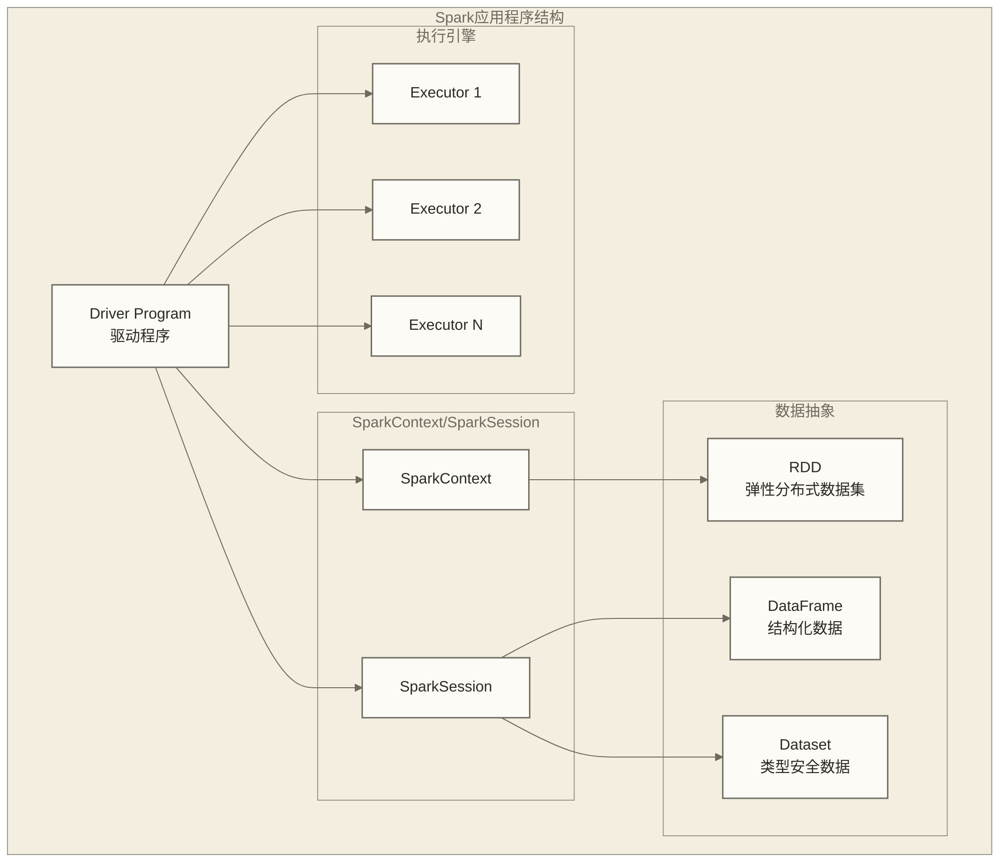

# 第一个Spark程序开发实战

## 概述

本指南将通过完整的示例代码，带你开发第一个Spark应用程序。我们将使用三种主要编程语言（Scala、Python、Java）来实现相同的功能，让你理解Spark程序的基本结构和开发模式。

## Spark程序基本结构

### 程序架构图



### 核心概念

| 概念 | 说明 | 作用 |
|------|------|------|
| Driver Program | 驱动程序 | 包含main函数，创建SparkContext |
| SparkContext | Spark上下文 | 连接集群的入口点 |
| SparkSession | Spark会话 | 统一的编程接口（Spark 2.0+） |
| RDD | 弹性分布式数据集 | Spark的基础数据抽象 |
| DataFrame | 结构化数据框 | 带Schema的分布式数据集 |

## 开发环境准备

### IDE配置

#### IntelliJ IDEA + Scala
```scala
// build.sbt
ThisBuild / version := "0.1.0-SNAPSHOT"
ThisBuild / scalaVersion := "2.12.15"

lazy val root = (project in file("."))
  .settings(
    name := "spark-first-app",
    libraryDependencies ++= Seq(
      "org.apache.spark" %% "spark-core" % "3.4.0",
      "org.apache.spark" %% "spark-sql" % "3.4.0",
      "org.apache.spark" %% "spark-mllib" % "3.4.0" % "provided"
    )
  )
```

#### VS Code + Python
```python
# requirements.txt
pyspark==3.4.0
findspark==2.0.1
jupyter==1.0.0
pandas==1.5.3
matplotlib==3.6.3
```

#### Eclipse + Java
```xml
<!-- pom.xml -->
<dependencies>
    <dependency>
        <groupId>org.apache.spark</groupId>
        <artifactId>spark-core_2.12</artifactId>
        <version>3.4.0</version>
    </dependency>
    <dependency>
        <groupId>org.apache.spark</groupId>
        <artifactId>spark-sql_2.12</artifactId>
        <version>3.4.0</version>
    </dependency>
</dependencies>
```

## 第一个程序：WordCount

### Scala版本

```scala
// WordCountApp.scala
import org.apache.spark.sql.SparkSession
import org.apache.spark.sql.functions._

object WordCountApp {
  def main(args: Array[String]): Unit = {
    // 创建SparkSession
    val spark = SparkSession.builder()
      .appName("WordCount Application")
      // 执行环境由spark-submit的--master指定；本地练习可使用--master 'local[*]'
      .config("spark.sql.adaptive.enabled", "true")
      .getOrCreate()
    
    import spark.implicits._
    
    try {
      // 设置日志级别
      spark.sparkContext.setLogLevel("WARN")
      
      println("=== Spark WordCount Application ===")
      
      // 方法1：使用RDD API
      wordCountWithRDD(spark)
      
      // 方法2：使用DataFrame API
      wordCountWithDataFrame(spark)
      
      // 方法3：使用SQL API
      wordCountWithSQL(spark)
      
    } finally {
      // 关闭SparkSession
      spark.stop()
    }
  }
  
  // 使用RDD实现WordCount
  def wordCountWithRDD(spark: SparkSession): Unit = {
    println("\n--- 使用RDD API ---")
    
    val sc = spark.sparkContext
    
    // 创建测试数据
    val textData = sc.parallelize(Seq(
      "Hello Spark World",
      "Spark is fast",
      "Spark is easy to use",
      "Big Data processing with Spark"
    ))
    
    // WordCount核心逻辑
    val wordCounts = textData
      .flatMap(_.split(" "))           // 分割单词
      .map(word => word.toLowerCase)    // 转小写
      .filter(_.nonEmpty)              // 过滤空字符串
      .map((_, 1))                     // 转换为(word, 1)
      .reduceByKey(_ + _)              // 按key聚合
      .sortBy(-_._2)                   // 按计数降序排列
    
    // 收集并打印结果
    val results = wordCounts.collect()
    results.foreach { case (word, count) =>
      println(f"$word%15s: $count%3d")
    }
    
    println(s"总词汇数: ${results.length}")
  }
  
  // 使用DataFrame实现WordCount
  def wordCountWithDataFrame(spark: SparkSession): Unit = {
    println("\n--- 使用DataFrame API ---")
    
    import spark.implicits._
    
    // 创建DataFrame
    val textDF = Seq(
      "Hello Spark World",
      "Spark is fast", 
      "Spark is easy to use",
      "Big Data processing with Spark"
    ).toDF("text")
    
    // 使用DataFrame操作
    val wordCountsDF = textDF
      .select(explode(split(lower(col("text")), " ")).alias("word"))
      .filter(col("word") =!= "")
      .groupBy("word")
      .count()
      .orderBy(desc("count"))
    
    wordCountsDF.show()
    println(s"使用DataFrame统计的总词汇数: ${wordCountsDF.count()}")
  }
  
  // 使用SQL实现WordCount
  def wordCountWithSQL(spark: SparkSession): Unit = {
    println("\n--- 使用SQL API ---")
    
    import spark.implicits._
    
    // 创建临时视图
    val textDF = Seq(
      "Hello Spark World",
      "Spark is fast",
      "Spark is easy to use", 
      "Big Data processing with Spark"
    ).toDF("text")
    
    textDF.createOrReplaceTempView("text_data")
    
    // 使用SQL查询
    val sqlQuery = """
      SELECT word, COUNT(*) as count
      FROM (
        SELECT LOWER(word) as word
        FROM (
          SELECT EXPLODE(SPLIT(text, ' ')) as word
          FROM text_data
        ) t
        WHERE word != ''
      ) word_table
      GROUP BY word
      ORDER BY count DESC
    """
    
    val resultDF = spark.sql(sqlQuery)
    resultDF.show()
    
    // 获取最常见的单词
    val mostCommon = resultDF.first()
    println(s"最常见的单词: '${mostCommon.getString(0)}' 出现 ${mostCommon.getLong(1)} 次")
  }
}
```

### Python版本

```python
# wordcount_app.py
from pyspark.sql import SparkSession
from pyspark.sql.functions import *
from pyspark.sql.types import *
import os

def create_spark_session():
    """创建SparkSession"""
    return SparkSession.builder \
        .appName("WordCount Application - Python") \
        .config("spark.sql.adaptive.enabled", "true") \
        .config("spark.sql.adaptive.coalescePartitions.enabled", "true") \
        .getOrCreate()

def word_count_with_rdd(spark):
    """使用RDD API实现WordCount"""
    print("\n--- 使用RDD API ---")
    
    sc = spark.sparkContext
    
    # 创建测试数据
    text_data = sc.parallelize([
        "Hello Spark World",
        "Spark is fast",
        "Spark is easy to use",
        "Big Data processing with Spark"
    ])
    
    # WordCount核心逻辑
    word_counts = text_data \
        .flatMap(lambda line: line.split(" ")) \
        .map(lambda word: word.lower()) \
        .filter(lambda word: word != "") \
        .map(lambda word: (word, 1)) \
        .reduceByKey(lambda a, b: a + b) \
        .sortBy(lambda x: -x[1])
    
    # 收集并打印结果
    results = word_counts.collect()
    for word, count in results:
        print(f"{word:>15}: {count:>3}")
    
    print(f"总词汇数: {len(results)}")

def word_count_with_dataframe(spark):
    """使用DataFrame API实现WordCount"""
    print("\n--- 使用DataFrame API ---")
    
    # 创建DataFrame
    text_data = [
        ("Hello Spark World",),
        ("Spark is fast",),
        ("Spark is easy to use",),
        ("Big Data processing with Spark",)
    ]
    
    schema = StructType([StructField("text", StringType(), True)])
    text_df = spark.createDataFrame(text_data, schema)
    
    # 使用DataFrame操作
    word_counts_df = text_df \
        .select(explode(split(lower(col("text")), " ")).alias("word")) \
        .filter(col("word") != "") \
        .groupBy("word") \
        .count() \
        .orderBy(desc("count"))
    
    word_counts_df.show()
    print(f"使用DataFrame统计的总词汇数: {word_counts_df.count()}")

def word_count_with_sql(spark):
    """使用SQL API实现WordCount"""
    print("\n--- 使用SQL API ---")
    
    # 创建DataFrame并注册为临时视图
    text_data = [
        ("Hello Spark World",),
        ("Spark is fast",),
        ("Spark is easy to use",),
        ("Big Data processing with Spark",)
    ]
    
    schema = StructType([StructField("text", StringType(), True)])
    text_df = spark.createDataFrame(text_data, schema)
    text_df.createOrReplaceTempView("text_data")
    
    # 使用SQL查询
    sql_query = """
        SELECT word, COUNT(*) as count
        FROM (
            SELECT LOWER(word) as word
            FROM (
                SELECT EXPLODE(SPLIT(text, ' ')) as word
                FROM text_data
            ) t
            WHERE word != ''
        ) word_table
        GROUP BY word
        ORDER BY count DESC
    """
    
    result_df = spark.sql(sql_query)
    result_df.show()
    
    # 获取最常见的单词
    most_common = result_df.first()
    print(f"最常见的单词: '{most_common['word']}' 出现 {most_common['count']} 次")

def analyze_performance(spark):
    """性能分析"""
    print("\n--- 性能分析 ---")
    
    # 生成大量测试数据
    import time
    import random
    
    words = ["spark", "hadoop", "python", "scala", "java", "data", "big", "analytics"]
    large_data = [" ".join(random.choices(words, k=10)) for _ in range(10000)]
    
    start_time = time.time()
    
    rdd = spark.sparkContext.parallelize(large_data)
    word_count = rdd \
        .flatMap(lambda line: line.split(" ")) \
        .map(lambda word: (word, 1)) \
        .reduceByKey(lambda a, b: a + b) \
        .count()
    
    end_time = time.time()
    
    print(f"处理10000行数据，耗时: {end_time - start_time:.2f} 秒")
    print(f"唯一词汇数: {word_count}")

def main():
    """主函数"""
    print("=== Spark WordCount Application - Python ===")
    
    # 创建SparkSession
    spark = create_spark_session()
    
    # 设置日志级别
    spark.sparkContext.setLogLevel("WARN")
    
    try:
        # 执行不同版本的WordCount
        word_count_with_rdd(spark)
        word_count_with_dataframe(spark)
        word_count_with_sql(spark)
        analyze_performance(spark)
        
        # 显示Spark配置信息
        print("\n--- Spark配置信息 ---")
        print(f"Spark版本: {spark.version}")
        print(f"应用名称: {spark.sparkContext.appName}")
        print(f"Master URL: {spark.sparkContext.master}")
        print(f"默认并行度: {spark.sparkContext.defaultParallelism}")
        
    finally:
        # 关闭SparkSession
        spark.stop()
        print("\nSpark应用程序执行完成！")

if __name__ == "__main__":
    main()
```

### Java版本

```java
// WordCountApp.java
package com.example.spark;

import org.apache.spark.api.java.JavaPairRDD;
import org.apache.spark.api.java.JavaRDD;
import org.apache.spark.api.java.JavaSparkContext;
import org.apache.spark.sql.Dataset;
import org.apache.spark.sql.Row;
import org.apache.spark.sql.SparkSession;
import scala.Tuple2;

import java.util.Arrays;
import java.util.List;

import static org.apache.spark.sql.functions.*;

public class WordCountApp {
    
    public static void main(String[] args) {
        System.out.println("=== Spark WordCount Application - Java ===");
        
        // 创建SparkSession
        SparkSession spark = SparkSession.builder()
                .appName("WordCount Application - Java")
                // 执行环境由spark-submit的--master指定
                .config("spark.sql.adaptive.enabled", "true")
                .getOrCreate();
        
        // 设置日志级别
        spark.sparkContext().setLogLevel("WARN");
        
        try {
            // 执行不同版本的WordCount
            wordCountWithRDD(spark);
            wordCountWithDataFrame(spark);
            wordCountWithSQL(spark);
            
        } finally {
            // 关闭SparkSession
            spark.stop();
            System.out.println("\nSpark应用程序执行完成！");
        }
    }
    
    /**
     * 使用RDD API实现WordCount
     */
    public static void wordCountWithRDD(SparkSession spark) {
        System.out.println("\n--- 使用RDD API ---");
        
        JavaSparkContext jsc = JavaSparkContext.fromSparkContext(spark.sparkContext());
        
        // 创建测试数据
        List<String> textData = Arrays.asList(
                "Hello Spark World",
                "Spark is fast",
                "Spark is easy to use",
                "Big Data processing with Spark"
        );
        
        JavaRDD<String> textRDD = jsc.parallelize(textData);
        
        // WordCount核心逻辑
        JavaPairRDD<String, Integer> wordCounts = textRDD
                .flatMap(line -> Arrays.asList(line.split(" ")).iterator())
                .map(String::toLowerCase)
                .filter(word -> !word.isEmpty())
                .mapToPair(word -> new Tuple2<>(word, 1))
                .reduceByKey(Integer::sum)
                .sortByKey();
        
        // 收集并打印结果
        List<Tuple2<String, Integer>> results = wordCounts.collect();
        results.forEach(tuple -> 
                System.out.printf("%15s: %3d%n", tuple._1(), tuple._2()));
        
        System.out.println("总词汇数: " + results.size());
    }
    
    /**
     * 使用DataFrame API实现WordCount
     */
    public static void wordCountWithDataFrame(SparkSession spark) {
        System.out.println("\n--- 使用DataFrame API ---");
        
        // 创建DataFrame
        List<String> textData = Arrays.asList(
                "Hello Spark World",
                "Spark is fast",
                "Spark is easy to use",
                "Big Data processing with Spark"
        );
        
        Dataset<Row> textDF = spark.createDataset(textData, 
                org.apache.spark.sql.Encoders.STRING()).toDF("text");
        
        // 使用DataFrame操作
        Dataset<Row> wordCountsDF = textDF
                .select(explode(split(lower(col("text")), " ")).alias("word"))
                .filter(col("word").notEqual(""))
                .groupBy("word")
                .count()
                .orderBy(desc("count"));
        
        wordCountsDF.show();
        System.out.println("使用DataFrame统计的总词汇数: " + wordCountsDF.count());
    }
    
    /**
     * 使用SQL API实现WordCount
     */
    public static void wordCountWithSQL(SparkSession spark) {
        System.out.println("\n--- 使用SQL API ---");
        
        // 创建DataFrame并注册为临时视图
        List<String> textData = Arrays.asList(
                "Hello Spark World",
                "Spark is fast",
                "Spark is easy to use",
                "Big Data processing with Spark"
        );
        
        Dataset<Row> textDF = spark.createDataset(textData, 
                org.apache.spark.sql.Encoders.STRING()).toDF("text");
        textDF.createOrReplaceTempView("text_data");
        
        // 使用SQL查询
        String sqlQuery = """
                SELECT word, COUNT(*) as count
                FROM (
                    SELECT LOWER(word) as word
                    FROM (
                        SELECT EXPLODE(SPLIT(text, ' ')) as word
                        FROM text_data
                    ) t
                    WHERE word != ''
                ) word_table
                GROUP BY word
                ORDER BY count DESC
                """;
        
        Dataset<Row> resultDF = spark.sql(sqlQuery);
        resultDF.show();
        
        // 获取最常见的单词
        Row mostCommon = resultDF.first();
        System.out.println("最常见的单词: '" + mostCommon.getString(0) + 
                "' 出现 " + mostCommon.getLong(1) + " 次");
    }
}
```

## 程序运行方式

### 1. 本地开发模式

```bash
# Scala版本
spark-submit \
  --class WordCountApp \
  --master local[4] \
  target/scala-2.12/spark-first-app_2.12-0.1.0-SNAPSHOT.jar

# Python版本
spark-submit \
  --master local[4] \
  wordcount_app.py

# Java版本
spark-submit \
  --class com.example.spark.WordCountApp \
  --master local[4] \
  target/spark-first-app-1.0-SNAPSHOT.jar
```

### 2. 集群提交模式

```bash
# 提交到YARN集群
spark-submit \
  --class WordCountApp \
  --master yarn \
  --deploy-mode cluster \
  --executor-memory 2g \
  --executor-cores 2 \
  --num-executors 4 \
  spark-first-app.jar

# 提交到Standalone集群
spark-submit \
  --class WordCountApp \
  --master spark://master:7077 \
  --deploy-mode cluster \
  --total-executor-cores 8 \
  --executor-memory 2g \
  spark-first-app.jar
```

### 3. 交互式开发

```bash
# Scala Shell
spark-shell --master local[4]

scala> :paste
// 粘贴代码片段
val textRDD = sc.parallelize(Array("Hello Spark", "Spark is great"))
val wordCounts = textRDD.flatMap(_.split(" ")).map((_, 1)).reduceByKey(_ + _)
wordCounts.collect()

# Python Shell
pyspark --master local[4]

>>> text_rdd = sc.parallelize(["Hello Spark", "Spark is great"])
>>> word_counts = text_rdd.flatMap(lambda x: x.split(" ")).map(lambda x: (x, 1)).reduceByKey(lambda x, y: x + y)
>>> word_counts.collect()
```

## 程序调试技巧

### 1. 日志配置

```scala
// 设置不同的日志级别
spark.sparkContext.setLogLevel("DEBUG")  // 详细调试信息
spark.sparkContext.setLogLevel("INFO")   // 一般信息
spark.sparkContext.setLogLevel("WARN")   // 警告信息
spark.sparkContext.setLogLevel("ERROR")  // 错误信息
```

### 2. 数据检查

```scala
// 检查数据分区情况
val rdd = spark.sparkContext.parallelize(data)
println(s"分区数: ${rdd.getNumPartitions}")
println(s"每个分区的数据量: ${rdd.glom().map(_.length).collect().mkString(", ")}")

// 采样数据
val sample = rdd.sample(false, 0.1).collect()
sample.foreach(println)
```

### 3. 性能监控

```python
# 监控执行时间
import time

start_time = time.time()

# 执行Spark操作
result = rdd.count()

end_time = time.time()
print(f"执行时间: {end_time - start_time:.2f} 秒")

# 查看执行计划
df.explain(True)
```

## 常见错误和解决方案

### 1. 序列化错误

```scala
// 错误示例
class MyClass {
  def process(rdd: RDD[String]): RDD[String] = {
    rdd.map(this.transform)  // 这会导致序列化错误
  }
  
  def transform(s: String): String = s.toUpperCase
}

// 正确做法
class MyClass extends Serializable {  // 实现Serializable接口
  def process(rdd: RDD[String]): RDD[String] = {
    rdd.map(transform)  // 或者使用静态方法
  }
  
  def transform(s: String): String = s.toUpperCase
}
```

### 2. 内存不足

```bash
# 增加驱动程序内存
spark-submit --driver-memory 4g --executor-memory 8g MyApp.jar

# 以下为Scala配置片段；客户端模式下，spark.driver.memory不能在应用代码中调整已启动Driver的堆大小，应使用启动参数。spark.executor.memory也应在创建SparkContext前配置。
val conf = new SparkConf()
  .set("spark.driver.memory", "4g")
  .set("spark.executor.memory", "8g")
```

### 3. 分区过多或过少

```scala
// 控制分区数
val rdd = spark.sparkContext.textFile("file.txt", 4)  // 指定4个分区

// 重新分区
val repartitioned = rdd.repartition(8)  // 增加分区
val coalesced = rdd.coalesce(2)         // 减少分区
```

## 性能优化建议

### 1. 数据本地性

```scala
// 缓存频繁使用的数据
val frequentlyUsedRDD = rdd.filter(...).cache()

// 使用persist指定存储级别
import org.apache.spark.storage.StorageLevel
rdd.persist(StorageLevel.MEMORY_AND_DISK_SER)
```

### 2. 避免Shuffle操作

```scala
// 不好的做法
val result = rdd.groupByKey().mapValues(_.sum)

// 更好的做法
val result = rdd.reduceByKey(_ + _)
```

### 3. 广播变量

```scala
// 使用广播变量避免重复传输大数据
val broadcastVar = spark.sparkContext.broadcast(largeMap)

val result = rdd.map { x =>
  val map = broadcastVar.value
  // 使用广播的数据
  map.get(x.key)
}
```

## 扩展练习

### 练习1：文件处理增强版

```python
def enhanced_word_count(spark, file_path):
    """增强版文件词频统计"""
    
    # 读取文件
    text_df = spark.read.text(file_path)
    
    # 复杂的文本处理
    result = text_df \
        .select(explode(split(lower(regexp_replace(col("value"), "[^a-zA-Z\\s]", "")), "\\s+")).alias("word")) \
        .filter(col("word") != "") \
        .filter(length(col("word")) > 2) \
        .groupBy("word") \
        .count() \
        .orderBy(desc("count"))
    
    return result

# 使用示例
result_df = enhanced_word_count(spark, "hdfs://path/to/large/text/file")
result_df.show(20)
```

### 练习2：实时数据处理

```scala
// 模拟流数据处理
import org.apache.spark.sql.streaming.Trigger

val streamingDF = spark
  .readStream
  .format("socket")
  .option("host", "localhost")
  .option("port", 9999)
  .load()

val wordCounts = streamingDF
  .select(explode(split(col("value"), " ")).alias("word"))
  .groupBy("word")
  .count()

val query = wordCounts
  .writeStream
  .outputMode("complete")
  .format("console")
  .trigger(Trigger.ProcessingTime("10 seconds"))
  .start()

query.awaitTermination()
```

## 相关链接

- [[【技术与工具】/Spark/05-Spark安装配置|Spark安装配置]]
- [[【技术与工具】/Spark/07-RDD编程基础|RDD]]
- [[【技术与工具】/Spark/08-DataFrame和Dataset|DataFrame和Dataset]]
- [[【技术与工具】/R/03-R基础语法|Scala/基础语法]]
- [[【技术与工具】/R/03-R基础语法|Python/基础语法]]

---

> [!tip] 学习建议
> 建议按照Scala → Python → Java的顺序学习，每种语言都要亲自运行代码，理解不同API的特点和使用场景。