# Spark数据读取与写入完全指南

## 概述

数据读取和写入是Spark应用程序的基础操作。Spark支持多种数据源和文件格式，提供了统一的DataFrameReader和DataFrameWriter API。本指南将深入介绍各种数据读写场景、性能优化技巧和最佳实践。

## 数据读取架构

### 数据源架构图

```mermaid
%%{init: {"theme":"base","themeVariables":{"fontFamily":"PingFang SC, -apple-system, Source Han Serif SC, serif","fontSize":"16px","background":"#FDFBF5","primaryColor":"#FDFBF5","primaryTextColor":"#2D2A26","primaryBorderColor":"#6E6A60","secondaryColor":"#E8EFE8","secondaryBorderColor":"#8FA890","secondaryTextColor":"#2D2A26","tertiaryColor":"#FDFBF5","tertiaryBorderColor":"#9A9488","tertiaryTextColor":"#6E6A60","lineColor":"#6E6A60","textColor":"#2D2A26","mainBkg":"#FDFBF5","nodeBorder":"#2D5A3D","clusterBkg":"#F3EEDF","clusterBorder":"#9A9488","edgeLabelBackground":"#FDFBF5"},"flowchart":{"htmlLabels":true,"curve":"basis","padding":20,"nodeSpacing":60,"rankSpacing":70,"useMaxWidth":false},"themeCSS":".node rect, .node polygon, .node circle { stroke-width: 1.5px; } .edgePath .path { stroke-width: 1.5px; } .cluster-label .nodeLabel, .cluster-label foreignObject { color: #2D2A26 !important; } .edgeLabel, .edgeLabel foreignObject { color: #2D2A26 !important; background-color: #FDFBF5; } .edgeLabel rect { fill: #FDFBF5; }"}}%%
graph TB
    classDef default fill:#FDFBF5,stroke:#6E6A60,color:#2D2A26,stroke-width:1.5px
    classDef startend fill:#2D2A26,stroke:#2D2A26,color:#FDFBF5,font-weight:bold
    classDef decision fill:#F6EAD8,stroke:#C08A1A,color:#2D2A26,font-weight:bold
    classDef hub fill:#3B5A80,stroke:#3B5A80,color:#FDFBF5,font-weight:bold
    classDef io fill:#E5EAF0,stroke:#3B5A80,color:#2D2A26
    classDef accent fill:#A6432C,stroke:#A6432C,color:#FDFBF5,font-weight:bold
    classDef storage fill:#F3EEDF,stroke:#9A9488,color:#2D2A26
    subgraph "Spark数据读取架构"
        Reader[DataFrameReader]
        
        subgraph "文件系统"
            HDFS[HDFS]
            S3[Amazon S3]
            GCS[Google Cloud Storage]
            Azure[Azure Blob Storage]
            Local[本地文件系统]
        end
        
        subgraph "文件格式"
            CSV[CSV]
            JSON[JSON] 
            Parquet[Parquet]
            ORC[ORC]
            Avro[Avro]
            Text[Text]
            XML[XML]
        end
        
        subgraph "数据库"
            MySQL[MySQL]
            PostgreSQL[PostgreSQL]
            Oracle[Oracle Database]
            MongoDB[MongoDB]
            Cassandra[Cassandra]
            HBase[HBase]
        end
        
        subgraph "流数据源"
            Kafka[Apache Kafka]
            Kinesis[AWS Kinesis]
            EventHub[Azure Event Hub]
            Socket[TCP Socket]
        end
        
        subgraph "大数据生态"
            Hive[Hive Tables]
            Delta[Delta Lake]
            Iceberg[Apache Iceberg]
            Elasticsearch[Elasticsearch]
        end
        
        Reader --> HDFS
        Reader --> S3
        Reader --> CSV
        Reader --> JSON
        Reader --> Parquet
        Reader --> MySQL
        Reader --> Kafka
        Reader --> Hive
        Reader --> Delta
    end
    class Reader,HDFS,S3,GCS,Azure,Local,CSV,JSON,Parquet,ORC,Avro,Text,XML,MySQL,PostgreSQL,Oracle,MongoDB,Cassandra,HBase,Kafka,Kinesis,EventHub,Socket,Hive,Delta,Iceberg,Elasticsearch default
```



## 文件格式读写

### CSV文件操作

```scala
import org.apache.spark.sql.{SparkSession, DataFrame}
import org.apache.spark.sql.types._
import org.apache.spark.sql.functions._

val spark = SparkSession.builder()
  .appName("Data IO Operations")
  .master("local[*]")
  .getOrCreate()

// 1. 读取CSV文件
val csvDF = spark.read
  .option("header", "true")           // 包含表头
  .option("inferSchema", "true")      // 自动推断数据类型
  .option("sep", ",")                 // 分隔符
  .option("quote", "\"")              // 引用字符
  .option("escape", "\\")             // 转义字符
  .option("nullValue", "NULL")        // 空值表示
  .option("dateFormat", "yyyy-MM-dd") // 日期格式
  .option("timestampFormat", "yyyy-MM-dd HH:mm:ss") // 时间戳格式
  .csv("path/to/file.csv")

// 2. 使用显式Schema读取CSV
val csvSchema = StructType(Array(
  StructField("id", IntegerType, nullable = false),
  StructField("name", StringType, nullable = true),
  StructField("age", IntegerType, nullable = true),
  StructField("salary", DoubleType, nullable = true),
  StructField("hire_date", DateType, nullable = true)
))

val csvWithSchemaDF = spark.read
  .schema(csvSchema)
  .option("header", "true")
  .option("dateFormat", "yyyy-MM-dd")
  .csv("employees.csv")

// 3. 读取多个CSV文件
val multiCsvDF = spark.read
  .option("header", "true")
  .option("inferSchema", "true")
  .csv("path/to/csv/files/*.csv")

// 4. 写入CSV文件
csvDF.write
  .mode("overwrite")                  // append, overwrite, ignore, error
  .option("header", "true")
  .option("sep", ",")
  .option("quote", "\"")
  .option("escape", "\\")
  .option("nullValue", "")
  .option("dateFormat", "yyyy-MM-dd")
  .option("timestampFormat", "yyyy-MM-dd HH:mm:ss")
  .csv("output/path")

// 5. 单文件输出
csvDF.coalesce(1).write
  .mode("overwrite")
  .option("header", "true")
  .csv("output/single_file")

// 6. 处理CSV中的复杂数据
val complexCsvDF = spark.read
  .option("header", "true")
  .option("multiline", "true")        // 支持多行记录
  .option("escape", "\"")
  .csv("complex_data.csv")

// 清理和转换数据
val cleanedDF = complexCsvDF
  .withColumn("name", trim(col("name")))
  .withColumn("age", col("age").cast(IntegerType))
  .filter(col("age").isNotNull && col("age") > 0)
```

### JSON文件操作

```scala
// 1. 读取JSON文件
val jsonDF = spark.read
  .option("multiLine", "true")        // 支持多行JSON
  .option("allowComments", "true")    // 允许注释
  .option("allowUnquotedFieldNames", "true") // 允许不带引号的字段名
  .option("dateFormat", "yyyy-MM-dd")
  .option("timestampFormat", "yyyy-MM-dd HH:mm:ss")
  .json("data.json")

// 2. 处理嵌套JSON
val nestedJsonDF = spark.read.json("nested_data.json")

// 展开嵌套结构
val flattenedDF = nestedJsonDF
  .select(
    col("id"),
    col("name"),
    col("address.street").alias("street"),
    col("address.city").alias("city"),
    col("address.zipcode").alias("zipcode"),
    explode(col("skills")).alias("skill")
  )

// 3. JSON字符串列处理
// 假设CSV表头包含id和json_column，且JSON字段按CSV规则转义。
val jsonStringDF = spark.read
  .option("header", "true")
  .csv("data_with_json_column.csv")

val parsedJsonDF = jsonStringDF
  .withColumn("parsed_json", 
    from_json(col("json_column"), 
      schema = StructType(Array(
        StructField("name", StringType, true),
        StructField("age", IntegerType, true)
      ))
    )
  )
  .select(
    col("id"),
    col("parsed_json.name").alias("name"),
    col("parsed_json.age").alias("age")
  )

// 4. 写入JSON
jsonDF.write
  .mode("overwrite")
  .option("dateFormat", "yyyy-MM-dd")
  .option("timestampFormat", "yyyy-MM-dd HH:mm:ss")
  .json("output/json")

// 5. 复杂JSON数据处理
case class Address(street: String, city: String, zipcode: String)
case class Person(id: Int, name: String, age: Int, address: Address, skills: Seq[String])

import spark.implicits._

val complexJsonData = Seq(
  Person(1, "Alice", 25, Address("123 Main St", "NYC", "10001"), Seq("Java", "Python")),
  Person(2, "Bob", 30, Address("456 Oak Ave", "LA", "90210"), Seq("Scala", "SQL"))
).toDF()

// 转换为JSON格式
val jsonOutput = complexJsonData
  .select(to_json(struct(col("*"))).alias("json_string"))

jsonOutput.write
  .mode("overwrite")
  .text("output/json_strings")
```

### Parquet文件操作

```scala
// 1. 读取Parquet文件
val parquetDF = spark.read
  .option("mergeSchema", "true")      // 合并Schema变更
  .parquet("data.parquet")

// 2. 读取分区Parquet文件
val partitionedParquetDF = spark.read
  .option("basePath", "partitioned_data")
  .parquet("partitioned_data/year=*/month=*")

// 查看分区信息
partitionedParquetDF.select("year", "month").distinct().show()

// 3. Schema演进处理
val schemaEvolutionDF = spark.read
  .option("mergeSchema", "true")
  .parquet("evolving_schema/")

// 4. 写入Parquet文件
parquetDF.write
  .mode("overwrite")
  .option("compression", "snappy")    // gzip, lzo, brotli, lz4, zstd
  .parquet("output/parquet")

// 5. 分区写入
parquetDF.write
  .mode("overwrite")
  .partitionBy("year", "month")
  .option("compression", "snappy")
  .parquet("output/partitioned_parquet")

// 6. 控制文件大小
parquetDF
  .repartition(10)  // 控制输出文件数量
  .write
  .mode("overwrite")
  .option("compression", "snappy")
  .parquet("output/sized_parquet")

// 7. Parquet性能优化
import org.apache.spark.sql.internal.SQLConf

// 启用列式向量化
spark.conf.set(SQLConf.PARQUET_VECTORIZED_READER_ENABLED.key, "true")

// 设置批处理大小
spark.conf.set(SQLConf.PARQUET_VECTORIZED_READER_BATCH_SIZE.key, "4096")

// 启用谓词下推
spark.conf.set(SQLConf.PARQUET_FILTER_PUSHDOWN_ENABLED.key, "true")

// 读取优化示例
val optimizedParquetDF = spark.read
  .option("pushDownPredicate", "true")
  .parquet("large_parquet_dataset")
  .filter(col("status") === "active")
  .select("id", "name", "amount")
```

### Avro文件操作

```scala
// 1. 读取Avro文件
val avroDF = spark.read
  .format("avro")
  .option("avroSchema", avroSchemaString) // 可选：指定Schema
  .load("data.avro")

// 2. 写入Avro文件
avroDF.write
  .mode("overwrite")
  .format("avro")
  .option("compression", "snappy")
  .save("output/avro")

// 3. Avro Schema注册中心集成
val schemaRegistryAvroDF = spark.read
  .format("avro")
  .option("avroSchema", getSchemaFromRegistry("user-schema"))
  .load("data.avro")

def getSchemaFromRegistry(schemaName: String): String = {
  // 从Schema Registry获取Schema的逻辑
  // 这里是示例代码
  """
  {
    "type": "record",
    "name": "User",
    "fields": [
      {"name": "id", "type": "int"},
      {"name": "name", "type": "string"},
      {"name": "email", "type": ["null", "string"], "default": null}
    ]
  }
  """
}
```

### ORC文件操作

```scala
// 1. 读取ORC文件
val orcDF = spark.read
  .option("mergeSchema", "true")
  .orc("data.orc")

// 2. 写入ORC文件
orcDF.write
  .mode("overwrite")
  .option("compression", "zlib")      // none, zlib, snappy, lzo, lz4, zstd
  .orc("output/orc")

// 3. 普通ORC文件读取（不提供事务表快照语义）
// 事务表读取需采用对应表格式或平台支持的读取方式。
val ordinaryOrcDF = spark.read
  .orc("path/to/orc_files")
```

## 数据库连接

### JDBC数据源

```scala
// 1. 基础JDBC连接
val jdbcDF = spark.read
  .format("jdbc")
  .option("url", "jdbc:mysql://localhost:3306/mydb")
  .option("dbtable", "employees")
  .option("user", "username")
  .option("password", "password")
  .option("driver", "com.mysql.cj.jdbc.Driver")
  .load()

// 2. 高级JDBC选项
val advancedJdbcDF = spark.read
  .format("jdbc")
  .option("url", "jdbc:postgresql://localhost:5432/analytics")
  .option("dbtable", "sales_data")
  .option("user", "analyst")
  .option("password", "password")
  .option("driver", "org.postgresql.Driver")
  // 性能优化选项
  .option("fetchsize", "1000")       // 批量获取大小
  .option("batchsize", "1000")       // 批量插入大小
  .option("numPartitions", "8")      // 并行度
  .option("partitionColumn", "id")   // 分区列
  .option("lowerBound", "1")         // 分区下界
  .option("upperBound", "1000000")   // 分区上界
  // PostgreSQL JDBC连接参数；此处不配置连接池
  .option("ssl", "false")
  .load()

// 3. 自定义SQL查询
val customQueryDF = spark.read
  .format("jdbc")
  .option("url", "jdbc:mysql://localhost:3306/ecommerce")
  .option("query", """
    SELECT 
      o.order_id,
      o.customer_id,
      o.order_date,
      SUM(oi.quantity * oi.price) as total_amount
    FROM orders o
    JOIN order_items oi ON o.order_id = oi.order_id
    WHERE o.order_date >= '2024-01-01'
    GROUP BY o.order_id, o.customer_id, o.order_date
  """)
  .option("user", "reader")
  .option("password", "password")
  .load()

// 4. 写入数据库
jdbcDF.write
  .mode("append")                    // append, overwrite, ignore, error
  .format("jdbc")
  .option("url", "jdbc:mysql://localhost:3306/warehouse")
  .option("dbtable", "processed_data")
  .option("user", "writer")
  .option("password", "password")
  .option("driver", "com.mysql.cj.jdbc.Driver")
  .option("batchsize", "1000")
  .option("truncate", "false")       // 覆盖模式下是否截断表
  .save()

// 5. 使用Properties传递JDBC连接参数（不实现连接池）
import java.util.Properties

val connectionProperties = new Properties()
connectionProperties.put("user", "username")
connectionProperties.put("password", "password")
connectionProperties.put("driver", "com.mysql.cj.jdbc.Driver")
connectionProperties.put("fetchsize", "1000")
connectionProperties.put("batchsize", "1000")

val pooledJdbcDF = spark.read
  .jdbc("jdbc:mysql://localhost:3306/mydb", "large_table", connectionProperties)

// 6. 分区读取大表
def readLargeTable(spark: SparkSession, tableName: String): DataFrame = {
  spark.read
    .format("jdbc")
    .option("url", "jdbc:mysql://localhost:3306/bigdata")
    .option("dbtable", s"(SELECT *, MOD(id, 10) as partition_key FROM $tableName) t")
    .option("user", "reader")
    .option("password", "password")
    .option("partitionColumn", "partition_key")
    .option("lowerBound", "0")
    .option("upperBound", "9")
    .option("numPartitions", "10")
    .load()
}

val largeTableDF = readLargeTable(spark, "transactions")
```

### NoSQL数据库

```scala
// 1. MongoDB连接
val mongoDF = spark.read
  .format("com.mongodb.spark.sql.DefaultSource")
  .option("uri", "mongodb://localhost:27017/mydb.mycollection")
  .option("partitioner", "MongoShardedPartitioner")
  .option("partitionerOptions.shardkey", "_id")
  .load()

// MongoDB聚合管道
val mongoAggDF = spark.read
  .format("mongo")
  .option("uri", "mongodb://localhost:27017/analytics.events")
  .option("pipeline", """[
    {"$match": {"event_date": {"$gte": {"$date": "2024-01-01"}}}},
    {"$group": {"_id": "$event_type", "count": {"$sum": 1}}}
  ]""")
  .load()

// 写入MongoDB
mongoDF.write
  .mode("append")
  .format("mongo")
  .option("uri", "mongodb://localhost:27017/warehouse.processed_events")
  .save()

// 2. Cassandra连接
import org.apache.spark.sql.cassandra._

val cassandraDF = spark.read
  .cassandraFormat("events", "analytics")
  .option("cluster", "cassandra-cluster")
  .option("confirm.truncate", "true")
  .load()

// Cassandra写入
cassandraDF.write
  .cassandraFormat("processed_events", "warehouse")
  .mode("append")
  .save()

// 3. HBase连接
val hbaseDF = spark.read
  .format("org.apache.spark.sql.execution.datasources.hbase")
  .option("catalog", s"""{
    "table":{"namespace":"default", "name":"user_profiles"},
    "rowkey":"key",
    "columns":{
      "rowkey":{"cf":"rowkey", "col":"key", "type":"string"},
      "name":{"cf":"personal", "col":"name", "type":"string"},
      "age":{"cf":"personal", "col":"age", "type":"int"}
    }
  }""")
  .load()
```

## 流数据处理

### Kafka集成

```scala
import org.apache.spark.sql.streaming.{StreamingQuery, Trigger}

// 1. 从Kafka读取流数据
val kafkaStreamDF = spark
  .readStream
  .format("kafka")
  .option("kafka.bootstrap.servers", "localhost:9092")
  .option("subscribe", "user-events,system-logs")
  .option("startingOffsets", "earliest")  // earliest, latest, 或指定offset
  .option("maxOffsetsPerTrigger", "1000") // 每个批次最大消息数
  .option("kafkaConsumer.pollTimeoutMs", "2000")
  .load()

// 2. 处理Kafka消息
val processedStreamDF = kafkaStreamDF
  .select(
    col("key").cast("string"),
    col("value").cast("string"),
    col("topic"),
    col("partition"),
    col("offset"),
    col("timestamp")
  )
  .withColumn("event_data", 
    from_json(col("value"), 
      StructType(Array(
        StructField("user_id", StringType, true),
        StructField("event_type", StringType, true),
        StructField("event_time", TimestampType, true),
        StructField("properties", MapType(StringType, StringType), true)
      ))
    )
  )
  .select(
    col("topic"),
    col("partition"),
    col("offset"),
    col("timestamp").alias("kafka_timestamp"),
    col("event_data.*")
  )

// 3. 流数据聚合
val streamAggDF = processedStreamDF
  .filter(col("event_type").isNotNull)
  .groupBy(
    window(col("event_time"), "1 minute", "30 seconds"),
    col("event_type")
  )
  .agg(
    count("*").alias("event_count"),
    approx_count_distinct("user_id").alias("approx_unique_users")
  )

// 4. 写入流数据到Kafka
val query = streamAggDF
  .select(
    to_json(struct(col("*"))).alias("value")
  )
  .writeStream
  .format("kafka")
  .option("kafka.bootstrap.servers", "localhost:9092")
  .option("topic", "aggregated-events")
  .option("checkpointLocation", "/tmp/kafka-checkpoint")
  .outputMode("update")
  .trigger(Trigger.ProcessingTime("30 seconds"))
  .start()

// 5. 多Topic处理
val multiTopicDF = spark
  .readStream
  .format("kafka")
  .option("kafka.bootstrap.servers", "localhost:9092")
  .option("subscribePattern", "events-.*")  // 正则表达式匹配Topic
  .load()

// 根据Topic路由处理
val routedStreamDF = multiTopicDF
  .withColumn("event_category",
    when(col("topic") === "events-user", "user_event")
    .when(col("topic") === "events-system", "system_event")
    .otherwise("unknown")
  )

query.awaitTermination()
```

### 文件流处理

```scala
// 1. 文件流监听
val fileStreamDF = spark
  .readStream
  .format("json")                     // csv, json, parquet, text
  .option("path", "/input/streaming")
  .option("maxFilesPerTrigger", "10") // 每个批次处理的最大文件数
  .option("latestFirst", "true")      // 优先处理最新文件
  .load()

// 2. Schema演进处理
val schemaLocation = "/schemas/events"
val fileStreamWithSchemaDF = spark
  .readStream
  .format("json")
  .option("path", "/input/events")
  .option("maxFilesPerTrigger", "5")
  .schema(eventSchema)  // 明确指定Schema
  .load()

// 3. 写入文件流
val fileOutput = fileStreamDF
  .writeStream
  .format("parquet")
  .option("path", "/output/processed")
  .option("checkpointLocation", "/checkpoints/file-stream")
  .partitionBy("year", "month", "day")
  .trigger(Trigger.ProcessingTime("1 minute"))
  .start()

// 4. 增量处理
val incrementalDF = spark
  .readStream
  .format("delta")                    // 使用Delta Lake进行增量处理
  .option("path", "/delta/source")
  .option("maxFilesPerTrigger", "100")
  .load()

fileOutput.awaitTermination()
```

## 高级数据源

### Delta Lake操作

```scala
// 1. 读取Delta表
val deltaDF = spark.read
  .format("delta")
  .load("/path/to/delta-table")

// 2. 时间旅行查询
val historicalDF = spark.read
  .format("delta")
  .option("timestampAsOf", "2024-01-01 00:00:00")
  .load("/path/to/delta-table")

val versionDF = spark.read
  .format("delta")
  .option("versionAsOf", 10)
  .load("/path/to/delta-table")

// 3. Delta表合并操作
import io.delta.tables._

val deltaTable = DeltaTable.forPath(spark, "/path/to/delta-table")

deltaTable.as("target")
  .merge(
    newDataDF.as("source"),
    "target.id = source.id"
  )
  .whenMatched()
  .updateAll()
  .whenNotMatched()
  .insertAll()
  .execute()

// 4. 写入Delta表
newDataDF.write
  .format("delta")
  .mode("overwrite")
  .option("overwriteSchema", "true")
  .partitionBy("date")
  .save("/path/to/new-delta-table")

// 5. Delta表维护
// 优化文件布局
deltaTable.optimize()
  .executeCompaction()

// Z-Order优化
deltaTable.optimize()
  .executeZOrderBy("customer_id", "order_date")

// 清理超过保留期且不再被当前表引用的数据文件
// 执行前确认长运行任务及历史读取不再需要这些文件；日志保留另有配置。
deltaTable.vacuum(168) // 数据文件保留阈值为168小时，不保证完整保留7天时间旅行能力
```

### Elasticsearch集成

```scala
// 1. 读取Elasticsearch数据
val esDF = spark.read
  .format("es")
  .option("es.nodes", "localhost")
  .option("es.port", "9200")
  .option("es.resource", "sales/orders")
  .option("es.query", """{"term": {"status": "completed"}}""")
  .option("es.read.metadata", "true")
  .load()

// 2. 写入Elasticsearch
esDF.write
  .format("es")
  .option("es.nodes", "localhost")
  .option("es.port", "9200")
  .option("es.resource", "analytics/processed-orders")
  .option("es.mapping.id", "order_id")
  .mode("append")
  .save()

// 3. Elasticsearch聚合查询
val esAggDF = spark.read
  .format("es")
  .option("es.resource", "logs/application")
  .option("es.query", """{
    "query": {"range": {"@timestamp": {"gte": "2024-01-01"}}},
    "aggs": {
      "error_types": {
        "terms": {"field": "level.keyword"}
      }
    }
  }""")
  .load()
```

## 性能优化策略

### 文件格式选择指南

```scala
object FileFormatOptimization {
  
  // 1. 根据用途选择格式
  def chooseFileFormat(useCase: String): String = useCase match {
    case "analytics_queries" => "parquet"    // 列式存储，查询友好
    case "archival_storage" => "parquet"     // 高压缩率
    case "streaming_ingestion" => "avro"     // Schema演进支持
    case "human_readable" => "json"          // 可读性好
    case "simple_export" => "csv"            // 通用性好
    case "transactional_data" => "delta"     // ACID事务支持
    case _ => "parquet"
  }
  
  // 2. 压缩算法选择
  def chooseCompression(priority: String): String = priority match {
    case "speed" => "lz4"                   // 快速压缩解压
    case "size" => "brotli"                 // 高压缩率
    case "balanced" => "snappy"             // 平衡选择
    case "cpu_intensive" => "gzip"          // 高CPU使用
    case _ => "snappy"
  }
  
  // 3. 文件大小优化
  def optimizeFileSize(df: DataFrame, targetSizeMB: Int = 128): DataFrame = {
    val currentPartitions = df.rdd.getNumPartitions
    require(targetSizeMB > 0, "targetSizeMB必须大于0")
    val estimatedSizeMB = estimateDataFrameSize(df).toDouble / 1024 / 1024
    val optimalPartitions = Math.max(1, Math.ceil(estimatedSizeMB / targetSizeMB).toInt)
    
    if (optimalPartitions < currentPartitions) {
      df.coalesce(optimalPartitions)
    } else {
      df.repartition(optimalPartitions)
    }
  }
  
  def estimateDataFrameSize(df: DataFrame): Long = {
    // 简化的大小估算逻辑
    val sampleDF = df.sample(0.01)
    val sampleSize = sampleDF.count()
    val totalSize = df.count()
    
    // 估算每行字节数
    val avgRowSize = estimateRowSize(df.schema)
    totalSize * avgRowSize
  }
  
  def estimateRowSize(schema: StructType): Long = {
    schema.fields.map { field =>
      field.dataType match {
        case IntegerType => 4
        case LongType => 8
        case DoubleType => 8
        case StringType => 50  // 假设平均字符串长度
        case TimestampType => 8
        case _ => 20  // 其他类型默认估算
      }
    }.sum
  }
}
```

### 分区策略优化

```scala
// 1. 时间分区策略
def createTimePartitions(df: DataFrame, dateColumn: String): DataFrame = {
  df.withColumn("year", year(col(dateColumn)))
    .withColumn("month", month(col(dateColumn)))
    .withColumn("day", dayofmonth(col(dateColumn)))
}

val timePartitionedDF = createTimePartitions(salesDF, "order_date")

timePartitionedDF.write
  .mode("overwrite")
  .partitionBy("year", "month")
  .parquet("partitioned_sales")

// 2. 哈希分区策略
def createHashPartitions(df: DataFrame, columns: Seq[String], numPartitions: Int): DataFrame = {
  val hashColumn = columns.map(col).reduce((c1, c2) => 
    hash(c1, c2)
  ) % numPartitions
  
  df.withColumn("hash_partition", when(hashColumn < 0, hashColumn + numPartitions).otherwise(hashColumn))
}

// 3. 动态分区裁剪
spark.conf.set("spark.sql.optimizer.dynamicPartitionPruning.enabled", "true")

val efficientJoin = spark.sql("""
SELECT s.*, c.customer_name
FROM partitioned_sales s
JOIN customers c ON s.customer_id = c.id
WHERE c.registration_date > '2023-01-01'
""")

// 4. 分区数量控制
def controlPartitionCount(df: DataFrame, maxPartitions: Int = 200): DataFrame = {
  val currentPartitions = df.rdd.getNumPartitions
  if (currentPartitions > maxPartitions) {
    df.coalesce(maxPartitions)
  } else {
    df
  }
}
```

### 读写性能调优

```scala
// 1. 并行度优化
val optimizedRead = spark.read
  .option("multiline", "false")
  .option("maxCharsPerColumn", "1000000")
  .option("maxColumns", "20000")
  .option("mode", "FAILFAST")  // PERMISSIVE, DROPMALFORMED, FAILFAST
  .option("columnNameOfCorruptRecord", "_corrupt_record")
  .csv("large_dataset.csv")

// 2. 预读优化
spark.conf.set("spark.sql.adaptive.enabled", "true")
spark.conf.set("spark.sql.adaptive.coalescePartitions.enabled", "true")
spark.conf.set("spark.sql.adaptive.skewJoin.enabled", "true")

// 3. 缓存策略
val frequentlyAccessedDF = expensiveDF.cache()
val result1 = frequentlyAccessedDF.count()
val result2 = frequentlyAccessedDF.groupBy("category").count().collect()

// 使用完后清理缓存
frequentlyAccessedDF.unpersist()

// 4. 写入优化
def optimizedWrite(df: DataFrame, outputPath: String, format: String): Unit = {
  val optimizedDF = df
    .repartition(spark.conf.get("spark.sql.shuffle.partitions").toInt / 4)
    .sortWithinPartitions("sort_column")  // 如果有排序需求
  
  optimizedDF.write
    .mode("overwrite")
    .option("compression", FileFormatOptimization.chooseCompression("balanced"))
    .format(format)
    .save(outputPath)
}

// 5. 内存管理优化
spark.conf.set("spark.sql.adaptive.advisoryPartitionSizeInBytes", "134217728") // 128MB
spark.conf.set("spark.sql.adaptive.coalescePartitions.minPartitionNum", "1")
spark.conf.set("spark.sql.adaptive.coalescePartitions.parallelismFirst", "true")
```

## 实战案例

### ETL管道构建

```scala
// 构建完整的ETL管道
class DataPipeline(spark: SparkSession) {
  
  // 1. 数据提取阶段
  def extractData(): Map[String, DataFrame] = {
    Map(
      "sales" -> spark.read
        .option("header", "true")
        .option("inferSchema", "true")
        .csv("raw_data/sales/*.csv"),
      
      "customers" -> spark.read
        .format("jdbc")
        .option("url", "jdbc:mysql://localhost:3306/crm")
        .option("dbtable", "customers")
        .option("user", "reader")
        .option("password", "password")
        .load(),
      
      "products" -> spark.read
        .json("raw_data/products.json")
    )
  }
  
  // 2. 数据转换阶段
  def transformData(rawData: Map[String, DataFrame]): DataFrame = {
    val salesDF = rawData("sales")
    val customersDF = rawData("customers")
    val productsDF = rawData("products")
    
    // 数据清洗
    val cleanedSalesDF = salesDF
      .filter(col("amount") > 0)
      .filter(col("quantity") > 0)
      .withColumn("sale_date", to_date(col("sale_date"), "yyyy-MM-dd"))
      .dropDuplicates("order_id")
    
    val cleanedCustomersDF = customersDF
      .filter(col("email").rlike("^[a-zA-Z0-9._%+-]+@[a-zA-Z0-9.-]+\\.[a-zA-Z]{2,}$"))
      .withColumn("full_name", concat_ws(" ", col("first_name"), col("last_name")))
    
    // 数据关联
    val enrichedSalesDF = cleanedSalesDF
      .join(cleanedCustomersDF, "customer_id")
      .join(productsDF, "product_id")
      .select(
        col("order_id"),
        col("customer_id"),
        col("full_name").alias("customer_name"),
        col("product_id"),
        col("product_name"),
        col("category"),
        col("amount"),
        col("quantity"),
        col("sale_date"),
        (col("amount") * col("quantity")).alias("total_revenue")
      )
    
    // 聚合计算
    enrichedSalesDF
      .withColumn("year", year(col("sale_date")))
      .withColumn("month", month(col("sale_date")))
  }
  
  // 3. 数据加载阶段
  def loadData(transformedDF: DataFrame): Unit = {
    // 写入数据仓库
    transformedDF.write
      .mode("overwrite")
      .partitionBy("year", "month")
      .option("compression", "snappy")
      .parquet("warehouse/sales_fact")
    
    // 写入分析数据库
    val aggregatedDF = transformedDF
      .groupBy("year", "month", "category")
      .agg(
        sum("total_revenue").alias("monthly_revenue"),
        count("*").alias("order_count"),
        countDistinct("customer_id").alias("unique_customers")
      )
    
    aggregatedDF.write
      .mode("overwrite")
      .format("jdbc")
      .option("url", "jdbc:postgresql://localhost:5432/analytics")
      .option("dbtable", "monthly_sales_summary")
      .option("user", "writer")
      .option("password", "password")
      .save()
  }
  
  // 4. 运行完整管道
  def runPipeline(): Unit = {
    try {
      val rawData = extractData()
      val transformedData = transformData(rawData)
      loadData(transformedData)
      
      println("ETL pipeline completed successfully")
    } catch {
      case e: Exception =>
        println(s"ETL pipeline failed: ${e.getMessage}")
        throw e
    }
  }
}

// 使用管道
val pipeline = new DataPipeline(spark)
pipeline.runPipeline()
```

## 最佳实践总结

### 数据读写清单

```scala
object DataIOBestPractices {
  
  // 1. 文件格式选择准则
  val formatGuidelines = Map(
    "large_analytical_datasets" -> "parquet",
    "streaming_data" -> "avro",
    "transactional_data" -> "delta",
    "archival_storage" -> "parquet_with_high_compression",
    "data_exchange" -> "json_or_csv"
  )
  
  // 2. 性能优化检查清单
  def performanceChecklist(): List[String] = List(
    "✓ 选择合适的文件格式",
    "✓ 使用适当的压缩算法",
    "✓ 控制文件大小（100MB-1GB）",
    "✓ 合理设计分区策略",
    "✓ 启用列剪枝和谓词下推",
    "✓ 配置适当的并行度",
    "✓ 使用缓存策略",
    "✓ 监控资源使用情况"
  )
  
  // 3. 错误处理模式
  def handleDataQualityIssues(df: DataFrame): DataFrame = {
    df.filter(col("_corrupt_record").isNull)  // 过滤损坏记录
      .drop("_corrupt_record")                // 删除错误列
      .dropDuplicates()                       // 去重
      .na.fill(Map(                          // 填充空值
        "string_column" -> "unknown",
        "numeric_column" -> 0
      ))
  }
}
```

## 相关链接

- [[【技术与工具】/Spark/09-Spark SQL基础|Spark SQL]]
- [[【技术与工具】/Spark/11-Spark性能调优|Spark性能调优]]
- [[【技术与工具】/Hadoop/03-HDFS分布式文件系统|Hadoop/HDFS分布式文件系统]]
- Kafka/Kafka连接器

---

> [!tip] 学习建议
> 数据读写是Spark应用的基础，建议根据实际数据特点选择合适的文件格式和存储策略，重点掌握性能优化技巧。