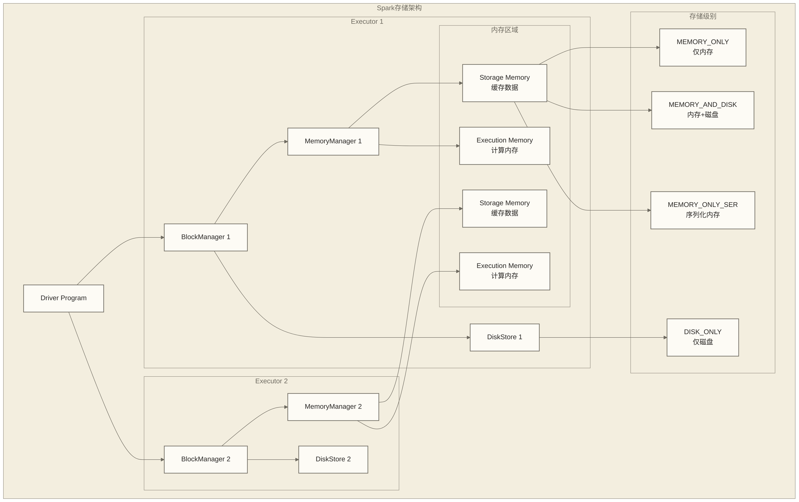

# Spark缓存与持久化策略详解

## 概述

缓存和持久化是Spark性能优化的核心技术之一。通过将频繁访问的数据存储在内存中，可以显著减少重复计算，提高应用程序的执行效率。本指南将深入探讨Spark的缓存机制、存储级别选择和最佳实践。

## 缓存机制原理

### Spark存储架构



### 内存管理机制

```scala
import org.apache.spark.sql.{DataFrame, SparkSession}
import org.apache.spark.storage.StorageLevel
import org.apache.spark.sql.functions._

// 1. 内存管理配置
val spark = SparkSession.builder()
  .appName("Caching and Persistence")
  .master("local[*]")
  // 统一内存管理配置
  .config("spark.memory.useLegacyMode", "false")  // 使用统一内存管理
  .config("spark.memory.storageFraction", "0.5")  // 存储内存占比
  .config("spark.memory.fraction", "0.6")         // Spark内存占堆内存比例
  // 序列化配置
  .config("spark.serializer", "org.apache.spark.serializer.KryoSerializer")
  .config("spark.kryoserializer.buffer.max", "256m")
  .getOrCreate()

// 2. 内存使用监控
class MemoryUsageMonitor(spark: SparkSession) {
  
  def getMemoryUsage(): Map[String, Any] = {
    val sc = spark.sparkContext
    val statusTracker = sc.statusTracker
    val executorInfos = statusTracker.getExecutorInfos()
    
    val totalMemory = executorInfos.map(_.maxMemory).sum
    val usedMemory = executorInfos.map(_.memoryUsed).sum
    val diskUsed = executorInfos.map(_.diskUsed).sum
    
    Map(
      "total_memory_gb" -> (totalMemory / 1024 / 1024 / 1024.0),
      "used_memory_gb" -> (usedMemory / 1024 / 1024 / 1024.0),
      "memory_utilization_pct" -> (usedMemory.toDouble / totalMemory * 100),
      "disk_used_gb" -> (diskUsed / 1024 / 1024 / 1024.0),
      "executor_count" -> executorInfos.length
    )
  }
  
  def printMemoryStatus(): Unit = {
    val usage = getMemoryUsage()
    println("=== Memory Usage Status ===")
    println(f"Total Memory: ${usage("total_memory_gb")}%.2f GB")
    println(f"Used Memory: ${usage("used_memory_gb")}%.2f GB")
    println(f"Memory Utilization: ${usage("memory_utilization_pct")}%.1f%%")
    println(f"Disk Used: ${usage("disk_used_gb")}%.2f GB")
    println(f"Executor Count: ${usage("executor_count")}")
  }
}

val memoryMonitor = new MemoryUsageMonitor(spark)
```

## 存储级别详解

### 存储级别对比

```scala
// 1. 所有存储级别对比
object StorageLevelAnalysis {
  
  import org.apache.spark.storage.StorageLevel
  
  val storageLevels = Map(
    "NONE" -> StorageLevel.NONE,
    "DISK_ONLY" -> StorageLevel.DISK_ONLY,
    "DISK_ONLY_2" -> StorageLevel.DISK_ONLY_2,
    "MEMORY_ONLY" -> StorageLevel.MEMORY_ONLY,
    "MEMORY_ONLY_2" -> StorageLevel.MEMORY_ONLY_2,
    "MEMORY_ONLY_SER" -> StorageLevel.MEMORY_ONLY_SER,
    "MEMORY_ONLY_SER_2" -> StorageLevel.MEMORY_ONLY_SER_2,
    "MEMORY_AND_DISK" -> StorageLevel.MEMORY_AND_DISK,
    "MEMORY_AND_DISK_2" -> StorageLevel.MEMORY_AND_DISK_2,
    "MEMORY_AND_DISK_SER" -> StorageLevel.MEMORY_AND_DISK_SER,
    "MEMORY_AND_DISK_SER_2" -> StorageLevel.MEMORY_AND_DISK_SER_2,
    "OFF_HEAP" -> StorageLevel.OFF_HEAP
  )
  
  def analyzeStorageLevel(level: StorageLevel): Map[String, Any] = {
    Map(
      "use_disk" -> level.useDisk,
      "use_memory" -> level.useMemory,
      "use_off_heap" -> level.useOffHeap,
      "deserialized" -> level.deserialized,
      "replication" -> level.replication,
      "memory_footprint" -> (if (level.deserialized) "高" else "低"),
      "cpu_overhead" -> (if (level.deserialized) "低" else "高"),
      "gc_pressure" -> (if (level.deserialized) "高" else "低")
    )
  }
  
  def printStorageLevelComparison(): Unit = {
    println("=== Storage Level Comparison ===")
    storageLevels.foreach { case (name, level) =>
      val analysis = analyzeStorageLevel(level)
      println(s"\n$name:")
      analysis.foreach { case (key, value) =>
        println(s"  $key: $value")
      }
    }
  }
}

StorageLevelAnalysis.printStorageLevelComparison()
```

### 存储级别选择策略

```scala
// 2. 智能存储级别选择器
class StorageLevelSelector {
  
  def selectOptimalStorageLevel(
    dataCharacteristics: DataCharacteristics,
    usagePattern: UsagePattern,
    resourceConstraints: ResourceConstraints
  ): StorageLevel = {
    
    import StorageLevel._
    
    (dataCharacteristics, usagePattern, resourceConstraints) match {
      // 小数据集，频繁访问，内存充足
      case (DataCharacteristics(size, _) , UsagePattern(freq, _), ResourceConstraints(mem, false)) 
        if size < 1024 * 1024 * 100 && freq > 5 && mem > 0.5 =>
        MEMORY_ONLY
      
      // 中等数据集，频繁访问，内存适中
      case (DataCharacteristics(size, _), UsagePattern(freq, _), ResourceConstraints(mem, false))
        if size < 1024 * 1024 * 500 && freq > 3 && mem > 0.3 =>
        MEMORY_AND_DISK
      
      // 大数据集，内存受限
      case (DataCharacteristics(size, _), UsagePattern(freq, _), ResourceConstraints(mem, true))
        if size > 1024 * 1024 * 500 && mem < 0.3 =>
        MEMORY_AND_DISK_SER
      
      // 高容错要求
      case (_, UsagePattern(_, true), _) =>
        MEMORY_AND_DISK_2
      
      // CPU密集型应用，内存充足
      case (DataCharacteristics(_, true), UsagePattern(freq, _), ResourceConstraints(mem, _))
        if freq > 2 && mem > 0.4 =>
        MEMORY_ONLY
      
      // CPU密集型应用，内存受限
      case (DataCharacteristics(_, true), UsagePattern(freq, _), ResourceConstraints(mem, _))
        if freq > 2 && mem < 0.4 =>
        MEMORY_ONLY_SER
      
      // 默认选择
      case _ => MEMORY_AND_DISK
    }
  }
  
  case class DataCharacteristics(sizeBytes: Long, computeIntensive: Boolean)
  case class UsagePattern(accessFrequency: Int, requireHighAvailability: Boolean)  
  case class ResourceConstraints(memoryAvailability: Double, memoryPressure: Boolean)
}

// 使用示例
val selector = new StorageLevelSelector()
import selector._
val optimalLevel = selector.selectOptimalStorageLevel(
  DataCharacteristics(sizeBytes = 1024 * 1024 * 200, computeIntensive = false),
  UsagePattern(accessFrequency = 4, requireHighAvailability = false),
  ResourceConstraints(memoryAvailability = 0.6, memoryPressure = false)
)

println(s"Recommended storage level: $optimalLevel")
```

## 缓存策略实践

### DataFrame/Dataset缓存

```scala
// 1. DataFrame缓存基础操作
val employeesDF = spark.read
  .option("header", "true")
  .option("inferSchema", "true")
  .csv("employees.csv")

// 基础缓存操作
val cachedEmployeesDF = employeesDF.cache()  // 等价于 persist(StorageLevel.MEMORY_AND_DISK)

// 显式指定存储级别
val persistedEmployeesDF = employeesDF.persist(StorageLevel.MEMORY_ONLY)

// 2. 缓存验证和监控
def verifyCaching(df: DataFrame, name: String): Unit = {
  println(s"=== Caching verification for $name ===")
  
  // 触发缓存
  val startTime = System.currentTimeMillis()
  val count1 = df.count()
  val firstAccessTime = System.currentTimeMillis() - startTime
  
  // 第二次访问（是否更快需实测，缓存不保证加速）
  val startTime2 = System.currentTimeMillis()
  val count2 = df.count()
  val secondAccessTime = System.currentTimeMillis() - startTime2
  
  println(s"Record count: $count1")
  println(s"First access time: ${firstAccessTime}ms")
  println(s"Second access time: ${secondAccessTime}ms")
  println(f"Performance improvement: ${(firstAccessTime.toDouble / secondAccessTime - 1) * 100}%.1f%%")
  
  // 检查存储级别
  println(s"Storage level: ${df.storageLevel}")
  println(s"Is cached: ${df.storageLevel != StorageLevel.NONE}")
}

verifyCaching(cachedEmployeesDF, "CachedEmployees")

// 3. 条件缓存策略
def conditionalCaching(df: DataFrame, threshold: Long = 1000000): DataFrame = {
  val rowCount = df.count()
  
  if (rowCount > threshold) {
    println(s"Large dataset ($rowCount rows), applying caching")
    df.persist(StorageLevel.MEMORY_AND_DISK_SER)
  } else {
    println(s"Small dataset ($rowCount rows), caching in memory only")
    df.persist(StorageLevel.MEMORY_ONLY)
  }
}

val smartCachedDF = conditionalCaching(employeesDF)
```

### RDD缓存操作

```scala
// 1. RDD缓存示例
val numbersRDD = spark.sparkContext.parallelize(1 to 1000000)

// 创建复杂的RDD转换链
val expensiveRDD = numbersRDD
  .filter(_ % 2 == 0)
  .map(x => (x, x.toLong * x.toLong, Math.sqrt(x)))
  .filter(_._2 > 1000)

// 缓存策略
val cachedRDD = expensiveRDD.cache()

// 验证RDD缓存效果
def benchmarkRDDCaching(rdd: org.apache.spark.rdd.RDD[_], name: String, iterations: Int = 3): Unit = {
  println(s"=== RDD Caching Benchmark: $name ===")
  
  val times = (1 to iterations).map { i =>
    val start = System.currentTimeMillis()
    val count = rdd.count()
    val duration = System.currentTimeMillis() - start
    println(s"Iteration $i: ${duration}ms (count: $count)")
    duration
  }
  
  val avgTime = times.sum / times.length.toDouble
  val improvement = if (times.length > 1) (times.head.toDouble / times.last - 1) * 100 else 0
  
  println(f"Average time: ${avgTime}%.1fms")
  println(f"Performance improvement: ${improvement}%.1f%%")
}

benchmarkRDDCaching(cachedRDD, "ExpensiveRDD")

// 2. RDD分区缓存优化
val partitionedRDD = numbersRDD
  .repartition(8)  // 优化分区数
  .mapPartitions { partition =>
    // 分区级别的计算优化
    val data = partition.toArray
    data.map(x => (x, expensiveCalculation(x))).iterator
  }
  .persist(StorageLevel.MEMORY_AND_DISK_SER)

def expensiveCalculation(x: Int): Double = {
  Thread.sleep(1)  // 模拟复杂计算
  Math.pow(x, 2) + Math.sqrt(x)
}

benchmarkRDDCaching(partitionedRDD, "PartitionedRDD")
```

### 广播变量优化

```scala
// 1. 广播变量缓存
val lookupMap = Map(
  "A" -> "Alpha", "B" -> "Beta", "C" -> "Gamma"
  // ... 更多映射数据
)

val broadcastLookup = spark.sparkContext.broadcast(lookupMap)

val dataDF = spark.range(1000000).select(
  col("id"),
  when(col("id") % 3 === 0, lit("A"))
    .when(col("id") % 3 === 1, lit("B"))
    .otherwise(lit("C")).alias("category_code")
)

// 使用广播变量进行Join替代
import spark.implicits._
val enrichedDF = dataDF.map { row =>
  val categoryCode = row.getString(1)
  val categoryName = broadcastLookup.value.getOrElse(categoryCode, "Unknown")
  (row.getLong(0), categoryCode, categoryName)
}.toDF("id", "category_code", "category_name")

// 2. 广播变量生命周期管理
class BroadcastManager(spark: SparkSession) {
  private var broadcasts = scala.collection.mutable.Map[String, org.apache.spark.broadcast.Broadcast[_]]()
  
  def broadcastData[T: scala.reflect.ClassTag](name: String, data: T): org.apache.spark.broadcast.Broadcast[T] = {
    val broadcast = spark.sparkContext.broadcast(data)
    broadcasts(name) = broadcast
    println(s"Broadcasted $name (size: ${estimateSize(data)} bytes)")
    broadcast
  }
  
  def destroyBroadcast(name: String): Unit = {
    broadcasts.get(name) match {
      case Some(broadcast) =>
        broadcast.destroy()
        broadcasts.remove(name)
        println(s"Destroyed broadcast variable: $name")
      case None =>
        println(s"Broadcast variable not found: $name")
    }
  }
  
  def listBroadcasts(): Unit = {
    println("=== Active Broadcast Variables ===")
    broadcasts.keys.foreach(println)
  }
  
  def cleanup(): Unit = {
    broadcasts.keys.foreach(destroyBroadcast)
  }
  
  private def estimateSize(data: Any): Long = {
    // 简化的大小估算
    data match {
      case map: Map[_, _] => map.size * 100L  // 假设每个entry 100字节
      case arr: Array[_] => arr.length * 50L
      case _ => 1000L
    }
  }
}

val broadcastManager = new BroadcastManager(spark)
val managedBroadcast = broadcastManager.broadcastData("lookup_map", lookupMap)
```

## 高级缓存技巧

### 多级缓存策略

```scala
// 1. 多级缓存实现
class MultiLevelCache(spark: SparkSession) {
  
  private case class CacheEntry(
    df: DataFrame,
    level: StorageLevel,
    lastAccess: Long,
    accessCount: Int,
    sizeEstimate: Long
  )
  
  private var cache = scala.collection.mutable.Map[String, CacheEntry]()
  private val maxCacheSize = 5 * 1024 * 1024 * 1024L  // 5GB
  private var currentCacheSize = 0L
  
  def cache(key: String, df: DataFrame, priority: CachePriority = MEDIUM): DataFrame = {
    val storageLevel = selectStorageLevel(priority, df)
    val sizeEstimate = estimateDataFrameSize(df)
    
    // 检查缓存空间
    ensureCacheSpace(sizeEstimate)
    
    val cachedDF = df.persist(storageLevel)
    cache(key) = CacheEntry(cachedDF, storageLevel, System.currentTimeMillis(), 0, sizeEstimate)
    currentCacheSize += sizeEstimate
    
    println(s"Cached $key with $storageLevel (estimated size: ${sizeEstimate / 1024 / 1024}MB)")
    cachedDF
  }
  
  def get(key: String): Option[DataFrame] = {
    cache.get(key).map { entry =>
      // 更新访问统计
      cache(key) = entry.copy(
        lastAccess = System.currentTimeMillis(),
        accessCount = entry.accessCount + 1
      )
      entry.df
    }
  }
  
  def evict(key: String): Unit = {
    cache.get(key).foreach { entry =>
      entry.df.unpersist()
      cache.remove(key)
      currentCacheSize -= entry.sizeEstimate
      println(s"Evicted $key from cache")
    }
  }
  
  private def ensureCacheSpace(requiredSize: Long): Unit = {
    while (currentCacheSize + requiredSize > maxCacheSize && cache.nonEmpty) {
      // LRU eviction strategy
      val lruKey = cache.minBy(_._2.lastAccess)._1
      evict(lruKey)
    }
  }
  
  private def selectStorageLevel(priority: CachePriority, df: DataFrame): StorageLevel = {
    priority match {
      case HIGH => StorageLevel.MEMORY_ONLY_2
      case MEDIUM => StorageLevel.MEMORY_AND_DISK
      case LOW => StorageLevel.MEMORY_AND_DISK_SER
    }
  }
  
  private def estimateDataFrameSize(df: DataFrame): Long = {
    // 简化估算 - 实际应用中需要更精确的方法
    try {
      val rowCount = df.count()
      rowCount * 100L  // 假设每行100字节估算全量大小，不代表真实缓存占用
    } catch {
      case _: Exception => 1024 * 1024L  // 默认1MB
    }
  }
  
  def getStats(): Map[String, Any] = {
    Map(
      "cache_entries" -> cache.size,
      "total_size_mb" -> currentCacheSize / 1024 / 1024,
      "utilization_pct" -> (currentCacheSize.toDouble / maxCacheSize * 100),
      "entries" -> cache.keys.toSeq
    )
  }
}

sealed trait CachePriority
case object HIGH extends CachePriority
case object MEDIUM extends CachePriority  
case object LOW extends CachePriority

// 使用多级缓存
val multiCache = new MultiLevelCache(spark)

val salesDF = spark.read.parquet("sales.parquet")
val customerDF = spark.read.parquet("customers.parquet")

val cachedSales = multiCache.cache("sales", salesDF, HIGH)
val cachedCustomers = multiCache.cache("customers", customerDF, MEDIUM)

println(multiCache.getStats())
```

### 动态缓存管理

```scala
// 2. 动态缓存管理器
class DynamicCacheManager(spark: SparkSession) {
  
  private val memoryMonitor = new MemoryUsageMonitor(spark)
  private val cache = scala.collection.mutable.Map[String, (DataFrame, StorageLevel, Long)]()
  
  def adaptiveCaching(key: String, df: DataFrame): DataFrame = {
    val memoryUsage = memoryMonitor.getMemoryUsage()
    val memoryUtilization = memoryUsage("memory_utilization_pct").asInstanceOf[Double]
    
    val storageLevel = memoryUtilization match {
      case util if util < 50 => StorageLevel.MEMORY_ONLY
      case util if util < 70 => StorageLevel.MEMORY_AND_DISK
      case util if util < 85 => StorageLevel.MEMORY_AND_DISK_SER
      case _ => StorageLevel.DISK_ONLY
    }
    
    println(s"Memory utilization: $memoryUtilization%, using $storageLevel")
    
    val cachedDF = df.persist(storageLevel)
    cache(key) = (cachedDF, storageLevel, System.currentTimeMillis())
    
    cachedDF
  }
  
  def rebalanceCache(): Unit = {
    val currentMemoryUsage = memoryMonitor.getMemoryUsage()
    val memoryUtilization = currentMemoryUsage("memory_utilization_pct").asInstanceOf[Double]
    
    if (memoryUtilization > 90) {
      println("High memory pressure detected, rebalancing cache...")
      
      cache.foreach { case (key, (df, currentLevel, _)) =>
        val newLevel = currentLevel match {
          case StorageLevel.MEMORY_ONLY => StorageLevel.MEMORY_AND_DISK_SER
          case StorageLevel.MEMORY_AND_DISK => StorageLevel.MEMORY_AND_DISK_SER
          case other => other
        }
        
        if (newLevel != currentLevel) {
          df.unpersist()
          val rebalancedDF = df.persist(newLevel)
          cache(key) = (rebalancedDF, newLevel, System.currentTimeMillis())
          println(s"Rebalanced $key from $currentLevel to $newLevel")
        }
      }
    }
  }
  
  def scheduleRebalancing(): Unit = {
    // 模拟定期重平衡
    import java.util.concurrent.{Executors, TimeUnit}
    
    val scheduler = Executors.newScheduledThreadPool(1)
    scheduler.scheduleAtFixedRate(
      new Runnable { def run(): Unit = rebalanceCache() },
      0, 30, TimeUnit.SECONDS
    )
  }
}

val dynamicManager = new DynamicCacheManager(spark)
val adaptiveCachedDF = dynamicManager.adaptiveCaching("adaptive_sales", salesDF)
```

## 性能分析和优化

### 缓存效果分析

```scala
// 1. 缓存性能分析器
class CachePerformanceAnalyzer(spark: SparkSession) {
  
  case class PerformanceMetrics(
    uncachedTime: Long,
    cachedTime: Long,
    improvement: Double,
    memoryUsed: Long,
    hitRatio: Double
  )
  
  def analyzeCachePerformance(df: DataFrame, operations: DataFrame => Any): PerformanceMetrics = {
    // 未缓存性能测试
    val uncachedStart = System.currentTimeMillis()
    operations(df)
    val uncachedTime = System.currentTimeMillis() - uncachedStart
    
    // 缓存性能测试
    val cachedDF = df.cache()
    
    // 预热缓存
    cachedDF.count()
    
    val cachedStart = System.currentTimeMillis()
    operations(cachedDF)
    val cachedTime = System.currentTimeMillis() - cachedStart
    
    // 计算性能提升
    val improvement = (uncachedTime.toDouble - cachedTime) / uncachedTime * 100
    
    // 内存使用情况
    val memoryUsage = new MemoryUsageMonitor(spark).getMemoryUsage()
    val memoryUsed = memoryUsage("used_memory_gb").asInstanceOf[Double] * 1024 * 1024 * 1024
    
    cachedDF.unpersist()
    
    PerformanceMetrics(
      uncachedTime = uncachedTime,
      cachedTime = cachedTime,
      improvement = improvement,
      memoryUsed = memoryUsed.toLong,
      hitRatio = Double.NaN  // 尚未测量命中率；95.0只能作为假设示例，不能作为实测结果
    )
  }
  
  def benchmarkStorageLevels(df: DataFrame): Map[StorageLevel, PerformanceMetrics] = {
    val levels = Seq(
      StorageLevel.MEMORY_ONLY,
      StorageLevel.MEMORY_AND_DISK,
      StorageLevel.MEMORY_ONLY_SER,
      StorageLevel.MEMORY_AND_DISK_SER
    )
    
    levels.map { level =>
      println(s"Testing storage level: $level")
      
      val testDF = df.persist(level)
      val metrics = analyzeCachePerformance(testDF, _.count())
      testDF.unpersist()
      
      level -> metrics
    }.toMap
  }
}

val analyzer = new CachePerformanceAnalyzer(spark)

// 分析不同操作的缓存效果
val testOperations: DataFrame => Any = { df =>
  df.filter(col("salary") > 50000).groupBy("department").count().collect()
}

val performanceMetrics = analyzer.analyzeCachePerformance(employeesDF, testOperations)

println(s"=== Cache Performance Analysis ===")
println(s"Uncached time: ${performanceMetrics.uncachedTime}ms")
println(s"Cached time: ${performanceMetrics.cachedTime}ms")  
println(f"Performance improvement: ${performanceMetrics.improvement}%.1f%%")
println(f"Memory used: ${performanceMetrics.memoryUsed / 1024 / 1024}%.1f MB")
```

### 内存泄漏检测

```scala
// 2. 内存泄漏检测器
class MemoryLeakDetector(spark: SparkSession) {
  
  private var snapshots = scala.collection.mutable.ArrayBuffer[MemorySnapshot]()
  
  case class MemorySnapshot(
    timestamp: Long,
    usedMemory: Long,
    cachedTables: Set[String],
    executorCount: Int
  )
  
  def takeSnapshot(): MemorySnapshot = {
    val usage = new MemoryUsageMonitor(spark).getMemoryUsage()
    val cachedTables = spark.catalog.listTables()
      .filter(_.isTemporary)
      .select("name")
      .collect()
      .map(_.getString(0))
      .toSet
    
    val snapshot = MemorySnapshot(
      timestamp = System.currentTimeMillis(),
      usedMemory = (usage("used_memory_gb").asInstanceOf[Double] * 1024 * 1024 * 1024).toLong,
      cachedTables = cachedTables,
      executorCount = usage("executor_count").asInstanceOf[Int]
    )
    
    snapshots += snapshot
    snapshot
  }
  
  def detectLeaks(): Seq[String] = {
    if (snapshots.length < 3) {
      return Seq("Insufficient snapshots for leak detection")
    }
    
    val recent = snapshots.takeRight(3)
    val memoryTrend = recent.map(_.usedMemory)
    
    val warnings = scala.collection.mutable.ArrayBuffer[String]()
    
    // 检查内存持续增长
    if (memoryTrend.sliding(2).forall { case Seq(prev, curr) => curr > prev * 1.1 }) {
      warnings += "Memory usage shows consistent growth pattern"
    }
    
    // 检查缓存表数量增长
    val tableTrend = recent.map(_.cachedTables.size)
    if (tableTrend.sliding(2).forall { case Seq(prev, curr) => curr > prev }) {
      warnings += "Number of cached tables is increasing"
    }
    
    // 检查孤儿缓存
    val allCachedTables = recent.flatMap(_.cachedTables).toSet
    val recentTables = recent.last.cachedTables
    val potentialOrphans = allCachedTables -- recentTables
    
    if (potentialOrphans.nonEmpty) {
      warnings += s"Potential orphaned caches detected: ${potentialOrphans.mkString(", ")}"
    }
    
    warnings.toSeq
  }
  
  def generateReport(): String = {
    if (snapshots.isEmpty) return "No snapshots available"
    
    val latest = snapshots.last
    val oldest = snapshots.head
    
    val memoryGrowth = latest.usedMemory - oldest.usedMemory
    val timeSpan = latest.timestamp - oldest.timestamp
    
    s"""
       |=== Memory Leak Detection Report ===
       |Time span: ${timeSpan / 1000}s
       |Memory growth: ${memoryGrowth / 1024 / 1024}MB
       |Current cached tables: ${latest.cachedTables.size}
       |Warnings: ${detectLeaks().mkString("; ")}
       |""".stripMargin
  }
}

val leakDetector = new MemoryLeakDetector(spark)

// 模拟一些操作来检测内存使用
leakDetector.takeSnapshot()
val tempDF1 = employeesDF.cache()
tempDF1.count()

Thread.sleep(1000)
leakDetector.takeSnapshot()

val tempDF2 = employeesDF.filter(col("age") > 30).cache()
tempDF2.count()

Thread.sleep(1000)  
leakDetector.takeSnapshot()

println(leakDetector.generateReport())
```

## 最佳实践指南

### 缓存决策框架

```scala
// 1. 智能缓存决策器
class CacheDecisionEngine {
  
  case class DatasetProfile(
    size: Long,
    complexity: Int,
    accessPattern: String,
    computeCost: Int
  )
  
  def shouldCache(profile: DatasetProfile): (Boolean, StorageLevel, String) = {
    val DatasetProfile(size, complexity, accessPattern, computeCost) = profile
    
    val sizeMB = size / 1024 / 1024
    
    // 决策逻辑
    (sizeMB, complexity, accessPattern, computeCost) match {
      
      // 小数据集，频繁访问
      case (s, _, "frequent", _) if s < 100 =>
        (true, StorageLevel.MEMORY_ONLY, "Small dataset with frequent access")
      
      // 中等数据集，复杂计算
      case (s, c, _, cost) if s < 1000 && c > 5 && cost > 7 =>
        (true, StorageLevel.MEMORY_AND_DISK, "Medium dataset with expensive computation")
      
      // 大数据集，但访问频繁
      case (s, _, "frequent", _) if s > 1000 =>
        (true, StorageLevel.MEMORY_AND_DISK_SER, "Large dataset with frequent access")
      
      // 复杂ETL管道中间结果
      case (_, c, "pipeline", cost) if c > 8 && cost > 8 =>
        (true, StorageLevel.MEMORY_AND_DISK, "Complex ETL pipeline intermediate result")
      
      // 临时分析，偶尔访问
      case (s, _, "occasional", _) if s < 500 =>
        (true, StorageLevel.MEMORY_AND_DISK_SER, "Temporary analysis with occasional access")
      
      // 不建议缓存的情况
      case (s, c, "single", _) if s > 2000 || c < 3 =>
        (false, StorageLevel.NONE, "Single access or simple computation on large dataset")
      
      // 默认情况
      case _ =>
        (false, StorageLevel.NONE, "No clear benefit from caching")
    }
  }
  
  def analyzeDataset(df: DataFrame): DatasetProfile = {
    val size = estimateDataFrameSize(df)
    val complexity = calculateComplexity(df)
    
    DatasetProfile(
      size = size,
      complexity = complexity,
      accessPattern = "unknown", // 需要运行时分析
      computeCost = complexity * 2  // 简化计算
    )
  }
  
  private def estimateDataFrameSize(df: DataFrame): Long = {
    try {
      val rowCount = df.count()
      rowCount * 200L  // 假设每行200字节估算全量大小，不代表真实缓存占用
    } catch {
      case _: Exception => 1024 * 1024L
    }
  }
  
  private def calculateComplexity(df: DataFrame): Int = {
    val planString = df.queryExecution.optimizedPlan.toString
    
    // 基于查询计划计算复杂度
    var complexity = 0
    if (planString.contains("Join")) complexity += 3
    if (planString.contains("Aggregate")) complexity += 2  
    if (planString.contains("Sort")) complexity += 2
    if (planString.contains("Window")) complexity += 4
    if (planString.contains("Union")) complexity += 1
    
    math.max(1, complexity)
  }
}

// 使用缓存决策引擎
val decisionEngine = new CacheDecisionEngine()

val complexDF = employeesDF
  .join(spark.read.parquet("departments.parquet"), "dept_id")
  .groupBy("department")
  .agg(avg("salary").alias("avg_salary"))
  .orderBy(desc("avg_salary"))

val profile = decisionEngine.analyzeDataset(complexDF)
val (shouldCache, level, reason) = decisionEngine.shouldCache(profile)

println(s"Cache decision: $shouldCache")
println(s"Recommended level: $level")
println(s"Reason: $reason")

if (shouldCache) {
  complexDF.persist(level)
}
```

### 缓存生命周期管理

```scala
// 2. 缓存清理器框架示例：目前仅清理登记元数据，未实际释放Spark缓存
class AutoCacheCleaner(spark: SparkSession) {
  
  private case class CacheMetadata(
    name: String,
    creationTime: Long,
    lastAccessTime: Long,
    accessCount: Int,
    size: Long,
    ttl: Long  // Time to live in milliseconds
  )
  
  private var cacheRegistry = scala.collection.mutable.Map[String, CacheMetadata]()
  
  def registerCache(name: String, df: DataFrame, ttlMinutes: Int = 60): DataFrame = {
    val now = System.currentTimeMillis()
    val size = estimateSize(df)
    
    cacheRegistry(name) = CacheMetadata(
      name = name,
      creationTime = now,
      lastAccessTime = now,
      accessCount = 0,
      size = size,
      ttl = ttlMinutes * 60 * 1000L
    )
    
    df.cache()
  }
  
  def accessCache(name: String): Unit = {
    cacheRegistry.get(name).foreach { metadata =>
      cacheRegistry(name) = metadata.copy(
        lastAccessTime = System.currentTimeMillis(),
        accessCount = metadata.accessCount + 1
      )
    }
  }
  
  def cleanupExpiredCaches(): Int = {
    val now = System.currentTimeMillis()
    var cleanedCount = 0
    
    val expiredCaches = cacheRegistry.filter { case (_, metadata) =>
      (now - metadata.lastAccessTime) > metadata.ttl
    }
    
    expiredCaches.foreach { case (name, metadata) =>
      // 这里应该调用实际的unpersist操作
      println(s"Cleaning up expired cache: $name (last accessed ${(now - metadata.lastAccessTime) / 1000}s ago)")
      cacheRegistry.remove(name)
      cleanedCount += 1
    }
    
    cleanedCount
  }
  
  def cleanupLRU(maxCaches: Int): Int = {
    if (cacheRegistry.size <= maxCaches) return 0
    
    val sortedByAccess = cacheRegistry.toSeq.sortBy(_._2.lastAccessTime)
    val toRemove = sortedByAccess.take(cacheRegistry.size - maxCaches)
    
    toRemove.foreach { case (name, _) =>
      println(s"Removing LRU cache: $name")
      cacheRegistry.remove(name)
    }
    
    toRemove.length
  }
  
  def getStatistics(): Map[String, Any] = {
    val now = System.currentTimeMillis()
    val totalSize = cacheRegistry.values.map(_.size).sum
    val activeCount = cacheRegistry.size
    val avgAge = if (activeCount > 0) {
      cacheRegistry.values.map(m => now - m.creationTime).sum / activeCount / 1000
    } else 0L
    
    Map(
      "active_caches" -> activeCount,
      "total_size_mb" -> totalSize / 1024 / 1024,
      "average_age_seconds" -> avgAge,
      "cache_names" -> cacheRegistry.keys.toSeq
    )
  }
  
  private def estimateSize(df: DataFrame): Long = {
    1024 * 1024L  // 简化估算：1MB
  }
  
  // 启动定期清理任务
  def startAutoCleaning(intervalMinutes: Int = 10): Unit = {
    import java.util.concurrent.{Executors, TimeUnit}
    
    val scheduler = Executors.newScheduledThreadPool(1)
    scheduler.scheduleAtFixedRate(
      new Runnable {
        def run(): Unit = {
          val expired = cleanupExpiredCaches()
          val lru = cleanupLRU(maxCaches = 10)
          if (expired + lru > 0) {
            println(s"Auto cleanup: removed $expired expired + $lru LRU caches")
          }
        }
      },
      intervalMinutes, intervalMinutes, TimeUnit.MINUTES
    )
  }
}

val cleaner = new AutoCacheCleaner(spark)

// 注册缓存
val managedCache1 = cleaner.registerCache("sales_summary", salesDF, ttlMinutes = 30)
val managedCache2 = cleaner.registerCache("customer_analysis", employeesDF, ttlMinutes = 60)

// 启动自动清理
cleaner.startAutoCleaning(intervalMinutes = 5)

println(cleaner.getStatistics())
```

## 监控和诊断工具

### 缓存监控仪表板

```scala
// 3. 缓存监控仪表板
class CacheMonitoringDashboard(spark: SparkSession) {
  
  def generateCacheReport(): String = {
    val sc = spark.sparkContext
    val report = new StringBuilder()
    
    report.append("=== Spark Cache Monitoring Dashboard ===\n\n")
    
    // 1. 总体内存使用情况
    val memoryUsage = new MemoryUsageMonitor(spark).getMemoryUsage()
    report.append("Memory Usage:\n")
    report.append(f"  Total Memory: ${memoryUsage("total_memory_gb")}%.2f GB\n")
    report.append(f"  Used Memory: ${memoryUsage("used_memory_gb")}%.2f GB\n")
    report.append(f"  Memory Utilization: ${memoryUsage("memory_utilization_pct")}%.1f%%\n")
    report.append(f"  Disk Used: ${memoryUsage("disk_used_gb")}%.2f GB\n\n")
    
    // 2. 缓存表统计
    val cachedTables = spark.catalog.listTables().collect()
    report.append(s"Cached Tables: ${cachedTables.length}\n")
    
    cachedTables.foreach { table =>
      report.append(s"  - ${table.name} (${table.database})\n")
    }
    report.append("\n")
    
    // 3. RDD缓存统计
    val rddInfos = sc.statusTracker.getExecutorInfos()
    report.append("RDD Cache Information:\n")
    
    rddInfos.foreach { executor =>
      val memUsedMB = executor.memoryUsed / 1024 / 1024
      val maxMemMB = executor.maxMemory / 1024 / 1024
      val diskUsedMB = executor.diskUsed / 1024 / 1024
      
      report.append(s"  Executor ${executor.executorId}:\n")
      report.append(s"    Memory: ${memUsedMB}MB / ${maxMemMB}MB\n")
      report.append(s"    Disk: ${diskUsedMB}MB\n")
    }
    
    report.toString()
  }
  
  def exportMetrics(): Map[String, Any] = {
    val memoryUsage = new MemoryUsageMonitor(spark).getMemoryUsage()
    val cachedTablesCount = spark.catalog.listTables().count()
    
    Map(
      "timestamp" -> System.currentTimeMillis(),
      "memory_usage_gb" -> memoryUsage("used_memory_gb"),
      "memory_utilization_pct" -> memoryUsage("memory_utilization_pct"),
      "cached_tables_count" -> cachedTablesCount,
      "executor_count" -> memoryUsage("executor_count")
    )
  }
  
  def checkCacheHealth(): Seq[String] = {
    val warnings = scala.collection.mutable.ArrayBuffer[String]()
    val memoryUsage = new MemoryUsageMonitor(spark).getMemoryUsage()
    
    val memoryUtilization = memoryUsage("memory_utilization_pct").asInstanceOf[Double]
    
    if (memoryUtilization > 95) {
      warnings += "CRITICAL: Memory utilization > 95%"
    } else if (memoryUtilization > 85) {
      warnings += "WARNING: Memory utilization > 85%"
    }
    
    val diskUsage = memoryUsage("disk_used_gb").asInstanceOf[Double]
    if (diskUsage > 10) {
      warnings += s"INFO: Significant disk usage detected: ${diskUsage}GB"
    }
    
    warnings.toSeq
  }
}

val dashboard = new CacheMonitoringDashboard(spark)
println(dashboard.generateCacheReport())

val healthChecks = dashboard.checkCacheHealth()
if (healthChecks.nonEmpty) {
  println("\n=== Health Warnings ===")
  healthChecks.foreach(println)
}
```

## 性能优化总结

### 缓存最佳实践清单

```scala
object CachingBestPractices {
  
  val bestPractices = List(
    "✓ 只缓存会被多次访问的数据",
    "✓ 选择合适的存储级别",
    "✓ 监控内存使用情况",
    "✓ 及时清理不再使用的缓存",
    "✓ 考虑数据大小和计算复杂度",
    "✓ 使用检查点处理复杂的血缘关系",
    "✓ 优化分区以提高缓存效率",
    "✓ 定期进行性能测试和调优"
  )
  
  val commonMistakes = List(
    "❌ 缓存只访问一次的数据",
    "❌ 过度使用MEMORY_ONLY级别",
    "❌ 忘记清理不再使用的缓存",
    "❌ 在内存不足时继续使用内存缓存",
    "❌ 缓存过大的数据集",
    "❌ 不监控缓存效果",
    "❌ 盲目缓存所有中间结果"
  )
  
  def printGuidelines(): Unit = {
    println("=== Caching Best Practices ===")
    bestPractices.foreach(println)
    
    println("\n=== Common Mistakes to Avoid ===")
    commonMistakes.foreach(println)
  }
  
  def getCacheDecisionTree(): String = {
    """
    |Cache Decision Tree:
    |
    |1. Will the data be accessed more than once?
    |   No  → Don't cache
    |   Yes → Continue to 2
    |
    |2. Is the computation expensive (> 1 second)?
    |   No  → Consider not caching
    |   Yes → Continue to 3
    |
    |3. How large is the dataset?
    |   < 100MB     → MEMORY_ONLY
    |   100MB - 1GB → MEMORY_AND_DISK
    |   > 1GB       → MEMORY_AND_DISK_SER or DISK_ONLY
    |
    |4. Is reducing recomputation after executor loss important?
    |   Yes → Consider replication (*_2 levels), accounting for storage and transfer costs
    |   No  → Use standard levels
    |
    |5. Is memory under pressure?
    |   Yes → Use serialized levels (*_SER)
    |   No  → Use deserialized levels
    """.stripMargin
  }
}

CachingBestPractices.printGuidelines()
println(CachingBestPractices.getCacheDecisionTree())
```

## 相关链接

- [[【技术与工具】/Spark/11-Spark性能调优|Spark性能调优]]
- [[【技术与工具】/Spark/13-分区调优|分区调优]]
- [[【技术与工具】/Spark/07-RDD编程基础|RDD]]
- [[【技术与工具】/Spark/19-性能监控与调优|性能监控与调优]]

---

> [!tip] 缓存策略建议
> 缓存是提升Spark性能的重要手段，但需要根据数据特点和使用模式合理选择。建议建立监控体系，定期评估缓存效果并及时调整策略。