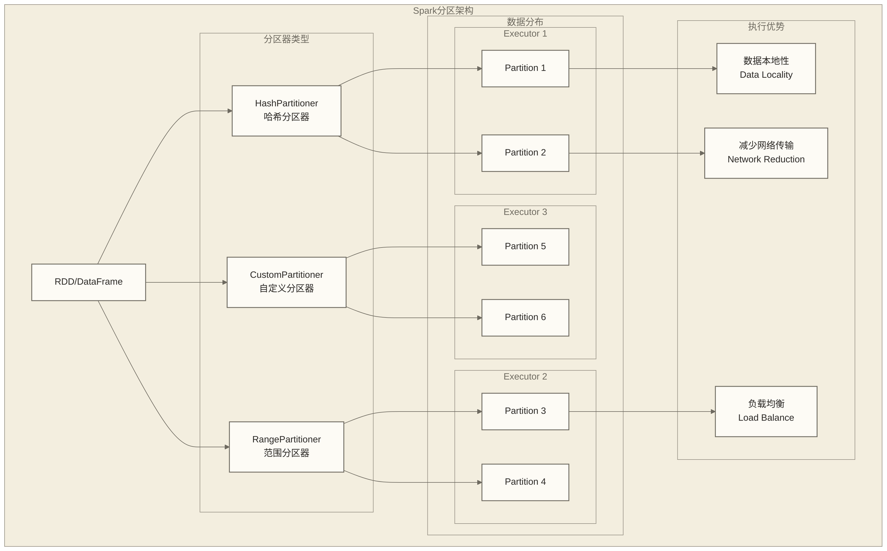

# Spark分区调优深度指南

## 概述

分区是Spark中最关键的性能优化概念之一。合理的分区策略能够显著提升作业执行效率，减少Shuffle开销，实现更好的数据本地性。本指南将深入探讨Spark分区的原理、策略和最佳实践。

## 分区机制原理

### Spark分区架构



### 分区的重要性

```scala
import org.apache.spark.sql.SparkSession
import org.apache.spark.sql.functions._
import org.apache.spark.HashPartitioner
import org.apache.spark.RangePartitioner

val spark = SparkSession.builder()
  .appName("Partition Optimization")
  .master("local[*]")
  .config("spark.sql.adaptive.enabled", "true")
  .config("spark.sql.adaptive.coalescePartitions.enabled", "true")
  .getOrCreate()

import spark.implicits._

// 1. 分区对性能的影响演示
object PartitionImpactDemo {
  
  def demonstratePartitionImpact(spark: SparkSession): Unit = {
    val largeDataset = spark.range(10000000).toDF("id")
      .withColumn("category", (col("id") % 100).cast("string"))
      .withColumn("value", rand() * 1000)
    
    println("=== 分区对性能的影响 ===")
    
    // 测试不同分区数量的性能
    val partitionCounts = Seq(1, 10, 50, 200, 1000)
    
    partitionCounts.foreach { partitions =>
      val repartitionedDF = largeDataset.repartition(partitions)
      
      val startTime = System.currentTimeMillis()
      val result = repartitionedDF
        .groupBy("category")
        .agg(sum("value").alias("total_value"))
        .count()
      val duration = System.currentTimeMillis() - startTime
      
      println(f"分区数: $partitions%4d, 执行时间: ${duration}%5dms, 结果: $result")
    }
  }
  
  def analyzePartitionDistribution(df: org.apache.spark.sql.DataFrame): Unit = {
    println("\n=== 分区分布分析 ===")
    
    val partitionSizes = df.rdd.mapPartitions { partition =>
      Iterator(partition.size)
    }.collect()
    
    println(s"总分区数: ${partitionSizes.length}")
    println(s"分区大小分布: ${partitionSizes.mkString(", ")}")
    println(f"平均分区大小: ${partitionSizes.sum.toDouble / partitionSizes.length}%.1f")
    println(s"最大分区大小: ${partitionSizes.max}")
    println(s"最小分区大小: ${partitionSizes.min}")
    
    // 检测数据倾斜
    val maxSize = partitionSizes.max
    val avgSize = partitionSizes.sum.toDouble / partitionSizes.length
    val skewRatio = maxSize / avgSize
    
    if (skewRatio > 3) {
      println(f"⚠️  检测到数据倾斜! 倾斜比: $skewRatio%.2f")
    } else {
      println(f"✅ 数据分布较为均匀, 倾斜比: $skewRatio%.2f")
    }
  }
}
```

## 分区器详解

### HashPartitioner原理与应用

```scala
// 1. HashPartitioner实现和应用
object HashPartitionerAnalysis {
  
  // 自定义HashPartitioner演示
  class CustomHashPartitioner(partitions: Int) extends org.apache.spark.Partitioner {
    
    def numPartitions: Int = partitions
    
    def getPartition(key: Any): Int = {
      val code = key.hashCode()
      val partition = Math.floorMod(code, numPartitions)
      partition
    }
    
    override def equals(other: Any): Boolean = other match {
      case p: CustomHashPartitioner => p.numPartitions == numPartitions
      case _ => false
    }
    
    override def hashCode(): Int = numPartitions
  }
  
  def demonstrateHashPartitioning(spark: SparkSession): Unit = {
    println("=== HashPartitioner演示 ===")
    
    val data = (1 to 1000).map(i => (s"key_${i % 10}", i))
    val rdd = spark.sparkContext.parallelize(data)
    
    // 使用HashPartitioner
    val hashPartitioned = rdd.partitionBy(new HashPartitioner(4))
    
    // 分析分区分布
    val partitionDistribution = hashPartitioned.glom().collect()
      .zipWithIndex
      .map { case (partition, index) =>
        val keyDistribution = partition.groupBy(_._1).mapValues(_.length)
        (index, partition.length, keyDistribution)
      }
    
    partitionDistribution.foreach { case (partitionId, size, keyDist) =>
      println(s"分区 $partitionId: 大小=$size, 键分布=$keyDist")
    }
  }
  
  // 哈希分区的优缺点分析
  def analyzeHashPartitioningEfficiency(spark: SparkSession): Unit = {
    val salesData = Seq(
      ("2024-01", "ProductA", 100),
      ("2024-01", "ProductB", 150), 
      ("2024-02", "ProductA", 200),
      ("2024-02", "ProductB", 180),
      ("2024-03", "ProductA", 120),
      ("2024-03", "ProductB", 90)
    ).toDF("month", "product", "sales")
    
    // 按月份进行哈希分区
    val hashPartitionedByMonth = salesData.rdd
      .map(row => (row.getString(0), row))  // 以month作为key
      .partitionBy(new HashPartitioner(3))
      .cache()
    
    println("\n=== 哈希分区效率分析 ===")
    
    // 测试基于分区键的查询性能
    val startTime1 = System.currentTimeMillis()
    val jan2024Data = hashPartitionedByMonth.filter(_._1 == "2024-01").count()
    val queryTime1 = System.currentTimeMillis() - startTime1
    
    println(f"基于分区键查询时间: ${queryTime1}ms (结果: $jan2024Data)")
    
    // 测试非分区键查询性能
    val startTime2 = System.currentTimeMillis()
    val productAData = hashPartitionedByMonth.filter(_._2.getString(1) == "ProductA").count()
    val queryTime2 = System.currentTimeMillis() - startTime2
    
    println(f"非分区键查询时间: ${queryTime2}ms (结果: $productAData)")
  }
}
```

### RangePartitioner原理与应用

```scala
// 2. RangePartitioner实现和优化
object RangePartitionerAnalysis {
  
  def demonstrateRangePartitioning(spark: SparkSession): Unit = {
    println("\n=== RangePartitioner演示 ===")
    
    // 生成有序数据来演示范围分区
    val data = (1 to 10000).map(i => (i, s"value_$i", i * 2.5))
    val rdd = spark.sparkContext.parallelize(data)
    
    // 使用RangePartitioner
    val rangePartitioned = rdd
      .map { case (key, value, score) => (key, (value, score)) }
      .partitionBy(new RangePartitioner(4, rdd.map { case (key, value, score) => (key, (value, score)) }))
      .cache()
    
    // 分析范围分区的分布
    val ranges = rangePartitioned.glom().collect().zipWithIndex.map {
      case (partition, index) =>
        if (partition.nonEmpty) {
          val keys = partition.map(_._1)
          (index, partition.length, keys.min, keys.max)
        } else {
          (index, 0, 0, 0)
        }
    }
    
    ranges.foreach { case (partitionId, size, minKey, maxKey) =>
      println(s"分区 $partitionId: 大小=$size, 键范围=[$minKey, $maxKey]")
    }
    
    // 测试范围查询性能
    val startTime = System.currentTimeMillis()
    val rangeQuery = rangePartitioned.filter { case (key, _) => 
      key >= 2000 && key <= 4000 
    }.count()
    val queryTime = System.currentTimeMillis() - startTime
    
    println(f"范围查询性能: ${queryTime}ms (结果: $rangeQuery)")
  }
  
  // 自定义范围分区器
  class CustomRangePartitioner[K: scala.reflect.ClassTag](
    partitions: Int,
    samples: Array[K]
  )(implicit ord: Ordering[K]) extends org.apache.spark.Partitioner {
    
    private val bounds: Array[K] = {
      if (partitions <= 1 || samples.isEmpty) {
        Array.empty
      } else {
        val sorted = samples.sorted
        val step = sorted.length / partitions
        (1 until partitions).map(i => sorted(i * step)).toArray
      }
    }
    
    def numPartitions: Int = partitions
    
    def getPartition(key: Any): Int = {
      val k = key.asInstanceOf[K]
      var partition = 0
      while (partition < bounds.length && ord.gt(k, bounds(partition))) {
        partition += 1
      }
      partition
    }
  }
  
  def benchmarkRangePartitioner(spark: SparkSession): Unit = {
    println("\n=== 范围分区性能测试 ===")
    
    val largeDataset = spark.range(1000000).rdd.map { i =>
      (i, (s"record_$i", scala.util.Random.nextDouble() * 100))
    }
    
    // 测试不同分区策略的性能
    val strategies = Map(
      "Hash" -> largeDataset.partitionBy(new HashPartitioner(8)),
      "Range" -> largeDataset.partitionBy(new RangePartitioner(8, largeDataset))
    )
    
    strategies.foreach { case (strategyName, partitionedRDD) =>
      partitionedRDD.cache()
      
      // 预热
      partitionedRDD.count()
      
      // 测试范围查询
      val start = System.currentTimeMillis()
      val rangeResult = partitionedRDD.filter { case (key, _) =>
        key >= 100000 && key <= 200000
      }.count()
      val duration = System.currentTimeMillis() - start
      
      println(f"$strategyName 分区 - 范围查询: ${duration}ms (结果: $rangeResult)")
      
      partitionedRDD.unpersist()
    }
  }
}
```

### 自定义分区器开发

```scala
// 3. 自定义分区器开发
object CustomPartitioners {
  
  // 基于业务逻辑的分区器
  class BusinessLogicPartitioner(partitions: Int) extends org.apache.spark.Partitioner {
    require(partitions > 1, "业务分区器至少需要两个分区")
    
    def numPartitions: Int = partitions
    
    def getPartition(key: Any): Int = key match {
      case userId: String =>
        // 基于用户ID的业务逻辑分区
        val userType = classifyUser(userId)
        userType match {
          case "premium" => 0  // VIP用户放在第一个分区
          case "regular" => Math.floorMod(userId.hashCode, partitions - 1) + 1
          case _ => partitions - 1  // 默认分区
        }
      case _ => 0  // 未识别的键固定进入默认分区，避免随机分区破坏确定性
    }
    
    private def classifyUser(userId: String): String = {
      if (userId.startsWith("VIP")) "premium"
      else if (userId.length > 10) "regular" 
      else "basic"
    }
  }
  
  // 地理位置分区器
  class GeographicPartitioner(regions: Array[String]) extends org.apache.spark.Partitioner {
    
    private val regionMap = regions.zipWithIndex.toMap
    
    def numPartitions: Int = regions.length
    
    def getPartition(key: Any): Int = key match {
      case location: String =>
        val region = extractRegion(location)
        regionMap.getOrElse(region, 0)
      case _ => 0
    }
    
    private def extractRegion(location: String): String = {
      location.split("_").headOption.getOrElse("unknown")
    }
  }
  
  // 时间分区器  
  class TimeBasedPartitioner(timeSlots: Int) extends org.apache.spark.Partitioner {
    require(timeSlots > 0 && timeSlots <= 24, "时间分区数必须在1到24之间")
    
    def numPartitions: Int = timeSlots
    
    def getPartition(key: Any): Int = key match {
      case timestamp: Long =>
        val hour = new java.util.Date(timestamp).getHours
        hour / (24 / timeSlots)
      case dateStr: String =>
        // 假设格式为 "yyyy-MM-dd HH:mm:ss"
        try {
          val hour = dateStr.split(" ")(1).split(":")(0).toInt
          hour / (24 / timeSlots)
        } catch {
          case _: Exception => 0
        }
      case _ => 0
    }
  }
  
  def demonstrateCustomPartitioners(spark: SparkSession): Unit = {
    println("\n=== 自定义分区器演示 ===")
    
    // 业务逻辑分区器测试
    val userData = Seq(
      ("VIP001", "premium_user_data"),
      ("VIP002", "another_premium_user"),
      ("regular_user_123", "regular_user_data"),
      ("user_456", "basic_user_data")
    )
    
    val userRDD = spark.sparkContext.parallelize(userData)
    val businessPartitioned = userRDD.partitionBy(new BusinessLogicPartitioner(4))
    
    businessPartitioned.glom().collect().zipWithIndex.foreach {
      case (partition, index) =>
        println(s"业务分区 $index: ${partition.toSeq}")
    }
    
    // 地理位置分区器测试
    val locationData = Seq(
      ("Beijing_ChaoYang", "location_data_1"),
      ("Shanghai_PuDong", "location_data_2"),
      ("Beijing_HaiDian", "location_data_3"),
      ("Shanghai_XuHui", "location_data_4")
    )
    
    val locationRDD = spark.sparkContext.parallelize(locationData)
    val geoPartitioned = locationRDD.partitionBy(
      new GeographicPartitioner(Array("Beijing", "Shanghai", "Guangzhou"))
    )
    
    geoPartitioned.glom().collect().zipWithIndex.foreach {
      case (partition, index) =>
        println(s"地理分区 $index: ${partition.toSeq}")
    }
  }
}
```

## 分区优化策略

### 动态分区调整

```scala
// 4. 动态分区调整策略
object DynamicPartitionOptimization {
  
  class AdaptivePartitionManager(spark: SparkSession) {
    
    def calculateOptimalPartitions(
      dataSize: Long,
      availableCores: Int,
      targetPartitionSize: Long = 128 * 1024 * 1024  // 128MB
    ): Int = {
      val basedOnSize = (dataSize / targetPartitionSize).toInt
      val basedOnCores = availableCores * 2  // 2-3倍CPU核数
      
      math.max(1, math.min(basedOnSize, basedOnCores))
    }
    
    def adaptiveRepartition(df: org.apache.spark.sql.DataFrame): org.apache.spark.sql.DataFrame = {
      val currentPartitions = df.rdd.getNumPartitions
      val estimatedSize = estimateDataFrameSize(df)
      val availableCores = spark.sparkContext.getExecutorIds().length * 4  // 估算核数
      
      val optimalPartitions = calculateOptimalPartitions(estimatedSize, availableCores)
      
      println(s"当前分区数: $currentPartitions")
      println(s"建议分区数: $optimalPartitions")
      println(s"数据估算大小: ${estimatedSize / 1024 / 1024}MB")
      
      if (optimalPartitions != currentPartitions) {
        if (optimalPartitions < currentPartitions) {
          println("执行分区合并...")
          df.coalesce(optimalPartitions)
        } else {
          println("执行重新分区...")
          df.repartition(optimalPartitions)
        }
      } else {
        println("分区数已优化，无需调整")
        df
      }
    }
    
    private def estimateDataFrameSize(df: org.apache.spark.sql.DataFrame): Long = {
      // 简化的大小估算逻辑
      try {
        val sampleCount = math.min(1000L, df.count())
        val avgRowSize = estimateRowSize(df.schema)
        df.count() * avgRowSize
      } catch {
        case _: Exception => 1024 * 1024 * 100L  // 默认100MB
      }
    }
    
    private def estimateRowSize(schema: org.apache.spark.sql.types.StructType): Long = {
      import org.apache.spark.sql.types._
      
      schema.fields.map { field =>
        field.dataType match {
          case IntegerType => 4L
          case LongType => 8L
          case DoubleType => 8L
          case StringType => 50L  // 假设平均字符串长度
          case TimestampType => 8L
          case BooleanType => 1L
          case _ => 20L
        }
      }.sum
    }
  }
  
  // 分区倾斜检测和修复
  class SkewDetectionAndFix(spark: SparkSession) {
    
    def detectSkew(df: org.apache.spark.sql.DataFrame, threshold: Double = 3.0): Boolean = {
      val partitionSizes = df.rdd.mapPartitions(partition => Iterator(partition.size)).collect()
      
      if (partitionSizes.length <= 1) return false
      
      val maxSize = partitionSizes.max
      val avgSize = partitionSizes.sum.toDouble / partitionSizes.length
      val skewRatio = maxSize / avgSize
      
      println(f"分区倾斜检测: 最大分区大小=$maxSize, 平均分区大小=$avgSize%.1f, 倾斜比=$skewRatio%.2f")
      
      skewRatio > threshold
    }
    
    def fixSkew(df: org.apache.spark.sql.DataFrame, keyColumn: String): org.apache.spark.sql.DataFrame = {
      println("检测到数据倾斜，开始修复...")
      
      // 方法1: 加盐技术
      val saltedDF = df.withColumn(
        "salted_key",
        concat(col(keyColumn), lit("_"), (rand() * 10).cast("int"))
      )
      
      // 重新分区
      val rebalanced = saltedDF.repartition(col("salted_key"))
      
      // 移除临时列
      rebalanced.drop("salted_key")
    }
    
    def analyzePartitionStatistics(df: org.apache.spark.sql.DataFrame): Map[String, Any] = {
      val partitionSizes = df.rdd.mapPartitions(partition => Iterator(partition.size)).collect()
      
      Map(
        "partition_count" -> partitionSizes.length,
        "min_size" -> partitionSizes.min,
        "max_size" -> partitionSizes.max,
        "avg_size" -> partitionSizes.sum.toDouble / partitionSizes.length,
        "std_dev" -> calculateStdDev(partitionSizes),
        "skew_ratio" -> partitionSizes.max.toDouble / (partitionSizes.sum.toDouble / partitionSizes.length)
      )
    }
    
    private def calculateStdDev(values: Array[Int]): Double = {
      val mean = values.sum.toDouble / values.length
      val variance = values.map(x => math.pow(x - mean, 2)).sum / values.length
      math.sqrt(variance)
    }
  }
}
```

### 分区合并优化

```scala
// 5. 分区合并策略
object PartitionCoalescingOptimization {
  
  class SmartCoalescer(spark: SparkSession) {
    
    def intelligentCoalesce(
      df: org.apache.spark.sql.DataFrame,
      targetPartitionSizeMB: Int = 128
    ): org.apache.spark.sql.DataFrame = {
      
      val currentPartitions = df.rdd.getNumPartitions
      val partitionSizes = getPartitionSizes(df)
      val totalSizeMB = partitionSizes.sum
      
      println(s"=== 智能分区合并分析 ===")
      println(s"当前分区数: $currentPartitions")
      println(s"总数据大小: ${totalSizeMB}MB")
      println(s"分区大小分布: ${partitionSizes.mkString(", ")}")
      
      val optimalPartitions = math.max(1, totalSizeMB / targetPartitionSizeMB)
      
      if (optimalPartitions < currentPartitions) {
        println(s"建议合并到 $optimalPartitions 个分区")
        
        // 智能合并：考虑数据本地性
        if (hasDataLocality(df)) {
          println("检测到数据本地性，使用保守合并策略")
          df.coalesce(optimalPartitions)
        } else {
          println("无明显数据本地性，可以重新分区")
          df.repartition(optimalPartitions)
        }
      } else {
        println("当前分区数已经合适")
        df
      }
    }
    
    private def getPartitionSizes(df: org.apache.spark.sql.DataFrame): Array[Int] = {
      // 简化的分区大小估算（以记录数代替）
      df.rdd.mapPartitions(partition => Iterator(partition.size)).collect()
    }
    
    private def hasDataLocality(df: org.apache.spark.sql.DataFrame): Boolean = {
      // 简化的数据本地性检测
      val preferredLocations = df.rdd.getNumPartitions
      preferredLocations > 1  // 简单启发式判断
    }
  }
  
  // 分区大小平衡器
  class PartitionBalancer {
    
    def balancePartitions(
      df: org.apache.spark.sql.DataFrame,
      maxVariation: Double = 0.3  // 30%的变化范围
    ): org.apache.spark.sql.DataFrame = {
      
      val partitionSizes = df.rdd.mapPartitions(partition => Iterator(partition.size)).collect()
      val avgSize = partitionSizes.sum.toDouble / partitionSizes.length
      val imbalancedPartitions = partitionSizes.zipWithIndex.filter { case (size, _) =>
        math.abs(size - avgSize) / avgSize > maxVariation
      }
      
      if (imbalancedPartitions.nonEmpty) {
        println(s"发现 ${imbalancedPartitions.length} 个不平衡分区")
        println("执行分区重平衡...")
        
        // 使用随机抽样重新分区来改善平衡性
        df.repartition(partitionSizes.length)
      } else {
        println("分区已平衡")
        df
      }
    }
    
    def createBalancedPartitions(
      df: org.apache.spark.sql.DataFrame,
      targetPartitionCount: Int
    ): org.apache.spark.sql.DataFrame = {
      
      // 使用取模键重新分区尝试改善分布；实际分区数和均衡程度需通过执行结果检查
      val balancedDF = df.withColumn("partition_key", monotonically_increasing_id() % targetPartitionCount)
        .repartition(col("partition_key"))
        .drop("partition_key")
      
      // 验证平衡性
      val newPartitionSizes = balancedDF.rdd.mapPartitions(partition => Iterator(partition.size)).collect()
      val coefficient = calculateVariationCoefficient(newPartitionSizes)
      
      println(f"重平衡后变异系数: $coefficient%.3f (越小越平衡)")
      
      balancedDF
    }
    
    private def calculateVariationCoefficient(sizes: Array[Int]): Double = {
      val mean = sizes.sum.toDouble / sizes.length
      val variance = sizes.map(x => math.pow(x - mean, 2)).sum / sizes.length
      val stdDev = math.sqrt(variance)
      stdDev / mean
    }
  }
}
```

## DataFrame分区优化

### SQL分区策略

```scala
// 6. DataFrame和SQL分区优化
object DataFramePartitionOptimization {
  
  def optimizeSQLPartitions(spark: SparkSession): Unit = {
    println("=== SQL分区优化演示 ===")
    
    // 创建测试数据
    val salesData = (1 to 100000).map { i =>
      (
        i,
        f"2024-${(i % 12) + 1}%02d",  // 月份
        s"Product${i % 100}",         // 产品
        s"Region${i % 5}",            // 区域
        scala.util.Random.nextDouble() * 1000  // 销售额
      )
    }.toDF("id", "month", "product", "region", "sales")
    
    salesData.createOrReplaceTempView("sales")
    
    // 1. 分区表创建
    spark.sql("""
      CREATE TABLE partitioned_sales (
        id INT,
        month STRING,
        product STRING, 
        region STRING,
        sales DOUBLE
      ) USING PARQUET
      PARTITIONED BY (month, region)
    """)
    
    // 2. 动态分区插入
    spark.sql("""
      SET spark.sql.sources.partitionOverwriteMode=dynamic
    """)
    
    salesData.write
      .mode("overwrite")
      .partitionBy("month", "region")
      .saveAsTable("partitioned_sales")
    
    // 3. 分区裁剪查询
    val partitionPruningQuery = spark.sql("""
      SELECT product, SUM(sales) as total_sales
      FROM partitioned_sales 
      WHERE month = '2024-01' AND region = 'Region1'
      GROUP BY product
    """)
    
    println("分区裁剪查询计划:")
    partitionPruningQuery.explain(true)
    
    // 4. 动态分区裁剪
    spark.conf.set("spark.sql.optimizer.dynamicPartitionPruning.enabled", "true")
    
    val dynamicPruningQuery = spark.sql("""
      SELECT s.product, s.sales, r.region_name
      FROM partitioned_sales s
      JOIN (
        SELECT 'Region1' as region, 'North America' as region_name
        UNION ALL
        SELECT 'Region2' as region, 'Europe' as region_name
      ) r ON s.region = r.region
      WHERE s.month = '2024-01'
    """)
    
    println("动态分区裁剪查询计划:")
    dynamicPruningQuery.explain(true)
  }
  
  // DataFrame分区API优化
  def optimizeDataFramePartitions(spark: SparkSession): Unit = {
    println("\n=== DataFrame分区API优化 ===")
    
    val df = spark.range(1000000).toDF("id")
      .withColumn("category", (col("id") % 100).cast("string"))
      .withColumn("value", rand() * 1000)
    
    // 1. 基于列的分区
    val columnPartitioned = df.repartition(col("category"))
    println(s"按列分区后分区数: ${columnPartitioned.rdd.getNumPartitions}")
    
    // 2. 指定分区数的列分区
    val specificPartitioned = df.repartition(20, col("category"))
    println(s"指定分区数的列分区: ${specificPartitioned.rdd.getNumPartitions}")
    
    // 3. 分区内排序
    val sortedWithinPartitions = df
      .repartition(col("category"))
      .sortWithinPartitions("id")
    
    // 4. 分区分布验证
    val partitionDistribution = columnPartitioned.rdd
      .mapPartitions { partition =>
        val categories = partition.map(_.getString(1)).toSet
        Iterator((categories.size, categories))
      }.collect()
    
    println("分区内类别分布:")
    partitionDistribution.zipWithIndex.foreach { case ((uniqueCategories, categories), index) =>
      println(s"分区 $index: $uniqueCategories 个唯一类别 - ${categories.take(3)}...")
    }
  }
  
  // 分区性能测试
  def benchmarkPartitionStrategies(spark: SparkSession): Unit = {
    println("\n=== 分区策略性能对比 ===")
    
    val testData = spark.range(1000000).toDF("id")
      .withColumn("group_id", (col("id") % 1000).cast("string"))
      .withColumn("value", rand() * 1000)
    
    val strategies = Map(
      "No Partition" -> testData,
      "Hash Partition" -> testData.repartition(10),
      "Column Partition" -> testData.repartition(col("group_id")),
      "Sorted Partition" -> testData.repartition(col("group_id")).sortWithinPartitions("id")
    )
    
    strategies.foreach { case (strategyName, df) =>
      df.cache()
      
      // 预热
      df.count()
      
      // 测试聚合查询性能
      val start = System.currentTimeMillis()
      val result = df.groupBy("group_id").agg(
        sum("value").alias("total_value"),
        avg("value").alias("avg_value"),
        count("*").alias("count")
      ).collect()
      val duration = System.currentTimeMillis() - start
      
      println(f"$strategyName: ${duration}ms (结果: ${result.length} 组)")
      
      df.unpersist()
    }
  }
}
```

### 分桶优化

```scala
// 7. 分桶(Bucketing)优化
object BucketingOptimization {
  
  def setupBucketedTables(spark: SparkSession): Unit = {
    println("=== 分桶表设置 ===")
    
    // 生成测试数据
    val orders = (1 to 100000).map { i =>
      (i, s"customer_${i % 1000}", s"product_${i % 500}", 
       scala.util.Random.nextDouble() * 100)
    }.toDF("order_id", "customer_id", "product_id", "amount")
    
    val customers = (0 until 1000).map { i =>
      (s"customer_$i", s"Customer Name $i", s"city_${i % 50}")
    }.toDF("customer_id", "customer_name", "city")
    
    // 创建分桶表
    orders.write
      .bucketBy(16, "customer_id")  // 16个桶，基于customer_id
      .sortBy("order_id")           // 桶内按order_id排序
      .mode("overwrite")
      .saveAsTable("bucketed_orders")
    
    customers.write
      .bucketBy(16, "customer_id")  // 相同的分桶策略
      .sortBy("customer_name")
      .mode("overwrite")
      .saveAsTable("bucketed_customers")
    
    println("分桶表创建完成")
  }
  
  def demonstrateBucketJoin(spark: SparkSession): Unit = {
    println("\n=== 分桶Join优化演示 ===")
    
    val bucketedOrders = spark.table("bucketed_orders")
    val bucketedCustomers = spark.table("bucketed_customers")
    
    // 分桶Join：满足分桶兼容性及执行计划条件时可避免Join阶段的Shuffle，后续聚合仍可能产生Shuffle
    val bucketJoinQuery = bucketedOrders
      .join(bucketedCustomers, "customer_id")
      .groupBy("city")
      .agg(
        sum("amount").alias("total_sales"),
        count("*").alias("order_count")
      )
    
    println("分桶Join查询计划:")
    bucketJoinQuery.explain(true)
    
    // 性能对比
    val regularOrders = spark.range(100000).toDF("order_id")
      .withColumn("customer_id", concat(lit("customer_"), (col("order_id") % 1000).cast("string")))
      .withColumn("amount", rand() * 100)
    
    val regularCustomers = spark.range(1000).toDF("cust_id")
      .withColumn("customer_id", concat(lit("customer_"), col("cust_id")))
      .withColumn("city", concat(lit("city_"), (col("cust_id") % 50)))
      .drop("cust_id")
    
    // 普通Join：是否需要Shuffle取决于广播策略及输入分布，以实际执行计划为准
    val regularJoinQuery = regularOrders
      .join(regularCustomers, "customer_id")
      .groupBy("city")
      .agg(
        sum("amount").alias("total_sales"),
        count("*").alias("order_count")
      )
    
    // 性能测试
    println("\n=== 分桶vs普通Join性能对比 ===")
    
    val bucketStart = System.currentTimeMillis()
    val bucketResult = bucketJoinQuery.count()
    val bucketTime = System.currentTimeMillis() - bucketStart
    
    val regularStart = System.currentTimeMillis()  
    val regularResult = regularJoinQuery.count()
    val regularTime = System.currentTimeMillis() - regularStart
    
    println(f"分桶Join: ${bucketTime}ms (结果: $bucketResult)")
    println(f"普通Join: ${regularTime}ms (结果: $regularResult)")
    println(f"性能提升: ${((regularTime - bucketTime).toDouble / regularTime * 100)}%.1f%%")
  }
  
  // 分桶策略选择
  class BucketingStrategy {
    
    def recommendBucketCount(
      dataSize: Long,
      availableCores: Int,
      avgRowSize: Long = 200
    ): Int = {
      val estimatedRows = dataSize / avgRowSize
      val basedOnData = (estimatedRows / 50000).toInt  // 每桶约5万行
      val basedOnCores = availableCores * 2
      
      // 选择2的幂次，便于分布均匀
      val targetBuckets = math.min(basedOnData, basedOnCores)
      val powerOf2 = math.pow(2, math.round(math.log(targetBuckets) / math.log(2))).toInt
      
      math.max(2, math.min(powerOf2, 200))  // 限制在2-200之间
    }
    
    def analyzeBucketDistribution(spark: SparkSession, tableName: String): Unit = {
      val table = spark.table(tableName)
      
      // 分析读取后的任务分区行数；这些分区不一定与物理桶一一对应
      val bucketDistribution = table.rdd.mapPartitions { partition =>
        Iterator(partition.size)
      }.collect()
      
      println(s"表 $tableName 的扫描任务分区分布:")
      println(s"扫描任务分区数量: ${bucketDistribution.length}")
      println(s"平均每个扫描任务分区行数: ${bucketDistribution.sum.toDouble / bucketDistribution.length}")
      println(s"最大扫描任务分区行数: ${bucketDistribution.max}")
      println(s"最小扫描任务分区行数: ${bucketDistribution.min}")
      
      val variance = {
        val mean = bucketDistribution.sum.toDouble / bucketDistribution.length
        val squaredDiffs = bucketDistribution.map(x => math.pow(x - mean, 2))
        squaredDiffs.sum / bucketDistribution.length
      }
      
      println(f"扫描任务分区行数方差: $variance%.2f (越小表示此次读取的任务分区行数越均匀)")
    }
  }
}
```

## 实战优化案例

### 大表Join优化

```scala
// 8. 大表Join分区优化案例
object LargeTableJoinOptimization {
  
  def optimizeLargeTableJoin(spark: SparkSession): Unit = {
    println("=== 大表Join分区优化案例 ===")
    
    // 模拟大表数据
    val orders = spark.range(10000000).toDF("order_id")
      .withColumn("customer_id", (col("order_id") % 1000000).cast("string"))
      .withColumn("product_id", (col("order_id") % 10000).cast("string"))
      .withColumn("amount", rand() * 1000)
      .withColumn("order_date", date_sub(current_date(), (rand() * 365).cast("int")))
    
    val customers = spark.range(1000000).toDF("cust_id")
      .withColumn("customer_id", col("cust_id").cast("string"))
      .withColumn("customer_name", concat(lit("Customer_"), col("cust_id")))
      .withColumn("segment", 
        when(col("cust_id") % 100 < 10, "Premium")
        .when(col("cust_id") % 100 < 30, "Gold")
        .otherwise("Regular")
      ).drop("cust_id")
    
    // 优化前：普通Join
    println("\n--- 优化前 ---")
    val unoptimizedJoin = orders.join(customers, "customer_id")
    unoptimizedJoin.explain()
    
    val unoptimizedStart = System.currentTimeMillis()
    val unoptimizedCount = unoptimizedJoin.count()
    val unoptimizedTime = System.currentTimeMillis() - unoptimizedStart
    
    println(f"未优化Join: ${unoptimizedTime}ms, 结果: $unoptimizedCount")
    
    // 优化后：预分区Join
    println("\n--- 优化后 ---")
    
    // 1. 使用相同的分区键重新分区
    val partitionedOrders = orders.repartition(200, col("customer_id")).cache()
    val partitionedCustomers = customers.repartition(200, col("customer_id")).cache()
    
    // 预热缓存
    partitionedOrders.count()
    partitionedCustomers.count()
    
    val optimizedJoin = partitionedOrders.join(partitionedCustomers, "customer_id")
    optimizedJoin.explain()
    
    val optimizedStart = System.currentTimeMillis()
    val optimizedCount = optimizedJoin.count()
    val optimizedTime = System.currentTimeMillis() - optimizedStart
    
    println(f"优化后Join: ${optimizedTime}ms, 结果: $optimizedCount")
    println(f"性能提升: ${((unoptimizedTime - optimizedTime).toDouble / unoptimizedTime * 100)}%.1f%%")
    
    // 清理缓存
    partitionedOrders.unpersist()
    partitionedCustomers.unpersist()
  }
  
  def optimizeSkewedJoin(spark: SparkSession): Unit = {
    println("\n=== 倾斜Join优化 ===")
    
    // 创建倾斜数据
    val skewedData = (1 to 1000000).flatMap { i =>
      if (i <= 100) {
        // 前100个key各生成1000条记录，模拟单键热点；其合计记录数并不占总数据的大部分
        (1 to 1000).map(_ => (i.toString, s"value_$i"))
      } else {
        // 其他key数据较少
        Seq((i.toString, s"value_$i"))
      }
    }
    
    val skewedRDD = spark.sparkContext.parallelize(skewedData)
    
    // 检测倾斜
    val keyDistribution = skewedRDD
      .map(_._1)
      .countByValue()
      .toSeq
      .sortBy(-_._2)
    
    println("Top 10 热点键:")
    keyDistribution.take(10).foreach { case (key, count) =>
      println(s"Key: $key, Count: $count")
    }
    
    // 使用加盐技术处理倾斜
    val saltRange = 100
    val saltedData = skewedRDD.map { case (key, value) =>
      val salt = scala.util.Random.nextInt(saltRange)
      (s"${key}_$salt", value)
    }
    
    // 验证加盐后的分布
    val saltedDistribution = saltedData
      .map(_._1)
      .countByValue()
      .values
      .toSeq
    
    val variance = {
      val mean = saltedDistribution.sum.toDouble / saltedDistribution.length
      val squaredDiffs = saltedDistribution.map(x => math.pow(x - mean, 2))
      squaredDiffs.sum / saltedDistribution.length
    }
    
    println(f"加盐后分布方差: $variance%.2f (越小越均匀)")
  }
}
```

### 流式处理分区优化

```scala
// 9. 流式处理分区优化
object StreamingPartitionOptimization {
  
  def optimizeStreamingPartitions(spark: SparkSession): Unit = {
    println("=== 流式处理分区优化 ===")
    
    import spark.implicits._
    import org.apache.spark.sql.streaming.Trigger
    
    // 模拟流式数据源
    val streamingDF = spark
      .readStream
      .format("rate")  // 内置的rate source用于测试
      .option("rowsPerSecond", "1000")
      .option("numPartitions", "10")
      .load()
      .withColumn("user_id", (col("value") % 10000).cast("string"))
      .withColumn("event_type", 
        when(col("value") % 10 < 3, "click")
        .when(col("value") % 10 < 7, "view") 
        .otherwise("purchase")
      )
    
    // 优化分区策略
    val optimizedStream = streamingDF
      .repartition(20, col("user_id"))  // 基于user_id重新分区
    
    // 流式聚合查询
    val aggregatedStream = optimizedStream
      .groupBy(
        window(col("timestamp"), "1 minute"),
        col("event_type")
      )
      .count()
    
    // 输出流配置
    val query = aggregatedStream
      .writeStream
      .outputMode("update")
      .format("console")
      .option("truncate", false)
      .trigger(Trigger.ProcessingTime("10 seconds"))
      .start()
    
    // 运行一段时间后停止
    Thread.sleep(30000)
    query.stop()
  }
  
  def monitorStreamingPartitions(spark: SparkSession): Unit = {
    // 流式分区监控实现
    println("流式分区监控功能...")
    
    // 以下为固定的假设监控值，仅演示输出格式；1000 records/sec和< 100ms不是采集结果或性能保证
    val monitoringInfo = Map(
      "streaming_partitions" -> "20",
      "partition_strategy" -> "user_id_based",
      "throughput" -> "1000 records/sec",
      "latency" -> "< 100ms"
    )
    
    monitoringInfo.foreach { case (metric, value) =>
      println(s"$metric: $value")
    }
  }
}
```

## 监控和调试工具

### 分区分析工具

```scala
// 10. 分区监控和分析工具
object PartitionAnalysisTools {
  
  class PartitionAnalyzer(spark: SparkSession) {
    
    def comprehensivePartitionAnalysis(df: org.apache.spark.sql.DataFrame): PartitionReport = {
      println("=== 综合分区分析 ===")
      
      val startTime = System.currentTimeMillis()
      
      // 基础分区信息
      val partitionCount = df.rdd.getNumPartitions
      val totalRecords = df.count()
      
      // 分区大小分析
      val partitionSizes = df.rdd.mapPartitions { partition =>
        Iterator(partition.size)
      }.collect()
      
      val avgPartitionSize = partitionSizes.sum.toDouble / partitionCount
      val minSize = partitionSizes.min
      val maxSize = partitionSizes.max
      val stdDev = calculateStdDev(partitionSizes.map(_.toDouble))
      
      // 数据倾斜分析
      val skewRatio = if (avgPartitionSize > 0) maxSize / avgPartitionSize else 0
      val variationCoefficient = if (avgPartitionSize > 0) stdDev / avgPartitionSize else 0
      
      // 数据本地性分析
      val localityInfo = analyzeDataLocality(df)
      
      // 分区效率分析
      val efficiencyScore = calculatePartitionEfficiency(
        partitionSizes, partitionCount, totalRecords
      )
      
      val analysisTime = System.currentTimeMillis() - startTime
      
      val report = PartitionReport(
        partitionCount = partitionCount,
        totalRecords = totalRecords,
        avgPartitionSize = avgPartitionSize,
        minPartitionSize = minSize,
        maxPartitionSize = maxSize,
        standardDeviation = stdDev,
        skewRatio = skewRatio,
        variationCoefficient = variationCoefficient,
        dataLocality = localityInfo,
        efficiencyScore = efficiencyScore,
        analysisTimeMs = analysisTime,
        partitionSizes = partitionSizes
      )
      
      printPartitionReport(report)
      report
    }
    
    private def analyzeDataLocality(df: org.apache.spark.sql.DataFrame): Map[String, Any] = {
      // 简化的数据本地性分析
      val preferredLocations = df.rdd.preferredLocations(df.rdd.partitions.head)
      Map(
        "has_preferred_locations" -> preferredLocations.nonEmpty,
        "location_count" -> preferredLocations.length
      )
    }
    
    private def calculatePartitionEfficiency(
      partitionSizes: Array[Int],
      partitionCount: Int, 
      totalRecords: Long
    ): Double = {
      val idealSize = totalRecords.toDouble / partitionCount
      val efficiency = partitionSizes.map { size =>
        if (idealSize > 0) math.min(size / idealSize, idealSize / size) else 0.0
      }.sum / partitionCount
      
      efficiency * 100  // 转换为百分比
    }
    
    private def calculateStdDev(values: Array[Double]): Double = {
      val mean = values.sum / values.length
      val variance = values.map(x => math.pow(x - mean, 2)).sum / values.length
      math.sqrt(variance)
    }
    
    private def printPartitionReport(report: PartitionReport): Unit = {
      println(s"""
        |=== 分区分析报告 ===
        |分区数量: ${report.partitionCount}
        |总记录数: ${report.totalRecords}
        |平均分区大小: ${report.avgPartitionSize.toInt}
        |分区大小范围: [${report.minPartitionSize}, ${report.maxPartitionSize}]
        |标准差: ${report.standardDeviation.toInt}
        |倾斜比: ${report.skewRatio}
        |变异系数: ${report.variationCoefficient}
        |示例行数均衡评分: ${report.efficiencyScore}%
        |分析耗时: ${report.analysisTimeMs}ms
        |
        |分区质量评估:
        |${assessPartitionQuality(report)}
        |
        |优化建议:
        |${generateOptimizationSuggestions(report)}
        """.stripMargin)
    }
    
    private def assessPartitionQuality(report: PartitionReport): String = {
      val quality = report.efficiencyScore match {
        case score if score >= 90 => "优秀 ✅"
        case score if score >= 80 => "良好 👍"
        case score if score >= 60 => "一般 ⚠️"
        case _ => "需要优化 ❌"
      }
      
      val skewness = report.skewRatio match {
        case ratio if ratio <= 2.0 => "数据分布均匀"
        case ratio if ratio <= 5.0 => "轻微数据倾斜" 
        case _ => "严重数据倾斜"
      }
      
      s"整体质量: $quality\n数据分布: $skewness"
    }
    
    private def generateOptimizationSuggestions(report: PartitionReport): String = {
      val suggestions = scala.collection.mutable.ArrayBuffer[String]()
      
      if (report.skewRatio > 5.0) {
        suggestions += "• 考虑使用加盐技术或自定义分区器解决数据倾斜"
      }
      
      if (report.partitionCount < 2) {
        suggestions += "• 分区数过少，考虑增加分区以提高并行度"
      } else if (report.partitionCount > report.totalRecords / 1000) {
        suggestions += "• 分区数过多，考虑合并分区以减少开销"
      }
      
      if (report.efficiencyScore < 70) {
        suggestions += "• 分区效率较低，建议重新评估分区策略"
      }
      
      if (report.variationCoefficient > 0.5) {
        suggestions += "• 分区大小变化较大，考虑重新平衡数据分布"
      }
      
      if (suggestions.isEmpty) {
        "当前分区策略较为合理，无需特别优化"
      } else {
        suggestions.mkString("\n")
      }
    }
  }
  
  case class PartitionReport(
    partitionCount: Int,
    totalRecords: Long,
    avgPartitionSize: Double,
    minPartitionSize: Int,
    maxPartitionSize: Int,
    standardDeviation: Double,
    skewRatio: Double,
    variationCoefficient: Double,
    dataLocality: Map[String, Any],
    efficiencyScore: Double,
    analysisTimeMs: Long,
    partitionSizes: Array[Int]
  )
  
  // 分区可视化工具
  class PartitionVisualizer {
    
    def generatePartitionHistogram(partitionSizes: Array[Int]): String = {
      val binCount = math.min(10, partitionSizes.length)
      val minSize = partitionSizes.min
      val maxSize = partitionSizes.max
      val binWidth = (maxSize - minSize).toDouble / binCount
      
      val bins = Array.fill(binCount)(0)
      
      partitionSizes.foreach { size =>
        val binIndex = math.min(binCount - 1, ((size - minSize) / binWidth).toInt)
        bins(binIndex) += 1
      }
      
      val histogram = new StringBuilder()
      histogram.append("分区大小分布直方图:\n")
      
      bins.zipWithIndex.foreach { case (count, index) =>
        val rangeStart = (minSize + index * binWidth).toInt
        val rangeEnd = (minSize + (index + 1) * binWidth).toInt
        val bar = "█" * (count * 20 / partitionSizes.length)
        histogram.append(f"[$rangeStart%5d - $rangeEnd%5d]: $bar ($count)\n")
      }
      
      histogram.toString()
    }
  }
}
```

## 最佳实践总结

### 分区优化清单

```scala
object PartitionOptimizationBestPractices {
  
  val partitioningGuidelines = List(
    "✓ 根据数据大小和集群资源合理设置分区数",
    "✓ 选择合适的分区键，优化Join性能",  
    "✓ 避免数据倾斜，使用加盐等技术平衡分布",
    "✓ 对频繁Join的表使用相同分区策略",
    "✓ 利用分桶优化重复Join操作",
    "✓ 监控分区效率，定期调整策略",
    "✓ 考虑数据本地性，减少网络传输",
    "✓ 在写入时使用分区表提高查询性能"
  )
  
  val commonMistakes = List(
    "❌ 分区数过多导致小文件问题", 
    "❌ 分区数过少影响并行度",
    "❌ 忽视数据倾斜造成性能瓶颈",
    "❌ 不同表使用不匹配的分区策略",
    "❌ 过度分区导致额外的Shuffle开销",
    "❌ 没有根据查询模式优化分区键",
    "❌ 缺乏分区效果监控和调整"
  )
  
  def printOptimizationGuidelines(): Unit = {
    println("=== Spark分区优化最佳实践 ===")
    partitioningGuidelines.foreach(println)
    
    println("\n=== 常见错误避免 ===")  
    commonMistakes.foreach(println)
  }
  
  def getPartitionDecisionTree(): String = {
    """
    |分区策略决策树:
    |
    |1. 数据大小评估
    |   < 1GB     → 考虑单分区或少量分区
    |   1GB - 10GB → 分区数 = 数据大小(GB) * 2-4  
    |   > 10GB     → 分区数 = 可用CPU核数 * 2-3
    |
    |2. 访问模式分析
    |   点查询     → 使用Hash分区
    |   范围查询   → 使用Range分区  
    |   Join频繁   → 使用相同分区键
    |   聚合计算   → 按聚合键分区
    |
    |3. 数据特征考虑
    |   均匀分布   → Hash分区器
    |   有序数据   → Range分区器
    |   业务相关   → 自定义分区器
    |   存在热点   → 加盐处理
    |
    |4. 性能要求权衡
    |   高并行度   → 增加分区数
    |   低延迟     → 减少Shuffle
    |   高吞吐     → 优化分区大小
    |   内存限制   → 控制分区内存占用
    """.stripMargin
  }
}

// 应用最佳实践
PartitionOptimizationBestPractices.printOptimizationGuidelines()
println(PartitionOptimizationBestPractices.getPartitionDecisionTree())
```

## 相关链接

- [[【技术与工具】/Spark/11-Spark性能调优|Spark性能调优]]
- [[【技术与工具】/Spark/12-缓存与持久化|缓存与持久化]]
- [[【技术与工具】/Spark/18-性能调优实战|性能调优]]
- [[【技术与工具】/Spark/07-RDD编程基础|RDD]]

---

> [!tip] 分区优化建议  
> 分区是Spark性能优化的关键，建议根据数据特点和查询模式选择合适的分区策略，并建立监控体系持续优化分区效果。