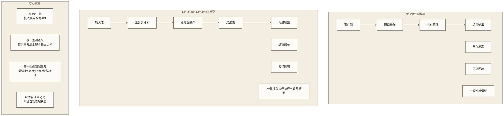
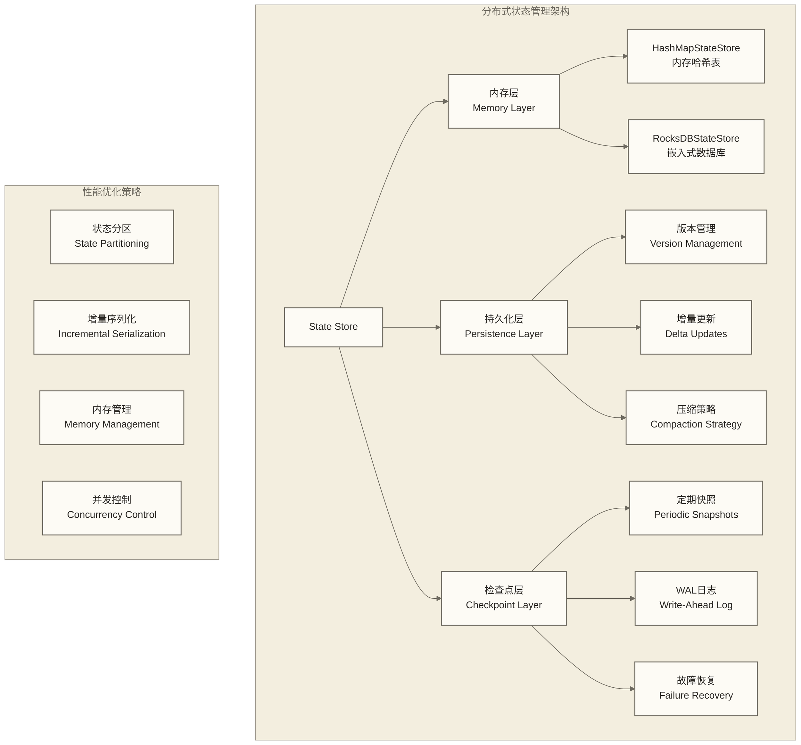
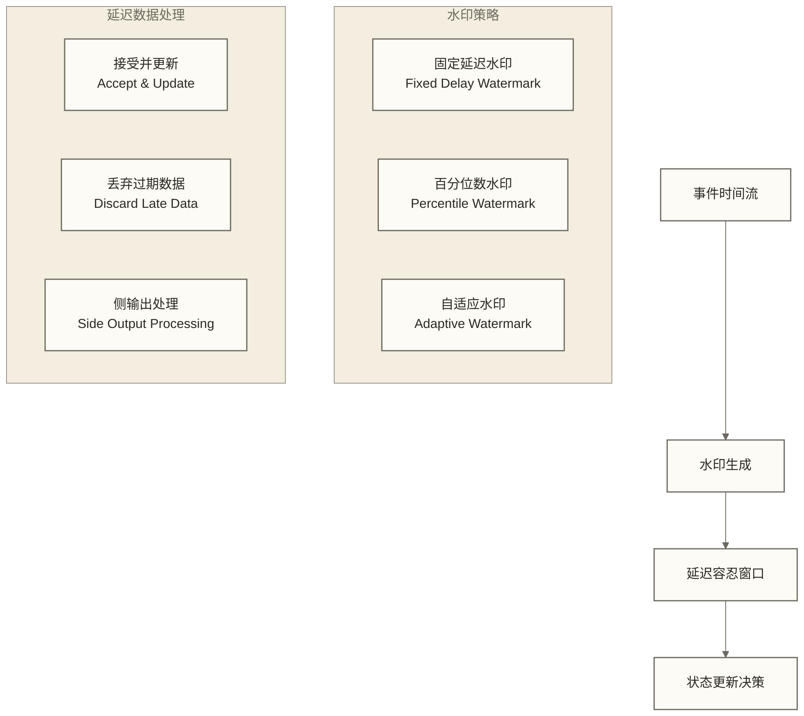
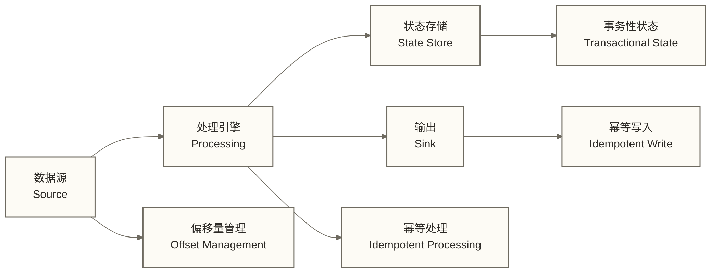

# Structured Streaming：流处理的统一编程模型

Structured Streaming是Apache Spark 2.0引入的革命性流处理引擎，它将流数据处理的复杂性抽象为简单的批处理操作，实现了真正意义上的批流统一。本文档深入解析Structured Streaming的设计理念、核心机制和最佳实践。

## 设计理念：流表一体化

### 概念突破：无界表模型

Structured Streaming的最大创新在于将流数据重新概念化为一个不断增长的无界表（Unbounded Table）。这种抽象带来了根本性的思维转变：

**传统流处理思维**：
- 数据以事件流的形式持续到达
- 需要显式管理窗口和状态
- 容错机制复杂，难以保证一致性

**结构化流处理思维**：
- 流数据被视为不断追加的表
- 使用标准SQL或DataFrame操作
- 系统自动处理状态管理和容错

### 执行模型：增量处理引擎

Structured Streaming采用增量处理模型，这种模型在性能和一致性之间找到了完美平衡：

**触发器驱动执行**：
- 系统根据触发器配置定期执行查询
- 每次执行只处理新到达的数据
- 输出模式决定如何处理结果的变更

**状态版本管理**：
- 每个微批次都有独立的版本号
- 状态更新采用copy-on-write机制
- 支持状态的快照和恢复

**水印机制**：
- 自动处理延迟数据和乱序事件
- 基于事件时间的窗口操作
- 智能清理过期状态

## 核心技术机制深度解析

### 状态存储的分布式实现

状态管理是流处理的核心挑战，Structured Streaming通过分布式状态存储解决了这个问题：

**状态存储的关键设计**：

1. **版本化存储**：状态版本用于提交与故障恢复；这不等同于面向用户提供任意历史状态的时间旅行或回滚能力。
2. **增量更新**：只存储状态的变化部分，减少存储和网络开销
3. **分区策略**：状态按键进行分区，支持水平扩展
4. **压缩机制**：定期合并历史版本，控制存储空间增长

### 水印与延迟数据处理

水印（Watermark）机制是处理延迟数据的核心技术：

**水印的概念本质**：
- 水印是对数据完整性的时间估计
- 表示"早于水印时间的数据基本到齐"
- 用于触发窗口计算和状态清理

**延迟容忍策略**：

**最佳实践指导**：
- 根据业务SLA设置合适的水印延迟
- 监控延迟数据的比例和分布
- 考虑业务对准确性和实时性的权衡

### 输出模式的语义保证

三种输出模式分别适用于不同的业务场景：

**Append模式**：
- 语义：只输出新增的记录
- 适用场景：ETL管道、事件日志处理
- 输出边界：Append只输出新增结果；带水印的窗口聚合可能需等待结果定稿，延迟取决于查询与水印配置，端到端一致性取决于数据源、执行模式和sink。

**Update模式**：
- 语义：输出新增和更新的记录
- 适用场景：实时仪表板、监控系统
- 输出边界：Update输出本次更新的结果行，不等同于最终一致性；下游需按业务键处理更新，实际延迟和一致性取决于查询及读写链路。

**Complete模式**：
- 语义：输出完整的结果表
- 适用场景：小结果集的实时聚合
- 输出边界：Complete每次输出完整结果表，结果集较大时输出与状态维护成本较高；该模式本身不构成端到端强一致性保证。

## 高级特性与企业级应用

### 复杂事件处理能力

Structured Streaming支持复杂的流处理模式：

**流表连接**：
- 流-静态表连接：实时数据与维度表关联
- 流-流连接：两个流之间的时间窗口连接
- 性能优化：广播连接、分区连接策略

**会话窗口**：
- 基于用户活动的动态窗口
- 支持不规则的时间边界
- 自动管理会话状态

**模式检测**：
- 复杂事件序列检测
- CEP（Complex Event Processing）支持
- 规则引擎集成

### 容错与一致性保障

**端到端exactly-once的条件性保障**：需结合执行模式、可重放数据源、可靠检查点以及sink的提交或幂等能力判断，以下图示表示所需环节，而非任意链路均具备的保证。

**故障恢复机制**：
1. **检查点机制**：持久化查询恢复所需的进度、提交信息及有状态算子的状态；不等同于定期保存完整应用快照。
2. **日志与状态持久化**：查询进度日志和状态存储的持久化机制共同支持恢复；状态变更的记录、快照及提交方式取决于所用状态存储后端与配置。
3. **源偏移量跟踪**：精确跟踪数据消费进度
4. **输出去重**：重试可能重复写入；需由sink的事务提交、幂等写入或业务去重机制防止重复结果，不能假定所有输出系统自动去重。

## 性能优化的系统性方法

### 资源配置优化

**内存配置策略**：
- 状态存储内存：根据状态大小预估内存需求
- 执行内存：为窗口操作和聚合预留足够内存
- 缓存内存：为频繁访问的维度表预留缓存

**并行度设置**：
- 输入分区数：匹配数据源的分区数
- 状态分区数：基于键的分布确定分区策略
- 输出并行度：考虑下游系统的处理能力

### 状态管理优化

**状态大小控制**：
- 使用TTL自动清理过期状态
- 合理设置水印延迟，及时清理窗口状态
- 考虑使用近似算法减少状态大小

**状态访问模式**：
- 热点键的负载均衡
- 状态预加载和预计算
- 分层状态存储架构

### 网络和I/O优化

**数据传输优化**：
- 使用高效的序列化格式
- 启用数据压缩
- 优化网络拓扑和带宽利用

**存储系统选择**：
- 检查点存储：选择高可用的分布式存储
- 状态后端：根据状态大小选择内存或RocksDB
- 输出系统：考虑下游系统的写入性能

## 最佳实践与设计模式

### 架构设计模式

**Lambda架构的现代化**：
- 批处理层：历史数据的离线处理
- 流处理层：实时数据的在线处理
- 服务层：统一查询接口

**Kappa架构的实现**：
- 统一流处理：所有数据都通过流处理
- 重处理能力：支持历史数据的重新处理
- 简化架构：减少系统复杂性

### 监控与运维

**关键指标监控**：
- 端到端延迟：从数据产生到结果输出的时间
- 处理吞吐量：每秒处理的记录数
- 状态大小：各类状态的内存和磁盘使用
- 水印延迟：当前水印与系统时间的差值

**告警策略**：
- 延迟超阈值告警
- 处理失败率告警
- 资源使用异常告警
- 数据质量问题告警

## 与其他流处理系统的比较

### 技术对比分析

| 特性 | Structured Streaming | Apache Flink | Apache Storm |
|------|---------------------|--------------|--------------|
| **编程模型** | 批流统一 | DataStream API | Spout/Bolt |
| **状态管理** | 框架管理查询状态，可使用状态接口 | 提供托管状态及检查点机制 | 取决于所用API与状态存储方案 |
| **时间语义** | 事件时间优先 | 三种时间语义 | 处理时间 |
| **容错机制** | 检查点、进度记录及数据重放等机制 | 检查点与状态恢复等机制 | 消息确认、重试等机制，具体保障取决于API及配置 |
| **延迟性能** | 取决于执行模式、查询、资源及读写链路 | 取决于查询、资源及读写链路 | 取决于拓扑、资源及读写链路 |
| **吞吐量** | 需在目标工作负载下测试 | 需在目标工作负载下测试 | 需在目标工作负载下测试 |

### 选择决策指导

**选择Structured Streaming的场景**：
- 已有Spark生态系统
- 需要批流统一处理
- 重视开发效率和维护性
- 对一致性要求较高

**选择其他系统的场景**：
- 超低延迟要求（< 10ms）
- 复杂的流处理逻辑
- 已有特定系统的技术栈

## 未来发展趋势

### 技术演进方向

**连续处理模式**：
- 毫秒级延迟的流处理
- 更细粒度的触发机制
- 实时物化视图支持

**智能化优化**：
- 自适应资源分配
- 智能状态管理
- 基于ML的性能优化

**云原生支持**：
- Kubernetes原生部署
- 无服务器流处理
- 弹性扩缩容优化

## 总结

Structured Streaming代表了流处理技术的重要进步，通过统一的编程模型和强大的状态管理能力，大大降低了流处理应用的开发和维护复杂度。其"流表一体化"的设计理念不仅简化了编程模型，还为批流统一奠定了坚实基础。

**核心价值**：
- **编程简化**：使用熟悉的批处理API处理流数据
- **一致性保障**：在执行模式、数据源重放、检查点和sink提交机制满足条件时，可实现端到端exactly-once语义。
- **状态管理自动化**：系统自动处理复杂的状态管理
- **性能优化**：通过增量处理和智能优化提升性能

**应用建议**：
- 优先考虑在现有Spark生态中使用
- 重视监控和性能调优
- 根据业务需求选择合适的输出模式
- 建立完善的容错和恢复机制

理解Structured Streaming的设计理念和实现机制，有助于构建可靠、高效的实时数据处理系统，为企业的数字化转型提供强大的技术支撑。

## 相关文档链接

- [[【技术与工具】/Spark/14-Spark Streaming流处理|Spark Streaming流处理]] - 传统流处理API对比
- [[【技术与工具】/Spark/08-DataFrame和Dataset|DataFrame和Dataset]] - 结构化API基础
- [[【技术与工具】/Spark/09-Spark SQL基础|Spark SQL]] - SQL操作基础
- [[【技术与工具】/Kafka/00-Kafka学习路线图|Kafka/Kafka]] - 数据源配置