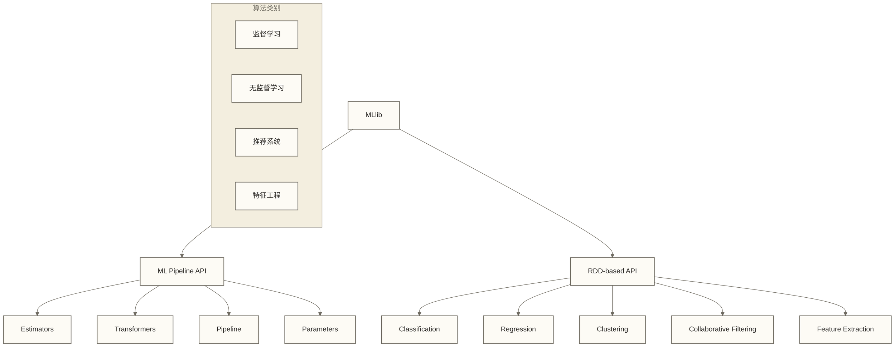

# MLlib机器学习

## 概述

MLlib是Apache Spark的分布式机器学习库，提供了丰富的机器学习算法和工具。它建立在Spark Core之上，能够处理大规模数据集的机器学习任务，支持分类、回归、聚类、协同过滤等多种学习任务。

> [!info] 设计理念
> MLlib的设计目标是让机器学习算法能够轻松扩展到大数据场景，同时保持易用性和高性能。它提供了两套API：基于RDD的原始API和基于DataFrame的ML Pipeline API。

## 核心架构

### MLlib组件结构



### ML Pipeline概念

ML Pipeline提供了构建机器学习工作流的统一API：

```scala
import org.apache.spark.ml.{Pipeline, PipelineModel}
import org.apache.spark.ml.classification.LogisticRegression
import org.apache.spark.ml.feature.{HashingTF, Tokenizer}

// 创建转换器和估计器
val tokenizer = new Tokenizer()
  .setInputCol("text")
  .setOutputCol("words")

val hashingTF = new HashingTF()
  .setInputCol("words")
  .setOutputCol("features")
  .setNumFeatures(1000)

val lr = new LogisticRegression()
  .setMaxIter(10)
  .setRegParam(0.001)

// 构建Pipeline
val pipeline = new Pipeline()
  .setStages(Array(tokenizer, hashingTF, lr))

// 训练模型
val model = pipeline.fit(trainingData)

// 预测
val predictions = model.transform(testData)
```

## 特征工程

### 特征提取

#### 文本特征提取

```scala
import org.apache.spark.ml.feature._

// TF-IDF
val tokenizer = new Tokenizer()
  .setInputCol("text")
  .setOutputCol("words")

val hashingTF = new HashingTF()
  .setInputCol("words")
  .setOutputCol("rawFeatures")
  .setNumFeatures(10000)

val idf = new IDF()
  .setInputCol("rawFeatures")
  .setOutputCol("features")

// Word2Vec
val word2Vec = new Word2Vec()
  .setInputCol("words")
  .setOutputCol("wordVectors")
  .setVectorSize(100)
  .setMinCount(5)

// CountVectorizer
val countVectorizer = new CountVectorizer()
  .setInputCol("words")
  .setOutputCol("features")
  .setVocabSize(10000)
  .setMinDF(2)
```

#### 数值特征处理

```scala
// StandardScaler - 标准化
val scaler = new StandardScaler()
  .setInputCol("features")
  .setOutputCol("scaledFeatures")
  .setWithStd(true)
  .setWithMean(false)

// MinMaxScaler - 归一化
val minMaxScaler = new MinMaxScaler()
  .setInputCol("features")
  .setOutputCol("scaledFeatures")
  .setMin(0.0)
  .setMax(1.0)

// Normalizer - 向量归一化
val normalizer = new Normalizer()
  .setInputCol("features")
  .setOutputCol("normFeatures")
  .setP(2.0)  // L2范数

// Bucketizer - 分桶
val bucketizer = new Bucketizer()
  .setInputCol("features")
  .setOutputCol("bucketedFeatures")
  .setSplits(Array(Double.NegativeInfinity, -0.5, 0.0, 0.5, Double.PositiveInfinity))
```

### 特征选择

```scala
// VectorSlicer - 特征切片
val vectorSlicer = new VectorSlicer()
  .setInputCol("features")
  .setOutputCol("selectedFeatures")
  .setIndices(Array(1, 4, 5))

// ChiSqSelector - 卡方特征选择
val chiSqSelector = new ChiSqSelector()
  .setNumTopFeatures(10)
  .setFeaturesCol("features")
  .setLabelCol("label")
  .setOutputCol("selectedFeatures")

// VarianceThresholdSelector - 方差阈值选择
val varianceSelector = new VarianceThresholdSelector()
  .setFeaturesCol("features")
  .setOutputCol("selectedFeatures")
  .setVarianceThreshold(0.1)
```

### 特征转换

```scala
// StringIndexer - 字符串索引
val stringIndexer = new StringIndexer()
  .setInputCol("category")
  .setOutputCol("categoryIndex")

// OneHotEncoder - 独热编码
val oneHotEncoder = new OneHotEncoder()
  .setInputCol("categoryIndex")
  .setOutputCol("categoryVec")

// VectorAssembler - 特征组合
val assembler = new VectorAssembler()
  .setInputCols(Array("feature1", "feature2", "feature3"))
  .setOutputCol("features")

// PCA - 主成分分析
val pca = new PCA()
  .setInputCol("features")
  .setOutputCol("pcaFeatures")
  .setK(3)
```

## 分类算法

### 逻辑回归

```scala
import org.apache.spark.ml.classification.LogisticRegression
import org.apache.spark.ml.evaluation.BinaryClassificationEvaluator

// 创建逻辑回归模型
val lr = new LogisticRegression()
  .setMaxIter(20)
  .setRegParam(0.01)
  .setElasticNetParam(0.8)
  .setFeaturesCol("features")
  .setLabelCol("label")

// 训练模型
val lrModel = lr.fit(trainingData)

// 预测
val predictions = lrModel.transform(testData)

// 评估
val evaluator = new BinaryClassificationEvaluator()
  .setLabelCol("label")
  .setRawPredictionCol("rawPrediction")
  .setMetricName("areaUnderROC")

val auc = evaluator.evaluate(predictions)
println(s"AUC: $auc")

// 查看模型系数
println(s"Coefficients: ${lrModel.coefficients}")
println(s"Intercept: ${lrModel.intercept}")
```

### 随机森林

```scala
import org.apache.spark.ml.classification.RandomForestClassifier
import org.apache.spark.ml.evaluation.MulticlassClassificationEvaluator

val rf = new RandomForestClassifier()
  .setNumTrees(100)
  .setMaxDepth(5)
  .setMaxBins(32)
  .setMinInstancesPerNode(1)
  .setMinInfoGain(0.0)
  .setSubsamplingRate(1.0)
  .setFeatureSubsetStrategy("auto")
  .setSeed(12345)

val rfModel = rf.fit(trainingData)

val predictions = rfModel.transform(testData)

// 多类分类评估
val evaluator = new MulticlassClassificationEvaluator()
  .setLabelCol("label")
  .setPredictionCol("prediction")
  .setMetricName("accuracy")

val accuracy = evaluator.evaluate(predictions)
println(s"Accuracy: $accuracy")

// 特征重要性
println(s"Feature Importances: ${rfModel.featureImportances}")
```

### 梯度提升树

```scala
import org.apache.spark.ml.classification.GBTClassifier

val gbt = new GBTClassifier()
  .setMaxIter(10)
  .setMaxDepth(5)
  .setStepSize(0.1)
  .setMinInstancesPerNode(1)
  .setMinInfoGain(0.0)
  .setSubsamplingRate(1.0)
  .setFeatureSubsetStrategy("all")

val gbtModel = gbt.fit(trainingData)
val predictions = gbtModel.transform(testData)
```

### 支持向量机

```scala
import org.apache.spark.ml.classification.LinearSVC

val svm = new LinearSVC()
  .setMaxIter(100)
  .setRegParam(0.01)
  .setTol(1e-6)
  .setFitIntercept(true)
  .setStandardization(true)
  .setThreshold(0.0)

val svmModel = svm.fit(trainingData)
val predictions = svmModel.transform(testData)
```

## 回归算法

### 线性回归

```scala
import org.apache.spark.ml.regression.LinearRegression
import org.apache.spark.ml.evaluation.RegressionEvaluator

val lr = new LinearRegression()
  .setMaxIter(10)
  .setRegParam(0.3)
  .setElasticNetParam(0.8)
  .setFeaturesCol("features")
  .setLabelCol("label")

val lrModel = lr.fit(trainingData)

// 模型摘要
val trainingSummary = lrModel.summary
println(s"RMSE: ${trainingSummary.rootMeanSquaredError}")
println(s"R2: ${trainingSummary.r2}")
println(s"Mean Absolute Error: ${trainingSummary.meanAbsoluteError}")

// 预测和评估
val predictions = lrModel.transform(testData)

val evaluator = new RegressionEvaluator()
  .setLabelCol("label")
  .setPredictionCol("prediction")
  .setMetricName("rmse")

val rmse = evaluator.evaluate(predictions)
println(s"Root Mean Squared Error (RMSE) on test data = $rmse")
```

### 随机森林回归

```scala
import org.apache.spark.ml.regression.RandomForestRegressor

val rf = new RandomForestRegressor()
  .setNumTrees(20)
  .setMaxDepth(5)
  .setMaxBins(32)
  .setMinInstancesPerNode(1)
  .setMinInfoGain(0.0)
  .setSubsamplingRate(1.0)
  .setFeatureSubsetStrategy("onethird")

val rfModel = rf.fit(trainingData)
val predictions = rfModel.transform(testData)
```

### 决策树回归

```scala
import org.apache.spark.ml.regression.DecisionTreeRegressor

val dt = new DecisionTreeRegressor()
  .setMaxDepth(5)
  .setMaxBins(32)
  .setMinInstancesPerNode(1)
  .setMinInfoGain(0.0)
  .setVarianceCol("variance")

val dtModel = dt.fit(trainingData)
val predictions = dtModel.transform(testData)
```

## 聚类算法

### K-Means聚类

```scala
import org.apache.spark.ml.clustering.KMeans
import org.apache.spark.ml.evaluation.ClusteringEvaluator

// K-Means
val kmeans = new KMeans()
  .setK(3)
  .setMaxIter(20)
  .setTol(1e-4)
  .setDistanceMeasure("euclidean")
  .setFeaturesCol("features")
  .setPredictionCol("cluster")

val kmeansModel = kmeans.fit(dataset)

// 预测
val predictions = kmeansModel.transform(dataset)

// 评估 - 轮廓系数
val evaluator = new ClusteringEvaluator()
  .setFeaturesCol("features")
  .setPredictionCol("cluster")
  .setMetricName("silhouette")
  .setDistanceMeasure("squaredEuclidean")

val silhouette = evaluator.evaluate(predictions)
println(s"Silhouette with squared euclidean distance = $silhouette")

// 聚类中心
println("Cluster Centers:")
kmeansModel.clusterCenters.foreach(println)

// 类内误差平方和
val wssse = kmeansModel.summary.trainingCost
println(s"Within Set Sum of Squared Errors = $wssse")
```

### 高斯混合模型

```scala
import org.apache.spark.ml.clustering.GaussianMixture

val gmm = new GaussianMixture()
  .setK(2)
  .setMaxIter(100)
  .setTol(1e-6)
  .setFeaturesCol("features")
  .setPredictionCol("cluster")
  .setProbabilityCol("probability")

val gmmModel = gmm.fit(dataset)

// 预测
val predictions = gmmModel.transform(dataset)

// 模型参数
println("Weights:")
gmmModel.weights.foreach(println)

println("Gaussians:")
for (i <- gmmModel.gaussians.indices) {
  println(s"Gaussian $i:")
  println(s"Mean: ${gmmModel.gaussians(i).mean}")
  println(s"Covariance: ${gmmModel.gaussians(i).cov}")
}
```

### 层次聚类

```scala
import org.apache.spark.ml.clustering.BisectingKMeans

val bkm = new BisectingKMeans()
  .setK(4)
  .setMaxIter(20)
  .setMinDivisibleClusterSize(1)
  .setDistanceMeasure("euclidean")

val bkmModel = bkm.fit(dataset)
val predictions = bkmModel.transform(dataset)

// 打印聚类中心
println("Cluster Centers:")
bkmModel.clusterCenters.foreach(println)
```

## 协同过滤

### 交替最小二乘法 (ALS)

```scala
import org.apache.spark.ml.recommendation.ALS
import org.apache.spark.ml.evaluation.RegressionEvaluator

// 准备数据 - 用户ID、物品ID、评分
case class Rating(userId: Int, movieId: Int, rating: Float, timestamp: Long)

// 创建ALS模型
val als = new ALS()
  .setMaxIter(10)
  .setRegParam(0.1)
  .setRank(10)
  .setUserCol("userId")
  .setItemCol("movieId")
  .setRatingCol("rating")
  .setColdStartStrategy("drop")
  .setNonnegative(true)

val alsModel = als.fit(trainingData)

// 预测
val predictions = alsModel.transform(testData)

// 评估
val evaluator = new RegressionEvaluator()
  .setMetricName("rmse")
  .setLabelCol("rating")
  .setPredictionCol("prediction")

val rmse = evaluator.evaluate(predictions)
println(s"Root-mean-square error = $rmse")

// 为所有用户推荐物品
val userRecs = alsModel.recommendForAllUsers(10)
userRecs.show(false)

// 为所有物品推荐用户
val movieRecs = alsModel.recommendForAllItems(10)
movieRecs.show(false)

// 为特定用户推荐
val users = dataset.select(als.getUserCol).distinct().limit(3)
val userSubsetRecs = alsModel.recommendForUserSubset(users, 10)
userSubsetRecs.show(false)
```

## 频繁模式挖掘

### FP-Growth

```scala
import org.apache.spark.ml.fpm.FPGrowth

// 数据格式：每行是一个事务，包含物品列表
val dataset = spark.createDataFrame(Seq(
  (0, Array("a", "b", "c")),
  (1, Array("a", "b")),
  (2, Array("a", "b", "c", "e")),
  (3, Array("a", "c", "e")),
  (4, Array("b", "e"))
)).toDF("id", "items")

val fpgrowth = new FPGrowth()
  .setItemsCol("items")
  .setMinSupport(0.5)
  .setMinConfidence(0.6)

val model = fpgrowth.fit(dataset)

// 频繁项集
model.freqItemsets.show()

// 关联规则
model.associationRules.show()

// 预测
model.transform(dataset).show()
```

## 模型评估与调优

### 交叉验证

```scala
import org.apache.spark.ml.tuning.{CrossValidator, ParamGridBuilder}
import org.apache.spark.ml.evaluation.BinaryClassificationEvaluator

// 构建参数网格
val paramGrid = new ParamGridBuilder()
  .addGrid(lr.regParam, Array(0.1, 0.01))
  .addGrid(lr.maxIter, Array(10, 20))
  .addGrid(lr.elasticNetParam, Array(0.0, 0.5, 1.0))
  .build()

// 创建交叉验证器
val cv = new CrossValidator()
  .setEstimator(lr)
  .setEvaluator(new BinaryClassificationEvaluator())
  .setEstimatorParamMaps(paramGrid)
  .setNumFolds(5)
  .setParallelism(2)

// 训练模型
val cvModel = cv.fit(trainingData)

// 使用最佳模型预测
val predictions = cvModel.transform(testData)

// 获取最佳参数
val bestModel = cvModel.bestModel.asInstanceOf[LogisticRegressionModel]
println(s"Best RegParam: ${bestModel.getRegParam}")
println(s"Best MaxIter: ${bestModel.getMaxIter}")
```

### 训练验证分割

```scala
import org.apache.spark.ml.tuning.{TrainValidationSplit, ParamGridBuilder}

val trainValidationSplit = new TrainValidationSplit()
  .setEstimator(lr)
  .setEvaluator(new BinaryClassificationEvaluator())
  .setEstimatorParamMaps(paramGrid)
  .setTrainRatio(0.8)

val tvModel = trainValidationSplit.fit(trainingData)
val predictions = tvModel.transform(testData)
```

### 评估指标

```scala
import org.apache.spark.ml.evaluation._

// 二分类评估
val binaryEvaluator = new BinaryClassificationEvaluator()
  .setLabelCol("label")
  .setRawPredictionCol("rawPrediction")

val areaUnderROC = binaryEvaluator.setMetricName("areaUnderROC").evaluate(predictions)
val areaUnderPR = binaryEvaluator.setMetricName("areaUnderPR").evaluate(predictions)

// 多类分类评估
val multiclassEvaluator = new MulticlassClassificationEvaluator()
  .setLabelCol("label")
  .setPredictionCol("prediction")

val accuracy = multiclassEvaluator.setMetricName("accuracy").evaluate(predictions)
val f1Score = multiclassEvaluator.setMetricName("f1").evaluate(predictions)
val precision = multiclassEvaluator.setMetricName("weightedPrecision").evaluate(predictions)
val recall = multiclassEvaluator.setMetricName("weightedRecall").evaluate(predictions)

// 回归评估
val regressionEvaluator = new RegressionEvaluator()
  .setLabelCol("label")
  .setPredictionCol("prediction")

val rmse = regressionEvaluator.setMetricName("rmse").evaluate(predictions)
val mae = regressionEvaluator.setMetricName("mae").evaluate(predictions)
val r2 = regressionEvaluator.setMetricName("r2").evaluate(predictions)
```

## 模型持久化

### 保存和加载模型

```scala
import org.apache.spark.ml.classification.LogisticRegressionModel

// 保存模型
lrModel.write.overwrite().save("path/to/model")

// 加载模型
val sameModel = LogisticRegressionModel.load("path/to/model")

// 保存Pipeline模型
pipelineModel.write.overwrite().save("path/to/pipeline/model")

// 加载Pipeline模型
val samePipelineModel = PipelineModel.load("path/to/pipeline/model")
```

### 模型版本管理

```scala
// 带版本的模型保存
val modelPath = s"hdfs://namenode:8020/models/logistic_regression/v${System.currentTimeMillis()}"
lrModel.write.overwrite().save(modelPath)

// 模型元数据
case class ModelMetadata(
  modelType: String,
  version: String,
  accuracy: Double,
  trainDate: String,
  features: Array[String]
)

val metadata = ModelMetadata(
  "LogisticRegression",
  "v1.0",
  accuracy,
  java.time.LocalDate.now().toString,
  featureNames
)
```

## 大规模机器学习实战

### 特征工程Pipeline

```scala
object FeatureEngineeringPipeline {
  
  def createPipeline(): Pipeline = {
    // 1. 文本特征处理
    val tokenizer = new Tokenizer()
      .setInputCol("text")
      .setOutputCol("words")
    
    val stopWordsRemover = new StopWordsRemover()
      .setInputCol("words")
      .setOutputCol("filtered_words")
    
    val hashingTF = new HashingTF()
      .setInputCol("filtered_words")
      .setOutputCol("raw_features")
      .setNumFeatures(10000)
    
    val idf = new IDF()
      .setInputCol("raw_features")
      .setOutputCol("text_features")
    
    // 2. 数值特征处理
    val numericCols = Array("feature1", "feature2", "feature3")
    val assembler1 = new VectorAssembler()
      .setInputCols(numericCols)
      .setOutputCol("numeric_features")
    
    val scaler = new StandardScaler()
      .setInputCol("numeric_features")
      .setOutputCol("scaled_numeric_features")
      .setWithMean(true)
      .setWithStd(true)
    
    // 3. 类别特征处理
    val categoricalCols = Array("category1", "category2")
    val indexers = categoricalCols.map { colName =>
      new StringIndexer()
        .setInputCol(colName)
        .setOutputCol(s"${colName}_index")
        .setHandleInvalid("keep")
    }
    
    val encoders = categoricalCols.map { colName =>
      new OneHotEncoder()
        .setInputCol(s"${colName}_index")
        .setOutputCol(s"${colName}_vec")
    }
    
    // 4. 特征组合
    val finalAssembler = new VectorAssembler()
      .setInputCols(Array("text_features", "scaled_numeric_features") ++ 
                   categoricalCols.map(name => s"${name}_vec"))
      .setOutputCol("features")
    
    // 5. 特征选择
    val selector = new ChiSqSelector()
      .setNumTopFeatures(1000)
      .setFeaturesCol("features")
      .setLabelCol("label")
      .setOutputCol("selected_features")
    
    new Pipeline()
      .setStages(Array(tokenizer, stopWordsRemover, hashingTF, idf, assembler1, scaler) ++
                indexers ++ encoders ++
                Array(finalAssembler, selector))
  }
}
```

### 模型比较和集成

```scala
object ModelEnsemble {
  
  def trainMultipleModels(trainingData: DataFrame): Map[String, PipelineModel] = {
    val models = Map(
      "logistic_regression" -> createLogisticRegressionPipeline(),
      "random_forest" -> createRandomForestPipeline(),
      "gradient_boosting" -> createGBTPipeline()
    )
    
    models.mapValues(_.fit(trainingData))
  }
  
  def createLogisticRegressionPipeline(): Pipeline = {
    val lr = new LogisticRegression()
      .setMaxIter(100)
      .setRegParam(0.01)
      .setElasticNetParam(0.8)
      .setFeaturesCol("selected_features")
    
    new Pipeline().setStages(Array(
      FeatureEngineeringPipeline.createPipeline(),
      lr
    ))
  }
  
  def evaluateModels(models: Map[String, PipelineModel], 
                    testData: DataFrame): Map[String, Double] = {
    val evaluator = new BinaryClassificationEvaluator()
      .setLabelCol("label")
      .setRawPredictionCol("rawPrediction")
      .setMetricName("areaUnderROC")
    
    models.mapValues { model =>
      val predictions = model.transform(testData)
      evaluator.evaluate(predictions)
    }
  }
  
  // 二分类软投票：各模型须使用一致的标签映射，且每个预测结果的 id 唯一、样本集合一致
  def ensemblePredictions(predictions: Seq[DataFrame]): DataFrame = {
    import org.apache.spark.sql.functions._
    
    // 假设所有预测结果都有相同的key列
    val baseDF = predictions.head.select("id", "label")
    
    val avgPredictions = predictions.zipWithIndex.foldLeft(baseDF) { 
      case (df, (predDF, idx)) =>
        df.join(
          predDF.select("id", udf((v: org.apache.spark.ml.linalg.Vector) => v(1)).apply(col("probability")).as(s"prob_$idx")), 
          "id"
        )
    }
    
    // 计算平均概率
    val probCols = predictions.indices.map(i => col(s"prob_$i"))
    avgPredictions.withColumn("ensemble_probability", 
      (probCols.reduce(_ + _) / probCols.length))
  }
}
```

### 在线学习和增量更新

```scala
import org.apache.spark.ml.classification.LogisticRegression
import org.apache.spark.ml.feature.VectorAssembler
import org.apache.spark.streaming._

object OnlineLearning {
  
  def retrainModelOnNewData(currentModel: LogisticRegressionModel,
                           newData: DataFrame): LogisticRegressionModel = {
    // 复用正则化参数，在新数据上重新批量训练；不是从旧模型继续增量学习
    // newData 需包含配置所要求的 features 和 label 列
    val lr = new LogisticRegression()
      .setMaxIter(10)
      .setRegParam(currentModel.getRegParam)
      .setElasticNetParam(currentModel.getElasticNetParam)
    
    lr.fit(newData)
  }
  
  // 流式机器学习
  def setupStreamingML(ssc: StreamingContext): Unit = {
    val kafkaStream = createKafkaStream(ssc)
    
    kafkaStream.foreachRDD { rdd =>
      if (!rdd.isEmpty()) {
        val df = spark.createDataFrame(rdd, schema)
        val processedDF = featureEngineeringPipeline.transform(df)
        
        // 批量预测
        val predictions = currentModel.transform(processedDF)
        
        // 保存预测结果
        predictions.write
          .mode("append")
          .parquet("hdfs://path/to/predictions")
        
        // 定期重训练模型
        if (shouldRetrain()) {
          val newModel = retrainModel(getRecentData())
          updateCurrentModel(newModel)
        }
      }
    }
  }
}
```

## 性能优化

### 数据预处理优化

```scala
// 1. 数据缓存
val processedData = rawData
  .filter(col("label").isNotNull)
  .cache()

// 2. 分区优化
val repartitionedData = processedData
  .repartition(200, col("user_id"))

// 3. 列式存储
processedData.write
  .mode("overwrite")
  .option("compression", "snappy")
  .parquet("hdfs://path/to/processed/data")
```

### 算法参数调优

```scala
val spark = SparkSession.builder()
  .appName("MLOptimization")
  // 设置适当的并行度
  .config("spark.sql.shuffle.partitions", "400")
  // 增加执行器内存
  .config("spark.executor.memory", "8g")
  // 启用动态分配
  .config("spark.dynamicAllocation.enabled", "true")
  .config("spark.dynamicAllocation.maxExecutors", "100")
  // 设置序列化器
  .config("spark.serializer", "org.apache.spark.serializer.KryoSerializer")
  .getOrCreate()
```

## 最佳实践

### 1. 数据准备

```scala
// 数据质量检查
def checkDataQuality(df: DataFrame): Unit = {
  println(s"Total rows: ${df.count()}")
  println(s"Null values per column:")
  df.columns.foreach { col =>
    val nullCount = df.filter(df(col).isNull).count()
    println(s"  $col: $nullCount")
  }
  
  // 标签分布
  df.groupBy("label").count().show()
}

// 数据分割
val Array(trainingData, validationData, testData) = 
  dataset.randomSplit(Array(0.6, 0.2, 0.2), seed = 12345)
```

### 2. 特征工程

```scala
// 特征重要性分析
def analyzeFeatureImportance(model: RandomForestClassificationModel, 
                           featureNames: Array[String]): Unit = {
  val importances = model.featureImportances.toArray
  val features = featureNames.zip(importances)
    .sortBy(-_._2)
    .take(20)
  
  println("Top 20 Important Features:")
  features.foreach { case (name, importance) =>
    println(f"$name: $importance%.4f")
  }
}
```

### 3. 模型监控

```scala
// 模型性能监控
def monitorModelPerformance(model: PipelineModel, 
                          testData: DataFrame): Map[String, Double] = {
  val predictions = model.transform(testData)
  
  val metrics = Map(
    "accuracy" -> new MulticlassClassificationEvaluator()
      .setMetricName("accuracy").evaluate(predictions),
    "auc" -> new BinaryClassificationEvaluator()
      .setMetricName("areaUnderROC").evaluate(predictions),
    "f1" -> new MulticlassClassificationEvaluator()
      .setMetricName("f1").evaluate(predictions)
  )
  
  // 发送监控指标
  sendMetricsToMonitoringSystem(metrics)
  
  metrics
}
```

## 总结

MLlib提供了完整的大规模机器学习解决方案：

**核心优势**：
1. **分布式计算**：支持大规模数据集的机器学习任务
2. **统一API**：ML Pipeline提供了一致的编程接口
3. **丰富算法**：涵盖分类、回归、聚类、推荐等主要任务
4. **生产应用基础**：提供模型持久化和批量推理接口；在线服务化仍需另行集成部署组件

**适用场景**：
- 大规模数据集的机器学习
- 特征工程和数据预处理
- 模型训练和调优
- 实时机器学习推理

**最佳实践**：
- 合理设计特征工程Pipeline
- 使用交叉验证进行模型选择
- 实施模型版本管理和监控
- 优化资源配置和性能参数

## 相关文档

- [[【技术与工具】/Spark/08-DataFrame和Dataset|DataFrame和Dataset]]：结构化数据处理基础
- [[【技术与工具】/Python/18-机器学习基础|Python机器学习]]：机器学习算法对比
- [[【技术与工具】/Spark/11-Spark性能调优|Spark性能调优]]：性能优化策略
- [[【技术与工具】/Spark/22-企业级Spark应用|企业级应用]]：生产环境部署