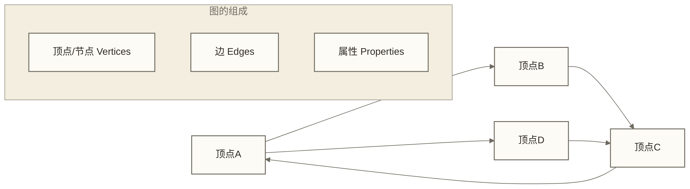

# GraphX图计算

## 概述

GraphX是Apache Spark的分布式图处理框架，提供了图的分布式计算能力。它将图建模为属性图（Property Graph），支持图的构建、转换和计算，特别适用于社交网络分析、推荐系统、欺诈检测等场景。

> [!info] 核心优势
> GraphX的最大优势是统一了图计算和数据流处理，可以在同一个Spark程序中进行图分析和常规的数据处理，避免了系统间的数据移动成本。

## 图论基础

### 图的基本概念



### 图的类型

1. **有向图 vs 无向图**
2. **加权图 vs 无权图**
3. **属性图**：顶点和边都可以带有属性

## GraphX核心概念

### 属性图模型

GraphX采用属性图模型，其中：
- **顶点 (Vertex)**：具有唯一ID和属性
- **边 (Edge)**：连接两个顶点，可以有方向和属性
- **三元组 (Triplet)**：包含源顶点、目标顶点和边的完整信息

```scala
import org.apache.spark.graphx._
import org.apache.spark.rdd.RDD

// 定义顶点属性类型
case class User(name: String, age: Int, profession: String)

// 定义边属性类型
case class Relationship(relation: String, since: Int)

// 创建顶点RDD
val vertices: RDD[(VertexId, User)] = sc.parallelize(Array(
  (1L, User("Alice", 28, "Engineer")),
  (2L, User("Bob", 32, "Data Scientist")),
  (3L, User("Charlie", 25, "Designer")),
  (4L, User("David", 35, "Manager"))
))

// 创建边RDD
val edges: RDD[Edge[Relationship]] = sc.parallelize(Array(
  Edge(1L, 2L, Relationship("friend", 2015)),
  Edge(2L, 3L, Relationship("colleague", 2018)),
  Edge(3L, 4L, Relationship("friend", 2019)),
  Edge(4L, 1L, Relationship("manager", 2020))
))

// 创建图
val graph = Graph(vertices, edges)
```

## 图的构建

### 从RDD构建图

```scala
// 方式1：从顶点和边RDD构建
val graph = Graph(vertices, edges)

// 方式2：从边RDD构建（自动推断顶点）
val edgeRDD: RDD[Edge[String]] = sc.parallelize(Array(
  Edge(1L, 2L, "follows"),
  Edge(2L, 3L, "follows"),
  Edge(3L, 1L, "follows")
))

val graphFromEdges = Graph.fromEdges(edgeRDD, defaultValue = "Unknown")

// 方式3：从边元组构建
val edgeTuples: RDD[(VertexId, VertexId)] = sc.parallelize(Array(
  (1L, 2L), (2L, 3L), (3L, 1L)
))

val graphFromTuples = Graph.fromEdgeTuples(edgeTuples, defaultValue = "User")
```

### 从数据文件构建图

```scala
// 从文件读取边数据
val edgeFile = "hdfs://namenode:9000/graph/edges.txt"
val edges = sc.textFile(edgeFile).map { line =>
  val fields = line.split(",")
  Edge(fields(0).toLong, fields(1).toLong, fields(2))
}

// 从文件读取顶点数据
val vertexFile = "hdfs://namenode:9000/graph/vertices.txt"
val vertices = sc.textFile(vertexFile).map { line =>
  val fields = line.split(",")
  (fields(0).toLong, fields(1))
}

val graph = Graph(vertices, edges)
```

### 随机图生成

```scala
import org.apache.spark.graphx.util.GraphGenerators

// 生成随机图
val randomGraph = GraphGenerators.logNormalGraph(sc, numVertices = 1000)

// 生成网格图
val gridGraph = GraphGenerators.gridGraph(sc, rows = 10, cols = 10)

// 生成星形图
val starGraph = GraphGenerators.starGraph(sc, nverts = 100)
```

## 基本图操作

### 图信息查询

```scala
// 图的基本信息
println(s"顶点数量: ${graph.numVertices}")
println(s"边数量: ${graph.numEdges}")

// 查看顶点
graph.vertices.collect().foreach {
  case (id, user) => println(s"顶点$id: ${user.name}, ${user.age}岁, ${user.profession}")
}

// 查看边
graph.edges.collect().foreach { edge =>
  println(s"边: ${edge.srcId} -> ${edge.dstId}, 关系: ${edge.attr.relation}")
}

// 查看三元组
graph.triplets.collect().foreach { triplet =>
  println(s"${triplet.srcAttr.name} -[${triplet.attr.relation}]-> ${triplet.dstAttr.name}")
}
```

### 图结构分析

```scala
// 入度统计
val inDegrees = graph.inDegrees
inDegrees.collect().foreach {
  case (id, degree) => println(s"顶点$id的入度: $degree")
}

// 出度统计
val outDegrees = graph.outDegrees
outDegrees.collect().foreach {
  case (id, degree) => println(s"顶点$id的出度: $degree")
}

// 度数统计
val degrees = graph.degrees
degrees.collect().foreach {
  case (id, degree) => println(s"顶点$id的度数: $degree")
}
```

## 图转换操作

### 顶点转换

```scala
// mapVertices - 转换顶点属性
val olderGraph = graph.mapVertices { case (id, user) =>
  user.copy(age = user.age + 1)
}

// 条件转换
val seniorGraph = graph.mapVertices { case (id, user) =>
  if (user.age >= 30) user.copy(profession = s"Senior ${user.profession}")
  else user
}
```

### 边转换

```scala
// mapEdges - 转换边属性
val weightedGraph = graph.mapEdges { edge =>
  val years = 2024 - edge.attr.since
  Relationship(edge.attr.relation, years)
}

// 条件转换边
val strongTiesGraph = graph.mapEdges { edge =>
  val years = 2024 - edge.attr.since
  if (years >= 5) edge.attr.copy(relation = s"strong_${edge.attr.relation}")
  else edge.attr
}
```

### 三元组转换

```scala
// mapTriplets - 基于三元组信息转换边
val contextualGraph = graph.mapTriplets { triplet =>
  val srcAge = triplet.srcAttr.age
  val dstAge = triplet.dstAttr.age
  val ageDiff = math.abs(srcAge - dstAge)
  
  if (ageDiff <= 5) "similar_age"
  else "different_age"
}
```

## 结构操作

### 子图操作

```scala
// subgraph - 创建子图
val engineerGraph = graph.subgraph(
  vpred = (id, user) => user.profession.contains("Engineer"),
  epred = triplet => triplet.attr.relation == "friend"
)

// 基于度数的子图
val highDegreeGraph = graph.subgraph(
  vpred = (id, _) => graph.degrees.lookup(id).headOption.getOrElse(0) >= 2
)
```

### 图的连接操作

```scala
// mask - 用另一个图作为掩码
val friendGraph = graph.subgraph(epred = triplet => triplet.attr.relation == "friend")
val maskedGraph = graph.mask(friendGraph)

// groupEdges - 合并多重边
val multiGraph = Graph.fromEdgeTuples(sc.parallelize(Array(
  (1L, 2L), (1L, 2L), (2L, 3L)
)), "User")

val consolidatedGraph = multiGraph.groupEdges((a, b) => a + b)
```

### 图的反向操作

```scala
// reverse - 反向所有边
val reversedGraph = graph.reverse
```

## 图算法

### PageRank算法

```scala
// 运行PageRank算法
val ranks = graph.pageRank(0.0001).vertices

// 查看PageRank结果
val ranksByVertex = graph.vertices.join(ranks).map {
  case (id, (user, rank)) => (user.name, rank)
}

ranksByVertex.collect().sortBy(-_._2).foreach {
  case (name, rank) => println(f"$name: $rank%.4f")
}

// 个性化PageRank
val personalizedRanks = graph.personalizedPageRank(1L, 0.0001).vertices
```

### 连通分量

```scala
// 强连通分量
val scc = graph.stronglyConnectedComponents(numIter = 10).vertices

// 查看连通分量
val sccByVertex = graph.vertices.join(scc).map {
  case (id, (user, component)) => (user.name, component)
}

sccByVertex.collect().foreach {
  case (name, component) => println(s"$name belongs to component $component")
}

// 弱连通分量（无向图）
val connectedComponents = graph.connectedComponents().vertices
```

### 三角形计数

```scala
// 计算每个顶点所在的三角形数量
val triCounts = graph.triangleCount().vertices

val triCountByVertex = graph.vertices.join(triCounts).map {
  case (id, (user, count)) => (user.name, count)
}

triCountByVertex.collect().foreach {
  case (name, count) => println(s"$name is in $count triangles")
}
```

### 最短路径

```scala
// 计算各顶点沿有向边到指定目标顶点的最短路径距离
val sourceId: VertexId = 1L
val sssp = graph.shortestPaths(Seq(sourceId)).vertices

sssp.collect().foreach {
  case (id, spMap) => 
    spMap.get(sourceId) match {
      case Some(distance) => println(s"Distance from $id to $sourceId: $distance")
      case None => println(s"No path from $id to $sourceId")
    }
}
```

## 消息传递

### Pregel API

GraphX提供了Pregel风格的消息传递API：

```scala
import org.apache.spark.graphx.{EdgeTriplet, VertexId}

// 实现简单的消息传递算法
def max(a: Int, b: Int): Int = math.max(a, b)

val initialGraph = graph.mapVertices((id, _) => if (id == 1L) 100 else 0)

val maxGraph = initialGraph.pregel(
  initialMsg = 0,              // 初始消息
  maxIterations = 10,          // 最大迭代次数
  activeDirection = EdgeDirection.Out  // 消息传递方向
)(
  // 顶点程序：处理接收到的消息
  (id: VertexId, attr: Int, msg: Int) => max(attr, msg),
  
  // 发送消息：决定向邻居发送什么消息
  (triplet: EdgeTriplet[Int, _]) => {
    if (triplet.srcAttr > triplet.dstAttr) {
      Iterator((triplet.dstId, triplet.srcAttr))
    } else {
      Iterator.empty
    }
  },
  
  // 合并消息：如何合并多个消息
  (a: Int, b: Int) => max(a, b)
)

maxGraph.vertices.collect().foreach {
  case (id, value) => println(s"顶点$id的最大值: $value")
}
```

### 自定义图算法

```scala
// 实现标签传播算法
object LabelPropagation {
  
  def run[VD, ED](graph: Graph[VD, ED], maxIterations: Int): Graph[VertexId, ED] = {
    // 初始化：每个顶点的标签为其ID
    var labelGraph = graph.mapVertices((id, _) => id)
    
    for (i <- 0 until maxIterations) {
      // 收集邻居标签
      val labelMessages = labelGraph.aggregateMessages[Map[VertexId, Int]](
        // 发送消息：向邻居发送自己的标签
        triplet => {
          triplet.sendToSrc(Map(triplet.dstAttr -> 1))
          triplet.sendToDst(Map(triplet.srcAttr -> 1))
        },
        // 合并消息：统计标签频次
        (a, b) => a ++ b.map { case (k, v) => k -> (v + a.getOrElse(k, 0)) }
      )
      
      // 更新标签：选择最频繁的标签
      labelGraph = labelGraph.joinVertices(labelMessages) { (id, oldLabel, labelCounts) =>
        labelCounts.maxBy(_._2)._1
      }
    }
    
    labelGraph
  }
}

// 使用自定义算法
val communityGraph = LabelPropagation.run(graph, maxIterations = 10)
```

## aggregateMessages操作

这是GraphX中最强大的操作之一：

```scala
// 示例1：计算每个用户的朋友平均年龄
val avgFriendAge = graph.aggregateMessages[List[Int]](
  // 发送消息阶段
  triplet => {
    if (triplet.attr.relation == "friend") {
      triplet.sendToSrc(List(triplet.dstAttr.age))
      triplet.sendToDst(List(triplet.srcAttr.age))
    }
  },
  // 合并消息阶段
  (a, b) => a ++ b
).mapValues(ages => if (ages.nonEmpty) ages.sum / ages.length.toDouble else 0.0)

// 示例2：查找每个用户的最年长朋友
val oldestFriend = graph.aggregateMessages[(String, Int)](
  triplet => {
    if (triplet.attr.relation == "friend") {
      triplet.sendToSrc((triplet.dstAttr.name, triplet.dstAttr.age))
      triplet.sendToDst((triplet.srcAttr.name, triplet.srcAttr.age))
    }
  },
  (a, b) => if (a._2 > b._2) a else b
)

// 示例3：计算二度朋友
val twoDegreeFriends = graph.aggregateMessages[Set[VertexId]](
  triplet => {
    // 第一步：收集直接朋友
    triplet.sendToSrc(Set(triplet.dstId))
    triplet.sendToDst(Set(triplet.srcId))
  },
  (a, b) => a ++ b
).cache()

val friendsOfFriends = graph.joinVertices(twoDegreeFriends) { (id, user, friends) =>
  (user, friends)
}.aggregateMessages[Set[VertexId]](
  triplet => {
    val (_, srcFriends) = triplet.srcAttr
    val (_, dstFriends) = triplet.dstAttr
    triplet.sendToSrc(dstFriends)
    triplet.sendToDst(srcFriends)
  },
  (a, b) => a ++ b
)
```

## 实战案例

### 社交网络分析

```scala
object SocialNetworkAnalysis {
  
  case class Person(name: String, age: Int, city: String)
  case class Connection(relationshipType: String, strength: Double)
  
  def analyzeSocialNetwork(graph: Graph[Person, Connection]): Unit = {
    
    // 1. 网络基本统计
    println(s"网络规模: ${graph.numVertices} 个用户, ${graph.numEdges} 个连接")
    
    // 2. 度数分布分析
    val degreeDistribution = graph.degrees
      .map(_._2)
      .map(degree => (degree, 1))
      .reduceByKey(_ + _)
      .collect()
      .sortBy(_._1)
    
    println("度数分布:")
    degreeDistribution.foreach { case (degree, count) =>
      println(s"度数 $degree: $count 个用户")
    }
    
    // 3. 影响力分析 - PageRank
    val influences = graph.pageRank(0.001).vertices
      .join(graph.vertices)
      .map { case (id, (influence, person)) => (person.name, influence) }
      .collect()
      .sortBy(-_._2)
      .take(10)
    
    println("影响力排行榜:")
    influences.foreach { case (name, influence) =>
      println(f"$name: $influence%.4f")
    }
    
    // 4. 强连通分量分组：识别互相可达的顶点，不等同于一般社区发现
    val communities = graph.stronglyConnectedComponents(10).vertices
      .join(graph.vertices)
      .map { case (id, (community, person)) => (community, person.name) }
      .groupByKey()
      .collect()
    
    println("强连通分量结构:")
    communities.foreach { case (communityId, members) =>
      println(s"强连通分量 $communityId: ${members.mkString(", ")}")
    }
    
    // 5. 城市连接分析
    val cityConnections = graph.triplets
      .filter(triplet => triplet.srcAttr.city != triplet.dstAttr.city)
      .map(triplet => ((triplet.srcAttr.city, triplet.dstAttr.city), 1))
      .reduceByKey(_ + _)
      .collect()
      .sortBy(-_._2)
    
    println("跨城市连接:")
    cityConnections.take(10).foreach { case ((city1, city2), count) =>
      println(s"$city1 <-> $city2: $count 个连接")
    }
  }
}
```

### 推荐系统

```scala
object GraphBasedRecommendation {
  
  case class User(name: String, preferences: Array[String])
  case class Interaction(interactionType: String, weight: Double)
  
  def recommendItems(userItemGraph: Graph[String, Double], 
                    userId: VertexId, 
                    numRecommendations: Int): Array[VertexId] = {
    
    // 1. 收集源顶点的交互记录；本示例未计算用户相似度
    val userSimilarities = userItemGraph.aggregateMessages[Array[(VertexId, Double)]](
      // 发送用户-物品交互信息
      triplet => {
        triplet.sendToSrc(Array((triplet.dstId, triplet.attr)))
      },
      // 合并交互信息
      (a, b) => a ++ b
    )
    
    // 2. 汇总非目标用户的物品评分，作为简化推荐基线；未按用户相似度加权
    val recommendations = userSimilarities
      .filter(_._1 != userId)  // 排除目标用户自己
      .flatMap { case (uid, items) =>
        items.map { case (itemId, rating) => (itemId, rating) }
      }
      .reduceByKey(_ + _)  // 聚合评分
      .top(numRecommendations)(Ordering.by(_._2))  // 取top N
      .map(_._1)
    
    recommendations
  }
  
  // 基于图游走的推荐
  def randomWalkRecommendation(graph: Graph[String, Double], 
                              startVertex: VertexId,
                              walkLength: Int,
                              numWalks: Int): Array[VertexId] = {
    
    val recommendations = scala.collection.mutable.Map[VertexId, Int]()
    
    for (_ <- 0 until numWalks) {
      var currentVertex = startVertex
      
      for (_ <- 0 until walkLength) {
        // 获取邻居
        val neighbors = graph.edges
          .filter(_.srcId == currentVertex)
          .map(edge => (edge.dstId, edge.attr))
          .collect()
        
        if (neighbors.nonEmpty) {
          // 基于权重选择下一个顶点
          val totalWeight = neighbors.map(_._2).sum
          val random = scala.util.Random.nextDouble() * totalWeight
          
          require(neighbors.forall { case (_, weight) => weight >= 0.0 && !weight.isNaN && !weight.isInfinity } && totalWeight > 0.0 && !totalWeight.isInfinity,
            "权重必须有限且非负，总权重必须有限且为正")
          var cumulativeWeight = 0.0
          var nextVertex = neighbors.last._1
          var selected = false
          
          for ((vertexId, weight) <- neighbors) {
            cumulativeWeight += weight
            if (!selected && cumulativeWeight > random) {
              nextVertex = vertexId
              selected = true
            }
          }
          
          currentVertex = nextVertex
          recommendations(currentVertex) = recommendations.getOrElse(currentVertex, 0) + 1
        }
      }
    }
    
    recommendations.toArray.sortBy(-_._2).map(_._1).take(10)
  }
}
```

### 欺诈检测

```scala
object FraudDetection {
  
  case class Account(accountId: String, accountType: String, riskScore: Double)
  case class Transaction(amount: Double, timestamp: Long, transactionType: String)
  
  def detectFraudulentAccounts(transactionGraph: Graph[Account, Transaction]): RDD[(VertexId, Double)] = {
    
    // 1. 计算异常交易模式
    val suspiciousPatterns = transactionGraph.aggregateMessages[List[Double]](
      triplet => {
        val transaction = triplet.attr
        // 大额交易或异常时间交易
        if (transaction.amount > 10000 || isOffHours(transaction.timestamp)) {
          triplet.sendToSrc(List(transaction.amount))
          triplet.sendToDst(List(transaction.amount))
        }
      },
      (a, b) => a ++ b
    )
    
    // 2. 社区异常检测
    val communities = transactionGraph.stronglyConnectedComponents(10).vertices
    val communityRisks = communities
      .join(transactionGraph.vertices)
      .map { case (accountId, (communityId, account)) => (communityId, account.riskScore) }
      .reduceByKey(_ + _)
    
    // 3. 综合风险评分
    val riskScores = transactionGraph.vertices
      .leftOuterJoin(suspiciousPatterns)
      .leftOuterJoin(communities)
      .map { case (accountId, ((account, suspiciousAmounts), communityOpt)) =>
        val baseRisk = account.riskScore
        val patternRisk = suspiciousAmounts.map(_.sum).getOrElse(0.0) / 1000.0
        val communityRisk = communityOpt.map(_ => 0.1).getOrElse(0.0)
        
        (accountId, baseRisk + patternRisk + communityRisk)
      }
      .filter(_._2 > 0.7)  // 高风险阈值
    
    riskScores
  }
  
  def isOffHours(timestamp: Long): Boolean = {
    val hour = new java.util.Date(timestamp).getHours
    hour < 6 || hour > 22
  }
  
  // 异常模式检测
  def detectAnomalousPatterns(graph: Graph[Account, Transaction]): Unit = {
    // 环形交易检测占位调用：当前detectCycles不识别交易环
    val cycles = detectCycles(graph)
    
    // 频繁小额交易
    val microTransactions = graph.edges
      .filter(_.attr.amount < 100)
      .map(edge => (edge.srcId, 1))
      .reduceByKey(_ + _)
      .filter(_._2 > 50)  // 超过50笔小额交易
    
    // 集中交易时间
    val timeConcentration = graph.edges
      .map(edge => (edge.srcId, edge.attr.timestamp))
      .groupByKey()
      .mapValues(timestamps => {
        val timeWindows = timestamps.grouped(10).map(window => window.max - window.min).toList
        timeWindows.count(_ < 3600000)  // 1小时内的交易群
      })
      .filter(_._2 > 5)
  }
  
  def detectCycles(graph: Graph[Account, Transaction]): RDD[List[VertexId]] = {
    // 占位实现：仅返回各顶点的单元素列表，不执行环检测
    // 不能将该返回结果解释为已识别的交易环
    graph.vertices.map(vertex => List(vertex._1)).cache()
  }
}
```

## 性能优化

### 分区策略

```scala
// 使用边分区策略
import org.apache.spark.graphx.PartitionStrategy

val partitionedGraph = graph.partitionBy(PartitionStrategy.EdgePartition2D)

// 自定义分区策略
val customPartitionedGraph = graph.partitionBy(
  PartitionStrategy.fromString("EdgePartition1D")
)

// 重新分区以减少网络通信
val rebalancedGraph = graph.partitionBy(
  PartitionStrategy.EdgePartition2D,
  numPartitions = 100
)
```

### 缓存和持久化

```scala
// 缓存图的结构
val cachedGraph = graph.cache()

// 持久化到内存和磁盘
val persistedGraph = graph.persist(StorageLevel.MEMORY_AND_DISK_SER)

// 缓存中间结果
val degrees = graph.degrees.cache()
val pageRanks = graph.pageRank(0.001).vertices.cache()
```

### 检查点

```scala
// 设置检查点目录
sc.setCheckpointDir("hdfs://namenode:9000/checkpoint")

// 对RDD进行检查点
graph.vertices.checkpoint()
graph.edges.checkpoint()

// 对图进行检查点
val checkpointedGraph = graph.checkpoint()
```

## 内存管理

```scala
val spark = SparkSession.builder()
  .appName("GraphXOptimized")
  // 增加执行器内存
  .config("spark.executor.memory", "8g")
  // 设置序列化器
  .config("spark.serializer", "org.apache.spark.serializer.KryoSerializer")
  // 注册GraphX相关类
  .config("spark.kryo.registrator", "org.apache.spark.graphx.GraphKryoRegistrator")
  // 设置Spark SQL shuffle分区数；不直接控制GraphX的RDD分区
  .config("spark.sql.shuffle.partitions", "200")
  .getOrCreate()
```

## 调试和监控

```scala
// 图的健康检查
def checkGraphHealth[VD, ED](graph: Graph[VD, ED]): Unit = {
  println(s"顶点数: ${graph.numVertices}")
  println(s"边数: ${graph.numEdges}")
  
  // 检查孤立顶点
  val isolatedVertices = graph.vertices
    .leftOuterJoin(graph.degrees)
    .filter(_._2._2.isEmpty)
    .count()
  println(s"孤立顶点数: $isolatedVertices")
  
  // 检查自环
  val selfLoops = graph.edges.filter(e => e.srcId == e.dstId).count()
  println(s"自环数: $selfLoops")
  
  // 度数统计
  val degreeStats = graph.degrees.map(_._2).stats()
  println(s"度数统计: 最小=${degreeStats.min}, 最大=${degreeStats.max}, 平均=${degreeStats.mean}")
}

// 性能监控
def monitorGraphOperation[T](operation: => T): T = {
  val startTime = System.nanoTime()
  val result = operation
  val endTime = System.nanoTime()
  
  println(s"操作耗时: ${(endTime - startTime) / 1e9} 秒")
  result
}
```

## 与其他系统集成

### 与Neo4j集成

```scala
// 从Neo4j导入数据到GraphX
object Neo4jIntegration {
  
  def loadFromNeo4j(spark: SparkSession): Graph[String, String] = {
    // 连接Neo4j并读取数据
    val vertices = spark.read
      .format("org.neo4j.spark.DataSource")
      .option("url", "bolt://localhost:7687")
      .option("query", "MATCH (n) RETURN id(n) as id, n.name as name")
      .load()
      .rdd
      .map(row => (row.getLong("id"), row.getString("name")))
    
    val edges = spark.read
      .format("org.neo4j.spark.DataSource")
      .option("url", "bolt://localhost:7687")
      .option("query", "MATCH (a)-[r]->(b) RETURN id(a) as src, id(b) as dst, type(r) as rel")
      .load()
      .rdd
      .map(row => Edge(row.getLong("src"), row.getLong("dst"), row.getString("rel")))
    
    Graph(vertices, edges)
  }
}
```

### 与图数据库比较

| 特性 | GraphX | Neo4j | JanusGraph |
|------|--------|-------|------------|
| 数据规模 | 大规模 | 中小规模 | 大规模 |
| 查询语言 | Scala/Java API | Cypher | Gremlin |
| 事务支持 | 批处理 | ACID事务 | ACID事务 |
| 实时更新 | 不支持 | 支持 | 支持 |
| 分布式计算 | 强 | 弱 | 强 |

## 最佳实践

### 1. 图设计原则

```scala
// 选择合适的顶点和边属性类型
case class OptimizedUser(
  id: String,           // 使用String ID而不是复杂对象
  features: Array[Double]  // 使用数组而不是Map
)

// 避免过度复杂的边属性
case class SimpleEdge(weight: Double, timestamp: Long)
```

### 2. 算法选择

```scala
// 根据图特性选择算法
def chooseAlgorithm(graph: Graph[_, _]): Unit = {
  val vertexCount = graph.numVertices
  val edgeCount = graph.numEdges
  val avgDegree = edgeCount.toDouble / vertexCount
  
  if (avgDegree > 10) {
    println("密集图：适合使用PageRank")
  } else {
    println("稀疏图：适合使用连通分量分析")
  }
}
```

### 3. 错误处理

```scala
// 图数据验证
def validateGraph[VD, ED](graph: Graph[VD, ED]): Boolean = {
  // 检查数据完整性
  val vertexIds = graph.vertices.keys.collect().toSet
  val edgeVertices = graph.edges.flatMap(e => Array(e.srcId, e.dstId)).collect().toSet
  
  val missingVertices = edgeVertices -- vertexIds
  if (missingVertices.nonEmpty) {
    println(s"缺失顶点: ${missingVertices.mkString(", ")}")
    false
  } else {
    true
  }
}
```

## 总结

GraphX为大规模图数据分析提供了强大的分布式计算能力：

**核心优势**：
1. **统一计算模型**：图计算与常规数据处理的统一
2. **丰富的算法库**：内置多种经典图算法
3. **弹性分布式计算**：基于Spark的容错和扩展能力
4. **灵活的消息传递**：支持自定义图算法实现

**适用场景**：
- 社交网络分析
- 推荐系统
- 欺诈检测
- 知识图谱分析
- 网络拓扑分析

**关键考虑因素**：
- 选择合适的分区策略
- 合理使用缓存和持久化
- 优化数据结构设计
- 监控内存使用和性能

**局限性**：
- 不支持实时图更新
- 主要适用于批处理场景
- 对于小规模图可能性能不如专门的图数据库

## 相关文档

- [[【技术与工具】/Spark/07-RDD编程基础|RDD]]：理解GraphX的底层实现
- [[【技术与工具】/Spark/11-Spark性能调优|Spark性能调优]]：图计算性能优化
- [[【技术与工具】/Spark/16-MLlib机器学习|MLlib机器学习]]：图与机器学习的结合
- [[【技术与工具】/Spark/22-企业级Spark应用|企业级应用]]：图计算的生产部署