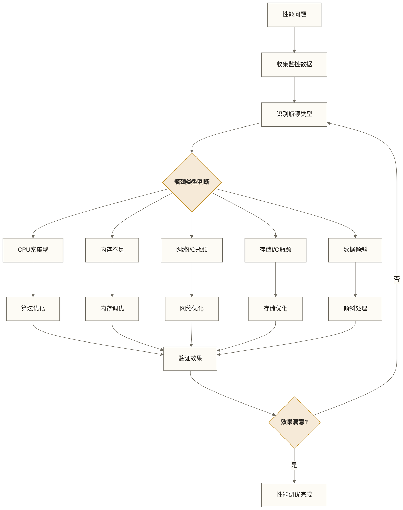

# 性能调优实战

## 概述

性能调优是Spark应用从开发到生产环境的关键环节。本文档将通过教学示例场景展示常见的性能问题及其候选解决方案，涵盖从诊断分析到优化实施的流程；场景不代表已证实的生产案例，优化效果需在具体环境中测量。

> [!info] 调优理念
> Spark性能调优是一个系统性工程，需要从应用架构、算法设计、资源配置、数据倾斜等多个维度综合考虑。优化的关键在于找到瓶颈点并采取针对性的解决方案。

## 性能诊断方法论

### 性能分析流程



### 关键监控指标

```scala
import org.apache.spark.sql.SparkSession
import org.apache.spark.util.AccumulatorV2

// 自定义累加器收集性能指标
class PerformanceAccumulator extends AccumulatorV2[String, collection.mutable.Map[String, Long]] {
  private val _map = collection.mutable.Map[String, Long]()
  
  def isZero: Boolean = _map.isEmpty
  def copy(): PerformanceAccumulator = {
    val acc = new PerformanceAccumulator
    acc._map ++= _map
    acc
  }
  def reset(): Unit = _map.clear()
  def add(v: String): Unit = _map(v) = _map.getOrElse(v, 0L) + 1
  def merge(other: AccumulatorV2[String, collection.mutable.Map[String, Long]]): Unit = {
    other match {
      case o: PerformanceAccumulator => 
        o._map.foreach { case (k, v) => _map(k) = _map.getOrElse(k, 0L) + v }
    }
  }
  def value: collection.mutable.Map[String, Long] = _map
}

// 性能监控工具类
object PerformanceMonitor {
  
  def monitorJobExecution[T](jobName: String)(operation: => T): T = {
    val startTime = System.nanoTime()
    val startMemory = Runtime.getRuntime.totalMemory() - Runtime.getRuntime.freeMemory()
    
    try {
      val result = operation
      val endTime = System.nanoTime()
      val endMemory = Runtime.getRuntime.totalMemory() - Runtime.getRuntime.freeMemory()
      
      println(s"=== 性能监控报告: $jobName ===")
      println(f"执行时间: ${(endTime - startTime) / 1e9}%.2f 秒")
      println(f"内存变化: ${(endMemory - startMemory) / 1024 / 1024}%.2f MB")
      
      result
    } catch {
      case e: Exception =>
        println(s"任务执行失败: $jobName - ${e.getMessage}")
        throw e
    }
  }
  
  def analyzeStageMetrics(spark: SparkSession): Unit = {
    val statusTracker = spark.sparkContext.statusTracker
    
    // 获取活跃任务信息
    statusTracker.getExecutorInfos.foreach { executor =>
      println(s"执行器 ${executor.executorId}:")
      println(s"  主机: ${executor.executorHost}")
      println(s"  核心数: ${executor.totalCores}")
      println(s"  最大内存: ${executor.maxMemory / 1024 / 1024} MB")
      println(s"  内存使用: ${executor.memoryUsed / 1024 / 1024} MB")
      println(s"  活跃任务数: ${executor.activeTasks}")
      println(s"  失败任务数: ${executor.failedTasks}")
      println()
    }
  }
}
```

## 实战案例一：数据倾斜优化

### 问题场景

某电商数据分析任务，处理用户行为日志时出现严重的数据倾斜问题：

```scala
// 原始代码 - 存在数据倾斜
val userLogs = spark.read.parquet("hdfs://logs/user_behavior/")
  
val userStats = userLogs
  .groupBy("user_id")
  .agg(
    count("*").as("total_actions"),
    sum("amount").as("total_amount"),
    countDistinct("product_id").as("unique_products")
  )

// 问题：某些热点用户的数据量过大，导致个别Task执行时间过长
```

### 问题诊断

```scala
object DataSkewDiagnostic {
  
  def analyzeDataSkew(df: DataFrame, keyColumn: String): Unit = {
    import org.apache.spark.sql.functions._
    
    // 1. 分析key的分布
    val keyDistribution = df
      .groupBy(keyColumn)
      .count()
      .orderBy(desc("count"))
    
    println("=== 数据分布分析 ===")
    keyDistribution.show(20)
    
    // 2. 统计分布情况
    val stats = keyDistribution.select("count").describe()
    stats.show()
    
    // 3. 找出热点key
    val hotKeys = keyDistribution
      .filter(col("count") > keyDistribution.select(avg("count") * 3).first().getDouble(0))
    
    println("=== 热点Key分析 ===")
    hotKeys.show(50)
    
    // 4. 分区倾斜分析
    val partitionSizes = df.rdd.mapPartitionsWithIndex { (partitionId, iter) =>
      Iterator((partitionId, iter.size))
    }.collect()
    
    println("=== 分区大小分析 ===")
    partitionSizes.foreach { case (partitionId, size) =>
      println(s"分区 $partitionId: $size 条记录")
    }
  }
}

// 执行诊断
DataSkewDiagnostic.analyzeDataSkew(userLogs, "user_id")
```

### 解决方案

#### 方案1：加盐技术

```scala
object SaltingTechnique {
  
  def processWithSalting(userLogs: DataFrame): DataFrame = {
    import org.apache.spark.sql.functions._
    
    // 第一阶段：局部聚合（加盐）
    val saltedLogs = userLogs
      .withColumn("salt", (rand() * 100).cast("int"))
      .withColumn("salted_user_id", concat(col("user_id"), lit("_"), col("salt")))
    
    val localAggregated = saltedLogs
      .groupBy("salted_user_id", "user_id")
      .agg(
        count("*").as("local_total_actions"),
        sum("amount").as("local_total_amount"),
        collect_set("product_id").as("local_products")
      )
    
    // 第二阶段：全局聚合（去盐）
    val globalAggregated = localAggregated
      .groupBy("user_id")
      .agg(
        sum("local_total_actions").as("total_actions"),
        sum("local_total_amount").as("total_amount"),
        size(array_distinct(flatten(collect_list("local_products")))).as("unique_products")
      )
    
    globalAggregated
  }
}
```

#### 方案2：分离热点数据

```scala
object HotDataSeparation {
  
  def processWithHotDataSeparation(userLogs: DataFrame): DataFrame = {
    import org.apache.spark.sql.functions._
    
    // 1. 识别热点用户
    val userCounts = userLogs
      .groupBy("user_id")
      .count()
    
    val avgCount = userCounts.select(avg("count")).first().getDouble(0)
    val threshold = avgCount * 3
    
    val hotUsers = userCounts
      .filter(col("count") > threshold)
      .select("user_id")
    
    // 2. 分离热点和非热点数据
    val hotUserData = userLogs.join(hotUsers, "user_id")
    val normalUserData = userLogs.join(hotUsers, "user_id", "left_anti")
    
    // 3. 分别处理
    val hotUserStats = processHotUserData(hotUserData)
    val normalUserStats = normalUserData
      .groupBy("user_id")
      .agg(
        count("*").as("total_actions"),
        sum("amount").as("total_amount"),
        countDistinct("product_id").as("unique_products")
      )
    
    // 4. 合并结果
    hotUserStats.union(normalUserStats)
  }
  
  def processHotUserData(hotData: DataFrame): DataFrame = {
    // 按user_id重分区；同一热点用户仍集中在同一分区，不能仅靠增加分区数拆散单键倾斜
    val repartitionedHotData = hotData.repartition(200, col("user_id"))
    
    repartitionedHotData
      .groupBy("user_id")
      .agg(
        count("*").as("total_actions"),
        sum("amount").as("total_amount"),
        countDistinct("product_id").as("unique_products")
      )
  }
}
```

#### 方案3：两阶段聚合

```scala
object TwoPhaseAggregation {
  
  def processWithTwoPhase(userLogs: DataFrame): DataFrame = {
    import org.apache.spark.sql.functions._
    
    // 阶段1：预聚合，增加随机前缀
    val preAggregated = userLogs
      .withColumn("random_prefix", (rand() * 10).cast("int"))
      .withColumn("prefixed_user_id", concat(col("random_prefix"), lit("_"), col("user_id")))
      .groupBy("prefixed_user_id", "user_id")
      .agg(
        count("*").as("partial_actions"),
        sum("amount").as("partial_amount"),
        collect_set("product_id").as("partial_products")
      )
    
    // 阶段2：最终聚合
    preAggregated
      .groupBy("user_id")
      .agg(
        sum("partial_actions").as("total_actions"),
        sum("partial_amount").as("total_amount"),
        size(array_distinct(flatten(collect_list("partial_products")))).as("unique_products")
      )
  }
}
```

### 效果对比

```scala
object PerformanceComparison {
  
  def compareApproaches(userLogs: DataFrame): Unit = {
    val spark = userLogs.sparkSession
    
    // 原始方法
    val originalResult = PerformanceMonitor.monitorJobExecution("原始方法") {
      userLogs
        .groupBy("user_id")
        .agg(count("*").as("total_actions"))
        .count()
    }
    
    // 加盐方法
    val saltingResult = PerformanceMonitor.monitorJobExecution("加盐方法") {
      SaltingTechnique.processWithSalting(userLogs).count()
    }
    
    // 分离热点方法
    val separationResult = PerformanceMonitor.monitorJobExecution("分离热点方法") {
      HotDataSeparation.processWithHotDataSeparation(userLogs).count()
    }
    
    // 两阶段方法
    val twoPhaseResult = PerformanceMonitor.monitorJobExecution("两阶段方法") {
      TwoPhaseAggregation.processWithTwoPhase(userLogs).count()
    }
    
    println("=== 性能对比结果 ===")
    println(s"原始方法处理记录数: $originalResult")
    println(s"加盐方法处理记录数: $saltingResult")
    println(s"分离热点方法处理记录数: $separationResult")
    println(s"两阶段方法处理记录数: $twoPhaseResult")
  }
}
```

## 实战案例二：内存优化

### 问题场景

大数据ETL任务中出现频繁的GC和OOM错误：

```scala
// 原始代码 - 内存使用不当
val largeDataset = spark.read.parquet("hdfs://data/large_dataset/")

val processedData = largeDataset
  .filter(col("status") === "active")
  .join(broadcast(dimensionTable), "dimension_id")  // 不当使用broadcast
  .groupBy("category", "region")
  .agg(sum("amount").as("total_amount"))
  .cache()  // 不必要的缓存

// 问题：内存使用效率低，频繁GC
```

### 内存分析工具

```scala
object MemoryAnalyzer {
  
  def analyzeMemoryUsage(spark: SparkSession): Unit = {
    val sc = spark.sparkContext
    
    // 1. 获取执行器内存信息
    val executorMemoryStatus = sc.getExecutorMemoryStatus
    executorMemoryStatus.foreach { case (executorId, (maxMem, remainingMem)) =>
      val usedMem = maxMem - remainingMem
      val usagePercent = (usedMem.toDouble / maxMem * 100).formatted("%.2f")
      println(s"执行器 $executorId: 使用 ${usedMem / 1024 / 1024} MB / ${maxMem / 1024 / 1024} MB ($usagePercent%)")
    }
    
    // 2. 分析RDD存储信息
    val rddInfos = sc.getRDDStorageInfo
    rddInfos.foreach { rdd =>
      if (rdd.memSize > 0) {
        println(s"RDD ${rdd.name} (ID: ${rdd.id}): ${rdd.memSize / 1024 / 1024} MB in memory")
        println(s"  分区数: ${rdd.numPartitions}")
        println(s"  缓存分区数: ${rdd.numCachedPartitions}")
        println(s"  存储级别: ${rdd.storageLevel}")
      }
    }
  }
  
  def recommendMemorySettings(dataSize: Long): Map[String, String] = {
    val executorMemory = Math.max(4, (dataSize / (1024 * 1024 * 1024) / 10).toInt)
    
    Map(
      "spark.executor.memory" -> s"${executorMemory}g",
      "spark.executor.memoryFraction" -> "0.8",
      "spark.sql.shuffle.partitions" -> s"${executorMemory * 50}",
      "spark.serializer" -> "org.apache.spark.serializer.KryoSerializer",
      "spark.sql.adaptive.enabled" -> "true",
      "spark.sql.adaptive.coalescePartitions.enabled" -> "true"
    )
  }
}
```

### 内存优化方案

#### 方案1：合理使用缓存

```scala
object CacheOptimization {
  
  def optimizedCaching(spark: SparkSession): DataFrame = {
    import spark.implicits._
    
    val largeDataset = spark.read.parquet("hdfs://data/large_dataset/")
    
    // 1. 只缓存必要的数据
    val filteredData = largeDataset
      .filter(col("status") === "active")
      .select("user_id", "category", "region", "amount")  // 只选择需要的列
    
    // 2. 选择合适的存储级别
    val cachedData = filteredData.persist(StorageLevel.MEMORY_AND_DISK_SER_2)
    
    // 3. 验证缓存效果
    val firstUse = cachedData.count()
    val secondUse = cachedData.count()  // 是否更快需实测，取决于缓存驻留、调度和资源竞争
    
    // 4. 及时释放缓存
    def processData(): DataFrame = {
      val result = cachedData
        .groupBy("category", "region")
        .agg(sum("amount").as("total_amount"))
      
      cachedData.unpersist()  // 此时仅构建了惰性聚合计划，尚未执行结果Action；这里释放缓存不能保证后续聚合复用缓存
      result
    }
    
    processData()
  }
  
  // 缓存策略选择
  def chooseCacheStrategy(dataSize: Long, accessPattern: String): StorageLevel = {
    accessPattern match {
      case "frequent_read" if dataSize < 1024 * 1024 * 1024 => // 1GB以下
        StorageLevel.MEMORY_ONLY
      case "frequent_read" =>
        StorageLevel.MEMORY_AND_DISK_SER
      case "occasional_read" =>
        StorageLevel.DISK_ONLY_2
      case _ =>
        StorageLevel.NONE
    }
  }
}
```

#### 方案2：内存配置优化

```scala
object MemoryConfiguration {
  
  def createOptimizedSparkSession(appName: String): SparkSession = {
    SparkSession.builder()
      .appName(appName)
      // 执行器内存配置
      .config("spark.executor.memory", "8g")
      .config("spark.executor.memoryFraction", "0.8")
      .config("spark.memory.storageFraction", "0.3")
      
      // 驱动器内存配置
      .config("spark.driver.memory", "4g")
      .config("spark.driver.maxResultSize", "2g")
      
      // 内存管理优化
      .config("spark.sql.execution.arrow.pyspark.enabled", "true")
      .config("spark.serializer", "org.apache.spark.serializer.KryoSerializer")
      .config("spark.kryoserializer.buffer.max", "256m")
      
      // 垃圾回收优化
      .config("spark.executor.extraJavaOptions", 
        "-XX:+UseG1GC " +
        "-XX:+UnlockDiagnosticVMOptions " +
        "-XX:+G1PrintRegionRememberedSetInfo " +
        "-XX:MaxGCPauseMillis=200 " +
        "-XX:G1HeapRegionSize=16m")
      
      // Shuffle优化
      .config("spark.sql.shuffle.partitions", "400")
      .config("spark.sql.adaptive.enabled", "true")
      .config("spark.sql.adaptive.coalescePartitions.enabled", "true")
      
      .getOrCreate()
  }
}
```

#### 方案3：数据结构优化

```scala
object DataStructureOptimization {
  
  // 使用更紧凑的数据类型
  case class OptimizedRecord(
    userId: Int,        // 使用Int而不是String
    timestamp: Long,    // 使用时间戳而不是Date对象
    amount: Float,      // 使用Float而不是Double（如果精度允许）
    categoryId: Short   // 使用Short而不是Int（如果范围允许）
  )
  
  def optimizeDataTypes(df: DataFrame): DataFrame = {
    import org.apache.spark.sql.types._
    import org.apache.spark.sql.functions._
    
    df.select(
      col("user_id").cast(IntegerType),
      col("timestamp").cast(LongType),
      col("amount").cast(FloatType),
      col("category_id").cast(ShortType)
    )
  }
  
  // 使用数组而不是嵌套结构
  def flattenNestedStructures(df: DataFrame): DataFrame = {
    import org.apache.spark.sql.functions._
    
    df.select(
      col("id"),
      col("metrics.clicks").as("clicks"),
      col("metrics.impressions").as("impressions"),
      col("metrics.conversions").as("conversions")
    )
  }
  
  // 列式存储优化
  def writeOptimizedParquet(df: DataFrame, outputPath: String): Unit = {
    df.write
      .mode("overwrite")
      .option("compression", "snappy")  // 使用snappy压缩
      .option("parquet.block.size", "268435456")  // 256MB块大小
      .option("parquet.page.size", "1048576")     // 1MB页大小
      .partitionBy("date")  // 按日期分区
      .parquet(outputPath)
  }
}
```

## 实战案例三：Shuffle优化

### 问题场景

大表JOIN操作导致Shuffle开销过大：

```scala
// 原始代码 - Shuffle开销大
val orders = spark.read.parquet("hdfs://data/orders/")
val customers = spark.read.parquet("hdfs://data/customers/")
val products = spark.read.parquet("hdfs://data/products/")

val result = orders
  .join(customers, "customer_id")
  .join(products, "product_id")
  .groupBy("customer_segment", "product_category")
  .agg(sum("order_amount").as("total_sales"))

// 问题：多次大表JOIN，Shuffle数据量巨大
```

### Shuffle优化策略

#### 方案1：使用Broadcast JOIN

```scala
object BroadcastOptimization {
  
  def optimizeWithBroadcast(spark: SparkSession): DataFrame = {
    import org.apache.spark.sql.functions._
    
    val orders = spark.read.parquet("hdfs://data/orders/")
    val customers = spark.read.parquet("hdfs://data/customers/")
    val products = spark.read.parquet("hdfs://data/products/")
    
    // 1. 检查表大小，决定是否使用broadcast
    def shouldBroadcast(df: DataFrame, threshold: Long = 100 * 1024 * 1024): Boolean = {
      try {
        val size = df.queryExecution.optimizedPlan.stats.sizeInBytes.toLong
        size < threshold
      } catch {
        case _: Exception => false
      }
    }
    
    // 2. 智能选择JOIN策略
    val optimizedResult = if (shouldBroadcast(customers) && shouldBroadcast(products)) {
      // 两个维度表都可以broadcast
      orders
        .join(broadcast(customers), "customer_id")
        .join(broadcast(products), "product_id")
        .groupBy("customer_segment", "product_category")
        .agg(sum("order_amount").as("total_sales"))
    } else if (shouldBroadcast(customers)) {
      // 只broadcast customers表
      orders
        .join(broadcast(customers), "customer_id")
        .join(products, "product_id")
        .groupBy("customer_segment", "product_category")
        .agg(sum("order_amount").as("total_sales"))
    } else {
      // 使用bucket join
      optimizeWithBucketJoin(orders, customers, products)
    }
    
    optimizedResult
  }
  
  def optimizeWithBucketJoin(orders: DataFrame, customers: DataFrame, products: DataFrame): DataFrame = {
    // 预先按JOIN键分桶存储数据
    orders.write
      .mode("overwrite")
      .bucketBy(200, "customer_id", "product_id")
      .sortBy("order_date")
      .saveAsTable("orders_bucketed")
    
    customers.write
      .mode("overwrite")
      .bucketBy(200, "customer_id")
      .saveAsTable("customers_bucketed")
    
    products.write
      .mode("overwrite")
      .bucketBy(200, "product_id")
      .saveAsTable("products_bucketed")
    
    // 读取分桶表进行JOIN
    val bucketedOrders = spark.table("orders_bucketed")
    val bucketedCustomers = spark.table("customers_bucketed")
    val bucketedProducts = spark.table("products_bucketed")
    
    bucketedOrders
      .join(bucketedCustomers, "customer_id")
      .join(bucketedProducts, "product_id")
      .groupBy("customer_segment", "product_category")
      .agg(sum("order_amount").as("total_sales"))
  }
}
```

#### 方案2：分区JOIN优化

```scala
object PartitionJoinOptimization {
  
  def optimizeJoinWithPartitioning(spark: SparkSession): DataFrame = {
    import org.apache.spark.sql.functions._
    
    val orders = spark.read.parquet("hdfs://data/orders/")
    val customers = spark.read.parquet("hdfs://data/customers/")
    
    // 1. 重分区确保JOIN键在同一分区
    val repartitionedOrders = orders
      .repartition(200, col("customer_id"))
      .cache()
    
    val repartitionedCustomers = customers
      .repartition(200, col("customer_id"))
      .cache()
    
    // 2. 执行JOIN
    val joinedResult = repartitionedOrders
      .join(repartitionedCustomers, "customer_id")
    
    // 3. 清理缓存
    repartitionedOrders.unpersist()
    repartitionedCustomers.unpersist()
    
    joinedResult
  }
  
  // 基于数据分布的智能分区
  def intelligentPartitioning(df: DataFrame, joinKey: String): DataFrame = {
    // 分析JOIN键的分布
    val keyDistribution = df
      .groupBy(joinKey)
      .count()
      .select(
        avg("count").as("avg_count"),
        stddev("count").as("stddev_count"),
        max("count").as("max_count")
      )
      .collect()(0)
    
    val avgCount = keyDistribution.getDouble(0)
    val stddevCount = keyDistribution.getDouble(1)
    val maxCount = keyDistribution.getLong(2)
    
    // 根据分布特征选择分区策略
    if (stddevCount / avgCount > 2.0) {
      // 数据倾斜严重，使用加盐分区
      df.repartition(400, col(joinKey), (rand() * 10).cast("int"))
    } else {
      // 数据分布相对均匀，使用标准分区
      val numPartitions = Math.max(100, (maxCount / avgCount * 100).toInt)
      df.repartition(numPartitions, col(joinKey))
    }
  }
}
```

#### 方案3：预计算优化

```scala
object PreComputationOptimization {
  
  def optimizeWithPreComputation(spark: SparkSession): DataFrame = {
    import org.apache.spark.sql.functions._
    
    // 1. 预计算维度表信息
    val customerSummary = spark.read.parquet("hdfs://data/customers/")
      .select("customer_id", "customer_segment", "region")
      .cache()
    
    val productSummary = spark.read.parquet("hdfs://data/products/")
      .select("product_id", "product_category", "brand")
      .cache()
    
    // 2. 预聚合事实表
    val orderSummary = spark.read.parquet("hdfs://data/orders/")
      .groupBy("customer_id", "product_id", "order_date")
      .agg(
        sum("order_amount").as("daily_amount"),
        count("*").as("daily_orders")
      )
    
    // 3. 执行优化后的JOIN
    val result = orderSummary
      .join(broadcast(customerSummary), "customer_id")
      .join(broadcast(productSummary), "product_id")
      .groupBy("customer_segment", "product_category")
      .agg(
        sum("daily_amount").as("total_sales"),
        sum("daily_orders").as("total_orders")
      )
    
    // 4. 清理缓存
    customerSummary.unpersist()
    productSummary.unpersist()
    
    result
  }
}
```

## 实战案例四：I/O优化

### 文件格式优化

```scala
object FileFormatOptimization {
  
  def compareFileFormats(spark: SparkSession, dataPath: String): Unit = {
    val df = spark.read.json(dataPath)
    
    // 测试不同格式的写入性能
    val formats = Map(
      "parquet" -> "parquet",
      "orc" -> "orc",
      "delta" -> "delta",
      "json" -> "json",
      "csv" -> "csv"
    )
    
    formats.foreach { case (formatName, format) =>
      val outputPath = s"hdfs://output/$formatName"
      
      val fileSize = PerformanceMonitor.monitorJobExecution(s"写入$formatName格式") {
        df.write
          .mode("overwrite")
          .option("compression", "snappy")
          .format(format)
          .save(outputPath)
        
        // 获取文件大小
        val fs = org.apache.hadoop.fs.FileSystem.get(spark.sparkContext.hadoopConfiguration)
        val path = new org.apache.hadoop.fs.Path(outputPath)
        val size = fs.getContentSummary(path).getLength
        size
      }
      
      println(s"$formatName 格式:")
      println(s"  文件大小: ${fileSize / 1024 / 1024} MB")
      println(s"  平均每条记录存储大小: ${(fileSize.toDouble / df.count()).formatted("%.2f")} bytes/record")
      println()
    }
    
    // 测试读取性能
    formats.foreach { case (formatName, format) =>
      val inputPath = s"hdfs://output/$formatName"
      
      PerformanceMonitor.monitorJobExecution(s"读取$formatName格式") {
        spark.read.format(format).load(inputPath).count()
      }
    }
  }
  
  def optimizeParquetSettings(): Map[String, String] = {
    Map(
      // 压缩设置
      "spark.sql.parquet.compression.codec" -> "snappy",
      
      // 块大小设置
      "spark.sql.parquet.block.size" -> "268435456",  // 256MB
      
      // 页大小设置
      "spark.sql.parquet.page.size" -> "1048576",     // 1MB
      
      // 字典编码
      "spark.sql.parquet.dictionary.enabled" -> "true",
      
      // 向量化读取
      "spark.sql.parquet.enableVectorizedReader" -> "true",
      
      // 批处理大小
      "spark.sql.parquet.columnarReaderBatchSize" -> "4096",
      
      // 过滤器下推
      "spark.sql.parquet.filterPushdown" -> "true",
      
      // 设置文件读取时每个分区规划的最大字节数，不合并磁盘上的小文件
      "spark.sql.files.maxPartitionBytes" -> "134217728"  // 128MB
    )
  }
}
```

### 分区策略优化

```scala
object PartitionStrategyOptimization {
  
  def analyzePartitionStrategy(df: DataFrame): Unit = {
    import org.apache.spark.sql.functions._
    
    // 1. 分析当前分区情况
    val partitionInfo = df.rdd.mapPartitionsWithIndex { (partitionId, iter) =>
      val count = iter.size
      Iterator((partitionId, count))
    }.collect()
    
    println("=== 当前分区分析 ===")
    partitionInfo.foreach { case (partitionId, count) =>
      println(s"分区 $partitionId: $count 条记录")
    }
    
    val totalRecords = partitionInfo.map(_._2).sum
    val avgRecordsPerPartition = totalRecords.toDouble / partitionInfo.length
    val maxRecords = partitionInfo.map(_._2).max
    val minRecords = partitionInfo.map(_._2).min
    
    println(s"总记录数: $totalRecords")
    println(s"平均每分区记录数: ${avgRecordsPerPartition.formatted("%.0f")}")
    println(s"最大分区记录数: $maxRecords")
    println(s"最小分区记录数: $minRecords")
    println(s"分区不平衡比率: ${(maxRecords.toDouble / avgRecordsPerPartition).formatted("%.2f")}")
    
    // 2. 推荐分区策略
    if (maxRecords > avgRecordsPerPartition * 2) {
      println("建议: 数据分布不均匀，考虑重新分区或使用coalesce")
    }
    
    val recommendedPartitions = Math.max(1, totalRecords / 10000).toInt
    println(s"推荐分区数: $recommendedPartitions")
  }
  
  def optimizePartitions(df: DataFrame): DataFrame = {
    val spark = df.sparkSession
    import org.apache.spark.sql.functions._
    
    // 1. 根据数据量自动计算最优分区数
    val recordCount = df.count()
    val targetRecordsPerPartition = 10000
    val optimalPartitions = Math.max(1, (recordCount / targetRecordsPerPartition).toInt)
    
    // 2. 检查当前分区数
    val currentPartitions = df.rdd.getNumPartitions
    
    if (currentPartitions > optimalPartitions * 2) {
      // 分区过多，合并分区
      println(s"当前分区数 $currentPartitions 过多，合并至 $optimalPartitions")
      df.coalesce(optimalPartitions)
    } else if (currentPartitions < optimalPartitions / 2) {
      // 分区过少，重新分区
      println(s"当前分区数 $currentPartitions 过少，重新分区至 $optimalPartitions")
      df.repartition(optimalPartitions)
    } else {
      // 分区数合适
      println(s"当前分区数 $currentPartitions 合适，无需调整")
      df
    }
  }
  
  // 基于业务逻辑的分区策略
  def partitionByBusinessLogic(df: DataFrame): DataFrame = {
    import org.apache.spark.sql.functions._
    
    // 按日期分区（适用于时序数据）
    val datePartitioned = df
      .withColumn("partition_date", date_format(col("timestamp"), "yyyy-MM-dd"))
      .repartition(col("partition_date"))
    
    // 按用户ID hash分区（适用于用户行为数据）
    val userPartitioned = df
      .repartition(200, col("user_id"))
    
    // 组合分区策略
    val combinedPartitioned = df
      .repartition(100, col("date"), col("region"))
    
    combinedPartitioned
  }
}
```

## 监控和调试工具

### 自定义监控系统

```scala
object CustomMonitoringSystem {
  
  case class JobMetrics(
    jobId: String,
    startTime: Long,
    endTime: Long,
    duration: Long,
    inputRecords: Long,
    outputRecords: Long,
    shuffleReadBytes: Long,
    shuffleWriteBytes: Long,
    peakExecutionMemory: Long,
    spilledRecords: Long,
    failedTasks: Int
  )
  
  class SparkJobMonitor(spark: SparkSession) {
    private val statusTracker = spark.sparkContext.statusTracker
    
    def captureJobMetrics(jobId: Int): Option[JobMetrics] = {
      statusTracker.getJobInfo(jobId) match {
        case Some(jobInfo) =>
          val stageInfos = jobInfo.stageIds.flatMap(statusTracker.getStageInfo)
          
          val aggregatedMetrics = stageInfos.foldLeft(
            (0L, 0L, 0L, 0L, 0L, 0L, 0)
          ) { case ((inputRecords, outputRecords, shuffleRead, shuffleWrite, memory, spilled, failed), stage) =>
            (
              inputRecords + stage.submissionTime.getOrElse(0L),
              outputRecords + stage.completionTime.getOrElse(0L),
              shuffleRead,
              shuffleWrite,
              memory,
              spilled,
              failed + stage.numFailedTasks
            )
          }
          
          Some(JobMetrics(
            jobId = jobId.toString,
            startTime = jobInfo.submissionTime.getOrElse(0L),
            endTime = jobInfo.completionTime.getOrElse(System.currentTimeMillis()),
            duration = jobInfo.completionTime.getOrElse(System.currentTimeMillis()) - jobInfo.submissionTime.getOrElse(0L),
            inputRecords = aggregatedMetrics._1,
            outputRecords = aggregatedMetrics._2,
            shuffleReadBytes = aggregatedMetrics._3,
            shuffleWriteBytes = aggregatedMetrics._4,
            peakExecutionMemory = aggregatedMetrics._5,
            spilledRecords = aggregatedMetrics._6,
            failedTasks = aggregatedMetrics._7
          ))
        case None => None
      }
    }
    
    def generatePerformanceReport(): String = {
      val activeJobs = statusTracker.getActiveJobIds()
      val executorInfos = statusTracker.getExecutorInfos
      
      val report = new StringBuilder
      report.append("=== Spark 性能监控报告 ===\n")
      report.append(s"活跃任务数: ${activeJobs.length}\n")
      report.append(s"执行器数量: ${executorInfos.length}\n")
      
      executorInfos.foreach { executor =>
        report.append(s"\n执行器 ${executor.executorId}:\n")
        report.append(f"  内存使用率: ${executor.memoryUsed.toDouble / executor.maxMemory * 100}%.2f%%\n")
        report.append(s"  活跃任务数: ${executor.activeTasks}\n")
        report.append(s"  完成任务数: ${executor.totalTasks - executor.activeTasks - executor.failedTasks}\n")
        report.append(s"  失败任务数: ${executor.failedTasks}\n")
      }
      
      report.toString()
    }
  }
  
  def setupRealtimeMonitoring(spark: SparkSession): Unit = {
    val monitor = new SparkJobMonitor(spark)
    
    // 定期输出性能报告
    val timer = new java.util.Timer()
    timer.schedule(new java.util.TimerTask {
      def run(): Unit = {
        println(monitor.generatePerformanceReport())
      }
    }, 0, 30000)  // 每30秒输出一次
    
    // 注册关闭钩子
    sys.addShutdownHook {
      timer.cancel()
    }
  }
}
```

### 性能分析脚本

```scala
object PerformanceAnalysisTools {
  
  def analyzeSlowStages(spark: SparkSession): Unit = {
    val statusTracker = spark.sparkContext.statusTracker
    val activeStages = statusTracker.getActiveStageInfos()
    val completedStages = statusTracker.getStageInfos
    
    println("=== 慢Stage分析 ===")
    completedStages
      .filter(_.completionTime.isDefined)
      .map { stage =>
        val duration = stage.completionTime.get - stage.submissionTime.getOrElse(0L)
        (stage, duration)
      }
      .sortBy(-_._2)
      .take(10)
      .foreach { case (stage, duration) =>
        println(s"Stage ${stage.stageId} (${stage.name}):")
        println(f"  执行时间: ${duration / 1000.0}%.2f 秒")
        println(s"  任务数: ${stage.numTasks}")
        println(s"  失败任务数: ${stage.numFailedTasks}")
        println(s"  输入大小: ${stage.inputBytes / 1024 / 1024} MB")
        println(s"  输出大小: ${stage.outputBytes / 1024 / 1024} MB")
        println()
      }
  }
  
  def identifyResourceBottlenecks(spark: SparkSession): Unit = {
    val executorInfos = spark.sparkContext.statusTracker.getExecutorInfos
    
    println("=== 资源瓶颈分析 ===")
    
    // CPU使用分析
    val avgActiveTasks = executorInfos.map(_.activeTasks).sum.toDouble / executorInfos.length
    val maxActiveTasks = executorInfos.map(_.activeTasks).max
    
    if (maxActiveTasks > avgActiveTasks * 2) {
      println("发现CPU热点: 某些执行器负载过高")
      executorInfos.filter(_.activeTasks > avgActiveTasks * 1.5).foreach { executor =>
        println(s"  执行器 ${executor.executorId}: ${executor.activeTasks} 个活跃任务")
      }
    }
    
    // 内存使用分析
    executorInfos.foreach { executor =>
      val memoryUsagePercent = executor.memoryUsed.toDouble / executor.maxMemory * 100
      if (memoryUsagePercent > 80) {
        println(f"内存使用警告: 执行器 ${executor.executorId} 内存使用率 $memoryUsagePercent%.1f%%")
      }
    }
    
    // 任务失败分析
    val totalFailedTasks = executorInfos.map(_.failedTasks).sum
    if (totalFailedTasks > 0) {
      println(s"任务失败警告: 总共 $totalFailedTasks 个任务失败")
    }
  }
  
  // SQL查询性能分析
  def analyzeSQLPerformance(spark: SparkSession, query: String): Unit = {
    val df = spark.sql(query)
    
    println("=== SQL查询计划分析 ===")
    df.explain(true)  // 显示详细执行计划
    
    // 执行查询并收集统计信息
    val startTime = System.nanoTime()
    val result = df.count()
    val endTime = System.nanoTime()
    
    println(s"查询结果: $result 行")
    println(f"执行时间: ${(endTime - startTime) / 1e9}%.2f 秒")
    
    // 分析查询统计信息
    val queryExecution = df.queryExecution
    val optimizedPlan = queryExecution.optimizedPlan
    val sparkPlan = queryExecution.sparkPlan
    
    println("\n=== 查询优化建议 ===")
    
    // 检查是否使用了广播JOIN
    val hasBroadcastJoin = sparkPlan.toString.contains("BroadcastHashJoin")
    if (!hasBroadcastJoin && sparkPlan.toString.contains("Join")) {
      println("建议: 考虑使用broadcast hint优化小表JOIN")
    }
    
    // 检查是否有全表扫描
    if (sparkPlan.toString.contains("FileScan")) {
      println("建议: 使用分区裁剪和谓词下推减少数据扫描量")
    }
  }
}
```

## 性能调优检查清单

### 应用级优化

```scala
object PerformanceChecklist {
  
  case class OptimizationItem(
    category: String,
    item: String,
    priority: String,
    status: String,
    recommendation: String
  )
  
  def generateOptimizationChecklist(spark: SparkSession): List[OptimizationItem] = {
    val checklist = scala.collection.mutable.ListBuffer[OptimizationItem]()
    
    // 1. 资源配置检查
    val executorMemory = spark.conf.get("spark.executor.memory", "1g")
    val executorCores = spark.conf.get("spark.executor.cores", "1")
    val numExecutors = spark.conf.get("spark.executor.instances", "1")
    
    checklist += OptimizationItem(
      "资源配置",
      "执行器内存设置",
      "高",
      if (executorMemory.replace("g", "").toInt >= 4) "✓" else "✗",
      "建议设置为4GB以上"
    )
    
    checklist += OptimizationItem(
      "资源配置",
      "执行器核心数",
      "高",
      if (executorCores.toInt >= 2 && executorCores.toInt <= 5) "✓" else "✗",
      "建议设置为2-5个核心"
    )
    
    // 2. 序列化检查
    val serializer = spark.conf.get("spark.serializer", "")
    checklist += OptimizationItem(
      "序列化",
      "Kryo序列化器",
      "中",
      if (serializer.contains("KryoSerializer")) "✓" else "✗",
      "建议使用Kryo序列化器提高性能"
    )
    
    // 3. 自适应查询执行检查
    val aqeEnabled = spark.conf.get("spark.sql.adaptive.enabled", "false")
    checklist += OptimizationItem(
      "查询优化",
      "自适应查询执行",
      "高",
      if (aqeEnabled.toBoolean) "✓" else "✗",
      "建议启用AQE优化查询性能"
    )
    
    // 4. Shuffle分区数检查
    val shufflePartitions = spark.conf.get("spark.sql.shuffle.partitions", "200")
    checklist += OptimizationItem(
      "Shuffle优化",
      "Shuffle分区数",
      "高",
      if (shufflePartitions.toInt >= 200) "✓" else "✗",
      "建议根据数据量调整分区数"
    )
    
    // 5. 广播阈值检查
    val broadcastThreshold = spark.conf.get("spark.sql.autoBroadcastJoinThreshold", "10485760")
    checklist += OptimizationItem(
      "JOIN优化",
      "广播JOIN阈值",
      "中",
      if (broadcastThreshold.toLong > 0) "✓" else "✗",
      "根据集群内存适当调整广播阈值"
    )
    
    checklist.toList
  }
  
  def printOptimizationReport(checklist: List[OptimizationItem]): Unit = {
    println("=== Spark 性能优化检查清单 ===")
    println()
    
    val categoryGroups = checklist.groupBy(_.category)
    
    categoryGroups.foreach { case (category, items) =>
      println(s"【$category】")
      items.foreach { item =>
        println(f"  ${item.status}%-2s ${item.item}%-20s [${item.priority}] ${item.recommendation}")
      }
      println()
    }
    
    val passedItems = checklist.count(_.status == "✓")
    val totalItems = checklist.length
    val score = (passedItems.toDouble / totalItems * 100).toInt
    
    println(s"优化完成度: $passedItems/$totalItems ($score%)")
    
    if (score < 70) {
      println("⚠️  建议优先处理高优先级的优化项")
    } else if (score < 90) {
      println("👍 性能配置良好，可以进一步优化中优先级项目")
    } else {
      println("🎉 性能配置优秀！")
    }
  }
}
```

## 总结

Spark性能调优是一个系统性工程，需要：

**核心原则**：
1. **先分析后优化**：通过监控和分析找到真正的瓶颈
2. **逐步优化**：一次只优化一个方面，便于评估效果
3. **持续监控**：建立监控体系，及时发现性能问题
4. **全面考虑**：从算法、配置、架构等多个维度优化

**常见优化策略**：
1. **数据倾斜**：加盐、分离热点、两阶段聚合
2. **内存优化**：合理缓存、配置调优、数据结构优化
3. **Shuffle优化**：广播JOIN、分区优化、预计算
4. **I/O优化**：文件格式选择、分区策略、压缩设置

**监控要点**：
- 任务执行时间和失败率
- 内存使用和GC情况
- Shuffle读写量
- 数据倾斜程度
- 资源利用率

**最佳实践**：
- 建立完整的性能监控体系
- 定期进行性能审计
- 根据业务场景选择优化策略
- 持续学习和应用新的优化技术

## 相关文档

- [[【技术与工具】/Spark/11-Spark性能调优|Spark性能调优]]：基础优化理论
- [[【技术与工具】/Spark/19-性能监控与调优|性能监控与调优]]：监控工具和方法
- [[【技术与工具】/Spark/13-分区调优|分区调优]]：分区优化策略
- [[【技术与工具】/Spark/12-缓存与持久化|缓存与持久化]]：缓存优化技术