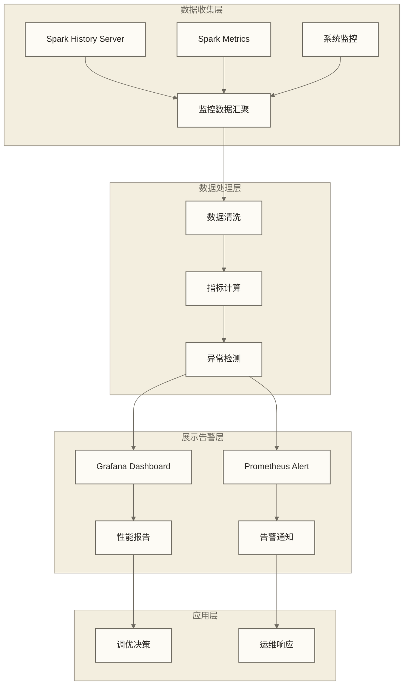

# 性能监控与调优

## 概述

生产环境中的Spark应用需要全面的监控体系来确保性能稳定和问题快速定位。本文档详细介绍Spark性能监控的完整方案，包括监控工具选择、指标体系建设、告警机制设计和调优策略实施。

> [!info] 监控理念
> 监控不是目的，而是手段。有效的监控体系应该能够：预防问题发生、快速定位问题根因、指导优化决策、量化优化效果。

## 监控体系架构

### 整体监控架构



### 监控数据源

```scala
object MonitoringDataSources {
  
  // Spark Metrics 配置
  def configureSparkMetrics(): Map[String, String] = {
    Map(
      // 启用所有metrics
      "spark.metrics.conf.driver.source.jvm.class" -> "org.apache.spark.metrics.source.JvmSource",
      "spark.metrics.conf.executor.source.jvm.class" -> "org.apache.spark.metrics.source.JvmSource",
      
      // 配置Prometheus sink
      "spark.metrics.conf.*.sink.prometheusServlet.class" -> "org.apache.spark.metrics.sink.PrometheusServlet",
      "spark.metrics.conf.*.sink.prometheusServlet.path" -> "/metrics/prometheus",
      
      // 配置CSV sink用于历史数据
      "spark.metrics.conf.*.sink.csv.class" -> "org.apache.spark.metrics.sink.CsvSink",
      "spark.metrics.conf.*.sink.csv.period" -> "10",
      "spark.metrics.conf.*.sink.csv.unit" -> "seconds",
      "spark.metrics.conf.*.sink.csv.directory" -> "/tmp/spark-metrics",
      
      // 启用事件日志
      "spark.eventLog.enabled" -> "true",
      "spark.eventLog.dir" -> "hdfs://spark-history/events",
      "spark.eventLog.compress" -> "true",
      
      // History Server配置
      "spark.history.provider" -> "org.apache.spark.deploy.history.FsHistoryProvider",
      "spark.history.fs.logDirectory" -> "hdfs://spark-history/events",
      "spark.history.fs.update.interval" -> "10s",
      "spark.history.ui.maxApplications" -> "500"
    )
  }
  
  // 自定义Metrics收集器
  class SparkApplicationMetrics(spark: SparkSession) {
    private val statusTracker = spark.sparkContext.statusTracker
    
    def collectApplicationMetrics(): ApplicationMetrics = {
      val activeJobs = statusTracker.getActiveJobIds()
      val activeStages = statusTracker.getActiveStageInfos()
      val executorInfos = statusTracker.getExecutorInfos
      
      ApplicationMetrics(
        applicationId = spark.sparkContext.applicationId,
        timestamp = System.currentTimeMillis(),
        activeJobs = activeJobs.length,
        activeStages = activeStages.length,
        totalExecutors = executorInfos.length,
        activeTasks = executorInfos.map(_.activeTasks).sum,
        failedTasks = executorInfos.map(_.failedTasks).sum,
        totalMemory = executorInfos.map(_.maxMemory).sum,
        usedMemory = executorInfos.map(_.memoryUsed).sum,
        totalCores = executorInfos.map(_.totalCores).sum
      )
    }
    
    case class ApplicationMetrics(
      applicationId: String,
      timestamp: Long,
      activeJobs: Int,
      activeStages: Int,
      totalExecutors: Int,
      activeTasks: Int,
      failedTasks: Int,
      totalMemory: Long,
      usedMemory: Long,
      totalCores: Int
    )
  }
}
```

## 核心监控指标体系

### 应用级监控指标

```scala
object ApplicationLevelMetrics {
  
  case class JobMetrics(
    jobId: Int,
    submissionTime: Long,
    completionTime: Option[Long],
    stageIds: Seq[Int],
    status: String,
    numTasks: Int,
    numActiveTasks: Int,
    numCompletedTasks: Int,
    numFailedTasks: Int
  )
  
  case class StageMetrics(
    stageId: Int,
    attemptId: Int,
    name: String,
    numTasks: Int,
    numActiveTasks: Int,
    numCompletedTasks: Int,
    numFailedTasks: Int,
    executorRunTime: Long,
    executorCpuTime: Long,
    submissionTime: Option[Long],
    firstTaskLaunchedTime: Option[Long],
    completionTime: Option[Long],
    inputBytes: Long,
    inputRecords: Long,
    outputBytes: Long,
    outputRecords: Long,
    shuffleReadBytes: Long,
    shuffleReadRecords: Long,
    shuffleWriteBytes: Long,
    shuffleWriteRecords: Long,
    memoryBytesSpilled: Long,
    diskBytesSpilled: Long
  )
  
  class MetricsCollector(spark: SparkSession) {
    private val statusTracker = spark.sparkContext.statusTracker
    
    def collectJobMetrics(): Seq[JobMetrics] = {
      statusTracker.getJobInfos.map { jobInfo =>
        JobMetrics(
          jobId = jobInfo.jobId,
          submissionTime = jobInfo.submissionTime.getOrElse(0L),
          completionTime = jobInfo.completionTime,
          stageIds = jobInfo.stageIds,
          status = jobInfo.status.toString,
          numTasks = jobInfo.numTasks,
          numActiveTasks = jobInfo.numActiveTasks,
          numCompletedTasks = jobInfo.numCompletedTasks,
          numFailedTasks = jobInfo.numFailedTasks
        )
      }
    }
    
    def collectStageMetrics(): Seq[StageMetrics] = {
      statusTracker.getStageInfos.map { stageInfo =>
        StageMetrics(
          stageId = stageInfo.stageId,
          attemptId = stageInfo.attemptId,
          name = stageInfo.name,
          numTasks = stageInfo.numTasks,
          numActiveTasks = stageInfo.numActiveTasks,
          numCompletedTasks = stageInfo.numCompletedTasks,
          numFailedTasks = stageInfo.numFailedTasks,
          executorRunTime = stageInfo.executorRunTime,
          executorCpuTime = stageInfo.executorCpuTime,
          submissionTime = stageInfo.submissionTime,
          firstTaskLaunchedTime = stageInfo.firstTaskLaunchedTime,
          completionTime = stageInfo.completionTime,
          inputBytes = stageInfo.inputBytes,
          inputRecords = stageInfo.inputRecords,
          outputBytes = stageInfo.outputBytes,
          outputRecords = stageInfo.outputRecords,
          shuffleReadBytes = stageInfo.shuffleReadBytes,
          shuffleReadRecords = stageInfo.shuffleReadRecords,
          shuffleWriteBytes = stageInfo.shuffleWriteBytes,
          shuffleWriteRecords = stageInfo.shuffleWriteRecords,
          memoryBytesSpilled = stageInfo.memoryBytesSpilled,
          diskBytesSpilled = stageInfo.diskBytesSpilled
        )
      }
    }
  }
}
```

### 执行器监控指标

```scala
object ExecutorLevelMetrics {
  
  case class ExecutorMetrics(
    executorId: String,
    host: String,
    port: Int,
    isActive: Boolean,
    totalCores: Int,
    maxTasks: Int,
    activeTasks: Int,
    failedTasks: Int,
    completedTasks: Int,
    totalTasks: Int,
    totalDuration: Long,
    totalGcTime: Long,
    totalInputBytes: Long,
    totalShuffleRead: Long,
    totalShuffleWrite: Long,
    maxMemory: Long,
    memoryUsed: Long,
    diskUsed: Long,
    maxOnHeapStorageMemory: Long,
    maxOffHeapStorageMemory: Long,
    timeStamp: Long
  )
  
  class ExecutorMetricsCollector(spark: SparkSession) {
    
    def collectExecutorMetrics(): Seq[ExecutorMetrics] = {
      val statusTracker = spark.sparkContext.statusTracker
      
      statusTracker.getExecutorInfos.map { executorInfo =>
        ExecutorMetrics(
          executorId = executorInfo.executorId,
          host = executorInfo.executorHost,
          port = executorInfo.port,
          isActive = executorInfo.isActive,
          totalCores = executorInfo.totalCores,
          maxTasks = executorInfo.maxTasks,
          activeTasks = executorInfo.activeTasks,
          failedTasks = executorInfo.failedTasks,
          completedTasks = executorInfo.completedTasks,
          totalTasks = executorInfo.totalTasks,
          totalDuration = executorInfo.totalDuration,
          totalGcTime = executorInfo.totalGcTime,
          totalInputBytes = executorInfo.totalInputBytes,
          totalShuffleRead = executorInfo.totalShuffleRead,
          totalShuffleWrite = executorInfo.totalShuffleWrite,
          maxMemory = executorInfo.maxMemory,
          memoryUsed = executorInfo.memoryUsed,
          diskUsed = executorInfo.diskUsed,
          maxOnHeapStorageMemory = executorInfo.maxOnHeapStorageMemory,
          maxOffHeapStorageMemory = executorInfo.maxOffHeapStorageMemory,
          timeStamp = System.currentTimeMillis()
        )
      }
    }
    
    def analyzeExecutorHealth(): Map[String, String] = {
      val executorMetrics = collectExecutorMetrics()
      val analysis = scala.collection.mutable.Map[String, String]()
      
      // 内存使用分析
      executorMetrics.foreach { executor =>
        val memoryUsagePercent = (executor.memoryUsed.toDouble / executor.maxMemory * 100).toInt
        if (memoryUsagePercent > 80) {
          analysis += s"high_memory_${executor.executorId}" -> s"执行器${executor.executorId}内存使用率${memoryUsagePercent}%过高"
        }
      }
      
      // 任务失败率分析
      executorMetrics.foreach { executor =>
        if (executor.totalTasks > 0) {
          val failureRate = (executor.failedTasks.toDouble / executor.totalTasks * 100).toInt
          if (failureRate > 5) {
            analysis += s"high_failure_${executor.executorId}" -> s"执行器${executor.executorId}任务失败率${failureRate}%过高"
          }
        }
      }
      
      // GC时间分析
      executorMetrics.foreach { executor =>
        if (executor.totalDuration > 0) {
          val gcTimePercent = (executor.totalGcTime.toDouble / executor.totalDuration * 100).toInt
          if (gcTimePercent > 10) {
            analysis += s"high_gc_${executor.executorId}" -> s"执行器${executor.executorId}GC时间占比${gcTimePercent}%过高"
          }
        }
      }
      
      analysis.toMap
    }
  }
}
```

## 监控工具集成

### Prometheus + Grafana 监控

```yaml
# prometheus.yml 配置
global:
  scrape_interval: 15s
  evaluation_interval: 15s

rule_files:
  - "spark_rules.yml"

scrape_configs:
  - job_name: 'spark-driver'
    static_configs:
      - targets: ['spark-driver:4040']
    metrics_path: '/metrics/prometheus'
    scrape_interval: 10s

  - job_name: 'spark-executor'
    static_configs:
      - targets: ['spark-executor-1:4041', 'spark-executor-2:4041']
    metrics_path: '/metrics/prometheus'
    scrape_interval: 10s

  - job_name: 'spark-history-server'
    static_configs:
      - targets: ['spark-history:18080']
    scrape_interval: 30s

alerting:
  alertmanagers:
    - static_configs:
        - targets:
          - alertmanager:9093
```

```yaml
# spark_rules.yml - 告警规则
groups:
- name: spark.rules
  rules:
  # 应用级告警
  - alert: SparkApplicationDown
    expr: up{job="spark-driver"} == 0
    for: 1m
    labels:
      severity: critical
    annotations:
      summary: "Spark Driver监控端点抓取失败"
      description: "监控端点 {{ $labels.instance }} 已连续超过1分钟抓取失败；需结合应用状态判断是否停止运行"

  - alert: SparkHighMemoryUsage
    expr: (spark_executor_memory_used / spark_executor_memory_total) > 0.9
    for: 2m
    labels:
      severity: warning
    annotations:
      summary: "Spark执行器内存使用率过高"
      description: "执行器 {{ $labels.executor_id }} 内存使用率超过90%"

  - alert: SparkHighTaskFailureRate
    expr: (spark_stage_failed_tasks / spark_stage_total_tasks) > 0.1
    for: 5m
    labels:
      severity: warning
    annotations:
      summary: "Spark任务失败率过高"
      description: "Stage {{ $labels.stage_id }} 任务失败率超过10%"

  - alert: SparkLongRunningJob
    expr: spark_job_duration_seconds > 3600
    for: 0m
    labels:
      severity: warning
    annotations:
      summary: "Spark任务运行时间过长"
      description: "Job {{ $labels.job_id }} 运行时间超过1小时"
```

### Grafana Dashboard 配置

```json
{
  "dashboard": {
    "title": "Spark应用监控Dashboard",
    "panels": [
      {
        "title": "应用程序概览",
        "type": "stat",
        "targets": [
          {
            "expr": "spark_application_total_executors",
            "legendFormat": "执行器总数"
          },
          {
            "expr": "spark_application_active_jobs",
            "legendFormat": "活跃任务数"
          }
        ]
      },
      {
        "title": "内存使用趋势",
        "type": "graph",
        "targets": [
          {
            "expr": "spark_executor_memory_used",
            "legendFormat": "已使用内存"
          },
          {
            "expr": "spark_executor_memory_total",
            "legendFormat": "总内存"
          }
        ]
      },
      {
        "title": "任务执行状态",
        "type": "piechart",
        "targets": [
          {
            "expr": "spark_stage_completed_tasks",
            "legendFormat": "已完成"
          },
          {
            "expr": "spark_stage_failed_tasks",
            "legendFormat": "失败"
          },
          {
            "expr": "spark_stage_active_tasks",
            "legendFormat": "执行中"
          }
        ]
      }
    ]
  }
}
```

### 自定义监控系统

```scala
object CustomMonitoringSystem {
  
  import org.apache.spark.sql.streaming.StreamingQueryListener
  import org.apache.spark.sql.streaming.StreamingQueryListener._
  
  class SparkStreamingMonitor extends StreamingQueryListener {
    
    override def onQueryStarted(event: QueryStartedEvent): Unit = {
      val queryId = event.id
      val name = event.name
      println(s"流查询启动: $name (ID: $queryId)")
      
      // 发送启动事件到监控系统
      sendMetric("spark.streaming.query.started", 1, Map("query_id" -> queryId.toString))
    }
    
    override def onQueryProgress(event: QueryProgressEvent): Unit = {
      val progress = event.progress
      val queryId = progress.id
      
      // 处理延迟监控
      val inputRowsPerSecond = progress.inputRowsPerSecond
      val processedRowsPerSecond = progress.durationMs.get("triggerExecution").map(duration =>
        progress.numInputRows.toDouble / (duration / 1000.0)
      ).getOrElse(0.0)
      
      sendMetric("spark.streaming.input_rate", inputRowsPerSecond, Map("query_id" -> queryId.toString))
      sendMetric("spark.streaming.processing_rate", processedRowsPerSecond, Map("query_id" -> queryId.toString))
      
      // 延迟监控
      progress.durationMs.foreach { case (phase, duration) =>
        sendMetric(s"spark.streaming.duration.$phase", duration, Map("query_id" -> queryId.toString))
      }
      
      // Watermark监控
      if (progress.eventTime.containsKey("watermark")) {
        val watermark = progress.eventTime.get("watermark")
        val watermarkMillis = java.time.Instant.parse(watermark).toEpochMilli
        sendMetric("spark.streaming.watermark", watermarkMillis.toDouble, Map("query_id" -> queryId.toString))
      }
    }
    
    override def onQueryTerminated(event: QueryTerminatedEvent): Unit = {
      val queryId = event.id
      val exception = event.exception
      
      if (exception.isDefined) {
        println(s"流查询异常终止: $queryId - ${exception.get}")
        sendMetric("spark.streaming.query.failed", 1, Map("query_id" -> queryId.toString))
      } else {
        println(s"流查询正常终止: $queryId")
        sendMetric("spark.streaming.query.stopped", 1, Map("query_id" -> queryId.toString))
      }
    }
    
    private def sendMetric(name: String, value: Double, tags: Map[String, String]): Unit = {
      // 发送指标到监控系统（如InfluxDB、CloudWatch等）
      // 这里是示例实现
      val timestamp = System.currentTimeMillis()
      val tagString = tags.map { case (k, v) => s"$k=$v" }.mkString(",")
      println(s"METRIC: $name,tags=$tagString value=$value $timestamp")
    }
  }
  
  // 实时性能分析器
  class RealTimePerformanceAnalyzer(spark: SparkSession) {
    private val analysisInterval = 30000 // 30秒分析一次
    
    def startAnalysis(): Unit = {
      val timer = new java.util.Timer()
      timer.schedule(new java.util.TimerTask {
        def run(): Unit = {
          try {
            performAnalysis()
          } catch {
            case e: Exception =>
              println(s"性能分析异常: ${e.getMessage}")
          }
        }
      }, 0, analysisInterval)
      
      sys.addShutdownHook {
        timer.cancel()
      }
    }
    
    private def performAnalysis(): Unit = {
      val statusTracker = spark.sparkContext.statusTracker
      val executorInfos = statusTracker.getExecutorInfos
      val activeStages = statusTracker.getActiveStageInfos()
      
      // 1. 内存分析
      analyzeMemoryUsage(executorInfos)
      
      // 2. 任务分析
      analyzeTaskExecution(activeStages)
      
      // 3. 数据倾斜分析
      analyzeDataSkew(activeStages)
      
      // 4. Shuffle分析
      analyzeShufflePerformance(activeStages)
    }
    
    private def analyzeMemoryUsage(executorInfos: Array[ExecutorInfo]): Unit = {
      val totalMemory = executorInfos.map(_.maxMemory).sum
      val usedMemory = executorInfos.map(_.memoryUsed).sum
      val memoryUtilization = usedMemory.toDouble / totalMemory
      
      if (memoryUtilization > 0.8) {
        sendAlert("HIGH_MEMORY_USAGE", s"内存使用率${(memoryUtilization * 100).toInt}%，接近上限")
      }
      
      // 检查内存倾斜
      val memoryUsages = executorInfos.map(_.memoryUsed)
      if (memoryUsages.nonEmpty) {
        val maxUsage = memoryUsages.max
        val avgUsage = memoryUsages.sum.toDouble / memoryUsages.length
        if (maxUsage > avgUsage * 2) {
          sendAlert("MEMORY_SKEW", s"执行器间内存使用不均衡，最大使用量是平均值的${(maxUsage / avgUsage).toInt}倍")
        }
      }
    }
    
    private def analyzeTaskExecution(activeStages: Array[StageInfo]): Unit = {
      activeStages.foreach { stage =>
        val runningTime = System.currentTimeMillis() - stage.submissionTime.getOrElse(0L)
        if (runningTime > 300000) { // 5分钟
          sendAlert("LONG_RUNNING_STAGE", s"Stage ${stage.stageId} 运行时间超过5分钟")
        }
        
        if (stage.numFailedTasks > stage.numCompletedTasks * 0.1) {
          sendAlert("HIGH_TASK_FAILURE_RATE", s"Stage ${stage.stageId} 任务失败率过高")
        }
      }
    }
    
    private def analyzeDataSkew(activeStages: Array[StageInfo]): Unit = {
      // 分析任务执行时间分布，检测数据倾斜
      // 这里是简化实现，实际需要更详细的任务级别分析
      activeStages.foreach { stage =>
        if (stage.numActiveTasks > 0 && stage.numCompletedTasks > 10) {
          val avgTaskTime = stage.executorRunTime / stage.numCompletedTasks
          // 如果有任务运行时间超过平均时间的3倍，可能存在数据倾斜
          // 实际实现需要获取每个任务的详细执行时间
        }
      }
    }
    
    private def analyzeShufflePerformance(activeStages: Array[StageInfo]): Unit = {
      activeStages.foreach { stage =>
        if (stage.shuffleReadBytes > 0) {
          val shuffleReadMB = stage.shuffleReadBytes / 1024 / 1024
          val shuffleWriteMB = stage.shuffleWriteBytes / 1024 / 1024
          
          if (shuffleReadMB > 1000) { // 1GB
            sendAlert("LARGE_SHUFFLE_READ", s"Stage ${stage.stageId} Shuffle读取量${shuffleReadMB}MB过大")
          }
          
          if (stage.memoryBytesSpilled > 0) {
            val spilledMB = stage.memoryBytesSpilled / 1024 / 1024
            sendAlert("MEMORY_SPILL", s"Stage ${stage.stageId} 内存溢出${spilledMB}MB")
          }
        }
      }
    }
    
    private def sendAlert(alertType: String, message: String): Unit = {
      val timestamp = new java.util.Date()
      println(s"ALERT [$timestamp] $alertType: $message")
      // 实际实现应该发送到告警系统
    }
  }
}
```

## 性能调优决策引擎

### 自动调优建议系统

```scala
object PerformanceTuningEngine {
  
  case class TuningRecommendation(
    category: String,
    priority: Int, // 1-5, 5为最高
    issue: String,
    recommendation: String,
    expectedImprovement: String,
    configChanges: Map[String, String]
  )
  
  class AutoTuningAnalyzer(spark: SparkSession) {
    
    def analyzeAndRecommend(): List[TuningRecommendation] = {
      val recommendations = scala.collection.mutable.ListBuffer[TuningRecommendation]()
      
      // 1. 内存配置分析
      recommendations ++= analyzeMemoryConfiguration()
      
      // 2. 并行度分析
      recommendations ++= analyzeParallelismConfiguration()
      
      // 3. Shuffle配置分析
      recommendations ++= analyzeShuffleConfiguration()
      
      // 4. 序列化配置分析
      recommendations ++= analyzeSerializationConfiguration()
      
      // 5. 缓存策略分析
      recommendations ++= analyzeCachingStrategy()
      
      recommendations.toList.sortBy(-_.priority)
    }
    
    private def analyzeMemoryConfiguration(): List[TuningRecommendation] = {
      val recommendations = scala.collection.mutable.ListBuffer[TuningRecommendation]()
      val conf = spark.conf
      
      // 检查执行器内存配置
      val executorMemory = conf.get("spark.executor.memory", "1g")
      val executorMemoryMB = parseMemoryString(executorMemory)
      
      if (executorMemoryMB < 2048) {
        recommendations += TuningRecommendation(
          category = "内存配置",
          priority = 4,
          issue = "执行器内存配置过低",
          recommendation = "增加执行器内存至4GB以上",
          expectedImprovement = "假设示例：若内存不足是主要瓶颈，增加内存可能减少溢写；处理速度提高30-50%仅为待测假设，不代表实测收益",
          configChanges = Map("spark.executor.memory" -> "4g")
        )
      }
      
      // 检查统一内存区域占可用堆内存的比例；该区域由执行与存储共享，并非执行内存独占比例
      val memoryFraction = conf.get("spark.executor.memoryFraction", "0.6").toDouble
      if (memoryFraction < 0.75) {
        recommendations += TuningRecommendation(
          category = "内存配置",
          priority = 3,
          issue = "统一内存区域比例低于示例阈值，是否需要调整取决于工作负载",
          recommendation = "仅在确认执行或存储内存压力后评估统一内存比例，避免挤压其他堆内存需求",
          expectedImprovement = "假设示例：调整统一内存比例可能减少磁盘溢写，也可能挤压其他内存需求；计算效率提高20-30%仅为待测假设",
          configChanges = Map("spark.executor.memoryFraction" -> "0.8")
        )
      }
      
      recommendations.toList
    }
    
    private def analyzeParallelismConfiguration(): List[TuningRecommendation] = {
      val recommendations = scala.collection.mutable.ListBuffer[TuningRecommendation]()
      val conf = spark.conf
      
      // 检查Shuffle分区数
      val shufflePartitions = conf.get("spark.sql.shuffle.partitions", "200").toInt
      val totalCores = getTotalCores()
      
      val recommendedPartitions = Math.max(totalCores * 2, 200)
      if (shufflePartitions < recommendedPartitions) {
        recommendations += TuningRecommendation(
          category = "并行度配置",
          priority = 5,
          issue = "Shuffle分区数过少",
          recommendation = s"将分区数调整为${recommendedPartitions}",
          expectedImprovement = "假设示例：并行度不足时调整分区数可能缩短执行时间，也可能增加调度开销；执行时间减少40-60%仅为待测假设",
          configChanges = Map("spark.sql.shuffle.partitions" -> recommendedPartitions.toString)
        )
      }
      
      recommendations.toList
    }
    
    private def analyzeShuffleConfiguration(): List[TuningRecommendation] = {
      val recommendations = scala.collection.mutable.ListBuffer[TuningRecommendation]()
      val conf = spark.conf
      
      // 检查Shuffle服务配置
      val externalShuffleEnabled = conf.get("spark.shuffle.service.enabled", "false").toBoolean
      if (!externalShuffleEnabled) {
        recommendations += TuningRecommendation(
          category = "Shuffle配置",
          priority = 3,
          issue = "未启用外部Shuffle服务",
          recommendation = "启用外部Shuffle服务提高稳定性",
          expectedImprovement = "减少执行器故障对Shuffle的影响",
          configChanges = Map(
            "spark.shuffle.service.enabled" -> "true",
            "spark.dynamicAllocation.enabled" -> "true"
          )
        )
      }
      
      // 检查压缩配置
      val shuffleCompressionEnabled = conf.get("spark.shuffle.compress", "true").toBoolean
      if (!shuffleCompressionEnabled) {
        recommendations += TuningRecommendation(
          category = "Shuffle配置",
          priority = 2,
          issue = "未启用Shuffle压缩",
          recommendation = "启用Shuffle数据压缩",
          expectedImprovement = "假设示例：启用压缩可能减少网络传输量并增加CPU开销；传输量减少20-40%仅为待测假设",
          configChanges = Map("spark.shuffle.compress" -> "true")
        )
      }
      
      recommendations.toList
    }
    
    private def analyzeSerializationConfiguration(): List[TuningRecommendation] = {
      val recommendations = scala.collection.mutable.ListBuffer[TuningRecommendation]()
      val conf = spark.conf
      
      val serializer = conf.get("spark.serializer", "")
      if (!serializer.contains("KryoSerializer")) {
        recommendations += TuningRecommendation(
          category = "序列化配置",
          priority = 3,
          issue = "未使用Kryo序列化器",
          recommendation = "使用Kryo序列化器提高性能",
          expectedImprovement = "假设示例：适用的对象序列化路径使用Kryo可能降低开销；序列化开销减少30-50%仅为待测假设，不适用于所有Spark SQL内部处理路径",
          configChanges = Map(
            "spark.serializer" -> "org.apache.spark.serializer.KryoSerializer",
            "spark.kryoserializer.buffer.max" -> "256m"
          )
        )
      }
      
      recommendations.toList
    }
    
    private def analyzeCachingStrategy(): List[TuningRecommendation] = {
      val recommendations = scala.collection.mutable.ListBuffer[TuningRecommendation]()
      
      // 分析当前缓存的RDD
      val cachedRDDs = spark.sparkContext.getRDDStorageInfo
      if (cachedRDDs.nonEmpty) {
        cachedRDDs.foreach { rddInfo =>
          val memoryUsed = rddInfo.memSize
          val diskUsed = rddInfo.diskSize
          val storageLevel = rddInfo.storageLevel
          
          if (diskUsed > memoryUsed && storageLevel.useMemory) {
            recommendations += TuningRecommendation(
              category = "缓存策略",
              priority = 2,
              issue = s"RDD ${rddInfo.name} 大量数据溢出到磁盘",
              recommendation = "考虑增加内存或使用MEMORY_AND_DISK_SER存储级别",
              expectedImprovement = "减少磁盘I/O，提高访问速度",
              configChanges = Map.empty
            )
          }
        }
      }
      
      recommendations.toList
    }
    
    private def getTotalCores(): Int = {
      val statusTracker = spark.sparkContext.statusTracker
      statusTracker.getExecutorInfos.map(_.totalCores).sum
    }
    
    private def parseMemoryString(memoryStr: String): Int = {
      val cleanStr = memoryStr.toLowerCase
      val multiplier = if (cleanStr.endsWith("g")) 1024 else if (cleanStr.endsWith("m")) 1 else 1
      val number = cleanStr.replaceAll("[gm]", "").toInt
      number * multiplier
    }
  }
  
  // 自动配置优化器
  class AutoConfigOptimizer(spark: SparkSession) {
    
    def optimizeConfiguration(recommendations: List[TuningRecommendation]): SparkSession = {
      val newConfigs = recommendations
        .filter(_.priority >= 4) // 只应用高优先级建议
        .flatMap(_.configChanges)
        .toMap
      
      if (newConfigs.nonEmpty) {
        println("=== 应用自动优化配置 ===")
        newConfigs.foreach { case (key, value) =>
          println(s"设置 $key = $value")
          spark.conf.set(key, value)
        }
      }
      
      spark
    }
  }
}
```

## 生产环境监控实践

### 监控部署架构

```bash
#!/bin/bash
# 生产环境监控部署脚本

# 1. 部署Prometheus
docker run -d \
  --name prometheus \
  -p 9090:9090 \
  -v /opt/prometheus/prometheus.yml:/etc/prometheus/prometheus.yml \
  -v /opt/prometheus/rules:/etc/prometheus/rules \
  prom/prometheus

# 2. 部署Grafana
docker run -d \
  --name grafana \
  -p 3000:3000 \
  -v grafana-storage:/var/lib/grafana \
  -e "GF_SECURITY_ADMIN_PASSWORD=admin123" \
  grafana/grafana

# 3. 部署AlertManager
docker run -d \
  --name alertmanager \
  -p 9093:9093 \
  -v /opt/alertmanager/config.yml:/etc/alertmanager/config.yml \
  prom/alertmanager

# 4. 启动Spark History Server
$SPARK_HOME/sbin/start-history-server.sh

# 5. 配置日志聚合
# 配置Fluentd或Logstash收集Spark日志

echo "监控系统部署完成"
echo "Prometheus: http://localhost:9090"
echo "Grafana: http://localhost:3000 (admin/admin123)"
echo "AlertManager: http://localhost:9093"
echo "Spark History: http://localhost:18080"
```

### 监控运维自动化

```scala
object MonitoringAutomation {
  
  case class MonitoringConfig(
    prometheusEndpoint: String,
    grafanaEndpoint: String,
    alertManagerEndpoint: String,
    sparkHistoryEndpoint: String,
    slackWebhook: Option[String],
    emailConfig: Option[EmailConfig]
  )
  
  case class EmailConfig(
    smtpHost: String,
    smtpPort: Int,
    username: String,
    password: String,
    recipients: List[String]
  )
  
  class MonitoringOrchestrator(config: MonitoringConfig) {
    
    def setupMonitoring(applicationId: String): Unit = {
      // 1. 自动创建Grafana Dashboard
      createGrafanaDashboard(applicationId)
      
      // 2. 配置告警规则
      configureAlertRules(applicationId)
      
      // 3. 设置通知渠道
      setupNotificationChannels()
      
      // 4. 启动健康检查
      startHealthCheck(applicationId)
    }
    
    private def createGrafanaDashboard(applicationId: String): Unit = {
      val dashboardJson = generateDashboardConfig(applicationId)
      
      // 通过Grafana API创建Dashboard
      val client = new HttpClient()
      val request = new HttpPost(s"${config.grafanaEndpoint}/api/dashboards/db")
      request.addHeader("Content-Type", "application/json")
      request.addHeader("Authorization", "Bearer YOUR_API_KEY")
      request.setEntity(new StringEntity(dashboardJson))
      
      val response = client.execute(request)
      if (response.getStatusLine.getStatusCode == 200) {
        println(s"Dashboard创建成功: $applicationId")
      } else {
        println(s"Dashboard创建失败: ${response.getStatusLine}")
      }
    }
    
    private def configureAlertRules(applicationId: String): Unit = {
      val alertRules = s"""
        groups:
        - name: spark-$applicationId.rules
          rules:
          - alert: SparkApplicationDown_$applicationId
            expr: up{job="spark-$applicationId"} == 0
            for: 1m
            labels:
              severity: critical
              application: $applicationId
            annotations:
              summary: "Spark应用程序 $applicationId 的监控端点抓取失败，需进一步确认应用状态"
              
          - alert: SparkHighMemoryUsage_$applicationId
            expr: (spark_executor_memory_used{application="$applicationId"} / spark_executor_memory_total{application="$applicationId"}) > 0.9
            for: 2m
            labels:
              severity: warning
              application: $applicationId
            annotations:
              summary: "Spark应用程序 $applicationId 内存使用率过高"
      """
      
      // 写入告警规则文件
      val rulesFile = new java.io.FileWriter(s"/opt/prometheus/rules/spark-$applicationId.yml")
      rulesFile.write(alertRules)
      rulesFile.close()
      
      // 重载Prometheus配置
      reloadPrometheusConfig()
    }
    
    private def setupNotificationChannels(): Unit = {
      config.slackWebhook.foreach { webhook =>
        // 配置Slack通知
        configureSlackNotification(webhook)
      }
      
      config.emailConfig.foreach { emailConfig =>
        // 配置邮件通知
        configureEmailNotification(emailConfig)
      }
    }
    
    private def startHealthCheck(applicationId: String): Unit = {
      val healthChecker = new Thread(() => {
        while (true) {
          try {
            checkApplicationHealth(applicationId)
            Thread.sleep(30000) // 30秒检查一次
          } catch {
            case e: Exception =>
              println(s"健康检查异常: ${e.getMessage}")
          }
        }
      })
      
      healthChecker.setDaemon(true)
      healthChecker.start()
    }
    
    private def checkApplicationHealth(applicationId: String): Unit = {
      // 检查应用程序状态
      val sparkHistoryClient = new SparkHistoryClient(config.sparkHistoryEndpoint)
      val appInfo = sparkHistoryClient.getApplicationInfo(applicationId)
      
      appInfo match {
        case Some(info) if info.status == "RUNNING" =>
          // 应用程序正常运行
          checkPerformanceMetrics(applicationId)
        case Some(info) if info.status == "FAILED" =>
          sendAlert("APPLICATION_FAILED", s"应用程序 $applicationId 执行失败")
        case None =>
          sendAlert("APPLICATION_NOT_FOUND", s"应用程序 $applicationId 未找到")
      }
    }
    
    private def checkPerformanceMetrics(applicationId: String): Unit = {
      // 查询Prometheus获取性能指标
      val prometheusClient = new PrometheusClient(config.prometheusEndpoint)
      
      // 检查内存使用率
      val memoryUsage = prometheusClient.query(
        s"avg(spark_executor_memory_used{application='$applicationId'}) / avg(spark_executor_memory_total{application='$applicationId'})"
      )
      
      if (memoryUsage > 0.9) {
        sendAlert("HIGH_MEMORY_USAGE", s"应用程序 $applicationId 内存使用率过高: ${(memoryUsage * 100).toInt}%")
      }
      
      // 检查任务失败率
      val failureRate = prometheusClient.query(
        s"sum(rate(spark_stage_failed_tasks{application='$applicationId'}[5m])) / sum(rate(spark_stage_total_tasks{application='$applicationId'}[5m]))"
      )
      
      if (failureRate > 0.1) {
        sendAlert("HIGH_FAILURE_RATE", s"应用程序 $applicationId 任务失败率过高: ${(failureRate * 100).toInt}%")
      }
    }
    
    private def sendAlert(alertType: String, message: String): Unit = {
      println(s"ALERT: $alertType - $message")
      
      // 发送Slack通知
      config.slackWebhook.foreach { webhook =>
        sendSlackAlert(webhook, alertType, message)
      }
      
      // 发送邮件通知
      config.emailConfig.foreach { emailConfig =>
        sendEmailAlert(emailConfig, alertType, message)
      }
    }
    
    private def sendSlackAlert(webhook: String, alertType: String, message: String): Unit = {
      val payload = s"""
        {
          "text": "Spark监控告警",
          "attachments": [{
            "color": "danger",
            "fields": [{
              "title": "$alertType",
              "value": "$message",
              "short": false
            }]
          }]
        }
      """
      
      // 发送HTTP POST请求到Slack
      val client = new HttpClient()
      val request = new HttpPost(webhook)
      request.addHeader("Content-Type", "application/json")
      request.setEntity(new StringEntity(payload))
      client.execute(request)
    }
    
    private def sendEmailAlert(emailConfig: EmailConfig, alertType: String, message: String): Unit = {
      // 使用JavaMail发送邮件
      val props = new java.util.Properties()
      props.put("mail.smtp.host", emailConfig.smtpHost)
      props.put("mail.smtp.port", emailConfig.smtpPort.toString)
      props.put("mail.smtp.auth", "true")
      props.put("mail.smtp.starttls.enable", "true")
      
      val session = Session.getInstance(props, new Authenticator() {
        override def getPasswordAuthentication: PasswordAuthentication = {
          new PasswordAuthentication(emailConfig.username, emailConfig.password)
        }
      })
      
      val mimeMessage = new MimeMessage(session)
      mimeMessage.setFrom(new InternetAddress(emailConfig.username))
      emailConfig.recipients.foreach { recipient =>
        mimeMessage.addRecipient(RecipientType.TO, new InternetAddress(recipient))
      }
      mimeMessage.setSubject(s"Spark监控告警: $alertType")
      mimeMessage.setText(message)
      
      Transport.send(mimeMessage)
    }
    
    // 辅助类
    class SparkHistoryClient(endpoint: String) {
      def getApplicationInfo(applicationId: String): Option[ApplicationInfo] = {
        // 实现HTTP客户端调用Spark History Server API
        None // 简化实现
      }
    }
    
    case class ApplicationInfo(id: String, name: String, status: String)
    
    class PrometheusClient(endpoint: String) {
      def query(query: String): Double = {
        // 实现Prometheus查询API调用
        0.0 // 简化实现
      }
    }
  }
}
```

## 总结

Spark性能监控与调优是确保生产环境稳定运行的关键环节：

**监控体系要点**：
1. **全面性**：覆盖应用、执行器、任务等各个层面
2. **实时性**：能够及时发现和响应问题
3. **准确性**：提供可靠的性能指标和告警
4. **可操作性**：监控数据能够指导优化决策

**核心监控指标**：
- **资源使用**：CPU、内存、磁盘、网络
- **任务执行**：完成率、失败率、执行时间
- **Shuffle性能**：读写量、溢出情况
- **业务指标**：吞吐量、延迟、数据质量

**自动化能力**：
- **智能告警**：基于阈值和趋势的多层告警
- **性能分析**：自动识别瓶颈和优化建议
- **配置调优**：根据分析结果自动调整参数
- **运维集成**：与现有运维平台无缝集成

**最佳实践**：
- 建立分层监控体系
- 实现监控数据的可视化
- 设置合理的告警策略
- 定期进行性能审计
- 持续优化监控系统本身

## 相关文档

- [[【技术与工具】/Spark/18-性能调优实战|性能调优]]：实战优化案例
- [[【技术与工具】/Spark/11-Spark性能调优|Spark性能调优]]：基础优化理论
- [[【技术与工具】/Spark/22-企业级Spark应用|企业级Spark]]：生产环境部署
- [[【技术与工具】/Kafka/14-监控与故障排查|Kafka监控与故障排查]]：消息系统监控