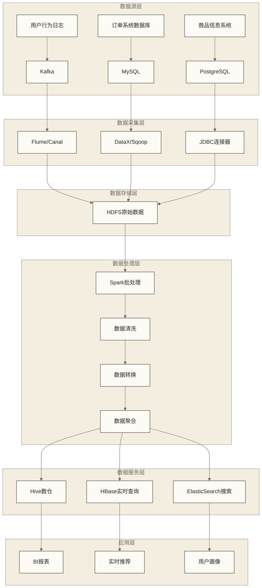

# 批处理项目实战

## 概述

本文档通过电商批处理项目的架构和模块实现示例，展示Spark在企业级数据处理中的应用。示例围绕电商数据平台的ETL系统，讨论数据采集、清洗、转换和存储流程，并提供调度、监控与资源配置的设计参考；当前未提供完整工程入口和读写实现，不能直接作为可部署项目或通用生产最佳实践。

> [!info] 项目背景
> 某电商公司需要构建统一的数据平台，整合来自用户行为日志、订单系统、商品库存等多个数据源的数据，为数据分析和机器学习提供高质量的数据服务。

## 项目架构设计

### 整体架构



### 技术栈选型

```scala
object TechnologyStack {
  
  case class TechStack(
    dataIngestion: List[String],
    dataStorage: List[String],
    dataProcessing: List[String],
    dataServing: List[String],
    monitoring: List[String]
  )
  
  val projectTechStack = TechStack(
    dataIngestion = List("Kafka", "Flume", "DataX", "Canal"),
    dataStorage = List("HDFS", "Hive", "HBase", "ElasticSearch"),
    dataProcessing = List("Spark", "Scala", "Spark SQL"),
    dataServing = List("Presto", "Kylin", "Druid"),
    monitoring = List("Prometheus", "Grafana", "AlertManager")
  )
  
  // 配置参数
  val sparkConfig = Map(
    "spark.app.name" -> "EcommerceETL",
    "spark.master" -> "yarn",
    "spark.submit.deployMode" -> "cluster",
    
    // 资源配置
    "spark.executor.instances" -> "20",
    "spark.executor.cores" -> "4",
    "spark.executor.memory" -> "8g",
    "spark.driver.memory" -> "4g",
    "spark.driver.cores" -> "2",
    
    // 性能优化
    "spark.serializer" -> "org.apache.spark.serializer.KryoSerializer",
    "spark.sql.adaptive.enabled" -> "true",
    "spark.sql.adaptive.coalescePartitions.enabled" -> "true",
    "spark.sql.adaptive.skewJoin.enabled" -> "true",
    
    // 存储配置
    "spark.sql.parquet.compression.codec" -> "snappy",
    "spark.sql.shuffle.partitions" -> "400",
    
    // Hive集成
    "spark.sql.warehouse.dir" -> "hdfs://namenode:8020/user/hive/warehouse",
    "spark.sql.catalogImplementation" -> "hive"
  )
}
```

## 数据模型设计

### 数据分层架构

```scala
object DataModelDesign {
  
  // 原始数据层 (ODS - Operational Data Store)
  case class UserBehaviorLog(
    userId: String,
    sessionId: String,
    timestamp: Long,
    eventType: String,
    pageUrl: String,
    productId: Option[String],
    categoryId: Option[String],
    userAgent: String,
    ip: String
  )
  
  case class OrderRecord(
    orderId: String,
    userId: String,
    orderTime: java.sql.Timestamp,
    totalAmount: BigDecimal,
    orderStatus: String,
    paymentMethod: String,
    shippingAddress: String,
    items: List[OrderItem]
  )
  
  case class OrderItem(
    productId: String,
    productName: String,
    quantity: Int,
    price: BigDecimal,
    categoryId: String
  )
  
  case class ProductInfo(
    productId: String,
    productName: String,
    categoryId: String,
    brandId: String,
    price: BigDecimal,
    stockQuantity: Int,
    createTime: java.sql.Timestamp,
    updateTime: java.sql.Timestamp
  )
  
  // 清洗数据层 (DWD - Data Warehouse Detail)
  case class CleanedUserBehavior(
    userId: String,
    sessionId: String,
    eventTime: java.sql.Timestamp,
    eventType: String,
    pageUrl: String,
    productId: Option[String],
    categoryId: Option[String],
    deviceType: String,
    browserType: String,
    location: String,
    isValid: Boolean
  )
  
  case class CleanedOrderData(
    orderId: String,
    userId: String,
    orderDate: String,
    orderTime: java.sql.Timestamp,
    totalAmount: BigDecimal,
    orderStatus: String,
    paymentMethod: String,
    region: String,
    city: String,
    items: List[OrderItem],
    isValid: Boolean
  )
  
  // 聚合数据层 (DWS - Data Warehouse Summary)
  case class UserDailySummary(
    userId: String,
    date: String,
    pageViews: Long,
    sessionCount: Long,
    sessionDuration: Long,
    orderCount: Long,
    orderAmount: BigDecimal,
    distinctProductViews: Long,
    distinctCategoryViews: Long
  )
  
  case class ProductDailySummary(
    productId: String,
    date: String,
    viewCount: Long,
    uniqueViewers: Long,
    orderCount: Long,
    orderQuantity: Long,
    revenue: BigDecimal,
    conversionRate: Double
  )
  
  // 应用数据层 (ADS - Application Data Service)
  case class UserProfile(
    userId: String,
    registerDate: String,
    totalOrders: Long,
    totalAmount: BigDecimal,
    avgOrderValue: BigDecimal,
    favoriteCategories: List[String],
    lastActiveDate: String,
    userLevel: String,
    tags: List[String]
  )
}
```

### 表结构设计

```sql
-- 原始数据表结构
CREATE TABLE IF NOT EXISTS ods.user_behavior_log (
    user_id STRING,
    session_id STRING,
    timestamp BIGINT,
    event_type STRING,
    page_url STRING,
    product_id STRING,
    category_id STRING,
    user_agent STRING,
    ip STRING,
    dt STRING
) PARTITIONED BY (dt)
STORED AS PARQUET
LOCATION 'hdfs://data/ods/user_behavior_log';

CREATE TABLE IF NOT EXISTS ods.order_records (
    order_id STRING,
    user_id STRING,
    order_time TIMESTAMP,
    total_amount DECIMAL(10,2),
    order_status STRING,
    payment_method STRING,
    shipping_address STRING,
    items ARRAY<STRUCT<
        product_id: STRING,
        product_name: STRING,
        quantity: INT,
        price: DECIMAL(10,2),
        category_id: STRING
    >>,
    dt STRING
) PARTITIONED BY (dt)
STORED AS PARQUET
LOCATION 'hdfs://data/ods/order_records';

-- 清洗数据表结构
CREATE TABLE IF NOT EXISTS dwd.cleaned_user_behavior (
    user_id STRING,
    session_id STRING,
    event_time TIMESTAMP,
    event_type STRING,
    page_url STRING,
    product_id STRING,
    category_id STRING,
    device_type STRING,
    browser_type STRING,
    location STRING,
    is_valid BOOLEAN,
    dt STRING
) PARTITIONED BY (dt)
STORED AS PARQUET
LOCATION 'hdfs://data/dwd/cleaned_user_behavior';

-- 聚合数据表结构
CREATE TABLE IF NOT EXISTS dws.user_daily_summary (
    user_id STRING,
    date STRING,
    page_views BIGINT,
    session_count BIGINT,
    session_duration BIGINT,
    order_count BIGINT,
    order_amount DECIMAL(10,2),
    distinct_product_views BIGINT,
    distinct_category_views BIGINT
) PARTITIONED BY (date)
STORED AS PARQUET
LOCATION 'hdfs://data/dws/user_daily_summary';
```

## 核心ETL流程实现

### 数据清洗模块

```scala
object DataCleaningModule {
  
  import org.apache.spark.sql.{SparkSession, DataFrame}
  import org.apache.spark.sql.functions._
  import org.apache.spark.sql.types._
  
  class DataCleaner(spark: SparkSession) {
    import spark.implicits._
    
    def cleanUserBehaviorData(rawData: DataFrame): DataFrame = {
      rawData
        .filter(col("user_id").isNotNull && col("user_id") =!= "")
        .filter(col("timestamp").isNotNull)
        .withColumn("event_time", from_unixtime(col("timestamp") / 1000).cast(TimestampType))
        .withColumn("device_type", extractDeviceType(col("user_agent")))
        .withColumn("browser_type", extractBrowserType(col("user_agent")))
        .withColumn("location", extractLocation(col("ip")))
        .withColumn("is_valid", validateBehaviorRecord())
        .filter(col("is_valid") === true)
    }
    
    def cleanOrderData(rawData: DataFrame): DataFrame = {
      rawData
        .filter(col("order_id").isNotNull && col("order_id") =!= "")
        .filter(col("user_id").isNotNull && col("user_id") =!= "")
        .filter(col("total_amount") > 0)
        .withColumn("order_date", date_format(col("order_time"), "yyyy-MM-dd"))
        .withColumn("region", extractRegion(col("shipping_address")))
        .withColumn("city", extractCity(col("shipping_address")))
        .withColumn("is_valid", validateOrderRecord())
        .filter(col("is_valid") === true)
    }
    
    // 自定义UDF函数
    private def extractDeviceType = udf { (userAgent: String) =>
      if (userAgent == null) "unknown"
      else if (userAgent.toLowerCase.contains("mobile")) "mobile"
      else if (userAgent.toLowerCase.contains("tablet")) "tablet"
      else "desktop"
    }
    
    private def extractBrowserType = udf { (userAgent: String) =>
      if (userAgent == null) "unknown"
      else if (userAgent.contains("Chrome")) "Chrome"
      else if (userAgent.contains("Firefox")) "Firefox"
      else if (userAgent.contains("Safari")) "Safari"
      else "other"
    }
    
    private def extractLocation = udf { (ip: String) =>
      // 这里应该接入IP地理位置服务
      // 简化实现，实际生产环境需要接入如GeoIP等服务
      if (ip == null) "unknown" else "China"
    }
    
    private def extractRegion = udf { (address: String) =>
      if (address == null) "unknown"
      else {
        // 简化的地址解析逻辑
        val provinces = List("北京", "上海", "广东", "浙江", "江苏")
        provinces.find(address.contains(_)).getOrElse("其他")
      }
    }
    
    private def extractCity = udf { (address: String) =>
      if (address == null) "unknown"
      else {
        // 简化的城市解析逻辑
        val cities = List("北京", "上海", "深圳", "杭州", "南京")
        cities.find(address.contains(_)).getOrElse("其他")
      }
    }
    
    private def validateBehaviorRecord = udf { () =>
      // 数据质量验证逻辑
      true // 简化实现
    }
    
    private def validateOrderRecord = udf { () =>
      // 订单数据质量验证逻辑
      true // 简化实现
    }
  }
  
  // 数据质量监控
  class DataQualityMonitor(spark: SparkSession) {
    
    def generateQualityReport(originalData: DataFrame, cleanedData: DataFrame): DataQualityReport = {
      val originalCount = originalData.count()
      val cleanedCount = cleanedData.count()
      val droppedCount = originalCount - cleanedCount
      val qualityScore = (cleanedCount.toDouble / originalCount * 100).toInt
      
      // 检查空值比例
      val nullColumns = originalData.columns.map { colName =>
        val nullCount = originalData.filter(col(colName).isNull).count()
        (colName, nullCount.toDouble / originalCount * 100)
      }.filter(_._2 > 5).toMap
      
      // 检查重复记录
      val duplicateCount = originalCount - originalData.dropDuplicates().count()
      
      DataQualityReport(
        originalCount = originalCount,
        cleanedCount = cleanedCount,
        droppedCount = droppedCount,
        qualityScore = qualityScore,
        nullColumns = nullColumns,
        duplicateCount = duplicateCount,
        timestamp = System.currentTimeMillis()
      )
    }
    
    case class DataQualityReport(
      originalCount: Long,
      cleanedCount: Long,
      droppedCount: Long,
      qualityScore: Int,
      nullColumns: Map[String, Double],
      duplicateCount: Long,
      timestamp: Long
    )
  }
}
```

### 数据转换模块

```scala
object DataTransformationModule {
  
  import org.apache.spark.sql.{SparkSession, DataFrame}
  import org.apache.spark.sql.functions._
  import org.apache.spark.sql.expressions.Window
  
  class DataTransformer(spark: SparkSession) {
    import spark.implicits._
    
    def transformUserBehavior(cleanedBehavior: DataFrame, 
                             orderData: DataFrame): DataFrame = {
      // 计算用户会话
      val sessionWindow = Window.partitionBy("user_id")
        .orderBy("event_time")
        .rangeBetween(-1800, 0) // 30分钟会话窗口
      
      val withSessions = cleanedBehavior
        .withColumn("session_start", 
          when(
            lag("event_time", 1).over(Window.partitionBy("user_id").orderBy("event_time"))
              .isNull || 
            unix_timestamp(col("event_time")) - 
            unix_timestamp(lag("event_time", 1).over(Window.partitionBy("user_id").orderBy("event_time"))) > 1800,
            true
          ).otherwise(false)
        )
        .withColumn("session_id_new", 
          sum(when(col("session_start"), 1).otherwise(0))
            .over(Window.partitionBy("user_id").orderBy("event_time"))
        )
      
      // 丰富用户行为数据
      val enrichedBehavior = withSessions
        .join(orderData.select("user_id", "order_time", "total_amount"), "user_id", "left")
        .withColumn("is_buyer", col("total_amount").isNotNull)
        .withColumn("user_value_segment", 
          when(col("total_amount") > 1000, "high_value")
          .when(col("total_amount") > 500, "medium_value")
          .when(col("total_amount") > 0, "low_value")
          .otherwise("non_buyer")
        )
      
      enrichedBehavior
    }
    
    def createUserDailySummary(behaviorData: DataFrame, 
                              orderData: DataFrame): DataFrame = {
      // 用户行为汇总
      val behaviorSummary = behaviorData
        .withColumn("date", date_format(col("event_time"), "yyyy-MM-dd"))
        .groupBy("user_id", "date")
        .agg(
          count("*").as("page_views"),
          countDistinct("session_id").as("session_count"),
          sum(
            coalesce(
              unix_timestamp(lead("event_time", 1).over(
                Window.partitionBy("user_id", "session_id").orderBy("event_time")
              )) - unix_timestamp(col("event_time")),
              lit(0)
            )
          ).as("session_duration"),
          countDistinct("product_id").as("distinct_product_views"),
          countDistinct("category_id").as("distinct_category_views")
        )
      
      // 用户订单汇总
      val orderSummary = orderData
        .withColumn("date", date_format(col("order_time"), "yyyy-MM-dd"))
        .groupBy("user_id", "date")
        .agg(
          count("*").as("order_count"),
          sum("total_amount").as("order_amount")
        )
      
      // 合并汇总数据
      behaviorSummary
        .join(orderSummary, Seq("user_id", "date"), "left")
        .na.fill(0, Seq("order_count", "order_amount"))
    }
    
    def createProductDailySummary(behaviorData: DataFrame,
                                 orderData: DataFrame): DataFrame = {
      // 商品浏览汇总
      val viewSummary = behaviorData
        .filter(col("product_id").isNotNull)
        .withColumn("date", date_format(col("event_time"), "yyyy-MM-dd"))
        .groupBy("product_id", "date")
        .agg(
          count("*").as("view_count"),
          countDistinct("user_id").as("unique_viewers")
        )
      
      // 商品销售汇总
      val salesSummary = orderData
        .select("order_time", explode(col("items")).as("item"))
        .select(
          col("item.product_id").as("product_id"),
          date_format(col("order_time"), "yyyy-MM-dd").as("date"),
          col("item.quantity").as("quantity"),
          col("item.price").as("price")
        )
        .groupBy("product_id", "date")
        .agg(
          count("*").as("order_count"),
          sum("quantity").as("order_quantity"),
          sum(col("quantity") * col("price")).as("revenue")
        )
      
      // 计算转化率
      viewSummary
        .join(salesSummary, Seq("product_id", "date"), "left")
        .na.fill(0, Seq("order_count", "order_quantity", "revenue"))
        .withColumn("conversion_rate", 
          when(col("unique_viewers") > 0, 
            col("order_count").cast("double") / col("unique_viewers")
          ).otherwise(0.0)
        )
    }
    
    def createUserProfile(userSummary: DataFrame,
                         orderData: DataFrame,
                         behaviorData: DataFrame): DataFrame = {
      // 用户整体统计
      val userStats = userSummary
        .groupBy("user_id")
        .agg(
          min("date").as("first_active_date"),
          max("date").as("last_active_date"),
          sum("page_views").as("total_page_views"),
          sum("session_count").as("total_sessions"),
          sum("order_count").as("total_orders"),
          sum("order_amount").as("total_amount"),
          when(sum("order_count") > 0,
            sum("order_amount") / sum("order_count")
          ).otherwise(lit(null)).as("avg_order_value")
        )
      
      // 用户偏好分析
      val userPreferences = behaviorData
        .filter(col("category_id").isNotNull)
        .groupBy("user_id", "category_id")
        .count()
        .withColumn("rank", 
          row_number().over(
            Window.partitionBy("user_id").orderBy(desc("count"))
          )
        )
        .filter(col("rank") <= 3)
        .groupBy("user_id")
        .agg(collect_list("category_id").as("favorite_categories"))
      
      // 用户分级
      userStats
        .join(userPreferences, "user_id", "left")
        .withColumn("user_level",
          when(col("total_amount") > 5000, "VIP")
          .when(col("total_amount") > 2000, "Gold")
          .when(col("total_amount") > 500, "Silver")
          .otherwise("Bronze")
        )
        .withColumn("tags", 
          array(
            when(col("total_orders") > 20, lit("frequent_buyer")).otherwise(lit(null)),
            when(col("avg_order_value") > 200, lit("high_value")).otherwise(lit(null)),
            when(datediff(current_date(), col("last_active_date")) <= 7, lit("active")).otherwise(lit("inactive"))
          ).cast("array<string>")
        )
    }
  }
}
```

### 数据聚合模块

```scala
object DataAggregationModule {
  
  import org.apache.spark.sql.{SparkSession, DataFrame}
  import org.apache.spark.sql.functions._
  import org.apache.spark.sql.expressions.Window
  
  class DataAggregator(spark: SparkSession) {
    import spark.implicits._
    
    def createHourlyMetrics(behaviorData: DataFrame): DataFrame = {
      behaviorData
        .withColumn("hour", date_format(col("event_time"), "yyyy-MM-dd HH"))
        .groupBy("hour")
        .agg(
          count("*").as("total_events"),
          countDistinct("user_id").as("active_users"),
          countDistinct("session_id").as("active_sessions"),
          countDistinct("product_id").as("viewed_products")
        )
        .orderBy("hour")
    }
    
    def createCategoryMetrics(behaviorData: DataFrame, 
                            orderData: DataFrame): DataFrame = {
      // 类目浏览指标
      val categoryViews = behaviorData
        .filter(col("category_id").isNotNull)
        .withColumn("date", date_format(col("event_time"), "yyyy-MM-dd"))
        .groupBy("category_id", "date")
        .agg(
          count("*").as("view_count"),
          countDistinct("user_id").as("unique_viewers")
        )
      
      // 类目销售指标
      val categorySales = orderData
        .select("order_time", explode(col("items")).as("item"))
        .select(
          col("item.category_id").as("category_id"),
          date_format(col("order_time"), "yyyy-MM-dd").as("date"),
          col("item.quantity").as("quantity"),
          (col("item.quantity") * col("item.price")).as("amount")
        )
        .groupBy("category_id", "date")
        .agg(
          count("*").as("order_count"),
          sum("quantity").as("sales_quantity"),
          sum("amount").as("sales_amount")
        )
      
      categoryViews
        .join(categorySales, Seq("category_id", "date"), "left")
        .na.fill(0, Seq("order_count", "sales_quantity", "sales_amount"))
    }
    
    def createGeographicMetrics(behaviorData: DataFrame,
                              orderData: DataFrame): DataFrame = {
      // 地域用户活跃度
      val geoActivity = behaviorData
        .withColumn("date", date_format(col("event_time"), "yyyy-MM-dd"))
        .groupBy("location", "date")
        .agg(
          countDistinct("user_id").as("active_users"),
          count("*").as("total_events")
        )
      
      // 地域销售指标
      val geoSales = orderData
        .withColumn("date", date_format(col("order_time"), "yyyy-MM-dd"))
        .groupBy("region", "city", "date")
        .agg(
          count("*").as("order_count"),
          sum("total_amount").as("sales_amount"),
          countDistinct("user_id").as("buyers")
        )
      
      geoActivity
        .join(geoSales, 
          col("location") === concat(col("region"), lit("-"), col("city")) && 
          geoActivity.col("date") === geoSales.col("date"), 
          "left")
        .na.fill(0, Seq("order_count", "sales_amount", "buyers"))
    }
    
    def createCohortAnalysis(orderData: DataFrame): DataFrame = {
      // 计算用户首次购买时间
      val userFirstOrder = orderData
        .groupBy("user_id")
        .agg(min("order_time").as("first_order_time"))
        .withColumn("cohort_month", 
          date_format(col("first_order_time"), "yyyy-MM"))
      
      // 计算每月活跃用户
      val monthlyActivity = orderData
        .withColumn("order_month", date_format(col("order_time"), "yyyy-MM"))
        .join(userFirstOrder, "user_id")
        .withColumn("months_since_first", 
          months_between(
            to_date(col("order_month"), "yyyy-MM"),
            to_date(col("cohort_month"), "yyyy-MM")
          )
        )
        .groupBy("cohort_month", "months_since_first")
        .agg(
          countDistinct("user_id").as("active_users"),
          sum("total_amount").as("revenue")
        )
      
      // 计算留存率
      val cohortSize = userFirstOrder
        .groupBy("cohort_month")
        .count()
        .withColumnRenamed("count", "cohort_size")
      
      monthlyActivity
        .join(cohortSize, "cohort_month")
        .withColumn("retention_rate", 
          col("active_users").cast("double") / col("cohort_size")
        )
        .orderBy("cohort_month", "months_since_first")
    }
    
    def createRFMAnalysis(orderData: DataFrame): DataFrame = {
      val analysisDate = current_date()
      
      orderData
        .groupBy("user_id")
        .agg(
          // Recency: 距离最近购买的天数
          datediff(analysisDate, max("order_time")).as("recency"),
          // Frequency: 购买频次
          count("*").as("frequency"),
          // Monetary: 总消费金额
          sum("total_amount").as("monetary")
        )
        .withColumn("r_score", 
          when(col("recency") <= 30, 5)
          .when(col("recency") <= 90, 4)
          .when(col("recency") <= 180, 3)
          .when(col("recency") <= 365, 2)
          .otherwise(1)
        )
        .withColumn("f_score",
          when(col("frequency") >= 20, 5)
          .when(col("frequency") >= 10, 4)
          .when(col("frequency") >= 5, 3)
          .when(col("frequency") >= 2, 2)
          .otherwise(1)
        )
        .withColumn("m_score",
          when(col("monetary") >= 5000, 5)
          .when(col("monetary") >= 2000, 4)
          .when(col("monetary") >= 1000, 3)
          .when(col("monetary") >= 500, 2)
          .otherwise(1)
        )
        .withColumn("rfm_score", 
          concat(col("r_score"), col("f_score"), col("m_score")))
        .withColumn("customer_segment",
          when(col("rfm_score").like("5%5") || col("rfm_score").like("4%5"), "Champions")
          .when(col("rfm_score").like("5%4") || col("rfm_score").like("4%4"), "Loyal Customers")
          .when(col("rfm_score").like("5%2") || col("rfm_score").like("5%3"), "Potential Loyalists")
          .when(col("rfm_score").like("5%1"), "New Customers")
          .when(col("rfm_score").like("4%1") || col("rfm_score").like("3%1"), "Promising")
          .when(col("rfm_score").like("3%3") || col("rfm_score").like("3%4"), "Need Attention")
          .when(col("rfm_score").like("2%3") || col("rfm_score").like("2%4"), "About to Sleep")
          .when(col("rfm_score").like("2%2"), "At Risk")
          .when(col("rfm_score").like("1%5") || col("rfm_score").like("1%4"), "Cannot Lose Them")
          .when(col("rfm_score").like("1%3"), "Hibernating")
          .otherwise("Lost")
        )
    }
  }
}
```

## 任务调度与执行

### Airflow调度配置

```python
from airflow import DAG
from airflow.providers.apache.spark.operators.spark_submit import SparkSubmitOperator
from airflow.operators.bash_operator import BashOperator
from airflow.operators.email_operator import EmailOperator
from datetime import datetime, timedelta

# 默认参数
default_args = {
    'owner': 'data-team',
    'depends_on_past': False,
    'start_date': datetime(2024, 1, 1),
    'email_on_failure': True,
    'email_on_retry': False,
    'retries': 2,
    'retry_delay': timedelta(minutes=5),
    'email': ['data-team@company.com']
}

# 创建DAG
dag = DAG(
    'ecommerce_etl_daily',
    default_args=default_args,
    description='电商数据ETL日处理任务',
    schedule_interval='0 2 * * *',  # 每天凌晨2点执行
    max_active_runs=1,
    catchup=False
)

# 数据验证任务
data_validation = BashOperator(
    task_id='validate_source_data',
    bash_command="""
    #!/bin/bash
    DATE={{ ds }}
    
    # 检查HDFS路径是否存在
    hadoop fs -test -e /data/ods/user_behavior_log/dt=${DATE}
    if [ $? -ne 0 ]; then
        echo "用户行为日志数据不存在: ${DATE}"
        exit 1
    fi
    
    hadoop fs -test -e /data/ods/order_records/dt=${DATE}
    if [ $? -ne 0 ]; then
        echo "订单数据不存在: ${DATE}"
        exit 1
    fi
    
    echo "数据验证通过"
    """,
    dag=dag
)

# 数据清洗任务
data_cleaning = SparkSubmitOperator(
    task_id='data_cleaning',
    application='/opt/spark/jobs/DataCleaningJob.py',
    name='data-cleaning-{{ ds }}',
    conn_id='spark_default',
    application_args=[
        '--input-date', '{{ ds }}',
        '--input-path', '/data/ods',
        '--output-path', '/data/dwd'
    ],
    conf={
        'spark.executor.instances': '10',
        'spark.executor.cores': '4',
        'spark.executor.memory': '8g',
        'spark.driver.memory': '4g'
    },
    dag=dag
)

# 数据转换任务
data_transformation = SparkSubmitOperator(
    task_id='data_transformation',
    application='/opt/spark/jobs/DataTransformationJob.py',
    name='data-transformation-{{ ds }}',
    conn_id='spark_default',
    application_args=[
        '--input-date', '{{ ds }}',
        '--input-path', '/data/dwd',
        '--output-path', '/data/dws'
    ],
    conf={
        'spark.executor.instances': '15',
        'spark.executor.cores': '4',
        'spark.executor.memory': '8g'
    },
    dag=dag
)

# 数据聚合任务
data_aggregation = SparkSubmitOperator(
    task_id='data_aggregation',
    application='/opt/spark/jobs/DataAggregationJob.py',
    name='data-aggregation-{{ ds }}',
    conn_id='spark_default',
    application_args=[
        '--input-date', '{{ ds }}',
        '--input-path', '/data/dws',
        '--output-path', '/data/ads'
    ],
    conf={
        'spark.executor.instances': '8',
        'spark.executor.cores': '4',
        'spark.executor.memory': '6g'
    },
    dag=dag
)

# 数据质量检查
data_quality_check = BashOperator(
    task_id='data_quality_check',
    bash_command="""
    #!/bin/bash
    DATE={{ ds }}
    
    # 检查处理结果记录数
    CLEANED_COUNT=$(spark-sql -e "SELECT COUNT(*) FROM dwd.cleaned_user_behavior WHERE dt='${DATE}'" 2>/dev/null | tail -1)
    AGGREGATED_COUNT=$(spark-sql -e "SELECT COUNT(*) FROM dws.user_daily_summary WHERE date='${DATE}'" 2>/dev/null | tail -1)
    
    if [ "$CLEANED_COUNT" -lt 1000 ]; then
        echo "清洗后数据量过少: $CLEANED_COUNT"
        exit 1
    fi
    
    if [ "$AGGREGATED_COUNT" -lt 100 ]; then
        echo "聚合后数据量过少: $AGGREGATED_COUNT"
        exit 1
    fi
    
    echo "数据质量检查通过"
    """,
    dag=dag
)

# 成功通知
success_notification = EmailOperator(
    task_id='success_notification',
    to=['data-team@company.com'],
    subject='ETL任务执行成功 - {{ ds }}',
    html_content="""
    <h3>ETL任务执行成功</h3>
    <p>日期: {{ ds }}</p>
    <p>任务完成时间: {{ ts }}</p>
    <p>请查看数据质量报告</p>
    """,
    dag=dag
)

# 设置任务依赖关系
data_validation >> data_cleaning >> data_transformation >> data_aggregation >> data_quality_check >> success_notification
```

### Spark作业提交脚本

```bash
#!/bin/bash

# ETL作业提交脚本
# submit_etl_job.sh

set -e

# 配置参数
APP_NAME="EcommerceETL"
MASTER="yarn"
DEPLOY_MODE="cluster"
QUEUE="default"

# 资源配置
EXECUTOR_INSTANCES=20
EXECUTOR_CORES=4
EXECUTOR_MEMORY="8g"
DRIVER_MEMORY="4g"
DRIVER_CORES=2

# Spark配置
SPARK_CONF=(
    "--conf spark.serializer=org.apache.spark.serializer.KryoSerializer"
    "--conf spark.sql.adaptive.enabled=true"
    "--conf spark.sql.adaptive.coalescePartitions.enabled=true"
    "--conf spark.sql.adaptive.skewJoin.enabled=true"
    "--conf spark.sql.parquet.compression.codec=snappy"
    "--conf spark.sql.shuffle.partitions=400"
    "--conf spark.dynamicAllocation.enabled=true"
    "--conf spark.dynamicAllocation.minExecutors=5"
    "--conf spark.dynamicAllocation.maxExecutors=50"
    "--conf spark.sql.warehouse.dir=hdfs://namenode:8020/user/hive/warehouse"
    "--conf spark.sql.catalogImplementation=hive"
)

# 解析命令行参数
while [[ $# -gt 0 ]]; do
    case $1 in
        --date)
            PROCESS_DATE="$2"
            shift 2
            ;;
        --job-type)
            JOB_TYPE="$2"
            shift 2
            ;;
        --input-path)
            INPUT_PATH="$2"
            shift 2
            ;;
        --output-path)
            OUTPUT_PATH="$2"
            shift 2
            ;;
        *)
            echo "未知参数: $1"
            exit 1
            ;;
    esac
done

# 验证必需参数
if [ -z "$PROCESS_DATE" ] || [ -z "$JOB_TYPE" ]; then
    echo "用法: $0 --date YYYY-MM-DD --job-type [cleaning|transformation|aggregation]"
    exit 1
fi

# 根据作业类型设置应用程序
case $JOB_TYPE in
    "cleaning")
        APPLICATION="/opt/spark/jobs/DataCleaningJob.scala"
        CLASS="com.ecommerce.etl.DataCleaningJob"
        ;;
    "transformation")
        APPLICATION="/opt/spark/jobs/DataTransformationJob.scala"
        CLASS="com.ecommerce.etl.DataTransformationJob"
        ;;
    "aggregation")
        APPLICATION="/opt/spark/jobs/DataAggregationJob.scala"
        CLASS="com.ecommerce.etl.DataAggregationJob"
        ;;
    *)
        echo "不支持的作业类型: $JOB_TYPE"
        exit 1
        ;;
esac

echo "提交Spark作业..."
echo "作业类型: $JOB_TYPE"
echo "处理日期: $PROCESS_DATE"
echo "输入路径: $INPUT_PATH"
echo "输出路径: $OUTPUT_PATH"

# 提交Spark作业
spark-submit \
    --name "${APP_NAME}-${JOB_TYPE}-${PROCESS_DATE}" \
    --master $MASTER \
    --deploy-mode $DEPLOY_MODE \
    --queue $QUEUE \
    --num-executors $EXECUTOR_INSTANCES \
    --executor-cores $EXECUTOR_CORES \
    --executor-memory $EXECUTOR_MEMORY \
    --driver-memory $DRIVER_MEMORY \
    --driver-cores $DRIVER_CORES \
    "${SPARK_CONF[@]}" \
    --class $CLASS \
    $APPLICATION \
    --date $PROCESS_DATE \
    --input-path $INPUT_PATH \
    --output-path $OUTPUT_PATH

if [ $? -eq 0 ]; then
    echo "作业提交成功"
else
    echo "作业提交失败"
    exit 1
fi
```

## 性能优化实践

### 资源调优

```scala
object ResourceOptimization {
  
  // 动态资源分配策略
  def getOptimalResourceConfig(dataSize: Long, complexity: String): ResourceConfig = {
    val baseCores = 200
    val baseMemoryGB = 400
    
    val (scaleFactor, memoryRatio) = complexity match {
      case "simple" => (1.0, 0.8)
      case "medium" => (1.5, 1.2)
      case "complex" => (2.0, 1.5)
      case _ => (1.0, 1.0)
    }
    
    val dataSizeGB = dataSize / (1024 * 1024 * 1024)
    val extraCores = (dataSizeGB / 10).toInt * 10
    val totalCores = (baseCores + extraCores * scaleFactor).toInt
    val totalMemory = (baseMemoryGB * memoryRatio + dataSizeGB * 0.5).toInt
    
    val executorCores = 4
    val executorMemory = 8
    val numExecutors = totalCores / executorCores
    val driverMemory = Math.max(4, totalMemory / 20)
    
    ResourceConfig(
      numExecutors = numExecutors,
      executorCores = executorCores,
      executorMemory = s"${executorMemory}g",
      driverMemory = s"${driverMemory}g",
      maxExecutors = (numExecutors * 1.5).toInt,
      minExecutors = Math.max(5, numExecutors / 4)
    )
  }
  
  case class ResourceConfig(
    numExecutors: Int,
    executorCores: Int,
    executorMemory: String,
    driverMemory: String,
    maxExecutors: Int,
    minExecutors: Int
  )
  
  // 分区策略优化
  def optimizePartitioning(spark: SparkSession, df: DataFrame, targetSize: Long = 128 * 1024 * 1024): DataFrame = {
    val currentPartitions = df.rdd.getNumPartitions
    val dataSize = df.queryExecution.optimizedPlan.stats.sizeInBytes.toLong
    val optimalPartitions = Math.max(1, (dataSize / targetSize).toInt)
    
    if (currentPartitions > optimalPartitions * 2) {
      println(s"当前分区数 $currentPartitions 过多，合并至 $optimalPartitions")
      df.coalesce(optimalPartitions)
    } else if (currentPartitions < optimalPartitions / 2) {
      println(s"当前分区数 $currentPartitions 过少，重新分区至 $optimalPartitions")
      df.repartition(optimalPartitions)
    } else {
      df
    }
  }
}
```

### 缓存策略

```scala
object CacheOptimization {
  
  import org.apache.spark.storage.StorageLevel
  
  def optimizeCaching(spark: SparkSession, dataFrames: Map[String, DataFrame]): Map[String, DataFrame] = {
    dataFrames.map { case (name, df) =>
      val storageLevel = selectStorageLevel(df, name)
      val cachedDF = df.persist(storageLevel)
      
      // 触发缓存
      val count = cachedDF.count()
      println(s"$name 缓存完成，记录数: $count，存储级别: $storageLevel")
      
      name -> cachedDF
    }
  }
  
  private def selectStorageLevel(df: DataFrame, name: String): StorageLevel = {
    val estimatedSize = df.queryExecution.optimizedPlan.stats.sizeInBytes.toLong
    val sizeMB = estimatedSize / 1024 / 1024
    
    name match {
      case n if n.contains("lookup") || n.contains("dimension") =>
        // 维度表使用内存存储
        StorageLevel.MEMORY_ONLY
      case n if n.contains("fact") && sizeMB < 1000 =>
        // 小于1GB的事实表使用内存和磁盘
        StorageLevel.MEMORY_AND_DISK_SER
      case n if n.contains("intermediate") =>
        // 中间结果使用序列化存储
        StorageLevel.MEMORY_AND_DISK_SER_2
      case _ =>
        // 默认策略
        if (sizeMB < 500) StorageLevel.MEMORY_ONLY
        else StorageLevel.MEMORY_AND_DISK_SER
    }
  }
  
  def cleanupCache(spark: SparkSession, exceptNames: Set[String] = Set.empty): Unit = {
    val cachedTables = spark.catalog.listTables().collect()
      .filter(_.isTemporary)
      .filterNot(table => exceptNames.contains(table.name))
    
    cachedTables.foreach { table =>
      spark.catalog.uncacheTable(table.name)
      println(s"清理缓存表: ${table.name}")
    }
    
    // 清理RDD缓存
    spark.sparkContext.getRDDStorageInfo
      .filterNot(rdd => exceptNames.exists(rdd.name.contains))
      .foreach { rdd =>
        spark.sparkContext.unpersistRDD(rdd.id)
        println(s"清理RDD缓存: ${rdd.name}")
      }
  }
}
```

## 监控与告警

### 作业监控

```scala
object JobMonitoring {
  
  import java.util.Properties
  import org.apache.kafka.clients.producer.{KafkaProducer, ProducerRecord}
  import spray.json._
  import DefaultJsonProtocol._
  
  case class JobMetrics(
    jobId: String,
    jobName: String,
    startTime: Long,
    endTime: Option[Long],
    status: String,
    inputRecords: Long,
    outputRecords: Long,
    processingTime: Long,
    errorMessage: Option[String]
  )
  
  implicit val jobMetricsFormat = jsonFormat9(JobMetrics)
  
  class JobMonitor(kafkaBrokers: String, monitoringTopic: String) {
    
    private val producer = createKafkaProducer()
    
    def reportJobStart(jobId: String, jobName: String): Unit = {
      val metrics = JobMetrics(
        jobId = jobId,
        jobName = jobName,
        startTime = System.currentTimeMillis(),
        endTime = None,
        status = "RUNNING",
        inputRecords = 0,
        outputRecords = 0,
        processingTime = 0,
        errorMessage = None
      )
      
      sendMetrics(metrics)
    }
    
    def reportJobSuccess(jobId: String, 
                        jobName: String, 
                        startTime: Long,
                        inputRecords: Long, 
                        outputRecords: Long): Unit = {
      val endTime = System.currentTimeMillis()
      val metrics = JobMetrics(
        jobId = jobId,
        jobName = jobName,
        startTime = startTime,
        endTime = Some(endTime),
        status = "SUCCESS",
        inputRecords = inputRecords,
        outputRecords = outputRecords,
        processingTime = endTime - startTime,
        errorMessage = None
      )
      
      sendMetrics(metrics)
    }
    
    def reportJobFailure(jobId: String, 
                        jobName: String, 
                        startTime: Long,
                        errorMessage: String): Unit = {
      val endTime = System.currentTimeMillis()
      val metrics = JobMetrics(
        jobId = jobId,
        jobName = jobName,
        startTime = startTime,
        endTime = Some(endTime),
        status = "FAILED",
        inputRecords = 0,
        outputRecords = 0,
        processingTime = endTime - startTime,
        errorMessage = Some(errorMessage)
      )
      
      sendMetrics(metrics)
      sendAlert(jobName, errorMessage)
    }
    
    private def sendMetrics(metrics: JobMetrics): Unit = {
      val record = new ProducerRecord[String, String](
        monitoringTopic,
        metrics.jobId,
        metrics.toJson.toString
      )
      
      producer.send(record)
    }
    
    private def sendAlert(jobName: String, errorMessage: String): Unit = {
      val alertTopic = "spark-job-alerts"
      val alert = JsObject(
        "job_name" -> JsString(jobName),
        "error_message" -> JsString(errorMessage),
        "timestamp" -> JsNumber(System.currentTimeMillis()),
        "severity" -> JsString("HIGH")
      ).compactPrint
      
      val record = new ProducerRecord[String, String](alertTopic, jobName, alert)
      producer.send(record)
    }
    
    private def createKafkaProducer(): KafkaProducer[String, String] = {
      val props = new Properties()
      props.put("bootstrap.servers", kafkaBrokers)
      props.put("key.serializer", "org.apache.kafka.common.serialization.StringSerializer")
      props.put("value.serializer", "org.apache.kafka.common.serialization.StringSerializer")
      props.put("acks", "all")
      props.put("retries", "3")
      props.put("batch.size", "16384")
      props.put("linger.ms", "1")
      props.put("buffer.memory", "33554432")
      
      new KafkaProducer[String, String](props)
    }
    
    def close(): Unit = {
      producer.close()
    }
  }
}
```

### 数据质量监控

```scala
object DataQualityMonitoring {
  
  import org.apache.spark.sql.{SparkSession, DataFrame}
  import org.apache.spark.sql.functions._
  
  class DataQualityChecker(spark: SparkSession) {
    import spark.implicits._
    
    def checkDataQuality(df: DataFrame, 
                        tableName: String,
                        primaryKeys: List[String] = List.empty,
                        requiredColumns: List[String] = List.empty): DataQualityReport = {
      val totalRows = df.count()
      
      // 1. 空值检查
      val nullCounts = df.columns.map { col =>
        col -> df.filter(df(col).isNull || df(col) === "").count()
      }.toMap
      
      // 2. 重复数据检查
      val duplicateCount = if (primaryKeys.nonEmpty) {
        totalRows - df.dropDuplicates(primaryKeys).count()
      } else {
        totalRows - df.dropDuplicates().count()
      }
      
      // 3. 必需字段检查
      val missingRequiredFields = requiredColumns.filter { colName =>
        !df.columns.contains(colName)
      }
      
      // 4. 数据类型检查
      val schemaIssues = checkSchemaConsistency(df, tableName)
      
      // 5. 数据分布检查
      val distributionStats = df.columns.map { col =>
        try {
          val stats = df.select(col).describe().collect()
          col -> stats.map(row => row.getString(0) -> row.getString(1)).toMap
        } catch {
          case _: Exception => col -> Map.empty[String, String]
        }
      }.toMap
      
      // 计算数据质量分数
      val qualityScore = calculateQualityScore(
        totalRows, nullCounts, duplicateCount, 
        missingRequiredFields, schemaIssues
      )
      
      DataQualityReport(
        tableName = tableName,
        totalRows = totalRows,
        nullCounts = nullCounts,
        duplicateCount = duplicateCount,
        missingRequiredFields = missingRequiredFields,
        schemaIssues = schemaIssues,
        distributionStats = distributionStats,
        qualityScore = qualityScore,
        timestamp = System.currentTimeMillis()
      )
    }
    
    private def checkSchemaConsistency(df: DataFrame, tableName: String): List[String] = {
      val issues = scala.collection.mutable.ListBuffer[String]()
      
      // 检查是否有预期的schema
      // 这里可以从配置文件或元数据存储中获取预期schema
      val expectedSchema = getExpectedSchema(tableName)
      
      expectedSchema.foreach { case (colName, expectedType) =>
        df.schema.find(_.name == colName) match {
          case Some(field) =>
            if (field.dataType.toString != expectedType) {
              issues += s"字段 $colName 类型不匹配: 期望 $expectedType, 实际 ${field.dataType}"
            }
          case None =>
            issues += s"缺少字段: $colName"
        }
      }
      
      issues.toList
    }
    
    private def getExpectedSchema(tableName: String): Map[String, String] = {
      // 这里应该从配置或元数据库中获取预期schema
      // 简化实现
      tableName match {
        case "user_behavior" => Map(
          "user_id" -> "StringType",
          "timestamp" -> "LongType",
          "event_type" -> "StringType"
        )
        case "orders" => Map(
          "order_id" -> "StringType",
          "user_id" -> "StringType",
          "total_amount" -> "DecimalType"
        )
        case _ => Map.empty
      }
    }
    
    private def calculateQualityScore(totalRows: Long,
                                    nullCounts: Map[String, Long],
                                    duplicateCount: Long,
                                    missingFields: List[String],
                                    schemaIssues: List[String]): Int = {
      var score = 100
      
      // 空值惩罚
      val nullRatio = nullCounts.values.sum.toDouble / (totalRows * nullCounts.size)
      score -= (nullRatio * 20).toInt
      
      // 重复数据惩罚
      val duplicateRatio = duplicateCount.toDouble / totalRows
      score -= (duplicateRatio * 30).toInt
      
      // 缺少字段惩罚
      score -= missingFields.size * 10
      
      // Schema问题惩罚
      score -= schemaIssues.size * 15
      
      Math.max(0, score)
    }
    
    def generateQualityReport(reports: List[DataQualityReport]): String = {
      val sb = new StringBuilder
      sb.append("=== 数据质量报告 ===\n")
      sb.append(s"检查时间: ${new java.util.Date()}\n")
      sb.append(s"检查表数: ${reports.size}\n\n")
      
      reports.foreach { report =>
        sb.append(s"表名: ${report.tableName}\n")
        sb.append(s"记录数: ${report.totalRows}\n")
        sb.append(s"质量分数: ${report.qualityScore}/100\n")
        
        if (report.nullCounts.values.sum > 0) {
          sb.append("空值情况:\n")
          report.nullCounts.filter(_._2 > 0).foreach { case (col, count) =>
            val ratio = (count.toDouble / report.totalRows * 100).toInt
            sb.append(s"  $col: $count ($ratio%)\n")
          }
        }
        
        if (report.duplicateCount > 0) {
          sb.append(s"重复记录数: ${report.duplicateCount}\n")
        }
        
        if (report.missingRequiredFields.nonEmpty) {
          sb.append(s"缺少必需字段: ${report.missingRequiredFields.mkString(", ")}\n")
        }
        
        if (report.schemaIssues.nonEmpty) {
          sb.append("Schema问题:\n")
          report.schemaIssues.foreach(issue => sb.append(s"  $issue\n"))
        }
        
        sb.append("\n")
      }
      
      sb.toString()
    }
  }
  
  case class DataQualityReport(
    tableName: String,
    totalRows: Long,
    nullCounts: Map[String, Long],
    duplicateCount: Long,
    missingRequiredFields: List[String],
    schemaIssues: List[String],
    distributionStats: Map[String, Map[String, String]],
    qualityScore: Int,
    timestamp: Long
  )
}
```

## 总结

通过本批处理项目实战，我们展示了：

**项目架构要点**：
1. **分层架构**：ODS、DWD、DWS、ADS四层数据架构
2. **技术选型**：基于Spark的现代化数据处理栈
3. **模块化设计**：清洗、转换、聚合功能模块化
4. **可扩展性**：支持业务增长和技术演进

**核心实现亮点**：
- **数据清洗模块示例**：包含过滤、转换及质量检查框架，记录验证仍为占位实现，质量评分与schema检查仍有缺陷
- **灵活的数据转换**：支持复杂的业务逻辑
- **多维度聚合**：从用户、商品、地域等维度分析
- **智能化调度**：基于Airflow的自动化任务调度

**生产环境设计参考（需结合执行环境与负载调整）**：
- **资源优化**：动态资源分配和分区优化
- **缓存策略示例**：按数据名称和估算大小选择存储级别，实际缓存收益与兼容性需结合复用次数、统计信息和内存预算判断
- **监控告警示例**：展示作业指标、失败告警及部分数据质量检查，不代表完整的生产监控与质量保障体系
- **故障处理示例**：展示任务重试、失败指标上报与通知；尚未实现分区幂等、失败回滚和补数恢复。

**关键成功因素**：
1. 合理的架构设计和技术选型
2. 完善的数据质量保障体系
3. 高效的资源利用和性能优化
4. 全面的监控和运维自动化

## 相关文档

- [[【技术与工具】/Spark/21-实时计算项目|实时计算项目]]：流处理项目实战
- [[【技术与工具】/Spark/19-性能监控与调优|性能监控与调优]]：监控调优方案
- [[【技术与工具】/Spark/18-性能调优实战|性能调优]]：优化实践案例
- [[【技术与工具】/Hive/08-数据导入导出|Hive数据导入导出]]：数据仓库操作