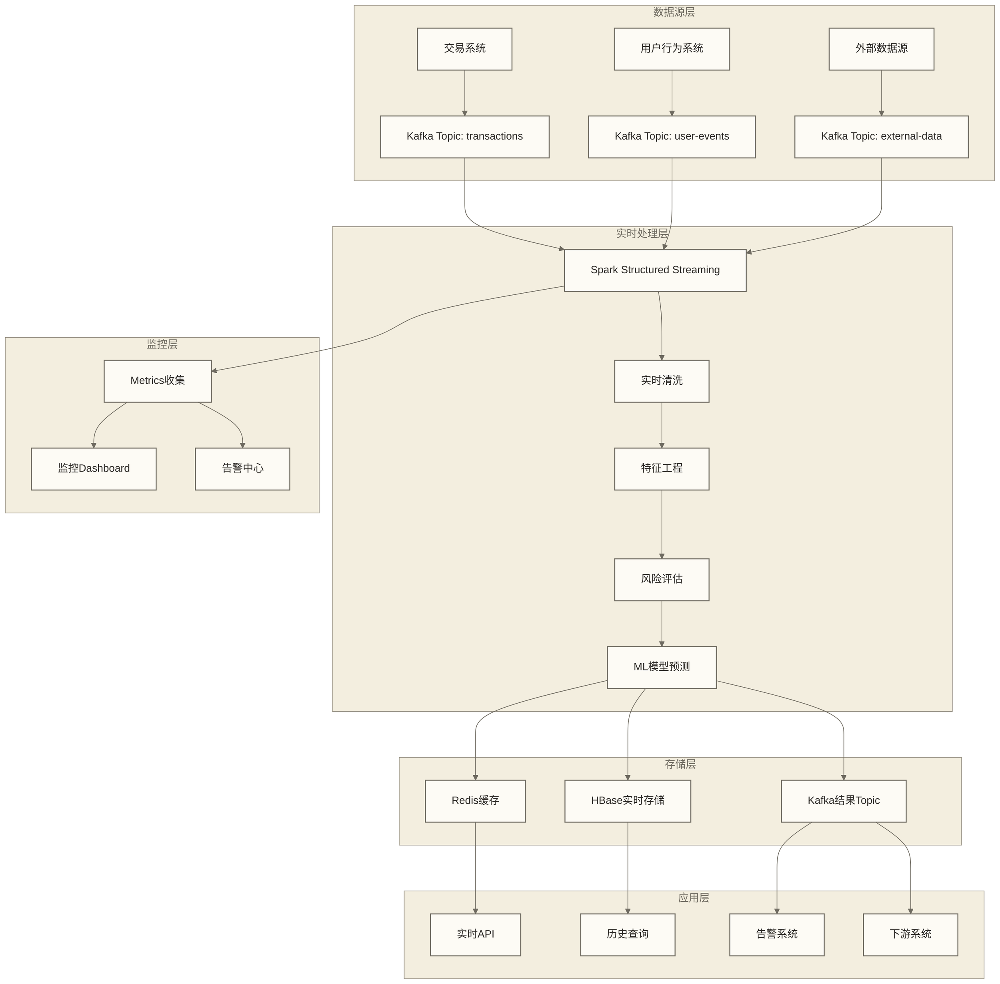

# 实时计算项目

## 概述

本文档通过假设的实时计算项目场景，讨论Spark Structured Streaming在企业级流处理中的应用。我们将设计一个实时风控系统，涵盖实时数据接入、复杂事件处理、机器学习预测和实时告警的流程；现有代码存在实现缺陷与材料缺口，不构成可直接部署的完整系统。

> [!info] 项目背景
> 假设某金融科技公司需要构建实时风控系统，对用户交易行为进行实时监控和风险评估，以毫秒级响应为业务目标，并支持复杂的风险规则引擎和机器学习模型预测；本文的秒级微批配置未证明达到该响应目标。

## 实时架构设计

### 整体架构



### 技术栈选择

```scala
object RealTimeStackConfig {
  
  case class StreamingConfig(
    appName: String,
    kafkaBootstrapServers: String,
    checkpointLocation: String,
    outputMode: String = "update",
    triggerInterval: String = "5 seconds"
  )
  
  val productionConfig = StreamingConfig(
    appName = "RealTimeRiskControl",
    kafkaBootstrapServers = "kafka1:9092,kafka2:9092,kafka3:9092",
    checkpointLocation = "hdfs://namenode:8020/streaming/checkpoints/risk-control",
    outputMode = "update",
    triggerInterval = "1 second"
  )
  
  val sparkStreamingSettings = Map(
    // 基础配置
    "spark.app.name" -> "RealTimeRiskControl",
    "spark.master" -> "yarn",
    "spark.submit.deployMode" -> "cluster",
    
    // Streaming配置
    "spark.sql.streaming.checkpointLocation" -> productionConfig.checkpointLocation,
    "spark.sql.streaming.stateStore.providerClass" -> "org.apache.spark.sql.execution.streaming.state.HDFSBackedStateStoreProvider",
    "spark.sql.streaming.stateStore.maintenanceInterval" -> "300s",
    "spark.sql.streaming.statefulOperator.checkCorrectness.enabled" -> "false",
    
    // 资源配置
    "spark.executor.instances" -> "30",
    "spark.executor.cores" -> "4",
    "spark.executor.memory" -> "8g",
    "spark.driver.memory" -> "4g",
    "spark.driver.cores" -> "2",
    
    // 性能优化
    "spark.serializer" -> "org.apache.spark.serializer.KryoSerializer",
    "spark.sql.adaptive.enabled" -> "true",
    "spark.sql.adaptive.coalescePartitions.enabled" -> "true",
    
    // Kafka配置
    "spark.sql.streaming.kafka.consumer.cache.maxCapacity" -> "64",
    "spark.sql.streaming.kafka.consumer.poll.ms" -> "1000",
    "spark.sql.streaming.kafka.consumer.fetchOffset.numRetries" -> "5",
    
    // 状态管理
    "spark.sql.streaming.metricsEnabled" -> "true",
    "spark.sql.streaming.numRecentProgressUpdates" -> "10"
  )
}
```

## 数据模型设计

### 实时数据结构

```scala
object RealTimeDataModels {
  
  import java.sql.Timestamp
  
  // 原始交易事件
  case class TransactionEvent(
    transactionId: String,
    userId: String,
    accountId: String,
    amount: Double,
    currency: String,
    transactionType: String,
    merchantId: String,
    merchantCategory: String,
    location: String,
    deviceId: String,
    ipAddress: String,
    timestamp: Timestamp,
    metadata: Map[String, String]
  )
  
  // 用户行为事件
  case class UserBehaviorEvent(
    userId: String,
    sessionId: String,
    eventType: String,
    deviceType: String,
    location: String,
    ipAddress: String,
    timestamp: Timestamp,
    properties: Map[String, String]
  )
  
  // 风险特征
  case class RiskFeatures(
    userId: String,
    transactionId: String,
    // 交易特征
    amount: Double,
    amountPercentile: Double,
    transactionCount1h: Long,
    transactionCount1d: Long,
    avgTransactionAmount1h: Double,
    avgTransactionAmount1d: Double,
    // 地理特征
    locationRisk: Double,
    locationChangeFrequency: Double,
    distanceFromLastTransaction: Double,
    // 设备特征
    deviceRisk: Double,
    deviceChangeFrequency: Double,
    newDevice: Boolean,
    // 时间特征
    hourOfDay: Int,
    dayOfWeek: Int,
    timeFromLastTransaction: Long,
    unusualTime: Boolean,
    // 行为特征
    velocityRisk: Double,
    patternAnomaly: Double,
    networkRisk: Double,
    timestamp: Timestamp
  )
  
  // 风险评估结果
  case class RiskAssessment(
    transactionId: String,
    userId: String,
    riskScore: Double,
    riskLevel: String, // LOW, MEDIUM, HIGH, CRITICAL
    ruleTriggered: List[String],
    mlScore: Option[Double],
    recommendation: String, // APPROVE, REVIEW, DECLINE
    processingTime: Long,
    timestamp: Timestamp
  )
  
  // 实时告警
  case class RiskAlert(
    alertId: String,
    userId: String,
    transactionId: String,
    alertType: String,
    severity: String,
    message: String,
    riskScore: Double,
    triggered_rules: List[String],
    timestamp: Timestamp,
    processed: Boolean = false
  )
}
```

### Kafka消息格式

```scala
object KafkaMessageFormats {
  
  import spray.json._
  import DefaultJsonProtocol._
  import java.sql.Timestamp
  
  // 自定义Timestamp格式
  implicit object TimestampFormat extends JsonFormat[Timestamp] {
    def write(obj: Timestamp): JsValue = JsNumber(obj.getTime)
    def read(json: JsValue): Timestamp = json match {
      case JsNumber(time) => new Timestamp(time.toLong)
      case _ => throw DeserializationException("Expected JsNumber for Timestamp")
    }
  }
  
  // JSON格式定义
  implicit val transactionEventFormat = jsonFormat13(TransactionEvent)
  implicit val userBehaviorEventFormat = jsonFormat8(UserBehaviorEvent)
  implicit val riskFeaturesFormat = jsonFormat22(RiskFeatures)
  implicit val riskAssessmentFormat = jsonFormat9(RiskAssessment)
  implicit val riskAlertFormat = jsonFormat10(RiskAlert)
  
  // 消息序列化/反序列化
  class MessageSerializer {
    
    def serializeTransaction(event: TransactionEvent): String = {
      event.toJson.toString()
    }
    
    def deserializeTransaction(json: String): TransactionEvent = {
      json.parseJson.convertTo[TransactionEvent]
    }
    
    def serializeRiskAssessment(assessment: RiskAssessment): String = {
      assessment.toJson.toString()
    }
    
    def deserializeRiskAssessment(json: String): RiskAssessment = {
      json.parseJson.convertTo[RiskAssessment]
    }
  }
  
  // Kafka主题配置
  object TopicConfig {
    val TRANSACTIONS = "transactions"
    val USER_EVENTS = "user-events"
    val EXTERNAL_DATA = "external-data"
    val RISK_ASSESSMENTS = "risk-assessments"
    val RISK_ALERTS = "risk-alerts"
    val FEATURE_STORE = "feature-store"
    
    val topicConfigs = Map(
      TRANSACTIONS -> Map(
        "num.partitions" -> "20",
        "replication.factor" -> "3",
        "retention.ms" -> "604800000", // 7天
        "compression.type" -> "snappy"
      ),
      RISK_ASSESSMENTS -> Map(
        "num.partitions" -> "10", 
        "replication.factor" -> "3",
        "retention.ms" -> "259200000" // 3天
      )
    )
  }
}
```

## 实时数据接入

### Kafka数据源配置

```scala
object KafkaDataSource {
  
  import org.apache.spark.sql.{SparkSession, DataFrame}
  import org.apache.spark.sql.functions._
  import org.apache.spark.sql.types._
  
  class StreamingDataReader(spark: SparkSession, config: StreamingConfig) {
    
    def readTransactionStream(): DataFrame = {
      spark
        .readStream
        .format("kafka")
        .option("kafka.bootstrap.servers", config.kafkaBootstrapServers)
        .option("subscribe", TopicConfig.TRANSACTIONS)
        .option("startingOffsets", "latest")
        .option("maxOffsetsPerTrigger", "100000") // 限制每批处理的消息数
        .option("kafka.consumer.group.id", "risk-control-transactions")
        .option("kafka.session.timeout.ms", "30000")
        .option("kafka.request.timeout.ms", "60000")
        .option("kafka.max.poll.records", "10000")
        .load()
        .select(
          col("key").cast(StringType).as("transactionId"),
          col("value").cast(StringType).as("json_data"),
          col("topic"),
          col("partition"),
          col("offset"),
          col("timestamp").as("kafka_timestamp")
        )
    }
    
    def readUserEventStream(): DataFrame = {
      spark
        .readStream
        .format("kafka")
        .option("kafka.bootstrap.servers", config.kafkaBootstrapServers)
        .option("subscribe", TopicConfig.USER_EVENTS)
        .option("startingOffsets", "latest")
        .option("kafka.consumer.group.id", "risk-control-user-events")
        .load()
        .select(
          col("key").cast(StringType).as("userId"),
          col("value").cast(StringType).as("json_data"),
          col("timestamp").as("kafka_timestamp")
        )
    }
    
    def readExternalDataStream(): DataFrame = {
      spark
        .readStream
        .format("kafka")
        .option("kafka.bootstrap.servers", config.kafkaBootstrapServers)
        .option("subscribe", TopicConfig.EXTERNAL_DATA)
        .option("startingOffsets", "latest")
        .option("kafka.consumer.group.id", "risk-control-external")
        .load()
        .select(
          col("key").cast(StringType).as("dataKey"),
          col("value").cast(StringType).as("json_data"),
          col("timestamp").as("kafka_timestamp")
        )
    }
  }
  
  // 数据解析器
  class StreamingDataParser(spark: SparkSession) {
    import spark.implicits._
    
    private val transactionSchema = StructType(Seq(
      StructField("transactionId", StringType, false),
      StructField("userId", StringType, false),
      StructField("accountId", StringType, false),
      StructField("amount", DoubleType, false),
      StructField("currency", StringType, false),
      StructField("transactionType", StringType, false),
      StructField("merchantId", StringType, true),
      StructField("merchantCategory", StringType, true),
      StructField("location", StringType, true),
      StructField("deviceId", StringType, true),
      StructField("ipAddress", StringType, true),
      StructField("timestamp", TimestampType, false),
      StructField("metadata", MapType(StringType, StringType), true)
    ))
    
    def parseTransactionStream(rawStream: DataFrame): DataFrame = {
      rawStream
        .select(
          col("transactionId"),
          from_json(col("json_data"), transactionSchema).as("transaction"),
          col("kafka_timestamp")
        )
        .select(
          col("transactionId"),
          col("transaction.*"),
          col("kafka_timestamp")
        )
        .withWatermark("timestamp", "10 seconds") // 设置水印
    }
    
    private val userEventSchema = StructType(Seq(
      StructField("userId", StringType, false),
      StructField("sessionId", StringType, false),
      StructField("eventType", StringType, false),
      StructField("deviceType", StringType, true),
      StructField("location", StringType, true),
      StructField("ipAddress", StringType, true),
      StructField("timestamp", TimestampType, false),
      StructField("properties", MapType(StringType, StringType), true)
    ))
    
    def parseUserEventStream(rawStream: DataFrame): DataFrame = {
      rawStream
        .select(
          col("userId"),
          from_json(col("json_data"), userEventSchema).as("event"),
          col("kafka_timestamp")
        )
        .select(
          col("userId"),
          col("event.*"),
          col("kafka_timestamp")
        )
        .withWatermark("timestamp", "30 seconds")
    }
  }
}
```

### 数据质量检查

```scala
object StreamingDataQuality {
  
  import org.apache.spark.sql.{DataFrame, SparkSession}
  import org.apache.spark.sql.functions._
  import org.apache.spark.sql.streaming.{StreamingQuery, Trigger}
  
  class StreamingQualityChecker(spark: SparkSession) {
    import spark.implicits._
    
    def addQualityChecks(df: DataFrame): DataFrame = {
      df
        // 添加数据质量标记
        .withColumn("is_valid_amount", col("amount") > 0 && col("amount") < 1000000)
        .withColumn("is_valid_user", col("userId").isNotNull && length(col("userId")) > 0)
        .withColumn("is_valid_timestamp", 
          col("timestamp").isNotNull && 
          col("timestamp") > lit("2020-01-01").cast(TimestampType) &&
          col("timestamp") < current_timestamp()
        )
        .withColumn("is_recent", 
          col("timestamp") > date_sub(current_timestamp(), 7) // 7天内的数据
        )
        .withColumn("data_quality_score",
          (when(col("is_valid_amount"), 1).otherwise(0) +
           when(col("is_valid_user"), 1).otherwise(0) +
           when(col("is_valid_timestamp"), 1).otherwise(0) +
           when(col("is_recent"), 1).otherwise(0)) / 4.0
        )
        .withColumn("is_valid", col("data_quality_score") >= 0.75)
    }
    
    def createQualityMonitoringStream(df: DataFrame, 
                                     outputPath: String): StreamingQuery = {
      val qualityMetrics = df
        .groupBy(window(col("timestamp"), "1 minute"))
        .agg(
          count("*").as("total_records"),
          sum(when(col("is_valid"), 1).otherwise(0)).as("valid_records"),
          sum(when(!col("is_valid"), 1).otherwise(0)).as("invalid_records"),
          avg("data_quality_score").as("avg_quality_score"),
          sum(when(!col("is_valid_amount"), 1).otherwise(0)).as("invalid_amount"),
          sum(when(!col("is_valid_user"), 1).otherwise(0)).as("invalid_user"),
          sum(when(!col("is_valid_timestamp"), 1).otherwise(0)).as("invalid_timestamp")
        )
        .withColumn("quality_ratio", col("valid_records").cast("double") / col("total_records"))
      
      qualityMetrics
        .writeStream
        .outputMode("update")
        .format("json")
        .option("path", s"$outputPath/quality_metrics")
        .option("checkpointLocation", s"$outputPath/checkpoints/quality")
        .trigger(Trigger.ProcessingTime("30 seconds"))
        .start()
    }
    
    // 异常数据告警
    def createAnomalyAlerts(df: DataFrame): DataFrame = {
      df
        .filter(!col("is_valid"))
        .select(
          col("transactionId"),
          col("userId"),
          col("amount"),
          col("timestamp"),
          col("data_quality_score"),
          when(!col("is_valid_amount"), lit("INVALID_AMOUNT")).as("issue_type"),
          when(!col("is_valid_user"), lit("INVALID_USER")).as("issue_type"),
          when(!col("is_valid_timestamp"), lit("INVALID_TIMESTAMP")).as("issue_type")
        )
        .withColumn("alert_id", concat(lit("DQ_"), col("transactionId"), lit("_"), unix_timestamp()))
        .withColumn("alert_type", lit("DATA_QUALITY"))
        .withColumn("severity", 
          when(col("data_quality_score") < 0.3, lit("HIGH"))
          .when(col("data_quality_score") < 0.5, lit("MEDIUM"))
          .otherwise(lit("LOW"))
        )
    }
  }
}
```

## 实时特征工程

### 特征计算引擎

```scala
object RealTimeFeatureEngine {
  
  import org.apache.spark.sql.{DataFrame, SparkSession}
  import org.apache.spark.sql.functions._
  import org.apache.spark.sql.expressions.Window
  import org.apache.spark.sql.types._
  
  class FeatureCalculator(spark: SparkSession) {
    import spark.implicits._
    
    def calculateTransactionFeatures(transactionStream: DataFrame,
                                   userEventStream: DataFrame): DataFrame = {
      
      // 1. 时间窗口特征
      val timeWindowFeatures = calculateTimeWindowFeatures(transactionStream)
      
      // 2. 用户行为特征  
      val behaviorFeatures = calculateBehaviorFeatures(transactionStream, userEventStream)
      
      // 3. 地理位置特征
      val geoFeatures = calculateGeoFeatures(transactionStream)
      
      // 4. 设备特征
      val deviceFeatures = calculateDeviceFeatures(transactionStream, userEventStream)
      
      // 5. 异常检测特征
      val anomalyFeatures = calculateAnomalyFeatures(transactionStream)
      
      // 合并所有特征
      transactionStream
        .join(timeWindowFeatures, Seq("userId", "timestamp"))
        .join(behaviorFeatures, Seq("userId", "timestamp"), "left")
        .join(geoFeatures, Seq("userId", "timestamp"))
        .join(deviceFeatures, Seq("userId", "timestamp"), "left") 
        .join(anomalyFeatures, Seq("userId", "timestamp"))
    }
    
    private def calculateTimeWindowFeatures(df: DataFrame): DataFrame = {
      // 定义时间窗口
      val window1h = Window.partitionBy("userId")
        .orderBy("timestamp")
        .rangeBetween(-3600, 0) // 1小时窗口
        
      val window1d = Window.partitionBy("userId")
        .orderBy("timestamp")
        .rangeBetween(-86400, 0) // 1天窗口
      
      df.withColumn("transactionCount1h", 
          count("*").over(window1h))
        .withColumn("transactionCount1d", 
          count("*").over(window1d))
        .withColumn("totalAmount1h",
          sum("amount").over(window1h))
        .withColumn("totalAmount1d",
          sum("amount").over(window1d))
        .withColumn("avgAmount1h",
          avg("amount").over(window1h))
        .withColumn("avgAmount1d",
          avg("amount").over(window1d))
        .withColumn("maxAmount1h",
          max("amount").over(window1h))
        .withColumn("maxAmount1d",
          max("amount").over(window1d))
        .withColumn("distinctMerchants1h",
          size(collect_set("merchantId").over(window1h)))
        .withColumn("distinctMerchants1d",
          size(collect_set("merchantId").over(window1d)))
    }
    
    private def calculateBehaviorFeatures(transactionDf: DataFrame,
                                        userEventDf: DataFrame): DataFrame = {
      
      // 计算用户行为模式
      val userBehaviorPattern = userEventDf
        .withWatermark("timestamp", "5 minutes")
        .groupBy(
          window(col("timestamp"), "10 minutes", "5 minutes"),
          col("userId")
        )
        .agg(
          count("*").as("eventCount10m"),
          countDistinct("sessionId").as("sessionCount10m"),
          countDistinct("deviceType").as("deviceTypeCount10m"),
          countDistinct("location").as("locationCount10m")
        )
        .select(
          col("userId"),
          col("window.start").as("window_start"),
          col("window.end").as("window_end"),
          col("eventCount10m"),
          col("sessionCount10m"),
          col("deviceTypeCount10m"),
          col("locationCount10m")
        )
      
      // 将行为特征与交易关联
      transactionDf
        .join(
          userBehaviorPattern,
          col("userId") === userBehaviorPattern.col("userId") &&
          col("timestamp") >= col("window_start") &&
          col("timestamp") <= col("window_end"),
          "left"
        )
        .withColumn("behaviorVelocity", 
          coalesce(col("eventCount10m"), lit(0)) / 10.0)
        .withColumn("sessionInstability",
          coalesce(col("sessionCount10m"), lit(1)).cast("double"))
        .withColumn("deviceSwitching",
          when(coalesce(col("deviceTypeCount10m"), lit(1)) > 1, 1.0).otherwise(0.0))
    }
    
    private def calculateGeoFeatures(df: DataFrame): DataFrame = {
      val userLocationWindow = Window.partitionBy("userId")
        .orderBy("timestamp")
        .rowsBetween(-5, -1) // 前5个交易
      
      df.withColumn("prevLocations",
          collect_list("location").over(userLocationWindow))
        .withColumn("locationChangeCount",
          size(array_distinct(col("prevLocations"))))
        .withColumn("isNewLocation",
          when(array_contains(col("prevLocations"), col("location")), 0.0)
          .otherwise(1.0))
        .withColumn("locationRisk",
          calculateLocationRisk(col("location")))
    }
    
    private def calculateDeviceFeatures(transactionDf: DataFrame,
                                      userEventDf: DataFrame): DataFrame = {
      
      // 设备风险评估
      val deviceRiskAssessment = userEventDf
        .groupBy("deviceId")
        .agg(
          countDistinct("userId").as("deviceUserCount"),
          count("*").as("deviceEventCount"),
          countDistinct("location").as("deviceLocationCount")
        )
        .withColumn("deviceRisk",
          when(col("deviceUserCount") > 5, 0.8) // 多用户设备风险高
          .when(col("deviceLocationCount") > 10, 0.6) // 多地点设备风险中等
          .otherwise(0.2))
      
      transactionDf
        .join(deviceRiskAssessment, "deviceId", "left")
        .withColumn("isHighRiskDevice",
          when(col("deviceRisk") > 0.5, 1.0).otherwise(0.0))
        .na.fill(0.5, Seq("deviceRisk"))
    }
    
    private def calculateAnomalyFeatures(df: DataFrame): DataFrame = {
      // 使用统计方法检测异常
      val userStatsWindow = Window.partitionBy("userId")
        .orderBy("timestamp")
        .rowsBetween(-100, -1) // 最近100笔交易
      
      df.withColumn("historicalAvgAmount",
          avg("amount").over(userStatsWindow))
        .withColumn("historicalStdAmount",
          stddev("amount").over(userStatsWindow))
        .withColumn("amountZScore",
          when(col("historicalStdAmount") > 0,
            (col("amount") - col("historicalAvgAmount")) / col("historicalStdAmount"))
          .otherwise(0.0))
        .withColumn("isAmountAnomaly",
          when(abs(col("amountZScore")) > 3.0, 1.0).otherwise(0.0))
        .withColumn("amountPercentile",
          percent_rank().over(userStatsWindow.orderBy("amount")))
    }
    
    // 自定义UDF：位置风险评估
    private def calculateLocationRisk = udf { (location: String) =>
      if (location == null) 0.5
      else {
        // 简化的位置风险逻辑，实际应该基于历史数据和地理信息
        val highRiskLocations = Set("UnknownLocation", "HighRiskCountry")
        if (highRiskLocations.contains(location)) 0.9
        else if (location.contains("ATM")) 0.3
        else 0.1
      }
    }
  }
  
  // 特征存储
  class FeatureStore(spark: SparkSession) {
    import spark.implicits._
    
    def saveFeaturesToKafka(featuresDF: DataFrame, 
                           kafkaServers: String): StreamingQuery = {
      featuresDF
        .selectExpr("userId as key", "to_json(struct(*)) as value")
        .writeStream
        .format("kafka")
        .option("kafka.bootstrap.servers", kafkaServers)
        .option("topic", TopicConfig.FEATURE_STORE)
        .option("checkpointLocation", "/streaming/checkpoints/feature-store")
        .outputMode("update")
        .start()
    }
    
    def saveFeaturesToRedis(featuresDF: DataFrame): StreamingQuery = {
      featuresDF
        .writeStream
        .foreachBatch { (batchDF: DataFrame, batchId: Long) =>
          batchDF.foreachPartition { partition =>
            val jedis = new redis.clients.jedis.Jedis("redis-cluster")
            
            partition.foreach { row =>
              val userId = row.getAs[String]("userId")
              val features = row.json
              
              // 存储到Redis，设置过期时间
              jedis.setex(s"features:$userId", 3600, features) // 1小时过期
            }
            
            jedis.close()
          }
        }
        .outputMode("update")
        .option("checkpointLocation", "/streaming/checkpoints/redis-features")
        .start()
    }
  }
}
```

## 实时风险评估

### 规则引擎

```scala
object RealTimeRiskEngine {
  
  import org.apache.spark.sql.{DataFrame, SparkSession}
  import org.apache.spark.sql.functions._
  
  trait RiskRule {
    def name: String
    def evaluate(features: DataFrame): DataFrame
    def weight: Double
  }
  
  class RiskRuleEngine(spark: SparkSession) {
    import spark.implicits._
    
    private val rules = List(
      new AmountAnomalyRule(),
      new VelocityRule(),
      new LocationRiskRule(), 
      new DeviceRiskRule(),
      new TimePatternRule(),
      new MerchantRiskRule()
    )
    
    def evaluateRisk(featuresDF: DataFrame): DataFrame = {
      var resultDF = featuresDF
      
      // 应用所有规则
      rules.foreach { rule =>
        resultDF = rule.evaluate(resultDF)
      }
      
      // 计算综合风险分数
      val ruleColumns = rules.map(rule => 
        col(s"${rule.name}_score") * lit(rule.weight)
      )
      
      resultDF
        .withColumn("total_rule_score", ruleColumns.reduce(_ + _))
        .withColumn("triggered_rules", 
          org.apache.spark.sql.functions.filter(
            array(rules.map(rule =>
              when(col(s"${rule.name}_triggered"), lit(rule.name)).otherwise(lit(null))
            ): _*),
            ruleName => ruleName.isNotNull
          )
        )
        .withColumn("risk_level",
          when(col("total_rule_score") > 0.8, "CRITICAL")
          .when(col("total_rule_score") > 0.6, "HIGH")
          .when(col("total_rule_score") > 0.4, "MEDIUM")
          .otherwise("LOW")
        )
    }
  }
  
  // 具体规则实现
  class AmountAnomalyRule extends RiskRule {
    def name: String = "amount_anomaly"
    def weight: Double = 0.25
    
    def evaluate(features: DataFrame): DataFrame = {
      features
        .withColumn(s"${name}_score",
          when(col("isAmountAnomaly") === 1.0, 0.8)
          .when(col("amountPercentile") > 0.95, 0.6)
          .when(col("amountPercentile") > 0.90, 0.4)
          .otherwise(0.0)
        )
        .withColumn(s"${name}_triggered", col(s"${name}_score") > 0.3)
    }
  }
  
  class VelocityRule extends RiskRule {
    def name: String = "velocity"
    def weight: Double = 0.2
    
    def evaluate(features: DataFrame): DataFrame = {
      features
        .withColumn(s"${name}_score",
          when(col("transactionCount1h") > 20, 0.9)
          .when(col("transactionCount1h") > 10, 0.6)
          .when(col("transactionCount1h") > 5, 0.3)
          .otherwise(0.0)
        )
        .withColumn(s"${name}_triggered", col(s"${name}_score") > 0.5)
    }
  }
  
  class LocationRiskRule extends RiskRule {
    def name: String = "location_risk"
    def weight: Double = 0.15
    
    def evaluate(features: DataFrame): DataFrame = {
      features
        .withColumn(s"${name}_score",
          when(col("locationRisk") > 0.8, 0.9)
          .when(col("isNewLocation") === 1.0 && col("locationRisk") > 0.5, 0.7)
          .when(col("locationChangeCount") > 3, 0.5)
          .otherwise(col("locationRisk") * 0.5)
        )
        .withColumn(s"${name}_triggered", col(s"${name}_score") > 0.4)
    }
  }
  
  class DeviceRiskRule extends RiskRule {
    def name: String = "device_risk" 
    def weight: Double = 0.1
    
    def evaluate(features: DataFrame): DataFrame = {
      features
        .withColumn(s"${name}_score",
          when(col("deviceRisk") > 0.7, 0.8)
          .when(col("deviceSwitching") === 1.0, 0.6)
          .otherwise(col("deviceRisk"))
        )
        .withColumn(s"${name}_triggered", col(s"${name}_score") > 0.5)
    }
  }
  
  class TimePatternRule extends RiskRule {
    def name: String = "time_pattern"
    def weight: Double = 0.1
    
    def evaluate(features: DataFrame): DataFrame = {
      features
        .withColumn("hour", hour(col("timestamp")))
        .withColumn("dayOfWeek", dayofweek(col("timestamp")))
        .withColumn(s"${name}_score",
          when(col("hour") >= 2 && col("hour") <= 6, 0.6) // 深夜交易
          .when(col("dayOfWeek") === 1 || col("dayOfWeek") === 7, 0.3) // 周末交易
          .otherwise(0.1)
        )
        .withColumn(s"${name}_triggered", col(s"${name}_score") > 0.4)
    }
  }
  
  class MerchantRiskRule extends RiskRule {
    def name: String = "merchant_risk"
    def weight: Double = 0.2
    
    def evaluate(features: DataFrame): DataFrame = {
      // 这里应该从外部数据源获取商户风险信息
      features
        .withColumn(s"${name}_score",
          when(col("merchantCategory") === "HIGH_RISK_CATEGORY", 0.8)
          .when(col("distinctMerchants1h") > 10, 0.7)
          .otherwise(0.1)
        )
        .withColumn(s"${name}_triggered", col(s"${name}_score") > 0.5)
    }
  }
}
```

### 机器学习模型集成

```scala
object MLModelIntegration {
  
  import org.apache.spark.ml.{Pipeline, PipelineModel}
  import org.apache.spark.ml.classification.{RandomForestClassifier, GBTClassifier}
  import org.apache.spark.ml.feature.{VectorAssembler, StringIndexer, StandardScaler}
  import org.apache.spark.ml.evaluation.BinaryClassificationEvaluator
  import org.apache.spark.sql.{DataFrame, SparkSession}
  import org.apache.spark.sql.functions._
  
  class RealTimeMLPredictor(spark: SparkSession) {
    import spark.implicits._
    
    private var trainedModel: Option[PipelineModel] = None
    
    def trainModel(historicalData: DataFrame): PipelineModel = {
      // 特征工程
      val featureColumns = Array(
        "amount", "transactionCount1h", "transactionCount1d",
        "avgAmount1h", "avgAmount1d", "locationRisk", "deviceRisk",
        "amountZScore", "amountPercentile", "behaviorVelocity",
        "locationChangeCount", "deviceSwitching"
      )
      
      val assembler = new VectorAssembler()
        .setInputCols(featureColumns)
        .setOutputCol("features")
        .setHandleInvalid("skip")
      
      val scaler = new StandardScaler()
        .setInputCol("features")
        .setOutputCol("scaledFeatures")
        .setWithStd(true)
        .setWithMean(true)
      
      // 标签处理
      val labelIndexer = new StringIndexer()
        .setInputCol("label")
        .setOutputCol("indexedLabel")
        .setHandleInvalid("keep")
      
      // 分类器
      val rf = new RandomForestClassifier()
        .setFeaturesCol("scaledFeatures")
        .setLabelCol("indexedLabel")
        .setNumTrees(100)
        .setMaxDepth(10)
        .setMinInstancesPerNode(20)
        .setSubsamplingRate(0.8)
      
      val pipeline = new Pipeline()
        .setStages(Array(assembler, scaler, labelIndexer, rf))
      
      val model = pipeline.fit(historicalData)
      trainedModel = Some(model)
      
      // 评估模型
      val predictions = model.transform(historicalData)
      val evaluator = new BinaryClassificationEvaluator()
        .setLabelCol("indexedLabel")
        .setRawPredictionCol("rawPrediction")
        .setMetricName("areaUnderROC")
      
      val auc = evaluator.evaluate(predictions)
      println(s"训练完成，AUC: $auc")
      
      model
    }
    
    def predictRisk(featuresDF: DataFrame): DataFrame = {
      trainedModel match {
        case Some(model) =>
          val predictions = model.transform(featuresDF)
          
          predictions
            .withColumn("ml_risk_score", col("probability").getItem(1))
            .withColumn("ml_prediction", 
              when(col("prediction") === 1.0, "HIGH_RISK").otherwise("LOW_RISK"))
            .select(
              col("*"),
              col("ml_risk_score"),
              col("ml_prediction")
            )
            
        case None =>
          println("模型未训练，返回默认预测")
          featuresDF
            .withColumn("ml_risk_score", lit(0.5))
            .withColumn("ml_prediction", lit("UNKNOWN"))
      }
    }
    
    // 在线学习更新
    def updateModelOnline(newData: DataFrame): Unit = {
      if (newData.count() > 1000) { // 累积足够的新数据再重训练
        println("开始在线模型更新...")
        trainModel(newData)
        println("在线模型更新完成")
      }
    }
  }
  
  // 模型服务
  class MLModelService(spark: SparkSession) {
    private val predictor = new RealTimeMLPredictor(spark)
    
    // 初始化时加载预训练模型
    def initialize(modelPath: String): Unit = {
      try {
        // 这里应该加载已保存的模型
        // val model = Pipeline.load(modelPath)
        println(s"模型加载尚未实现，配置路径为 $modelPath；当前预测器未加载预训练模型")
      } catch {
        case e: Exception =>
          println(s"模型加载失败: ${e.getMessage}")
      }
    }
    
    def predictBatch(featuresDF: DataFrame): DataFrame = {
      predictor.predictRisk(featuresDF)
    }
    
    // 异步模型更新
    def scheduleModelUpdate(spark: SparkSession): Unit = {
      import java.util.concurrent.{Executors, TimeUnit}
      
      val executor = Executors.newScheduledThreadPool(1)
      
      executor.scheduleAtFixedRate(new Runnable {
        def run(): Unit = {
          try {
            // 从历史数据重新训练模型
            val historicalData = loadHistoricalData(spark)
            predictor.trainModel(historicalData)
            println("定时模型更新完成")
          } catch {
            case e: Exception =>
              println(s"定时模型更新失败: ${e.getMessage}")
          }
        }
      }, 0, 6, TimeUnit.HOURS) // 每6小时更新一次
    }
    
    private def loadHistoricalData(spark: SparkSession): DataFrame = {
      // 从数据仓库或特征存储加载历史数据
      spark.read
        .format("hive")
        .table("risk_control.historical_features")
        .filter(col("date") >= date_sub(current_date(), 30)) // 最近30天数据
    }
  }
}
```

## 实时告警系统

### 告警引擎

```scala
object RealTimeAlertSystem {
  
  import org.apache.spark.sql.{DataFrame, SparkSession}
  import org.apache.spark.sql.functions._
  import org.apache.spark.sql.streaming.{StreamingQuery, Trigger}
  
  class AlertEngine(spark: SparkSession) {
    import spark.implicits._
    
    def createAlerts(riskAssessments: DataFrame): DataFrame = {
      riskAssessments
        .filter(col("risk_level").isin("HIGH", "CRITICAL") || 
                col("ml_risk_score") > 0.8)
        .select(
          concat(lit("ALERT_"), col("transactionId"), lit("_"), 
                 unix_timestamp()).as("alertId"),
          col("transactionId"),
          col("userId"),
          determineAlertType().as("alertType"),
          col("risk_level").as("severity"),
          generateAlertMessage(col("risk_level"), col("triggered_rules")).as("message"),
          greatest(col("total_rule_score"), 
                  coalesce(col("ml_risk_score"), lit(0.0))).as("riskScore"),
          col("triggered_rules"),
          current_timestamp().as("timestamp"),
          lit(false).as("processed")
        )
    }
    
    private def determineAlertType = udf { () =>
      "TRANSACTION_RISK" // 可以根据具体规则确定告警类型
    }
    
    private def generateAlertMessage = udf { (riskLevel: String, 
                                           triggeredRules: Seq[String]) =>
      s"检测到${riskLevel}风险交易，触发规则: ${triggeredRules.mkString(", ")}"
    }
    
    def processAlerts(alerts: DataFrame): StreamingQuery = {
      alerts
        .writeStream
        .foreachBatch { (batchDF: DataFrame, batchId: Long) =>
          batchDF.collect().foreach { alert =>
            val alertId = alert.getAs[String]("alertId")
            val severity = alert.getAs[String]("severity")
            val message = alert.getAs[String]("message")
            val riskScore = alert.getAs[Double]("riskScore")
            
            // 发送告警
            sendAlert(alertId, severity, message, riskScore)
          }
        }
        .option("checkpointLocation", "/streaming/checkpoints/alerts")
        .outputMode("update")
        .trigger(Trigger.ProcessingTime("5 seconds"))
        .start()
    }
    
    private def sendAlert(alertId: String, 
                         severity: String, 
                         message: String, 
                         riskScore: Double): Unit = {
      
      severity match {
        case "CRITICAL" =>
          // 立即短信/电话通知
          sendSMSAlert(alertId, message)
          sendEmailAlert(alertId, message)
          
        case "HIGH" =>
          // 邮件和应用内通知
          sendEmailAlert(alertId, message)
          sendAppNotification(alertId, message)
          
        case _ =>
          // 应用内通知
          sendAppNotification(alertId, message)
      }
      
      // 记录告警历史
      logAlert(alertId, severity, message, riskScore)
    }
    
    private def sendSMSAlert(alertId: String, message: String): Unit = {
      // SMS服务集成
      println(s"发送短信告警 [$alertId]: $message")
    }
    
    private def sendEmailAlert(alertId: String, message: String): Unit = {
      // 邮件服务集成
      println(s"发送邮件告警 [$alertId]: $message")
    }
    
    private def sendAppNotification(alertId: String, message: String): Unit = {
      // 应用内推送
      println(s"发送应用通知 [$alertId]: $message")
    }
    
    private def logAlert(alertId: String, 
                        severity: String, 
                        message: String, 
                        riskScore: Double): Unit = {
      // 写入告警日志数据库
      println(s"记录告警日志: $alertId, $severity, $riskScore")
    }
  }
  
  // 告警升级机制
  class AlertEscalation(spark: SparkSession) {
    
    def checkUnprocessedAlerts(): StreamingQuery = {
      val alertStream = spark
        .readStream
        .format("kafka")
        .option("kafka.bootstrap.servers", "localhost:9092")
        .option("subscribe", "risk-alerts")
        .option("startingOffsets", "latest")
        .load()
        .select(from_json(col("value").cast("string"), alertSchema).as("alert"))
        .select("alert.*")
      
      alertStream
        .withWatermark("timestamp", "10 minutes")
        .filter(!col("processed"))
        .groupBy(
          window(col("timestamp"), "5 minutes"),
          col("severity")
        )
        .count()
        .filter(col("count") > getEscalationThreshold(col("severity")))
        .writeStream
        .foreachBatch { (batchDF: DataFrame, batchId: Long) =>
          // 告警升级处理
          escalateAlerts(batchDF)
        }
        .outputMode("update")
        .start()
    }
    
    private def getEscalationThreshold = udf { (severity: String) =>
      severity match {
        case "CRITICAL" => 0  // 配合count > threshold，在窗口出现至少1条CRITICAL告警时触发升级
        case "HIGH" => 5      // HIGH告警5个以上升级
        case "MEDIUM" => 10   // MEDIUM告警10个以上升级
        case _ => 20
      }
    }
    
    private def escalateAlerts(alertBatch: DataFrame): Unit = {
      println(s"告警升级: ${alertBatch.count()}个高频告警需要人工介入")
      // 通知运营团队
    }
  }
  
  private val alertSchema = StructType(Seq(
    StructField("alertId", StringType, false),
    StructField("transactionId", StringType, false),
    StructField("userId", StringType, false),
    StructField("alertType", StringType, false),
    StructField("severity", StringType, false),
    StructField("message", StringType, false),
    StructField("riskScore", DoubleType, false),
    StructField("triggered_rules", ArrayType(StringType), false),
    StructField("timestamp", TimestampType, false),
    StructField("processed", BooleanType, false)
  ))
}
```

## 流处理应用主程序

### 主应用类

```scala
object RiskControlStreamingApp {
  
  import org.apache.spark.sql.SparkSession
  import org.apache.spark.sql.streaming.{StreamingQuery, Trigger}
  import org.apache.spark.sql.functions._
  
  def main(args: Array[String]): Unit = {
    
    // 创建SparkSession
    val spark = SparkSession.builder()
      .appName("RealTimeRiskControl")
      .config("spark.serializer", "org.apache.spark.serializer.KryoSerializer")
      .config("spark.sql.streaming.checkpointLocation", "/streaming/checkpoints")
      .config("spark.sql.adaptive.enabled", "true")
      .enableHiveSupport()
      .getOrCreate()
    
    spark.sparkContext.setLogLevel("WARN")
    
    try {
      // 初始化组件
      val dataReader = new StreamingDataReader(spark, productionConfig)
      val dataParser = new StreamingDataParser(spark)
      val qualityChecker = new StreamingQualityChecker(spark)
      val featureCalculator = new FeatureCalculator(spark)
      val riskEngine = new RiskRuleEngine(spark)
      val mlService = new MLModelService(spark)
      val alertEngine = new AlertEngine(spark)
      
      // 初始化ML模型
      mlService.initialize("/models/risk-control-model")
      mlService.scheduleModelUpdate(spark)
      
      // 读取数据流
      val transactionRawStream = dataReader.readTransactionStream()
      val userEventRawStream = dataReader.readUserEventStream()
      
      // 解析数据
      val transactionStream = dataParser.parseTransactionStream(transactionRawStream)
      val userEventStream = dataParser.parseUserEventStream(userEventRawStream)
      
      // 数据质量检查
      val qualifiedTransactions = qualityChecker.addQualityChecks(transactionStream)
        .filter(col("is_valid"))
      
      // 特征工程
      val featuresStream = featureCalculator.calculateTransactionFeatures(
        qualifiedTransactions, userEventStream)
      
      // 风险评估
      val riskAssessments = riskEngine.evaluateRisk(featuresStream)
      
      // ML预测
      val mlPredictions = mlService.predictBatch(riskAssessments)
      
      // 生成告警
      val alerts = alertEngine.createAlerts(mlPredictions)
      
      // 启动流处理任务
      val queries = List(
        // 风险评估结果输出
        writeRiskAssessments(mlPredictions),
        
        // 告警处理
        alertEngine.processAlerts(alerts),
        
        // 特征存储
        writeFeaturesToKafka(featuresStream),
        
        // 数据质量监控
        qualityChecker.createQualityMonitoringStream(
          qualifiedTransactions, "/streaming/output/quality"),
        
        // 实时指标输出
        writeRealTimeMetrics(mlPredictions)
      )
      
      println("实时风控系统启动成功")
      
      // 等待所有查询完成
      queries.foreach(_.awaitTermination())
      
    } catch {
      case e: Exception =>
        e.printStackTrace()
        println(s"应用异常: ${e.getMessage}")
    } finally {
      spark.stop()
    }
  }
  
  private def writeRiskAssessments(assessments: DataFrame): StreamingQuery = {
    assessments
      .selectExpr(
        "transactionId as key",
        "to_json(struct(*)) as value"
      )
      .writeStream
      .format("kafka")
      .option("kafka.bootstrap.servers", productionConfig.kafkaBootstrapServers)
      .option("topic", TopicConfig.RISK_ASSESSMENTS)
      .option("checkpointLocation", "/streaming/checkpoints/risk-assessments")
      .outputMode("update")
      .trigger(Trigger.ProcessingTime("2 seconds"))
      .start()
  }
  
  private def writeFeaturesToKafka(features: DataFrame): StreamingQuery = {
    features
      .selectExpr(
        "userId as key", 
        "to_json(struct(*)) as value"
      )
      .writeStream
      .format("kafka")
      .option("kafka.bootstrap.servers", productionConfig.kafkaBootstrapServers)
      .option("topic", TopicConfig.FEATURE_STORE)
      .option("checkpointLocation", "/streaming/checkpoints/features")
      .outputMode("update")
      .trigger(Trigger.ProcessingTime("5 seconds"))
      .start()
  }
  
  private def writeRealTimeMetrics(assessments: DataFrame): StreamingQuery = {
    val metrics = assessments
      .withWatermark("timestamp", "30 seconds")
      .groupBy(
        window(col("timestamp"), "1 minute"),
        col("risk_level")
      )
      .agg(
        count("*").as("transaction_count"),
        avg("total_rule_score").as("avg_rule_score"),
        avg("ml_risk_score").as("avg_ml_score")
      )
      .select(
        col("window.start").as("window_start"),
        col("window.end").as("window_end"),
        col("risk_level"),
        col("transaction_count"),
        col("avg_rule_score"),
        col("avg_ml_score")
      )
    
    metrics
      .writeStream
      .format("console")
      .outputMode("update")
      .trigger(Trigger.ProcessingTime("10 seconds"))
      .option("truncate", false)
      .start()
  }
}
```

### 部署脚本

```bash
#!/bin/bash

# 实时风控系统部署脚本
# deploy_streaming_app.sh

set -e

# 配置参数
APP_NAME="RealTimeRiskControl"
JAR_FILE="/opt/apps/risk-control-streaming.jar"
MAIN_CLASS="RiskControlStreamingApp"

# Spark配置
SPARK_CONF=(
    "--name $APP_NAME"
    "--master yarn"
    "--deploy-mode cluster"
    "--queue production"
    
    # 资源配置
    "--num-executors 30"
    "--executor-cores 4"
    "--executor-memory 8g"
    "--driver-memory 4g"
    "--driver-cores 2"
    
    # 流处理配置
    "--conf spark.sql.streaming.checkpointLocation=hdfs://namenode:8020/streaming/checkpoints"
    "--conf spark.sql.streaming.stateStore.maintenanceInterval=300s"
    "--conf spark.sql.streaming.metricsEnabled=true"
    
    # 性能优化
    "--conf spark.serializer=org.apache.spark.serializer.KryoSerializer"
    "--conf spark.sql.adaptive.enabled=true"
    "--conf spark.sql.adaptive.coalescePartitions.enabled=true"
    
    # Kafka配置
    "--conf spark.sql.streaming.kafka.consumer.cache.maxCapacity=64"
    "--conf spark.sql.streaming.kafka.consumer.poll.ms=1000"
    
    # 动态资源分配
    "--conf spark.dynamicAllocation.enabled=true"
    "--conf spark.dynamicAllocation.minExecutors=10"
    "--conf spark.dynamicAllocation.maxExecutors=50"
    "--conf spark.dynamicAllocation.initialExecutors=20"
)

echo "开始部署实时风控系统..."

# 检查JAR文件是否存在
if [ ! -f "$JAR_FILE" ]; then
    echo "错误: JAR文件不存在 $JAR_FILE"
    exit 1
fi

# 检查HDFS checkpoint目录
echo "检查checkpoint目录..."
hadoop fs -test -d /streaming/checkpoints || hadoop fs -mkdir -p /streaming/checkpoints

# 提交Spark Streaming应用
echo "提交Spark Streaming应用..."
spark-submit \
    "${SPARK_CONF[@]}" \
    --class $MAIN_CLASS \
    $JAR_FILE

echo "实时风控系统部署完成"
```

## 监控与运维

### 实时监控Dashboard

```scala
object StreamingMonitoringDashboard {
  
  import org.apache.spark.sql.{DataFrame, SparkSession}
  import org.apache.spark.sql.functions._
  import org.apache.spark.sql.streaming.{StreamingQuery, Trigger}
  
  class StreamingMetricsCollector(spark: SparkSession) {
    import spark.implicits._
    
    def collectStreamingMetrics(): DataFrame = {
      // 收集Streaming Query的指标
      val queryMetrics = spark.streams.active.map { query =>
        val progress = query.lastProgress
        if (progress != null) {
          Some(StreamingMetric(
            queryId = query.id.toString,
            queryName = query.name,
            batchId = progress.batchId,
            timestamp = progress.timestamp,
            inputRowsPerSecond = progress.inputRowsPerSecond,
            processedRowsPerSecond = progress.processedRowsPerSecond,
            batchDuration = progress.durationMs.getOrElse("triggerExecution", 0L),
            numInputRows = progress.numInputRows,
            stateMemoryUsed = progress.stateOperators.headOption.map(_.memoryUsedBytes).getOrElse(0L)
          ))
        } else None
      }.collect { case Some(metric) => metric }.toSeq
      
      queryMetrics.toDF()
    }
    
    case class StreamingMetric(
      queryId: String,
      queryName: String,
      batchId: Long,
      timestamp: String,
      inputRowsPerSecond: Double,
      processedRowsPerSecond: Double,
      batchDuration: Long,
      numInputRows: Long,
      stateMemoryUsed: Long
    )
    
    def createMetricsDashboard(): StreamingQuery = {
      val metricsDF = collectStreamingMetrics()
      
      metricsDF
        .writeStream
        .format("console")
        .outputMode("update")
        .trigger(Trigger.ProcessingTime("30 seconds"))
        .option("truncate", false)
        .start()
    }
  }
  
  class AlertingSystem(spark: SparkSession) {
    
    def monitorStreamingHealth(): StreamingQuery = {
      val healthCheck = spark
        .readStream
        .format("rate")
        .option("rowsPerSecond", "1")
        .load()
        .select(current_timestamp().as("check_time"))
        .withColumn("active_queries", lit(spark.streams.active.length))
        .withColumn("failed_queries", 
          lit(spark.streams.active.count(_.exception.isDefined)))
      
      healthCheck
        .writeStream
        .foreachBatch { (batchDF: DataFrame, batchId: Long) =>
          val row = batchDF.first()
          val activeQueries = row.getAs[Int]("active_queries")
          val failedQueries = row.getAs[Int]("failed_queries")
          
          if (failedQueries > 0) {
            sendAlert(s"检测到 $failedQueries 个流处理任务失败")
          }
          
          if (activeQueries == 0) {
            sendAlert("所有流处理任务都已停止")
          }
          
          println(s"健康检查: 活跃查询=$activeQueries, 失败查询=$failedQueries")
        }
        .outputMode("update")
        .start()
    }
    
    private def sendAlert(message: String): Unit = {
      // 发送告警通知
      println(s"系统告警: $message")
    }
  }
}
```

## 总结

通过本实时计算项目实战，我们展示了：

**核心技术亮点**：
1. **实时流处理**：基于Structured Streaming的秒级微批处理示例；毫秒级端到端响应是待验证的业务目标，而非本文已展示的性能结果
2. **复杂事件处理**：多数据源融合和复杂业务逻辑处理
3. **机器学习集成**：在线预测和模型更新机制
4. **智能告警系统**：分级告警和升级处理机制

**架构设计优势**：
- **高可用性**：多副本部署和故障自动恢复
- **高性能**：优化的资源配置和处理策略
- **可扩展性**：动态资源分配和水平扩展能力
- **容错性**：Checkpoint机制和状态恢复

**生产环境最佳实践**：
- **数据质量保障**：实时数据清洗和质量监控
- **特征工程优化**：高效的特征计算和存储
- **模型管理**：示例展示批量重训练与定时更新思路，尚未实现模型版本管理或增量在线学习
- **运维监控**：全方位的系统监控和告警

**关键技术要点**：
1. 合理的流处理架构和资源配置
2. 完善的数据质量和异常处理机制
3. 高效的特征工程和风险评估算法
4. 智能的告警系统和运维自动化

## 相关文档

- [[【技术与工具】/Spark/15-Structured Streaming|Structured Streaming]]：流处理基础
- [[【技术与工具】/Spark/20-批处理项目实战|批处理项目]]：批处理项目对比
- [[【技术与工具】/Kafka/07-生产者深入剖析|Kafka生产者]]：消息队列集成
- [[【技术与工具】/Spark/19-性能监控与调优|性能监控与调优]]：系统监控方案