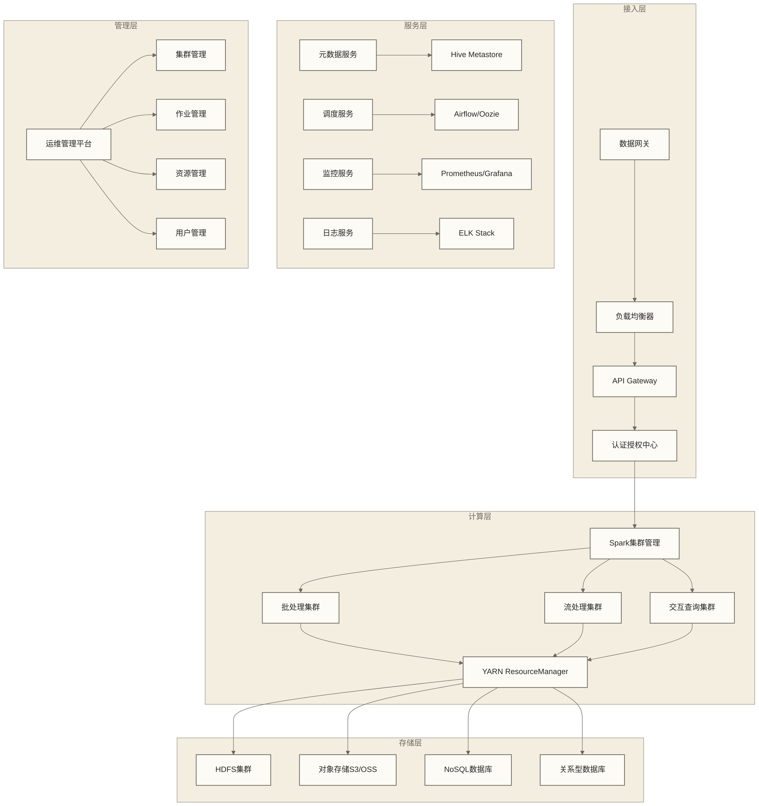

# 企业级Spark应用

## 概述

企业级Spark应用需要考虑高可用性、高性能、高安全性和可维护性等多个维度。本文档从架构设计、部署策略、运维管理、安全控制等方面，全面阐述如何构建和管理企业级Spark应用平台。

> [!info] 企业级要求
> 企业级Spark应用不仅要满足业务功能需求，还需根据业务制定可用性、容量、响应时间、安全控制和运维目标。例如，可将99.9%的可用性、PB级数据处理能力或特定请求的毫秒级响应时间作为不同场景下的假设目标；这些目标并非所有Spark应用的统一要求，也不是本文方案已实现的性能保证。

## 企业级架构设计

### 整体架构



### 分层架构设计

```scala
object EnterpriseSparkArchitecture {
  
  // 架构分层定义
  sealed trait ArchitectureLayer
  case object PresentationLayer extends ArchitectureLayer
  case object BusinessLayer extends ArchitectureLayer
  case object DataLayer extends ArchitectureLayer
  case object InfrastructureLayer extends ArchitectureLayer
  
  case class EnterpriseArchitecture(
    presentation: PresentationConfig,
    business: BusinessConfig,
    data: DataConfig,
    infrastructure: InfrastructureConfig
  )
  
  case class PresentationConfig(
    apiGateway: String,
    webPortal: String,
    mobileApp: Option[String],
    dashboards: List[String]
  )
  
  case class BusinessConfig(
    batchProcessing: BatchProcessingConfig,
    streamProcessing: StreamProcessingConfig,
    adhocQuery: AdhocQueryConfig,
    mlPlatform: MLPlatformConfig
  )
  
  case class DataConfig(
    dataLake: DataLakeConfig,
    dataWarehouse: DataWarehouseConfig,
    datamart: DatamartConfig,
    cache: CacheConfig
  )
  
  case class InfrastructureConfig(
    compute: ComputeConfig,
    storage: StorageConfig,
    network: NetworkConfig,
    security: SecurityConfig
  )
  
  // 批处理配置
  case class BatchProcessingConfig(
    scheduler: String = "Airflow",
    resourceManager: String = "YARN", 
    executionEngine: String = "Spark",
    defaultResources: ResourceAllocation,
    queues: List[QueueConfig]
  )
  
  case class ResourceAllocation(
    executors: Int,
    executorMemory: String,
    executorCores: Int,
    driverMemory: String,
    driverCores: Int
  )
  
  case class QueueConfig(
    name: String,
    capacity: Double,
    maxCapacity: Double,
    priority: Int,
    users: List[String]
  )
  
  // 企业级配置示例
  val productionArchitecture = EnterpriseArchitecture(
    presentation = PresentationConfig(
      apiGateway = "Kong/Zuul",
      webPortal = "React/Vue Admin Portal",
      mobileApp = Some("React Native App"),
      dashboards = List("Grafana", "Tableau", "Power BI")
    ),
    business = BusinessConfig(
      batchProcessing = BatchProcessingConfig(
        scheduler = "Airflow",
        resourceManager = "YARN",
        executionEngine = "Spark",
        defaultResources = ResourceAllocation(20, "8g", 4, "4g", 2),
        queues = List(
          QueueConfig("production", 60.0, 80.0, 1, List("prod_users")),
          QueueConfig("development", 20.0, 40.0, 2, List("dev_users")),
          QueueConfig("adhoc", 20.0, 30.0, 3, List("analyst_users"))
        )
      ),
      streamProcessing = StreamProcessingConfig("Spark Structured Streaming"),
      adhocQuery = AdhocQueryConfig("Spark Thrift Server"),
      mlPlatform = MLPlatformConfig("MLflow + Spark MLlib")
    ),
    data = DataConfig(
      dataLake = DataLakeConfig("HDFS + S3"),
      dataWarehouse = DataWarehouseConfig("Hive + Presto"),
      datamart = DatamartConfig("ClickHouse + Elasticsearch"),
      cache = CacheConfig("Redis Cluster")
    ),
    infrastructure = InfrastructureConfig(
      compute = ComputeConfig("YARN + Kubernetes"),
      storage = StorageConfig("HDFS + Object Storage"),
      network = NetworkConfig("10Gb Ethernet + InfiniBand"),
      security = SecurityConfig("Kerberos + LDAP + Ranger")
    )
  )
  
  case class StreamProcessingConfig(engine: String)
  case class AdhocQueryConfig(engine: String)
  case class MLPlatformConfig(platform: String)
  case class DataLakeConfig(storage: String)
  case class DataWarehouseConfig(storage: String)
  case class DatamartConfig(storage: String)
  case class CacheConfig(storage: String)
  case class ComputeConfig(platform: String)
  case class StorageConfig(system: String)
  case class NetworkConfig(infrastructure: String)
  case class SecurityConfig(components: String)
}
```

## 高可用性设计

### 集群高可用配置

```scala
object HighAvailabilityDesign {
  
  import org.apache.spark.sql.SparkSession
  
  case class HAConfig(
    nameNodeHA: Boolean = true,
    resourceManagerHA: Boolean = true,
    historyServerHA: Boolean = true,
    metastoreHA: Boolean = true,
    replicationFactor: Int = 3,
    backupStrategy: BackupStrategy
  )
  
  case class BackupStrategy(
    enabled: Boolean = true,
    frequency: String = "daily",
    retention: Int = 30,
    crossRegion: Boolean = true
  )
  
  class HASparkClusterManager {
    
    def setupHighAvailability(): Map[String, String] = {
      Map(
        // HDFS HA配置
        "dfs.nameservices" -> "mycluster",
        "dfs.ha.namenodes.mycluster" -> "nn1,nn2",
        "dfs.namenode.rpc-address.mycluster.nn1" -> "namenode1:8020",
        "dfs.namenode.rpc-address.mycluster.nn2" -> "namenode2:8020",
        "dfs.ha.automatic-failover.enabled" -> "true",
        "dfs.client.failover.proxy.provider.mycluster" -> 
          "org.apache.hadoop.hdfs.server.namenode.ha.ConfiguredFailoverProxyProvider",
        
        // YARN HA配置
        "yarn.resourcemanager.ha.enabled" -> "true",
        "yarn.resourcemanager.cluster-id" -> "cluster1",
        "yarn.resourcemanager.ha.rm-ids" -> "rm1,rm2",
        "yarn.resourcemanager.hostname.rm1" -> "resourcemanager1",
        "yarn.resourcemanager.hostname.rm2" -> "resourcemanager2",
        "yarn.resourcemanager.recovery.enabled" -> "true",
        "yarn.resourcemanager.store.class" -> 
          "org.apache.hadoop.yarn.server.resourcemanager.recovery.ZKRMStateStore",
        
        // Spark History Server HA
        "spark.history.provider" -> "org.apache.spark.deploy.history.FsHistoryProvider",
        "spark.history.fs.logDirectory" -> "hdfs://mycluster/spark-history",
        "spark.history.fs.update.interval" -> "10s",
        "spark.history.retainedApplications" -> "1000",
        
        // Hive Metastore HA
        "javax.jdo.option.ConnectionURL" -> 
          "jdbc:mysql://mysql1:3306,mysql2:3306/metastore?useSSL=false",
        "javax.jdo.option.ConnectionDriverName" -> "com.mysql.cj.jdbc.Driver"
      )
    }
    
    def createHASparkSession(appName: String): SparkSession = {
      SparkSession.builder()
        .appName(appName)
        .config("spark.master", "yarn")
        .config("spark.submit.deployMode", "cluster")
        
        // HA相关配置
        .config("spark.hadoop.dfs.nameservices", "mycluster")
        .config("spark.hadoop.dfs.client.failover.proxy.provider.mycluster",
          "org.apache.hadoop.hdfs.server.namenode.ha.ConfiguredFailoverProxyProvider")
        
        // 容错配置
        .config("spark.task.maxAttempts", "3")
        .config("spark.stage.maxConsecutiveAttempts", "8")
        .config("spark.kubernetes.executor.deleteOnTermination", "false")
        .config("spark.sql.adaptive.enabled", "true")
        .config("spark.sql.adaptive.coalescePartitions.enabled", "true")
        
        // 检查点配置
        .config("spark.sql.streaming.checkpointLocation", "hdfs://mycluster/checkpoints")
        .config("spark.sql.recovery.checkpointInterval", "10s")
        
        .getOrCreate()
    }
    
    def enableAutomaticFailover(): Unit = {
      // 配置Zookeeper自动故障转移
      println("配置自动故障转移...")
      
      // 启动ZKFC (ZooKeeper Failover Controller)
      val zkfcConfig = Map(
        "ha.zookeeper.quorum" -> "zk1:2181,zk2:2181,zk3:2181",
        "ha.zookeeper.session-timeout.ms" -> "5000",
        "dfs.ha.zkfc.port" -> "8019"
      )
      
      zkfcConfig.foreach { case (key, value) =>
        println(s"设置 $key = $value")
      }
    }
  }
  
  // 故障检测和恢复
  class FailureDetectionAndRecovery {
    
    def monitorClusterHealth(): Unit = {
      import java.util.concurrent.{Executors, TimeUnit}
      
      val executor = Executors.newScheduledThreadPool(2)
      
      // 定期健康检查
      executor.scheduleAtFixedRate(new Runnable {
        def run(): Unit = {
          try {
            checkNameNodeHealth()
            checkResourceManagerHealth()
            checkSparkHistoryServerHealth()
            checkApplicationHealth()
          } catch {
            case e: Exception =>
              println(s"健康检查异常: ${e.getMessage}")
              triggerFailover(e)
          }
        }
      }, 0, 30, TimeUnit.SECONDS)
      
      // 性能监控
      executor.scheduleAtFixedRate(new Runnable {
        def run(): Unit = {
          collectPerformanceMetrics()
          checkPerformanceThresholds()
        }
      }, 0, 60, TimeUnit.SECONDS)
    }
    
    private def checkNameNodeHealth(): Unit = {
      // 检查NameNode状态
      val command = "hdfs haadmin -getServiceState nn1"
      val result = scala.sys.process.Process(command).!!
      if (!result.contains("active") && !result.contains("standby")) {
        throw new RuntimeException("NameNode状态异常")
      }
    }
    
    private def checkResourceManagerHealth(): Unit = {
      // 检查ResourceManager状态
      val command = "yarn rmadmin -getServiceState rm1"
      val result = scala.sys.process.Process(command).!!
      if (!result.contains("active") && !result.contains("standby")) {
        throw new RuntimeException("ResourceManager状态异常")
      }
    }
    
    private def checkSparkHistoryServerHealth(): Unit = {
      // 检查Spark History Server
      try {
        val response = scala.io.Source.fromURL("http://historyserver:18080")
        response.close()
      } catch {
        case _: Exception =>
          throw new RuntimeException("Spark History Server不可访问")
      }
    }
    
    private def checkApplicationHealth(): Unit = {
      // 检查关键应用程序状态
      val sparkSession = SparkSession.getActiveSession
      sparkSession.foreach { spark =>
        val runningApps = spark.streams.active
        if (runningApps.exists(_.exception.isDefined)) {
          throw new RuntimeException("检测到Streaming应用异常")
        }
      }
    }
    
    private def collectPerformanceMetrics(): Unit = {
      // 收集性能指标
      println("收集性能指标...")
    }
    
    private def checkPerformanceThresholds(): Unit = {
      // 检查性能阈值
      println("检查性能阈值...")
    }
    
    private def triggerFailover(error: Exception): Unit = {
      println(s"触发故障转移: ${error.getMessage}")
      
      // 发送告警
      sendAlert(s"集群故障: ${error.getMessage}")
      
      // 自动故障转移逻辑
      performAutomaticFailover()
    }
    
    private def performAutomaticFailover(): Unit = {
      println("执行自动故障转移...")
      
      // 1. 检查备用节点状态
      // 2. 切换到备用节点
      // 3. 重启失败的服务
      // 4. 验证服务可用性
    }
    
    private def sendAlert(message: String): Unit = {
      // 发送告警通知
      println(s"告警: $message")
    }
  }
}
```

### 数据备份与恢复

```scala
object DataBackupAndRecovery {
  
  import org.apache.spark.sql.{SparkSession, DataFrame}
  import java.time.LocalDateTime
  import java.time.format.DateTimeFormatter
  
  case class BackupPolicy(
    fullBackupInterval: String = "weekly",
    incrementalBackupInterval: String = "daily",
    retentionPeriod: Int = 90,
    compressionEnabled: Boolean = true,
    encryptionEnabled: Boolean = true,
    crossRegionReplication: Boolean = true
  )
  
  class EnterpriseBackupManager(spark: SparkSession, policy: BackupPolicy) {
    
    private val formatter = DateTimeFormatter.ofPattern("yyyy-MM-dd-HH-mm-ss")
    
    def performFullBackup(databases: List[String], 
                         backupLocation: String): Unit = {
      val timestamp = LocalDateTime.now().format(formatter)
      val fullBackupPath = s"$backupLocation/full-backup-$timestamp"
      
      println(s"开始全量备份到: $fullBackupPath")
      
      databases.foreach { database =>
        backupDatabase(database, s"$fullBackupPath/$database", "full")
      }
      
      // 备份元数据
      backupMetadata(s"$fullBackupPath/metadata")
      
      // 备份配置文件
      backupConfigurations(s"$fullBackupPath/configs")
      
      // 生成备份清单
      generateBackupManifest(fullBackupPath, "full", timestamp)
      
      println("全量备份完成")
    }
    
    def performIncrementalBackup(databases: List[String],
                                backupLocation: String,
                                lastBackupTime: String): Unit = {
      val timestamp = LocalDateTime.now().format(formatter)
      val incrementalBackupPath = s"$backupLocation/incremental-backup-$timestamp"
      
      println(s"开始增量备份到: $incrementalBackupPath")
      
      databases.foreach { database =>
        backupDatabaseIncremental(database, 
          s"$incrementalBackupPath/$database", 
          lastBackupTime)
      }
      
      generateBackupManifest(incrementalBackupPath, "incremental", timestamp)
      
      println("增量备份完成")
    }
    
    private def backupDatabase(database: String, 
                              backupPath: String, 
                              backupType: String): Unit = {
      
      val tables = spark.catalog.listTables(database).collect()
      
      tables.foreach { table =>
        val tableName = table.name
        val tableDF = spark.table(s"$database.$tableName")
        
        println(s"备份表: $database.$tableName")
        
        var writer = tableDF.write
          .mode("overwrite")
          .option("compression", if (policy.compressionEnabled) "gzip" else "none")
        
        // 根据表大小选择格式
        val tableSize = getTableSize(database, tableName)
        if (tableSize > 1024 * 1024 * 1024) { // 1GB以上使用Parquet
          writer = writer.format("parquet")
        } else {
          writer = writer.format("json")
        }
        
        writer.save(s"$backupPath/$tableName")
        
        // 备份表结构
        backupTableSchema(database, tableName, s"$backupPath/$tableName.schema")
      }
    }
    
    private def backupDatabaseIncremental(database: String,
                                        backupPath: String, 
                                        lastBackupTime: String): Unit = {
      val tables = spark.catalog.listTables(database).collect()
      
      tables.foreach { table =>
        val tableName = table.name
        
        // 检查表是否有更新时间字段
        val tableDF = spark.table(s"$database.$tableName")
        val hasUpdateTime = tableDF.columns.contains("update_time") || 
                           tableDF.columns.contains("modified_date")
        
        if (hasUpdateTime) {
          val timeColumns = List("update_time", "modified_date")
            .filter(tableDF.columns.contains)
          val incrementalCondition = timeColumns
            .map(name => org.apache.spark.sql.functions.col(name) > org.apache.spark.sql.functions.lit(lastBackupTime))
            .reduce(_ || _)
          val incrementalData = tableDF.filter(incrementalCondition)
          
          if (incrementalData.count() > 0) {
            println(s"备份增量数据: $database.$tableName")
            incrementalData.write
              .mode("overwrite")
              .format("parquet")
              .save(s"$backupPath/$tableName")
          }
        } else {
          println(s"表 $database.$tableName 无时间字段，跳过增量备份")
        }
      }
    }
    
    private def backupMetadata(metadataPath: String): Unit = {
      println("备份元数据...")
      
      // 备份Hive元数据
      val metadataBackupScript = s"""
        |mysqldump -h metastore-db-host -u hive -p hive_metastore > $metadataPath/hive_metastore.sql
        |""".stripMargin
      
      scala.sys.process.Process(metadataBackupScript).!
    }
    
    private def backupConfigurations(configPath: String): Unit = {
      println("备份配置文件...")
      
      val configFiles = List(
        "/etc/hadoop/conf/core-site.xml",
        "/etc/hadoop/conf/hdfs-site.xml", 
        "/etc/hadoop/conf/yarn-site.xml",
        "/etc/spark/conf/spark-defaults.conf",
        "/etc/hive/conf/hive-site.xml"
      )
      
      configFiles.foreach { file =>
        val copyCommand = s"cp $file $configPath/"
        scala.sys.process.Process(copyCommand).!
      }
    }
    
    private def generateBackupManifest(backupPath: String,
                                     backupType: String, 
                                     timestamp: String): Unit = {
      val manifest = BackupManifest(
        backupType = backupType,
        timestamp = timestamp,
        location = backupPath,
        policy = policy,
        files = listBackupFiles(backupPath)
      )
      
      val manifestJson = manifest.toJson
      val manifestPath = s"$backupPath/backup-manifest.json"
      
      // 写入清单文件
      import java.io.PrintWriter
      new PrintWriter(manifestPath) {
        write(manifestJson)
        close()
      }
    }
    
    private def getTableSize(database: String, tableName: String): Long = {
      // 获取表大小的简化实现
      try {
        val stats = spark.sql(s"ANALYZE TABLE $database.$tableName COMPUTE STATISTICS")
        // 从统计信息中提取大小
        1024 * 1024 * 100 // 默认100MB
      } catch {
        case _: Exception => 1024 * 1024 * 100
      }
    }
    
    private def backupTableSchema(database: String, 
                                tableName: String, 
                                schemaPath: String): Unit = {
      val schema = spark.table(s"$database.$tableName").schema
      val schemaJson = schema.json
      
      import java.io.PrintWriter
      new PrintWriter(schemaPath) {
        write(schemaJson)
        close()
      }
    }
    
    private def listBackupFiles(backupPath: String): List[String] = {
      // 列出备份文件
      import java.io.File
      def listFilesRecursively(dir: File): List[String] = {
        val files = dir.listFiles()
        if (files != null) {
          files.toList.flatMap { file =>
            if (file.isDirectory) {
              listFilesRecursively(file)
            } else {
              List(file.getAbsolutePath)
            }
          }
        } else {
          List.empty
        }
      }
      
      listFilesRecursively(new File(backupPath))
    }
  }
  
  case class BackupManifest(
    backupType: String,
    timestamp: String,
    location: String,
    policy: BackupPolicy,
    files: List[String]
  ) {
    def toJson: String = {
      // 简化的JSON序列化
      s"""
      |{
      |  "backupType": "$backupType",
      |  "timestamp": "$timestamp", 
      |  "location": "$location",
      |  "fileCount": ${files.length}
      |}
      |""".stripMargin
    }
  }
  
  // 数据恢复管理器
  class DataRecoveryManager(spark: SparkSession) {
    
    def recoverFromBackup(backupManifestPath: String, 
                         targetDatabase: String): Unit = {
      println(s"开始从备份恢复: $backupManifestPath")
      
      // 读取备份清单
      val manifest = readBackupManifest(backupManifestPath)
      
      // 验证备份完整性
      if (validateBackupIntegrity(manifest)) {
        // 执行恢复
        performRestore(manifest, targetDatabase)
        
        // 验证恢复结果
        validateRestoreResult(targetDatabase)
        
        println("数据恢复完成")
      } else {
        throw new RuntimeException("备份文件损坏，无法恢复")
      }
    }
    
    private def readBackupManifest(manifestPath: String): BackupManifest = {
      // 读取备份清单
      import scala.io.Source
      val manifestContent = Source.fromFile(manifestPath).mkString
      // 简化的JSON解析
      BackupManifest("full", "2024-01-01", "/backup/path", 
        BackupPolicy(), List.empty)
    }
    
    private def validateBackupIntegrity(manifest: BackupManifest): Boolean = {
      // 验证备份文件完整性
      manifest.files.forall { file =>
        new java.io.File(file).exists()
      }
    }
    
    private def performRestore(manifest: BackupManifest, 
                              targetDatabase: String): Unit = {
      val backupLocation = manifest.location
      
      // 创建目标数据库
      spark.sql(s"CREATE DATABASE IF NOT EXISTS $targetDatabase")
      
      // 恢复表数据
      val backupDir = new java.io.File(backupLocation)
      backupDir.listFiles().foreach { tableDir =>
        if (tableDir.isDirectory && !tableDir.getName.contains("metadata")) {
          val tableName = tableDir.getName
          
          println(s"恢复表: $tableName")
          
          val tableData = spark.read
            .format("parquet")
            .load(tableDir.getAbsolutePath)
          
          tableData.write
            .mode("overwrite")
            .saveAsTable(s"$targetDatabase.$tableName")
        }
      }
    }
    
    private def validateRestoreResult(database: String): Unit = {
      // 验证恢复结果
      val tables = spark.catalog.listTables(database).collect()
      
      tables.foreach { table =>
        val count = spark.table(s"$database.${table.name}").count()
        println(s"表 ${table.name} 恢复记录数: $count")
      }
    }
  }
}
```

## 安全控制体系

### 认证授权体系

```scala
object EnterpriseSecurityFramework {
  
  import org.apache.spark.sql.SparkSession
  
  case class SecurityConfig(
    authenticationMethod: String = "Kerberos",
    authorizationMethod: String = "Ranger",
    encryptionInTransit: Boolean = true,
    encryptionAtRest: Boolean = true,
    auditLogging: Boolean = true,
    dataClassification: Boolean = true
  )
  
  class SecurityManager(config: SecurityConfig) {
    
    def setupKerberosAuthentication(): Map[String, String] = {
      Map(
        // Kerberos配置
        "spark.security.credentials.hbase.enabled" -> "true",
        "spark.security.credentials.hive.enabled" -> "true",
        "spark.authenticate" -> "true",
        "spark.authenticate.secret" -> "spark-secret",
        "spark.network.sasl.enabled" -> "true",
        "spark.network.sasl.serverAlwaysEncrypt" -> "true",
        
        // HDFS Kerberos
        "spark.hadoop.fs.hdfs.impl.disable.cache" -> "true",
        "spark.hadoop.hadoop.security.authentication" -> "kerberos",
        "spark.hadoop.hadoop.security.authorization" -> "true",
        
        // Hive Kerberos
        "spark.hadoop.hive.metastore.sasl.enabled" -> "true",
        "spark.hadoop.hive.metastore.kerberos.principal" -> "hive/_HOST@REALM",
        "spark.hadoop.hive.server2.authentication" -> "kerberos",
        
        // YARN Kerberos
        "spark.hadoop.yarn.resourcemanager.principal" -> "rm/_HOST@REALM",
        "spark.hadoop.yarn.nodemanager.principal" -> "nm/_HOST@REALM"
      )
    }
    
    def createSecureSparkSession(principal: String, 
                               keytabPath: String): SparkSession = {
      val kerberosConfig = setupKerberosAuthentication()
      
      val spark = SparkSession.builder()
        .appName("SecureSparkApplication")
        .config("spark.master", "yarn")
        .config("spark.submit.deployMode", "cluster")
        
      kerberosConfig.foreach { case (key, value) =>
        spark.config(key, value)
      }
      
      val sparkSession = spark
        // SSL配置
        .config("spark.ssl.enabled", "true")
        .config("spark.ssl.protocol", "TLSv1.2")
        .config("spark.ssl.keyStore", "/path/to/keystore.jks")
        .config("spark.ssl.keyStorePassword", "keystore-password")
        .config("spark.ssl.trustStore", "/path/to/truststore.jks")
        .config("spark.ssl.trustStorePassword", "truststore-password")
        
        // 数据加密
        .config("spark.sql.parquet.encryption.column.keys", 
          "k1:col1,col2;k2:col3")
        .config("spark.sql.parquet.encryption.footer.key", "footer_key")
        
        .getOrCreate()
      
      // Kerberos登录
      loginWithKerberos(principal, keytabPath)
      
      sparkSession
    }
    
    private def loginWithKerberos(principal: String, keytabPath: String): Unit = {
      import org.apache.hadoop.security.UserGroupInformation
      import org.apache.hadoop.conf.Configuration
      
      val conf = new Configuration()
      conf.set("hadoop.security.authentication", "kerberos")
      UserGroupInformation.setConfiguration(conf)
      
      UserGroupInformation.loginUserFromKeytab(principal, keytabPath)
      println(s"Kerberos登录成功: $principal")
    }
  }
  
  // Apache Ranger集成
  class RangerAuthorizationManager {
    
    def setupRangerPolicies(): Unit = {
      // 创建Ranger策略
      val policies = List(
        createDatabasePolicy("finance_db", List("finance_team"), List("SELECT")),
        createDatabasePolicy("hr_db", List("hr_team"), List("SELECT", "INSERT")),
        createTablePolicy("public_db", "user_profiles", List("analysts"), List("SELECT")),
        createColumnPolicy("customer_db", "customers", List("pii_columns"), 
          List("data_privacy_team"), List("SELECT"))
      )
      
      policies.foreach(deployPolicy)
    }
    
    private def createDatabasePolicy(database: String,
                                   users: List[String], 
                                   permissions: List[String]): RangerPolicy = {
      RangerPolicy(
        policyType = "database",
        resource = database,
        users = users,
        permissions = permissions
      )
    }
    
    private def createTablePolicy(database: String,
                                table: String, 
                                users: List[String],
                                permissions: List[String]): RangerPolicy = {
      RangerPolicy(
        policyType = "table",
        resource = s"$database.$table",
        users = users, 
        permissions = permissions
      )
    }
    
    private def createColumnPolicy(database: String,
                                 table: String,
                                 columns: List[String],
                                 users: List[String],
                                 permissions: List[String]): RangerPolicy = {
      RangerPolicy(
        policyType = "column",
        resource = s"$database.$table.${columns.mkString(",")}",
        users = users,
        permissions = permissions
      )
    }
    
    private def deployPolicy(policy: RangerPolicy): Unit = {
      // 通过Ranger API部署策略
      println(s"部署Ranger策略: ${policy.resource}")
    }
    
    case class RangerPolicy(
      policyType: String,
      resource: String,
      users: List[String],
      permissions: List[String]
    )
  }
  
  // 数据分类和标记
  class DataClassificationManager(spark: SparkSession) {
    
    sealed trait DataClassification
    case object Public extends DataClassification
    case object Internal extends DataClassification
    case object Confidential extends DataClassification
    case object Restricted extends DataClassification
    
    case class DataClassificationRule(
      pattern: String,
      classification: DataClassification,
      maskingRequired: Boolean = false
    )
    
    val classificationRules = List(
      DataClassificationRule(".*ssn.*|.*social_security.*", Restricted, maskingRequired = true),
      DataClassificationRule(".*email.*|.*phone.*", Confidential, maskingRequired = true),
      DataClassificationRule(".*salary.*|.*income.*", Confidential),
      DataClassificationRule(".*public.*|.*common.*", Public)
    )
    
    def classifyDataFrame(df: org.apache.spark.sql.DataFrame): 
      Map[String, DataClassification] = {
      
      val columnClassifications = df.columns.map { columnName =>
        val classification = classificationRules
          .find(rule => columnName.toLowerCase.matches(rule.pattern.toLowerCase))
          .map(_.classification)
          .getOrElse(Internal)
        
        columnName -> classification
      }.toMap
      
      columnClassifications
    }
    
    def applyDataMasking(df: org.apache.spark.sql.DataFrame): 
      org.apache.spark.sql.DataFrame = {
      
      import org.apache.spark.sql.functions._
      
      val classifications = classifyDataFrame(df)
      var maskedDF = df
      
      classifications.foreach { case (columnName, classification) =>
        classification match {
          case Restricted =>
            // 完全掩码
            maskedDF = maskedDF.withColumn(columnName, lit("***RESTRICTED***"))
          case Confidential =>
            // 部分掩码  
            maskedDF = maskedDF.withColumn(columnName,
              regexp_replace(col(columnName), ".{3}$", "***"))
          case _ =>
            // 不需要掩码
        }
      }
      
      maskedDF
    }
  }
  
  // 审计日志
  class AuditLoggingManager {
    
    case class AuditLog(
      timestamp: Long,
      user: String,
      operation: String,
      resource: String,
      result: String,
      clientIP: String,
      details: Map[String, String]
    )
    
    def logDataAccess(user: String,
                     operation: String, 
                     resource: String,
                     result: String,
                     clientIP: String = "unknown"): Unit = {
      
      val auditLog = AuditLog(
        timestamp = System.currentTimeMillis(),
        user = user,
        operation = operation,
        resource = resource,
        result = result,
        clientIP = clientIP,
        details = Map(
          "applicationId" -> SparkSession.getActiveSession.map(_.sparkContext.applicationId).getOrElse("unknown"),
          "sparkVersion" -> org.apache.spark.SPARK_VERSION
        )
      )
      
      writeAuditLog(auditLog)
    }
    
    private def writeAuditLog(auditLog: AuditLog): Unit = {
      // 写入审计日志到多个目标
      writeToFile(auditLog)
      writeToElasticsearch(auditLog)
      writeToKafka(auditLog)
    }
    
    private def writeToFile(auditLog: AuditLog): Unit = {
      val logLine = s"${auditLog.timestamp}|${auditLog.user}|${auditLog.operation}|${auditLog.resource}|${auditLog.result}"
      
      import java.io.{FileWriter, BufferedWriter}
      val writer = new BufferedWriter(new FileWriter("/var/log/spark-audit.log", true))
      try {
        writer.write(logLine)
        writer.newLine()
      } finally {
        writer.close()
      }
    }
    
    private def writeToElasticsearch(auditLog: AuditLog): Unit = {
      // 发送到Elasticsearch
      println(s"发送审计日志到Elasticsearch: ${auditLog.user} - ${auditLog.operation}")
    }
    
    private def writeToKafka(auditLog: AuditLog): Unit = {
      // 发送到Kafka
      println(s"发送审计日志到Kafka: ${auditLog.user} - ${auditLog.operation}")
    }
  }
}
```

## 性能与资源管理

### 动态资源管理

```scala
object DynamicResourceManagement {
  
  import org.apache.spark.sql.SparkSession
  
  case class ResourceProfile(
    executors: Int,
    executorMemory: String,
    executorCores: Int,
    driverMemory: String,
    driverCores: Int
  )
  
  case class WorkloadCharacteristics(
    dataSize: Long,
    complexity: String, // "simple", "medium", "complex"
    priority: String,   // "low", "medium", "high", "critical"
    sla: Int           // SLA in minutes
  )
  
  class DynamicResourceManager(spark: SparkSession) {
    
    private val resourceProfiles = Map(
      "small" -> ResourceProfile(5, "2g", 2, "1g", 1),
      "medium" -> ResourceProfile(10, "4g", 2, "2g", 1),
      "large" -> ResourceProfile(20, "8g", 4, "4g", 2),
      "xlarge" -> ResourceProfile(50, "16g", 4, "8g", 2),
      "xxlarge" -> ResourceProfile(100, "32g", 8, "16g", 4)
    )
    
    def determineOptimalResources(workload: WorkloadCharacteristics): ResourceProfile = {
      val baseProfile = workload.dataSize match {
        case size if size < 1024 * 1024 * 1024 => "small"        // < 1GB
        case size if size < 10L * 1024 * 1024 * 1024 => "medium"  // < 10GB
        case size if size < 100L * 1024 * 1024 * 1024 => "large"  // < 100GB
        case size if size < 1024L * 1024 * 1024 * 1024 => "xlarge" // < 1TB
        case _ => "xxlarge"
      }
      
      var profile = resourceProfiles(baseProfile)
      
      // 根据复杂度调整
      profile = workload.complexity match {
        case "complex" => profile.copy(
          executors = (profile.executors * 1.5).toInt,
          executorMemory = increaseMemory(profile.executorMemory, 1.5)
        )
        case "simple" => profile.copy(
          executors = Math.max(2, (profile.executors * 0.7).toInt)
        )
        case _ => profile
      }
      
      // 根据优先级调整
      profile = workload.priority match {
        case "critical" => profile.copy(
          executors = (profile.executors * 1.2).toInt,
          driverMemory = increaseMemory(profile.driverMemory, 1.2)
        )
        case "low" => profile.copy(
          executors = Math.max(2, (profile.executors * 0.8).toInt)
        )
        case _ => profile
      }
      
      profile
    }
    
    private def increaseMemory(currentMemory: String, factor: Double): String = {
      val currentSize = currentMemory.dropRight(1).toInt
      val newSize = (currentSize * factor).toInt
      s"${newSize}g"
    }
    
    def applyDynamicAllocation(): Map[String, String] = {
      Map(
        "spark.dynamicAllocation.enabled" -> "true",
        "spark.dynamicAllocation.minExecutors" -> "2",
        "spark.dynamicAllocation.maxExecutors" -> "200", 
        "spark.dynamicAllocation.initialExecutors" -> "10",
        "spark.dynamicAllocation.targetNumExecutors" -> "20",
        
        // 扩缩容策略
        "spark.dynamicAllocation.schedulerBacklogTimeout" -> "5s",
        "spark.dynamicAllocation.sustainedSchedulerBacklogTimeout" -> "10s",
        "spark.dynamicAllocation.executorIdleTimeout" -> "60s",
        "spark.dynamicAllocation.cachedExecutorIdleTimeout" -> "300s",
        
        // 外部Shuffle服务
        "spark.shuffle.service.enabled" -> "true",
        "spark.dynamicAllocation.shuffleTracking.enabled" -> "true"
      )
    }
  }
  
  // 资源监控和调整
  class ResourceMonitoringAndTuning(spark: SparkSession) {
    
    def startResourceMonitoring(): Unit = {
      import java.util.concurrent.{Executors, TimeUnit}
      
      val executor = Executors.newScheduledThreadPool(1)
      
      executor.scheduleAtFixedRate(new Runnable {
        def run(): Unit = {
          try {
            val metrics = collectResourceMetrics()
            analyzeResourceUtilization(metrics)
            suggestResourceAdjustments(metrics)
          } catch {
            case e: Exception =>
              println(s"资源监控异常: ${e.getMessage}")
          }
        }
      }, 0, 60, TimeUnit.SECONDS) // 每分钟监控一次
    }
    
    case class ResourceMetrics(
      totalExecutors: Int,
      activeExecutors: Int,
      totalCores: Int,
      usedCores: Int,
      totalMemory: Long,
      usedMemory: Long,
      pendingTasks: Int,
      runningTasks: Int,
      completedTasks: Int,
      failedTasks: Int
    )
    
    private def collectResourceMetrics(): ResourceMetrics = {
      val statusTracker = spark.sparkContext.statusTracker
      val executorInfos = statusTracker.getExecutorInfos
      
      ResourceMetrics(
        totalExecutors = executorInfos.length,
        activeExecutors = executorInfos.count(_.isActive),
        totalCores = executorInfos.map(_.totalCores).sum,
        usedCores = executorInfos.map(_.totalCores - _.maxTasks + _.activeTasks).sum,
        totalMemory = executorInfos.map(_.maxMemory).sum,
        usedMemory = executorInfos.map(_.memoryUsed).sum,
        pendingTasks = statusTracker.getActiveStageInfos().map(_.numActiveTasks).sum,
        runningTasks = statusTracker.getActiveStageInfos().map(_.numActiveTasks).sum,
        completedTasks = statusTracker.getActiveStageInfos().map(_.numCompletedTasks).sum,
        failedTasks = statusTracker.getActiveStageInfos().map(_.numFailedTasks).sum
      )
    }
    
    private def analyzeResourceUtilization(metrics: ResourceMetrics): Unit = {
      val coreUtilization = if (metrics.totalCores > 0) {
        metrics.usedCores.toDouble / metrics.totalCores
      } else 0.0
      
      val memoryUtilization = if (metrics.totalMemory > 0) {
        metrics.usedMemory.toDouble / metrics.totalMemory
      } else 0.0
      
      val executorUtilization = if (metrics.totalExecutors > 0) {
        metrics.activeExecutors.toDouble / metrics.totalExecutors
      } else 0.0
      
      println(s"资源利用率:")
      println(s"  CPU: ${(coreUtilization * 100).toInt}%")
      println(s"  内存: ${(memoryUtilization * 100).toInt}%")
      println(s"  执行器: ${(executorUtilization * 100).toInt}%")
      println(s"  待处理任务: ${metrics.pendingTasks}")
      println(s"  失败任务: ${metrics.failedTasks}")
    }
    
    private def suggestResourceAdjustments(metrics: ResourceMetrics): Unit = {
      val suggestions = scala.collection.mutable.ListBuffer[String]()
      
      // CPU利用率分析
      val coreUtilization = metrics.usedCores.toDouble / metrics.totalCores
      if (coreUtilization > 0.9) {
        suggestions += "CPU利用率过高，建议增加执行器数量或CPU核心数"
      } else if (coreUtilization < 0.3) {
        suggestions += "CPU利用率过低，建议减少资源分配"
      }
      
      // 内存利用率分析
      val memoryUtilization = metrics.usedMemory.toDouble / metrics.totalMemory
      if (memoryUtilization > 0.85) {
        suggestions += "内存使用率过高，建议增加执行器内存"
      }
      
      // 任务分析
      if (metrics.pendingTasks > metrics.totalCores * 2) {
        suggestions += "待处理任务过多，建议增加并行度"
      }
      
      if (metrics.failedTasks > metrics.completedTasks * 0.1) {
        suggestions += "任务失败率过高，检查资源配置和数据倾斜"
      }
      
      if (suggestions.nonEmpty) {
        println("资源调整建议:")
        suggestions.foreach(suggestion => println(s"  - $suggestion"))
      }
    }
  }
  
  // 多租户资源隔离
  class MultiTenantResourceIsolation {
    
    case class TenantProfile(
      tenantId: String,
      maxExecutors: Int,
      maxMemory: String,
      maxCores: Int,
      priority: Int,
      queue: String
    )
    
    val tenantProfiles = Map(
      "production" -> TenantProfile("production", 100, "800g", 400, 1, "production"),
      "development" -> TenantProfile("development", 20, "160g", 80, 3, "development"),
      "analytics" -> TenantProfile("analytics", 50, "400g", 200, 2, "analytics"),
      "adhoc" -> TenantProfile("adhoc", 10, "80g", 40, 4, "adhoc")
    )
    
    def createTenantSpecificSession(tenantId: String, 
                                   appName: String): SparkSession = {
      val profile = tenantProfiles.getOrElse(tenantId, 
        throw new IllegalArgumentException(s"未知租户: $tenantId"))
      
      SparkSession.builder()
        .appName(s"${profile.tenantId}-$appName")
        .master("yarn")
        .config("spark.yarn.queue", profile.queue)
        .config("spark.dynamicAllocation.enabled", "true")
        .config("spark.dynamicAllocation.maxExecutors", profile.maxExecutors.toString)
        .config("spark.executor.memory", calculateExecutorMemory(profile))
        .config("spark.executor.cores", calculateExecutorCores(profile).toString)
        .config("spark.sql.adaptive.enabled", "true")
        .config("spark.sql.adaptive.coalescePartitions.enabled", "true")
        .config("spark.serializer", "org.apache.spark.serializer.KryoSerializer")
        .getOrCreate()
    }
    
    private def calculateExecutorMemory(profile: TenantProfile): String = {
      val totalMemoryGB = profile.maxMemory.dropRight(1).toInt
      val executorMemoryGB = Math.min(32, totalMemoryGB / profile.maxExecutors * 4)
      s"${executorMemoryGB}g"
    }
    
    private def calculateExecutorCores(profile: TenantProfile): Int = {
      Math.min(8, profile.maxCores / profile.maxExecutors * 2)
    }
  }
}
```

## 企业级运维管理

### 统一管理平台

```scala
object EnterpriseOperationsManagement {
  
  import org.apache.spark.sql.SparkSession
  import java.time.LocalDateTime
  
  case class ClusterStatus(
    totalNodes: Int,
    activeNodes: Int,
    totalMemory: Long,
    usedMemory: Long,
    totalCores: Int,
    usedCores: Int,
    runningApplications: Int,
    queuedApplications: Int,
    healthScore: Double
  )
  
  case class ApplicationInfo(
    applicationId: String,
    name: String,
    user: String,
    queue: String,
    state: String,
    startTime: LocalDateTime,
    duration: Long,
    memoryUsed: Long,
    coresUsed: Int,
    progress: Double
  )
  
  class EnterpriseManagementPlatform {
    
    def getClusterOverview(): ClusterStatus = {
      // 集群概览信息
      ClusterStatus(
        totalNodes = 100,
        activeNodes = 98,
        totalMemory = 1024L * 1024 * 1024 * 1024, // 1TB
        usedMemory = 512L * 1024 * 1024 * 1024,   // 512GB
        totalCores = 2000,
        usedCores = 800,
        runningApplications = 25,
        queuedApplications = 5,
        healthScore = 95.5
      )
    }
    
    def getApplications(limit: Int = 50): List[ApplicationInfo] = {
      // 获取应用程序列表
      (1 to limit).map { i =>
        ApplicationInfo(
          applicationId = s"application_${System.currentTimeMillis()}_$i",
          name = s"SparkApp_$i",
          user = s"user$i",
          queue = if (i % 3 == 0) "production" else "development", 
          state = if (i <= 25) "RUNNING" else "ACCEPTED",
          startTime = LocalDateTime.now().minusMinutes(i * 10),
          duration = i * 600000L, // 毫秒
          memoryUsed = i * 1024L * 1024 * 1024, // GB
          coresUsed = i * 4,
          progress = if (i <= 25) Math.random() else 0.0
        )
      }.toList
    }
    
    def killApplication(applicationId: String): Boolean = {
      try {
        // 通过YARN API终止应用
        val command = s"yarn application -kill $applicationId"
        val result = scala.sys.process.Process(command).!
        result == 0
      } catch {
        case e: Exception =>
          println(s"终止应用失败: ${e.getMessage}")
          false
      }
    }
    
    def getQueueInfo(): List[QueueInfo] = {
      // 获取队列信息
      List(
        QueueInfo("production", 60.0, 45.2, 15, 2, "RUNNING"),
        QueueInfo("development", 25.0, 18.7, 8, 3, "RUNNING"),
        QueueInfo("analytics", 15.0, 12.1, 2, 0, "RUNNING")
      )
    }
    
    case class QueueInfo(
      name: String,
      capacity: Double,
      usedCapacity: Double,
      runningApps: Int,
      pendingApps: Int,
      state: String
    )
  }
  
  // 应用生命周期管理
  class ApplicationLifecycleManager {
    
    def submitApplication(appConfig: ApplicationConfig): String = {
      val sparkSubmitCommand = buildSparkSubmitCommand(appConfig)
      
      try {
        val process = scala.sys.process.Process(sparkSubmitCommand)
        val output = process.!!
        
        // 从输出中提取应用ID
        val applicationId = extractApplicationId(output)
        
        // 记录提交日志
        logApplicationSubmission(appConfig, applicationId)
        
        applicationId
      } catch {
        case e: Exception =>
          println(s"应用提交失败: ${e.getMessage}")
          throw e
      }
    }
    
    def monitorApplication(applicationId: String): ApplicationStatus = {
      val yarnCommand = s"yarn application -status $applicationId"
      val output = scala.sys.process.Process(yarnCommand).!!
      
      parseApplicationStatus(output)
    }
    
    def scaleApplication(applicationId: String, 
                        targetExecutors: Int): Boolean = {
      // 以下为自定义扩缩容服务的接口示意，并非Spark标准REST端点，也不能直接用于YARN应用扩缩容
      try {
        val scaleCommand = s"""
          curl -X POST http://spark-master:6066/v1/submissions/scale \\
          -H "Content-Type: application/json" \\
          -d '{
            "action": "scale",
            "appId": "$applicationId", 
            "targetExecutors": $targetExecutors
          }'
        """
        
        val result = scala.sys.process.Process(scaleCommand).!
        result == 0
      } catch {
        case e: Exception =>
          println(s"应用扩缩容失败: ${e.getMessage}")
          false
      }
    }
    
    private def buildSparkSubmitCommand(config: ApplicationConfig): String = {
      s"""
        |spark-submit \\
        |  --name "${config.appName}" \\
        |  --master yarn \\
        |  --deploy-mode cluster \\
        |  --queue ${config.queue} \\
        |  --num-executors ${config.numExecutors} \\
        |  --executor-memory ${config.executorMemory} \\
        |  --executor-cores ${config.executorCores} \\
        |  --driver-memory ${config.driverMemory} \\
        |  --class ${config.mainClass} \\
        |  ${config.jarFile} \\
        |  ${config.appArgs.mkString(" ")}
        |""".stripMargin
    }
    
    private def extractApplicationId(output: String): String = {
      val pattern = "application_\\d+_\\d+".r
      pattern.findFirstIn(output).getOrElse("unknown")
    }
    
    private def logApplicationSubmission(config: ApplicationConfig, 
                                       applicationId: String): Unit = {
      val logEntry = s"""
        |应用提交记录:
        |  应用ID: $applicationId
        |  应用名称: ${config.appName}
        |  用户: ${config.user}
        |  队列: ${config.queue}
        |  提交时间: ${LocalDateTime.now()}
        |""".stripMargin
      
      println(logEntry)
    }
    
    private def parseApplicationStatus(output: String): ApplicationStatus = {
      // 解析YARN状态输出
      ApplicationStatus(
        applicationId = "app_123",
        state = "RUNNING",
        progress = 75.0,
        startTime = LocalDateTime.now().minusHours(1),
        elapsedTime = 3600000L
      )
    }
    
    case class ApplicationConfig(
      appName: String,
      user: String,
      queue: String,
      numExecutors: Int,
      executorMemory: String,
      executorCores: Int,
      driverMemory: String,
      mainClass: String,
      jarFile: String,
      appArgs: List[String]
    )
    
    case class ApplicationStatus(
      applicationId: String,
      state: String,
      progress: Double,
      startTime: LocalDateTime,
      elapsedTime: Long
    )
  }
  
  // 自动运维
  class AutomatedOperations {
    
    def setupAutomatedMaintenance(): Unit = {
      import java.util.concurrent.{Executors, TimeUnit}
      
      val executor = Executors.newScheduledThreadPool(3)
      
      // 定期清理
      executor.scheduleAtFixedRate(new Runnable {
        def run(): Unit = cleanupOldApplications()
      }, 0, 24, TimeUnit.HOURS)
      
      // 资源重平衡
      executor.scheduleAtFixedRate(new Runnable {
        def run(): Unit = rebalanceResources()
      }, 0, 2, TimeUnit.HOURS)
      
      // 健康检查
      executor.scheduleAtFixedRate(new Runnable {
        def run(): Unit = performHealthCheck()
      }, 0, 15, TimeUnit.MINUTES)
    }
    
    private def cleanupOldApplications(): Unit = {
      println("清理旧应用程序...")
      
      // 清理完成超过7天的应用日志
      val cleanupCommand = """
        find /var/log/spark -name "*.log" -mtime +7 -delete
        find /tmp/hadoop-yarn -name "application_*" -mtime +7 -exec rm -rf {} +
      """
      
      scala.sys.process.Process(cleanupCommand).!
      
      // 清理HDFS上的旧检查点
      val hdfsCleanupCommand = """
        hadoop fs -find /spark-checkpoints -name "*" -mtime +30 -delete
        hadoop fs -find /spark-warehouse -name "_tmp*" -delete
      """
      
      scala.sys.process.Process(hdfsCleanupCommand).!
    }
    
    private def rebalanceResources(): Unit = {
      println("执行资源重平衡...")
      
      // 分析当前资源使用情况
      val clusterStats = analyzeClusterUtilization()
      
      if (clusterStats.imbalanceRatio > 0.3) {
        // 执行负载均衡
        performLoadBalancing()
      }
    }
    
    private def performHealthCheck(): Unit = {
      val healthIssues = scala.collection.mutable.ListBuffer[String]()
      
      // 检查HDFS健康状态
      if (!checkHDFSHealth()) {
        healthIssues += "HDFS健康检查失败"
      }
      
      // 检查YARN健康状态
      if (!checkYARNHealth()) {
        healthIssues += "YARN健康检查失败"
      }
      
      // 检查Spark History Server
      if (!checkSparkHistoryServer()) {
        healthIssues += "Spark History Server不可用"
      }
      
      if (healthIssues.nonEmpty) {
        sendHealthAlert(healthIssues.toList)
      } else {
        println("集群健康检查通过")
      }
    }
    
    private def analyzeClusterUtilization(): ClusterUtilizationStats = {
      ClusterUtilizationStats(
        avgCpuUtil = 65.5,
        avgMemUtil = 70.2,
        imbalanceRatio = 0.25,
        hotspotNodes = List("node1", "node5")
      )
    }
    
    private def performLoadBalancing(): Unit = {
      println("执行负载均衡...")
      // 实现负载均衡逻辑
    }
    
    private def checkHDFSHealth(): Boolean = {
      try {
        val command = "hdfs dfsadmin -report"
        val output = scala.sys.process.Process(command).!!
        output.contains("Live datanodes")
      } catch {
        case _: Exception => false
      }
    }
    
    private def checkYARNHealth(): Boolean = {
      try {
        val command = "yarn node -list -states RUNNING"
        val result = scala.sys.process.Process(command).!
        result == 0
      } catch {
        case _: Exception => false
      }
    }
    
    private def checkSparkHistoryServer(): Boolean = {
      try {
        scala.io.Source.fromURL("http://spark-history:18080/api/v1/applications")
        true
      } catch {
        case _: Exception => false
      }
    }
    
    private def sendHealthAlert(issues: List[String]): Unit = {
      val alertMessage = s"集群健康检查发现问题:\n${issues.mkString("\n")}"
      println(s"发送健康告警: $alertMessage")
    }
    
    case class ClusterUtilizationStats(
      avgCpuUtil: Double,
      avgMemUtil: Double,
      imbalanceRatio: Double,
      hotspotNodes: List[String]
    )
  }
}
```

## 总结

企业级Spark应用的成功实施需要：

**核心架构原则**：
1. **分层架构**：清晰的分层设计，便于维护和扩展
2. **高可用性**：多节点部署，自动故障转移
3. **安全第一**：全面的安全控制体系
4. **性能优化**：智能资源管理和调优

**关键技术要点**：
- **集群管理**：YARN/Kubernetes双模式支持
- **存储策略**：多层存储架构，冷热数据分离
- **安全控制**：Kerberos认证+Ranger授权
- **监控运维**：全栈监控和自动化运维

**企业级特性**：
- **多租户隔离**：按业务部门划分资源
- **服务等级协议**：不同优先级的SLA保障
- **数据治理目标**：数据分类和血缘管理；本文仅示意基于列名的数据分类，未实现血缘管理
- **合规审计目标**：全链路审计日志记录；本文仅提供手动日志记录示意，远端输出仍为占位实现

**最佳实践建议**：
1. 采用DevOps流程，自动化部署和运维
2. 建立完善的监控告警体系
3. 定期进行容量规划和性能调优
4. 持续完善安全策略和合规措施
5. 建立知识库和培训体系

**成功关键因素**：
- 组织架构与技术架构的匹配
- 完善的制度流程和规范标准
- 专业的技术团队和运维团队
- 持续的技术演进和优化改进

## 相关文档

- [[【技术与工具】/Spark/19-性能监控与调优|性能监控与调优]]：监控调优详解
- [[【技术与工具】/Spark/20-批处理项目实战|批处理项目]]：批处理应用案例
- [[【技术与工具】/Spark/21-实时计算项目|实时计算项目]]：流处理应用案例
- [[【技术与工具】/Hadoop/19-高可用架构设计|Hadoop高可用]]：底层平台HA设计