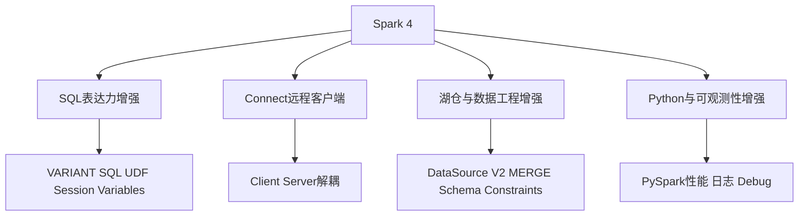

# Spark 4与AI时代数据处理

> [!abstract] 一句话结论
> Spark 4 不是“老大数据框架的例行升级”，而是 Spark 在 AI 时代重新确认自己的位置：**大规模结构化数据处理、湖仓批处理、特征工程、SQL 语义计算和远程客户端接入**。它不负责替代 Agent，但会继续给 Agent 和 AI 系统准备可计算、可治理、可规模化的数据底座。

截至 2026-05-18，Apache Spark 下载页显示稳定版本坐标为 4.1.0；同时 Spark 4.2.0 仍处于 preview 测试阶段，不应直接当生产稳定版本理解。Spark 4.0 是 4.x 的首个大版本，4.1 在其基础上继续加强 SQL、DataSource V2、Python 性能、可观测性等能力。

这篇不是逐条翻译 release note，而是回答数据人真正关心的问题：**Spark 4 对 AI 时代的数据工程意味着什么？**

前置阅读：[[【技术与工具】/Spark/00-Spark学习路线图|Spark学习路线图]]、[[【数据开发与数据架构】/06-数据处理架构/02-批处理架构|批处理架构]]、[[【数据开发与数据架构】/17-技术趋势/10-Agentic-Data-Engineering方法论|Agentic Data Engineering方法论]]。

---

## 1. Spark 4的四条主线

### 1.1 SQL 表达力增强

Spark 4.0 官方 release note 明确提到 Spark SQL 增强了 VARIANT 数据类型、SQL UDF、session variables、pipe syntax、string collation 等能力。这里的战略意义是：Spark 不只是计算引擎，也在继续成为数据平台的 SQL 语义层执行底座。

AI 时代大量数据不是完美结构化的。日志、JSON、半结构化事件、模型输出、工具调用 trace，都需要更强的半结构化表达能力。VARIANT 这类能力，正好补上了“结构化数仓”和“非结构化 AI 数据”之间的灰色地带。

### 1.2 Spark Connect 继续成熟

Spark Connect 的核心是 client-server 解耦：客户端不再必须和 driver 紧密绑定，而是通过协议把逻辑计划交给服务端执行。

对数据团队的影响：

- Notebook、IDE、服务端应用可以更轻量地访问 Spark。
- 多语言客户端会更自然。
- 未来 Agent 生成的数据处理计划，也更适合通过受控服务提交，而不是直接进入集群内部。

这和 [[【数据开发与数据架构】/07-数据服务架构/10-Agent-to-Data访问架构|Agent-to-Data访问架构]] 的方向是一致的：Agent 不应该拿生产集群权限，而应该通过受控接口提交任务。

### 1.3 湖仓与 DataSource V2 增强

Spark 4.1 release note 中出现了 DML metrics、MERGE INTO schema evolution、table constraints、DataSource V2 join pushdown 等方向。这说明 Spark 正在进一步加强湖仓表操作、约束、优化和数据源接口能力。

这对 [[【技术与工具】/Iceberg/00-Iceberg学习路线图|Iceberg]]、[[【技术与工具】/Hudi/00-Hudi学习路线图|Hudi]]、[[【技术与工具】/Paimon/00-Paimon学习路线图|Paimon]] 这类湖仓格式很重要。AI 工作负载会产生更多 schema 演进、增量更新、trace 写入、特征回填，底层表格式和计算引擎必须更懂“变更”。

### 1.4 Python 性能与可观测性

Spark 4.1 对 Python worker、Arrow 内存、Python UDF 序列化、日志等都有改进。这不是小事。今天大量数据科学、特征工程、AI 数据准备工作都发生在 Python 生态中。PySpark 如果调试困难、性能不可控，就会成为 AI 数据流水线的瓶颈。

---

## 2. Spark 4在AI时代的正确位置

Spark 4 不应该被包装成“AI Agent 引擎”。它的强项仍然是大规模数据处理。

| 场景 | Spark 4是否合适 | 原因 |
|---|---|---|
| 大规模特征回填 | 适合 | 批处理、分布式、生态成熟 |
| 海量日志清洗 | 适合 | SQL/DataFrame 表达成熟 |
| Embedding 批量生成前的数据准备 | 适合 | 能处理多源数据和大规模 join |
| 实时毫秒级 Agent 响应 | 不适合 | 延迟模型不匹配，适合 Flink/服务化架构 |
| 个人本地分析 | 通常不适合 | DuckDB/Polars 更轻 |
| 数据湖表批量维护 | 适合 | 与湖仓格式生态结合强 |

> [!tip] 判断
> Spark 是“重型数据加工厂”，不是“前台 AI 对话窗口”。AI 系统越多，背后越需要稳定的大规模数据加工厂。

---

## 3. Spark 4与Agentic Data Engineering

在 Agentic Data Engineering 里，Spark 可能承担三类工作：

### 3.1 数据准备层

包括：

- 清洗日志和事件数据
- 生成训练样本
- 构建特征宽表
- 把非结构化解析结果转为结构化表
- 处理大规模历史回填

相关：[[【数据开发与数据架构】/02-数据工程实践/09-非结构化数据管道|非结构化数据管道]]。

### 3.2 批量评估层

Agent 和 LLM 系统需要 Eval。大规模 Eval 往往不是单条调用，而是批量问题集、批量结果、批量评分、批量回归分析。Spark 适合做离线评估数据的汇总与分析。

相关：[[【AI 与大数据】/04-AI工程化/05-LLM评估体系|LLM评估体系]]、[[【AI 与大数据】/03-AI-Agent/06-Agent可观测性三件套|Agent可观测性三件套]]。

### 3.3 湖仓维护层

包括：

- 表 compaction
- 分区重写
- schema 演进
- 历史数据重算
- 数据质量扫描
- 血缘与审计日志归档

这部分会和 [[【数据治理与数据管理】/02-深度研究/05-AI数据治理/AI-Lineage血缘2.0|AI Lineage血缘2.0]] 结合。

---

## 4. 迁移到Spark 4前要注意什么

### 4.1 Java、Scala、Python版本变化

Spark 4 放弃 Scala 2.12，转向 Scala 2.13；Spark 4.0 也将 JDK 17 作为默认方向。Spark 4.1 进一步提升 Python 最低版本与 PyArrow 依赖。升级前要检查：

- 公司作业使用的 Scala 版本
- 自定义 UDF/UDAF 依赖
- Hadoop 与云存储 connector
- Python 环境与依赖包
- Docker 镜像基础版本

### 4.2 SQL行为变化

SQL 表达力增强不等于完全无痛。ANSI 模式、类型转换、半结构化字段、函数行为都可能影响旧作业。建议对核心任务做回归测试。

### 4.3 不要为了Spark 4重写所有旧作业

升级 Spark 版本不是重构全部管道的理由。优先迁移：

- 性能瓶颈明显的作业
- 需要 Connect 的交互式场景
- 需要半结构化/VARIANT 的新场景
- 新湖仓表格式项目
- AI 数据准备和 Eval 项目

---

## 5. 学习路线建议

1. 先补基础：[[【技术与工具】/Spark/08-DataFrame和Dataset|DataFrame和Dataset]]、[[【技术与工具】/Spark/09-Spark SQL基础|Spark SQL基础]]。
2. 再补性能：[[【技术与工具】/Spark/11-Spark性能调优|Spark性能调优]]、[[【技术与工具】/Spark/13-分区调优|分区调优]]。
3. 然后读 Spark 4：理解 SQL、Connect、DataSource V2、Python 性能和可观测性。
4. 最后结合 AI 场景：特征回填、非结构化数据管道、Eval 批处理、湖仓维护。

---

## 6. 外部参考

- [Apache Spark 4.0.0 Release Notes](https://spark.apache.org/releases/spark-release-4-0-0.html)
- [Apache Spark 4.1.0 released](https://spark.apache.org/news/spark-4-1-0-released.html)
- [Apache Spark Downloads](https://spark.apache.org/downloads.html)
- [Spark Connect Overview](https://spark.apache.org/docs/4.0.0/spark-connect-overview.html)

---

## 7. 相关学习入口

- [[【技术与工具】/Spark/00-Spark学习路线图|Spark学习路线图]]
- [[【技术与工具】/Flink/22-Flink-2_2实时Data-AI架构|Flink 2.2实时Data-AI架构]]
- [[【技术与工具】/DuckDB/00-DuckDB学习路线图|DuckDB学习路线图]]
- [[【数据开发与数据架构】/06-数据处理架构/00-数据处理架构导览|数据处理架构导览]]
- [[【数据开发与数据架构】/17-技术趋势/10-Agentic-Data-Engineering方法论|Agentic Data Engineering方法论]]
