# dbt 学习路线图 - 现代分析工程师的必备工具

> [!abstract] 路线图概览
> - **目标人群**：数据分析师、初中级数据工程师、希望向 Analytics Engineering 转型的从业者
> - **学习周期**：4-8 周（每天 1-2 小时）
> - **核心价值**：用软件工程的方式管理 SQL 项目，告别 SQL 脚本的混乱状态
> - **技术定位**：现代数据栈（Modern Data Stack）的转换层核心工具

## 2026更新：dbt Fusion 与 AI 时代 SQL 语义工程

dbt 的学习重点正在从“SQL 项目组织”升级成“SQL 语义工程”：依赖、血缘、测试、列级上下文、开发反馈，都开始成为 AI Agent 可靠生成 SQL 的前提。

建议完成阶段一到阶段三后阅读：

- [[【技术与工具】/dbt/14-dbt-Fusion与AI时代SQL语义工程|dbt Fusion与AI时代SQL语义工程]]：理解 Fusion 引擎、语义理解、状态感知编排与 AI-ready metadata。
- [[【数据开发与数据架构】/07-数据服务架构/09-语义层工程实践|语义层工程实践]]：把 dbt 项目中的业务口径沉淀成可复用语义资产。
- [[【技术与工具】/SQL/33-AI时代分析SQL实战|AI时代分析SQL实战]]：训练“人审 AI 写 SQL”的判断力。

> [!tip] 学习判断
> AI 会让低质量 SQL 变得更快，也会让高质量 SQL 项目变得更值钱。dbt 的核心价值，是把散落在脑子里的业务规则变成机器可读、团队可审、Agent 可引用的上下文。

---

## dbt 在现代数据栈中的位置

理解 dbt 最快的方式，是先理解现代数据栈（Modern Data Stack）的分工。

```mermaid
%%{init: {"theme":"base","themeVariables":{"fontFamily":"PingFang SC, -apple-system, Source Han Serif SC, serif","fontSize":"16px","background":"#FDFBF5","primaryColor":"#FDFBF5","primaryTextColor":"#2D2A26","primaryBorderColor":"#6E6A60","secondaryColor":"#E8EFE8","secondaryBorderColor":"#8FA890","secondaryTextColor":"#2D2A26","tertiaryColor":"#FDFBF5","tertiaryBorderColor":"#9A9488","tertiaryTextColor":"#6E6A60","lineColor":"#6E6A60","textColor":"#2D2A26","mainBkg":"#FDFBF5","nodeBorder":"#2D5A3D","clusterBkg":"#F3EEDF","clusterBorder":"#9A9488","edgeLabelBackground":"#FDFBF5"},"flowchart":{"htmlLabels":true,"curve":"basis","padding":20,"nodeSpacing":60,"rankSpacing":70,"useMaxWidth":false},"themeCSS":".node rect, .node polygon, .node circle { stroke-width: 1.5px; } .edgePath .path { stroke-width: 1.5px; } .cluster-label .nodeLabel, .cluster-label foreignObject { color: #2D2A26 !important; } .edgeLabel, .edgeLabel foreignObject { color: #2D2A26 !important; background-color: #FDFBF5; } .edgeLabel rect { fill: #FDFBF5; }"}}%%
flowchart LR
    subgraph Source["数据来源"]
        S1[业务数据库\nMySQL/PostgreSQL]
        S2[SaaS工具\nSalesforce/GA]
        S3[埋点数据\nEvent Log]
    end

    subgraph Ingestion["数据摄取 (Extract & Load)"]
        I1[Fivetran / Airbyte\nStitch / 自研管道]
    end

    subgraph Warehouse["数据仓库 (Storage)"]
        W1[Snowflake / BigQuery\nRedshift / ClickHouse]
    end

    subgraph Transform["转换层 (Transform)"]
        T1["⭐ dbt\n(本系列重点)"]
    end

    subgraph Consume["数据消费 (Serve)"]
        C1[BI 工具\nTableau/Metabase]
        C2[数据 API\n内部服务]
        C3[机器学习\n特征工程]
    end

    Source --> Ingestion --> Warehouse --> Transform --> Consume

    style T1 fill:#f59e0b,color:#fff
    style Warehouse fill:#3b82f6,color:#fff
```



**dbt 专门负责 T（Transform）这一层**，也就是 ELT 中的最后一个字母。它的工作是：在数据仓库内部，把原始数据转换成业务需要的数据模型。

> [!note] 为什么强调"在仓库内部"
> 传统 ETL 在数据落仓之前完成转换（Extract → Transform → Load）。
> 现代 ELT 先把原始数据加载到仓库，再在仓库内部用 SQL 完成转换（Extract → Load → Transform）。
> 这个范式转变让 dbt 成为可能，也让 [[【数据开发与数据架构】/05-数据存储架构/04-数据仓库架构|数据仓库架构设计]] 发生了根本性变化。

---

## 学习路线总览

### 阶段一：建立认知（第 1 周）

明确 dbt 解决的问题，理解它的核心价值主张。

| 文档 | 核心问题 | 预计时间 |
|------|---------|---------|
| [[【技术与工具】/dbt/01-dbt概述与理念]] | dbt 是什么、为什么需要它 | 1 小时 |
| [[【技术与工具】/dbt/02-dbt安装与项目初始化]] | 把 dbt 跑起来 | 2 小时 |

**阶段目标**：能解释 dbt 解决了什么问题，完成本地安装并连接到数据库。

---

### 阶段二：核心能力（第 2-3 周）

学会用 dbt 的方式组织 SQL 项目。

| 文档 | 核心问题 | 预计时间 |
|------|---------|---------|
| [[【技术与工具】/dbt/03-Model基础]] | 怎么写 dbt 模型 | 2 小时 |
| [[【技术与工具】/dbt/04-数据建模分层]] | 如何组织数据层次 | 3 小时 |
| [[【技术与工具】/dbt/05-增量模型]] | 大表怎么高效更新 | 2 小时 |

**阶段目标**：能独立设计三层数据架构，完成增量更新的配置。

---

### 阶段三：质量与文档（第 4 周）

让数据可信赖、可理解。

| 文档 | 核心问题 | 预计时间 |
|------|---------|---------|
| [[【技术与工具】/dbt/06-测试与数据质量]] | 怎么保证数据质量 | 2 小时 |
| [[【技术与工具】/dbt/07-文档与数据血缘]] | 怎么让数据可解释 | 1.5 小时 |

**阶段目标**：掌握数据质量即代码的理念，能生成并查看数据血缘图。

---

### 阶段四：进阶能力（第 5-6 周）

掌握让 dbt 更强大的高级特性。

| 文档 | 核心问题 | 预计时间 |
|------|---------|---------|
| [[【技术与工具】/dbt/08-Jinja与宏]] | 怎么复用 SQL 逻辑 | 3 小时 |
| [[【技术与工具】/dbt/09-Seeds与Snapshots]] | 维度表和历史数据怎么处理 | 2 小时 |

**阶段目标**：能用 Jinja 宏封装复用逻辑，实现 SCD Type 2 缓慢变化维。

---

### 阶段五：工程化落地（第 7-8 周）

把 dbt 项目部署到生产环境。

| 文档 | 核心问题 | 预计时间 |
|------|---------|---------|
| [[【技术与工具】/dbt/10-dbt与调度集成]] | 怎么自动化运行 dbt | 2 小时 |
| [[【技术与工具】/dbt/11-dbt项目实战]] | 完整项目怎么做 | 4 小时 |
| [[【技术与工具】/dbt/12-dbt最佳实践]] | 团队怎么用好 dbt | 2 小时 |

**阶段目标**：完成一个端到端的 dbt 数仓项目，能与 Airflow/CI 集成。

---

## dbt 的核心价值一览

在开始学习之前，先建立一个清晰的价值认知，有助于在遇到困难时保持动力。

### 没有 dbt 时的典型痛点

```text
analytics/
├── 用户分析.sql          # 不知道依赖哪些表
├── 用户分析_v2.sql       # 什么时候改的？改了什么？
├── 用户分析_最终版.sql   # 这是最新的吗？
├── 用户分析_真正最终版.sql  # 为什么有这么多版本...
├── 收入报表.sql          # 数据对不上时找不到原因
└── 订单汇总（老王写的别动）.sql  # 这就是真实的项目状态
```

### 有了 dbt 之后

```text
models/
├── staging/              # 来源清晰，一个源对应一个文件
│   ├── stg_orders.sql
│   └── stg_customers.sql
├── intermediate/         # 中间逻辑有命名规范
│   └── int_order_items_joined.sql
└── marts/                # 最终产出对应业务域
    ├── fct_orders.sql
    └── dim_customers.sql
```

每个文件背后都有：版本控制（Git）、依赖追踪（ref()）、自动测试、数据文档。

---

## 与知识库其他内容的关联

dbt 不是孤立存在的，它与以下知识点紧密关联：

**前置知识（学 dbt 之前应该掌握的）**：
- [[【技术与工具】/SQL/00-SQL学习路线图|SQL基础到进阶]] - dbt 的核心还是 SQL，SQL 能力越强 dbt 用得越好
- Git 基础操作 - dbt 项目应该用 Git 管理，是团队协作的基础
- [[【数据开发与数据架构】/05-数据存储架构/04-数据仓库架构|数据仓库架构设计]] - 理解 ODS/DWD/DWS/ADS 分层后会更容易理解 dbt 的分层理念

**配套工具（与 dbt 一起使用的）**：
- [[【技术与工具】/Airflow/02-Airflow核心概念|Airflow核心概念]] - 最常见的 dbt 调度器，学完 dbt 后可以学如何与 Airflow 集成
- [[【数据治理与数据管理】/01-快速学习/02-实践方法/数据质量评估方法]] - dbt test 实现的就是代码化的数据质量管理

**进阶方向（学完 dbt 后可以探索的）**：
- [[【数据开发与数据架构】/03-数据建模/05-维度建模基础|维度建模基础]] - dbt 分层架构的理论基础
- [[【求职就业专题】/03-数据工程师求职全攻略/99-专属资源/数据血缘追踪]] - dbt docs 生成的血缘图是数据治理的重要输入
- [[【数据开发与数据架构】/02-数据工程实践/02-数据管道设计|数据管道设计]] - 理解 dbt 在整个数据管道中的角色

---

## 常见问题

> [!faq] dbt 适合我吗？
> 如果你满足以下任一条件，dbt 对你很有价值：
> - 你写 SQL 查询，但项目越来越难维护
> - 你想向"分析工程师（Analytics Engineer）"方向发展
> - 你的团队在用 Snowflake / BigQuery / Redshift / ClickHouse / DuckDB
> - 你想让数据分析工作更可靠、更可解释

> [!faq] 需要会编程才能用 dbt 吗？
> 不需要。dbt 的核心是 SQL，Python/Jinja 知识是加分项但不是必须的。
> 如果你能写 `SELECT ... FROM ... WHERE ...`，你就能入门 dbt。

> [!faq] dbt Core 和 dbt Cloud 怎么选？
> 学习阶段用 **dbt Core**（免费、开源、本地运行）。
> 生产环境如果不想自己维护调度，可以考虑 **dbt Cloud**（有免费额度）。
> 详见 [[【技术与工具】/dbt/01-dbt概述与理念]]。

---

## 快速开始

如果你已经有了一个 PostgreSQL 或者 DuckDB 环境，可以按以下步骤 5 分钟跑通第一个 dbt 项目：

```bash
# 1. 安装 dbt
pip install dbt-core dbt-postgres   # 根据你的数据库选择适配器

# 2. 创建项目
dbt init my_first_dbt_project

# 3. 进入项目目录
cd my_first_dbt_project

# 4. 测试连接
dbt debug

# 5. 运行示例模型
dbt run
```

详细步骤见 [[【技术与工具】/dbt/02-dbt安装与项目初始化]]。

---

*最后更新：2026-03-18*

#dbt #Analytics-Engineering #现代数据栈 #学习路线 #数据建模
