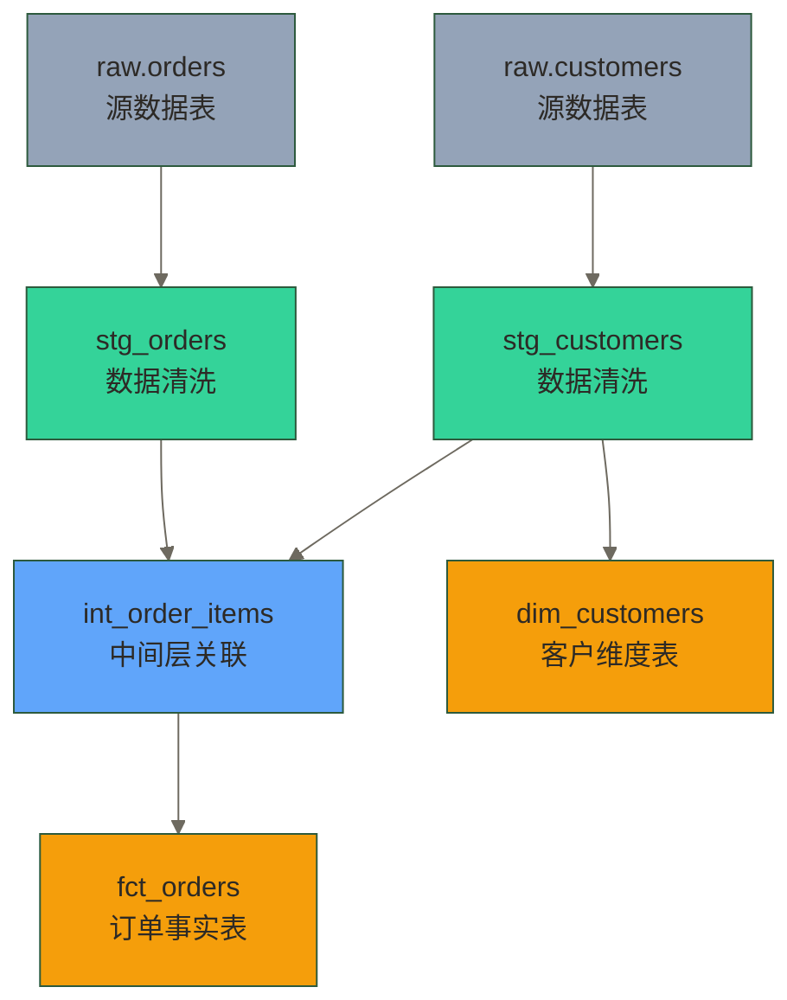
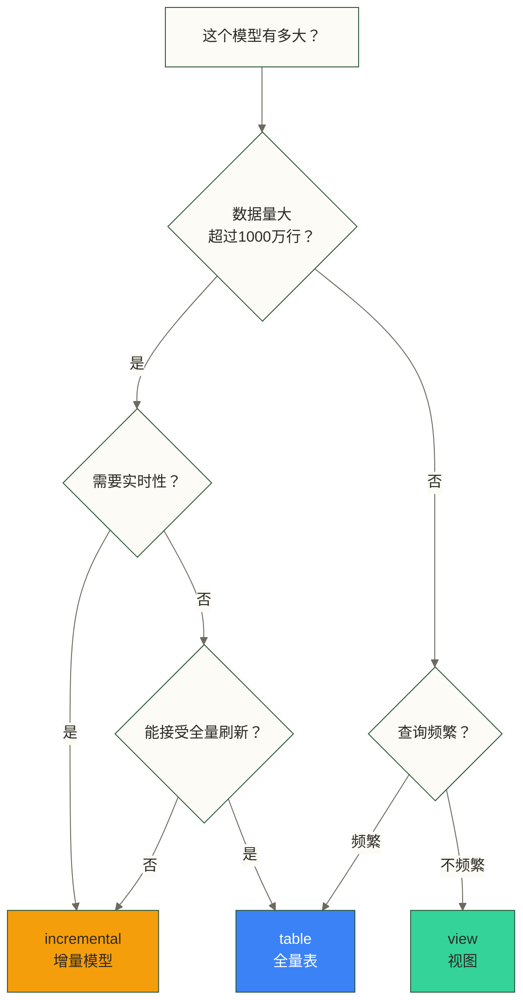

# dbt Model 基础 - SELECT 就是模型

> [!abstract] 本文核心
> Model 是 dbt 的核心概念。理解了 Model，就理解了 dbt 一半的精髓。
> 核心结论：**一个 dbt Model 就是一个 SELECT 语句**，dbt 负责把它变成数据库中的表或视图。

---

## 什么是 Model

在 dbt 中，一个 **Model** 就是 `models/` 目录下的一个 `.sql` 文件，文件内容是一个 `SELECT` 语句。

就这么简单。

```sql
-- models/my_first_model.sql
-- 这就是一个完整的 dbt Model

SELECT
    id           AS order_id,
    user_id,
    status,
    amount,
    created_at
FROM raw.orders
WHERE status != 'cancelled'
```

当你运行 `dbt run` 时，dbt 会：
1. 读取这个 SQL 文件
2. 在数据库中执行 `CREATE VIEW` 或 `CREATE TABLE`（取决于物化配置）
3. 给你一个可查询的对象

> [!note] 为什么只写 SELECT，不写 CREATE TABLE
> 这是 dbt 的核心设计哲学：**你描述"数据应该是什么样"，dbt 负责"怎么创建它"**。
>
> 这样做的好处：
> - 逻辑更纯粹，不被基础设施细节污染
> - 想切换物化方式？改一行配置，不改 SQL
> - 同一个 SQL 可以在开发环境创建 View，在生产环境创建 Table

---

## ref() 函数：建立依赖关系

`ref()` 是 dbt 中最重要的函数，它的作用是**引用另一个 Model**，同时告诉 dbt 这两个模型之间存在依赖关系。

### 没有 ref() 的问题

```sql
-- 传统 SQL：直接引用表名
SELECT
    o.order_id,
    o.amount,
    c.customer_name
FROM raw.orders o
JOIN raw.customers c ON o.customer_id = c.id
```

这样写的问题：
- `raw.orders` 在哪里定义的？不知道
- 如果 `raw.orders` 改名了，你需要手动找所有引用它的 SQL 去修改
- 开发环境和生产环境的 schema 名字不同，怎么办？
- 两个模型的执行顺序怎么保证？

### 使用 ref() 解决这些问题

```sql
-- models/fct_orders.sql
-- 使用 ref() 引用其他模型

SELECT
    o.order_id,
    o.amount,
    c.customer_name
FROM {{ ref('stg_orders') }} o        -- 引用 stg_orders 模型
JOIN {{ ref('stg_customers') }} c     -- 引用 stg_customers 模型
    ON o.customer_id = c.customer_id
```

`ref('stg_orders')` 会被 dbt 在运行时解析为实际的表名（如 `dbt_dev.stg_orders`），同时：
- dbt 知道 `fct_orders` 依赖 `stg_orders` 和 `stg_customers`
- dbt 会先运行 `stg_orders` 和 `stg_customers`，再运行 `fct_orders`
- 切换环境时，ref() 自动解析到正确的 schema

### ref() 构建的 DAG

有了 ref()，dbt 会自动构建依赖有向无环图（DAG）：



---

## 第一个 Model 实战

让我们从零开始创建一个真实的模型。假设你有一张原始订单表：

```sql
-- 原始数据示例（raw.orders）
-- order_id | customer_id | order_date | amount | status  | created_at
-- 1001     | 101         | 2024-01-01 | 299.99 | placed  | 2024-01-01 10:00:00
-- 1002     | 102         | 2024-01-02 | 149.50 | shipped | 2024-01-02 11:30:00
-- 1003     | 101         | 2024-01-03 | 89.00  | cancelled | 2024-01-03 09:15:00
```

### 第一步：创建 staging 层模型

```sql
-- models/staging/stg_orders.sql
-- 目标：清洗原始订单数据，统一命名规范，过滤无效数据

SELECT
    -- 统一字段命名（下划线风格）
    order_id,
    customer_id,

    -- 日期类型转换
    CAST(order_date AS DATE)                 AS order_date,
    CAST(created_at AS TIMESTAMP)            AS created_at,

    -- 金额统一为分（避免浮点精度问题）
    ROUND(amount * 100)::INTEGER             AS amount_cents,

    -- 状态标准化（小写）
    LOWER(status)                            AS status,

    -- 派生字段
    CASE
        WHEN status IN ('placed', 'shipped', 'completed') THEN TRUE
        ELSE FALSE
    END                                      AS is_valid_order

FROM {{ source('raw', 'orders') }}           -- source() 引用原始数据源
WHERE order_date >= '2020-01-01'             -- 过滤历史垃圾数据
```

> [!note] source() vs ref()
> - `ref('model_name')` 引用另一个 **dbt 模型**
> - `source('source_name', 'table_name')` 引用原始数据源（在 `_sources.yml` 中定义）
>
> 详见 [[【技术与工具】/dbt/04-数据建模分层]] 中对 source 的详细说明。

---

## 物化方式（Materialization）

物化方式决定了 dbt 在数据库中如何创建这个模型。这是一个非常重要的配置，直接影响性能和资源消耗。

### 四种物化方式

#### 1. view（视图）

```sql
-- 配置方式一：在 SQL 文件顶部用 config block 配置
{{ config(materialized='view') }}

SELECT * FROM {{ ref('stg_orders') }}
```

- dbt 执行：`CREATE OR REPLACE VIEW`
- **优点**：不占存储空间，总是反映最新数据
- **缺点**：每次查询都重新执行 SQL，数据量大时很慢
- **适用场景**：staging 层、逻辑简单的中间层

#### 2. table（表）

```sql
{{ config(materialized='table') }}

SELECT
    customer_id,
    COUNT(*) AS order_count,
    SUM(amount_cents) AS total_amount_cents
FROM {{ ref('stg_orders') }}
WHERE is_valid_order = TRUE
GROUP BY customer_id
```

- dbt 执行：`CREATE TABLE AS SELECT`（先删除旧表，再全量创建）
- **优点**：查询速度快，物理存储
- **缺点**：每次全量重建，大表耗时长
- **适用场景**：marts 层、需要高查询性能的模型

#### 3. incremental（增量）

```sql
{{ config(
    materialized='incremental',
    unique_key='order_id'
) }}

SELECT
    order_id,
    customer_id,
    amount_cents,
    status,
    created_at
FROM {{ ref('stg_orders') }}


    -- 按创建时间筛选候选新增记录；不保证避免全量扫描，也不覆盖迟到记录、相同时间戳记录或历史更新
    WHERE created_at > (SELECT MAX(created_at) FROM {{ this }})

```

- dbt 执行：只处理新数据，合并到已有表中
- **优点**：速度快，适合大表
- **缺点**：逻辑复杂，需要仔细设计
- **适用场景**：数据量大、每次全量构建太慢的事实表
- 详见 [[【技术与工具】/dbt/05-增量模型]]

#### 4. ephemeral（临时）

```sql
{{ config(materialized='ephemeral') }}

-- 这个模型不会在数据库中创建任何对象
-- 它只是一个 CTE（公共表表达式），在引用它的模型中内联执行
SELECT
    order_id,
    customer_id,
    ROUND(amount * 100)::INTEGER AS amount_cents
FROM {{ source('raw', 'orders') }}
WHERE status != 'test'
```

- dbt 执行：把 SQL 内联为 CTE，不创建任何数据库对象
- **优点**：避免中间表，减少存储占用
- **缺点**：调试困难（无法直接查询），性能不一定好
- **适用场景**：很简单的中间逻辑，不值得单独物化

### 物化方式选择指南



### 在 dbt_project.yml 中批量设置物化方式

不需要每个文件都写 config block，可以在项目配置里按目录批量设置：

```yaml
# dbt_project.yml

models:
  my_analytics_project:
    staging:
      +materialized: view      # staging 层全部是 view
    intermediate:
      +materialized: view      # intermediate 层全部是 view
    marts:
      +materialized: table     # marts 层全部是 table
      core:
        +materialized: table
      finance:
        +materialized: table
```

单个模型可以通过 config block 覆盖默认配置：

```sql
-- 即使 marts 层默认是 table，这个特定模型使用 incremental
{{ config(
    materialized='incremental',
    unique_key='order_id'
) }}

SELECT ...
```

---

## 模型文件组织

良好的文件组织是项目可维护的基础：

```text
models/
├── staging/                      # 数据清洗层
│   ├── _sources.yml              # 定义数据源（下划线开头是约定）
│   ├── _stg_models.yml           # 该层模型的测试和文档
│   ├── stg_orders.sql
│   ├── stg_customers.sql
│   └── stg_products.sql
│
├── intermediate/                 # 中间逻辑层
│   ├── _int_models.yml
│   └── int_order_items_joined.sql
│
└── marts/                        # 数据集市层
    ├── core/                     # 按业务域分组
    │   ├── _core_models.yml
    │   ├── fct_orders.sql
    │   └── dim_customers.sql
    └── finance/
        ├── _finance_models.yml
        └── fct_revenue.sql
```

> [!tip] 文件命名规范
> - 以 `_` 开头的 yml 文件（如 `_sources.yml`）是 dbt 的约定，用于存放元数据
> - 模型文件名要有意义，能清楚表达这个模型的内容
> - 遵循 staging/intermediate/marts 的命名前缀规范（见 [[【技术与工具】/dbt/04-数据建模分层]]）

---

## 常用的 Model 配置选项

```sql
{{ config(
    materialized='incremental',        -- 物化方式
    unique_key='order_id',             -- 增量 upsert 的主键
    schema='custom_schema',            -- 自定义 schema；默认通常与目标 schema 拼接，结果取决于 generate_schema_name 宏
    alias='my_table_name',             -- 覆盖默认表名（默认是文件名）
    tags=['daily', 'finance'],         -- 打标签，用于选择性运行
    post_hook=[                        -- 目标关系创建后执行；以下语法需按数据库适配器调整
        "GRANT SELECT ON {{ this }} TO ROLE analyst",
        "ANALYZE {{ this }}"
    ],
    persist_docs={"relation": true}    -- 把 description 写入数据库注释
) }}
```

### 使用 tags 选择性运行模型

```bash
# 只运行打了 finance 标签的模型
dbt run --select tag:finance

# 只运行 staging 目录下的模型
dbt run --select staging

# 只运行某个特定模型
dbt run --select fct_orders

# 运行某个模型及其所有上游依赖
dbt run --select +fct_orders

# 运行某个模型及其所有下游依赖
dbt run --select fct_orders+
```

---

## 调试技巧

### 查看 dbt 生成的 SQL

```bash
# dbt 会把生成的 SQL 放在 target/compiled/ 目录下
# 可以直接查看最终执行的 SQL

dbt compile --select stg_orders

# 然后查看
cat target/compiled/my_project/models/staging/stg_orders.sql
```

### 在模型中打印调试信息

```sql
-- 使用 dbt 内置的 log 宏输出调试信息
{{ log("正在处理 " ~ this.name, info=True) }}

SELECT ...
```

---

## 总结

| 概念 | 说明 |
|------|------|
| Model | `models/` 目录下的 `.sql` 文件，内容是 SELECT 语句 |
| ref() | 引用其他模型，建立依赖关系，dbt 自动管理执行顺序 |
| view | 不存储数据，查询时实时计算 |
| table | 全量重建，查询快，适合 marts 层 |
| incremental | 只处理增量数据，适合大表 |
| ephemeral | 不创建数据库对象，内联为 CTE |

---

## 下一步

[[【技术与工具】/dbt/04-数据建模分层]] - 理解 staging/intermediate/marts 三层架构，这是 dbt 项目组织的灵魂

---

*最后更新：2026-03-18*

#dbt #Model #ref函数 #物化方式 #数据建模

---

> [!info] 前置知识
> - dbt 项目已初始化并能正常运行，参考 [[【技术与工具】/dbt/02-dbt安装与项目初始化|dbt 安装与项目初始化]]
> - 熟悉 SQL 的 SELECT、CTE（WITH 子句）语法
> - 了解数据库中 View 和 Table 的区别

---

## 掌握检查

- [ ] 能从空白文件写出一个使用 `{{ ref('上游模型') }}` 引用上游数据的 dbt Model，并用 `dbt run --select 模型名` 运行成功
- [ ] 能说出 view、table、incremental、ephemeral 四种物化方式各自的使用场景
- [ ] 理解为什么 dbt 用 `ref()` 而不是直接写表名：`ref()` 建立了依赖关系，让 dbt 知道运行顺序，并支持跨环境（dev/prod）的 schema 自动切换
- [ ] 能用 `dbt compile --select 模型名` 查看 dbt 编译后的真实 SQL
- [ ] 知道如何用 `dbt run --select fct_orders+` 运行指定模型及其所有下游依赖；`staging+` 选择 staging 目录中的模型及其下游依赖

---

## 实践练习

**基础题**：在你的 dbt 项目中创建两个模型：`stg_orders.sql`（从原始表 `raw.orders` 做基础清洗），和 `fct_daily_orders.sql`（用 `{{ ref('stg_orders') }}` 引用 stg_orders，按日期聚合订单数量）。运行 `dbt run` 确认两个模型都成功创建。

**进阶题**：把 `stg_orders.sql` 的物化方式设为 `view`，`fct_daily_orders.sql` 设为 `table`。修改 `dbt_project.yml` 或在模型文件中用 `{{ config() }}` 实现。运行后在数据库中验证：stg 是视图，fct 是表。
