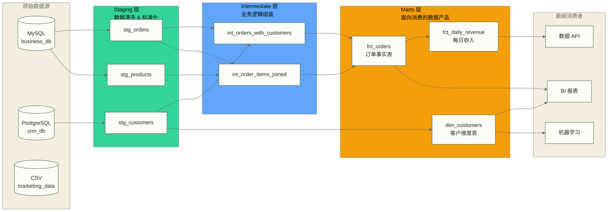

# dbt 数据建模分层 - staging/intermediate/marts 三层架构

> [!abstract] 本文核心
> dbt 的三层架构（staging / intermediate / marts）是 dbt 项目的骨架。
> 理解这套分层，等于理解了如何把混乱的原始数据，按照清晰的逻辑，转变为业务可用的数据产品。

---

## 为什么需要分层

假设你直接在一个 SQL 里写完所有逻辑：

```sql
-- 反面教材：一个 SQL 做所有事情
SELECT
    o.id                                          AS order_id,
    -- 处理来源数据的脏数据
    COALESCE(c.name, 'Unknown')                   AS customer_name,
    LOWER(TRIM(c.email))                          AS customer_email,
    -- 业务逻辑计算
    CASE WHEN o.discount > 0 THEN o.amount * (1 - o.discount)
         ELSE o.amount END                        AS net_amount,
    -- 多表关联
    p.category                                    AS product_category,
    -- 时间维度处理
    DATE_TRUNC('month', o.created_at)             AS order_month,
    -- 指标聚合
    SUM(oi.quantity)                              AS total_items
FROM raw.orders o
JOIN raw.customers c ON o.customer_id = c.id
JOIN raw.order_items oi ON o.id = oi.order_id
JOIN raw.products p ON oi.product_id = p.id
WHERE o.status NOT IN ('test', 'cancelled')
GROUP BY 1, 2, 3, 4, 5, 6
```

这个 SQL 有几个问题：
- 数据清洗逻辑（COALESCE、LOWER、TRIM）和业务逻辑（折扣计算）混在一起
- 如果另一个报表也需要"客户邮箱标准化"，这段逻辑要复制粘贴
- 哪个字段来自哪个源表？三个月后你自己都看不懂
- 任何一个步骤出错，整体都失败，且难以定位问题

**分层就是要解决这些问题**：每一层只做一件事，职责清晰。

---

## 三层架构总览



---

## Staging 层：数据清洗与标准化

### 核心职责

Staging 层（暂存层）的职责非常单一：**把原始数据清洗成干净的、标准化的形式**。

**做的事**：
- 重命名字段（统一命名规范）
- 基础类型转换（字符串转日期、转数字）
- 去除前后空格（TRIM）
- 统一大小写（LOWER/UPPER）
- 过滤明显的垃圾数据（测试账号、无效记录）
- 简单的 NULL 处理（COALESCE 替换默认值）

**不做的事**：
- 不做多表 JOIN（staging 层一个模型只对应一个源表）
- 不做业务逻辑计算（折扣、汇率换算等）
- 不做聚合

### Staging 层命名规范

```css
stg_{source_name}__{table_name}.sql
       ↑               ↑
    数据源名称       原始表名
    （双下划线分隔）

示例：
stg_shopify__orders.sql
stg_stripe__payments.sql
stg_salesforce__accounts.sql
```

> [!note] 单数据源时可简化命名
> 如果整个项目只有一个数据源（比如只有一个 MySQL），可以简化为 `stg_orders.sql`，省略 source 前缀。

### Staging 层示例

```sql
-- models/staging/stg_orders.sql

WITH source AS (
    -- 引用原始数据源
    SELECT * FROM {{ source('shopify', 'orders') }}
),

renamed AS (
    SELECT
        -- 主键：明确命名
        id                                          AS order_id,

        -- 外键：保持一致性
        customer_id,
        shop_id,

        -- 日期处理：明确类型
        CAST(created_at AS TIMESTAMP)               AS created_at,
        CAST(updated_at AS TIMESTAMP)               AS updated_at,
        CAST(processed_at AS DATE)                  AS processed_date,

        -- 金额：统一单位（分 / 美分）
        ROUND(total_price * 100)::BIGINT            AS total_price_cents,
        ROUND(subtotal_price * 100)::BIGINT         AS subtotal_price_cents,

        -- 字符串：标准化
        LOWER(TRIM(financial_status))               AS financial_status,
        LOWER(TRIM(fulfillment_status))             AS fulfillment_status,

        -- 布尔值：明确化
        (taxes_included = 'true')::BOOLEAN          AS is_taxes_included,

        -- 保留需要的字段，不要 SELECT *（控制下游依赖的字段范围）
        note,
        tags

    FROM source
),

filtered AS (
    -- 过滤测试订单和无效数据
    SELECT *
    FROM renamed
    WHERE order_id IS NOT NULL
      AND created_at IS NOT NULL
      AND financial_status != 'test'   -- 过滤测试数据
)

SELECT * FROM filtered
```

---

## 定义数据源：source() 函数

在使用 `source()` 函数之前，需要先在 `_sources.yml` 中定义数据源：

```yaml
# models/staging/_sources.yml

version: 2

sources:
  - name: shopify                          # 数据源名称（source() 的第一个参数）
    description: "Shopify 电商平台原始数据"
    database: raw_db                       # 数据库名
    schema: shopify_raw                    # schema 名
    loaded_at_field: _fivetran_synced      # 数据新鲜度检查字段

    # 数据新鲜度检查：超过 12 小时未更新则警告，超过 24 小时则报错
    freshness:
      warn_after: {count: 12, period: hour}
      error_after: {count: 24, period: hour}

    tables:
      - name: orders                       # 原始表名（source() 的第二个参数）
        description: "Shopify 订单原始表"
        columns:
          - name: id
            description: "订单 ID，Shopify 自增主键"
            tests:
              - unique
              - not_null

      - name: customers
        description: "Shopify 客户原始表"

      - name: order_items
        description: "订单商品明细"
```

使用方式：

```sql
-- models/staging/stg_orders.sql
SELECT * FROM {{ source('shopify', 'orders') }}
--                         ↑           ↑
--                    sources.name  tables.name
```

### source() 的价值

相比直接写表名（`raw_db.shopify_raw.orders`），source() 的优势：
- 数据血缘图中会显示原始数据源节点
- 可以配置数据新鲜度检查（freshness check）
- 如果源表路径变了，只需改一个地方（`_sources.yml`），所有引用自动更新

---

## Intermediate 层：业务逻辑组装

### 核心职责

Intermediate 层（中间层）负责**把 staging 层的干净数据，按照业务逻辑进行组装**。

**做的事**：
- 多表 JOIN（把相关的实体关联起来）
- 业务逻辑计算（折扣计算、汇率换算、状态推导）
- 中间聚合（不是最终聚合，而是准备下一步的数据）

**不做的事**：
- 不直接暴露给 BI 工具（中间层是内部的）
- 不做最终的汇总聚合（那是 marts 层的事）

### Intermediate 层命名规范

```css
int_{entity}s_{verb}.sql

示例：
int_order_items_joined.sql        # 订单商品关联
int_customers_with_orders.sql     # 客户关联订单
int_payments_pivoted.sql          # 支付方式透视
```

### Intermediate 层示例

```sql
-- models/intermediate/int_order_items_joined.sql
-- 职责：把订单明细和产品信息关联起来

WITH order_items AS (
    SELECT * FROM {{ ref('stg_order_items') }}
),

products AS (
    SELECT * FROM {{ ref('stg_products') }}
),

orders AS (
    SELECT * FROM {{ ref('stg_orders') }}
),

joined AS (
    SELECT
        -- 明细标识
        oi.order_item_id,
        oi.order_id,

        -- 产品信息（从 products 关联）
        oi.product_id,
        p.product_name,
        p.category,
        p.subcategory,

        -- 订单信息（从 orders 关联）
        o.customer_id,
        o.created_at        AS order_date,
        o.financial_status,

        -- 商品数量和价格
        oi.quantity,
        oi.unit_price_cents,
        -- 业务逻辑：计算行小计
        oi.quantity * oi.unit_price_cents   AS line_total_cents,

        -- 折扣计算
        oi.discount_percentage,
        ROUND(
            oi.quantity * oi.unit_price_cents * (1 - oi.discount_percentage / 100.0)
        )::BIGINT                           AS net_line_total_cents

    FROM order_items oi
    LEFT JOIN products p ON oi.product_id = p.product_id
    LEFT JOIN orders o ON oi.order_id = o.order_id
)

SELECT * FROM joined
```

> [!tip] Intermediate 层不是必须的
> 对于简单项目，可以跳过 intermediate 层，直接从 staging 到 marts。
> 当 marts 层的模型变得复杂、需要大量 JOIN 时，再引入 intermediate 层做代码解耦。

---

## Marts 层：面向消费的数据产品

### 核心职责

Marts 层（数据集市层）是**面向最终消费者的数据产品**：

**做的事**：
- 最终聚合（汇总到业务需要的粒度）
- 按业务域组织（finance、marketing、operations 等）
- 创建事实表（fct_）和维度表（dim_）

### Marts 层命名规范

```css
fct_{entity}s.sql     # 事实表：记录可度量的业务事件
dim_{entity}.sql      # 维度表：描述实体的属性

示例：
fct_orders.sql            # 订单事实表（每行=一个订单）
fct_order_items.sql       # 订单明细事实表（每行=一个订单商品）
fct_daily_revenue.sql     # 每日收入（每行=一天的收入汇总）
dim_customers.sql         # 客户维度表
dim_products.sql          # 产品维度表
dim_date.sql              # 日期维度表
```

### Marts 层示例：事实表

```sql
-- models/marts/core/fct_orders.sql
-- 订单事实表：每行代表一个订单，记录订单的度量值

{{ config(materialized='table') }}

WITH orders AS (
    SELECT * FROM {{ ref('stg_orders') }}
),

order_items AS (
    SELECT * FROM {{ ref('int_order_items_joined') }}
),

-- 先按订单聚合商品信息
order_item_aggregates AS (
    SELECT
        order_id,
        COUNT(DISTINCT product_id)          AS unique_product_count,
        SUM(quantity)                       AS total_items,
        SUM(net_line_total_cents)           AS items_total_cents
    FROM order_items
    GROUP BY order_id
),

final AS (
    SELECT
        -- 主键
        o.order_id,

        -- 外键（连接维度表）
        o.customer_id,
        o.shop_id,

        -- 时间维度
        o.created_at,
        DATE_TRUNC('day', o.created_at)     AS order_date,
        DATE_TRUNC('week', o.created_at)    AS order_week,
        DATE_TRUNC('month', o.created_at)   AS order_month,

        -- 状态
        o.financial_status,
        o.fulfillment_status,
        CASE
            WHEN o.financial_status = 'paid'
             AND o.fulfillment_status = 'fulfilled' THEN 'completed'
            WHEN o.financial_status = 'refunded' THEN 'refunded'
            WHEN o.financial_status = 'paid' THEN 'paid_unfulfilled'
            ELSE 'other'
        END                                 AS order_status_combined,

        -- 度量值
        oia.unique_product_count,
        oia.total_items,
        o.total_price_cents,                -- 包含税和运费
        o.subtotal_price_cents,             -- 商品小计
        oia.items_total_cents,              -- 折后商品金额

        -- 布尔标志
        o.is_taxes_included,
        (o.financial_status = 'refunded')   AS is_refunded

    FROM orders o
    LEFT JOIN order_item_aggregates oia ON o.order_id = oia.order_id
    WHERE o.financial_status != 'test'   -- 确保最终层也过滤测试数据
)

SELECT * FROM final
```

### Marts 层示例：维度表

```sql
-- models/marts/core/dim_customers.sql
-- 客户维度表：描述客户的属性

{{ config(materialized='table') }}

WITH customers AS (
    SELECT * FROM {{ ref('stg_customers') }}
),

-- 计算每个客户的汇总指标（可以放在 intermediate 层，这里简化直接计算）
customer_orders AS (
    SELECT
        customer_id,
        COUNT(*)                            AS total_orders,
        SUM(total_price_cents)              AS lifetime_value_cents,
        MIN(created_at)                     AS first_order_at,
        MAX(created_at)                     AS most_recent_order_at
    FROM {{ ref('fct_orders') }}
    WHERE financial_status = 'paid'
    GROUP BY customer_id
),

final AS (
    SELECT
        c.customer_id,
        c.email,
        c.first_name,
        c.last_name,
        c.first_name || ' ' || c.last_name  AS full_name,
        c.created_at                         AS customer_since,

        -- 从订单聚合的属性
        COALESCE(co.total_orders, 0)         AS total_orders,
        COALESCE(co.lifetime_value_cents, 0) AS lifetime_value_cents,
        co.first_order_at,
        co.most_recent_order_at,

        -- 派生属性：客户分层
        CASE
            WHEN COALESCE(co.total_orders, 0) = 0 THEN 'no_orders'
            WHEN co.total_orders = 1 THEN 'new'
            WHEN co.total_orders BETWEEN 2 AND 5 THEN 'repeat'
            ELSE 'loyal'
        END                                  AS customer_segment

    FROM customers c
    LEFT JOIN customer_orders co ON c.customer_id = co.customer_id
)

SELECT * FROM final
```

---

## 与传统数仓分层的对应关系

如果你有传统数仓（ODS/DWD/DWS/ADS）的背景，可以参考这个对应关系：

| 传统数仓层次 | dbt 对应层次 | 说明 |
|------------|-------------|------|
| ODS（原始数据层）| Source（源定义）| dbt 不直接管理，通过 source() 引用 |
| DWD（明细数据层）| Staging 层 | 数据清洗、标准化，保留明细粒度 |
| DWS（汇总层）| Intermediate + Marts 层 | 业务逻辑组装和聚合 |
| ADS（应用层）| Marts 层 | 面向 BI 和应用的最终数据产品 |

> [!note] 不是完全一一对应
> dbt 的分层更偏向"职责分离"，传统数仓的分层更偏向"数据处理阶段"。
> 两者设计理念有所不同，不必强行对应，理解各自的核心逻辑更重要。
> 详见 数据仓库架构设计。

---

## 分层设计最佳实践

### 原则一：单向数据流

数据只能向下流动：Sources → Staging → Intermediate → Marts

```text
✅ 正确：fct_orders 引用 stg_orders
❌ 错误：stg_orders 引用 fct_orders（向上引用）
❌ 错误：stg_orders 引用 stg_customers（同层引用，应该放到 intermediate）
```

### 原则二：staging 层一对一原则

每个 staging 模型只对应一个源表：

```text
✅ 正确：stg_orders 只从 source('shopify', 'orders') 读数据
❌ 错误：stg_orders JOIN stg_customers（JOIN 应该在 intermediate 层做）
```

### 原则三：marts 层对 BI 友好

marts 层是 BI 工具的直接查询对象，应该：
- 字段命名业务化（不要 `amt`，用 `revenue_amount_cents`）
- 提供清晰的主键
- 避免空值（给 NULL 设置合理的默认值）
- 包含业务分析需要的时间维度字段

### 原则四：不同层次不同物化策略

| 层次 | 推荐物化方式 | 原因 |
|------|------------|------|
| Staging | view | 逻辑简单，存储开销不值得 |
| Intermediate | view / ephemeral | 中间结果，通常不需要物化 |
| Marts | table / incremental | 最终产出，查询性能优先 |

---

## 完整项目结构示例

```text
models/
├── staging/
│   ├── shopify/                    # 按数据源分组
│   │   ├── _shopify_sources.yml    # Shopify 数据源定义
│   │   ├── stg_shopify__orders.sql
│   │   ├── stg_shopify__customers.sql
│   │   └── stg_shopify__products.sql
│   └── stripe/
│       ├── _stripe_sources.yml
│       └── stg_stripe__payments.sql
│
├── intermediate/
│   ├── _int_models.yml
│   ├── int_order_items_joined.sql
│   └── int_customers_with_orders.sql
│
└── marts/
    ├── core/                       # 核心业务域
    │   ├── _core_models.yml
    │   ├── fct_orders.sql
    │   ├── fct_order_items.sql
    │   └── dim_customers.sql
    ├── finance/                    # 财务域
    │   ├── _finance_models.yml
    │   └── fct_daily_revenue.sql
    └── marketing/                  # 市场域
        ├── _marketing_models.yml
        └── fct_campaign_performance.sql
```

---

## 下一步

掌握了基础的分层架构后，可以继续学习：

- [[【技术与工具】/dbt/05-增量模型]] - 当 marts 层的表很大，全量重建太慢时，如何用增量策略优化
- [[【技术与工具】/dbt/06-测试与数据质量]] - 如何为每一层添加数据质量测试

---

*最后更新：2026-03-18*

#dbt #数据建模 #分层架构 #staging #marts #维度建模

---

> [!info] 前置知识
> - 掌握 dbt Model 的基础概念（`ref()`、物化方式），参考 [[【技术与工具】/dbt/03-Model基础|dbt Model 基础]]
> - 了解数据仓库分层的基本思路（ODS/DWD/DWS 或类似概念）
> - 能写复杂 SQL（多表 JOIN、窗口函数）

---

## 掌握检查

- [ ] 能说出 staging、intermediate、marts 三层各自的核心职责和严格禁止事项（如 staging 层不做业务聚合，marts 层不直接引用原始表）
- [ ] 能解释 `source()` 和 `ref()` 的使用场景区别：`source()` 引用原始数据源（外部表），`ref()` 引用 dbt 管理的模型
- [ ] 知道 staging 层的命名规范：`stg_<数据源>__<表名>`（两个下划线分隔数据源和表名）
- [ ] 理解 intermediate 层何时必要：当多个 marts 模型需要相同的 JOIN 逻辑时，抽取到 intermediate 避免重复
- [ ] 能将传统数仓分层（ODS/DWD/DWS/ADS）与 dbt 三层架构对应起来

---

## 实践练习

**基础题**：用 dbt 三层架构组织你的项目：创建 `stg_orders.sql`（staging 层，基础清洗）、`int_order_items_joined.sql`（intermediate 层，订单和订单明细 JOIN）、`fct_orders.sql`（marts 层，最终事实表）。验证三个模型依次 ref 上游，形成正确的血缘关系。

**进阶题**：某个项目中有 5 个 marts 模型都需要用到"用户的首次下单日期"这个逻辑。目前每个 marts 模型里都重复写了同样的子查询。请用 intermediate 层重构，把这个公共逻辑抽取成 `int_customer_first_orders.sql`，让 5 个 marts 通过 `ref()` 引用它。
