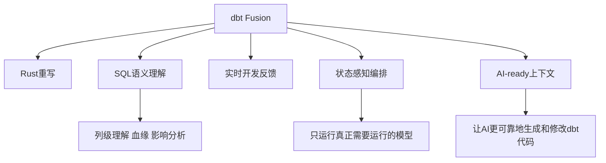

# dbt Fusion与AI时代SQL语义工程

> [!abstract] 一句话结论
> dbt Fusion 的重点不是“dbt 变快了”这么简单，而是 dbt 从“SQL 模板执行器”升级为更懂 SQL 语义的工程平台。AI 时代，谁能给 Agent 提供可信的结构化上下文，谁就会成为数据工作流的控制点。

dbt 过去的核心价值是：用软件工程方式管理 SQL。Fusion 之后，dbt 的野心变成：用更深的 SQL 理解和更快的执行引擎，支撑人和 AI 一起开发可信数据产品。

前置阅读：[[【技术与工具】/dbt/00-dbt学习路线图|dbt学习路线图]]、[[【数据开发与数据架构】/07-数据服务架构/09-语义层工程实践|语义层工程实践]]、[[【学习路线】/AI时代数据人/09-Analytics-Engineer岗位全解析|Analytics Engineer岗位全解析]]。

---

## 1. Fusion到底变了什么

根据 dbt Labs 官方资料，dbt Fusion 是一次从底层引擎开始的重写：Rust、深度 SQL comprehension、更快的解析与编译、VS Code 扩展、状态感知编排、面向 AI 的项目上下文。

过去 dbt Core 更像“渲染 SQL + 调仓库执行”。Fusion 的变化是：它不仅渲染 SQL，还试图理解 SQL 的结构、依赖、列、语义和状态。

---

## 2. 为什么这件事和AI有关

AI 写 SQL 最大的问题不是不会写，而是不知道项目上下文：

- 哪个 model 是可信入口？
- 哪个字段已经废弃？
- 这个指标的 owner 是谁？
- 改这个字段会影响哪些下游报表？
- 这段 SQL 是否符合团队规范？
- 生成的模型能不能通过测试？

如果没有结构化上下文，AI 就只能猜。dbt 项目天然包含模型依赖、测试、文档、血缘、语义层、指标定义。Fusion 如果能更深理解这些内容，就能成为 AI coding agent 的“项目地图”。

这与 [[【技术与工具】/AI-Agent框架/06-A2A协议与MCP分工|A2A协议与MCP分工]]、[[【技术与工具】/MCP/00-MCP学习路线图|MCP学习路线图]] 的方向一致：AI 需要可机器读取、可验证、可执行的上下文。

---

## 3. Analytics Engineering进入语义工程阶段

传统 Analytics Engineering 关注：

- SQL 项目结构
- 分层建模
- 数据测试
- 文档与血缘
- CI/CD

AI 时代要继续增加：

- 指标语义层
- 列级血缘
- 自动影响分析
- AI 生成代码的验证
- Text-to-SQL Eval
- Agent 可读的数据产品上下文

这就是“SQL 语义工程”：不只是写 SQL，而是把 SQL、指标、测试、文档、血缘、权限组织成机器可理解的工程资产。

---

## 4. dbt Fusion的价值场景

### 4.1 大项目开发体验

官方资料提到 Fusion 可显著加快大型项目解析与编译。对日常开发者来说，最大变化是反馈循环变短：错误更早暴露，影响更快看见。

### 4.2 状态感知编排

传统 dbt run 容易把不需要重跑的模型也重跑。Fusion 相关的 State-Aware Orchestration 方向，是只运行真正需要运行的模型。对大项目来说，这意味着成本和调度复杂度都有下降空间。

### 4.3 AI 代码协作

当 AI 修改 dbt 模型时，Fusion 能提供更完整的项目理解、列级信息、依赖关系和验证反馈。这样 AI 不再只是生成一段 SQL，而是可以在工程约束下修改模型。

### 4.4 语义层与指标治理

dbt 生态本来就强调 semantic layer、metrics、documentation。Fusion 之后，语义资产更可能成为 AI 和 BI 共享的上下文层。

相关：[[【数据治理与数据管理】/02-深度研究/05-AI数据治理/10-AI-ready Data/02-语义层与指标口径治理|语义层与指标口径治理]]。

---

## 5. 数据团队应该怎么准备

### 5.1 先把dbt基础打牢

Fusion 再强，也救不了混乱的 SQL 项目。先保证：

- staging / intermediate / marts 分层清晰
- source 和 ref 使用规范
- 每个核心模型有 schema.yml 文档
- 关键字段有 tests
- PR 和 CI 流程可用

### 5.2 把指标写成工程资产

不要让指标只存在于飞书、Confluence 或口头约定。要把指标定义、口径、Owner、测试、血缘沉淀下来。

### 5.3 为AI生成代码准备规则

建议建立：

- dbt 项目命名规范
- SQL 风格规范
- 模型分层规则
- 禁止访问表清单
- 测试必备规则
- AI 修改后的回归检查

这和 [[【技术与工具】/SQL/33-AI时代分析SQL实战|AI时代分析SQL实战]] 的 Text-to-SQL 审查思路一致。

---

## 6. 不要误解Fusion

### 误区一：Fusion等于不用懂dbt

错。Fusion 提升的是引擎与开发体验，不会替代建模判断。数据分层、指标口径、业务语义仍然需要人定义。

### 误区二：Fusion等于所有团队必须马上迁移

不一定。已有 dbt Core 项目应根据平台支持、适配器成熟度、团队风险承受能力逐步评估。

### 误区三：AI可以直接改生产模型

不应该。AI 可以生成候选代码，但必须经过测试、review、血缘影响分析和发布流程。

---

## 7. 外部参考

- [dbt Labs Redefines dbt with New Fusion Engine](https://www.getdbt.com/blog/dbt-labs-redefines-dbt-with-new-fusion-engine)
- [The dbt Fusion engine product page](https://www.getdbt.com/product/fusion)
- [Where we're headed with the dbt Fusion engine](https://www.getdbt.com/blog/where-we-re-headed-with-the-dbt-fusion-engine)
- [State-aware orchestration now in Preview for Fusion projects](https://www.getdbt.com/blog/announcing-state-aware-orchestration)

---

## 8. 相关学习入口

- [[【技术与工具】/dbt/00-dbt学习路线图|dbt学习路线图]]
- [[【技术与工具】/dbt/06-测试与数据质量|dbt测试与数据质量]]
- [[【技术与工具】/dbt/07-文档与数据血缘|dbt文档与数据血缘]]
- [[【技术与工具】/dbt/12-dbt最佳实践|dbt最佳实践]]
- [[【数据开发与数据架构】/07-数据服务架构/09-语义层工程实践|语义层工程实践]]
- [[【学习路线】/AI时代数据人/09-Analytics-Engineer岗位全解析|Analytics Engineer岗位全解析]]
