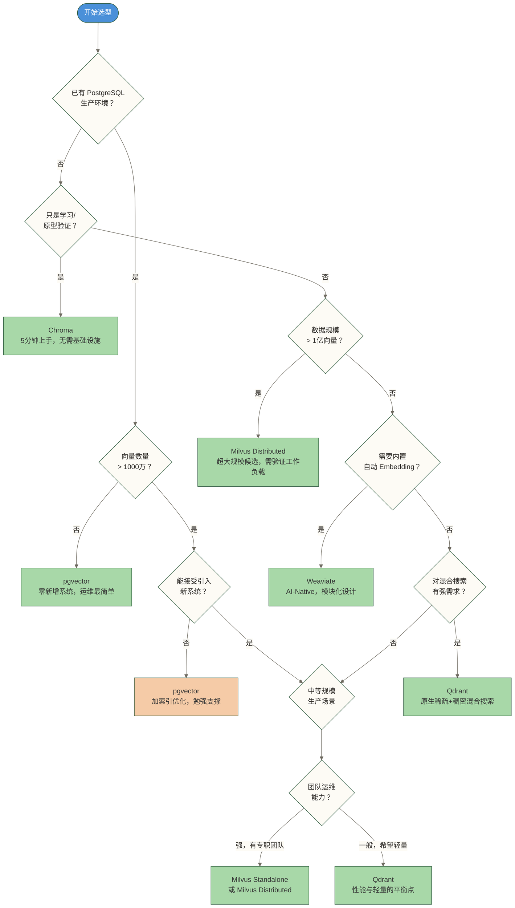

# 向量数据库选型指南

> [!info] 文档定位
> 这是向量数据库专题的导航和总览文档。目标不是罗列参数，而是给你一个**决策框架**。读完之后你应该能缩小候选范围、明确验证重点，而不是更困惑；生产选择仍需结合实际工作负载验证。

## 目录

- [[#选择向量数据库为什么这么难]]
- [[#选型前必须回答的5个问题]]
- [[#主流产品横向对比]]
- [[#决策树：一步步做出你的选择]]
- [[#各产品定位速览]]
- [[#场景化推荐]]
- [[#演进路径：从学习到生产]]
- #2025-2026年趋势判断

---

## 选择向量数据库为什么这么难

市面上关于向量数据库的文章很多，但大多数只是参数罗列。你看完之后仍然不知道该选哪个——因为文章没有告诉你**什么场景用什么**。

困难来自三个地方：

**场景差异太大。** 百万向量和百亿向量是完全不同的问题。单机开发和分布式生产是完全不同的架构。实时写入和批量导入对产品的要求截然相反。用一张参数表覆盖所有场景，必然失真。

**产品演进太快。** 2023年的向量数据库格局和2025年已经不同。pgvector从"玩具"变成了"够用"，Qdrant从小众变成了主流，Pinecone的先发优势正在被开源产品蚕食。今天的对比明天就可能过期。

**缺乏决策逻辑。** 大多数文章告诉你"Milvus性能强，Chroma易上手"，但没有告诉你**强到什么程度才值得承受它的复杂度**，以及**什么时候"够用"比"最强"更重要**。

这篇文档的做法：先帮你搞清楚需求，再给你决策树，最后才是对比表格。

---

## 选型前必须回答的5个问题

在看任何产品对比之前，先把这5个问题的答案想清楚。它们决定了你的选择空间。

### Q1：数据规模是多少？

这是最关键的一个维度，直接决定了你的选择范围。

| 规模 | 向量数量 | 适用产品 |
|------|---------|---------|
| 小规模 | < 100万 | 可先比较易用性，再验证具体工作负载下的容量与性能 |
| 中等规模 | 100万 - 1亿 | Qdrant、pgvector、Milvus Standalone |
| 大规模 | 1亿 - 10亿 | Milvus Distributed，需要认真规划架构 |
| 超大规模 | > 10亿 | Milvus + 专业运维，或 Zilliz Cloud |

> [!warning] 常见误区
> 很多人在数据量还在百万级的时候就选了 Milvus，然后被它的部署复杂度折磨。**在规模没到门槛之前，"够用"的方案就是最好的方案。**

### Q2：团队现有技术栈是什么？

技术选型不是真空中的决策，存量系统的兼容性往往比产品本身的性能更重要。

- **已有 PostgreSQL 生产环境** → 认真考虑 [[【技术与工具】/向量数据库/pgvector/00-pgvector学习路线图|pgvector实战指南]]，零新增系统，运维成本最低
- **Python 技术栈，快速原型** → [[【技术与工具】/向量数据库/00-向量数据库选型指南|Chroma向量数据库实战]] 是最快的起点，5分钟能跑起来
- **需要 AI-Native，不想管 Embedding** → [[【技术与工具】/向量数据库/Weaviate/00-Weaviate学习路线图|Weaviate向量数据库实战]]，内置模块化 AI 流水线
- **有 Rust 生态或追求极致性能** → [[【技术与工具】/向量数据库/Qdrant/00-Qdrant学习路线图|Qdrant向量数据库实战]]，性能和易用性的平衡点
- **超大规模，有专职数据基础设施团队** → [[【技术与工具】/向量数据库/Milvus/00-Milvus学习路线图|Milvus向量数据库实战]]

### Q3：原型验证还是生产系统？

这两种场景的优先级完全不同。原型阶段最大的成本是**时间**，生产阶段最大的成本是**稳定性和可维护性**。

| 阶段 | 首选方案 | 理由 |
|------|---------|------|
| 原型验证/POC | Chroma | 最快上手，无需任何基础设施 |
| 小规模生产 | pgvector 或 Qdrant | 稳定、运维简单 |
| 中大规模生产 | Milvus 或 Qdrant 集群 | 扩展性好、高可用 |
| 企业级 AI 平台 | Milvus 或 Weaviate | 完整的企业级特性 |

### Q4：对混合搜索的需求有多强？

**混合搜索**（向量搜索 + 关键词搜索 BM25 融合）在实际 RAG 和搜索场景中往往比纯向量搜索效果更好。

> [!tip] 为什么混合搜索很重要
> 纯向量搜索对语义相似性强，但对精确词匹配弱——比如搜索一个产品型号、人名、代码片段，关键词搜索更准。混合搜索融合两者，召回率更高。

- **需要开箱即用的混合搜索** → Weaviate（最简单）或 Qdrant（原生支持，性能强）
- **可以自己实现 RRF 融合逻辑** → 任何产品都能实现
- **已有 Elasticsearch** → 直接用 ES 的 kNN 功能，不必引入新系统

### Q5：部署环境和运维能力？

| 部署需求 | 推荐方案 |
|---------|---------|
| 本地开发/实验 | 任何产品的单机模式 |
| 单机生产部署 | Qdrant、Milvus Standalone、pgvector |
| 云原生/Kubernetes | Milvus（Helm Chart 成熟）、Weaviate |
| 纯托管，减少基础设施运维 | Pinecone、Zilliz Cloud、Weaviate Cloud |
| 有 PG 托管服务 | pgvector（AWS RDS、Supabase 等均支持） |

---

## 主流产品横向对比

> [!note] 说明
> 以下对比基于2025年底各产品的主要版本，部分指标为估算量级。产品迭代较快，重大决策前建议复核最新文档。

| 维度 | [[【技术与工具】/向量数据库/Milvus/00-Milvus学习路线图\|Milvus]] | [[【技术与工具】/向量数据库/Qdrant/00-Qdrant学习路线图\|Qdrant]] | [[【技术与工具】/向量数据库/Weaviate/00-Weaviate学习路线图\|Weaviate]] | [[【技术与工具】/向量数据库/pgvector/00-pgvector学习路线图\|pgvector]] | [[【技术与工具】/向量数据库/00-向量数据库选型指南\|Chroma]] |
|------|--------|--------|----------|----------|--------|
| 开发语言 | Go + C++ | Rust | Go | C（PG扩展） | Python |
| 最大向量规模 | 百亿+ | 十亿+ | 十亿级 | 千万级 | 千万级 |
| 部署复杂度 | 高 | 低 | 中 | 极低 | 极低 |
| 混合搜索 | 支持（BM25） | 原生稀疏+稠密 | 原生 BM25 | 手动融合 | 不支持 |
| 内置 Embedding | 否 | 否 | 是（多模型） | 否 | 是（默认） |
| 多租户 | 分区/集合级 | 原生 Payload 隔离 | 原生多租户 | 数据库/Schema 级 | 否 |
| 分布式扩展 | 原生分布式 | 分布式集群 | 分布式集群 | 否 | 否 |
| 持久化存储 | 云原生（S3等） | 本地/对象存储 | 本地/云存储 | PostgreSQL | 本地文件 |
| 云托管服务 | Zilliz Cloud | Qdrant Cloud | Weaviate Cloud | 多家云厂商 PG | Chroma Cloud |
| 最佳适用规模 | 超大规模 | 中大规模 | 中等规模 | 小中规模 | 开发/小规模 |
| 学习曲线 | 较高 | 中等 | 中等 | 低（懂SQL即会） | 极低 |
| 生产成熟度 | 极高 | 高 | 高 | 高（依托PG） | 中（生产经验少） |
| GitHub Stars（2025） | ~33k | ~22k | ~12k | ~13k（PG本体不计） | ~17k |

---

## 决策树：一步步做出你的选择



---

## 各产品定位速览

### [[【技术与工具】/向量数据库/Milvus/00-Milvus学习路线图|Milvus向量数据库实战]] — 超大规模场景的候选方案

**最适合**：向量数量超过1亿、有专职基础设施团队、对查询延迟要求极高的场景。

**核心优势**：原生分布式架构，存算分离设计，支持多种索引类型（HNSW、IVF、DiskANN），生产案例最丰富（爱奇艺、微信、小红书均在使用）。

**核心劣势**：部署复杂（依赖 etcd、MinIO、Pulsar），学习曲线陡峭，小规模场景下完全是杀鸡用牛刀。

**典型用户画像**：大厂数据基础设施团队，或需要支撑亿级用户的 AI 平台。

> [!tip] 快速判断
> 如果你的向量数量不超过5000万，且没有专职运维团队，Milvus 可能不是你的最优解——可将“Qdrant以更低代价覆盖所需能力的80%”作为待验证的选型假设，而非实测结论；覆盖程度取决于功能需求和实际工作负载。

---

### [[【技术与工具】/向量数据库/Qdrant/00-Qdrant学习路线图|Qdrant向量数据库实战]] — 性能与轻量的完美平衡

**最适合**：中大规模生产场景（百万到十亿量级），需要高性能过滤查询，或有混合搜索需求的团队。

**核心优势**：Rust 实现，内存效率极高；原生支持稀疏+稠密混合搜索；Payload 过滤查询性能业界领先；单节点部署极简，扩展到集群也不复杂。

**核心劣势**：生态不如 Milvus 成熟，企业级特性（RBAC等）还在完善中。

**典型用户画像**：需要生产可用的向量搜索，但不想引入 Milvus 那样复杂的基础设施的中小团队。

> [!tip] 快速判断
> 2024-2025年增长最快的开源向量数据库。如果你拿不定主意，Qdrant 是一个很难出错的选择。

---

### [[【技术与工具】/向量数据库/Weaviate/00-Weaviate学习路线图|Weaviate向量数据库实战]] — AI-Native，内置 Embedding 和 RAG

**最适合**：需要快速构建 AI 应用、不想手动管理 Embedding 流程、或需要多模态搜索的团队。

**核心优势**：内置多个 Embedding 模型模块（OpenAI、Cohere、HuggingFace等），GraphQL API 设计优雅，原生支持混合搜索，多租户支持完善。

**核心劣势**：超大规模场景下性能不及 Milvus；GraphQL 学习成本对习惯 REST 的团队有一定门槛。

**典型用户画像**：AI 应用开发团队，希望"向量数据库+Embedding服务"一体化，减少系统复杂度。

---

### [[【技术与工具】/向量数据库/pgvector/00-pgvector学习路线图|pgvector实战指南]] — 已有 PG 栈的最优解

**最适合**：已经在使用 PostgreSQL 的业务系统，向量规模在千万以内，不想引入新系统的团队。

**核心优势**：零新增系统，复用现有 PG 的运维、备份、监控体系；支持 ACID 事务，向量和业务数据可以 JOIN；Supabase、AWS RDS、Neon 等主流 PG 云服务均支持。

**核心劣势**：向量规模超过2000万后性能显著下降；不支持分布式扩展；索引构建速度较慢。

**典型用户画像**：SaaS 产品团队，已经有 PG 数据库，想以最小代价给产品加上 AI 搜索能力。

> [!warning] 规模红线
> pgvector 的 HNSW 索引在千万量级以内可用，超过这个量级建议迁移到 Qdrant 或 Milvus。不要等到性能出问题了再迁移。

---

### [[【技术与工具】/向量数据库/00-向量数据库选型指南|Chroma向量数据库实战]] — 开发者的第一个向量数据库

**最适合**：学习向量数据库概念、快速原型验证、本地开发和测试。

**核心优势**：pip 安装即用，API 极其简单，内置默认 Embedding 函数，与 LangChain、LlamaIndex 深度集成。

**核心劣势**：不适合生产大规模部署，多租户支持弱，性能上限低，分布式能力有限。

**典型用户画像**：刚开始学习 RAG 或 LLM 应用开发的工程师，或需要快速验证想法的独立开发者。

> [!note] 关于 Chroma 的定位
> Chroma 是一个优秀的**开发工具**，但不是一个成熟的**生产系统**。用它学习、验证是正确的，但如果你的 RAG 应用要服务真实用户，请在上线前评估迁移方案。

---

## 场景化推荐

直接告诉你答案，不绕弯子。

| 应用场景 | 推荐方案 | 选择理由 |
|---------|---------|---------|
| 个人项目 / 学习 RAG | [[【技术与工具】/向量数据库/00-向量数据库选型指南\|Chroma]] | 最快上手，无需任何基础设施 |
| 企业知识库（< 500万文档） | [[【技术与工具】/向量数据库/Qdrant/00-Qdrant学习路线图\|Qdrant]] 或 [[【技术与工具】/向量数据库/pgvector/00-pgvector学习路线图\|pgvector]] | 稳定、易维护，运维成本低 |
| 企业知识库（> 500万文档） | [[【技术与工具】/向量数据库/Milvus/00-Milvus学习路线图\|Milvus]] 或 [[【技术与工具】/向量数据库/Qdrant/00-Qdrant学习路线图\|Qdrant]] 集群 | 扩展性好，支持高并发 |
| 电商语义搜索 | [[【技术与工具】/向量数据库/Qdrant/00-Qdrant学习路线图\|Qdrant]]（混合搜索） | 高性能 Payload 过滤，混合搜索召回率高 |
| 推荐系统（亿级用户） | [[【技术与工具】/向量数据库/Milvus/00-Milvus学习路线图\|Milvus]] | 超大规模实时检索，生产案例最多 |
| 已有 PG 的 SaaS 产品 | [[【技术与工具】/向量数据库/pgvector/00-pgvector学习路线图\|pgvector]] | 零新增系统，复用现有运维体系 |
| AI 应用平台 / 多模态 | [[【技术与工具】/向量数据库/Weaviate/00-Weaviate学习路线图\|Weaviate]] | AI-Native，内置 Embedding，模块化设计 |
| RAG 生产系统（中规模） | [[【技术与工具】/向量数据库/Qdrant/00-Qdrant学习路线图\|Qdrant]] | 高可用、高性能、运维不复杂 |
| RAG 生产系统（大规模） | [[【技术与工具】/向量数据库/Milvus/00-Milvus学习路线图\|Milvus]] | 经过大规模生产验证 |
| 希望减少基础设施运维，采用纯托管 | Pinecone 或 Zilliz Cloud | 可减少基础设施运维，仍需管理数据、权限、成本和服务质量 |
| 图像/音视频相似搜索 | [[【技术与工具】/向量数据库/Milvus/00-Milvus学习路线图\|Milvus]] 或 [[【技术与工具】/向量数据库/Weaviate/00-Weaviate学习路线图\|Weaviate]] | 多模态支持完善 |

---

## 演进路径：从学习到生产

大多数团队不是从一开始就在大规模生产环境，而是经历一个逐步演进的过程。以下是典型的演进路径：

```text
学习阶段
Chroma（内存模式）
最快上手，理解向量检索的基本概念
        ↓
原型验证阶段
Chroma（持久化）或 pgvector
有了持久化，开始验证业务逻辑
重点：跑通 RAG 流水线，不是追求性能
        ↓
小规模生产（< 100万向量）
pgvector（已有PG） 或 Qdrant Standalone
真实流量，需要稳定性和可监控性
重点：运维简单，不要引入不必要的复杂度
        ↓
中规模生产（100万 - 1亿向量）
Qdrant 集群 或 Milvus Standalone
开始需要考虑扩展性和高可用
重点：索引策略、查询性能调优
        ↓
大规模生产（1亿+ 向量）
Milvus Distributed 或 Zilliz Cloud
存算分离，水平扩展
重点：基础设施自动化，成本优化
```

> [!tip] 迁移的时机
> 每次"升级"都有迁移成本。**不要提前优化，但要提前设计接口层**——用一个统一的向量存储抽象层包装底层实现，可以减少迁移对业务代码的影响；能否仅改配置取决于接口兼容性，仍需验证数据迁移、过滤语义、索引配置和检索行为。LangChain 和 LlamaIndex 的 VectorStore 接口就是这个思路。

---

## 2025-2026 年趋势判断

> [!note] 以下判断基于2025年底的市场观察，供参考

**趋势假设：若无重大技术范式转变，现有格局可能相对稳定，但不能排除颠覆性新玩家。** 向量数据库赛道经历了2022-2023年的爆发期，主要玩家已经确定。除非有重大技术范式转变，现有格局不会大变。

**Milvus 和 Qdrant 是开源领域的两大赢家。** 前者靠超大规模场景和 LF AI & Data 背书稳住企业市场，后者靠 Rust 性能和优秀的开发者体验赢得中小团队。两者的竞争格局类似 Kafka 和 Pulsar。

**pgvector 功能快速追赶，正在蚕食小规模市场。** pgvector 0.7+ 版本的 HNSW 性能已经达到生产可用水平，对于数据量在千万以内的场景，"用 PG 就够了"正在成为主流选择。

**纯向量搜索正在成为"旧时代"。** 混合搜索（向量 + BM25）已成为生产 RAG 系统的标配。只支持纯向量搜索的产品，其竞争力正在快速下降。

**托管服务的价值回归理性。** Pinecone 等早期纯托管产品的溢价已经难以为继，Zilliz Cloud（Milvus托管）和 Qdrant Cloud 提供了更有竞争力的方案。对于不想运维的团队，托管服务仍然是合理选择。

**GraphRAG 和多跳推理带来新需求。** 纯向量搜索在需要多步推理的场景下效果有限，图数据库 + 向量搜索的混合架构（如 NebulaGraph + Milvus）开始出现在生产系统中。

---

## 专题文档索引

| 文档 | 定位 | 适合场景 |
|------|------|---------|
| [[【技术与工具】/向量数据库/Milvus/00-Milvus学习路线图|Milvus向量数据库实战]] | 超大规模分布式向量数据库 | 亿级以上生产场景 |
| [[【技术与工具】/向量数据库/Qdrant/00-Qdrant学习路线图|Qdrant向量数据库实战]] | 高性能轻量向量数据库 | 中大规模生产场景 |
| [[【技术与工具】/向量数据库/Weaviate/00-Weaviate学习路线图|Weaviate向量数据库实战]] | AI-Native向量数据库 | AI应用平台、多模态 |
| [[【技术与工具】/向量数据库/pgvector/00-pgvector学习路线图|pgvector实战指南]] | PostgreSQL向量扩展 | 已有PG、小中规模 |
| [[【技术与工具】/向量数据库/00-向量数据库选型指南|Chroma向量数据库实战]] | 开发者向量数据库 | 学习、原型验证 |

---

#向量数据库 #技术选型 #RAG #AI工程 #数据库
