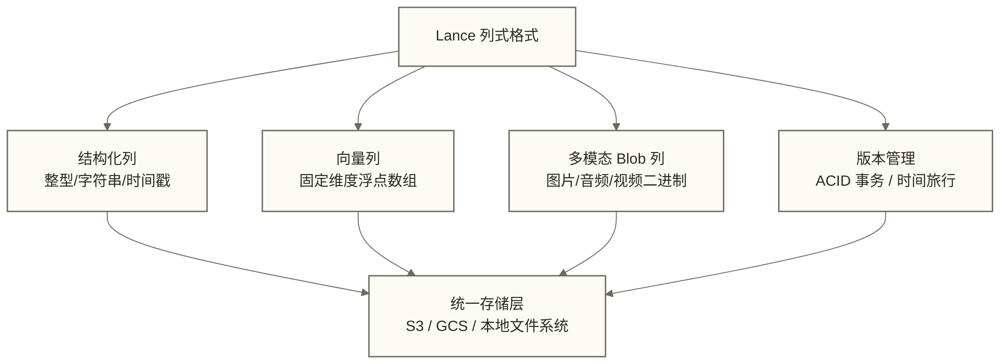
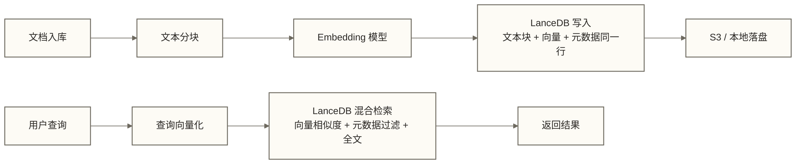
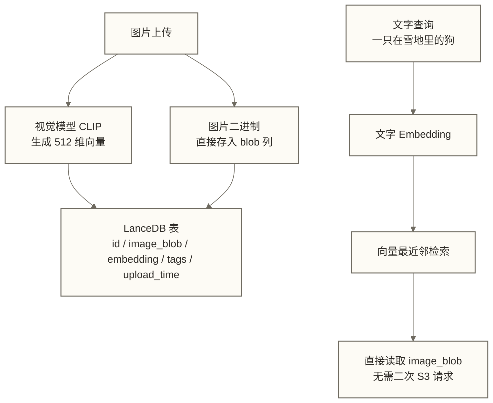
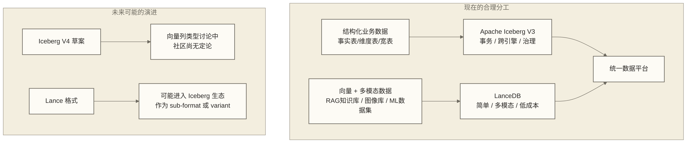

# LanceDB：AI-Native 多模态 Lakehouse 实战

> [!info] 前置知识
> 阅读本文前，建议先了解以下概念：
> - [[【技术与工具】/向量数据库/00-向量数据库选型指南|向量数据库选型指南]] — 理解主流向量库的基本差异
> - [[【技术与工具】/Iceberg/01-Iceberg-V3深度解析|Apache Iceberg V3 深度解析]] — 理解 Lakehouse 表格格式的演进方向
> - [[【AI 与大数据】/02-大模型核心/04-RAG检索增强生成实战|RAG 检索增强生成实战]] — 理解 RAG 系统的存储需求

---

## 背景：一套存储三件套，用到什么时候

现在做 RAG 系统，大多数团队都在跑一套三件套：Iceberg 或 Delta Lake 管结构化数据，Milvus 或 Pinecone 存向量，S3 存原始文件。

这套方案能跑，但代价不小。

三个系统意味着三套运维、三套监控、三套权限管理。用户上传一张图片，你要把它的 embedding 写进向量库，把元数据写进结构化表，把原图扔进对象存储 ——写三次，同步三次，查询时跨系统 join。任何一个环节的延迟、失败或版本不一致，都会在生产环境变成难以排查的 bug。

多模态数据让这个问题更难。图片、音频、视频的 embedding 和原文件是分离的——向量库只存了一串浮点数，原始文件在 S3 另一个路径，两者之间靠你自己维护 ID 映射。时间一长，孤儿向量和找不到原文件的引用会悄悄积累。

**这不是向量库的问题，是架构本身的摩擦。**

LanceDB 的出现，是对这种摩擦的一次正面回应。它不是一个更快的向量库，而是一个重新设计的存储层——把向量、结构化数据和非结构化原文件统一放进同一张表里。

---

## LanceDB 是什么：重新定义 Lakehouse 的存储格式

LanceDB 基于 Lance 列式格式构建。Lance 不是对 Parquet 的修补，而是从头设计的多模态存储格式。它的核心特点有三：

**向量是一等公民。** Lance 原生支持固定维度浮点向量列，支持 HNSW 和 IVF 索引，不需要额外的向量索引服务。一张表可以同时有 `id`（整型）、`text`（字符串）、`embedding`（向量）、`image`（二进制 blob）四列。Parquet也可以用数组和二进制类型表达这些数据，不能仅凭这些列类型区分两者；本文关注的是Lance面向向量检索与多模态访问的设计。

**多模态 blob 原生存储。** 图片、音频、视频的二进制内容可以直接作为列值存进 Lance 表，随向量和元数据一起落盘，不需要单独的 S3 路径管理。当然，对于超大文件，仍然可以存引用路径 ——这是配置问题，不是架构限制。

**基于对象存储，零 infra。** LanceDB 的数据直接落在 S3、GCS 或本地文件系统上，没有常驻的服务端进程。Python 程序直接读写，不需要启动数据库服务。对于采用嵌入式部署的中小团队，这可以减少独立数据库服务的运维工作，但仍有运行环境、存储、权限、备份和数据维护成本。

Lance 格式还支持 ACID 事务、schema evolution 和版本管理（时间旅行），这些是 Iceberg 的标志性能力，现在在 Lance 里同样可以用于向量和多模态数据。



---

## 和主流方案的对比

下面这张表是选型的核心参考。没有绝对优劣，只有适不适合你的场景。

| 维度 | LanceDB | Milvus | pgvector | Iceberg + Milvus 组合 |
|------|---------|--------|----------|-----------------------|
| 向量原生支持 | 一等公民 | 专为向量设计 | 插件扩展 | 分层：Milvus 负责向量 |
| 多模态数据存储与访问 | 支持二进制列及面向多模态的访问设计 | 需按字段能力及文件存储设计判断 | PostgreSQL 可存二进制数据；pgvector 提供向量能力 | Iceberg 可表达二进制列；文件内联或外置需按访问与容量需求选择 |
| 结构化数据 | 支持（SQL 查询） | 标量字段过滤 | PostgreSQL 全能力 | Iceberg 全能力 |
| ACID 事务 | 支持 | 有限 | 支持（PostgreSQL） | Iceberg 支持 |
| 版本管理 / 时间旅行 | 支持 | 不支持 | 不支持 | Iceberg 支持 |
| 运维复杂度 | 极低（无服务端） | 高（分布式集群） | 中（PostgreSQL 实例） | 极高（两套系统） |
| 大规模写入性能 | 中等 | 高 | 中等 | 高（Iceberg 优化写入） |
| 生态成熟度 | 早期成长阶段 | 成熟 | 成熟（PostgreSQL 生态） | 成熟 |
| 企业治理功能 | 欠缺 | 中等 | PostgreSQL 级别 | 强（Iceberg 元数据） |
| 适合规模 | 中小团队 / 原型 | 中大规模 | 小中规模 | 大规模数据平台 |

**一个判断**：如果你的核心需求是 RAG 系统的一体化存储，团队规模不大，且有多模态数据需要管理，LanceDB 值得认真考虑。如果你已经有成熟的 Iceberg + Milvus 体系，应将维护现有架构作为对照方案；只有一体化存储的预期收益足以覆盖迁移、验证和治理适配成本时，才考虑切换。

---

## 三个典型落地场景

### 场景一：RAG 系统的一体化存储

传统 RAG 需要同步两个系统：文档分块存向量库，元数据存关系库。LanceDB 把两者合并：



关键优势：**原子写入**。文本块和它的向量在同一条记录，不存在向量写成功但元数据丢失的半失败状态。

### 场景二：多模态检索（图文混合）

图片搜索场景中，图片 embedding 和图片本身通常分开存储。用 LanceDB 可以把它们放在一行里：



这里的收益是**读路径简化**：结果集里直接带图片数据，不需要用 S3 key 再发一次请求取图。对于中小规模的图片库（百万级以下），这套方案的延迟表现相当好。

### 场景三：AI 训练数据集的版本管理

机器学习团队最头痛的问题之一：昨天用来训练的数据集，今天能不能重现？LanceDB 的版本管理让这件事变得可追溯：

```mermaid
%%{init: {"theme":"base","themeVariables":{"fontFamily":"PingFang SC, -apple-system, Source Han Serif SC, serif","fontSize":"16px","background":"#FDFBF5","primaryColor":"#FDFBF5","primaryTextColor":"#2D2A26","primaryBorderColor":"#6E6A60","secondaryColor":"#E8EFE8","secondaryBorderColor":"#8FA890","secondaryTextColor":"#2D2A26","tertiaryColor":"#FDFBF5","tertiaryBorderColor":"#9A9488","tertiaryTextColor":"#6E6A60","lineColor":"#6E6A60","textColor":"#2D2A26","mainBkg":"#FDFBF5","nodeBorder":"#2D5A3D","clusterBkg":"#F3EEDF","clusterBorder":"#9A9488","edgeLabelBackground":"#FDFBF5"},"flowchart":{"htmlLabels":true,"curve":"basis","padding":20,"nodeSpacing":60,"rankSpacing":70,"useMaxWidth":false},"themeCSS":".node rect, .node polygon, .node circle { stroke-width: 1.5px; } .edgePath .path { stroke-width: 1.5px; } .cluster-label .nodeLabel, .cluster-label foreignObject { color: #2D2A26 !important; } .edgeLabel, .edgeLabel foreignObject { color: #2D2A26 !important; background-color: #FDFBF5; } .edgeLabel rect { fill: #FDFBF5; }"}}%%
graph LR
    classDef default fill:#FDFBF5,stroke:#6E6A60,color:#2D2A26,stroke-width:1.5px
    classDef startend fill:#2D2A26,stroke:#2D2A26,color:#FDFBF5,font-weight:bold
    classDef decision fill:#F6EAD8,stroke:#C08A1A,color:#2D2A26,font-weight:bold
    classDef hub fill:#3B5A80,stroke:#3B5A80,color:#FDFBF5,font-weight:bold
    classDef io fill:#E5EAF0,stroke:#3B5A80,color:#2D2A26
    classDef accent fill:#A6432C,stroke:#A6432C,color:#FDFBF5,font-weight:bold
    classDef storage fill:#F3EEDF,stroke:#9A9488,color:#2D2A26
    A[数据集 v1<br/>10万条] --> B[标注更新<br/>新增5000条]
    B --> C[数据集 v2<br/>105000条]
    C --> D[模型训练<br/>记录 version_id]
    D --> E[模型出问题]
    E --> F[访问 v1 历史快照<br/>需保留历史文件]
    F --> G[lance.dataset.checkout_version_1]
    class A,B,C,D,E,F,G default
```



这和 Iceberg 的时间旅行有相似的历史快照读取思路。访问历史版本不等于恢复当前表版本；历史数据及索引是否可用取决于相关文件的保留情况，不能据此保证检索结果必然一致或无需重建索引。

---

## 最小代码：Python API 实战

下面这段代码演示了 LanceDB 的核心操作：建表、写向量、做混合检索。这段代码用于展示API流程：两条示例数据不适合执行下方IVF_PQ索引训练，字符串混合检索还需配置匹配入库向量的embedding函数或显式提供查询向量，不能按现状保证整段直接运行。

```python
import lancedb
import numpy as np
import pyarrow as pa

# 1. 连接 LanceDB（本地目录或 s3:// 路径）
db = lancedb.connect("./my_lance_db")

# 2. 定义 schema：文本 + 向量 + 元数据
schema = pa.schema([
    pa.field("id", pa.int64()),
    pa.field("text", pa.utf8()),
    pa.field("embedding", pa.list_(pa.float32(), list_size=384)),
    pa.field("category", pa.utf8()),
    pa.field("created_at", pa.timestamp("s")),
])

# 3. 写入数据（向量和元数据同一条记录）
data = [
    {
        "id": 1,
        "text": "LanceDB 是一个多模态存储引擎",
        "embedding": np.random.rand(384).astype(np.float32).tolist(),
        "category": "技术",
        "created_at": 1713484800,
    },
    {
        "id": 2,
        "text": "Apache Iceberg 是 Lakehouse 的表格格式标准",
        "embedding": np.random.rand(384).astype(np.float32).tolist(),
        "category": "技术",
        "created_at": 1713484800,
    },
]

# 首次建表，之后用 open_table
table = db.create_table("docs", data=data, schema=schema)

# 4. 创建向量索引（数据量 >1万行时推荐）
table.create_index(
    metric="cosine",
    vector_column_name="embedding",
    index_type="IVF_PQ",
    num_partitions=8,
    num_sub_vectors=16,
)

# 5. 全文索引（支持 BM25 全文检索）
table.create_fts_index("text")

# 6. 混合检索：向量相似度 + 元数据过滤 + 全文
query_vector = np.random.rand(384).astype(np.float32).tolist()

results = (
    table.search(query_vector, vector_column_name="embedding")
    .where("category = '技术'")          # 元数据过滤
    .limit(5)
    .to_pandas()
)

cols = ["id", "text", "_distance"]
print(results[cols])

# 7. 纯全文检索
fts_results = (
    table.search("Lakehouse 表格格式", query_type="fts")
    .limit(3)
    .to_pandas()
)

# 8. 混合检索（向量 + 全文，reranking）
hybrid_results = (
    table.search("多模态存储引擎", query_type="hybrid")
    .limit(5)
    .to_pandas()
)

# 9. 查看版本并访问历史版本
print(db.open_table("docs").list_versions())
# 切换到 version 1 的历史快照，不等于恢复当前表版本
# 历史版本访问依赖相关文件仍被保留
table.checkout(1)
```

> [!tip] 关于 embedding 生成
> 实际项目中，`embedding` 列的值需要通过 Sentence Transformers、OpenAI Embeddings 或其他模型生成。上面代码用随机向量替代，只演示 API 用法。完整 RAG 集成方式参考 [[【AI 与大数据】/04-AI工程化/08-向量数据库与RAG工程实践|向量数据库与 RAG 工程实践]]。

---

## 生产落地的现实判断

### 做得好的地方

**成本极低。** 数据落在 S3，LanceDB 本身无服务端，若采用自托管嵌入式部署，可以不单独租用数据库服务实例，但AWS账单仍可能包含对象存储请求、数据传输及运行应用所需的计算费用。对于中小团队，这是很实质的节省。

**多模态原生。** 这是 LanceDB 目前最独特的优势。在本文假设的“文件、向量、元数据分别存储”架构下，LanceDB统一表存储可以减少跨系统协调；其他方案是否需要三套系统，取决于其数据存储能力和部署设计。

**开发体验好。** Python API 设计简洁，学习曲线低。Pandas、PyArrow、LangChain、LlamaIndex 都有原生集成。原型到可用 demo 的时间，比搭 Milvus 集群短得多。

**版本管理是真能用的功能。** 对于 ML 训练数据集的版本化，Lance 的实现比 DVC 更轻量，比 Delta Lake 更适合向量场景。

### 现实的局限

**大规模写入性能有上限。** 单节点写入在亿级数据时会碰到瓶颈，Milvus 的分布式写入能力目前 LanceDB 还没有。

**企业治理功能欠缺。** 细粒度的列级权限控制、数据血缘、审计日志——这些是大厂数据平台的刚需，LanceDB 2026 年上半年还没有完善的支持。

**生态不如 Iceberg/Milvus 成熟。** Spark connector、Flink 集成、Presto 查询——这些 Iceberg 打磨了多年的周边工具，LanceDB 还在追赶。

**社区和企业支持仍在成长阶段。** 遇到生产问题，能找到的答案比 Milvus 少。这是真实的运维风险。

### 选型建议

| 场景 | 推荐方案 |
|------|----------|
| 中小团队 RAG 系统（百万级文档以内） | LanceDB 首选 |
| 多模态检索（图文/音视频）原型到 MVP | LanceDB 首选 |
| ML 训练数据集版本管理（中小规模） | LanceDB 值得考虑 |
| 大规模向量检索（亿级以上，高 QPS） | Milvus 或 [[【技术与工具】/向量数据库/Qdrant/01-Qdrant概述与核心定位\|Qdrant]] |
| 已有 PostgreSQL 体系，向量需求不大 | [[【技术与工具】/向量数据库/pgvector/01-pgvector概述与核心定位\|pgvector]] |
| 大厂主数据平台，需要完整治理体系 | Iceberg + Milvus 组合方案，暂不建议替代 |

---

## LanceDB 和 Iceberg V3 的关系

这是一个容易被误解的问题：LanceDB 会不会替代 Iceberg？

**不会，也替代不了。**

两者解决的问题不在同一平面。Iceberg V3 在结构化数据的事务语义、分区演化、行级变更跟踪（delete files）和跨引擎互操作（Spark、Flink、Trino 都能读）方面，是 LanceDB 目前无法企及的。大规模数据仓库的核心存储格式，Iceberg 的地位在 2026 年仍然稳固。

LanceDB 的价值在它自己的领地：向量 + 多模态 + 简单运维。

两者更准确的关系是**互补而非竞争**：



Iceberg V4 的社区讨论中已经出现了向量列类型的提案，Lance 团队也在观察是否将 Lance 格式定位为 Iceberg 的多模态 variant。这是值得持续关注的方向，但 2026 年上半年，两条路线仍然独立演进。

参考：[[【技术与工具】/Iceberg/01-Iceberg-V3深度解析|Iceberg V3 深度解析]] 对 delete files 和 row lineage 的详细解读。

---

## 和多模态 AI 生态的连接

LanceDB 能发挥最大价值的场景，恰恰是多模态 AI 应用爆发的方向：图文联合检索、视频理解 + 语义检索、音频归档 + 声纹搜索。

这些场景的共同特征是：非结构化原文件 + embedding + 结构化标签同时存在，且需要联合查询。传统的"文件存 S3，向量存向量库，标签存关系库"的方案在这里摩擦最大，LanceDB 的优势最明显。

延伸阅读：
- [[【AI 与大数据】/02-大模型核心/02-多模态AI技术与应用|多模态 AI 技术与应用]] — 理解多模态模型的输入输出结构
- [[【AI 与大数据】/04-AI工程化/07-向量数据库与语义搜索|向量数据库与语义搜索]] — 向量检索的基础原理
- [[【AI 与大数据】/04-AI工程化/08-向量数据库与RAG工程实践|向量数据库与 RAG 工程实践]] — 工程化 RAG 的完整实践

---

## 掌握检查

完成本文后，你应该能够回答以下问题：

- [ ] 传统"三件套"（Iceberg + Milvus + S3）在什么场景下摩擦最大？LanceDB 如何缓解这种摩擦？
- [ ] Lance 格式和 Parquet 格式的核心区别是什么？为什么能够存储向量数组和二进制列，并不等于具备面向向量检索和多模态访问的专门优化？
- [ ] LanceDB 的版本管理功能和 Iceberg 的时间旅行，在向量场景下的核心差异是什么？
- [ ] 给定一个亿级文档、高 QPS 的 RAG 场景，你会选 LanceDB 还是 Milvus？理由是什么？
- [ ] LanceDB 和 Iceberg V3 是替代关系还是互补关系？各自的核心价值域是什么？

---

## 实践练习

**基础练习**：参考本文代码示例，在本地搭建一个 LanceDB 表，存入至少 10 条包含文本、向量（随机生成）和元数据的记录，并完成一次带元数据过滤的向量检索。验证结果是否按 `_distance` 升序排列。

**进阶练习**：设计一个多模态图片库的 Lance schema，要求同时包含：图片文件路径（或 blob 列）、CLIP 向量（512 维）、上传时间、标签数组（`pa.list_(pa.utf8())`）。写入 5 条测试数据后，用文字 query 做跨模态检索，并对比返回的 `_distance` 值和标签内容是否符合预期。

**架构练习**：为一个月活 10 万用户的企业知识库产品设计存储架构。知识库包含：PDF 文档（结构化文本块 + embedding）、图片附件（CLIP embedding + 原图）、用户标注数据（结构化）。画出存储层架构图，说明选择 LanceDB 还是组合方案的理由，以及如何处理向量更新时的版本一致性。

---

## 下一步

本文介绍了 LanceDB 的核心设计和典型场景。如果你在构建完整的 RAG 系统，下一步推荐阅读：

- [[【AI 与大数据】/04-AI工程化/08-向量数据库与RAG工程实践|向量数据库与 RAG 工程实践]] — 覆盖 RAG 系统的完整工程链路，包括 chunking 策略、reranking 设计和评估方法
- [[【技术与工具】/向量数据库/通用知识/04-RAG系统架构设计模式|RAG 系统架构设计模式]] — 不同规模和场景下的 RAG 架构选择
- [[【技术与工具】/向量数据库/00-向量数据库选型指南|向量数据库选型指南]] — 在确定用 LanceDB 之前，完整比较各方案的适用场景
