# Milvus 学习路线图

> [!abstract] 这份路线图能给你什么
> - **学习目标**：通过 10 篇文档，系统掌握 Milvus 向量数据库从入门到生产的完整技能
> - **设计理念**：沿着真实工程路径走，每一步都有实际意义，不绕弯路
> - **预计时长**：总计 20-35 小时，覆盖入门、进阶、生产、专家四个阶段
> - **适用背景**：有 Python 基础，对 AI/RAG 工程感兴趣，或工作中需要上向量搜索能力

AI 时代，"会用向量数据库"正在成为数据工程师的标配技能。搜索推荐、RAG 问答、图像检索、相似用户挖掘——凡是涉及"语义相似"的场景，底层几乎都跑着向量索引。Milvus 是这个赛道里最成熟、最重的一匹马，背后有 Zilliz、Linux 基金会和全球数千名贡献者在撑。这份路线图帮你最高效地驾驭它。

---

## 前置知识要求

在开始 Milvus 之前，你需要具备以下基础：

| 前置知识 | 要求程度 | 说明 |
|---------|---------|------|
| Python 基础 | 必须 | 能写 class、能用 pip，会基本的列表/字典操作 |
| 向量与嵌入概念 | 推荐 | 理解"把文本变成数字向量"是怎么回事 |
| Docker 基础 | 推荐 | Standalone 部署需要 docker-compose |
| 数据库基本概念 | 了解即可 | 知道什么是表、索引、CRUD |

**推荐先读**：
- [[【AI 与大数据】/04-AI工程化/07-向量数据库与语义搜索]] — 理解向量搜索的核心原理，建立认知基础
- [[【AI 与大数据】/04-AI工程化/08-向量数据库与RAG工程实践]] — 了解 RAG 架构全貌，明确 Milvus 在其中的位置
- [[【技术与工具】/向量数据库/00-向量数据库选型指南]] — 理解为什么选 Milvus 而不是其他方案

> [!tip] 已有其他向量数据库经验？
> 如果你用过 Chroma 或 Qdrant，可以快速浏览第 1-3 篇文档，重点看 Milvus 的架构设计和集合模型，然后直接跳到第 6 篇索引选型。

---

## 整体学习路径

```mermaid
%%{init: {"theme":"base","themeVariables":{"fontFamily":"PingFang SC, -apple-system, Source Han Serif SC, serif","fontSize":"16px","background":"#FDFBF5","primaryColor":"#FDFBF5","primaryTextColor":"#2D2A26","primaryBorderColor":"#6E6A60","secondaryColor":"#E8EFE8","secondaryBorderColor":"#8FA890","secondaryTextColor":"#2D2A26","tertiaryColor":"#FDFBF5","tertiaryBorderColor":"#9A9488","tertiaryTextColor":"#6E6A60","lineColor":"#6E6A60","textColor":"#2D2A26","mainBkg":"#FDFBF5","nodeBorder":"#2D5A3D","clusterBkg":"#F3EEDF","clusterBorder":"#9A9488","edgeLabelBackground":"#FDFBF5"},"flowchart":{"htmlLabels":true,"curve":"basis","padding":20,"nodeSpacing":60,"rankSpacing":70,"useMaxWidth":false},"themeCSS":".node rect, .node polygon, .node circle { stroke-width: 1.5px; } .edgePath .path { stroke-width: 1.5px; } .cluster-label .nodeLabel, .cluster-label foreignObject { color: #2D2A26 !important; } .edgeLabel, .edgeLabel foreignObject { color: #2D2A26 !important; background-color: #FDFBF5; } .edgeLabel rect { fill: #FDFBF5; }"}}%%
flowchart TB
    subgraph "阶段一：入门（1-2周）"
        A1["01-Milvus概述与核心定位<br/>了解它是什么、解决什么问题"]
        A2["02-Milvus架构深度解析<br/>搞懂分布式云原生架构"]
        A3["03-核心概念详解<br/> Collection、Index、Partition..."]
        A1 --> A2 --> A3
    end

    subgraph "阶段二：进阶（2-3周）"
        B1["04-安装与部署<br/>Lite / Standalone / Distributed"]
        B2["05-第一个Milvus应用<br/>端到端跑通，建立手感"]
        B3["06-索引类型与选型指南<br/>IVF / HNSW / DiskANN..."]
        B4["07-Schema设计与数据建模<br/>多字段、动态Schema、主键策略"]
        B1 --> B2 --> B3 --> B4
    end

    subgraph "阶段三：生产（3-4周）"
        C1["08-查询与搜索详解<br/>ANN / 混合搜索 / 过滤查询"]
        C2["09-生产运维与性能调优<br/>监控、扩容、故障处理"]
        C1 --> C2
    end

    subgraph "阶段四：专家（持续深化）"
        D1["10-RAG集成实战<br/>LangChain / LlamaIndex / 生产级RAG"]
    end

    A3 --> B1
    B4 --> C1
    C2 --> D1

    style A1 fill:#dbeafe,stroke:#3b82f6
    style A2 fill:#dbeafe,stroke:#3b82f6
    style A3 fill:#dbeafe,stroke:#3b82f6
    style B1 fill:#dcfce7,stroke:#16a34a
    style B2 fill:#dcfce7,stroke:#16a34a
    style B3 fill:#dcfce7,stroke:#16a34a
    style B4 fill:#dcfce7,stroke:#16a34a
    style C1 fill:#fef9c3,stroke:#ca8a04
    style C2 fill:#fef9c3,stroke:#ca8a04
    style D1 fill:#fce7f3,stroke:#db2777
```

---

## 各阶段详解

### 阶段一：入门（预计 1-2 周，6-8 小时）

**目标**：建立对 Milvus 的完整认知地图。读完这三篇，你能清楚地说出：Milvus 是什么、它的架构为什么这样设计、它的核心概念是什么。

---

**[[【技术与工具】/向量数据库/Milvus/01-Milvus概述与核心定位]]**（约 60 分钟）

Milvus 的起点文档。不是简单介绍"功能列表"，而是讲清楚三件事：它为什么会被造出来（FAISS 的局限）、它的能力边界在哪里（能做什么、不做什么）、它在向量数据库生态里处于什么位置（vs Pinecone、Qdrant、pgvector）。

读完之后你应该能回答：为什么不直接用 FAISS？Milvus 和 Chroma 的本质区别是什么？

---

**[[【技术与工具】/向量数据库/Milvus/02-Milvus架构深度解析]]**（约 60 分钟）

Milvus 2.x 是一次架构革命——从单体应用变成了云原生微服务。这篇解析四层架构（接入层、协调层、工作节点、存储层），以及 etcd、MinIO、Pulsar 各自扮演的角色。理解架构，才能在遇到问题时知道去哪里找原因。

---

**03-核心概念详解**（约 45 分钟）

Milvus 有一套自己的概念体系：Collection、Partition、Segment、Field、Index……这篇逐一拆解，并配合类比帮助理解。这些概念会贯穿后续所有文档。

---

**阶段一完成检验**：
- [ ] 能说清楚 Milvus 解决了什么问题，FAISS 为什么不够用
- [ ] 能画出 Milvus 的四层架构示意图
- [ ] 知道 Collection、Segment、Partition 的关系

---

### 阶段二：进阶（预计 2-3 周，8-12 小时）

**目标**：从"知道"到"会用"。这个阶段完成后，你能在本地跑起一个 Milvus 实例，完成从数据写入到向量搜索的完整流程，并且能根据业务场景选择合适的索引和数据模型。

---

**04-安装与部署**（约 90 分钟）

Milvus 有三种形态，选哪个取决于你的场景：

- **Milvus Lite**：一行 `pip install` 即可，嵌入 Python 进程，适合原型开发
- **Milvus Standalone**：docker-compose 一键起，适合单机生产和中等规模
- **Milvus Distributed**：Kubernetes 集群，适合亿级以上规模

这篇覆盖三种形态的完整部署步骤，以及常见安装问题排查。

---

**[[【技术与工具】/向量数据库/Milvus/05-第一个Milvus应用]]**（约 60 分钟）

"Hello World"级别的完整项目：创建 Collection、生成向量、批量写入、构建索引、执行搜索，一路跑通。配有详细注释的代码，每一步都解释"为什么这样做"。

---

**[[【技术与工具】/向量数据库/Milvus/06-索引类型与选型指南]]**（约 90 分钟）

这是 Milvus 最有技术深度的一篇。向量索引不是一个选项，而是一个工程权衡：

- **IVF_FLAT / IVF_SQ8 / IVF_PQ**：倒排文件索引家族，内存友好
- **HNSW**：图索引，可作为低延迟检索的候选方案；查询速度和内存占用取决于数据、参数、硬件及召回率要求，需通过测试比较
- **DiskANN**：磁盘原生索引，大规模场景利器
- **SCANN / BIN_IVF_FLAT**：特殊场景选型

读完后你能根据数据规模、内存预算、延迟要求做出合理选择。

---

**07-Schema设计与数据建模**（约 75 分钟）

向量数据库的建模不只是"存个向量"。这篇讲多字段 Schema 设计、动态 Schema 使用、主键策略、分区设计，以及如何为混合检索（向量 + 标量过滤）设计合理的数据结构。

---

**阶段二完成检验**：
- [ ] 本地成功启动 Milvus Standalone
- [ ] 完成第一个完整的向量写入和搜索流程
- [ ] 能在 HNSW 和 IVF 系列之间做出合理选择
- [ ] 设计过一个包含多个字段的 Collection Schema

---

### 阶段三：生产（预计 3-4 周，8-10 小时）

**目标**：从"能用"到"用好"。生产环境的 Milvus 有更多需要关注的维度：查询召回率、过滤性能、集群监控、容量规划、故障恢复。

---

**08-查询与搜索详解**（约 90 分钟）

ANN 搜索只是开始。这篇深入讲解：

- **纯向量搜索**：nprobe、ef、search_params 的调优逻辑
- **混合搜索**：向量搜索 + 标量过滤，如何避免过滤率过高导致的性能崩溃
- **多向量搜索**：同时用多个 embedding 字段搜索并合并结果（RRF）
- **Range Search**：按相似度阈值而不是 Top-K 搜索

---

**09-生产运维与性能调优**（约 120 分钟）

生产部署的系统性指南：

- 集群资源规划：QueryNode、DataNode、IndexNode 各需要多少资源
- 监控体系：Prometheus + Grafana 集成，关键指标解读
- 数据压实（Compaction）：理解 Growing Segment 和 Sealed Segment 的生命周期
- 常见性能瓶颈排查：内存压力、磁盘 IO、慢查询分析
- 升级与滚动重启策略

---

**阶段三完成检验**：
- [ ] 能解释 nprobe 和 ef 参数对召回率/延迟的影响
- [ ] 配置过 Prometheus 监控面板
- [ ] 能分析一个慢查询并找到根本原因
- [ ] 理解 Compaction 的触发时机和影响

---

### 阶段四：专家（持续深化）

**目标**：将 Milvus 整合进真实 AI 应用。这个阶段不再是孤立地学习 Milvus，而是把它作为 RAG 系统的核心组件，与 LLM、Embedding 模型、编排框架配合使用。

---

**10-RAG集成实战**（约 120 分钟）

端到端的 RAG 工程实战：

- 文档处理 Pipeline：分块策略、Embedding 模型选型、批量写入优化
- LangChain 集成：VectorStore 接口使用、检索链构建
- LlamaIndex 集成：更细粒度的索引控制
- 生产级 RAG：混合检索（向量 + BM25）、重排序（Reranker）、上下文压缩
- 常见问题：召回质量差怎么诊断、写入延迟高怎么优化

---

**阶段四完成检验**：
- [ ] 独立完成一个面向生产需求的 RAG 问答系统，并依据业务要求验证检索质量、性能、安全和故障恢复能力后，再判断是否可用于生产
- [ ] 实现过混合检索（向量 + 关键词）
- [ ] 理解 Reranker 在召回链路中的位置和作用

---

## 本系列文档导航

| 序号 | 文档 | 阶段 | 预计时长 |
|------|------|------|---------|
| 00 | [[【技术与工具】/向量数据库/Milvus/00-Milvus学习路线图]] | 导航 | 15 分钟 |
| 01 | [[【技术与工具】/向量数据库/Milvus/01-Milvus概述与核心定位]] | 入门 | 60 分钟 |
| 02 | [[【技术与工具】/向量数据库/Milvus/02-Milvus架构深度解析]] | 入门 | 60 分钟 |
| 03 | 03-核心概念详解 | 入门 | 45 分钟 |
| 04 | 04-安装与部署 | 进阶 | 90 分钟 |
| 05 | [[【技术与工具】/向量数据库/Milvus/05-第一个Milvus应用]] | 进阶 | 60 分钟 |
| 06 | [[【技术与工具】/向量数据库/Milvus/06-索引类型与选型指南]] | 进阶 | 90 分钟 |
| 07 | 07-Schema设计与数据建模 | 进阶 | 75 分钟 |
| 08 | 08-查询与搜索详解 | 生产 | 90 分钟 |
| 09 | 09-生产运维与性能调优 | 生产 | 120 分钟 |
| 10 | 10-RAG集成实战 | 专家 | 120 分钟 |

---

## Milvus 在向量数据库生态中的位置

> [!info] 如何读这张表
> 这不是一张"谁强谁弱"的评分表，而是**定位图**。每款产品都有自己最适合的场景，关键是找到匹配你需求的那一个。

| 产品 | 定位 | 规模上限 | 部署复杂度 | 最适合场景 |
|------|------|---------|-----------|-----------|
| **Milvus** | 开源分布式向量数据库 | 百亿级 | 高 | 大规模生产，自部署 |
| Chroma | 开发者友好的轻量库 | 千万级 | 极低 | 原型开发，快速验证 |
| Qdrant | 高性能开源向量引擎 | 十亿级 | 中 | 中等规模，Rust 性能 |
| pgvector | PostgreSQL 向量扩展 | 亿级 | 低 | 已有 PG 技术栈 |
| Pinecone | 全托管云向量服务 | 百亿级 | 极低 | 不想运维，预算充足 |
| Weaviate | AI-Native 向量数据库 | 十亿级 | 中 | 多模态，GraphQL |
| Zilliz Cloud | Milvus 全托管版 | 百亿级 | 极低 | 要 Milvus 能力但不想运维 |

**Milvus 的核心竞争力**：在需要**超大规模**（亿级以上）且要求**自部署可控**的场景下，Milvus 是目前最成熟的开源选择。代价是较高的部署和运维复杂度。

---

## 适合人群与不适合人群

> [!check] 适合学 Milvus 的你
> - 正在构建或计划构建 RAG 系统，数据量预期会增长到千万级以上
> - 负责企业级搜索、推荐、相似性匹配等系统
> - 对分布式系统架构有兴趣，想了解云原生向量引擎的内部设计
> - 需要在私有环境部署向量搜索能力（数据安全要求）
> - 已经用过 Chroma/Qdrant，想升级到更有生产保障的方案

> [!warning] 可能暂时不适合你
> - 数据量在百万以内时，可优先评估 Chroma 或 pgvector；是否够用还取决于向量维度、并发、过滤条件、召回率和延迟要求
> - 没有 Docker/K8s 经验，Milvus 的部署会让你卡在起点
> - 只是做技术验证或 Demo，Milvus Lite 虽然可以用，但更建议从更简单的工具入手
> - 团队没有人愿意承担运维责任，这种情况建议直接用 Zilliz Cloud 或 Pinecone

---

## 推荐的学习方式

**最低成本的入门方式**：先用 Milvus Lite（`pip install pymilvus`），在 Jupyter Notebook 里跑通 01-05 文档的核心代码，不需要任何服务器。感觉对了再去部署 Standalone。

**最高效的深化方式**：在学完第 6 篇索引选型后，找一个真实业务数据集（比如公司的知识库文档），做一个小型 RAG Demo。可以把“实际踩坑比看文档学得快 10 倍”作为激励性的假设，而非已测得的学习效率；实际效果因基础、任务和反馈质量而异。

**团队学习顺序建议**：
- 产品/业务同学：读 01 篇即可，了解能力边界
- 数据工程师：重点是 02、04、07、09
- AI 应用开发：重点是 03、05、06、08、10
- 架构师：02、06、09 是核心

---

> [!quote] 一句话定位
> Milvus 的部署与运维存在学习成本，可作为面向规模增长的候选方案；它是否成为系统瓶颈取决于架构、资源、配置和业务负载。选择 Milvus，是在为未来的规模增长提前付出学习成本。

**立即开始**：[[【技术与工具】/向量数据库/Milvus/01-Milvus概述与核心定位]]

---

**创建时间**：2026-03-11
**文档总数**：10 篇专精文档
**覆盖范围**：Milvus 入门 → 生产 → RAG 集成全栈

#Milvus #向量数据库 #学习路线 #RAG #AI工程
