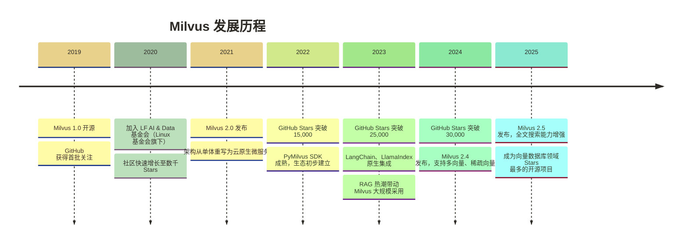
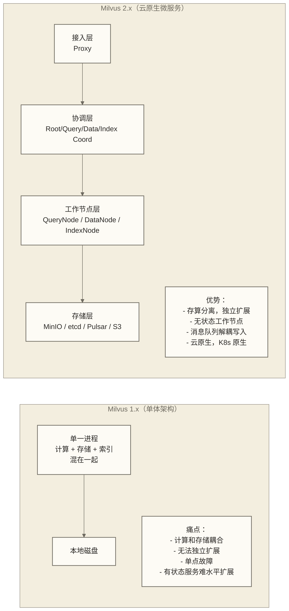
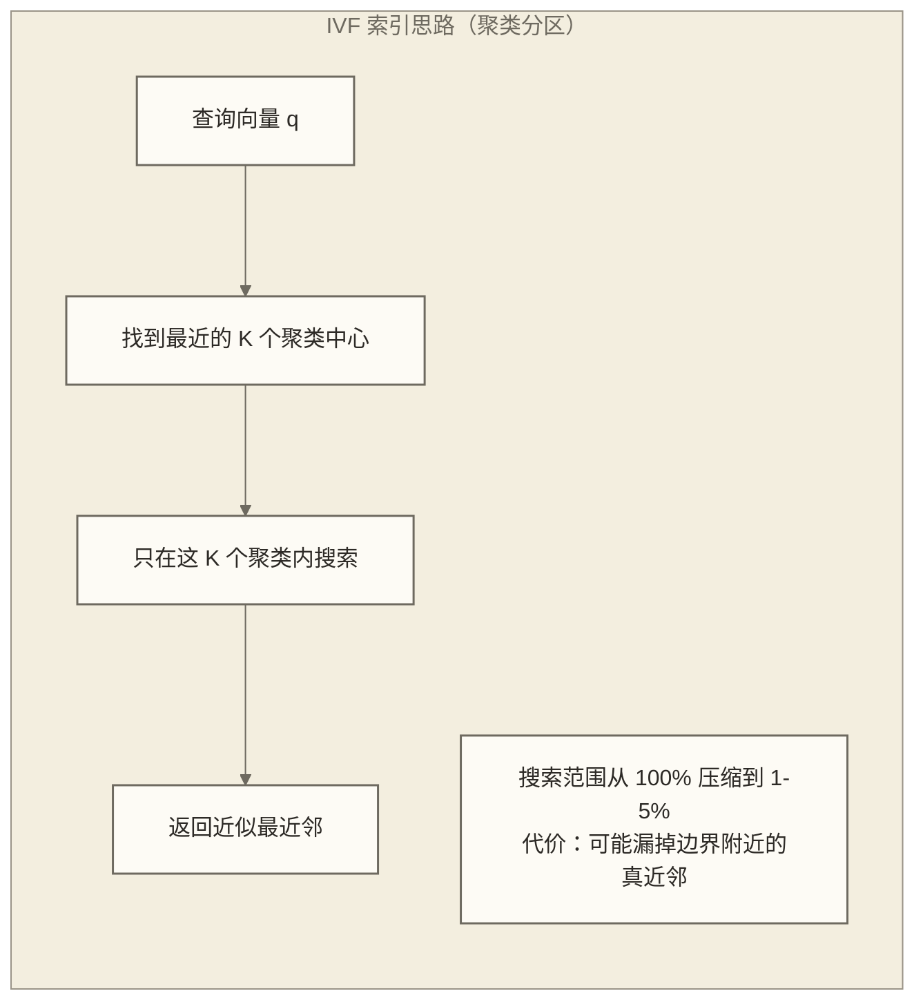
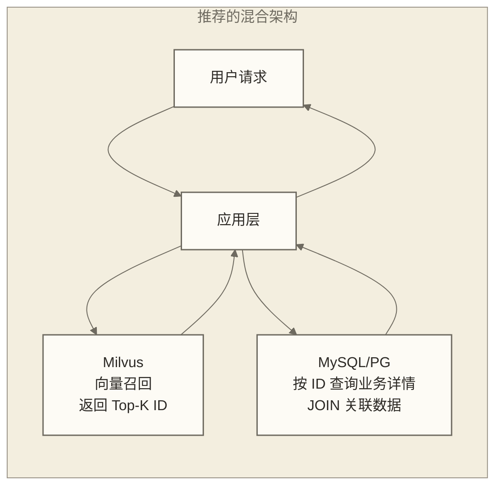
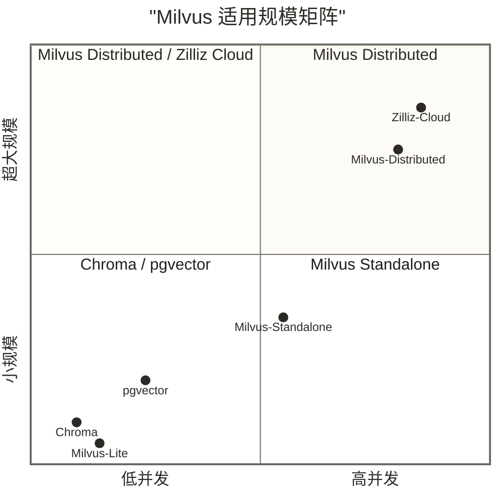
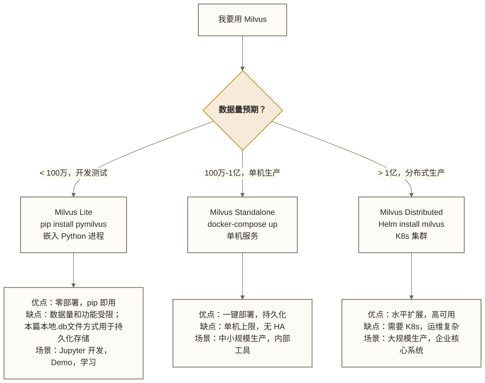

# Milvus 概述与核心定位

> [!abstract] 本篇概览
> - **学习目标**：理解 Milvus 的诞生背景、核心问题、能力边界和生态位置
> - **前置知识**：[[【AI 与大数据】/04-AI工程化/07-向量数据库与语义搜索]] 的基本概念，Python 基础
> - **预计时长**：60 分钟
> - **读完之后**：你能清楚回答"为什么用 Milvus 而不用 FAISS / pgvector / Pinecone"

---

## 目录

- [[#一个 2019 年的工程问题]]
- [[#FAISS 有什么不够用]]
- [[#Milvus 的诞生：从论文到 Linux 基金会]]
- [[#架构革命：从 1.x 到 2.x]]
- [[#向量搜索为什么难]]
- [[#为什么不能用传统数据库]]
- [[#ANN vs 精确搜索：工程上的核心取舍]]
- [[#Milvus 的核心能力边界]]
- [[#与竞品的本质差异：不是功能对比，是定位分析]]
- [[#Milvus 的三种形态]]
- [[#生态与集成全景]]
- [[#本篇小结]]

---

## 一个 2019 年的工程问题

假设一个以2019年为背景的图像相似搜索场景：工程团队需要处理1亿张图片的向量，每张图片是一个512维的浮点向量。这里将原文所述Zilliz客户经历作为教学假设，不将其视为已有来源支持的真实案例。

需求很清晰：给一张新图片，在 1 亿条记录里找出最相似的 10 张。

暴力做法是可以的——把新图片的向量和库里每条记录算一遍余弦相似度，排序取 Top 10。仅逐维点积就涉及约1亿 × 512 = 512亿次乘加，尚未计入归一化和Top-K选择；GPU上的实际耗时取决于硬件、计算精度、数据布局和访存条件，此处不提供未经测试的延迟结论。听起来还行？但这只是查询延迟，问题是：

**同时有 1000 个用户在查怎么办？**

若假设单次查询耗时50毫秒，1000个并发请求会增加计算与调度压力，但所需资源不一定增加1000倍，还取决于批处理、资源利用率、排队策略和延迟目标。数据量翻倍，计算量线性翻倍。这不是一个可以横向扩展解决的问题——你不能无限堆 GPU 服务器。

在这个假设场景中，团队使用的工具是FAISS。

---

## FAISS 有什么不够用

FAISS（Facebook AI Similarity Search）是 Meta 在 2017 年开源的向量搜索库，到今天仍然是向量搜索领域最重要的基础组件。它解决了核心算法问题：通过近似最近邻（ANN）算法减少需要比较的候选向量；实际查询复杂度取决于索引、数据分布、维度和搜索参数，不能统一视为 O(log N) 或更低。

FAISS 是优秀的。但它是一个**库**，不是一个**系统**。

> [!note] 库和系统的本质区别
> **库**：给你算法和数据结构，你调用它的函数。它不管你的数据怎么存、怎么更新、怎么扩展、怎么容错。
> **系统**：给你完整的服务能力。数据持久化、并发访问、分布式扩展、故障恢复——这些"工程问题"都由系统负责。

FAISS 在生产环境中面临的具体问题：

**数据持久化**：FAISS 的索引默认在内存里。进程重启，索引消失，需要重新加载和构建。对于 1 亿条数据，光是构建 HNSW 索引就需要几十分钟。

**动态更新需要额外工程支持**：FAISS的多种索引支持添加向量，但添加、删除及更新能力取决于索引类型。增量添加不等于完整的实时写入服务；并发控制、持久化、更新一致性及必要的重训练或重建仍需应用侧设计，部分场景也可采用补丁索引并合并查询结果。

**无水平扩展**：FAISS 是单机的。数据量超出单机内存或 CPU 能力，没有内置方案。

**无过滤能力**：现实中的搜索往往不是"全库搜索"，而是"在满足某些条件的子集里搜索"——比如"找和这篇文章相似的、发布时间在最近 30 天内的文章"。FAISS 不做标量过滤，你需要自己在外面套一层。

**无运维工具**：没有管理界面、没有监控指标、没有权限控制。在团队协作场景下，这些缺失是真实痛点。

一句话总结：FAISS 解决了"算法层"的问题，但工程师在生产环境面临的是"系统层"的问题。Milvus 就是为了填平这个鸿沟而生的。

---

## Milvus 的诞生：从论文到 Linux 基金会

2019 年 10 月，Milvus 1.0 在 GitHub 上开源。创始团队来自 Zilliz，公司总部在上海，由前百度工程师创立。

**里程碑时间线**：



> [!info] Linux 基金会背书意味着什么
> 加入 LF AI & Data Foundation（2020 年）是 Milvus 从"公司项目"变成"社区项目"的标志性事件。这意味着项目治理结构独立于 Zilliz 公司，有正式的 TSC（技术指导委员会），代码贡献者来自全球。对于企业用户，基金会治理是评估项目持续维护能力的一个信号，但不保证项目不会因公司或社区变化而停止更新。

**社区现状（2025 年数据）**：
- GitHub Stars：约 32,000+
- 代码贡献者：500+，来自全球 50+ 国家
- 生产用户：数千家企业，包括 Salesforce、eBay、Compass 等
- PyMilvus 周下载量：数十万次

---

## 架构革命：从 1.x 到 2.x

Milvus 1.x 和 2.x 的差异不是"版本升级"，而是**架构的彻底重写**。理解这个革命，是真正理解 Milvus 设计哲学的关键。



**存算分离**是 2.x 的核心设计决策。在 1.x 中，数据和计算绑定在同一个节点上——你想增加查询能力，必须同时增加存储；你想扩容存储，必须同时扩容计算。这在云环境中极其浪费。

2.x 把存储完全下沉到对象存储（MinIO 或 S3），计算节点变成无状态的——任意 QueryNode 可以加载任意 Segment，节点故障后可通过调度和数据加载在其他节点恢复服务，切换时间及查询影响取决于副本、资源和部署配置，不保证无缝切换。这是真正的云原生。

> [!warning] 1.x 的用户注意
> 如果你在某些旧教程里看到 `Milvus.connect()` 这样的单节点 API，那是 1.x 的用法。2.x 的 PyMilvus 接口有所不同。本系列所有文档基于 Milvus 2.x。

---

## 向量搜索为什么难

在讲 Milvus 能做什么之前，先讲清楚这个问题有多难。这决定了为什么你需要一个专门的系统，而不是"手写几行代码就搞定"。

### 暴力搜索的复杂度

最直接的向量相似搜索算法是 K-NN（K 近邻）：

```text
对于查询向量 q，遍历数据库中所有向量 v_i
计算 distance(q, v_i)（欧氏距离或余弦相似度）
使用距离度量时取距离最小的K个；使用余弦相似度时取相似度最大的K个
```

时间复杂度：**O(N × D)**

- N：向量数量
- D：向量维度

在 N = 1 亿、D = 1536（OpenAI text-embedding-3-small 的维度）的情况下：

每次查询需要 **1亿 × 1536 = 1536 亿次**浮点乘法。

不能仅用A100的某项理论峰值算力推导本次查询延迟：峰值指标有计算精度和运算模式等适用条件，点积还包含累加，实际查询也受数据加载、内存带宽、Top-K选择和并发调度影响。此处未提供测试条件与结果，因此不作毫秒级延迟或额外开销倍数的结论。

### 高维空间的诅咒

还有一个更深层的数学问题：**维度灾难**（Curse of Dimensionality）。

在低维空间（比如 2D、3D），"距离"这个概念很直观，最近邻也很好找。但当维度增加到几百、几千时，一个奇怪的现象出现了：**所有点之间的距离变得"差不多"**。

想象一个 1000 维的超球体。在这个空间里，随机取两个点，它们的距离几乎总是集中在一个很窄的范围内。这意味着"最近邻"和"随机邻"之间的差异变得极小，传统基于"近的点应该聚在一起"的空间索引（B 树、R 树）完全失效。

这就是为什么向量搜索需要**专门设计的索引结构**，而不能简单复用传统数据库的索引。

---

## 为什么不能用传统数据库

一个很自然的问题：既然 PostgreSQL 有 pgvector 插件，为什么还需要 Milvus？

这个问题问得好，答案不是“pgvector不行”。pgvector与Milvus都可使用HNSW等向量索引，选型差异主要涉及系统架构、扩展方式、业务数据关联和运维需求，适用规模不能仅由索引名称决定。

**传统数据库的索引逻辑**：

B 树索引在有序数据上工作得极好——查找一个确定的值，或范围查询。原理是把数据按照某种顺序组织，使得查找时可以二分跳转，复杂度 O(log N)。但这个"顺序"只在低维空间有意义。把 1536 维向量按照某个维度排序，对其他维度的查询毫无帮助。

**专用向量索引的设计**：

向量索引（IVF、HNSW 等）的核心思路是**近似**：我不保证找到精确的最近邻，但我能以高概率找到"足够近"的答案，同时把搜索范围从全量数据压缩到一个小子集。



这个权衡在百万、亿级数据下是值得的。但它带来了 pgvector 面临的真实局限：

| 维度                 | pgvector     | Milvus      |
| ------------------ | ------------ | ----------- |
| 1000 万向量查询延迟（HNSW） | ~10-50ms     | ~1-5ms      |
| 1 亿向量支持            | 困难（内存压力大）    | 设计目标        |
| 水平扩展               | 依赖 PG 分区（复杂） | 原生分布式       |
| 并发写入吞吐             | 受 PG WAL 限制  | 消息队列解耦，吞吐高  |
| 运维统一性              | 和现有 PG 栈统一   | 独立部署，额外运维成本 |

> [!tip] 什么时候选 pgvector？
> 如果你已经有 PostgreSQL 技术栈，数据量在 5000 万以内，团队没有人力维护独立的向量数据库——pgvector 是完全合理的选择。不要为了"技术先进"而增加不必要的复杂度。

---

## ANN vs 精确搜索：工程上的核心取舍

ANN（Approximate Nearest Neighbor，近似最近邻）是向量搜索领域最重要的工程概念。理解它，才能理解 Milvus 的所有参数调优逻辑。

**核心取舍**：

| 方案 | 召回率 | 查询延迟 | 内存/磁盘 |
|------|--------|---------|----------|
| 精确搜索（暴力） | 100% | 极慢（O(N×D)） | 原始向量 |
| ANN（HNSW） | 95-99% | 极快（O(log N)） | 原始向量 × 1.5-2x |
| ANN（IVF_PQ） | 85-95% | 快 | 压缩向量，节省 4-16x |

**召回率（Recall）**：ANN 返回的结果中，有多少是真正的"精确最近邻"。99% 的召回率意味着如果精确答案是 [A, B, C, D, E]，ANN 结果里有 4.95 个平均是正确的。

可以用一个教学假设理解取舍：若某项实测在Recall@K为99%时获得100—1000倍提速，且业务能够接受遗漏近邻，那么采用ANN可能是划算的选择。这些数字不是本文已验证的普遍结论，也不能把召回率直接等同于业务准确率；是否够用需结合任务指标判断。

真正需要精确搜索的场景极少：比如法律文书中的精确引用检索、金融合规中的精确匹配。这些场景通常数据量也不大，可以用暴力搜索解决。

> [!note] 为什么你不需要纠结这个取舍
> 在 Milvus 里，你通过调整 `nprobe`（IVF）或 `ef`（HNSW）参数来控制精度/速度的平衡。这不是一次性的架构决策，而是运行时可调的参数。你可以根据实际业务反馈随时调整，不需要重建索引。

---

## Milvus 的核心能力边界

理解一个工具，既要知道它能做什么，也要知道它不做什么。Milvus 的设计目标非常清晰，它不试图成为"万能数据库"。

### 能做什么

**向量存储与管理**：支持 Float、Float16、BFloat16、Binary、Sparse Float 等多种向量类型，维度上限 32,768。支持批量写入（每秒数十万条）和实时插入。

**ANN 向量搜索**：提供 IVF 家族、HNSW、DiskANN、ScaNN 等多种索引，支持余弦相似度、欧氏距离、内积等距离度量。

**混合过滤搜索**：在向量搜索的同时，支持对标量字段（字符串、数字、布尔值、日期）进行过滤。比如"找和这份文档相似的、category='finance'、created_at > '2024-01-01'的文档"。

**多向量搜索**：同一条记录可以存多个向量（比如同时存标题向量和正文向量），搜索时可以多路召回并通过 RRF（倒数排名融合）合并。

**分布式水平扩展**：数据按 Shard 分布到多个 DataNode，查询并发分发到多个 QueryNode。理论上可以扩展到数百节点。

**全文搜索（2.5+）**：Milvus 2.5 引入了基于 BM25 的全文搜索能力，可以和向量搜索做混合检索（Hybrid Search）。

### 不做什么

> [!warning] Milvus 的能力边界
> 以下这些是 Milvus **有意不做**的事情，不是 Bug，是设计决策：
>
> - **不支持 JOIN**：没有多表关联查询。如果你的向量检索结果需要和其他业务数据 JOIN，在应用层处理，或用 Milvus 做召回、用传统数据库做 JOIN。
> - **不做复杂事务**：没有 ACID 事务语义。不适合做金融流水、订单系统。
> - **不是 OLAP 数据库**：没有聚合分析、GROUP BY、复杂 SQL。不能替代 ClickHouse 做数据分析。
> - **无关系型存储能力**：标量字段只用于过滤，不能做复杂的关系型查询。

**推荐的架构模式**：Milvus 负责向量召回，传统数据库（MySQL、PostgreSQL）负责业务数据存储和 JOIN，两者通过主键关联。



**数据规模参考图**：



---

## 与竞品的本质差异：不是功能对比，是定位分析

以下对比不试图说"Milvus 比 X 强"，而是分析每对关系的**定位差异**——找到你真正关心的维度。

### vs FAISS：库 vs 数据库系统

FAISS 是 Milvus 最重要的技术底座之一——Milvus 在内部使用了 FAISS 的索引算法。两者是**上下游关系**，不是替代关系。

如果你的场景是：Python 脚本，数据在内存里，只需要算相似度，不需要持久化——用 FAISS 就够了，轻量直接。

如果你的场景是：服务化部署，数据需要持久化，多用户并发访问，有动态写入——你需要 Milvus 这样的系统。

### vs Pinecone：开源自部署 vs 全托管云服务

这是最常见的选型对比。本质上是**控制权 vs 便利性**的取舍：

| 维度 | Milvus（自部署） | Pinecone（托管） |
|------|----------------|----------------|
| 部署成本 | 需要运维团队 | 零运维 |
| 数据控制 | 完全自主 | 数据在 Pinecone 服务器 |
| 定制能力 | 源码可改，配置可调 | 有限的参数配置 |
| 月费用（亿级数据） | 服务器成本（可优化） | $$$（按用量计费） |
| 供应商锁定 | 无 | 有 |

> [!tip] 决策框架
> - 数据安全要求高（金融、医疗、政府）→ Milvus 自部署
> - 团队没有运维能力且预算充足 → Pinecone 或 Zilliz Cloud
> - 想要 Milvus 能力但不想运维 → Zilliz Cloud（Milvus 的全托管版）

### vs Qdrant：工程选型的哲学差异

Qdrant 用 Rust 编写，Milvus 用 Go + C++。这个技术栈差异背后是不同的工程哲学。

Qdrant 的核心优势：
- Rust 带来的内存安全和极低的资源占用
- 更简洁的部署（单二进制文件）
- 出色的 Payload（标量字段）过滤性能
- 更适合中等规模（千万到十亿级）

Milvus 的核心优势：
- 更成熟的分布式架构（存算分离、消息队列）
- 更丰富的索引类型（特别是 DiskANN 磁盘索引）
- 更大规模的生产验证（亿级到百亿级）
- 更活跃的中文社区和企业支持

在规模没到十亿以上、团队技术栈以 Python 为主的情况下，Qdrant 和 Milvus 都是合理选择，差异并不明显。**Milvus 在超大规模场景的工程成熟度上有明显优势。**

### vs Weaviate：纯向量引擎 vs AI-Native

Weaviate 的定位更接近"AI 原生数据库"——它内置了模块系统，可以直接挂载 Embedding 模型，连向量化都不用在外面做。它的查询语言是 GraphQL，面向的是需要"开箱即用 AI 能力"的用户。

Milvus 的定位是"向量搜索基础设施"——它不管 Embedding 怎么生成，只负责高效存储和搜索。这给了应用开发者更大的灵活性，但也意味着更多的集成工作。

**选 Weaviate 的场景**：需要快速上线一个 AI 应用，向量化、存储、搜索一套搞定，不想处理 Embedding 管线。
**选 Milvus 的场景**：已有 Embedding 生成流程，需要高性能向量搜索基础设施，对存储架构有控制需求。

### vs pgvector：专业工具 vs 通用扩展

pgvector 的最大优势是**"零增量运维成本"**——如果你已经在用 PostgreSQL，pgvector 只是一个 `CREATE EXTENSION vector` 就能用的能力。

在数据量 1000 万以内、并发不高的场景下，pgvector + HNSW 的性能完全够用，而且你可以直接和业务数据 JOIN，这是 Milvus 做不到的。

Milvus 的优势在 **"规模边界"** 之后开始显现：当数据量超过 5000 万、查询并发超过 100 QPS 时，pgvector 的性能压力会变得明显，而 Milvus 的分布式架构才真正发挥价值。

---

## Milvus 的三种形态

这是非常重要的实操知识。根据部署形态的不同，你的安装方式、资源需求、适用场景都完全不同。



### Milvus Lite

2023 年推出的轻量形态，是 pymilvus 2.4+ 内置的能力：

```python
from pymilvus import MilvusClient

# 就这一行，不需要任何服务器
client = MilvusClient("./milvus_demo.db")
```

数据存储在本地 SQLite 文件（底层基于 Milvus 的轻量实现）。适合：
- 在 Jupyter Notebook 里学习和验证
- 本地开发调试，不想启动 Docker
- RAG 原型项目的快速起步

**限制**：单进程，不支持多线程并发访问；数据量建议不超过 200 万；不支持所有 Milvus 功能（部分高级 API 不可用）。

### Milvus Standalone

生产级单机部署，通过 docker-compose 启动：

```yaml
# docker-compose.yml（简化版）
version: '3.5'
services:
  etcd:       # 元数据存储
  minio:      # 对象存储
  standalone: # Milvus 主进程
    image: milvusdb/milvus:v2.5.0
    ports:
      - "19530:19530"  # gRPC 端口
      - "9091:9091"    # HTTP 端口
```

适合大多数企业内部应用场景。单机资源需求：
- 最低：4 核 CPU，8GB 内存
- 推荐：8 核 CPU，16GB 内存，SSD 存储
- 能支撑约 1 亿向量（取决于维度和索引类型）

### Milvus Distributed

Kubernetes 上的完整分布式部署，通过 Helm Chart 安装：

```bash
helm repo add milvus https://zilliztech.github.io/milvus-helm/
helm install milvus milvus/milvus --set cluster.enabled=true
```

核心组件：
- **Proxy**：接入层，负载均衡
- **RootCoord**：全局元数据协调
- **QueryCoord / QueryNode**：查询调度和执行
- **DataCoord / DataNode**：数据写入调度和执行
- **IndexCoord / IndexNode**：索引构建调度和执行
- **MinIO / S3**：底层对象存储（Segment 数据）
- **etcd**：元数据存储（集群状态）
- **Pulsar / Kafka**：消息队列（写入 WAL）

每个组件可以独立扩缩容。这是 Milvus 2.x 最重要的设计优势——QueryNode 可以从 2 个扩到 20 个而不影响写入，DataNode 可以独立扩容而不影响查询。

---

## 生态与集成全景

Milvus 的生态在 2023-2025 年随着 RAG 热潮快速成熟。

### AI/ML 框架集成

**LangChain**：原生支持 Milvus 作为 VectorStore，是 RAG 应用中最常见的集成方式。

```python
from langchain_community.vectorstores import Milvus

vectorstore = Milvus(
    embedding_function=embeddings,
    collection_name="my_collection",
    connection_args={"host": "localhost", "port": "19530"}
)
```

**LlamaIndex**：同样原生支持，提供更细粒度的索引控制和多种 Retriever 策略。

**DSPy**：支持 Milvus 作为 Retriever，适合需要自动优化 Prompt 的 RAG 系统。

**Haystack**：支持 MilvusDocumentStore，适合生产级问答系统。

### 管理工具

**Attu**：Milvus 的官方图形界面，Web UI，支持：
- 集合管理（创建、删除、查看统计）
- 数据浏览和查询
- 索引监控
- 系统资源监控

```bash
docker run -p 3000:3000 zilliz/attu:latest
```

**Milvus CLI**：命令行工具，适合脚本化管理。

### 全托管选项：Zilliz Cloud

如果你想要 Milvus 的全部能力，但不想处理运维，Zilliz Cloud 是官方提供的全托管版本：

- 可使用pymilvus SDK访问，但具体API、索引和功能支持需按云服务形态及版本确认，不能仅凭使用同一SDK认定完全兼容
- 提供 Serverless 形态（按使用量计费，适合间歇性负载）
- 内置监控、备份、自动扩缩容
- 有免费套餐，适合学习和小规模验证

```python
from pymilvus import MilvusClient

# 连接Zilliz Cloud的接口示意；已有数据迁移、索引配置和功能适配不包含在此示例中
client = MilvusClient(
    uri="https://xxx.api.gcp-us-west1.zillizcloud.com",
    token="your_api_key"
)
```

### Embedding 模型集成

Milvus 本身不生成 Embedding，但与所有主流 Embedding 方案无缝配合：

| Embedding 方案 | 典型维度 | 适用场景 |
|--------------|---------|---------|
| OpenAI text-embedding-3-small | 1536 | 通用文本，性价比高 |
| OpenAI text-embedding-3-large | 3072 | 高精度文本，成本较高 |
| BGE-M3（开源） | 1024 | 中英文双语，开源可本地部署 |
| CLIP（开源） | 512 | 图文跨模态搜索 |
| E5 / GTE 系列（开源） | 768-1024 | 通用文本，开源 |

> [!tip] 选 Embedding 模型的原则
> 先看任务类型（文本/图片/代码），再看语言（中文还是英文），最后看是否需要本地部署（数据安全要求）。维度不是越高越好——更高的维度意味着更多的内存占用和更慢的索引构建，需要和召回率提升做平衡。

---

## 本篇小结

> [!success] 核心要点回顾
>
> 1. **Milvus 的诞生动机**：FAISS 解决了算法问题，Milvus 解决了工程问题——持久化、动态更新、分布式扩展、并发访问。
>
> 2. **为什么需要专用向量数据库**：高维向量的搜索无法复用传统 B 树索引，ANN算法是大规模向量搜索的常用工程方案；是否采用ANN仍需结合精确性要求、数据规模、硬件和延迟目标判断。
>
> 3. **Milvus 的能力边界**：擅长向量存储和 ANN 搜索，不做 JOIN、不做 ACID 事务、不做复杂 OLAP 分析。要和传统数据库搭配使用。
>
> 4. **竞品定位差异**：
>    - vs FAISS：上下游关系，不是替代
>    - vs Pinecone：自部署控制权 vs 托管便利性
>    - vs Qdrant：超大规模优势 vs 中等规模简洁
>    - vs pgvector：专业工具 vs 通用扩展（量级是关键）
>
> 5. **三种形态按需选择**：Lite（开发）→ Standalone（单机生产）→ Distributed（大规模生产）

**下一步**：读完本篇你有了 Milvus 的"地图"，下一篇 [[【技术与工具】/向量数据库/Milvus/02-Milvus架构深度解析]] 会深入到技术内部，解析四层架构的设计逻辑和各组件的职责。

---

**相关文档**：
- [[【技术与工具】/向量数据库/Milvus/00-Milvus学习路线图]] — 回到全局导航
- [[【技术与工具】/向量数据库/Milvus/02-Milvus架构深度解析]] — 下一篇：架构内部解析
- [[【技术与工具】/向量数据库/00-向量数据库选型指南]] — 跨产品选型决策框架
- [[【AI 与大数据】/04-AI工程化/07-向量数据库与语义搜索]] — 向量搜索基础原理
- [[【AI 与大数据】/04-AI工程化/08-向量数据库与RAG工程实践]] — RAG 工程实战

---

**创建时间**：2026-03-11
**文档版本**：基于 Milvus 2.5.x
**字数**：约 5000 字

#Milvus #向量数据库 #ANN搜索 #RAG #AI工程 #云原生 #分布式系统
