# Milvus 架构深度解析

> [!quote] 写在前面
> 理解一个系统的架构，不是记住它有哪些组件，而是搞清楚**它为什么这样设计**——哪些是被迫的权衡，哪些是深思熟虑的取舍。这篇文档会带你从设计哲学出发，一路拆解到每个组件的内部工作机制。读完之后，当你遇到 Milvus 的任何线上问题，应该能本能地知道去哪里找答案。

## 目录

- [[#一、设计哲学：先搞清楚为什么]]
- [[#二、四层架构总览]]
- [[#三、接入层（Access Layer）：所有请求的门卫]]
- [[#四、协调层（Coordinator Service）：大脑与神经中枢]]
- [[#五、工作节点（Worker Nodes）：真正干活的人]]
- [[#六、存储层（Storage Layer）：记忆的根基]]
- [[#七、写入路径深度解析]]
- [[#八、查询路径深度解析]]
- [[#九、索引构建路径]]
- [[#十、一致性模型与 TSO 机制]]
- [[#十一、高可用与容错设计]]
- [[#十二、Milvus 1.x vs 2.x 架构演进]]
- [[#十三、架构总结：设计决策一览]]

---

## 一、设计哲学：先搞清楚为什么

在看任何架构图之前，先回答三个问题。这三个问题的答案，决定了 Milvus 2.x 的所有设计选择。

### 1.1 为什么必须存算分离？

先说传统数据库怎么做。MySQL、PostgreSQL 这类系统，计算和存储是绑定在一起的。一台机器既运行查询引擎，也存储数据文件。这个设计有个隐含假设：**数据量和计算量的增长是同步的**。

但向量数据库面对的现实完全不同：

**场景一：写入洪峰。** 你在做批量导入，一次性插入 1 亿条向量。这需要大量计算资源（向量编码、写入缓冲）。导入结束后，计算需求骤降 90%，但数据还在那里，存储需求不变。

**场景二：索引构建。** 刚写入的数据需要构建 HNSW 或 IVF 索引，这是 CPU 密集型操作，可能需要几十个核心跑几小时。构建完之后，这些计算资源就闲置了。

**场景三：查询峰值。** 白天业务高峰期，查询 QPS 可能是夜间的 100 倍。如果存算耦合，你要么在夜间浪费大量计算资源，要么在白天因计算不足而延迟升高。

存算分离的核心价值是：**让计算资源和存储资源独立扩缩**。需要更多算力时，加 Query Node，不动存储。需要更多容量时，扩对象存储，不影响计算层。在云环境下，这直接转化为成本效益。

> [!note] 类比：饭店的外卖模式
> 传统存算耦合就像"只有堂食"的饭店——厨房（计算）和桌位（存储）绑定，来多少客人用多少桌，来少了桌子就空着。存算分离就像外卖平台——厨房（计算节点）和仓库（对象存储）分开，旺季多雇厨师，淡季减少厨师，仓库里的食材不受影响。

### 1.2 云原生意味着什么？无状态节点的设计价值

"云原生"不是一个营销词汇。在 Milvus 的架构里，它意味着一个非常具体的工程原则：**计算节点是无状态的（Stateless）**。

这里的无状态指计算节点不承担不可恢复持久状态的唯一副本。Query Node 故障后，可在持久化数据、元数据和调度机制可用的条件下重建运行状态；“几秒到几十秒”只能作为恢复时间的讨论假设，实际恢复时间、数据完整性与是否需要人工介入取决于数据重加载、可用容量和依赖系统状态。

为什么能做到？因为真正的"状态"（数据、元数据、日志）全部存在外部系统里：
- 业务数据 → 对象存储（S3/MinIO），永久持久化
- 消息日志 → 消息队列（Pulsar/Kafka），持久化且可回放
- 元数据 → etcd，强一致性键值存储
- 节点自身 → 可保存运行时缓存、缓冲和本地临时文件，但不应作为不可恢复持久状态的唯一副本；重启后仍需重建运行状态

这个设计让 Kubernetes 的自愈能力得以充分发挥。K8s 检测到节点崩溃 → 自动重启 Pod → 新 Pod 从对象存储加载数据 → 恢复服务。在依赖系统正常、资源充足且自动恢复配置有效时，这一过程可自动完成；持续失败或依赖系统故障仍可能需要人工运维介入。

> [!tip] 无状态节点的工程价值
> - **滚动升级的可用性基础**：逐个替换节点有助于降低中断风险，但零停机取决于版本兼容性、冗余容量和流量切换机制
> - **水平扩缩的工程基础**：持久化存储与计算解耦，但扩缩容仍可能涉及 Segment 重分配、数据重加载和缓存预热
> - **自动恢复降低人工负担**：K8s 可处理部分节点故障，但不能替代告警、值班和对依赖系统故障的处置

### 1.3 为什么用 Go + C++ 双语言？

这不是"为了用而用"，而是两种语言各自解决了一类问题。

**C++：性能敏感路径**

向量计算、索引构建（HNSW、IVF、DiskANN）、SIMD 指令优化——这些都在 C++ 层完成。C++ 的优势是：
- 直接操控内存布局，零开销抽象
- 可以精准使用 AVX2/AVX-512 等 SIMD 指令加速向量运算
- 没有 GC 停顿，延迟可预测

Milvus 底层的向量索引库是 **Knowhere**，纯 C++ 实现，封装了 FAISS、hnswlib、DiskANN 等算法，并做了大量针对现代 CPU 架构的优化。

**Go：服务治理路径**

Coordinator 的调度逻辑、gRPC 服务端点、节点之间的通信协议、etcd 的交互——这些都在 Go 层完成。Go 的优势是：
- 原生并发（goroutine），处理大量并发连接代价极低
- 编译速度快，编写分布式系统代码简洁
- GC 虽然存在，但对于控制面（不在查询热路径上）完全可以接受

**两层架构的边界**

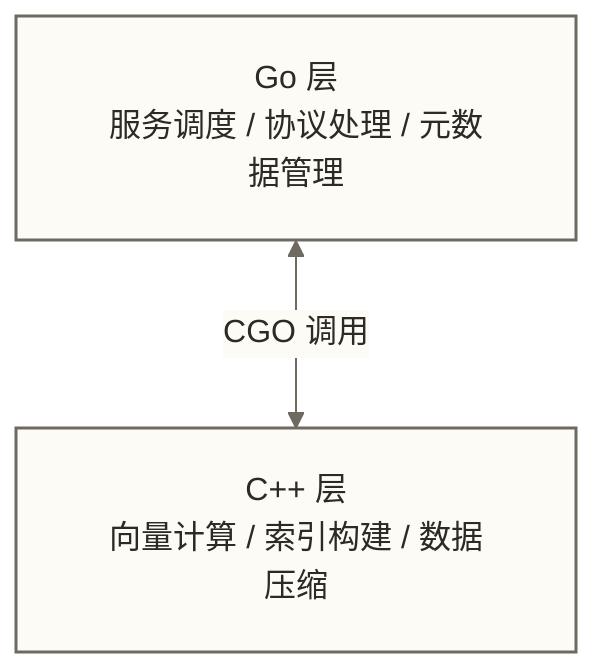

CGO 的调用开销存在，但 Milvus 刻意将 CGO 边界设计成批量操作（一次调用处理一个向量批次，而不是逐条调用），将跨语言开销摊薄到可忽略的程度。

---

## 二、四层架构总览

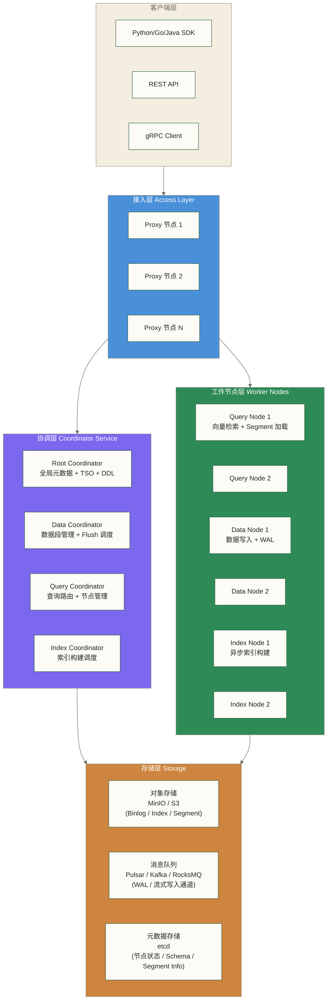

> [!note] 四层的职责边界
> - **接入层**：协议转换、鉴权、请求路由——不存任何业务数据
> - **协调层**：全局调度决策——只存元数据，不碰业务数据
> - **工作节点层**：真正的计算执行——CPU/内存密集型操作
> - **存储层**：所有持久化状态——计算层崩溃，数据一条不丢

---

## 三、接入层（Access Layer）：所有请求的门卫

### 3.1 Proxy 的核心职责

Proxy 是 Milvus 集群对外暴露的唯一入口。每一个来自 SDK 或 REST API 的请求，都必须经过 Proxy。它的工作可以归纳为四件事：

**职责一：协议转换与路由**

外部请求可以是 gRPC 或 HTTP/REST 格式。Proxy 统一解析后，转换成内部 protobuf 格式，然后根据请求类型路由到不同目标：
- DDL 操作（建表、删表）→ Root Coordinator
- 写入操作（Insert/Delete）→ 消息队列（绕过 Data Coordinator，直接发消息）
- 查询操作（Search/Query）→ Query Coordinator → Query Node

**职责二：负载均衡**

多个 Proxy 节点之间通过 etcd 注册服务，客户端 SDK 通过 etcd 发现可用的 Proxy 列表，并做客户端侧的负载均衡（Round-Robin 或随机）。

**职责三：结果聚合**

对于分片查询（Collection 有多个 Shard），Proxy 会并行向多个 Query Node 发出子查询请求，然后将返回的多组 Top-K 结果做**归并排序（K-way merge）**，返回最终的全局 Top-K。

**职责四：参数校验与权限检查**

- 校验请求字段是否合法（向量维度是否匹配 Collection Schema）
- Token 鉴权（Milvus 2.x 支持基于 Token 的认证）
- 限流（防止单客户端打爆集群）

### 3.2 Proxy 如何做到无状态？

Proxy 无状态的关键是：**它不缓存任何业务数据，只缓存轻量的元数据**。

当一个 Search 请求到来，Proxy 需要知道这个 Collection 有几个 Shard，分别在哪些 Query Node 上。这个信息会在本地缓存（内存中），但它的数据源是 etcd 和 Root Coordinator。如果 Proxy 重启，重新从 etcd 拉取元数据，几秒内就恢复工作能力。

| 类别 | 内容 |
|------|------|
| **Proxy 本地缓存的内容** | Collection Schema（字段定义、分片数） |
| | Shard → Query Node 的路由表 |
| | 当前 TSO（时间戳，用于一致性） |
| **Proxy 绝对不缓存的内容** | 向量数据 |
| | Segment 文件 |
| | 任何业务数据 |

### 3.3 gRPC + REST 双协议

- **gRPC**：官方 SDK（Python、Go、Java、Node.js）默认使用 gRPC。优势是性能高（HTTP/2 多路复用、protobuf 序列化体积小），劣势是需要生成代码、调试不直观。
- **REST**：通过 Milvus RESTful API 暴露，底层由一个 HTTP 服务转发到内部 gRPC。适合快速测试、与不支持 gRPC 的系统集成（如 curl 调试、非官方语言客户端）。

> [!tip] 生产环境建议
> 生产环境始终用 gRPC SDK，延迟更低、序列化开销更小。REST API 留给运维调试和一次性脚本使用。

---

## 四、协调层（Coordinator Service）：大脑与神经中枢

协调层是 Milvus 架构中最精妙、也最容易被忽视的部分。它由四个 Coordinator 组成，每个都只负责一块高度聚焦的全局调度职责。

### 4.1 Root Coordinator（RC）：全局秩序的维护者

Root Coordinator 是整个集群的"全局大脑"，负责三件最重要的事情：

**职责一：DDL 操作（数据定义）**

所有改变集群结构的操作都由 RC 处理：
- `create_collection` / `drop_collection`
- `create_partition` / `drop_partition`
- `create_index` / `drop_index`

RC 将这些元数据持久化到 etcd，确保所有节点看到一致的 Schema 视图。

**职责二：全局唯一 ID 分配**

每个 Collection、Partition、Segment 都需要全局唯一的 ID。RC 维护一个单调递增的 ID 生成器，通过批量预分配（每次申请一批 ID，用完再申请）来降低与 etcd 的交互频率。

**职责三：TSO（Timestamp Oracle，时间戳服务）**

这是 RC 最关键、也最巧妙的职责。TSO 为整个集群提供全局单调递增的时间戳，是 Milvus 一致性模型的核心基础设施。

> [!note] TSO 的工作原理
> TSO 不是简单地返回当前系统时间（那会有时钟漂移问题）。RC 维护一个逻辑时钟，每次 Proxy 发起写入请求时，都会向 RC 申请一个时间戳。RC 保证返回的时间戳是严格单调递增的，不受任何节点时钟偏差影响。
>
> 类比：TSO 就像银行柜台的"取号机"。每个客户来了都取一个号，号码严格递增，不管你几点来、用哪台机器取，号码序列永远不乱。

### 4.2 Data Coordinator（DC）：数据段的生命周期管家

Data Coordinator 管理数据的物理组织形式——Segment（数据段）。

**核心职责：**

- 追踪所有 Segment 的状态（Growing / Sealed / Flushed / Indexed）
- 决定何时触发 Segment 的 Flush（将内存数据写入对象存储）
- 在多个 Data Node 之间做数据均衡（防止某个节点数据偏斜）
- 接收来自 Data Node 的心跳和统计信息

**Flush 触发策略：**

DC 有两个 Flush 触发条件，满足任意一个即触发：

| 触发条件 | 默认阈值 | 说明 |
|---------|---------|------|
| Segment 大小阈值 | 512MB | Growing Segment 累积数据超过阈值，转为 Sealed |
| 时间阈值 | 600 秒 | 超过 10 分钟未 Flush 的 Segment，强制触发 |

> [!warning] Flush 阈值的调优影响
> - 阈值太小：Segment 文件碎片化严重，查询时需要扫描更多文件，性能下降
> - 阈值太大：内存占用高，崩溃恢复时需要回放更多 WAL 日志，恢复时间长
> - 生产建议：保持默认值，除非有明确的性能测试数据支撑调整

### 4.3 Query Coordinator（QC）：查询流量的调度中心

Query Coordinator 负责管理查询路径的全局状态：

**节点注册与健康管理：**
所有 Query Node 启动时向 QC 注册，QC 通过心跳机制持续监控节点健康。节点超时未心跳 → 被标记为不可用 → 其负责的 Segment 被重新分配给其他健康节点。

**Segment 加载调度：**
QC 决定哪些 Indexed Segment 应该被加载到哪个 Query Node 的内存中。调度依据包括：
- Query Node 的内存剩余容量
- 当前负载（CPU 使用率、QPS）
- Segment 的访问热度（热数据优先常驻内存）

**查询路由：**
当 Proxy 的 Search 请求到来，QC 返回路由表：这个 Collection 的哪些 Segment 在哪些 Query Node 上，Proxy 据此并行发出子查询。

### 4.4 Index Coordinator（IC）：索引构建的任务调度器

Index Coordinator 负责异步索引构建的任务调度：

- 监听 Data Coordinator 发出的"Segment 已 Seal"事件
- 为该 Segment 分配一个 Index Node 执行索引构建任务
- 追踪索引构建进度，处理失败重试
- 构建完成后，将索引文件位置信息更新到 etcd

IC 自身不参与任何数据操作，只做任务调度。这种设计将索引构建与读写执行分离；所有 Index Node 宕机时，已有可用数据和索引的读写路径不必同步等待索引构建，但新索引任务会停滞，待索引数据积压可能影响后续查询性能和资源使用。

### 4.5 一次查询的全链路时序（Coordinator 视角）

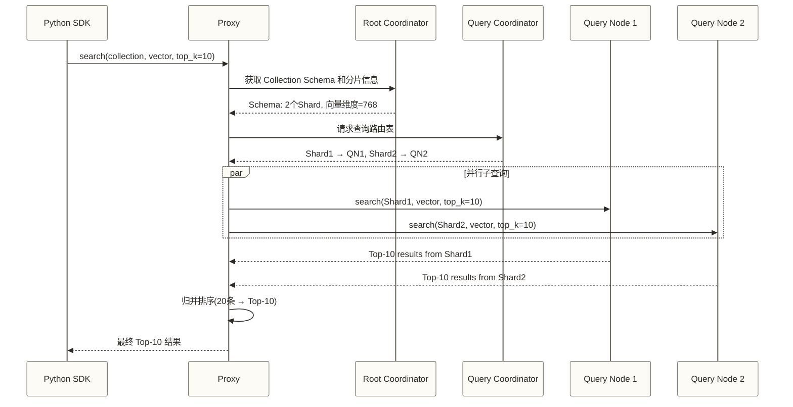

---

## 五、工作节点（Worker Nodes）：真正干活的人

### 5.1 Query Node：检索引擎的执行者

Query Node 是向量相似度搜索的执行单元，也是整个集群中内存消耗最大的组件。

**Query Node 的内存中存放什么？**

| 内存区域 | 说明 |
|---------|------|
| **Growing Segments**（正在写入、尚未 Seal） | 原始向量 + 标量字段，无索引，暴力扫描 |
| **Sealed + Indexed Segments**（已构建索引的历史数据） | HNSW/IVF 索引结构，支持高效 ANN 搜索 |
| **临时缓冲区** | Search 结果的工作区 |

**为什么同时维护两类 Segment？**

这是 Milvus 处理"新写入数据立即可查"需求的关键设计：
- **Indexed Segment**：已构建索引，搜索极快，但构建索引需要时间
- **Growing Segment**：刚写入的数据，没有索引，但可以立即参与查询（代价是暴力扫描，慢但准确）

每次 Search 请求，Query Node 同时搜索这两类 Segment，结果合并后返回。这保证了写入后的数据在几秒内就能被搜索到，同时不牺牲历史数据的搜索性能。

**横向扩展策略：**

当查询 QPS 超过单个 Query Node 的处理能力：
1. 增加 Query Node 副本
2. Query Coordinator 自动将部分 Segment 从负载高的节点迁移到新节点
3. 迁移过程中，旧节点继续服务（不停机），迁移完成后更新路由表

### 5.2 Data Node：写入流水线的终点站

Data Node 负责接收来自消息队列的写入数据，并最终持久化到对象存储。

**Data Node 的核心工作循环：**

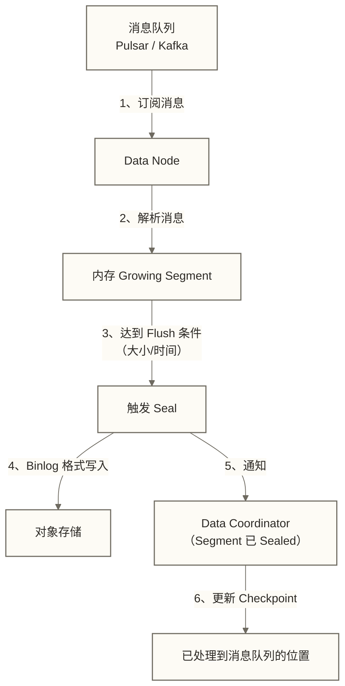

**WAL 的崩溃恢复机制：**

Data Node 的 WAL（Write-Ahead Log）就是消息队列本身。Pulsar/Kafka 的消息是持久化的，Data Node 维护一个 Checkpoint（已消费到哪条消息）。如果 Data Node 崩溃：
1. K8s 重启一个新的 Data Node
2. 新节点从 etcd 读取上次的 Checkpoint 位置
3. 从 Checkpoint 开始重放消息队列中的消息
4. 重建内存中的 Growing Segment 状态
5. 恢复正常工作

> [!note] 消息队列就是 WAL
> 这是 Milvus 架构最巧妙的地方之一：它没有自己维护一套 WAL 文件，而是直接把分布式消息队列当作 WAL 来用。消息队列的持久化保证 + 可回放特性，完美覆盖了 WAL 的所有需求，还额外获得了多消费者的能力（Data Node 和 Query Node 可以同时订阅同一个 Topic）。

### 5.3 Index Node：独立的索引工厂

Index Node 是一个纯粹的"工厂"：给它一批 Sealed Segment 数据，它输出索引文件，仅此而已。

**Index Node 工作流程：**

1. 向 Index Coordinator 拉取待构建的索引任务
2. 从对象存储下载对应的 Segment 数据（Binlog 格式）
3. 在本地内存/磁盘中执行索引构建算法（HNSW、IVF_FLAT、IVF_PQ 等）
4. 将构建好的索引文件上传到对象存储
5. 向 Index Coordinator 报告任务完成
6. IC 更新 etcd 中的索引文件位置信息
7. QC 通知对应的 Query Node 加载新索引

**为什么索引构建必须是异步的？**

索引构建是极其 CPU 密集的操作。以 1 亿条 768 维向量构建 HNSW 索引为例，可能需要数小时。如果这个过程阻塞写入路径：
- 写入方：所有 Insert 请求必须等待索引构建完成才能确认，延迟不可接受
- 读取方：无法搜索正在构建索引中的数据

异步设计的解法：Sealed Segment 数据先用暴力扫描方式参与查询（正确性保证），Index Node 在后台异步构建索引，构建完成后 Query Node 无缝切换到索引搜索（性能提升）。整个过程对用户完全透明。

> [!tip] Index Node 的资源隔离价值
> 将索引构建隔离到专用节点，带来一个重要的工程收益：可以给 Index Node 配置大内存（构建索引需要将全量数据载入内存），而 Query Node 的内存则专门用于服务查询，两者资源互不干扰。在 Kubernetes 里，可以给不同类型的节点配置不同的 resource limits，精细化资源管理。

---

## 六、存储层（Storage Layer）：记忆的根基

存储层由三个独立的外部系统组成，各自承担不同类型的持久化职责。理解它们各自存什么，是诊断 Milvus 线上问题的关键。

### 6.1 对象存储（MinIO / S3）：大数据的家

对象存储是 Milvus 中**体积最大**的存储组件，存放所有业务数据文件。

**存储内容详细说明：**

| 文件类型 | 路径格式 | 说明 |
|---------|---------|------|
| Insert Binlog | `insert_log/{collection_id}/{partition_id}/{segment_id}/{field_id}/{...}` | 向量数据和标量字段的原始写入记录，按字段分列存储 |
| Delete Binlog | `delta_log/{collection_id}/{partition_id}/{segment_id}/{...}` | 删除操作的日志，记录被删除的主键列表 |
| 索引文件 | `index_files/{collection_id}/{index_build_id}/{...}` | HNSW 图结构、IVF 聚类中心等索引数据 |
| Stats Binlog | `stats_log/{...}` | Segment 的统计信息（向量分布、基数估计） |

> [!note] 为什么按字段分列存储？
> Milvus 的 Binlog 采用列式存储格式（类似 Parquet 的思路）。当只需要查询某几个标量字段时，可以只读取对应字段的文件，不需要加载整个 Segment 的所有数据。这对于标量过滤（先过滤标量，再做向量搜索）的场景，能大幅减少 IO。

### 6.2 消息队列（Pulsar / Kafka / RocksMQ）：流动的数据总线

消息队列在 Milvus 中扮演的角色远不止"消息传递"，它是整个写入路径的核心基础设施。

**三个可选的消息队列后端：**

| 消息队列 | 适用场景 | 优势 | 劣势 |
|---------|---------|------|------|
| **RocksMQ** | 单机 Standalone 部署 | 无需额外部署，开箱即用 | 不支持分布式，无法横向扩展 |
| **Pulsar** | 生产分布式部署（官方推荐） | 原生多租户、存算分离、消息生命周期管理强 | 部署运维复杂，资源消耗较高 |
| **Kafka** | 团队已有 Kafka 基础设施 | 成熟稳定，运维团队熟悉 | 功能不如 Pulsar 丰富，但完全够用 |

**消息队列在写入路径中的具体角色：**

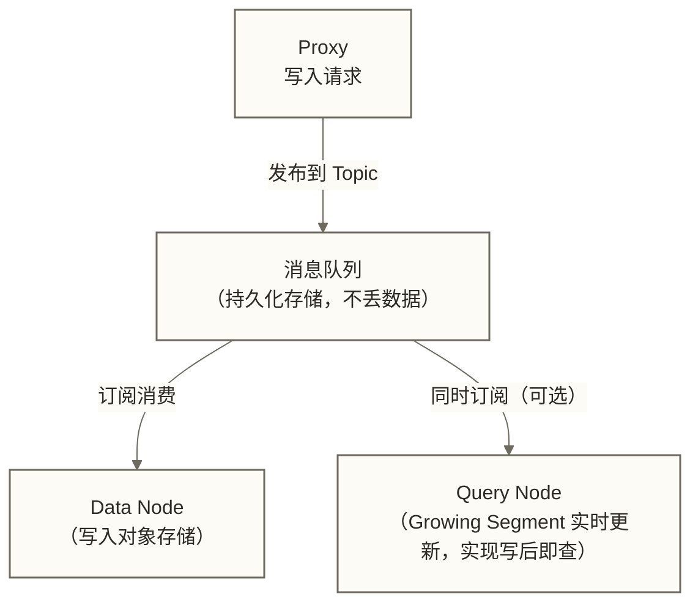

这个设计有一个关键好处：**写入路径的解耦**。Proxy 只需要把消息成功发到队列里，就可以返回客户端"写入成功"。Data Node 的处理速度不影响写入延迟。这让 Milvus 的写入吞吐量可以达到极高的水平（批量插入时，消息队列的吞吐是瓶颈，而不是 Data Node 的处理速度）。

### 6.3 元数据存储（etcd）：集群的"户籍管理局"

etcd 存放的数据体积最小（通常只有几十 MB），但重要性最高——它是整个集群的"真相来源"（Source of Truth）。

**etcd 中存放的关键信息：**

| etcd 路径 | 存储内容 | 负责 Coordinator |
|----------|---------|-----------------|
| `/milvus/root-coord/collections/{collection_id}` | Collection Schema 定义 | Root Coordinator |
| `/milvus/root-coord/partitions/{partition_id}` | 分区元数据 | Root Coordinator |
| `/milvus/root-coord/aliases/{alias_name}` | Collection 别名映射 | Root Coordinator |
| `/milvus/data-coord/segments/{segment_id}` | Segment 元数据（大小、状态、所属节点） | Data Coordinator |
| `/milvus/data-coord/checkpoints/{channel}` | 各 Data Node 的消费位置 | Data Coordinator |
| `/milvus/query-coord/nodes/{node_id}` | 注册的 Query Node 列表 | Query Coordinator |
| `/milvus/query-coord/segment_dist/{segment_id}` | Segment 在哪个 Query Node 上 | Query Coordinator |
| `/milvus/index-coord/indexes/{index_id}` | 索引元数据（类型、参数、文件位置） | Index Coordinator |
| `/milvus/session/{service_name}/{node_id}` | 所有服务节点的心跳注册 | 全局 |

> [!warning] etcd 的运维红线
> - etcd 的推荐集群规模：**3 节点或 5 节点**（奇数，保证 Raft 多数派选举）
> - etcd 对磁盘延迟极敏感，**必须使用 SSD**，HDD 会导致集群不稳定
> - etcd 的数据目录需要定期备份，它的损坏意味着整个 Milvus 集群的元数据丢失
> - 不要和其他高写入负载的应用共享 etcd 集群

---

## 七、写入路径深度解析

### 7.1 完整写入链路

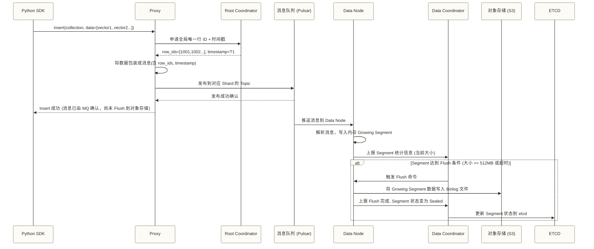

### 7.2 Segment 的生命周期状态机

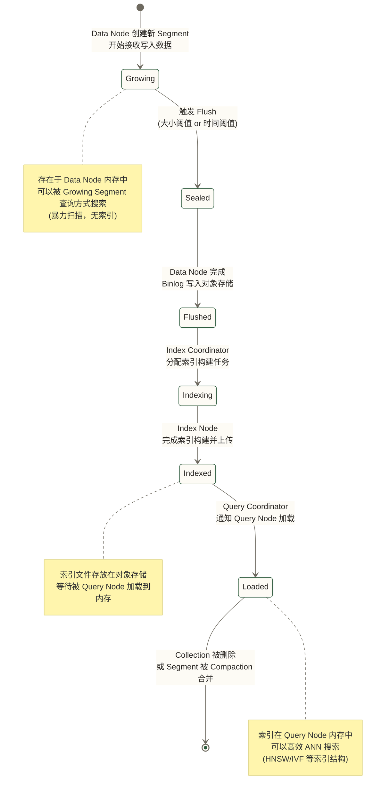

> [!note] Segment 状态的工程意义
> 理解这个状态机，就能理解 Milvus 的很多"奇怪"现象：
> - 为什么刚插入的数据有时候搜索比较慢？→ 数据还在 Growing Segment，走暴力扫描
> - 为什么磁盘空间在 Flush 后才增长？→ Flush 之前数据只在内存和消息队列
> - 为什么 `compact` 操作能减少 Segment 数量？→ 合并多个小的 Flushed Segment 为一个大 Segment，减少查询时的扫描文件数

### 7.3 为什么 Insert 成功不代表数据已 Flush 到对象存储？

当 Proxy 向 SDK 返回"Insert 成功"时，数据实际上在哪里？

| 时间点 | 发生的事 | 数据所在位置 |
|-------|---------|------------|
| T0 | SDK 发出 Insert 请求 | 客户端 |
| T1 | Proxy 发布消息到 MQ，返回成功（SDK 认为"写入成功"） | 消息队列（持久化） |
| T2 | Data Node 消费消息，写入内存 Growing Segment | 内存（可查询） |
| T3 | Flush 触发，Binlog 写入对象存储（完成 Binlog 持久化；此前消息队列已承担日志持久化） | 对象存储 |

> T1 → T3 的时间差：通常为秒级到分钟级，取决于 Flush 配置

这意味着：**在消息已可靠持久化、尚未被清理且 Checkpoint 可用的条件下，Data Node 在 T1 到 T3 之间崩溃后，可通过重放消息恢复尚未 Flush 的数据**；这不是对消息队列和元数据同时故障的无条件不丢数据保证。这就是"消息队列作为 WAL"的核心保障。

---

## 八、查询路径深度解析

### 8.1 完整查询链路

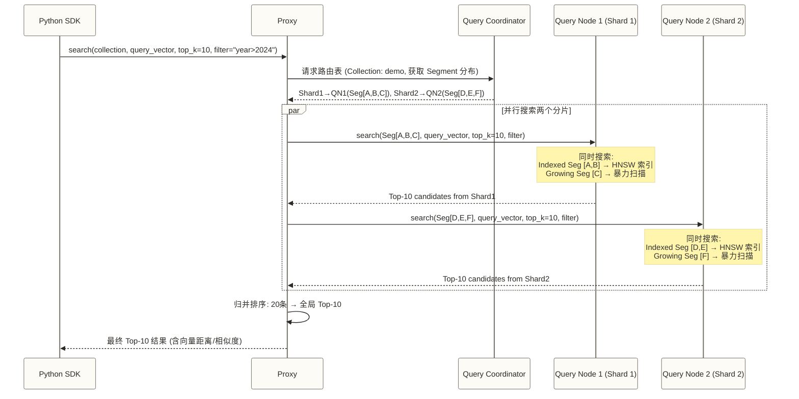

### 8.2 标量过滤与向量搜索的协同

当查询包含 `filter="year > 2024 AND category == 'tech'"` 时，Query Node 的处理策略：

**策略一：后过滤（Post-filter）**

先用向量索引找出 Top-K 候选集，再用标量条件过滤。适合过滤率低（大部分数据满足过滤条件）的场景。

问题：如果过滤率高（只有 1% 的数据满足条件），Top-K 候选集里可能只有少数几条通过过滤，最终返回的结果数不足 K。

**策略二：前过滤（Pre-filter）**

先按标量条件构建 Bitset（哪些行满足条件），再在向量搜索时跳过 Bitset 中标记为不满足的行。

Milvus 2.x 默认使用前过滤策略，将标量过滤集成到向量搜索的内层循环中，HNSW/IVF 搜索时自动跳过不满足条件的向量。

> [!tip] 混合搜索性能优化建议
> - 过滤条件尽量选择**高基数（cardinality）字段**（如时间戳、用户 ID），而不是低基数字段（如性别、状态），避免后者产生大量 Bitset 操作
> - 对标量过滤字段建立**标量索引**（`create_index` on scalar field），可以跳过大量不相关 Segment 的扫描
> - 参考 [[【技术与工具】/向量数据库/Milvus/06-索引类型与选型指南]] 中关于混合索引的建议

### 8.3 Top-K 归并的数学原理

当 Proxy 从多个 Query Node 收到结果后，如何归并？

假设 2 个 Shard，每个返回 Top-10，需要归并为全局 Top-10：

```text
Shard1 Top-10: [0.95, 0.94, 0.93, 0.92, 0.91, 0.90, 0.89, 0.88, 0.87, 0.86]
                (余弦相似度，越大越相似)
Shard2 Top-10: [0.97, 0.96, 0.93, 0.91, 0.90, 0.88, 0.87, 0.85, 0.84, 0.83]

归并排序后 Top-10:
[0.97, 0.96, 0.95, 0.94, 0.93, 0.93, 0.92, 0.91, 0.91, 0.90]
```

这是标准的 K-way merge，时间复杂度 O(n log k)，其中 n 是总结果数，k 是 Shard 数。即使 Shard 数量很多，归并开销也非常小（因为 n 很小，通常 ≤ top_k × shard_count）。

---

## 九、索引构建路径

### 9.1 从 Seal 到索引就绪的完整流程

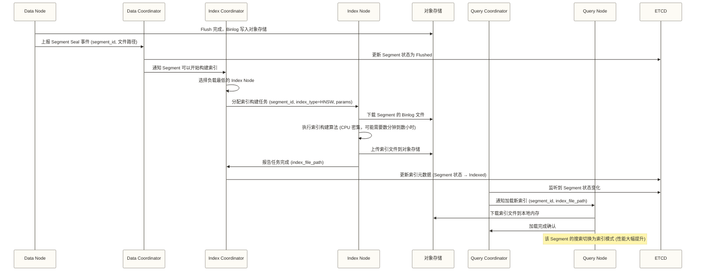

### 9.2 异步索引对查询性能的短期影响

在索引构建期间，新 Sealed 的 Segment 处于"Flushed"状态，没有索引。这段时间内的查询行为：

- Query Node 会下载该 Segment 的 Binlog 原始数据
- 使用**暴力扫描**（Brute Force）对该 Segment 做精确搜索
- 暴力扫描的延迟与 Segment 大小成正比，可能显著高于有索引时的延迟

**实际影响的量化：**

| Segment 大小 | 向量维度 | 暴力扫描延迟（估算） | HNSW 索引延迟（估算） |
|------------|---------|------------------|------------------|
| 50万条 | 768维 | ~500ms | ~5ms |
| 100万条 | 768维 | ~1000ms | ~8ms |
| 500万条 | 768维 | ~5000ms | ~15ms |

> [!warning] 高写入场景下的查询延迟抖动
> 如果写入速度非常快，大量 Segment 处于待索引状态，查询延迟会明显升高。应对策略：
> - 增加 Index Node 数量，加快索引构建速度
> - 调整 `segment.maxSize` 减小 Segment 大小，降低每次暴力扫描的数据量
> - 可将 `DISKANN` 纳入对照测试；“构建速度比 HNSW 快2-3倍且仅有轻微精度损失”只能作为待测试假设，本文没有给出支持该比较的数据、参数和资源条件
> - 详见 09-生产运维与性能调优 中的索引构建优化章节

---

## 十、一致性模型与 TSO 机制

### 10.1 Milvus 的四种一致性级别

Milvus 2.x 提供四种一致性级别，可以在 Collection 级别或单次查询级别配置：

| 一致性级别 | 英文名 | 语义 | 适用场景 | 性能代价 |
|----------|--------|------|---------|---------|
| **强一致** | Strong | 读操作能看到所有已确认写入 | 金融、医疗等强一致性需求 | 最高（每次查询等待最新 TSO） |
| **有界过期** | Bounded Staleness | 读操作的数据可见性滞后不超过配置的 N 秒窗口 | 允许轻微延迟的实时系统 | 中等 |
| **会话一致** | Session | 同一 Session 内，读能看到自己的写 | 用户个人数据查询 | 较低 |
| **最终一致** | Eventually | 不保证能立即看到最新写入 | 推荐系统、离线分析 | 最低（默认值） |

> [!note] 为什么默认是最终一致性？
> 强一致性的实现代价很高：每次查询都需要向 Root Coordinator 获取最新的 TSO，并等待所有 Data Node 消费到该 TSO 对应的消息位置。在高 QPS 场景下，这会造成 Root Coordinator 成为热点，并显著增加查询延迟。
>
> 大多数向量数据库的业务场景（RAG、推荐、语义搜索）对一致性要求不高——用户不在乎搜索结果里是否包含刚刚写入的那几条数据。因此默认使用最终一致性，以性能换体验。

### 10.2 TSO 机制深度解析

TSO（Timestamp Oracle）是理解 Milvus 一致性的关键。

**TSO 的数据结构：**

Milvus 的时间戳是一个 64 位整数，不是普通的 Unix 时间戳：

**Milvus Timestamp（64-bit 结构）：**

| 位段 | 含义 | 说明 |
|-----|------|------|
| 高 46 bits | 物理时间（毫秒级 Unix 时间戳） | 保证全局时间有序 |
| 低 18 bits | 逻辑计数器 | 同一毫秒内最多 2^18 = 262144 次有序写入 |

这个设计允许同一毫秒内发生多达 2^18 = 262144 次有序的写入操作，每次都有唯一的时间戳。

**TSO 在一致性中的应用：**

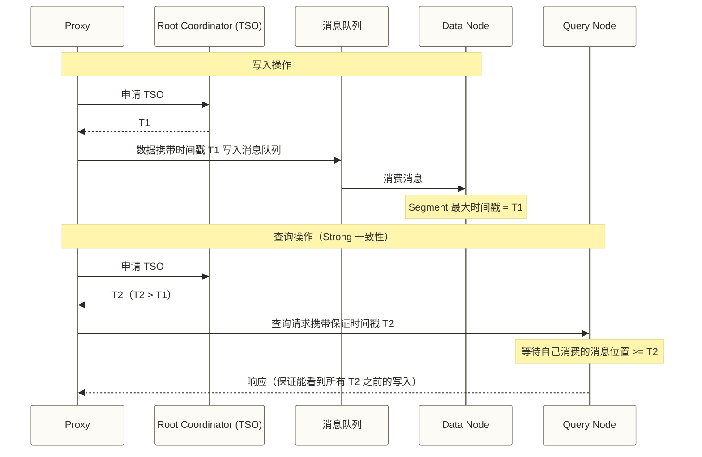

> [!tip] Bounded Staleness 的实际配置
> 以下示例展示 Bounded 一致性的调用形式，并使用系统默认过期窗口；代码没有明确设置5秒窗口，不能单凭此示例满足业务的5秒延迟要求：
> ```python
> collection.search(
>     data=query_vectors,
>     anns_field="embedding",
>     param={"metric_type": "COSINE", "params": {"ef": 64}},
>     limit=10,
>     consistency_level="Bounded",  # 有界过期
>     guarantee_timestamp=0,        # 0 表示使用系统默认的过期窗口
> )
> ```
> 若以“有界过期比强一致性减少30-50%的查询延迟”作为测试假设，应在相同硬件、负载和数据条件下验证；本文未提供该数字的测试依据，是否适合作为平衡点取决于业务允许的可见性滞后。

---

## 十一、高可用与容错设计

### 11.1 各组件的故障处理策略

| 组件 | 单点故障影响 | 恢复机制 | 恢复时间 |
|-----|------------|---------|---------|
| **Proxy** | 该实例流量中断，其他实例接管 | SDK 自动重连其他 Proxy | < 1秒 |
| **Root Coordinator** | DDL 操作可能暂停；读写是否受影响取决于时间戳、元数据依赖及切换阶段，不能保证不受影响 | 在已配置且适用的 Active-Standby 部署中由 Standby 节点接管 | 5-30秒（讨论假设，未提供测试条件） |
| **Data Coordinator** | Flush 触发暂停，写入继续（消息积压） | Standby 节点接管，读取 etcd 恢复状态 | 10-30秒 |
| **Query Coordinator** | 新 Segment 加载暂停，现有查询不受影响 | Standby 节点接管 | 10-30秒 |
| **Index Coordinator** | 索引构建任务队列暂停 | Standby 节点接管，从 etcd 恢复任务列表 | 10-30秒 |
| **Data Node** | 未 Flush 数据在内存丢失 | 新节点从消息队列 Checkpoint 回放 | 30秒-数分钟 |
| **Query Node** | 该节点负责的 Segment 查询中断 | QC 将 Segment 重新分配给其他 Query Node | 30-60秒 |
| **Index Node** | 正在构建的索引任务失败 | IC 重新分配任务给其他 Index Node | 下次任务轮询时 |

### 11.2 Coordinator 的 Active-Standby 机制

所有 Coordinator 采用基于 etcd 的分布式锁实现 Active-Standby：

```text
启动流程：
1. 每个 Coordinator 实例启动时，尝试在 etcd 中写入一个带 TTL 的 Lock Key
2. 第一个写入成功的实例成为 Active（主节点）
3. 其余实例成为 Standby，监听该 Lock Key
4. Active 节点持续续约 TTL（每隔 heartbeat_interval 刷新一次）

故障切换：
1. Active 节点崩溃 → TTL 到期，Lock Key 自动删除
2. Standby 节点检测到 Key 消失 → 竞争写入新的 Lock Key
3. 胜出的 Standby 成为新的 Active → 从 etcd 读取状态，恢复工作
```

切换过程中，已经在运行的查询和写入请求会短暂失败（收到 `ErrService` 错误），SDK 会自动重试。

### 11.3 Query Node 崩溃后的数据重加载

Query Node 崩溃是最常见的故障场景，恢复流程如下：

```text
1. QC 检测到 Query Node N 心跳超时 (默认 30s)
2. QC 将 N 的状态标记为 Unavailable
3. QC 查询 etcd，找出 N 负责的所有 Segment 列表
4. QC 将这些 Segment 重新分配给其他健康的 Query Node
5. 被分配的 Query Node 从对象存储下载对应的索引文件
6. 加载完成后，QC 更新路由表，新查询路由到新节点
```

关键点：**整个恢复过程不需要任何数据从其他节点传输**，因为数据一直在对象存储里。节点崩溃只是"内存中的索引丢了"，从对象存储重新加载即可。这是存算分离架构最直接的高可用收益。

> [!warning] 避免 Query Node 内存压力导致的 OOM
> 如果待加载数据超过可用内存容量，可能出现加载失败、内存压力或查询失败；不能据此断言系统会跳过部分 Segment 并正常返回不完整结果，具体行为需以适用版本的加载状态、错误响应和查询语义为准。
>
> 解决方案：
> - 可评估 **DiskANN** 等磁盘索引方案，将部分索引访问转移到磁盘；内存仍需用于缓存、搜索工作区等。“内存占用降低10x”仅作为待测试假设，实际收益取决于数据、索引参数、缓存设置和磁盘性能
> - 调整 `queryNode.cache.memoryHighWaterLevel`（默认 85%），在内存接近上限时触发 Segment 卸载
> - 增加 Query Node 数量，分散 Segment 负载
> - 参考 09-生产运维与性能调优 中的内存管理章节

---

## 十二、Milvus 1.x vs 2.x 架构演进

### 12.1 单体架构时代（Milvus 1.x）

Milvus 1.x 是一个经典的单体架构：

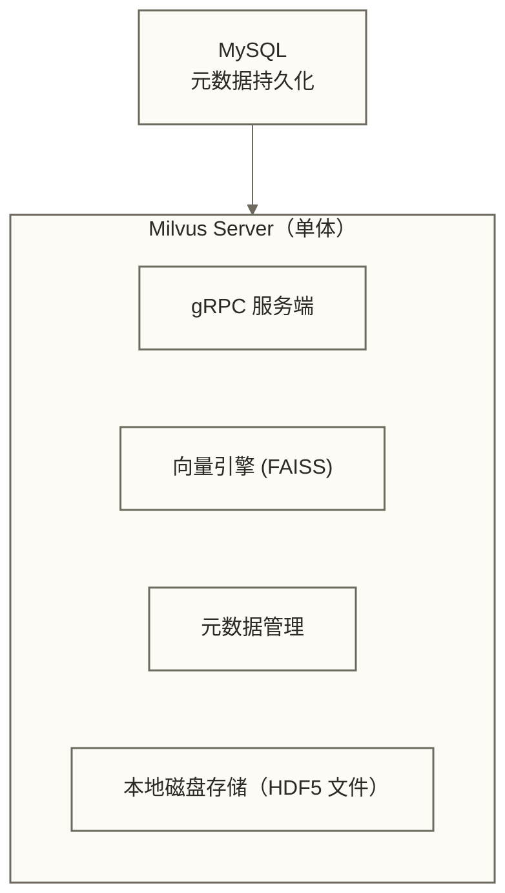

**1.x 的核心限制：**

| 限制 | 具体表现 |
|-----|---------|
| **存算耦合** | 数据存在本地磁盘，计算无法独立扩缩 |
| **单节点瓶颈** | 数据量超过单机磁盘容量就无法扩展 |
| **高可用代价高** | 主从复制需要同步全量数据，切换时间长 |
| **运维复杂** | 升级需要停服，无法滚动更新 |
| **不支持流式写入** | 数据写入是同步阻塞的，写入吞吐有限 |

### 12.2 云原生架构时代（Milvus 2.x）

2021 年发布的 Milvus 2.0 是对整个架构的重写，核心变化：

| 维度 | Milvus 1.x | Milvus 2.x |
|-----|-----------|-----------|
| **架构模式** | 单体（Monolith） | 微服务（Microservices） |
| **存储模型** | 存算耦合，本地磁盘 | 存算分离，对象存储 |
| **写入模型** | 同步写入 | 异步写入（消息队列解耦） |
| **扩展方式** | 垂直扩展（加机器内存/CPU） | 水平扩展（加节点） |
| **高可用** | 主从复制（数据同步） | 无状态节点（从对象存储重建） |
| **部署方式** | 裸机/Docker | Kubernetes 原生 |
| **一致性** | 最终一致 | 可配置 4 级一致性 |
| **最大数据规模** | 亿级（受单机限制） | 十亿级以上（理论无上限） |

**2.x 的代价：**

架构复杂度显著提升。Milvus 1.x 是"下载，启动一个进程，完成"。Milvus 2.x 分布式模式需要维护 etcd 集群、消息队列集群、对象存储——光是这三个基础设施的运维就需要专业技能。

这也是为什么 Milvus 提供了 **Standalone 模式**（单机版，使用 RocksMQ + MinIO 内嵌，一个 Docker Compose 启动）和 **Distributed 模式**（生产分布式版）两种部署模式。

> [!tip] 如何选择部署模式
> - 数据量 < 1000 万向量，单机内存够用 → **Standalone 模式**，简单可靠
> - 数据量 > 1000 万，或需要高可用，或有水平扩展需求 → **Distributed 模式**
> - 不想自己运维 → **Zilliz Cloud**（Milvus 的全托管云服务，即插即用）

---

## 十三、架构总结：设计决策一览

| 设计决策 | 选择 | 为什么这样选 | 代价 |
|---------|------|------------|------|
| **存算分离** | 计算与存储独立 | 独立弹性扩缩，降低成本 | 增加网络 IO |
| **无状态计算节点** | 所有状态外置 | 故障自愈，滚动升级 | 依赖外部系统稳定性 |
| **双语言（Go+C++）** | 服务层 Go，计算层 C++ | 各取所长 | CGO 边界管理复杂度 |
| **消息队列作 WAL** | Pulsar/Kafka 代替自实现 WAL | 成熟的持久化和回放能力 | 增加一个中间件依赖 |
| **异步索引构建** | Index Node 后台构建 | 不阻塞读写路径 | 新数据短期查询性能较低 |
| **多种一致性级别** | Strong/Bounded/Session/Eventually | 让用户按需权衡性能和一致性 | 开发使用复杂度增加 |
| **四类 Coordinator** | RC/DC/QC/IC 职责分离 | 各自独立演进，故障隔离 | 系统整体复杂度高 |

> [!note] 延伸阅读
> - 03-核心概念详解：深入理解 Collection、Partition、Segment、Shard 的关系
> - [[【技术与工具】/向量数据库/Milvus/06-索引类型与选型指南]]：HNSW vs IVF_FLAT vs IVF_PQ vs DiskANN 的选择逻辑
> - 09-生产运维与性能调优：基于本文架构理解，针对性地优化生产集群

---

## 关键要点回顾

> [!summary] 本文核心结论
> 1. **存算分离**不是为了技术先进性，而是为了让计算和存储能**独立弹性扩缩**——这在云环境下直接转化为成本效益
> 2. **无状态节点**有助于**故障自愈**：在持久化数据、元数据、日志与调度机制可用且资源充足时，可重建节点运行状态；恢复时间和人工介入需求取决于故障范围
> 3. **消息队列即 WAL**：Milvus 没有自己实现 WAL，而是借助 Pulsar/Kafka 的持久化能力实现崩溃恢复
> 4. **异步索引构建**保证了写入路径不被索引计算阻塞，代价是新写入数据在索引构建完成前查询性能较低
> 5. **TSO 时间戳**是一致性模型的基础设施：所有写入带时间戳，查询可以指定"至少看到哪个时间点"的数据
> 6. **四类 Coordinator** 在本文描述的架构中分别承担全局元数据、数据段、查询调度和索引任务管理；职责分离有助于降低耦合，但共享依赖和跨组件协作意味着故障域并非完全隔离

#Milvus #向量数据库 #分布式架构 #存算分离 #云原生 #TSO #一致性模型 #Segment生命周期
