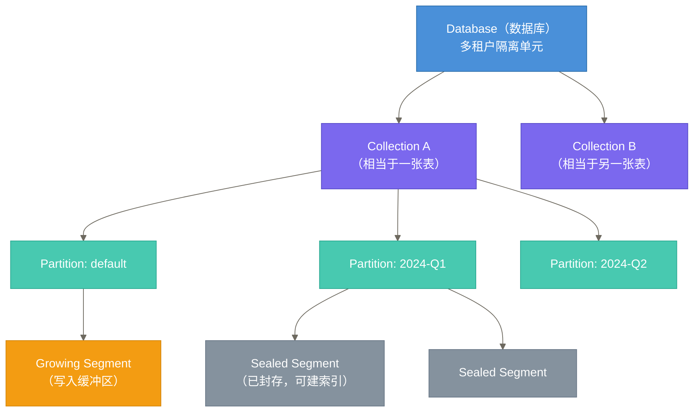
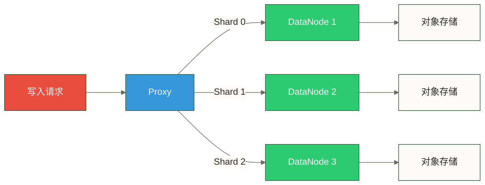
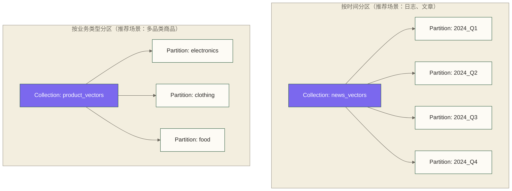
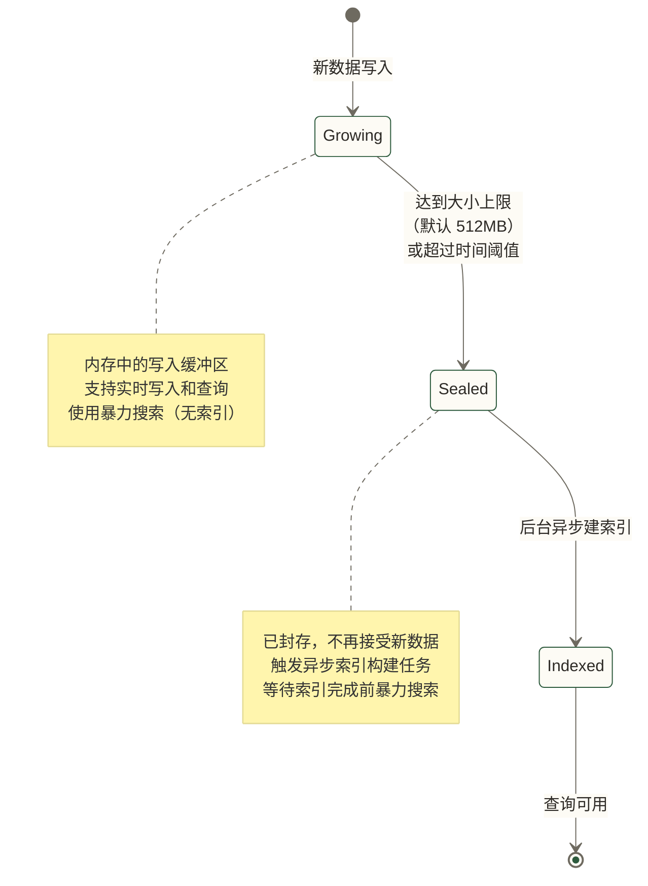
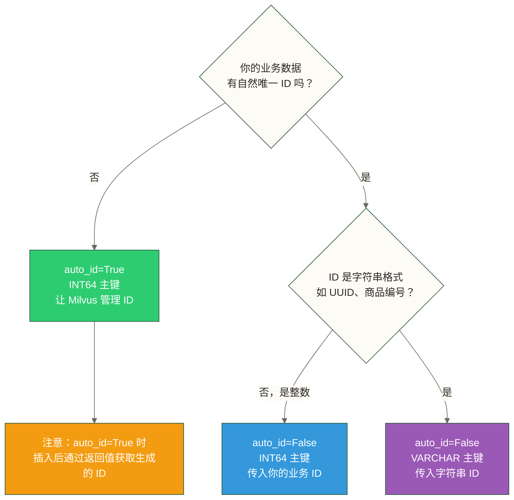
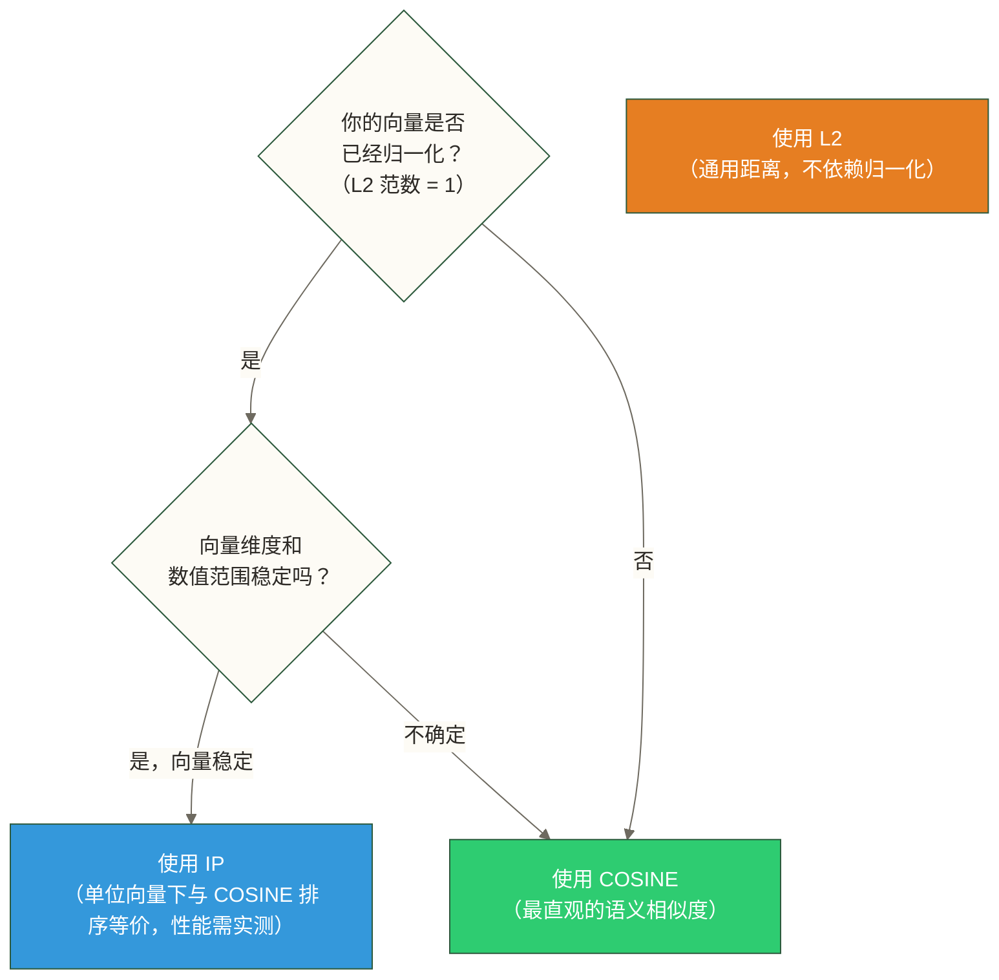
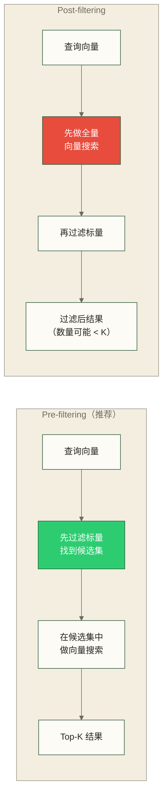
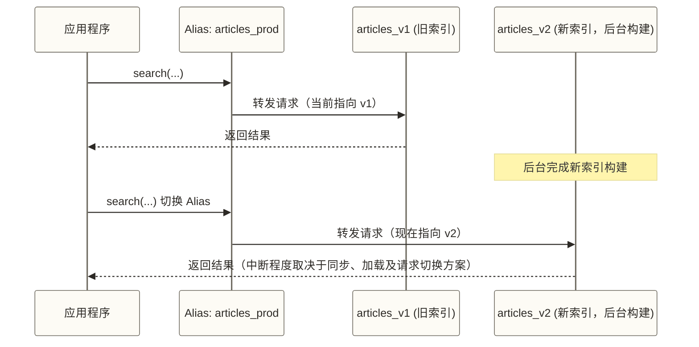
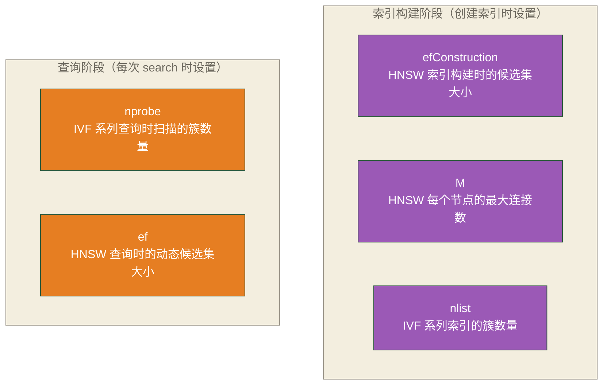

# Milvus 核心概念详解

> [!tip] 文档定位
> 这是一本 Milvus 的**概念字典**。在你写第一行代码之前，先理解这里的主要概念，有助于减少后续开发中的概念混淆。
> 每个概念不只给定义，更重要的是解释**"为什么这样设计"**——理解设计意图，才能用好这个工具。

## 目录

- [[#1. 数据组织层级|数据组织层级（从大到小）]]
  - [[#Database（数据库）|Database]]
  - [[#Collection（集合）|Collection]]
  - [[#Partition（分区）|Partition]]
  - [[#Segment（段）|Segment]]
- [[#2. Schema 设计核心概念|Schema 设计核心概念]]
  - [[#字段类型全解析|字段类型全解析]]
  - [[#Dynamic Field（动态字段）|Dynamic Field]]
  - [[#Multi-Vector（多向量）|Multi-Vector]]
- [[#3. 索引概念概述|索引概念概述]]
  - [[#什么是 ANN 索引|什么是 ANN 索引]]
  - [[#距离度量（Metric Type）|距离度量]]
  - [[#Index 和 Collection 的关系|Index 和 Collection 的关系]]
- [[#4. 查询相关概念|查询相关概念]]
  - [[#Search vs Query 的区别|Search vs Query]]
  - [[#Hybrid Search（混合查询）|Hybrid Search]]
  - [[#Consistency Level|Consistency Level]]
  - [[#Alias（别名）|Alias]]
- [[#5. 关键参数概念|关键参数概念]]
  - 索引与查询参数
  - [[#Top-K / Limit / Offset|Top-K / Limit / Offset]]

---

## 1. 数据组织层级

Milvus 的数据组织从大到小分为四层：**Database → Collection → Partition → Segment**。理解这四层是一切操作的基础。



---

### Database（数据库）

**定义**：Milvus 2.2 版本起支持多 Database，概念与 MySQL 的 `database` 完全对应——一个 Milvus 实例可以创建多个相互隔离的 Database。

**为什么需要这个设计？**

在 2.2 之前，一个 Milvus 实例只有一个全局命名空间，所有 Collection 混在一起。当你需要为不同业务部门、不同客户提供服务时，Collection 的名字会打架，权限也无法隔离。

多 Database 的引入，解决了**多租户**场景的核心痛点：

| 场景 | 没有 Database 时 | 有 Database 时 |
|------|-----------------|----------------|
| 电商平台服务多个商家 | Collection 命名加前缀区分，混乱 | 每个商家一个 Database，区分命名空间；权限需配置，计算资源不因此独享 |
| 同一公司多个业务线 | 容易命名冲突，难以权限管控 | 业务线级别隔离，权限清晰 |
| 开发/测试/生产环境 | 需要部署多套 Milvus 实例 | 同一实例建三个 Database |

**操作示例**：

```python
from pymilvus import connections, db

# 连接 Milvus
connections.connect(host="localhost", port="19530")

# 创建 database
db.create_database("ecommerce_merchant_001")

# 切换到指定 database
db.using_database("ecommerce_merchant_001")
```

> [!note] 默认 Database
> 如果不显式创建和切换，所有操作都在名为 `default` 的 Database 中进行。对于单租户场景，完全不需要关心 Database 层。

---

### Collection（集合）

**定义**：Collection 是 Milvus 中存储数据的核心结构，类比关系数据库中的 **Table（表）**。但它和普通表有一个根本区别：**Schema 中必须包含至少一个向量字段**。

**Collection 的物理存储方式：Shard 分片**

创建 Collection 时，Milvus 会把它拆分成若干个 **Shard（分片）**，每个 Shard 独立接收写入请求，由不同的 DataNode 处理。这是 Milvus 实现**写入水平扩展**的核心机制。



**Shard 数量对写入性能的影响**

| Shard 数量 | 适合场景 | 注意事项 |
|-----------|---------|---------|
| 1 | 可作为低写入压力场景的测试起点，默认值需按版本确认 | 单 Shard 不等于所有写入串行；吞吐还取决于批量大小、部署资源与服务实现 |
| 2 | 可作为生产压测的候选配置 | 是否合适需比较写入吞吐、查询开销与资源消耗 |
| 4+ | 超高写入吞吐需求 | Shard 过多会增加查询时的合并开销 |

> [!warning] Shard 数量不可修改
> Collection 创建后，Shard 数量**无法动态修改**。需要在创建前根据业务规模合理规划。如果评估不准确，只能重建 Collection 并迁移数据。

**创建 Collection 示例**：

```python
from pymilvus import CollectionSchema, FieldSchema, DataType, Collection

# 定义 Schema
fields = [
    FieldSchema(name="id", dtype=DataType.INT64, is_primary=True, auto_id=True),
    FieldSchema(name="text_vector", dtype=DataType.FLOAT_VECTOR, dim=768),
    FieldSchema(name="category", dtype=DataType.VARCHAR, max_length=64),
]
schema = CollectionSchema(fields=fields, description="文章向量库")

# 创建 Collection，指定 Shard 数量
collection = Collection(
    name="articles",
    schema=schema,
    num_shards=2  # 示例配置，生产取值需结合部署与压测确定
)
```

---

### Partition（分区）

**定义**：Partition 是在 Collection 内部做的**逻辑分区**，让你在查询时只扫描部分数据，而不是全量扫描整个 Collection。

**Shard vs Partition——最容易搞混的两个概念**

这两个概念经常让初学者困惑，一张表格说清楚：

| 维度 | Shard（分片） | Partition（分区） |
|------|-------------|----------------|
| 可见性 | 对用户透明，自动管理 | 用户显式创建和命名 |
| 目的 | 提升**写入**并发度 | 提升**查询**过滤性能 |
| 分割依据 | 哈希算法自动分配 | 用户指定 partition_name |
| 修改 | 创建后不可改 | 随时增删分区 |
| 类比 | MySQL 的分库 | MySQL 的分表/分区表 |

> [!tip] 一句话理解
> **Shard 是给写入加速用的，Partition 是给查询加速用的。** 写入时数据自动分配到不同 Shard，查询时你告诉 Milvus "我只查这几个 Partition"，大幅减少扫描量。

**典型分区策略**



**分区操作示例**：

```python
# 创建分区
collection.create_partition("2024_Q1")
collection.create_partition("2024_Q2")

# 向指定分区写入数据
collection.insert(data, partition_name="2024_Q1")

# 只在指定分区内搜索（性能提升关键！）
results = collection.search(
    data=query_vectors,
    anns_field="text_vector",
    param={"metric_type": "L2", "params": {"nprobe": 16}},
    limit=10,
    partition_names=["2024_Q1", "2024_Q2"]  # 只扫这两个分区
)
```

**分区数量限制与最佳实践**

> [!warning] 分区数量上限
> 每个 Collection 默认最多创建 **1024** 个分区（可通过配置调整，但不建议设置过大）。
>
> **最佳实践**：
> - 可将 **100 个以内**作为分区数量的压测候选范围，而非通用上限；需观察元数据管理开销
> - 可将每个分区 **百万条以上**作为分区粒度的待测假设，而非收益必然超过成本的门槛
> - 如果分类维度超过 100 个，可对比**标量过滤**（在 Schema 中加字段）与分区方案，按查询模式和测试结果选择

---

### Segment（段）

**定义**：Segment 是 Milvus **数据管理的最小物理单元**。用户感知不到 Segment 的存在，但它是理解 Milvus 性能特性的关键。

**Growing Segment vs Sealed Segment**

Milvus 中的 Segment 有两种状态，生命周期如下：



| 特性 | Growing Segment | Sealed Segment |
|------|----------------|----------------|
| 状态 | 活跃，接受写入 | 已封存，只读 |
| 存储位置 | QueryNode 内存 | 对象存储（S3/MinIO） |
| 查询方式 | 暴力搜索（Brute Force） | 使用 ANN 索引 |
| 索引 | 没有索引 | 异步构建索引 |
| 可见性 | 数据可见性取决于一致性级别与查询读取进度 | 封存不等于数据消失，可查询性仍受加载状态与一致性设置约束 |

**为什么 Segment 大小有限制（512MB 默认）？**

这是一个精心设计的权衡：

- **太小（如 10MB）**：Segment 数量爆炸，元数据管理开销剧增，索引构建频繁，整体性能反而下降
- **太大（如 5GB）**：单个 Segment 的索引构建耗时过长，占用内存过多，QueryNode 加载困难

此处以 512MB 作为讲解用的配置假设，实际默认值应以部署版本和配置为准。对于高维向量（如 4096 维），可将 1–2GB 作为压测候选值，但不能仅凭维度决定调大；还需观察索引构建耗时、加载内存和查询延迟。

**Segment 和索引的关系**

> [!important] 关键理解
> 索引是**按 Segment 粒度构建的**，而不是按 Collection 或 Partition 粒度。
>
> 这意味着：
> - 一个 Segment 完成索引构建，查询立即加速——不需要等整个 Collection 的索引都建完
> - Growing Segment 里的数据（刚写入的新数据）**始终**用暴力搜索，无论你是否创建了索引
> - Growing Segment 可参与查询，但新写入是否立即可见仍取决于一致性级别与读取进度

---

## 2. Schema 设计核心概念

Schema 定义了你的数据长什么样。Milvus 的 Schema 设计比关系数据库更灵活，但也有一些独特的约束需要了解。

详细的 Schema 设计最佳实践请参考 07-Schema设计与数据建模。

---

### 字段类型全解析

#### 主键字段

每个 Collection **必须有且只有一个**主键字段，类型只能是 `INT64` 或 `VARCHAR`。

| 主键类型 | auto_id=True | auto_id=False |
|---------|-------------|--------------|
| INT64 | Milvus 自动生成递增 ID | 你自己提供唯一 int64 |
| VARCHAR | 不支持自动生成 | 你自己提供唯一字符串 |

**自动 ID vs 手动指定——如何选择？**



> [!tip] 经验法则
> - 如果你的数据来自其他系统（数据库、文档系统），通常有业务 ID，用 `auto_id=False` 保留原始 ID，方便关联查询
> - 如果 Milvus 是独立的向量存储，没有外部 ID，用 `auto_id=True` 最简单

---

#### 向量字段

向量字段是 Milvus 的核心，当前支持五种类型：

| 向量类型 | 数据类型 | 典型维度 | 使用场景 |
|---------|---------|---------|---------|
| `FLOAT_VECTOR` | float32，每维 4 字节 | 128~4096 | 通用场景，最常用 |
| `BINARY_VECTOR` | bit，每维 1/8 字节 | 128~2048 | 图像哈希、文档指纹，极致压缩 |
| `FLOAT16_VECTOR` | float16，每维 2 字节 | 128~4096 | 降低存储和内存，精度略降 |
| `BFLOAT16_VECTOR` | bfloat16，每维 2 字节 | 128~4096 | 深度学习模型输出，与 float32 精度接近 |
| `SPARSE_FLOAT_VECTOR` | 稀疏格式 | 不固定 | 关键词匹配、BM25 混合检索 |

**稀疏向量（SparseFloatVector）是什么？什么时候用？**

普通向量（Dense Vector）：每个维度都有值，即使是 0 也要存储。
```json
[0.1, 0.0, 0.0, 0.5, 0.0, 0.0, 0.3, ...]  # 10000 维，大部分是 0
```

稀疏向量（Sparse Vector）：只存非零维度的位置和值，用字典表示。
```python
# 只存非零维，大幅节省空间
{42: 0.5, 1891: 0.3, 7654: 0.1}  # 位置: 值
```

> [!note] 稀疏向量的典型用途
> 稀疏向量主要用于**词袋模型（BoW）和 BM25 检索**场景：
>
> - 传统关键词搜索（TF-IDF、BM25）产生的向量天然是稀疏的
> - 维度数 = 词汇表大小（通常 10万+），但每个文档只包含少数词
> - 和 Dense 向量混合使用，实现**语义搜索 + 关键词搜索**的融合（Hybrid Search）

---

#### 标量字段

标量字段用于存储非向量的元数据，支持以下类型：

| 类型 | 说明 | 适用场景 |
|------|------|---------|
| `INT8` / `INT16` / `INT32` / `INT64` | 整数，位数越大范围越大 | 计数、枚举、时间戳 |
| `FLOAT` / `DOUBLE` | 浮点数 | 价格、评分、地理坐标 |
| `BOOL` | 布尔值 | 是否上架、是否审核通过 |
| `VARCHAR` | 变长字符串，需指定 max_length | 标题、标签、状态码 |
| `JSON` | JSON 对象 | 动态属性、扩展信息 |
| `ARRAY` | 同类型元素的数组 | 标签列表、多值属性 |

**JSON 字段的查询支持**

JSON 字段可以直接在过滤表达式中访问嵌套字段：

```python
# Schema 中定义 JSON 字段
FieldSchema(name="metadata", dtype=DataType.JSON)

# 写入时传入 JSON 对象
data = {
    "metadata": {
        "author": "张三",
        "views": 10000,
        "tags": ["AI", "技术"]
    }
}

# 查询时直接访问 JSON 内部字段
results = collection.query(
    expr='metadata["author"] == "张三" and metadata["views"] > 5000'
)
```

> [!warning] JSON 字段的限制
> - JSON 字段**不能建标量索引**，过滤时需要全量扫描
> - JSON 内的数组字段**不支持** `ARRAY_CONTAINS` 语法（这种需求用 ARRAY 字段类型）
> - 适合存放**偶尔查询**的扩展属性，频繁过滤的字段请用普通标量字段

**ARRAY 字段的特殊用法**

ARRAY 字段是 Milvus 2.4+ 新增的类型，存储同类型元素的列表：

```python
# Schema 定义
FieldSchema(
    name="tags",
    dtype=DataType.ARRAY,
    element_type=DataType.VARCHAR,  # 数组元素类型
    max_capacity=10,                # 最大元素数量
    max_length=64                   # 每个元素最大长度（字符串类型才需要）
)

# 查询：标签包含"AI"的文档
results = collection.query(expr='ARRAY_CONTAINS(tags, "AI")')

# 查询：标签数组长度大于 3
results = collection.query(expr='ARRAY_LENGTH(tags) > 3')
```

---

### Dynamic Field（动态字段）

**什么是 Dynamic Schema？为什么需要它？**

传统数据库的 Schema 是刚性的——你必须提前定义所有字段，之后新增字段就得 ALTER TABLE，非常痛苦。

Milvus 的动态字段（Dynamic Field）解决了这个问题：**允许你在 Schema 中没有显式定义的字段，直接写入数据**。

**启用方式**：

```python
schema = CollectionSchema(
    fields=fields,
    enable_dynamic_field=True  # 开启动态字段
)
```

**启用后能做什么？**

```python
# 即使 Schema 里没有定义 "source" 和 "score" 字段
# 也可以直接写入
data = [
    {
        "id": 1,
        "text_vector": [0.1, 0.2, ...],
        "title": "文章标题",          # 在前述 fields 中未定义；启用动态字段后可作为动态字段
        "source": "wechat",           # 动态字段（Schema 中未定义）
        "read_count": 5000,           # 动态字段
        "is_premium": True            # 动态字段
    }
]
collection.insert(data)

# 动态字段也可以参与过滤查询
results = collection.query(expr='source == "wechat" and read_count > 1000')
```

> [!note] 动态字段的存储原理
> 动态字段在底层被统一存储在一个隐藏的 `$meta` JSON 字段中。所以动态字段本质上就是 JSON 字段的语法糖——**查询性能与 JSON 字段相同**，不适合高频过滤。

**适合 Dynamic Field 的场景**：

- 爬虫数据，不同网站的元信息字段各不相同
- 用户生成内容，属性字段随版本迭代不断扩展
- 快速原型开发，还不确定最终 Schema 长什么样

---

### Multi-Vector（多向量）

**一条数据存多个向量的场景**

现实中的数据往往有多种模态，单一向量无法完整描述。Milvus 2.4+ 支持在同一个 Collection 中定义多个向量字段：

```python
# 电商商品的 Schema 示例：同时存文本向量和图像向量
fields = [
    FieldSchema(name="product_id", dtype=DataType.INT64, is_primary=True),
    FieldSchema(name="title_vector", dtype=DataType.FLOAT_VECTOR, dim=768),   # 标题文本向量
    FieldSchema(name="image_vector", dtype=DataType.FLOAT_VECTOR, dim=2048),  # 商品图片向量
    FieldSchema(name="product_name", dtype=DataType.VARCHAR, max_length=256),
    FieldSchema(name="price", dtype=DataType.FLOAT),
]
```

**多向量搜索（Multi-Vector Search）**

```python
from pymilvus import AnnSearchRequest, RRFRanker

# 定义文本向量搜索请求
text_search = AnnSearchRequest(
    data=[text_query_vector],
    anns_field="title_vector",
    param={"metric_type": "COSINE", "params": {"nprobe": 16}},
    limit=20
)

# 定义图像向量搜索请求
image_search = AnnSearchRequest(
    data=[image_query_vector],
    anns_field="image_vector",
    param={"metric_type": "L2", "params": {"nprobe": 16}},
    limit=20
)

# 使用 RRF 算法融合两路结果
results = collection.hybrid_search(
    reqs=[text_search, image_search],
    rerank=RRFRanker(k=60),  # RRF 融合
    limit=10
)
```

> [!tip] 多向量的典型应用场景
> - **电商搜索**：文字搜索 + 以图搜图，双路融合提升召回率
> - **文档检索**：Dense 语义向量 + Sparse BM25 向量，结合语义和关键词优势
> - **多模态内容推荐**：用户行为向量 + 内容特征向量，综合排序

---

## 3. 索引概念概述

> [!note] 本节为概述，详细内容请参考 [[【技术与工具】/向量数据库/Milvus/06-索引类型与选型指南]]
> 这里只建立直觉性理解，不深入数学细节。

---

### 什么是 ANN 索引

**为什么不能用 B-Tree？**

关系数据库中对整数、字符串的索引用 B-Tree，因为这些数据有**自然的全序关系**——1 < 2 < 3，字符串有字典序。可以高效地做范围查找。

向量不行。一个 768 维的向量，没有"大小"的概念，只有两个向量之间的"距离"或"相似度"。你想问的是："哪些向量和我的查询向量**距离最近**？"

暴力解法：把查询向量和库里每一个向量计算距离，排序取前 K 个。这是精确答案，叫 **KNN（K-Nearest Neighbors）**，但计算量是 `O(N × dim)`，在千万数据量下完全不可接受。

**ANN（Approximate Nearest Neighbor）** 的思路：**允许一点精度损失，换取数量级的速度提升**。

> [!important] ANN 的精度-速度权衡
> 想象你在一个大城市找"距离你最近的咖啡馆"：
>
> - **KNN（精确）**：挨个量每家咖啡馆和你的距离，一定找到最近的那家，但要花一天时间
> - **ANN（近似）**：先找你所在的区，只在这个区里找，5 分钟出结果，答案可能不是全市最近的，但通常差不多
>
> ANN 索引就是那个"先缩小搜索范围"的机制，牺牲一点召回率（Recall），换取查询速度。

**Recall（召回率）** 是衡量 ANN 精度的核心指标：

```text
Recall@K = ANN 返回的结果中有多少个是真实 KNN 结果 / K
```

Recall@10 = 0.95 意味着：10 个结果里有 9.5 个是真正最近的（近似平均），5% 的结果是"次优"的。

---

### 距离度量（Metric Type）

距离度量决定了"什么叫相似"。选错了，搜索结果会很差。

| Metric Type | 公式含义 | 最佳场景 | 注意事项 |
|------------|---------|---------|---------|
| `L2`（欧氏距离） | 两向量在空间中的直线距离 | 向量**未归一化**时的通用选择 | 距离越小越相似，值域 [0, +∞) |
| `IP`（内积） | 两向量的点积 | 向量**已归一化**到单位长度时，等价余弦相似度 | 值越大越相似 |
| `COSINE`（余弦相似度） | 两向量夹角的余弦 | 文本语义相似度，Milvus 2.3+ 原生支持 | 值域 [-1, 1]，越大越相似 |
| `HAMMING` | 二进制串不同位的数量 | 二进制向量（BinaryVector） | 仅用于 BinaryVector |
| `JACCARD` | Jaccard 距离，即 1 减去二进制集合的交并比 | 文档指纹、相似文档检测 | 用于 BinaryVector，距离越小越相似 |

**L2 vs IP vs COSINE 的选择逻辑**：



> [!tip] 实践建议
> - 使用 OpenAI、Sentence-BERT 等 Embedding 模型时，应确认具体模型和调用设置是否归一化，不能仅凭模型系列名称判断；单位向量下 **IP 与 COSINE** 排序等价
> - 优先采用模型说明或训练目标要求的度量；若目标是比较方向且向量非零，可考虑 **COSINE**
> - 自己训练的模型也应按训练目标选择度量，不能仅因向量未归一化就默认使用 **L2**

---

### Index 和 Collection 的关系

几个关键认知：

**一个向量字段只能有一个索引**

不像关系数据库可以对同一列建多个索引（普通索引、唯一索引），Milvus 中每个向量字段只能创建一种 ANN 索引。如果想换索引类型，需要先删除再重建。

**没有索引时是 FLAT 暴力搜索**

```python
# 如果你没有调用 create_index()，查询仍然可以执行
# 但 Milvus 会对所有 Sealed Segment 做暴力搜索
# 数据量小时无感，百万级以上查询会很慢
```

**索引是异步构建的**

索引构建由后台任务执行，但后台执行不等于 SDK 调用立即返回；`create_index()` 是否等待完成取决于接口及同步、异步调用方式。搜索前需确认索引就绪并完成所需加载。

```python
# 创建索引；调用是否等待完成取决于接口及同步、异步调用方式
collection.create_index(
    field_name="text_vector",
    index_params={"index_type": "HNSW", "metric_type": "COSINE", "params": {"M": 16, "efConstruction": 200}}
)

# 确认索引就绪后加载到内存
collection.load()

# 现在可以使用 ANN 索引的快速搜索了
```

---

## 4. 查询相关概念

---

### Search vs Query 的区别

这是 Milvus 中**最重要的概念区分**之一，初学者经常混淆：

| 操作 | 方法 | 输入 | 输出 | 本质 |
|------|------|------|------|------|
| **Search** | `collection.search()` | 向量 | Top-K 最相似的记录 | 向量相似度搜索 |
| **Query** | `collection.query()` | 布尔表达式 | 接口结果窗口及分页设置范围内的匹配记录 | 标量条件过滤 |

```python
# Search：给我找最像这个向量的 10 条记录
results = collection.search(
    data=[[0.1, 0.2, ...]],   # 查询向量
    anns_field="text_vector",
    param={"metric_type": "COSINE", "params": {"nprobe": 16}},
    limit=10,                  # Top-K
    output_fields=["title"]
)

# Query：给我找所有 category="技术" 且 views>1000 的记录
results = collection.query(
    expr='category == "技术" and views > 1000',
    output_fields=["id", "title", "views"]
)
```

> [!warning] Query 的注意事项
> - Query 按标量条件查询；即使未显式指定 `limit`，也不能据此认为一次会返回全部匹配记录，仍需考虑版本、接口结果窗口及分页限制
> - 如果过滤条件选择性不高，可能返回大量数据，导致内存压力
> - Query 不做向量计算，只做标量过滤，速度取决于索引是否支持该字段

---

### Hybrid Search（混合查询）

**带标量过滤的向量搜索：与多路 Hybrid Search 区分**

大多数真实场景中，纯向量搜索是不够的。你可能需要："找最相似的文章，但只要发布于 2024 年且作者是张三的"。这是带标量过滤的向量搜索；前文的 hybrid_search 则用于融合多路向量检索结果，两者不应混为同一接口概念。

以下对比预过滤与后过滤的概念流程，不表示它们都是当前示例接口的可选模式；具体支持方式及性能取决于版本、索引与过滤条件：



**Milvus 的实际行为**：

Milvus 默认使用 **pre-filtering**（称为 bitset 过滤），在执行 ANN 搜索时同时应用标量过滤条件：

```python
# 标量过滤直接写在 search 的 expr 参数中
results = collection.search(
    data=[query_vector],
    anns_field="text_vector",
    param={"metric_type": "COSINE", "params": {"nprobe": 32}},
    limit=10,
    expr='publish_year == 2024 and author == "张三"',  # 与向量搜索同时执行
    output_fields=["title", "author", "publish_year"]
)
```

> [!warning] Pre-filtering 的陷阱
> 当过滤条件**极其严格**（过滤后剩余数据很少）时，pre-filtering 可能导致"找不够 K 个结果"的问题。
>
> 例如：全库 100 万条，过滤后只剩 50 条，请求 Top-10 的目标是在这 50 条中找最相似的 10 条；仅凭候选集缩小不能判断结果不足或质量不高，还需区分候选数量不足、ANN 召回不足与业务相关性不足。
>
> 若是 ANN 召回不足，可按索引类型测试提高 IVF 的 `nprobe` 或 HNSW 的 `ef`；若满足条件的记录本就少于 K，调参不会增加合格记录。`AUTOINDEX` 是否适用需结合部署能力与测试结果判断。

---

### Consistency Level

Milvus 是分布式系统，写入和读取可能在不同节点上，因此存在**数据一致性**的问题。

Milvus 提供四个一致性级别，对应 CAP 定理中 C（Consistency）和 A（Availability）的不同权衡：

| 级别 | 含义 | 适用场景 | 性能开销 |
|------|------|---------|---------|
| `Strong` | 写入后立即可查，严格一致 | 金融交易、需要精确实时性的场景 | 最高 |
| `Bounded Staleness` | 允许最多 X 秒的延迟 | 大多数业务场景的推荐值 | 中等 |
| `Session` | 同一个 session 内写入立即可查，跨 session 可能延迟 | 用户个性化推荐，用户刚操作的数据要立即反映 | 较低 |
| `Eventually` | 最终一致，延迟不确定 | 批量数据分析，对实时性要求低 | 最低 |

```python
# 在 search 时指定一致性级别
results = collection.search(
    data=[query_vector],
    anns_field="text_vector",
    param={"metric_type": "COSINE", "params": {"nprobe": 16}},
    limit=10,
    consistency_level="Bounded"  # 推荐生产环境使用
)
```

> [!note] 更多架构细节
> Consistency Level 的底层实现（时间戳机制、TSO 全局时钟）详见 [[【技术与工具】/向量数据库/Milvus/02-Milvus架构深度解析]]。

---

### Alias（别名）

**定义**：为 Collection 设置一个别名，应用程序通过别名访问，而不是直接使用 Collection 名称。

**为什么需要 Alias？**

想象你需要重建索引（比如切换到新的索引类型）：

- 没有 Alias：若坚持让新 Collection 沿用旧名称，可能需要停服重建；也可使用不同集合名称，并通过应用配置、路由和数据同步方案迁移，不是只能先删除旧集合。
- 有 Alias：新旧 Collection 可以并存；在新集合数据同步、索引构建和加载完成，并妥善处理写入与在途请求后，可切换 Alias 指向，以减少切换中断，但 Alias 本身不保证零停机。



**操作示例**：

```python
from pymilvus import utility

# 创建 alias
utility.create_alias(collection_name="articles_v1", alias="articles_prod")

# 应用程序使用 alias 访问
collection = Collection("articles_prod")  # 实际访问 articles_v1

# 后台建好 articles_v2 后，一键切换
utility.alter_alias(collection_name="articles_v2", alias="articles_prod")

# 现在 "articles_prod" 指向 articles_v2，应用无需任何修改
```

> [!tip] Alias 的其他使用场景
> - **A/B 测试**：两个不同索引配置的 Collection，通过流量控制分别访问，对比效果
> - **灰度发布**：新模型产出的向量存入新 Collection，逐步切量
> - **环境隔离**：同一套代码，通过 Alias 区分测试和生产数据

---

## 5. 关键参数概念

---

### nprobe / ef / ef_construction / m

这些参数初次见到容易令人困惑，因为它们是不同索引类型的参数，混在一起使用。下面把它们分类说清楚：



**IVF 系列索引的参数（IVFFLAT、IVFPQ、IVFSQ8）**

| 参数 | 在哪里设置 | 直觉理解 | 范围建议 |
|------|----------|---------|---------|
| `nlist` | create_index | 把数据空间划分成多少个"区域"（类似城市的区） | 数据量/1000 ~ 数据量/100 |
| `nprobe` | search param | 查询时检查多少个"区域" | 1~nlist，推荐 nlist/8~nlist/4 |

**HNSW 索引的参数**

| 参数 | 在哪里设置 | 直觉理解 | 范围建议 |
|------|----------|---------|---------|
| `M` | create_index | 图中每个节点最多连几条边（连接密度） | 4~64，通常 16 |
| `efConstruction` | create_index 的 HNSW params | 建图时为每个节点找多少候选邻居 | 示例取 200，支持范围与实际取值需结合版本及压测确定 |
| `ef` | search param | 查询时维护的候选集大小 | 必须 >= K，通常 64~512 |

**用比喻理解这些参数**：

> [!tip] 地图搜索比喻
> 把向量数据库比作一张城市地图，ANN 搜索是找离你最近的餐厅：
>
> **IVF 系列**：
> - `nlist` = 城市被划分成多少个区（区越多，每区越小，越精准）
> - `nprobe` = 查找时去几个区里找（去的区越多，越准确，但越慢）
>
> **HNSW**：
> - `M` = 地图的道路密度（路越多，导航越灵活，但地图越大）
> - `ef_construction` = 建地图时每个地点连接多少条路的候选数（越大地图质量越高，但建图越慢）
> - `ef` = 导航时考虑的备选路线数（越多结果越准，但越慢）

**精度 vs 速度的调节规律**：

- 提高 `nprobe`（IVF）或 `ef`（HNSW）→ 精度提升，速度下降
- 降低 `nprobe`（IVF）或 `ef`（HNSW）→ 速度提升，精度下降
- `M` 和 `ef_construction` 影响**索引质量**，设置好了就不用改，查询时不再调整

---

### Top-K / Limit / Offset

**三个参数的区别**

| 参数 | 含义 | 适用方法 |
|------|------|---------|
| `limit` | 返回多少条结果 | search 和 query 都有 |
| Top-K | search 中 limit 的语义：找最相似的前 K 条 | search |
| `offset` | 跳过前 N 条，用于翻页 | search 和 query 都有 |

**分页（Pagination）的实现**

```python
# 第 1 页：前 10 条
page1 = collection.search(
    data=[query_vector],
    anns_field="text_vector",
    param={"metric_type": "COSINE", "params": {"nprobe": 16}},
    limit=10,
    offset=0
)

# 第 2 页：第 11-20 条
page2 = collection.search(
    data=[query_vector],
    anns_field="text_vector",
    param={"metric_type": "COSINE", "params": {"nprobe": 16}},
    limit=10,
    offset=10  # 跳过前 10 条
)

# 第 N 页
page_n = collection.search(
    ...,
    limit=page_size,
    offset=(page_number - 1) * page_size
)
```

> [!warning] Offset 分页的性能限制
> Milvus 的 offset 分页有硬性限制：`limit + offset` 的值不能超过 **16384**。
>
> 也就是说，你最多能翻到第 16384 / page_size 页。这是所述接口的结果窗口限制，不是所有 ANN 算法的天然限制；具体边界需结合使用版本确认。
>
> 如果业务需要深度分页或全量导出，应选择使用版本支持的迭代或分页接口，并确认其排序语义与导出目标；单次增大 limit 不能绕过同一结果窗口上限。

**一个常见误区**：

```python
# 错误理解：以为每次 search 独立，offset 是相对于这次搜索结果
# 这样分页才是正确的

# 正确理解：
# search(limit=10, offset=0)  → 最相似的 1~10 名
# search(limit=10, offset=10) → 最相似的 11~20 名
# 每次请求都会重新计算，offset 是跳过的数量
```

---

## 总结：概念速查表

| 概念 | 一句话定义 | 关键数字/限制 |
|------|-----------|-------------|
| Database | 多租户隔离单元（Milvus 2.2+） | 无硬性数量限制 |
| Collection | 向量数据的核心存储表，必须有向量字段 | Shard 数创建后不可改 |
| Shard | 写入分片，可支持写入并发扩展 | 默认值按版本确认；2 可作为压测候选配置 |
| Partition | 逻辑查询分区，用户控制 | 默认上限 1024 |
| Segment | 数据管理最小单元 | 512MB 为本文配置假设，封存条件按版本与配置确认 |
| Growing Segment | 活跃写入缓冲，暴力搜索 | 内存中 |
| Sealed Segment | 只读，异步建索引 | 对象存储 |
| Dynamic Field | 无需预定义 Schema 的弹性字段 | 底层是 JSON，查询较慢 |
| FLOAT_VECTOR | 最通用的向量类型 | 维度上限 32768 |
| SPARSE_FLOAT_VECTOR | 稀疏向量，用于关键词检索 | 维度不固定 |
| ANN 索引 | 通过近似搜索权衡召回率与查询开销 | 可将 Recall@K ≥ 95% 作为示例验收目标，不代表默认保证 |
| L2 | 欧氏距离，通用距离度量 | 越小越相似 |
| COSINE | 余弦相似度，语义相似首选 | 越大越相似，[-1,1] |
| Search | 向量相似度搜索，返回 Top-K | limit+offset <= 16384 |
| Query | 标量条件过滤，返回接口限制及分页设置范围内的匹配记录 | 注意结果窗口限制和大量返回的内存压力 |
| Hybrid Search | 融合多路向量检索结果 | 与单路 search 加标量过滤区分 |
| Alias | Collection 的别名 | 配合数据同步、加载与切换方案减少服务中断 |
| nprobe | IVF 查询时扫描的簇数 | 越大越准，越慢 |
| ef | HNSW 查询候选集大小 | 必须 >= limit |
| Consistency Level | 读一致性保证级别 | 推荐 Bounded |

---

## 延伸阅读

| 主题 | 文档 |
|------|------|
| Milvus 内部架构，如何实现一致性和高可用 | [[【技术与工具】/向量数据库/Milvus/02-Milvus架构深度解析]] |
| 各种 ANN 索引类型的详细对比和选型建议 | [[【技术与工具】/向量数据库/Milvus/06-索引类型与选型指南]] |
| Schema 设计模式，多种业务场景的建模实战 | 07-Schema设计与数据建模 |

---

#向量数据库 #Milvus #核心概念 #ANN #Schema设计 #数据组织
