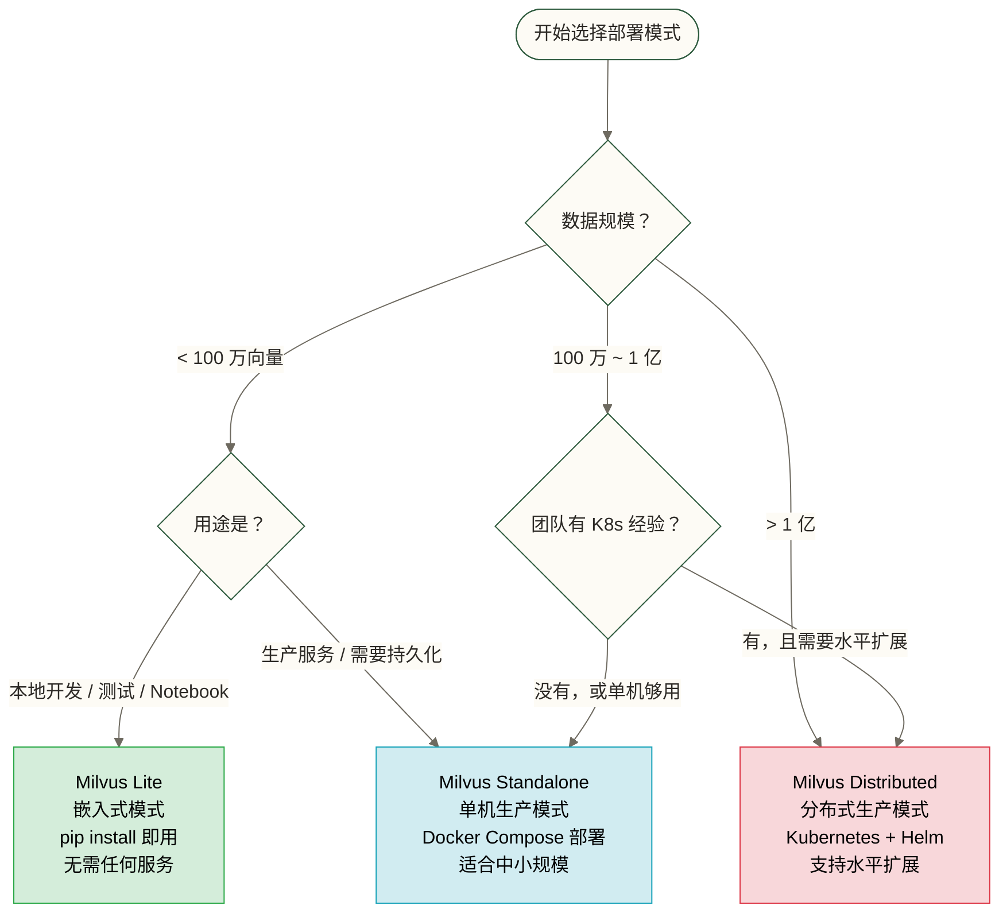
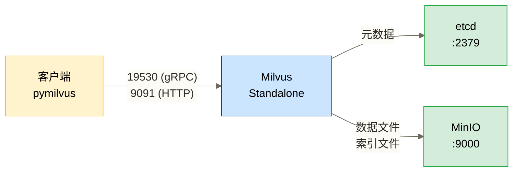
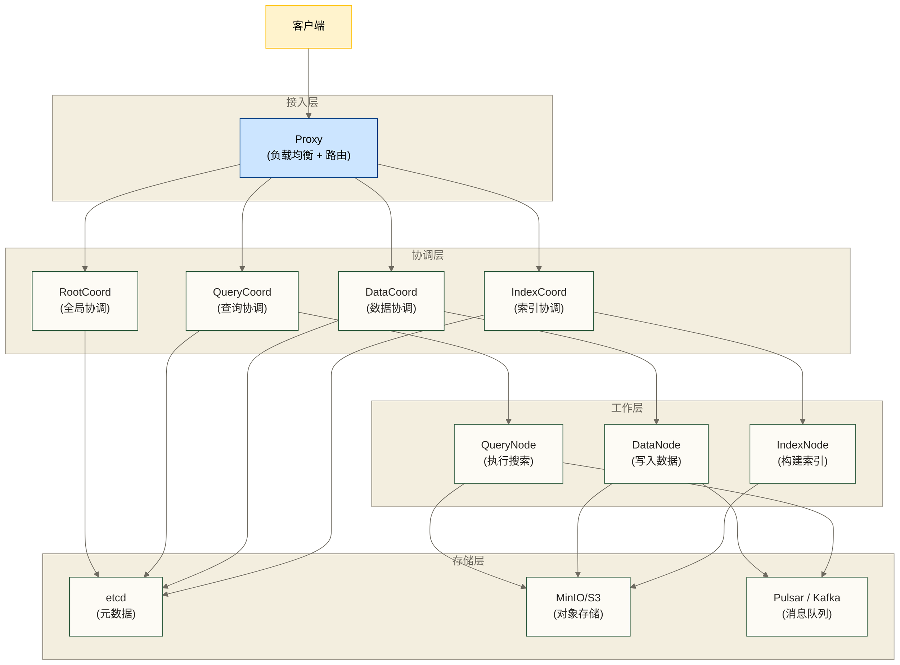

# Milvus 安装与部署

> [!info] 文档定位
> 本文覆盖 Milvus 三种部署模式的完整操作步骤——Lite（嵌入式）、Standalone（单机）、Distributed（分布式）。无论你是在 Jupyter Notebook 里探索，还是要上线一个支撑亿级向量的生产系统，都能在这里找到对应的部署方案。

## 目录

- [[#部署模式选择：先做决策，再动手]]
- [[#Milvus Lite：嵌入式模式]]
- [[#Milvus Standalone：单机生产模式]]
- [[#Milvus Distributed：分布式生产模式]]
- [[#Attu：可视化管理工具]]
- [[#连接配置与健康检查]]
- [[#常见问题排查]]

---

## 部署模式选择：先做决策，再动手

Milvus 有三种部署模式，复杂度和能力依次递增。错误的模式选择会让你在不必要的地方浪费大量时间——在生产里用 Lite，或者在本地开发时折腾分布式集群，都是常见的踩坑。

下面这个决策树帮你在 2 分钟内完成选型：



### 三种模式快速对比

| 维度 | Milvus Lite | Standalone | Distributed |
|------|-------------|------------|-------------|
| 部署复杂度 | 极低（pip install） | 低（Docker Compose） | 高（K8s + Helm） |
| 依赖服务 | 无 | etcd + MinIO | etcd + MinIO + Pulsar/Kafka |
| 向量规模 | 取决于本地资源与负载 | 取决于单机资源与负载 | 取决于集群资源与配置（可横向扩展） |
| 高可用 | 不支持 | 不支持 | 支持 |
| 适用场景 | 开发 / 测试 | 中小规模生产 | 大规模生产 |
| 推荐硬件 | 笔记本即可 | 16G 内存起步 | 多节点集群 |

> [!tip] 建议的学习路径
> 本地先用 **Lite** 跑通代码逻辑 → 用 **Standalone** 做集成测试，并评估其是否满足生产要求 → 当单机容量、吞吐量或可用性不能满足需求时考虑 **Distributed**。5000 万条向量可作为一个假设性评估点，不是必须达到的门槛；是否需要分布式部署应由负载测试和运维要求决定。

---

## Milvus Lite：嵌入式模式

### 什么是 Milvus Lite

Milvus Lite 是 Milvus 的嵌入式版本。它把 Milvus 的核心功能打包进 Python 库，数据存在本地文件里，不需要启动任何服务。你可以把它理解成向量数据库领域的 SQLite——轻量、够用、零配置。

> [!note] 适用场景
> - 本地开发和原型验证
> - Jupyter Notebook 中的交互式探索
> - 单元测试和集成测试
> - 算法实验，无需运维投入

> [!warning] 不适合 Lite 的场景
> - 生产环境（本地文件模式可持久化，但不提供面向生产服务的高可用保障；仅内存模式在进程退出后丢失数据）
> - 多进程并发写入
> - 不能满足本地资源与性能目标的数据集（100 万条可作为假设性测试点，不是统一性能界限）
> - 需要高可用和备份的场景

### 安装

```bash
# 安装 pymilvus，[model] 扩展包含常用向量模型依赖
pip install pymilvus[model]

# 只安装核心库（不需要内置模型时）
pip install pymilvus
```

> [!info] 版本要求
> Python >= 3.8，推荐使用 3.10 或 3.11。pymilvus 2.4.x 起支持 Milvus Lite。

### 5 行代码启动

```python
from pymilvus import MilvusClient

# 连接到本地文件（文件不存在时自动创建）
client = MilvusClient("./milvus_demo.db")

# 创建 collection（简化模式，自动推断 schema）
client.create_collection(
    collection_name="demo",
    dimension=768  # 向量维度，与你的 embedding 模型对齐
)

# 插入一条数据
client.insert(
    collection_name="demo",
    data=[{"id": 1, "vector": [0.1] * 768, "text": "hello milvus"}]
)

# 搜索最相似的 3 条
results = client.search(
    collection_name="demo",
    data=[[0.1] * 768],
    limit=3,
    output_fields=["text"]
)
print(results)
```

### Lite 的数据存储

Milvus Lite 的数据存储在你指定的 `.db` 文件中，本质是 SQLite 格式。

```python
# 指定不同路径存储数据
client = MilvusClient("/path/to/your/data.db")

# 使用内存模式（程序退出后数据消失）
client = MilvusClient(":memory:")
```

> [!warning] 数据迁移提醒
> Milvus Lite 的数据文件格式与 Standalone/Distributed 不兼容，无法直接迁移。从 Lite 升级到 Standalone 时，需要重新导入原始数据并重建向量。规划好了再开始，避免后期数据迁移的麻烦。

---

## Milvus Standalone：单机生产模式

### 架构说明

Standalone 模式下，Milvus 依赖两个外部服务：

- **etcd**：存储元数据（Collection 定义、Schema、节点状态）
- **MinIO**：存储向量数据和索引文件

这三个服务用 Docker Compose 统一管理，对外只暴露 Milvus 的端口（默认 19530）。



### Docker Compose 部署

**第一步：获取 docker-compose.yml**

```bash
# 创建工作目录
mkdir milvus-standalone && cd milvus-standalone

# 下载官方 compose 文件（Milvus 2.4.x）
wget https://github.com/milvus-io/milvus/releases/download/v2.4.9/milvus-standalone-docker-compose.yml \
     -O docker-compose.yml
```

**docker-compose.yml 完整内容**（建议直接使用以下经过注释的版本）：

```yaml
version: '3.5'

services:
  # ── etcd：Milvus 的元数据存储 ──────────────────────────
  etcd:
    container_name: milvus-etcd
    image: quay.io/coreos/etcd:v3.5.5
    environment:
      - ETCD_AUTO_COMPACTION_MODE=revision
      - ETCD_AUTO_COMPACTION_RETENTION=1000
      - ETCD_QUOTA_BACKEND_BYTES=4294967296  # 4GB，防止 etcd 空间满
      - ETCD_SNAPSHOT_COUNT=50000
    volumes:
      - ${DOCKER_VOLUME_DIRECTORY:-.}/volumes/etcd:/etcd  # 持久化 etcd 数据
    command: etcd
      -advertise-client-urls=http://127.0.0.1:2379
      -listen-client-urls http://0.0.0.0:2379
      --data-dir /etcd
    healthcheck:
      test: ["CMD", "etcdctl", "endpoint", "health"]
      interval: 30s
      timeout: 20s
      retries: 3

  # ── MinIO：向量数据和索引的对象存储 ─────────────────────
  minio:
    container_name: milvus-minio
    image: minio/minio:RELEASE.2023-03-13T19-46-17Z
    environment:
      MINIO_ACCESS_KEY: minioadmin    # 生产环境务必修改！
      MINIO_SECRET_KEY: minioadmin    # 生产环境务必修改！
    ports:
      - "9001:9001"  # MinIO 控制台，可用浏览器访问
      - "9000:9000"  # MinIO API
    volumes:
      - ${DOCKER_VOLUME_DIRECTORY:-.}/volumes/minio:/minio_data  # 持久化数据
    command: minio server /minio_data --console-address ":9001"
    healthcheck:
      test: ["CMD", "curl", "-f", "http://localhost:9000/minio/health/live"]
      interval: 30s
      timeout: 20s
      retries: 3

  # ── Milvus：向量数据库核心服务 ───────────────────────────
  standalone:
    container_name: milvus-standalone
    image: milvusdb/milvus:v2.4.9
    command: ["milvus", "run", "standalone"]
    security_opt:
      - seccomp:unconfined
    environment:
      ETCD_ENDPOINTS: etcd:2379
      MINIO_ADDRESS: minio:9000
    volumes:
      - ${DOCKER_VOLUME_DIRECTORY:-.}/volumes/milvus:/var/lib/milvus  # 持久化 Milvus 数据
    healthcheck:
      test: ["CMD", "curl", "-f", "http://localhost:9091/healthz"]
      interval: 30s
      start_period: 90s
      timeout: 20s
      retries: 3
    ports:
      - "19530:19530"  # gRPC，pymilvus 默认连接此端口
      - "9091:9091"    # HTTP API 和健康检查
    depends_on:
      - "etcd"
      - "minio"

networks:
  default:
    name: milvus
```

**第二步：启动服务**

```bash
# 后台启动所有服务
docker compose up -d

# 查看启动状态
docker compose ps
```

期望看到类似输出：

```text
NAME                 IMAGE                               STATUS
milvus-etcd          quay.io/coreos/etcd:v3.5.5         Up (healthy)
milvus-minio         minio/minio:...                    Up (healthy)
milvus-standalone    milvusdb/milvus:v2.4.9             Up (healthy)
```

**第三步：验证服务正常**

```bash
# 检查健康状态（返回 {"status":"ok"} 表示正常）
curl -f http://localhost:9091/healthz

# 查看 Milvus 日志（如果启动失败，从这里排查）
docker logs milvus-standalone --tail 50
```

### 数据持久化配置

默认情况下，数据存储在 `./volumes/` 目录下。**生产环境强烈建议挂载到独立的高速磁盘**：

```bash
# 启动时指定数据目录
DOCKER_VOLUME_DIRECTORY=/data/milvus docker compose up -d
```

建议的目录结构：

| 目录路径 | 说明 |
|---------|------|
| `/data/milvus/volumes/etcd/` | etcd 元数据，通常很小（< 1GB） |
| `/data/milvus/volumes/minio/` | 向量数据和索引，随数据量增长 |
| `/data/milvus/volumes/milvus/` | Milvus 本地缓存 |

> [!warning] 磁盘选型建议
> MinIO 存储向量数据，I/O 是性能瓶颈。推荐使用 SSD，避免将 MinIO 数据放在 NFS 或网络挂载盘上。机械硬盘会导致索引构建和搜索性能大幅下降。

### 资源配置建议

| 数据规模 | 内存 | CPU | 磁盘 |
|---------|------|-----|------|
| < 100 万向量 | 16 GB | 4 核 | 100 GB SSD |
| 100 万 ~ 1000 万 | 32 GB | 8 核 | 500 GB SSD |
| 1000 万 ~ 1 亿 | 64 GB+ | 16 核+ | 2 TB SSD |

> [!tip] 内存估算公式
> 粗略估算：向量维度 × 4 字节 × 向量数量 × 1.5（索引开销）= 所需内存
> 例如：1000 万条 768 维向量 ≈ 768 × 4 × 10,000,000 × 1.5 ≈ 46 GB

### 停止和重启

```bash
# 停止服务（数据保留）
docker compose down

# 停止服务并删除 Compose 管理的卷；不会删除本文使用的 ./volumes/ 绑定目录
docker compose down -v

# 重启单个服务
docker compose restart standalone
```

---

## Milvus Distributed：分布式生产模式

### 架构组件全景

Distributed 模式将 Milvus 拆分为多个独立服务，每个组件可以独立扩缩容：



### Kubernetes + Helm 部署步骤

**前置条件：**
- Kubernetes 集群（1.20+）
- Helm 3.x
- kubectl 配置完成
- 集群总内存 >= 32 GB（最小配置）

**第一步：添加 Milvus Helm 仓库**

```bash
helm repo add milvus https://zilliztech.github.io/milvus-helm/
helm repo update
```

**第二步：最小化配置部署（开发/测试用）**

```bash
# 创建命名空间
kubectl create namespace milvus

# 使用最小配置部署（所有组件单副本）
helm install milvus milvus/milvus \
  --namespace milvus \
  --set cluster.enabled=true \
  --set etcd.replicaCount=1 \
  --set minio.mode=standalone \
  --set pulsar.enabled=false \
  --set kafka.enabled=true \
  --set kafka.replicaCount=1
```

**第三步：多副本配置示例（生产方案评估起点，不构成高可用保证）**

创建 `values-production.yaml`：

```yaml
# values-production.yaml - 待匹配 chart 版本并完成故障验证的多副本配置示例
cluster:
  enabled: true

# Proxy：接入层，可水平扩展
proxy:
  replicas: 2
  resources:
    requests:
      memory: "4Gi"
      cpu: "2"
    limits:
      memory: "8Gi"
      cpu: "4"

# QueryNode：负责执行向量搜索，搜索压力大时横向扩展此组件
queryNode:
  replicas: 3
  resources:
    requests:
      memory: "16Gi"  # 索引要加载到内存，给足内存
      cpu: "4"
    limits:
      memory: "32Gi"
      cpu: "8"

# DataNode：负责数据写入
dataNode:
  replicas: 2
  resources:
    requests:
      memory: "4Gi"
      cpu: "2"
    limits:
      memory: "8Gi"
      cpu: "4"

# IndexNode：负责构建索引，CPU 密集型
indexNode:
  replicas: 2
  resources:
    requests:
      memory: "8Gi"
      cpu: "8"
    limits:
      memory: "16Gi"
      cpu: "16"

# etcd：高可用配置
etcd:
  replicaCount: 3
  persistence:
    storageClassName: "fast-ssd"  # 替换为你的 StorageClass

# MinIO：生产用分布式模式
minio:
  mode: distributed
  replicas: 4
  persistence:
    storageClassName: "fast-ssd"
    size: 500Gi

# Kafka（替代 Pulsar；稳定性取决于部署配置和实际负载）
pulsar:
  enabled: false
kafka:
  enabled: true
  replicaCount: 3
```

```bash
# 使用生产配置部署
helm install milvus milvus/milvus \
  --namespace milvus \
  --values values-production.yaml
```

**第四步：验证部署状态**

```bash
# 查看所有 Pod 状态
kubectl get pods -n milvus

# 期望所有 Pod 状态为 Running
# NAME                                   READY   STATUS    RESTARTS
# milvus-datacoord-xxx                   1/1     Running   0
# milvus-datanode-xxx                    1/1     Running   0
# milvus-indexcoord-xxx                  1/1     Running   0
# milvus-indexnode-xxx                   1/1     Running   0
# milvus-proxy-xxx                       1/1     Running   0
# milvus-querycoord-xxx                  1/1     Running   0
# milvus-querynode-xxx                   1/1     Running   0
# milvus-rootcoord-xxx                   1/1     Running   0

# 检查 Milvus 健康状态
kubectl port-forward svc/milvus 19530:19530 -n milvus &
# 此命令仅转发 19530；不能据此访问本地 9091 健康检查端口
```

### 节点扩缩容

```bash
# 扩展 QueryNode（搜索压力大时）
kubectl scale deployment milvus-querynode --replicas=6 -n milvus

# 或通过 Helm 更新
helm upgrade milvus milvus/milvus \
  --namespace milvus \
  --reuse-values \
  --set queryNode.replicas=6
```

> [!tip] 扩容时机判断
> - QueryNode CPU 持续 > 70%：扩 QueryNode
> - DataNode 写入延迟增加：扩 DataNode
> - 索引构建队列堆积：扩 IndexNode

---

## Attu：可视化管理工具

Attu 是 Milvus 官方的 Web 管理界面，可以在浏览器中直观地管理 Collection、浏览数据、执行搜索。

### 启动 Attu

```bash
# Standalone 模式（本地）
docker run -d \
  --name attu \
  --network milvus \
  -p 8000:3000 \
  -e MILVUS_URL=milvus-standalone:19530 \
  zilliz/attu:latest

# 访问 http://localhost:8000
```

```bash
# 连接远程 Milvus（生产环境）
docker run -d \
  --name attu \
  -p 8000:3000 \
  -e MILVUS_URL=your-milvus-host:19530 \
  zilliz/attu:latest
```

### Attu 主要功能

| 功能 | 说明 |
|------|------|
| Collection 管理 | 创建、删除、查看 Collection 的 Schema 和统计信息 |
| 数据浏览 | 翻页查看已插入的数据 |
| 向量搜索 | 在界面中直接执行搜索，调试查询参数 |
| 索引管理 | 查看和管理 Collection 的索引状态 |
| 系统监控 | 查看节点状态、内存使用、连接数 |

> [!note] Attu 适合的场景
> 开发阶段调试和数据验证用。生产环境的监控建议接入 Prometheus + Grafana（Milvus 原生支持 metrics 暴露）。

---

## 连接配置与健康检查

### pymilvus 连接方式

```python
from pymilvus import MilvusClient, connections

# ── 方式一：MilvusClient（推荐，新版简化 API）──────────────
# 本地 Milvus Lite
client = MilvusClient("./local.db")

# 连接远程 Standalone
client = MilvusClient(
    uri="http://localhost:19530"
)

# 带认证（开启了 Milvus 鉴权时）
client = MilvusClient(
    uri="http://your-host:19530",
    token="root:Milvus"  # 格式：username:password
)

# ── 方式二：connections（旧版 API，兼容性更广）─────────────
from pymilvus import connections

connections.connect(
    alias="default",       # 连接别名，后续操作引用此别名
    host="localhost",
    port="19530",
    user="root",           # 开启鉴权时填写
    password="Milvus"
)

# 断开连接
connections.disconnect("default")
```

### 连接池配置

在高并发场景下，合理配置连接池可以显著提升吞吐量：

```python
from pymilvus import connections

connections.connect(
    alias="default",
    host="localhost",
    port="19530",
    pool_size=10,      # 连接池大小，根据并发量调整
    timeout=30         # 连接超时（秒）
)
```

### 健康检查代码

```python
from pymilvus import MilvusClient, utility, connections

def check_milvus_health(uri: str) -> dict:
    """
    检查 Milvus 连接状态和服务健康度。
    返回包含版本、状态和 Collection 数量的字典。
    """
    try:
        client = MilvusClient(uri=uri)

        # 获取 Milvus 版本信息
        # 注：utility 函数需要先建立 connections
        connections.connect(uri=uri)
        server_version = utility.get_server_version()

        # 列出所有 Collection
        collections = client.list_collections()

        return {
            "status": "healthy",
            "server_version": server_version,
            "collection_count": len(collections),
            "collections": collections
        }
    except Exception as e:
        return {
            "status": "unhealthy",
            "error": str(e)
        }

# 使用示例
health = check_milvus_health("http://localhost:19530")
print(health)
# {'status': 'healthy', 'server_version': 'v2.4.9', 'collection_count': 3, ...}
```

---

## 常见问题排查

### 问题 1：Milvus 容器启动后立即退出

```bash
# 查看详细日志
docker logs milvus-standalone --tail 100
```

常见原因：
- **etcd 未就绪**：Milvus 启动时 etcd 可能还没准备好。本文列表式 `depends_on` 仅规定启动顺序，不等待健康检查通过。先检查 etcd 和 MinIO 的健康状态；依赖就绪后可执行 `docker compose restart standalone`。若要自动等待依赖健康，需使用当前 Compose 实现支持的 `condition: service_healthy` 长格式配置。
- **MinIO 连接失败**：检查 MinIO 的 `MINIO_ACCESS_KEY` 和 `MINIO_SECRET_KEY` 是否与 Milvus 配置一致。
- **端口被占用**：`lsof -i :19530` 检查端口是否被其他进程占用。

### 问题 2：连接超时（Connection timed out）

```python
# 确认 Milvus 在监听
# 在 Milvus 所在机器上执行
# curl http://localhost:9091/healthz

# 如果是远程连接，检查防火墙规则
# 19530 (gRPC) 和 9091 (HTTP) 需要放通
```

### 问题 3：内存不足导致服务崩溃

```bash
# 查看内存使用
docker stats milvus-standalone

# 临时解决：限制 Collection 加载到内存的数据量
# 在 milvus.yaml 中配置：
# queryNode:
#   cache:
#     memoryWatermark: 0.8  # 内存使用超过 80% 时触发 LRU 驱逐
```

### 问题 4：磁盘空间不足

```bash
# 查看 MinIO 数据占用
docker exec milvus-minio du -sh /minio_data
```

对于仍存在的 Collection，可在建立连接后请求压缩：

```python
from pymilvus import Collection, connections

connections.connect(alias="default", uri="http://localhost:19530")
collection = Collection("your_collection_name", using="default")
collection.compact()
```

压缩请求不保证立即释放磁盘空间，也不能通过上述方式压缩已经删除的 Collection；对象回收还取决于服务的垃圾回收机制与保留配置。

> [!tip] 相关文档
> - 安装完成后，参考 [[【技术与工具】/向量数据库/Milvus/05-第一个Milvus应用]] 运行你的第一个向量搜索
> - 理解 Collection 和 Schema 设计，参考 02-核心概念与数据模型
> - 索引类型选择，参考 03-索引原理与选型
> - 如果还没确定是否要用 Milvus，先看 [[【技术与工具】/向量数据库/00-向量数据库选型指南]]

---

#Milvus #向量数据库 #部署 #Docker #Kubernetes #安装配置
