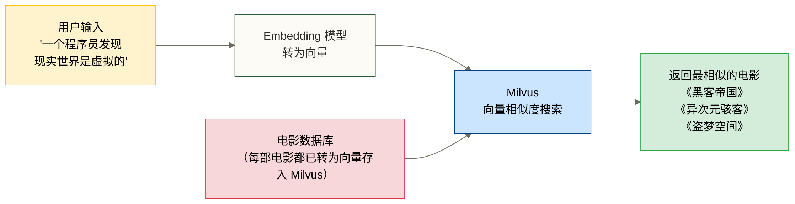
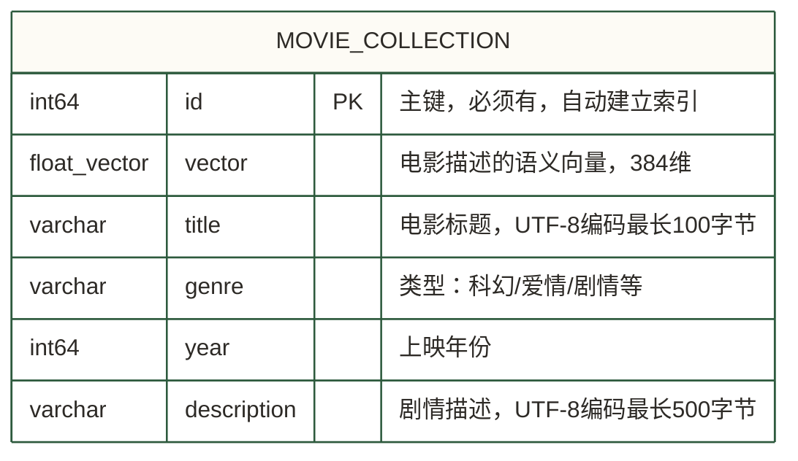

# 第一个 Milvus 应用：电影语义搜索

> [!info] 文档定位
> 这是一个完整的动手教程。我们用**电影语义搜索**这一个真实场景，从第一行代码写到能运行的完整应用。每一行代码都有注释，每一个概念都有解释。读完并跑通之后，你就具备了独立构建向量搜索系统的基础能力。

## 目录

- [[#场景设定：我们要做什么]]
- [[#环境准备]]
- [[#Step 1：准备电影数据]]
- [[#Step 2：连接 Milvus]]
- [[#Step 3：创建 Collection]]
- [[#Step 4：插入数据]]
- [[#Step 5：创建索引]]
- [[#Step 6：执行搜索]]
- [[#Step 7：清理资源]]
- [[#完整代码汇总]]
- [[#常见新手问题]]

---

## 场景设定：我们要做什么

想象你在构建一个电影推荐系统。用户输入一段描述，比如"一个程序员发现现实世界是虚拟的"，系统需要找出与这个描述最相似的电影——即使电影名字和描述里一个字都不重合。

这就是**语义搜索**的典型场景；仅靠字面关键词匹配可能难以识别这类关联，向量搜索可用于探索语义相似性，但效果取决于模型、数据和查询。



我们要构建的系统包含这几个核心步骤：

1. 准备电影数据（title、genre、description）
2. 用 sentence-transformers 把每部电影的描述转为向量
3. 把向量和元数据存入 Milvus
4. 用户输入描述 → 转为向量 → 在 Milvus 中搜索最相似的结果

整个教程用同一批电影数据贯穿，你可以清晰地看到每一步在系统中扮演的角色。

---

## 环境准备

### 安装依赖

```bash
# pymilvus：Milvus 的 Python 客户端
# sentence-transformers：生成文本向量的预训练模型库
pip install pymilvus sentence-transformers

# 如果使用 Milvus Lite（本地嵌入模式，无需启动服务）
pip install pymilvus[model]
```

> [!info] 本教程使用的运行环境
> - pymilvus >= 2.4.0
> - sentence-transformers >= 2.7.0
> - Python >= 3.8
> - Milvus：本教程默认使用 **Milvus Lite**（无需任何服务，pip install 即用）。如果你已经部署了 Standalone，只需修改连接部分的代码即可，其余完全相同。

### 验证安装

```python
import pymilvus
from sentence_transformers import SentenceTransformer

print(f"pymilvus 版本: {pymilvus.__version__}")

# 下载并加载模型（首次运行会从网络下载，约 90MB）
model = SentenceTransformer("all-MiniLM-L6-v2")
print("模型加载成功")

# 快速验证向量生成
test_vec = model.encode("hello world")
print(f"向量维度: {len(test_vec)}")  # 应输出 384
```

> [!tip] 模型选择说明
> 本教程使用 `all-MiniLM-L6-v2`，向量维度 384，在速度和质量之间取得了良好平衡。
> 生产环境可考虑 `all-mpnet-base-v2`（维度 768，质量更高但更慢）或 OpenAI `text-embedding-3-small`（需要 API Key）。
> 关键原则：**Collection 的维度必须与你选用的模型一致**，之后不能修改。

---

## Step 1：准备电影数据

我们准备 20 部电影，每部包含 id、标题、类型、上映年份和描述五个字段。描述是语义搜索的"被搜索对象"。

```python
# step1_prepare_data.py

from sentence_transformers import SentenceTransformer

# ── 20 部电影的原始数据 ────────────────────────────────────
MOVIES = [
    {
        "id": 1,
        "title": "黑客帝国",
        "genre": "科幻",
        "year": 1999,
        "description": "程序员尼奥发现他生活的世界是一个虚假的计算机模拟程序，真实的人类文明早已被机器奴役。"
    },
    {
        "id": 2,
        "title": "盗梦空间",
        "genre": "科幻",
        "year": 2010,
        "description": "专业窃梦者通过进入他人梦境盗取商业机密，接受了一项在梦境中植入想法的危险任务。"
    },
    {
        "id": 3,
        "title": "星际穿越",
        "genre": "科幻",
        "year": 2014,
        "description": "地球濒临灭绝，一组宇航员穿越虫洞前往遥远星系寻找人类新家园，跨越时间维度拯救人类。"
    },
    {
        "id": 4,
        "title": "泰坦尼克号",
        "genre": "爱情",
        "year": 1997,
        "description": "两个来自不同阶级的年轻人在豪华邮轮上相遇坠入爱河，在船只沉没的悲剧中展现出真挚的爱情。"
    },
    {
        "id": 5,
        "title": "肖申克的救赎",
        "genre": "剧情",
        "year": 1994,
        "description": "被冤枉入狱的银行家在监狱中坚守希望，用智慧和毅力最终获得自由，展现人类精神的不屈。"
    },
    {
        "id": 6,
        "title": "终结者",
        "genre": "科幻",
        "year": 1984,
        "description": "未来的机器人被送回过去暗杀人类抵抗军领袖的母亲，一名战士也随之穿越时间保护她。"
    },
    {
        "id": 7,
        "title": "蜘蛛侠：英雄无归",
        "genre": "超级英雄",
        "year": 2021,
        "description": "蜘蛛侠请求奇异博士抹去所有人的记忆，却意外打开了多元宇宙的大门，来自不同宇宙的反派纷纷出现。"
    },
    {
        "id": 8,
        "title": "寄生虫",
        "genre": "剧情",
        "year": 2019,
        "description": "贫穷的一家人通过精心策划骗局渗入富裕家庭，展现了贫富分化社会中的阶级矛盾与人性。"
    },
    {
        "id": 9,
        "title": "阿甘正传",
        "genre": "剧情",
        "year": 1994,
        "description": "智力低下的阿甘凭借善良和坚持跑过了美国历史上的重要时刻，诠释了生命像一盒巧克力的哲学。"
    },
    {
        "id": 10,
        "title": "异次元骇客",
        "genre": "科幻",
        "year": 1999,
        "description": "科学家创造了一个完美的1937年虚拟世界模拟器，却发现自己所处的世界也可能是模拟的。"
    },
    {
        "id": 11,
        "title": "搏击俱乐部",
        "genre": "剧情",
        "year": 1999,
        "description": "一个失眠的上班族与神秘的肥皂推销员创建了秘密搏击俱乐部，逐渐演变成危险的无政府主义运动。"
    },
    {
        "id": 12,
        "title": "阿凡达",
        "genre": "科幻",
        "year": 2009,
        "description": "残疾退伍军人在外星球潘多拉控制蓝色外星人阿凡达，与土著纳美人融合并最终站在他们一边对抗人类入侵。"
    },
    {
        "id": 13,
        "title": "千与千寻",
        "genre": "动画",
        "year": 2001,
        "description": "少女千寻误入神灵的世界，父母变成了猪，她必须在奇异的澡堂工作才能救回父母回到人间。"
    },
    {
        "id": 14,
        "title": "辛德勒名单",
        "genre": "历史",
        "year": 1993,
        "description": "德国商人辛德勒在二战期间利用工厂雇用犹太人，冒着生命危险从纳粹手中拯救了一千多名犹太人。"
    },
    {
        "id": 15,
        "title": "楚门的世界",
        "genre": "剧情",
        "year": 1998,
        "description": "一个普通男人逐渐发现自己从出生起就生活在一个巨大的电视直播节目中，整个小镇都是摄影棚。"
    },
    {
        "id": 16,
        "title": "黑暗骑士",
        "genre": "超级英雄",
        "year": 2008,
        "description": "蝙蝠侠与哥谭市的新警察局长联手对抗小丑，小丑通过恐怖行动挑战人类道德的底线。"
    },
    {
        "id": 17,
        "title": "哈利·波特与魔法石",
        "genre": "奇幻",
        "year": 2001,
        "description": "孤儿哈利在11岁时得知自己是巫师，进入霍格沃茨魔法学校学习魔法，揭开父母死亡的真相。"
    },
    {
        "id": 18,
        "title": "当幸福来敲门",
        "genre": "剧情",
        "year": 2006,
        "description": "穷困潦倒的父亲带着儿子无家可归，凭借不屈的意志从实习生做起最终成为成功的股票经纪人。"
    },
    {
        "id": 19,
        "title": "头号玩家",
        "genre": "科幻",
        "year": 2018,
        "description": "2045年人们逃离现实进入虚拟世界绿洲，少年韦德追寻创始人留下的彩蛋，为争夺绿洲控制权展开竞赛。"
    },
    {
        "id": 20,
        "title": "2001太空漫游",
        "genre": "科幻",
        "year": 1968,
        "description": "宇航员与人工智能 HAL 9000 踏上前往木星的神秘旅程，探索人类进化与宇宙文明起源的终极问题。"
    },
]

def generate_embeddings(movies: list, model_name: str = "all-MiniLM-L6-v2") -> list:
    """
    为每部电影的描述生成向量。
    返回包含 embedding 字段的电影列表。
    """
    print(f"加载 Embedding 模型: {model_name}")
    model = SentenceTransformer(model_name)

    # 批量提取描述文本（批量处理比逐条处理快很多）
    descriptions = [movie["description"] for movie in movies]

    print(f"正在为 {len(descriptions)} 部电影生成向量...")
    # encode() 返回 numpy array，Milvus 接受 list 和 numpy array
    embeddings = model.encode(descriptions, show_progress_bar=True)

    # 将向量附加到原始数据中
    for movie, embedding in zip(movies, embeddings):
        movie["vector"] = embedding.tolist()  # 转为 Python list

    print(f"向量生成完成，维度: {len(movies[0]['vector'])}")
    return movies

# 直接运行此模块时验证数据
if __name__ == "__main__":
    movies_with_vectors = generate_embeddings(MOVIES)
    print(f"\n示例数据（前 2 条）:")
    for movie in movies_with_vectors[:2]:
        preview = movie.copy()
        preview["vector"] = f"[{movie['vector'][0]:.4f}, ..., {movie['vector'][-1]:.4f}]（共 {len(movie['vector'])} 维）"
        print(preview)
```

> [!note] 为什么对描述而不是标题做向量化？
> 标题"黑客帝国"和"异次元骇客"没有任何字面关联，但它们的描述在语义上非常相近（都涉及"现实是模拟的"主题）。对描述做向量化，就能捕捉到这种深层语义关联，这是向量搜索的核心价值所在。

---

## Step 2：连接 Milvus

### MilvusClient vs 旧版 connections

pymilvus 2.4.x 提供了两套 API，了解它们的区别有助于你读懂各种教程和文档：

| 对比维度 | MilvusClient（新版，推荐） | connections（旧版） |
|---------|--------------------------|-------------------|
| API 风格 | 面向对象，更简洁 | 面向过程，更底层 |
| 连接管理 | 自动管理 | 手动 connect/disconnect |
| 适用场景 | 新项目、快速开发 | 需要精细控制的场景 |
| Milvus Lite 支持 | 原生支持 | 不支持 |

**本教程统一使用 MilvusClient。**

```python
# step2_connect.py

from pymilvus import MilvusClient

def create_client(mode: str = "lite") -> MilvusClient:
    """
    根据模式创建 Milvus 客户端。
    mode: "lite" | "standalone" | "cloud"
    """
    if mode == "lite":
        # Milvus Lite：数据存本地文件，无需任何服务
        # 文件不存在时自动创建
        client = MilvusClient("./movie_search.db")
        print("已连接到 Milvus Lite（本地文件模式）")

    elif mode == "standalone":
        # 连接到已部署的 Milvus Standalone
        # 参考 04-安装与部署 启动服务
        client = MilvusClient(
            uri="http://localhost:19530"
        )
        print("已连接到 Milvus Standalone")

    elif mode == "standalone_auth":
        # 带认证的 Standalone 连接（开启了用户认证时）
        client = MilvusClient(
            uri="http://localhost:19530",
            token="root:Milvus"   # 格式：username:password
        )
        print("已连接到 Milvus Standalone（带认证）")

    else:
        raise ValueError(f"未知模式: {mode}")

    return client

# 使用示例
if __name__ == "__main__":
    client = create_client(mode="lite")  # 默认使用 Lite 模式

    # 验证连接：列出当前所有 Collection
    collections = client.list_collections()
    print(f"当前已有的 Collections: {collections}")
```

---

## Step 3：创建 Collection

Collection 是 Milvus 中的核心数据组织单元，类似关系数据库中的"表"，但专门为向量数据设计。

### 理解 Schema

在创建 Collection 之前，需要定义数据的结构（Schema）。我们的电影数据有这些字段：



```python
# step3_create_collection.py

from pymilvus import MilvusClient, DataType

COLLECTION_NAME = "movie_search"  # Collection 名称，整个教程保持一致
VECTOR_DIM = 384                   # all-MiniLM-L6-v2 的输出维度

def create_collection(client: MilvusClient) -> None:
    """
    定义 Schema 并创建电影搜索 Collection。
    如果 Collection 已存在则跳过创建。
    """

    # 检查是否已经存在，避免重复创建
    if client.has_collection(COLLECTION_NAME):
        print(f"Collection '{COLLECTION_NAME}' 已存在，跳过创建")
        return

    # ── 第一步：定义 Schema ──────────────────────────────────
    schema = client.create_schema(
        auto_id=False,          # False：我们自己管理 id；True：Milvus 自动生成
        enable_dynamic_field=True,  # True：允许插入 schema 里没定义的字段（灵活性）
    )

    # 主键字段：每部电影的唯一 ID
    schema.add_field(
        field_name="id",
        datatype=DataType.INT64,
        is_primary=True,        # 必须指定一个主键字段
        description="电影唯一ID"
    )

    # 向量字段：电影描述的语义向量，这是搜索的核心
    schema.add_field(
        field_name="vector",
        datatype=DataType.FLOAT_VECTOR,
        dim=VECTOR_DIM,         # 必须与 Embedding 模型输出维度一致！
        description="电影描述向量"
    )

    # 标量字段：可用于过滤（filter）的元数据
    schema.add_field(
        field_name="title",
        datatype=DataType.VARCHAR,
        max_length=100,         # VARCHAR 必须指定最大长度
        description="电影标题"
    )

    schema.add_field(
        field_name="genre",
        datatype=DataType.VARCHAR,
        max_length=50,
        description="电影类型"
    )

    schema.add_field(
        field_name="year",
        datatype=DataType.INT64,
        description="上映年份"
    )

    schema.add_field(
        field_name="description",
        datatype=DataType.VARCHAR,
        max_length=500,
        description="剧情描述"
    )

    # ── 第二步：定义索引参数（在创建时一并指定）────────────────
    # HNSW 是推荐的默认索引类型，兼顾速度和精度
    # 详细的索引原理参见 03-索引原理与选型
    index_params = client.prepare_index_params()
    index_params.add_index(
        field_name="vector",        # 对向量字段建索引
        index_type="HNSW",
        metric_type="COSINE",       # 余弦相似度，文本语义搜索的首选
        params={
            "M": 16,                # HNSW 图中每个节点的最大连接数
                                    # 越大：精度高，内存占用多，建议 8~64
            "efConstruction": 200   # 构建时的搜索深度，越大精度越高但构建越慢
                                    # 建议值：100~500
        }
    )

    # ── 第三步：创建 Collection ───────────────────────────────
    client.create_collection(
        collection_name=COLLECTION_NAME,
        schema=schema,
        index_params=index_params
    )

    print(f"Collection '{COLLECTION_NAME}' 创建成功")
    print(f"字段列表: {[f.name for f in schema.fields]}")
```

> [!warning] 维度一旦确定不能修改
> `dim=VECTOR_DIM` 这个参数与你的 Embedding 模型绑定。Collection 创建后，这个值**无法修改**。如果后续换了模型（比如从 384 维换到 768 维），必须创建新的 Collection 并重新导入所有数据。生产环境务必在一开始就确认好模型选型。

> [!note] metric_type 怎么选？
> - **COSINE**：余弦相似度，不受向量长度影响，文本语义搜索首选
> - **L2**：欧氏距离，适合图像特征等对绝对距离敏感的场景
> - **IP**（内积）：适合已经做了 L2 归一化的向量
> 对于 sentence-transformers 生成的文本向量，用 COSINE 即可。

---

## Step 4：插入数据

Schema 定好了，现在把 20 部电影的数据批量写入 Milvus。

```python
# step4_insert_data.py

from pymilvus import MilvusClient
from step3_create_collection import COLLECTION_NAME

def insert_movies(client: MilvusClient, movies_with_vectors: list) -> None:
    """
    批量插入电影数据到 Milvus。
    movies_with_vectors：包含 vector 字段的电影列表（来自 step1 的输出）
    """

    # 确保每条记录只包含 Schema 中定义的字段
    # （如果有 enable_dynamic_field=True，多余字段也会被保存）
    data_to_insert = []
    for movie in movies_with_vectors:
        data_to_insert.append({
            "id": movie["id"],
            "vector": movie["vector"],       # float list，与 dim=384 对应
            "title": movie["title"],
            "genre": movie["genre"],
            "year": movie["year"],
            "description": movie["description"]
        })

    # 批量插入（insert 接受 list of dict 格式）
    result = client.insert(
        collection_name=COLLECTION_NAME,
        data=data_to_insert
    )

    print(f"插入完成，共插入 {result['insert_count']} 条记录")
    print(f"插入的 ID 列表: {result['ids']}")

    # ── 关键操作：Flush ────────────────────────────────────────
    # insert 成功不能简单解释为数据仅存在于内存缓冲区。
    # flush 涉及数据段封存和持久化流程；写入可靠性还取决于部署与存储配置，
    # 不能以是否调用 flush 统一判断进程退出后的数据安全或查询可见性。
    #
    # 注意：Milvus Lite 模式下 flush 是自动的，不需要手动调用。
    # Standalone/Distributed 模式下，建议在批量导入结束后显式 flush。
    client.flush(COLLECTION_NAME)
    print("Flush 完成，数据已持久化到磁盘")
```

> [!warning] 关于 Flush 的常见误解
> **误区**：每次 insert 之后都调用 flush。
> **正确做法**：批量导入结束后调用一次 flush。频繁 flush 会产生大量小文件，严重影响后续搜索性能。
> Milvus 的自动flush行为取决于部署版本和配置，本文不指定通用周期。插入后立即搜索应结合一致性设置、加载状态和过滤条件判断查询可见性，不能把手动flush视为即时可检索的必要条件。

---

## Step 5：创建索引

等等——我们在 Step 3 创建 Collection 时不是已经指定了索引参数了吗？

是的。在 `create_collection` 时传入 `index_params`，Milvus 会在数据导入后**自动开始构建索引**。但有时你需要**手动触发**或**等待索引构建完成**，特别是大批量数据导入之后。

```python
# step5_create_index.py

from pymilvus import MilvusClient
from step3_create_collection import COLLECTION_NAME

def ensure_index_and_load(client: MilvusClient) -> None:
    """
    确保索引已构建完成，并加载 Collection 到内存（搜索前必须）。
    """

    # ── 检查索引状态 ─────────────────────────────────────────
    # 列出当前 Collection 上的所有索引
    indexes = client.list_indexes(COLLECTION_NAME)
    print(f"当前索引列表: {indexes}")

    # 如果索引不存在（极少情况），手动创建
    if not indexes:
        print("索引不存在，手动创建 HNSW 索引...")
        index_params = client.prepare_index_params()
        index_params.add_index(
            field_name="vector",
            index_type="HNSW",
            metric_type="COSINE",
            params={"M": 16, "efConstruction": 200}
        )
        client.create_index(
            collection_name=COLLECTION_NAME,
            index_params=index_params
        )
        print("索引创建完成")

    # ── 加载 Collection 到内存 ───────────────────────────────
    # 这一步是搜索前的必要操作！
    # Milvus 的数据存储在磁盘，搜索时需要先加载到内存。
    # load() 会触发索引和数据的内存映射，之后才能执行搜索。
    print("正在加载 Collection 到内存...")
    client.load_collection(COLLECTION_NAME)
    print("Collection 加载完成，可以开始搜索")

    # 查看 Collection 统计信息
    stats = client.get_collection_stats(COLLECTION_NAME)
    print(f"Collection 统计: 共 {stats['row_count']} 条记录")
```

> [!warning] 搜索前必须 load，这是最常见的新手错误
> 如果你遇到 `CollectionNotLoadedException`，应检查 Collection 是否已加载；搜索返回空结果还可能与数据量、过滤条件和查询可见性有关，不能仅凭空结果判断缺少 `load_collection()`。
> - Milvus Lite 模式下 load 是自动的，不需要手动调用
> - Standalone/Distributed 模式下，每次重启 Milvus 服务后都需要重新 load
> - load 操作是异步的，大 Collection 可能需要等待几秒到几分钟

---

## Step 6：执行搜索

所有准备工作完成，现在来写搜索函数——这是整个系统最核心的部分。

### 基础向量搜索

```python
# step6_search.py

from sentence_transformers import SentenceTransformer
from pymilvus import MilvusClient
from step3_create_collection import COLLECTION_NAME

MODEL = SentenceTransformer("all-MiniLM-L6-v2")

def semantic_search(
    client: MilvusClient,
    query_text: str,
    top_k: int = 5,
    output_fields: list = None
) -> list:
    """
    根据文本描述搜索最相似的电影。

    参数：
        query_text: 用户输入的搜索描述
        top_k: 返回前 k 个最相似的结果
        output_fields: 返回哪些字段（不含 vector，太长了）

    返回：
        list of dict，每个 dict 包含电影信息和相似度分数
    """

    if output_fields is None:
        output_fields = ["title", "genre", "year", "description"]

    # ── 第一步：将用户输入转为向量 ────────────────────────────
    # 必须使用与插入时相同的模型！
    query_vector = MODEL.encode(query_text).tolist()

    # ── 第二步：执行向量搜索 ──────────────────────────────────
    results = client.search(
        collection_name=COLLECTION_NAME,
        data=[query_vector],        # 注意：search 接受向量列表（支持批量查询）
                                    # 单条查询也要包装成 list
        limit=top_k,                # 返回最相似的 top_k 条
        output_fields=output_fields, # 指定返回的标量字段
        search_params={
            "metric_type": "COSINE",
            "params": {
                "ef": 100           # HNSW 搜索时的探索深度
                                    # 越大：召回率越高，但搜索越慢
                                    # 建议：ef >= top_k，通常设为 top_k * 10
            }
        }
    )

    # ── 第三步：解析搜索结果 ──────────────────────────────────
    # results[0] 对应第一条查询向量的结果（我们只查了一条）
    hits = results[0]

    formatted_results = []
    for rank, hit in enumerate(hits, start=1):
        formatted_results.append({
            "rank": rank,
            "id": hit["id"],
            "similarity": round(hit["distance"], 4),  # COSINE 相似度，越接近 1 越相似
            **{field: hit["entity"].get(field) for field in output_fields}
        })

    return formatted_results


def print_search_results(query: str, results: list) -> None:
    """格式化打印搜索结果。"""
    print(f"\n{'='*60}")
    print(f"搜索词: 「{query}」")
    print(f"{'='*60}")
    for result in results:
        print(f"\n  #{result['rank']}  {result['title']} ({result['year']}) [{result['genre']}]")
        print(f"      相似度: {result['similarity']}")
        print(f"      描述: {result['description'][:60]}...")
    print()


# ── 测试基础搜索 ───────────────────────────────────────────
if __name__ == "__main__":
    from pymilvus import MilvusClient

    client = MilvusClient("./movie_search.db")
    client.load_collection(COLLECTION_NAME)

    # 测试 1：语义搜索（没有关键词重合，纯靠语义）
    query1 = "一个程序员发现现实世界是虚拟的"
    results1 = semantic_search(client, query1)
    print_search_results(query1, results1)
    # 期望排名靠前的：黑客帝国、异次元骇客、楚门的世界

    # 测试 2：情感主题搜索
    query2 = "关于穷人和富人之间的社会矛盾"
    results2 = semantic_search(client, query2)
    print_search_results(query2, results2)
    # 期望排名靠前的：寄生虫、肖申克的救赎
```

### 带标量过滤条件的向量搜索

这里演示带标量过滤条件的向量搜索，用 filter 限定候选电影的类型或年份；它不同于多路向量检索融合意义上的混合搜索，过滤与向量检索的执行顺序取决于具体搜索策略。

```python
def hybrid_search(
    client: MilvusClient,
    query_text: str,
    genre_filter: str = None,
    year_range: tuple = None,
    top_k: int = 5
) -> list:
    """
    带标量过滤条件的向量搜索；函数名hybrid_search仅为本示例命名，不表示多路检索融合。

    参数：
        genre_filter: 按类型过滤，如 "科幻"、"剧情"
        year_range: 按年份范围过滤，如 (1990, 2010)

    Milvus filter 语法类似 SQL WHERE 子句：
        - 等值：genre == "科幻"
        - 范围：year >= 2000 and year <= 2020
        - IN：genre in ["科幻", "剧情"]
        - 组合：genre == "科幻" and year > 2000
    """

    query_vector = MODEL.encode(query_text).tolist()

    # 动态构建 filter 表达式
    filter_parts = []
    if genre_filter:
        filter_parts.append(f'genre == "{genre_filter}"')
    if year_range:
        start_year, end_year = year_range
        filter_parts.append(f"year >= {start_year} and year <= {end_year}")

    filter_expr = " and ".join(filter_parts) if filter_parts else None

    print(f"执行带标量过滤的向量搜索:")
    print(f"  查询词: {query_text}")
    print(f"  过滤条件: {filter_expr or '无'}")

    results = client.search(
        collection_name=COLLECTION_NAME,
        data=[query_vector],
        limit=top_k,
        filter=filter_expr,         # 过滤条件，None 表示不过滤
        output_fields=["title", "genre", "year", "description"],
        search_params={
            "metric_type": "COSINE",
            "params": {"ef": 100}
        }
    )

    hits = results[0]
    return [
        {
            "rank": i + 1,
            "id": hit["id"],
            "similarity": round(hit["distance"], 4),
            "title": hit["entity"]["title"],
            "genre": hit["entity"]["genre"],
            "year": hit["entity"]["year"],
            "description": hit["entity"]["description"]
        }
        for i, hit in enumerate(hits)
    ]


# 带标量过滤的向量搜索示例
def demo_hybrid_search():
    client = MilvusClient("./movie_search.db")
    client.load_collection(COLLECTION_NAME)

    # 示例 1：在科幻类电影中搜索"关于人工智能的故事"
    results = hybrid_search(
        client,
        query_text="关于人工智能和机器的故事",
        genre_filter="科幻",
        top_k=3
    )
    print("\n科幻类 AI 相关电影:")
    for r in results:
        print(f"  {r['rank']}. {r['title']} ({r['year']}) - 相似度: {r['similarity']}")

    # 示例 2：2000年以后的关于穿越时空的电影
    results = hybrid_search(
        client,
        query_text="穿越时间拯救未来",
        year_range=(2000, 2030),
        top_k=3
    )
    print("\n2000年后的时间旅行题材电影:")
    for r in results:
        print(f"  {r['rank']}. {r['title']} ({r['year']}) - 相似度: {r['similarity']}")
```

> [!tip] filter 的性能影响
> filter 用于限定符合标量条件的候选记录，不能一概理解为在向量搜索之后对 top_k 结果做过滤。如果符合过滤条件的可检索记录少于top_k，实际返回数量可能不足top_k；采用何种过滤执行策略应以具体版本、搜索配置和索引为准，不能由过滤条件严格程度推断系统必然自动切换策略。
> 高频 filter 字段建议为标量字段建立索引，参考 06-查询与过滤 中的标量索引部分。

---

## Step 7：清理资源

教程结束后或者需要重建数据时，清理 Collection：

```python
# step7_cleanup.py

from pymilvus import MilvusClient
from step3_create_collection import COLLECTION_NAME

def cleanup(client: MilvusClient, collection_name: str) -> None:
    """
    释放内存并删除 Collection。
    生产环境使用时务必二次确认！
    """

    # 先释放内存（将 Collection 从内存卸载）
    # 注：Standalone 模式下 drop 操作会自动释放，但显式调用更规范
    if client.has_collection(collection_name):
        client.release_collection(collection_name)
        print(f"Collection '{collection_name}' 已从内存卸载")

        # 删除 Collection（不可恢复！）
        client.drop_collection(collection_name)
        print(f"Collection '{collection_name}' 已删除")
    else:
        print(f"Collection '{collection_name}' 不存在，无需清理")


if __name__ == "__main__":
    client = MilvusClient("./movie_search.db")
    cleanup(client, COLLECTION_NAME)
```

---

## 完整代码汇总

下面是可以直接复制运行的完整版本，把所有步骤整合在一个文件里：

```python
#!/usr/bin/env python3
"""
电影语义搜索系统 - Milvus 完整示例
一个可直接运行的完整 Milvus 应用

运行方式：
    pip install pymilvus sentence-transformers
    python movie_search_complete.py
"""

from pymilvus import MilvusClient, DataType
from sentence_transformers import SentenceTransformer

# ── 全局配置 ──────────────────────────────────────────────────
COLLECTION_NAME = "movie_search"
VECTOR_DIM = 384                          # all-MiniLM-L6-v2 输出维度
DB_PATH = "./movie_search.db"             # Milvus Lite 数据文件路径
MODEL_NAME = "all-MiniLM-L6-v2"

# ── 电影数据 ──────────────────────────────────────────────────
MOVIES = [
    {"id": 1,  "title": "黑客帝国",          "genre": "科幻",   "year": 1999, "description": "程序员尼奥发现他生活的世界是一个虚假的计算机模拟程序，真实的人类文明早已被机器奴役。"},
    {"id": 2,  "title": "盗梦空间",          "genre": "科幻",   "year": 2010, "description": "专业窃梦者通过进入他人梦境盗取商业机密，接受了一项在梦境中植入想法的危险任务。"},
    {"id": 3,  "title": "星际穿越",          "genre": "科幻",   "year": 2014, "description": "地球濒临灭绝，一组宇航员穿越虫洞前往遥远星系寻找人类新家园，跨越时间维度拯救人类。"},
    {"id": 4,  "title": "泰坦尼克号",        "genre": "爱情",   "year": 1997, "description": "两个来自不同阶级的年轻人在豪华邮轮上相遇坠入爱河，在船只沉没的悲剧中展现出真挚的爱情。"},
    {"id": 5,  "title": "肖申克的救赎",      "genre": "剧情",   "year": 1994, "description": "被冤枉入狱的银行家在监狱中坚守希望，用智慧和毅力最终获得自由，展现人类精神的不屈。"},
    {"id": 6,  "title": "终结者",            "genre": "科幻",   "year": 1984, "description": "未来的机器人被送回过去暗杀人类抵抗军领袖的母亲，一名战士也随之穿越时间保护她。"},
    {"id": 7,  "title": "蜘蛛侠：英雄无归",  "genre": "超级英雄", "year": 2021, "description": "蜘蛛侠请求奇异博士抹去所有人的记忆，却意外打开了多元宇宙的大门，来自不同宇宙的反派纷纷出现。"},
    {"id": 8,  "title": "寄生虫",            "genre": "剧情",   "year": 2019, "description": "贫穷的一家人通过精心策划骗局渗入富裕家庭，展现了贫富分化社会中的阶级矛盾与人性。"},
    {"id": 9,  "title": "阿甘正传",          "genre": "剧情",   "year": 1994, "description": "智力低下的阿甘凭借善良和坚持跑过了美国历史上的重要时刻，诠释了生命像一盒巧克力的哲学。"},
    {"id": 10, "title": "异次元骇客",        "genre": "科幻",   "year": 1999, "description": "科学家创造了一个完美的1937年虚拟世界模拟器，却发现自己所处的世界也可能是模拟的。"},
    {"id": 11, "title": "搏击俱乐部",        "genre": "剧情",   "year": 1999, "description": "一个失眠的上班族与神秘的肥皂推销员创建了秘密搏击俱乐部，逐渐演变成危险的无政府主义运动。"},
    {"id": 12, "title": "阿凡达",            "genre": "科幻",   "year": 2009, "description": "残疾退伍军人在外星球潘多拉控制蓝色外星人阿凡达，与土著纳美人融合并最终站在他们一边对抗人类入侵。"},
    {"id": 13, "title": "千与千寻",          "genre": "动画",   "year": 2001, "description": "少女千寻误入神灵的世界，父母变成了猪，她必须在奇异的澡堂工作才能救回父母回到人间。"},
    {"id": 14, "title": "辛德勒名单",        "genre": "历史",   "year": 1993, "description": "德国商人辛德勒在二战期间利用工厂雇用犹太人，冒着生命危险从纳粹手中拯救了一千多名犹太人。"},
    {"id": 15, "title": "楚门的世界",        "genre": "剧情",   "year": 1998, "description": "一个普通男人逐渐发现自己从出生起就生活在一个巨大的电视直播节目中，整个小镇都是摄影棚。"},
    {"id": 16, "title": "黑暗骑士",          "genre": "超级英雄", "year": 2008, "description": "蝙蝠侠与哥谭市的新警察局长联手对抗小丑，小丑通过恐怖行动挑战人类道德的底线。"},
    {"id": 17, "title": "哈利·波特与魔法石", "genre": "奇幻",   "year": 2001, "description": "孤儿哈利在11岁时得知自己是巫师，进入霍格沃茨魔法学校学习魔法，揭开父母死亡的真相。"},
    {"id": 18, "title": "当幸福来敲门",      "genre": "剧情",   "year": 2006, "description": "穷困潦倒的父亲带着儿子无家可归，凭借不屈的意志从实习生做起最终成为成功的股票经纪人。"},
    {"id": 19, "title": "头号玩家",          "genre": "科幻",   "year": 2018, "description": "2045年人们逃离现实进入虚拟世界绿洲，少年韦德追寻创始人留下的彩蛋，为争夺绿洲控制权展开竞赛。"},
    {"id": 20, "title": "2001太空漫游",      "genre": "科幻",   "year": 1968, "description": "宇航员与人工智能 HAL 9000 踏上前往木星的神秘旅程，探索人类进化与宇宙文明起源的终极问题。"},
]


def main():
    print("=" * 60)
    print("  电影语义搜索系统 - Milvus 完整示例")
    print("=" * 60)

    # ── Step 1: 生成向量 ─────────────────────────────────────
    print("\n[Step 1] 生成电影描述向量...")
    model = SentenceTransformer(MODEL_NAME)
    descriptions = [m["description"] for m in MOVIES]
    embeddings = model.encode(descriptions, show_progress_bar=True)
    for movie, emb in zip(MOVIES, embeddings):
        movie["vector"] = emb.tolist()
    print(f"向量生成完成，维度: {len(MOVIES[0]['vector'])}")

    # ── Step 2: 连接 Milvus ──────────────────────────────────
    print("\n[Step 2] 连接 Milvus...")
    client = MilvusClient(DB_PATH)
    print(f"已连接到 Milvus Lite: {DB_PATH}")

    # ── Step 3: 创建 Collection ──────────────────────────────
    print("\n[Step 3] 创建 Collection...")
    if client.has_collection(COLLECTION_NAME):
        client.drop_collection(COLLECTION_NAME)  # 重新创建（演示用）
        print(f"删除旧的 Collection: {COLLECTION_NAME}")

    schema = client.create_schema(auto_id=False, enable_dynamic_field=True)
    schema.add_field("id", DataType.INT64, is_primary=True)
    schema.add_field("vector", DataType.FLOAT_VECTOR, dim=VECTOR_DIM)
    schema.add_field("title", DataType.VARCHAR, max_length=100)
    schema.add_field("genre", DataType.VARCHAR, max_length=50)
    schema.add_field("year", DataType.INT64)
    schema.add_field("description", DataType.VARCHAR, max_length=500)

    index_params = client.prepare_index_params()
    index_params.add_index(
        field_name="vector",
        index_type="HNSW",
        metric_type="COSINE",
        params={"M": 16, "efConstruction": 200}
    )

    client.create_collection(COLLECTION_NAME, schema=schema, index_params=index_params)
    print(f"Collection '{COLLECTION_NAME}' 创建成功")

    # ── Step 4: 插入数据 ──────────────────────────────────────
    print("\n[Step 4] 插入电影数据...")
    result = client.insert(collection_name=COLLECTION_NAME, data=MOVIES)
    print(f"插入成功: {result['insert_count']} 条记录")

    # ── Step 5: 加载 Collection ──────────────────────────────
    print("\n[Step 5] 加载 Collection 到内存...")
    client.load_collection(COLLECTION_NAME)
    stats = client.get_collection_stats(COLLECTION_NAME)
    print(f"加载完成，共 {stats['row_count']} 条记录")

    # ── Step 6: 执行搜索 ──────────────────────────────────────
    print("\n[Step 6] 开始搜索测试...")

    test_queries = [
        ("一个程序员发现现实世界是虚拟的", None, None),
        ("关于穷人和富人的社会矛盾", None, None),
        ("宇宙探索和人工智能", "科幻", None),
        ("时间旅行拯救人类", None, (2000, 2030)),
    ]

    for query_text, genre, year_range in test_queries:
        query_vector = model.encode(query_text).tolist()

        # 构建 filter
        filters = []
        if genre:
            filters.append(f'genre == "{genre}"')
        if year_range:
            filters.append(f"year >= {year_range[0]} and year <= {year_range[1]}")
        filter_expr = " and ".join(filters) if filters else None

        results = client.search(
            collection_name=COLLECTION_NAME,
            data=[query_vector],
            limit=3,
            filter=filter_expr,
            output_fields=["title", "genre", "year"],
            search_params={"metric_type": "COSINE", "params": {"ef": 100}}
        )

        print(f"\n  搜索: 「{query_text}」" + (f" [类型={genre}]" if genre else "") + (f" [年份={year_range}]" if year_range else ""))
        for i, hit in enumerate(results[0], 1):
            print(f"    {i}. {hit['entity']['title']} ({hit['entity']['year']}) [{hit['entity']['genre']}] - 相似度: {hit['distance']:.4f}")

    # ── Step 7: 清理（演示用，生产环境按需执行）─────────────
    print("\n[Step 7] 清理资源...")
    client.release_collection(COLLECTION_NAME)
    print("Collection 已从内存卸载（数据文件保留在磁盘）")
    print("\n完成！如需删除数据，执行: client.drop_collection(COLLECTION_NAME)")


if __name__ == "__main__":
    main()
```

---

## 常见新手问题

### 问题 1：Collection not loaded 错误

**错误信息：**
```text
MilvusException: collection not loaded
```

**原因：** 执行搜索前没有调用 `load_collection()`。Milvus 的数据在磁盘上，搜索时需要先加载到内存。

**解决方案：**
```python
# 在 search() 之前添加：
client.load_collection(COLLECTION_NAME)

# 或者检查 Collection 是否已经加载
load_state = client.get_load_state(COLLECTION_NAME)
if load_state["state"] != "Loaded":
    client.load_collection(COLLECTION_NAME)
```

> [!note] 何时需要重新 load？
> - Milvus 服务重启后
> - 调用了 `release_collection()` 之后
> - Milvus Lite 模式下不需要，自动加载

---

### 问题 2：插入数据后搜不到（查询可见性排查）

**现象：** 刚插入了数据，立刻搜索，结果是空的或者少于预期。

**可能原因：** 查询一致性与写入可见性、Collection加载状态、实际写入的数据以及过滤条件均可能影响结果；不能仅凭空结果断定数据尚未持久化或建立索引。

**解决方案：**
```python
# 批量插入完成后，显式 flush
client.insert(collection_name=COLLECTION_NAME, data=data)
client.flush(COLLECTION_NAME)  # 等待数据持久化完成

# 然后再搜索
results = client.search(...)
```

> [!warning] 只在测试时手动 flush
> 生产环境的持续写入不要每次 insert 都 flush，这会产生大量小文件，严重影响性能。Milvus 的自动flush行为取决于部署版本和配置，本文不指定通用周期；手动flush不能替代查询可见性排查。

---

### 问题 3：向量维度不匹配

**错误信息：**
```text
MilvusException: The dim (768) of field (vector) is not equal to the dim (384) of the entity
```

**原因：** Collection 创建时指定的 `dim` 与实际插入向量的维度不一致。通常是换了 Embedding 模型但忘记更新 Collection。

**解决方案：**
```python
# 1. 检查 Collection 的 dim 配置
collection_info = client.describe_collection(COLLECTION_NAME)
for field in collection_info['fields']:
    if field['name'] == 'vector':
        print(f"Collection dim: {field['params']['dim']}")

# 2. 检查你的模型输出 dim
test_vec = model.encode("test")
print(f"Model output dim: {len(test_vec)}")

# 3. 如果不匹配，必须重建 Collection
# 先删除旧的：
client.drop_collection(COLLECTION_NAME)
# 用正确的 dim 重新创建（参考 Step 3）
```

---

### 问题 4：搜索结果相似度分数看不懂

**疑问：** `distance` 字段的值是什么含义？越大越好还是越小越好？

**解答：**

| metric_type | distance 含义 | 越大越好 / 越小越好 |
|-------------|--------------|-------------------|
| COSINE | 余弦相似度，范围 [-1, 1] | 越接近 1 越相似 |
| L2 | 欧氏距离，范围 [0, +∞) | 越接近 0 越相似 |
| IP | 内积，范围 (-∞, +∞) | 越大越相似 |

```python
# Milvus 按所选度量排序返回结果；非空时 results[0][0] 是本次返回结果中排名第一的记录，近似检索不保证它是全库真实最近邻
# 你只需要关注排名，不需要对分数做额外处理

for i, hit in enumerate(results[0]):
    print(f"排名 {i+1}: {hit['entity']['title']} - 距离: {hit['distance']:.4f}")
```

---

### 问题 5：搜索返回的结果数量少于 top_k

**现象：** 设置了 `limit=5`，但结果只有 2 条。

**可能原因：**
1. Collection 里的数据本身就少于 5 条
2. 设置了 `filter`，过滤后符合条件的结果不足 5 条
3. 如果另外配置了范围搜索或相似度阈值，部分结果可能被排除；本文的普通 top_k 示例未设置此类阈值，不会仅因相似度低而自动过滤。

```python
# 检查 Collection 总数据量
stats = client.get_collection_stats(COLLECTION_NAME)
print(f"总记录数: {stats['row_count']}")

# 如果是 filter 导致的，可以先不加 filter 确认
results_no_filter = client.search(
    collection_name=COLLECTION_NAME,
    data=[query_vector],
    limit=5,
    # 移除 filter 参数
    output_fields=["title"]
)
print(f"不加 filter 的结果数: {len(results_no_filter[0])}")
```

---

> [!tip] 下一步学习
> 恭喜你完成了第一个 Milvus 应用！接下来可以：
> - 了解更多索引类型和参数调优：03-索引原理与选型
> - 深入理解 Collection 和 Schema 设计：02-核心概念与数据模型
> - 学习生产级查询优化：06-查询与过滤
> - 如果还没部署好 Milvus，参考：04-安装与部署
> - 横向对比其他向量数据库：[[【技术与工具】/向量数据库/00-向量数据库选型指南]]

---

#Milvus #向量数据库 #语义搜索 #Python #入门 #实战 #向量搜索
