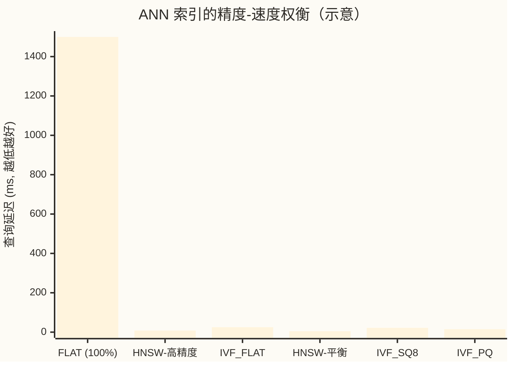
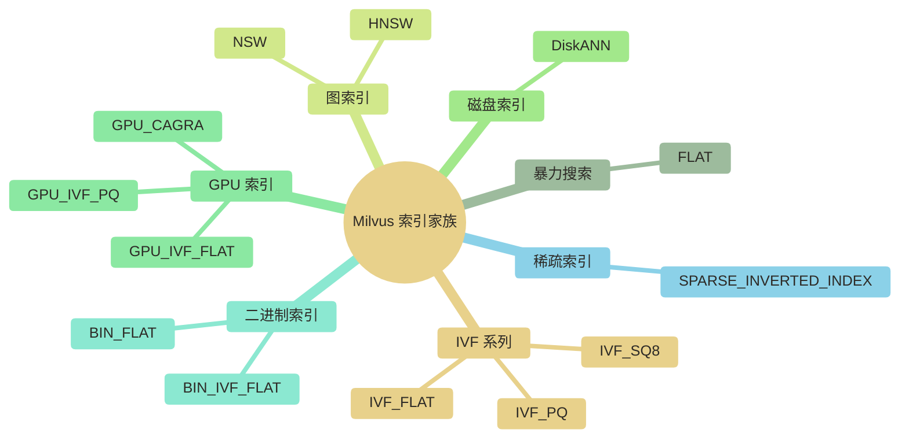
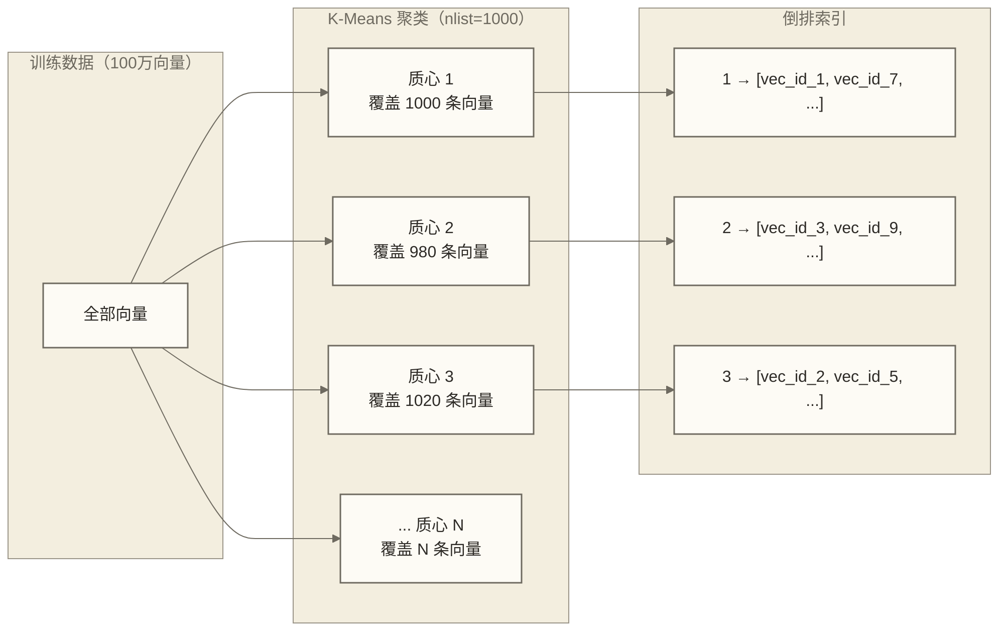
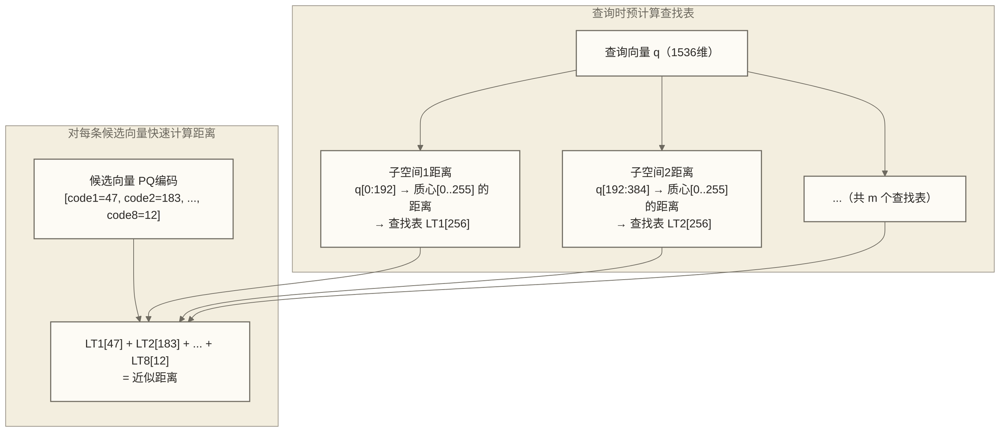
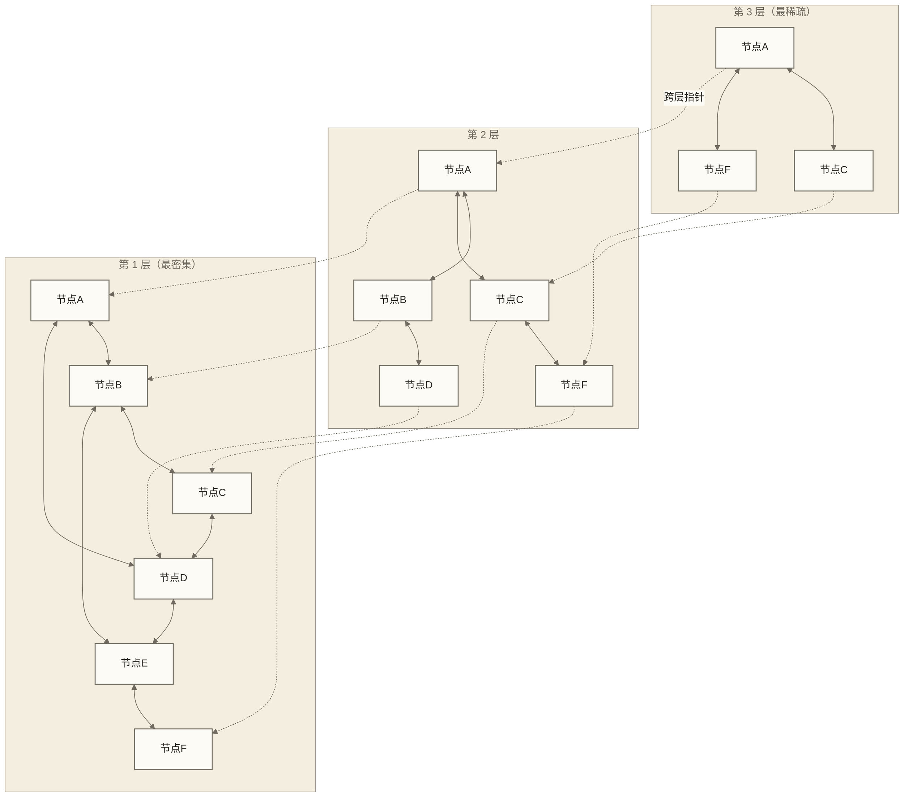
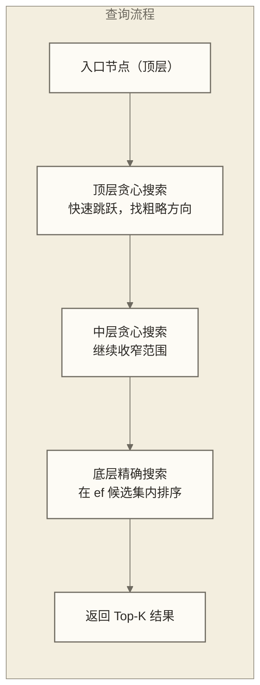
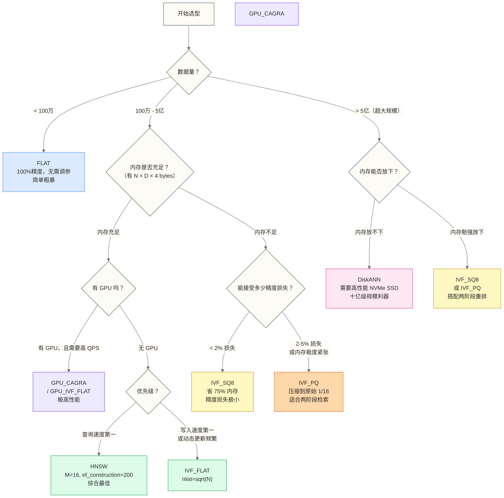

# Milvus 索引类型与选型指南

> [!abstract] 本篇核心收益
> - 彻底理解为什么向量搜索是一个工程难题，而不只是"查个数据库"
> - 深度掌握 FLAT、IVF 系列、HNSW、DiskANN 的底层原理
> - 能在真实场景下做出有依据的索引选型决策
> - 掌握关键参数的调优逻辑，而不是凭感觉猜
> - **预计时长**：90 分钟精读 + 30 分钟代码实践

这篇文档是整个 Milvus 系列里技术密度最高的一篇。向量索引是 Milvus 的核心引擎——选对了，系统飞速响应；选错了，钱烧完了效果还很差。本篇会把每种索引讲到原理级别，但同时用生活类比让你不需要数学博士学位也能理解。

---

## 目录

- [[#一、为什么向量索引是一个难题]]
- [[#二、ANN 的本质：精度与速度的 Pareto 前沿]]
- [[#三、Milvus 支持的索引类型逐一解析]]
  - [[#FLAT：最诚实的暴力搜索]]
  - #IVF_FLAT：城市分区搜索
  - #IVF_SQ8：压缩存储的 IVF
  - #IVF_PQ：极致压缩的乘积量化
  - [[#HNSW：最强的图索引]]
  - [[#DiskANN：磁盘原生的超大规模索引]]
  - [[#GPU 索引：结合显存、负载与成本评估]]
- [[#四、索引选型决策框架]]
- [[#五、关键参数调优指南]]
- [[#六、完整实战代码]]
- [[#七、常见误区与陷阱]]

---

## 一、为什么向量索引是一个难题

在理解各种索引之前，先要搞清楚这个问题本身有多难。很多人第一次接触向量搜索时会想："向量不就是个数组吗？排个序不就完了？"这个直觉在小规模数据下是对的，但在工程规模下会撞上一堵巨大的性能墙。

### 暴力搜索的代价

最朴素的向量搜索方式叫**暴力搜索（Brute Force）**，逻辑极其简单：

1. 拿到查询向量 `q`
2. 计算 `q` 和数据库里每一条向量的距离
3. 返回距离最小的 K 个

这在逻辑上无懈可击，精度是 100%。问题在于计算量。

**复杂度分析**：

假设数据库里有 $N$ 条向量，每条向量的维度是 $D$。计算一对向量的内积或欧氏距离需要 $O(D)$ 次浮点运算，计算所有向量的距离就是 $O(N \times D)$。

**来一个具体的数字**：

| 参数 | 数值 | 说明 |
|------|------|------|
| 向量数量 N | 1 亿 | 中等规模 RAG 知识库 |
| 向量维度 D | 1536 | OpenAI text-embedding-3-small |
| 单次查询浮点运算 | 1536 亿次 | N × D |
| 现代 CPU 浮点性能 | ~100 GFLOPS | 单核峰值 |
| 理论查询延迟 | ~1.5 秒 | 1536亿 / 1000亿 |

**1.5 秒**。这还是理论峰值，实际上还有内存带宽限制、缓存压力等因素，实际延迟很可能是 5-10 秒。

对于一个需要实时响应的搜索系统，这完全不可接受。互联网产品的用户体验阈值是 200ms，AI 对话的检索环节要求往往更严苛。

> [!warning] 内存带宽才是真正瓶颈
> 1 亿个 1536 维 float32 向量，原始内存占用是：
> `1亿 × 1536 × 4 bytes = 614 GB`
> 别说计算了，光把数据从内存读出来，按现代服务器 200 GB/s 的内存带宽，就需要 3 秒。这才是暴力搜索真正的性能天花板——**内存带宽**，而不是 CPU 算力。

### 高维空间的诅咒

向量索引面临的第二个困难是**维度灾难（Curse of Dimensionality）**。

在低维空间（比如 2D 平面），你可以轻松地用树形结构（KD-tree）把空间分区，找最近邻效率极高。但维度升高后，这种方法彻底失效。

直觉解释：在 2D 空间，一个圆圈能覆盖它外接正方形 78% 的面积。在 1536 维空间，一个超球体只能覆盖对应超立方体的 `10^{-3000}` 的体积——几乎为零。这意味着在高维空间，所有的点看起来都"差不多远"，基于空间分区的索引结构失去了区分度。

这就是为什么向量索引必须用专门设计的算法，而不能简单套用关系型数据库的 B-tree 或 KD-tree。

---

## 二、ANN 的本质：精度与速度的 Pareto 前沿

既然精确搜索代价太高，工程界选择了一条妥协路线：**近似最近邻搜索（Approximate Nearest Neighbor，ANN）**。

### Recall@K 的定义

ANN 的精度用 **Recall@K** 衡量。定义如下：

> [!note] Recall@K 公式
> $$\text{Recall@K} = \frac{|\text{ANN返回的K个结果} \cap \text{真实最近邻K个结果}|}{K}$$
>
> 简单说：在 ANN 找到的 K 个结果里，有多少个是"真正的"最近邻？

举例：搜索 Top-10，ANN 返回了 `[id1, id3, id5, id7, id9, id2, id4, id6, id8, id10]`，其中真正的最近邻是 `[id1, id3, id5, id7, id9, id11, id13, id15, id17, id19]`，两者交集有 5 个，那么 Recall@10 = 5/10 = 50%。

### 精度-速度的 Pareto 前沿

ANN 索引本质上在以下两个维度做权衡：



> [!tip] 如何判断 99% 平均 Recall 是否满足任务要求
>
> 这个问题值得仔细想想。考虑一个 RAG 场景：用户问了一个问题，系统需要从 100 万个文档片段里找最相关的 10 个。
>
> - **100% Recall**：找到了完全正确的 Top-10
> - **99% Recall**：若这是多次 Top-10 查询的平均 Recall，则平均每次命中 9.9 个真实最近邻；单次查询的命中数只能是整数，且漏检片段对答案的影响取决于任务。
>
> 作为示例假设，若漏检片段不包含回答所需的唯一关键证据，99% 平均 Recall 可能仍满足该 RAG 任务要求；若漏掉关键证据，答案质量可能明显下降。也可假设某个测试负载下近似检索比精确检索快 100 倍，但本文未提供支持该倍数的测试依据，实际效果需同时评估检索性能与下游答案质量。
>
> 换句话说：**工程上的最优解从来不是数学上的最优解**。

---

## 三、Milvus 支持的索引类型逐一解析

Milvus 支持 10+ 种索引，但核心选手就是以下几类。理解它们的原理，选型就水到渠成。



---

### FLAT：最诚实的暴力搜索

#### 原理

FLAT 就是第一节里说的暴力搜索。没有任何技巧，没有任何近似，就是把查询向量和所有存储向量逐一计算距离，返回最小的 K 个。

**在相同数据快照、过滤条件、距离度量及一致的并列结果处理规则下，FLAT 可作为精确最近邻基准，Recall@K = 1.0；这不保证返回内容的业务相关性或下游答案正确性。**

#### 什么时候用 FLAT

> [!check] 适用场景
> - 数据量 **小于 100 万**（超过这个规模，延迟会超出容忍范围）
> - **精度要求极高**，不能接受任何近似误差（比如金融合规、医疗诊断）
> - 用作 **基准测试**：评估其他索引的 Recall 时，需要 FLAT 的结果作为真值
> - **开发调试阶段**：先用 FLAT 跑通逻辑，再换生产索引

#### 参数

FLAT 没有构建参数。查询时支持标准的 `metric_type`（L2、IP、COSINE）。

#### 内存与性能

| 指标 | 说明 |
|------|------|
| 内存占用 | 100% 原始向量数据（float32 精度） |
| 构建速度 | 极快（几乎无需构建） |
| 查询速度 | O(N×D)，数据越多越慢 |
| 精度 | 100% |
| 支持动态删除 | 是 |

---

### IVF_FLAT：城市分区搜索

IVF（Inverted File Index，倒排文件索引）是向量数据库里最经典的索引结构，理解它是理解所有 IVF 变体的基础。

#### 原理深度解析

**类比**：假设你在一座陌生城市想找离你最近的餐厅。

- **暴力搜索**：跑遍整座城市，逐一测量每家餐厅到你的距离。
- **IVF**：城市被分成若干个行政区（Voronoi 区域），每个区有一个区域中心。你先找到离你最近的几个区域中心，然后只在这几个区域内搜索餐厅。

这个类比精确地对应了 IVF 的两个阶段：

**构建阶段（训练）**：

1. 对所有向量跑 **K-Means 聚类**，把向量空间划分为 `nlist` 个 Voronoi 区域
2. 每个区域有一个质心（centroid）
3. 每条向量被分配到离它最近的质心所在的区域
4. 建立**倒排索引**：对每个质心，记录属于该区域的所有向量 ID



**查询阶段**：

1. 计算查询向量 `q` 到所有 `nlist` 个质心的距离
2. 选出最近的 `nprobe` 个质心
3. 仅在这 `nprobe` 个区域内的向量中，做暴力搜索
4. 合并结果，返回 Top-K

> [!info] nprobe 的物理意义
> `nprobe` 决定了"搜索的行政区数量"。如果 `nlist=1000`，`nprobe=10`，那么每次查询只搜索全库的 1/100。这就是 IVF 获得速度提升的核心机制——用区域化搜索代替全局搜索。

#### 核心参数

**构建参数 nlist**：

`nlist` 是聚类数，即把向量空间划成多少个区域。

| nlist 取值 | 效果 |
|-----------|------|
| 太小（如 64） | 每个区域内向量太多，搜索慢，但召回高 |
| 适中（sqrt(N)） | 经验最优点，平衡速度与质量 |
| 太大（如 65536） | 每个区域向量少，搜索快，但边界效应导致召回下降 |

**经验公式**：$\text{nlist} \approx \sqrt{N}$，即对 1 亿条数据，`nlist ≈ 10000`

> [!warning] 训练数据要求
> IVF 的 K-Means 训练要求：**训练数据量 >= nlist × 39**。
> 如果 nlist=1000，你需要至少 39000 条训练向量。
> Milvus 会用实际数据训练，数据不足时会报错。

**查询参数 nprobe**：

`nprobe` 是查询时探测的区域数。它是最重要的查询时调优旋钮。

| nprobe / nlist | 召回率 | 查询速度 | 适用场景 |
|---------------|--------|---------|---------|
| 1/128 (~0.8%) | ~60-70% | 极快 | 对精度不敏感的推荐 |
| 1/32 (~3%) | ~80-85% | 很快 | 一般推荐场景 |
| 1/8 (~12%) | ~92-95% | 中等 | 大多数搜索场景 |
| 1/4 (~25%) | ~97-99% | 慢 | 高精度要求 |
| 1/1 (100%) | ~100% | 等同FLAT | 退化为暴力搜索 |

> [!tip] nprobe 调优策略
> 从 `nlist / 8` 开始，逐步增大，观察 Recall 和延迟的变化曲线，找到业务可接受的最低 nprobe 值。通常 `nprobe = nlist / 8` 到 `nlist / 4` 之间能覆盖大多数场景。

#### 边界效应问题

IVF 的最大局限是**边界效应**：如果查询向量 `q` 的真实最近邻恰好位于相邻区域，而不是 `q` 所在区域，IVF 就会错过它。

```text
区域边界
    |
    |  ★ q（查询向量）
    |      ○ 真实最近邻（在隔壁区域！）
    |
区域 A 的质心              区域 B 的质心
```

增大 `nprobe` 可以缓解边界效应，但代价是速度变慢。这是仅探测部分分区时的漏检风险。对于保留原始向量的 IVF_FLAT，令 `nprobe = nlist` 并遍历全部分区，可在一致的距离度量和并列结果处理规则下得到精确最近邻；IVF_SQ8、IVF_PQ 则仍可能存在量化误差。

---

### IVF_SQ8：压缩存储的 IVF

#### 原理

IVF_SQ8 在 IVF_FLAT 的基础上，对存储的向量做了**标量量化（Scalar Quantization，SQ）**：

- IVF_FLAT：每个向量分量用 **32-bit 浮点数**（float32）存储
- IVF_SQ8：每个向量分量用 **8-bit 整数**（uint8）存储

具体做法：对每个维度，找到该维度在训练集上的最大值和最小值，然后把 `[min, max]` 范围均匀映射到 `[0, 255]` 的整数区间。

$$\text{quantized}[i] = \text{round}\left(\frac{x[i] - \min_i}{\max_i - \min_i} \times 255\right)$$

#### 效果对比

| 对比维度 | IVF_FLAT | IVF_SQ8 | 差异 |
|---------|---------|---------|------|
| 内存占用 | 100% | ~25% | 节省 75% |
| 精度损失 | 0% | ~1-2% | 可接受 |
| 查询速度 | 中等 | 略快于FLAT | 因内存减少，缓存命中提升 |
| 参数 | 同IVF_FLAT | 同IVF_FLAT | 无额外参数 |

#### 什么场景值得用 IVF_SQ8

> [!check] IVF_SQ8 的最佳场景
> - 内存资源受限，但数据量又在 IVF 的适用范围（百万到亿级）
> - 能接受 1-2% 的精度损失
> - 使用余弦相似度或内积（SQ8 的量化误差对这两种度量影响更小）
>
> **一个典型例子**：你有 1 亿条 768 维向量，IVF_FLAT 需要 ~288 GB 内存，而你的服务器只有 96 GB。IVF_SQ8 只需要 ~72 GB，刚好能放得下。

---

### IVF_PQ：极致压缩的乘积量化

IVF_PQ 是 IVF 系列里压缩率最高的，背后的**乘积量化（Product Quantization，PQ）**技术是向量压缩领域的经典算法。

#### PQ 原理深度解析

**类比**：把一首歌压缩成 MP3。

一首歌有鼓声、吉他声、人声三个声部。朴素的压缩方式是把整首歌当成一个整体压缩，这样会丢失很多细节。更好的方式是：把三个声部分开，每个声部独立压缩，最后合并。每个声部都有自己的"声学模式库"，用索引代替实际波形。

PQ 就是这个思路应用到向量上：

**第一步：切割子空间**

把 D 维向量切成 `m` 段，每段是 `D/m` 维的子向量。

```text
原始向量（1536维）
[d1, d2, ..., d192 | d193, ..., d384 | ... | d1345, ..., d1536]
     子空间 1             子空间 2             子空间 8
```

**第二步：每个子空间独立量化**

对每个子空间，在训练集上跑 K-Means，得到 $2^{\text{nbits}}$ 个质心（通常 nbits=8，即 256 个质心）。

每个子向量用距离最近的质心的**索引**（0-255）来表示。

**第三步：用编码代替原始向量**

一个 1536 维的 float32 向量，原本需要 `1536 × 4 = 6144 bytes`。经过 PQ 编码（m=8, nbits=8）后，只需要 `8 × 1 byte = 8 bytes`。

**压缩比：768:1**。

**距离计算：查找表加速**

PQ 的聪明之处在于距离计算的加速：

1. 预计算查询向量每个子空间到所有质心的距离，存入"查找表"
2. 对每条候选向量，把各子空间的编码索引在查找表里查距离并求和
3. 这样一次距离计算只需要 `m` 次表查询，极其快速



#### IVF_PQ 参数

| 参数 | 含义 | 推荐值 |
|------|------|--------|
| `nlist` | 聚类数（同IVF_FLAT） | sqrt(N) |
| `m` | 子空间切割数 | D/32 到 D/8 之间，必须能整除 D |
| `nbits` | 每段编码位数 | 通常 8（即 256 个质心/子空间） |

**m 的选择对内存的影响（D=1536 的向量，N=1亿）**：

| m 值 | 压缩比 | 内存占用 | 精度损失 |
|------|--------|---------|---------|
| 192（D/8） | 32x | 19.2 GB（仅编码） | 需实测 |
| 96（D/16） | 64x | 9.6 GB（仅编码） | 需实测 |
| 48（D/32） | 128x | 4.8 GB（仅编码） | 需实测 |
| 16（D/96） | 384x | 1.6 GB（仅编码） | 需实测 |

以上按 nbits=8、十进制 GB 计算，不包含 ID、码本、分区结构和运行时开销。

> [!warning] PQ 的精度代价
> PQ 的量化误差比 SQ8 大得多。当 m 值很小时，精度损失可能超过 5-10%。在实际应用中，IVF_PQ 通常用于**第一阶段粗排**：先用 PQ 快速召回候选集，再用精确距离重排。这种"两阶段检索"是大规模系统的常见架构。

---

### HNSW：最强的图索引

HNSW（Hierarchical Navigable Small World，分层可导航小世界图）是常用的图型 ANN 索引，可作为高召回、低延迟内存检索的候选方案；是否优于其他索引取决于数据分布、内存预算、更新方式及测试负载。理解 HNSW 需要先理解它的前身 NSW。

#### NSW：小世界图的直觉

**"六度分隔"理论**说：世界上任意两个人，最多通过 6 个中间人就能相互认识。这是因为社交网络里既有**本地连接**（邻居、同事），也有**长程连接**（不同城市的朋友、大 V）。

NSW 把这个思想应用到向量空间：

1. 每个向量是一个节点
2. 每个节点连接一些**近邻**（距离近的向量）和一些**远邻**（距离远但能快速跳跃到远处的向量）
3. 搜索时，从任意节点出发，沿着"贪心"方向跳跃，快速接近目标

问题：NSW 是单层图，在大规模数据下，"找入口点"本身就很慢。

#### HNSW：加上分层，彻底解决入口问题

HNSW 在 NSW 基础上引入了**分层结构**，类比于地图的缩放级别：



**分层的含义**：

- **顶层（稀疏）**：只有少量节点，节点之间的连接跨越很大的距离，像"高速公路"
- **底层（密集）**：所有节点都在，连接距离很近，像"小街巷"
- **跨层指针**：每个节点在不同层都有对应，通过指针连接

#### HNSW 查询过程

**类比导航软件**：从北京找到上海的某个咖啡馆。

1. 先在全国地图（高层）上定位到上海（粗粒度跳跃）
2. 切换到上海地图（中层），定位到目标区域
3. 切换到街道地图（底层），精确找到咖啡馆

HNSW 搜索过程完全类似：

1. 从顶层的入口节点出发，在当前层做贪心搜索（每步跳到距目标最近的邻居）
2. 找到当前层的局部最优点，下移一层，从该点对应的下层节点继续搜索
3. 重复直到底层，在底层做精确搜索（在 ef 范围内的候选集里）
4. 返回 Top-K 结果



#### HNSW 插入过程

插入一个新节点 `q` 时：

1. **随机决定层级**：用指数分布随机决定 `q` 最高出现在第几层（大多数节点只在底层，少数节点出现在多层，形成稀疏的高层）
2. **从顶层开始搜索**：找到 `q` 在每一层的 `ef_construction` 个最近邻
3. **连接最近邻**：在每一层，把 `q` 和其最近邻相连，并可能"修剪"一些旧连接以维持图的性质

`ef_construction` 越大，构建时找到的邻居质量越高，图质量越好，但构建越慢。

#### HNSW 核心参数详解

**构建参数**：

| 参数 | 含义 | 默认值 | 调优建议 |
|------|------|--------|---------|
| `M` | 每个节点在每层的最大连接数 | 16 | 通用场景 16，高精度场景 32-64 |
| `ef_construction` | 构建时的动态候选集大小 | 200 | 通常 100-500，越大质量越好 |

**M 值的影响（以 1 亿向量为例）**：

| M 值 | Recall@10 | 查询延迟 | 额外内存开销 | 适用场景 |
|------|-----------|---------|------------|---------|
| 8 | ~96% | 最快 | 最小 | 对延迟极度敏感 |
| 16（默认） | ~98% | 快 | 中等 | 大多数场景 |
| 32 | ~99% | 中等 | 较大 | 高精度要求 |
| 64 | ~99.5% | 较慢 | 很大 | 极高精度要求 |

每增加一倍的 M，额外内存开销大约增加 `N × M × 2 × 4 bytes`（每条边两个方向各需存储 ID）。

**查询参数**：

| 参数 | 含义 | 默认值 | 调优建议 |
|------|------|--------|---------|
| `ef` | 查询时的动态候选集大小 | 64 | 必须 >= topK，通常 topK × 2 到 topK × 4 |

`ef` 决定了在底层搜索时维护的候选集大小。`ef` 越大，结果越精确，延迟越高。

> [!warning] ef 和 ef_construction 的关系
> - `ef_construction`：构建时参数，决定图的**结构质量**，一旦建完就固定了
> - `ef`：查询时参数，决定搜索时**探索的范围**，可以随时调整
>
> 即使你用 `ef_construction=100` 建了一个"一般质量"的图，也可以通过增大 `ef` 来提高查询精度（但受限于图本身的质量上限）。
>
> **规则**：`ef` 必须 >= `topK`，否则直接报错。

#### HNSW 的内存开销

HNSW 是内存密集型索引，除了原始向量数据，还需要存储图的边信息：

$$\text{额外内存} \approx N \times M \times 2 \times 8 \text{ bytes}$$

（M 是每层连接数，2 是双向边，8 bytes 是 int64 ID 的大小）

以 1 亿向量、M=16 为例，按上述简化假设计算的图载荷为：`1亿 × 16 × 2 × 8 = 25.6 GB`。若每条向量为1536维float32，原始向量载荷为614.4 GB，两者相加约640 GB，即原始向量载荷的104.2%；这不包含其他层级、元数据、预留容量和运行时开销，也不是Milvus总内存估算。

> [!success] HNSW 的核心优势总结
> 1. **查询速度极快**：对数级复杂度，比 IVF 系列快 3-5 倍
> 2. **精度极高**：在同等延迟下，Recall 比 IVF 系列高 2-3%
> 3. **无需训练阶段**：IVF 需要 K-Means 训练，HNSW 插入即索引
> 4. **支持实时插入**：HNSW 的图结构天然支持动态插入，不需要重建
> 5. **查询参数简单**：只有一个 `ef` 旋钮

---

### DiskANN：磁盘原生的超大规模索引

#### 解决的核心问题

HNSW 很好，但有一个致命弱点：需要把整个图结构加载到内存。当数据量超过 10 亿时，内存成本高得令人望而却步。

DiskANN（基于 Vamana 图算法）的核心思想是：**把向量和图结构存在 SSD 上，内存只放一部分关键数据**。

#### 架构原理

DiskANN 的设计分两个层面：

**磁盘层**：完整的 Vamana 图（所有向量 + 边的连接关系）存储在 SSD 上。Vamana 图的设计针对磁盘访问做了优化——每次磁盘读取时，把一个节点和它的邻居数据压缩在同一个磁盘块里，减少随机 IO。

**内存层**：对每条向量保留一个**压缩版本**（通常是 PQ 编码），用于快速过滤候选集，减少不必要的磁盘访问。

**查询流程**：

1. 用内存中的 PQ 编码初步筛选出 BeamSearch 候选集
2. 从 SSD 加载候选节点的完整向量和邻居信息
3. 在内存中精确计算距离，更新候选集
4. 沿图继续搜索，直到收敛
5. 返回 Top-K 结果

#### 关键参数

| 参数 | 含义 | 推荐值 |
|------|------|--------|
| `index_file_size` | 每个分段索引文件的大小（MB） | 1024 |
| `search_list` | 搜索时的候选集大小 | max(topK × 2, topK + 20) |
| `pq_code_budget_gb` | 内存中 PQ 编码的内存预算（GB） | 数据量 × 压缩比 |

#### 性能特征

| 指标 | 数值 | 说明 |
|------|------|------|
| 内存占用 | 5-20% 原始数据 | 只存 PQ 编码 |
| SSD 占用 | ~100% 原始数据 + 图结构 | 通常是原始数据的 1.2-1.5 倍 |
| 查询延迟 | 10-50ms | 比 HNSW 慢，但可接受 |
| 精度 | ~95-98% Recall | 受 PQ 压缩影响 |
| 适用规模 | 十亿级以上 | 小于 1 亿用 HNSW 即可 |

> [!warning] DiskANN 的使用限制
> 1. **需要高性能 NVMe SSD**：机械硬盘的随机 IO 完全无法满足要求，延迟会飙升到秒级
> 2. **不支持实时插入**：DiskANN 需要重建索引来合并新数据（Milvus 通过 Segment 机制部分缓解了这个问题）
> 3. **Milvus 版本要求**：DiskANN 在 Milvus 2.2+ 开始稳定支持
> 4. **DataNode 配置**：需要挂载持久化 SSD 存储，云环境要注意存储类的选择

---

### GPU 索引：结合显存、负载与成本评估

Milvus 支持多种 GPU 加速索引，核心是利用 GPU 的大规模并行计算能力。

#### GPU_CAGRA：面向 GPU 并行计算的图索引

CAGRA（Cuda Anns Graph-based Refined Approach）是 NVIDIA RAFT 库的图索引，专为 GPU 并行计算设计。作为待验证的示例假设，可设定某个GPU测试负载相比CPU HNSW有5-20倍性能提升；本文未提供支持该倍数的测试依据，不能将其视为有GPU时的通用结果。

#### 性能基准（A100 GPU vs 32 核 CPU）

| 场景 | CPU HNSW | GPU_CAGRA | 提升倍数 |
|------|---------|-----------|---------|
| 构建速度（1000万向量） | ~30 分钟 | ~3 分钟 | 10x |
| QPS（Recall=99%） | ~5000 | ~50000-100000 | 10-20x |
| 延迟（p99） | ~5ms | ~1ms | 5x |

#### 适用场景

> [!check] GPU 索引的适用条件
> - 拥有 NVIDIA GPU（A100/V100/RTX 4090 以上效果最好）
> - 需要极高 QPS（>10000 QPS）
> - 数据量在内存可接受范围（GPU 显存通常 80 GB 以内）
> - 实时推荐、广告检索等延迟极度敏感场景

---

## 四、索引选型决策框架

### 决策树



### 综合对比表

| 索引 | 构建速度 | 查询速度 | 内存占用 | 精度 | 适用规模 | 是否需要训练 | 支持动态插入 |
|------|---------|---------|---------|------|---------|------------|------------|
| FLAT | 极快 | 极慢 | 100% | 100% | <100万 | 否 | 是 |
| IVF_FLAT | 快 | 中等 | 100% | 高 (~98%) | 100万-1亿 | 是 | 是 |
| IVF_SQ8 | 快 | 中等 | 25% | 高 (~97%) | 1亿+ | 是 | 是 |
| IVF_PQ | 中等 | 较快 | 极小 (<10%) | 中 (~90-95%) | 内存受限 | 是 | 是 |
| HNSW | 慢 | 极快 | ~150% | 极高 (~99%) | 通用推荐 | 否 | 是 |
| DiskANN | 极慢 | 中等 | 极小 | 高 (~96%) | 十亿级 | 否 | 受限 |
| GPU_CAGRA | 快（GPU） | 极极快 | GPU 显存 | 极高 | 高 QPS 场景 | 否 | 是 |

---

## 五、关键参数调优指南

### nlist 设置原则

**经验公式**：

$$\text{nlist} = \sqrt{N} \quad \text{（N 为向量总数）}$$

**实际应用参考**：

| 数据量 | 推荐 nlist | 原因 |
|--------|-----------|------|
| 100 万 | 1,000 | sqrt(1M) = 1000 |
| 1,000 万 | 3,162 | sqrt(10M) ≈ 3162，通常取整为 4096 |
| 1 亿 | 10,000 | sqrt(100M) = 10000 |
| 10 亿 | 31,623 | 通常取 32768（2 的幂） |

> [!tip] 使用 2 的幂次
> 取 2 的幂次方（如 1024、4096、8192）是个好习惯——K-Means 在这些值上的数值稳定性更好，同时方便后续通过 nprobe 精确控制搜索比例。

**nlist 上限约束**：

- 训练数据量必须 >= `nlist × 39`
- 如果你的数据量是 100 万，nlist 最大不超过约 25,000

### nprobe 调优策略

nprobe 的调优本质是找**业务可接受的 Recall 下限**，然后用最小的 nprobe 满足它。

**调优流程**：

```text
Step 1: 用 FLAT 跑 1000 条测试查询，得到真实最近邻（Ground Truth）
Step 2: 用不同 nprobe 值跑相同查询，计算 Recall@K
Step 3: 画出 Recall vs 延迟 曲线
Step 4: 找到 Recall 达标的最小 nprobe
```

**典型的 nprobe Recall 曲线**（nlist=4096，1000万向量）：

| nprobe | Recall@10 | 查询延迟（ms） |
|--------|-----------|-------------|
| 1 | 62% | 0.3 |
| 4 | 78% | 0.8 |
| 16 | 88% | 2.5 |
| 64 | 95% | 8.0 |
| 128 | 97% | 15 |
| 256 | 99% | 28 |
| 512 | 99.5% | 55 |
| 4096（全部） | ~100% | 220 |

> [!note] 通用建议
> - 推荐系统（精度要求不高）：nprobe = nlist/64 到 nlist/32
> - RAG/语义搜索（精度要求中等）：nprobe = nlist/16 到 nlist/8
> - 高精度场景：nprobe = nlist/4 到 nlist/2

### HNSW M 值选择

| 场景 | 推荐 M | 说明 |
|------|--------|------|
| 资源受限，速度第一 | 8-12 | 精度稍有牺牲 |
| 通用生产场景 | 16（默认） | 大多数情况的最优点 |
| 高精度要求（如人脸识别） | 32-48 | 相比M=16，简化图连接载荷约增至2-3倍，不代表总内存同比增长 |
| 极高精度（金融风控） | 64 | 仅在必要时使用 |

### ef_construction 和 ef 的关系

这两个参数经常被混淆，用一个表格厘清：

| 参数 | 阶段 | 作用 | 改变后是否需要重建索引 |
|------|------|------|-------------------|
| `ef_construction` | 构建时 | 决定图的内在质量（边的连接质量） | 是（必须重建） |
| `ef` | 查询时 | 决定搜索时探索的范围 | 否（随时可调） |

**经验值**：

- `ef_construction = max(ef, M × 2)`，且 >= 64
- `ef = topK × 2` 到 `topK × 4`（精度要求越高，倍数越大）
- `ef` 必须 >= `topK`

> [!warning] ef_construction 不是越大越好
> `ef_construction = 500` 比 `ef_construction = 200` 的构建时间可能多 2-3 倍，但 Recall 的提升往往不到 1%。在构建时间受限的场景，`ef_construction = 100-200` 已经足够。

---

## 六、完整实战代码

### 连接与基础设置

```python
from pymilvus import (
    connections,
    Collection,
    CollectionSchema,
    FieldSchema,
    DataType,
    utility
)
import numpy as np

# 连接 Milvus
connections.connect(
    alias="default",
    host="localhost",
    port="19530"
)

# 数据规模设置（可根据实际情况调整）
NUM_VECTORS = 100_000   # 10 万向量用于演示
DIM = 1536              # OpenAI text-embedding-3-small 维度
COLLECTION_NAME = "index_demo"

# 创建 Schema（通用，后续所有索引共用）
def create_collection(collection_name: str) -> Collection:
    """创建测试用 Collection"""
    # 如果已存在则删除
    if utility.has_collection(collection_name):
        utility.drop_collection(collection_name)

    fields = [
        FieldSchema(
            name="id",
            dtype=DataType.INT64,
            is_primary=True,
            auto_id=True       # 自动生成主键
        ),
        FieldSchema(
            name="embedding",
            dtype=DataType.FLOAT_VECTOR,
            dim=DIM
        ),
        FieldSchema(
            name="doc_id",
            dtype=DataType.VARCHAR,
            max_length=100
        )
    ]

    schema = CollectionSchema(
        fields=fields,
        description="索引类型演示集合",
        enable_dynamic_field=True  # 允许动态字段
    )

    collection = Collection(
        name=collection_name,
        schema=schema
    )
    return collection

# 生成测试数据
def generate_data(n: int, dim: int):
    """生成随机测试向量（实际应用中替换为真实 embedding）"""
    # 归一化向量（cosine 相似度场景的标准做法）
    vectors = np.random.randn(n, dim).astype(np.float32)
    norms = np.linalg.norm(vectors, axis=1, keepdims=True)
    vectors = vectors / norms

    doc_ids = [f"doc_{i:08d}" for i in range(n)]
    return vectors, doc_ids

# 插入数据
def insert_data(collection: Collection, vectors: np.ndarray, doc_ids: list):
    """批量插入数据，推荐批次大小 1000-5000"""
    batch_size = 2000
    total = len(vectors)

    for start in range(0, total, batch_size):
        end = min(start + batch_size, total)
        batch_data = [
            vectors[start:end].tolist(),   # embedding 字段
            doc_ids[start:end]             # doc_id 字段
        ]
        collection.insert(batch_data)

    # 刷新确保数据持久化
    collection.flush()
    print(f"插入完成：{total} 条向量")
```

### FLAT 索引

```python
def create_flat_index(collection: Collection):
    """
    FLAT 索引：暴力搜索，精度 100%

    适用场景：
    - 数据量 < 100 万
    - 精度要求 100%（作为基准测试的标准答案）
    - 开发调试阶段
    """
    index_params = {
        "metric_type": "COSINE",   # 余弦相似度（语义搜索首选）
        "index_type": "FLAT",
        "params": {}               # FLAT 无需任何参数
    }

    collection.create_index(
        field_name="embedding",
        index_params=index_params
    )

    print("FLAT 索引创建完成（无训练过程，几乎即时）")

def search_with_flat(collection: Collection, query_vectors: np.ndarray, top_k: int = 10):
    """FLAT 搜索：在一致数据、过滤条件、度量及并列结果处理规则下可作为精确最近邻基准，不保证业务相关性。"""
    collection.load()

    search_params = {
        "metric_type": "COSINE",
        "params": {}              # FLAT 搜索时同样无参数
    }

    results = collection.search(
        data=query_vectors.tolist(),
        anns_field="embedding",
        param=search_params,
        limit=top_k,
        output_fields=["doc_id"]
    )

    return results
```

### IVF_FLAT 索引

```python
import math

def create_ivf_flat_index(collection: Collection, num_vectors: int):
    """
    IVF_FLAT 索引：倒排文件 + 暴力搜索

    核心参数：
    - nlist：聚类数，推荐 sqrt(N)

    适用场景：
    - 数据量 100万 - 1亿
    - 内存充足
    - 写入频繁（IVF 不需要重建索引即可添加新数据）
    """
    # 经验公式：nlist = sqrt(N)，取整到最近的整数
    nlist = int(math.sqrt(num_vectors))
    # 对齐到 1024 的倍数（可选，便于 nprobe 的整除计算）
    nlist = max(1024, round(nlist / 1024) * 1024)

    print(f"设置 nlist = {nlist}（数据量 {num_vectors} 的 sqrt 约为 {int(math.sqrt(num_vectors))}）")

    index_params = {
        "metric_type": "COSINE",
        "index_type": "IVF_FLAT",
        "params": {
            "nlist": nlist     # 聚类数，影响构建速度和查询精度
        }
    }

    # 注意：IVF 类索引需要训练，当数据量 < nlist*39 时会报错
    collection.create_index(
        field_name="embedding",
        index_params=index_params
    )

    print(f"IVF_FLAT 索引创建完成，nlist={nlist}")

def search_with_ivf_flat(
    collection: Collection,
    query_vectors: np.ndarray,
    top_k: int = 10,
    nprobe: int = None,
    nlist: int = 1024
):
    """
    IVF_FLAT 搜索

    nprobe 是最关键的查询参数：
    - 越大召回越高，延迟越高
    - 推荐从 nlist/8 开始，根据 Recall 评估结果调整
    """
    collection.load()

    # 如果未指定 nprobe，使用经验起始值
    if nprobe is None:
        nprobe = max(1, nlist // 8)

    search_params = {
        "metric_type": "COSINE",
        "params": {
            "nprobe": nprobe    # 探测的 Voronoi 区域数
        }
    }

    results = collection.search(
        data=query_vectors.tolist(),
        anns_field="embedding",
        param=search_params,
        limit=top_k,
        output_fields=["doc_id"]
    )

    print(f"IVF_FLAT 搜索完成，nprobe={nprobe}（搜索了 {nprobe}/{nlist} = {nprobe/nlist:.1%} 的区域）")
    return results
```

### IVF_SQ8 索引

```python
def create_ivf_sq8_index(collection: Collection, num_vectors: int):
    """
    IVF_SQ8 索引：IVF + 8-bit 标量量化

    内存节省：相比 IVF_FLAT 节省 ~75%
    精度损失：~1-2%

    最佳场景：
    - 服务器内存不够放 IVF_FLAT
    - 能接受轻微精度损失
    - 数据规模 1亿 以上
    """
    nlist = int(math.sqrt(num_vectors))
    nlist = max(1024, round(nlist / 1024) * 1024)

    index_params = {
        "metric_type": "COSINE",
        "index_type": "IVF_SQ8",
        "params": {
            "nlist": nlist
            # SQ8 无额外参数，量化过程自动进行
        }
    }

    collection.create_index(
        field_name="embedding",
        index_params=index_params
    )

    # 内存估算
    original_memory_gb = num_vectors * DIM * 4 / (1024 ** 3)
    sq8_memory_gb = num_vectors * DIM * 1 / (1024 ** 3)  # 8-bit = 1 byte
    print(f"IVF_SQ8 索引创建完成")
    print(f"  原始内存估算：{original_memory_gb:.1f} GB")
    print(f"  SQ8 内存估算：{sq8_memory_gb:.1f} GB（节省 {(1 - sq8_memory_gb/original_memory_gb)*100:.0f}%）")
```

### IVF_PQ 索引

```python
def create_ivf_pq_index(collection: Collection, num_vectors: int, dim: int):
    """
    IVF_PQ 索引：IVF + 乘积量化

    极致压缩，适合内存极度受限场景

    参数选择原则：
    - m：子空间数，必须能整除 dim，推荐 dim/32 到 dim/8
    - nbits：每段编码位数，通常固定为 8（256个质心）
    """
    nlist = int(math.sqrt(num_vectors))
    nlist = max(1024, round(nlist / 1024) * 1024)

    # m 的选择：dim 的因子，且能被 dim 整除
    # dim=1536 的合理选项：8, 12, 16, 24, 32, 48, 64, 96, 128, 192, 256, 384
    # 这里选 m=96，每个子空间维度 = 1536/96 = 16
    m = dim // 16   # dim/16 是一个平衡点

    # 确保 dim 可以被 m 整除
    while dim % m != 0:
        m -= 1

    nbits = 8   # 256 个质心，通常不需要修改

    index_params = {
        "metric_type": "COSINE",
        "index_type": "IVF_PQ",
        "params": {
            "nlist": nlist,
            "m": m,           # 子空间切割数
            "nbits": nbits    # 每段编码位数（质心数 = 2^nbits）
        }
    }

    collection.create_index(
        field_name="embedding",
        index_params=index_params
    )

    # 内存估算
    original_bytes = num_vectors * dim * 4
    pq_bytes = num_vectors * m * (nbits / 8)  # 每个向量的 PQ 编码大小
    compression_ratio = original_bytes / pq_bytes

    print(f"IVF_PQ 索引创建完成")
    print(f"  m={m}, nbits={nbits}")
    print(f"  每个向量编码：{m * nbits // 8} bytes（原始 {dim * 4} bytes）")
    print(f"  压缩比：约 {compression_ratio:.0f}x")
    print(f"  内存估算：{pq_bytes / (1024**3):.2f} GB（原始 {original_bytes / (1024**3):.1f} GB）")
```

### HNSW 索引

```python
def create_hnsw_index(
    collection: Collection,
    m: int = 16,
    ef_construction: int = 200,
    scenario: str = "general"
):
    """
    HNSW 索引：分层可导航小世界图

    这是大多数场景的首选索引

    参数说明：
    - M：每个节点的最大连接数
      - 8：速度优先，适合延迟敏感的推荐系统
      - 16（默认）：大多数场景最优
      - 32：高精度要求，如语义搜索、RAG
      - 64：极高精度，内存代价大

    - ef_construction：构建时的候选集大小
      - 越大构建越慢，图质量越好
      - 推荐 100-500，通常 200 够用
    """
    # 根据场景自动选择参数
    scenario_configs = {
        "speed_first": {"M": 8, "ef_construction": 100},
        "general": {"M": 16, "ef_construction": 200},
        "high_recall": {"M": 32, "ef_construction": 300},
        "ultra_recall": {"M": 64, "ef_construction": 400}
    }

    if scenario in scenario_configs:
        config = scenario_configs[scenario]
        m = config["M"]
        ef_construction = config["ef_construction"]
        print(f"使用预设场景 '{scenario}'：M={m}, ef_construction={ef_construction}")

    index_params = {
        "metric_type": "COSINE",
        "index_type": "HNSW",
        "params": {
            "M": m,                          # 图的连接数，影响内存和精度
            "efConstruction": ef_construction # 构建质量参数
        }
    }

    collection.create_index(
        field_name="embedding",
        index_params=index_params
    )

    print(f"HNSW 索引创建完成：M={m}, efConstruction={ef_construction}")
    print(f"预计额外内存开销：~{NUM_VECTORS * m * 2 * 8 / (1024**3):.1f} GB（图结构）")

def search_with_hnsw(
    collection: Collection,
    query_vectors: np.ndarray,
    top_k: int = 10,
    ef: int = None
):
    """
    HNSW 搜索

    ef 是唯一需要调整的查询参数：
    - 必须 >= top_k
    - 推荐 top_k * 2 到 top_k * 4
    - 精度要求越高，ef 越大
    """
    collection.load()

    if ef is None:
        ef = max(top_k * 2, 64)   # 至少 top_k 的 2 倍，且不低于 64

    # 安全检查
    if ef < top_k:
        raise ValueError(f"ef ({ef}) 必须 >= top_k ({top_k})")

    search_params = {
        "metric_type": "COSINE",
        "params": {
            "ef": ef    # 查询时的动态候选集大小，越大越精确
        }
    }

    results = collection.search(
        data=query_vectors.tolist(),
        anns_field="embedding",
        param=search_params,
        limit=top_k,
        output_fields=["doc_id"]
    )

    print(f"HNSW 搜索完成，ef={ef}，top_k={top_k}")
    return results
```

### DiskANN 索引

```python
def create_diskann_index(collection: Collection):
    """
    DiskANN 索引：磁盘原生超大规模索引

    使用前提：
    1. Milvus 2.2+ 版本
    2. 挂载了高性能 NVMe SSD
    3. 数据量通常 > 5亿（否则 HNSW 更优）

    参数说明：
    - index_file_size：每个索引分片文件的大小（MB），默认 1024
      越小内存使用更平滑，越大 IO 效率更高
    - search_list：查询时的候选集，类似 HNSW 的 ef
    - pq_code_budget_gb：内存中缓存的 PQ 编码大小
      这是 DiskANN 能放在内存的压缩向量，越大越好，通常设为可用内存的 70-80%
    """
    index_params = {
        "metric_type": "L2",           # DiskANN 当前主要支持 L2（部分版本支持 COSINE）
        "index_type": "DISKANN",
        "params": {
            "index_file_size": 1024,   # 每个索引文件 1GB，根据 SSD 性能调整
            # 注意：pq_code_budget_gb 在 Milvus 中通过集群配置指定，不在这里设置
        }
    }

    collection.create_index(
        field_name="embedding",
        index_params=index_params
    )

    print("DiskANN 索引创建完成（构建时间较长，请耐心等待）")
    print("提示：确保 DataNode 的挂载路径是 NVMe SSD，否则查询延迟会很高")

def search_with_diskann(
    collection: Collection,
    query_vectors: np.ndarray,
    top_k: int = 10,
    search_list: int = None
):
    """
    DiskANN 搜索

    search_list 类似 HNSW 的 ef，必须 >= top_k
    推荐值：max(top_k * 2, top_k + 20)
    """
    collection.load()

    if search_list is None:
        search_list = max(top_k * 2, top_k + 20)

    search_params = {
        "metric_type": "L2",
        "params": {
            "search_list": search_list
        }
    }

    results = collection.search(
        data=query_vectors.tolist(),
        anns_field="embedding",
        param=search_params,
        limit=top_k,
        output_fields=["doc_id"]
    )

    return results
```

### Recall 评估工具

```python
def evaluate_recall(
    collection: Collection,
    query_vectors: np.ndarray,
    ground_truth_ids: list,  # 来自 FLAT 搜索的真实最近邻 ID 列表
    search_params: dict,
    top_k: int = 10
) -> float:
    """
    计算 Recall@K

    ground_truth_ids: 每个查询对应的真实 Top-K ID 列表
                      通常用 FLAT 索引搜索结果作为真值

    返回：平均 Recall@K
    """
    collection.load()

    results = collection.search(
        data=query_vectors.tolist(),
        anns_field="embedding",
        param=search_params,
        limit=top_k
    )

    total_recall = 0.0
    num_queries = len(query_vectors)

    for i, result in enumerate(results):
        returned_ids = set(hit.id for hit in result)
        true_ids = set(ground_truth_ids[i])

        intersection = len(returned_ids & true_ids)
        recall = intersection / min(top_k, len(true_ids))
        total_recall += recall

    avg_recall = total_recall / num_queries
    return avg_recall

# 使用示例：完整的 Recall 评估流程
def benchmark_index(collection_name: str, num_test_queries: int = 100):
    """对某个索引做完整的 Recall + 延迟基准测试"""
    import time

    collection = Collection(collection_name)
    collection.load()

    # 生成测试查询
    query_vectors, _ = generate_data(num_test_queries, DIM)

    # Step 1: 用 FLAT 获取 Ground Truth
    print("Step 1: 用 FLAT 获取 Ground Truth...")
    flat_params = {"metric_type": "COSINE", "params": {}}

    start = time.time()
    flat_results = collection.search(
        data=query_vectors.tolist(),
        anns_field="embedding",
        param=flat_params,
        limit=10
    )
    flat_latency = (time.time() - start) * 1000 / num_test_queries

    ground_truth = [[hit.id for hit in result] for result in flat_results]

    # Step 2: 测试目标索引（以 HNSW ef=64 为例）
    print("Step 2: 测试 HNSW 索引...")
    hnsw_params = {"metric_type": "COSINE", "params": {"ef": 64}}

    start = time.time()
    recall = evaluate_recall(
        collection, query_vectors, ground_truth, hnsw_params, top_k=10
    )
    hnsw_latency = (time.time() - start) * 1000 / num_test_queries

    print(f"\n基准测试结果（{num_test_queries} 条查询）：")
    print(f"  FLAT  延迟：{flat_latency:.1f} ms/query")
    print(f"  HNSW  延迟：{hnsw_latency:.1f} ms/query  Recall@10：{recall:.1%}")
    print(f"  速度提升：{flat_latency/hnsw_latency:.1f}x")
```

---

## 七、常见误区与陷阱

> [!warning] 误区一：HNSW 构建很慢，能不能用 IVF_FLAT 代替？
>
> HNSW 确实比 IVF_FLAT 构建慢（因为图的构建是 O(N log N)），但这个代价只付一次。除非你的数据更新极其频繁（分钟级全量重建），否则 HNSW 在查询性能上的优势远超一次性构建成本。
>
> **如果你需要频繁批量更新**：考虑 Milvus 的 Segment 机制——新数据会先以 Growing Segment 形式快速插入，后台自动触发索引构建，不会阻塞查询。

> [!warning] 误区二：nprobe 越大越好
>
> nprobe 增大到 `nlist/4` 以上时，Recall 的提升往往已经很边际（从 97% 到 98%），但延迟可能翻倍。在大多数业务场景，97% 的 Recall 已经是生产可用的水平。
>
> 真正需要 99%+ Recall 的场景，应该考虑换 HNSW，而不是无限增大 nprobe。

> [!warning] 误区三：向量维度越高，索引越难做
>
> 这是对的，但程度有限。Milvus 的 HNSW 在 1536 维和 128 维的性能差异并不像理论上的维度灾难那么严重，因为实际数据的分布远比随机均匀分布稠密（真实 embedding 通常集中在低维流形上）。如果遇到高维向量的性能问题，优先考虑降维（PCA 到 256 维）或者减少 embedding 模型维度，而不是换索引。

> [!warning] 误区四：collection.load() 会把所有向量都加载进内存
>
> 对于 IVF 类索引，`load()` 确实会把所有向量加载进内存（这是 IVF_FLAT 内存开销等于原始数据的原因）。但 DiskANN 是例外——它只把 PQ 编码部分加载进内存，向量本体留在 SSD。
>
> 内存不足时，考虑使用 `load(replica_number=1)` 并配合 `mmap_enabled=True`（Milvus 2.4+），允许向量数据用内存映射方式访问磁盘，以时间换空间。

> [!warning] 误区五：IVF 的 nlist 一旦设定不能改
>
> 正确，nlist 是索引构建时的参数，构建完成后无法修改。但 nprobe 是查询时参数，每次搜索都可以动态指定不同的 nprobe 值。如果发现 nlist 设置不合理，需要 `drop_index()` 后重建。

---

## 总结与下一步

### 核心要点回顾

| 概念 | 关键记忆点 |
|------|-----------|
| 暴力搜索的代价 | O(N×D)，1亿×1536维 = 约 1.5 秒延迟，内存带宽是瓶颈 |
| Recall@K | ANN 找到的 K 个结果中，真实最近邻的比例；99%平均Recall是否够用取决于任务与漏检影响 |
| FLAT | 暴力搜索，精度 100%，仅适合 <100 万数据 |
| IVF_FLAT | K-Means 分区 + 局部暴力搜索，nlist=sqrt(N)，nprobe 是关键旋钮 |
| IVF_SQ8 | IVF 基础上 8-bit 量化，省 75% 内存，损失 ~1-2% 精度 |
| IVF_PQ | 乘积量化，极致压缩（可达 100x），适合两阶段检索 |
| HNSW | 分层小世界图，可作为高召回、低延迟检索的候选方案；性能与总内存需结合维度、参数及负载实测 |
| DiskANN | 磁盘原生，十亿级利器，需要 NVMe SSD |
| GPU_CAGRA | GPU加速；10-20x仅作为本文待验证的性能假设，是否选用需评估显存、兼容性、负载与成本 |

### 推荐的默认选择

如果你不知道选什么，按以下规则走：

1. **数据 < 100万**：FLAT
2. **数据 100万-5亿，内存充足**：HNSW（M=16, ef_construction=200）
3. **数据 100万-5亿，内存不足**：IVF_SQ8（nlist=sqrt(N)）
4. **数据 > 5亿**：DiskANN（需要 NVMe SSD）
5. **有 GPU**：将GPU_CAGRA列为候选，确认实现兼容性与显存预算后，按其自身构建和搜索参数进行基准测试，不直接套用HNSW参数

### 相关文档

- 03-核心概念详解 — 理解 Collection、Segment、Index 的关系，是本篇的前置知识
- [[【技术与工具】/向量数据库/Milvus/02-Milvus架构深度解析]] — 理解 QueryNode、IndexNode 如何协作构建和服务索引
- 09-生产运维与性能调优 — 本篇讲"选什么索引"，第 9 篇讲"如何调优到最佳状态"
- 08-查询与搜索详解 — 索引选好之后，如何写出高效的查询语句（混合搜索、过滤查询）

---

**创建时间**：2026-03-11
**所属系列**：Milvus 向量数据库完整指南 第 6 篇
**技术深度**：进阶

#Milvus #向量数据库 #ANN #HNSW #IVF #DiskANN #向量索引 #索引选型
