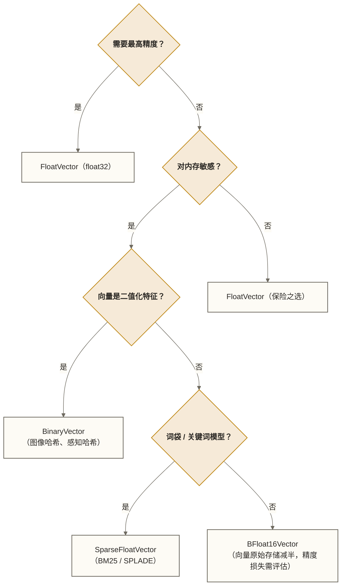
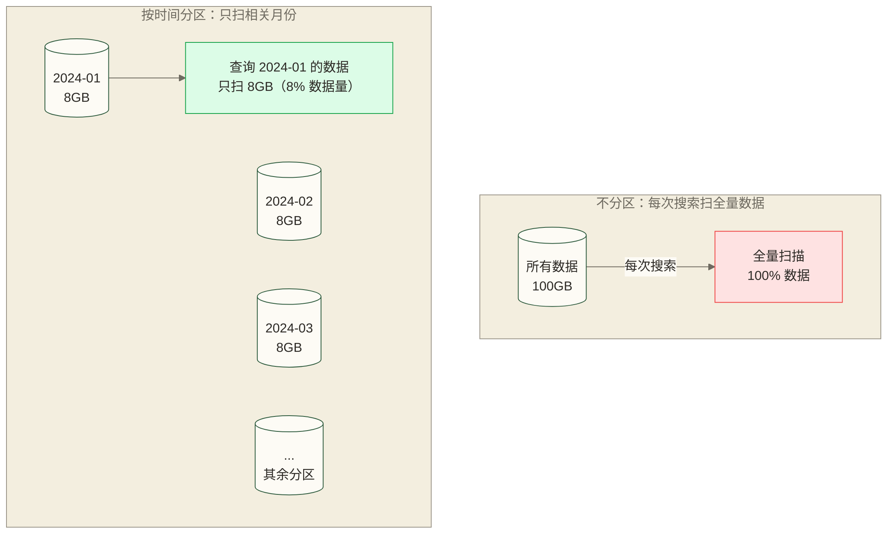
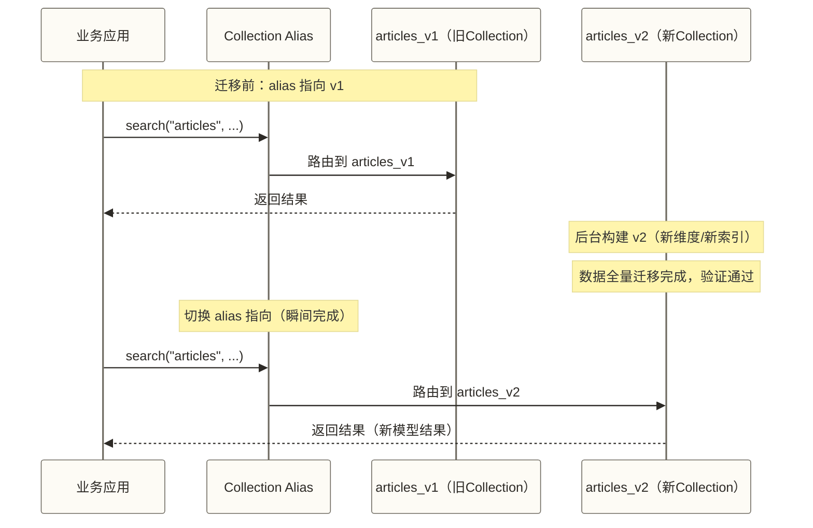

# Schema 设计与数据建模

> [!abstract] 本文能给你什么
> - **掌握 Milvus Schema 设计的核心思路**，理解它与关系数据库设计的本质差异
> - **学会每种字段类型的选型逻辑**，在内存、精度、查询灵活性之间做出正确权衡
> - **掌握三种主流设计模式**：RAG 知识库、多模态搜索、实时推荐的 Schema 最佳实践
> - **了解 Schema 演进方案**，掌握 Alias 切换机制及平滑迁移所需条件

很多人第一次用 Milvus 时，习惯性地把关系数据库的设计思路搬过来——先想范式、再想外键、再考虑怎么 join。结果发现 Milvus 根本没有 join，写了一半发现整个方向错了。

其实数据建模的底层逻辑是一样的：**先搞清楚查询，再设计结构**。只不过在向量数据库里，这个原则更彻底、更极端。本文帮你建立正确的建模心智模型，少走弯路。

---

## 目录

- [[#向量数据建模 vs 关系数据建模]]
- [[#字段类型详解与选型]]
- [[#主键设计]]
- [[#向量字段选型]]
- [[#标量字段选型]]
- [[#分区策略设计]]
- [[#实战设计模式]]
- [[#Schema 演进与零停机迁移]]
- [[#常见设计错误与避坑指南]]

---

## 向量数据建模 vs 关系数据建模

### 思维转变：从范式到查询模式

关系数据库的设计工作流是：

1. 分析业务实体和关系
2. 建立 ER 图
3. 按范式（1NF/2NF/3NF）消除冗余
4. 考虑查询，建立索引

Milvus 的设计工作流应该是：

1. **明确核心查询是什么**（找最相似的 K 个向量，并满足什么条件）
2. **决定要存哪些过滤字段**（帮助缩小搜索范围的标量属性）
3. **选择向量类型**（精度与内存的权衡）
4. **设计分区策略**（根据数据规模和访问模式）

> [!tip] 一句话总结思维差异
> 关系数据库设计是**数据驱动**的（先建模实体和关系），Milvus 设计是**查询驱动**的（先确定查询路径，再反推数据结构）。

### 核心设计原则

**原则一：一个 Collection 对应一类语义相似性任务**

不要把文章向量和用户向量塞进同一个 Collection，除非你真的要做跨模态搜索。每类语义任务的向量空间是不同的，混在一起只会让索引效率下降。

**原则二：过滤字段只保留真正用于 filter 的列**

不是所有业务属性都要放进 Milvus。用于展示的字段，可以在 MySQL/Redis 里存一份，Milvus 只保存影响搜索逻辑的关键属性。

**原则三：向量字段的维度一旦确定不可修改**

维度是硬约束，跟你的 Embedding 模型绑定。模型换了，Collection 要重建。这是 Milvus 设计里最重要的"高代价决策"，提前想清楚。


---

## 字段类型详解与选型

Milvus Collection 的 Schema 由三类字段构成：**主键字段**、**向量字段**、**标量字段**。每类字段都有自己的选型逻辑。

---

## 主键设计

主键是 Collection 里每条数据的唯一标识符，在 Milvus 里必须且只能有一个主键字段。

### int64 自动 ID vs 手动指定

| 对比维度 | 自动 ID（`auto_id=True`） | 手动指定 ID |
|---------|--------------------------|------------|
| 写入便利性 | 无需传入，Milvus 自动生成 | 业务层负责生成并传入 |
| ID 类型 | 雪花算法生成的 int64 | 自定义 int64 或 VarChar |
| 适用场景 | 纯向量数据，与业务 ID 无关 | 需要与外部系统（数据库/消息队列）的 ID 对齐 |
| 查询方式 | 可从写入返回结果或搜索结果取得 ID；已知 ID 时也可按主键精确查询 | 可以直接用业务 ID 做精确查询 |
| 并发写入 | 天然无冲突 | 需要业务层保证 ID 唯一性 |

**自动 ID 适用场景：**
- 纯粹的向量检索服务，结果只用于排序展示
- 数据来源没有全局唯一 ID 的场景（如实时采集的传感器数据）

**手动指定 ID 适用场景：**
- RAG 系统：需要根据 Milvus 返回的 `chunk_id` 去 MySQL 或对象存储里取原始文本
- 推荐系统：`item_id` 与商品数据库对齐，搜索结果直接可用
- 多租户系统：ID 中编码了租户信息

```python
from pymilvus import MilvusClient, DataType

# 场景一：自动 ID（纯向量服务）
schema_auto = MilvusClient.create_schema(auto_id=True, enable_dynamic_field=False)
schema_auto.add_field(field_name="id", datatype=DataType.INT64, is_primary=True)

# 场景二：手动 int64 ID（对齐业务数据库）
schema_manual_int = MilvusClient.create_schema(auto_id=False)
schema_manual_int.add_field(field_name="item_id", datatype=DataType.INT64, is_primary=True)

# 场景三：VarChar 主键（直接用业务字符串 ID）
schema_manual_str = MilvusClient.create_schema(auto_id=False)
schema_manual_str.add_field(
    field_name="doc_id",
    datatype=DataType.VARCHAR,
    max_length=128,     # 必须指定最大长度
    is_primary=True
)
```

> [!warning] VarChar 主键的注意事项
> VarChar 主键在高并发写入时性能比 int64 略差，因为字符串比较比整数比较更耗 CPU。如果业务 ID 是 UUID，可使用 VarChar 主键；若映射为 int64，应设计碰撞检测与处理机制，不能把哈希值视为天然唯一，并可另存原始 UUID 用于查询。

### 主键不可变原则

Milvus 的主键一旦写入，**不支持更新**。如果你的业务有"修改记录 ID"的需求，只能先 delete 再 insert。这个约束在设计时要考虑清楚。

---

## 向量字段选型

向量字段存储 Embedding 向量，是 Milvus 的核心字段类型。Milvus 2.4+ 支持一个 Collection 有多个向量字段（Multi-Vector）。

### 各向量类型对比

| 向量类型 | 数据格式 | 每维内存占用 | 适用场景 | 精度损失 |
|---------|---------|------------|---------|---------|
| `FloatVector` | float32 列表 | 4 字节 | 通用场景，最常用 | 无（原生精度） |
| `BFloat16Vector` | bfloat16 字节串 | 2 字节 | 内存敏感，大规模部署 | 轻微（指数位完整保留） |
| `Float16Vector` | float16 字节串 | 2 字节 | 内存敏感，精度要求更高的压缩 | 取决于数值范围与舍入方式（浮点格式转换，非均匀量化） |
| `BinaryVector` | 字节串（bit打包） | 1/8 字节 | 图像哈希、感知哈希、二值特征 | 较大（仅保留符号） |
| `SparseFloatVector` | 字典/稀疏矩阵 | 仅非零元素 | 词袋模型（BM25、SPLADE） | 取决于稀疏化策略 |

### 内存占用对比（以 1024 维为例）

```text
FloatVector   1024维 × 4字节  = 4096 字节/条 ≈ 4.0 KB
BFloat16      1024维 × 2字节  = 2048 字节/条 ≈ 2.0 KB（节省 50%）
Float16       1024维 × 2字节  = 2048 字节/条 ≈ 2.0 KB（节省 50%）
BinaryVector  1024维 × 1/8字节 = 128 字节/条 ≈ 0.1 KB（节省 97%）

1000万条数据的内存对比：
FloatVector   → 约 40 GB
BFloat16      → 约 20 GB
BinaryVector  → 约 1.3 GB
```

> [!tip] 选型决策树



### FloatVector：最通用的选择

```python
schema.add_field(
    field_name="embedding",
    datatype=DataType.FLOAT_VECTOR,
    dim=1536    # 对应 text-embedding-3-small 的维度
)
```

几乎所有 OpenAI、Cohere、HuggingFace 的 Embedding 模型输出都是 float32，直接用 `FloatVector` 最省事，没有任何转换开销。

### BFloat16Vector：大规模部署的内存杀手

BFloat16（Brain Float16）保留了 float32 完整的 8 位指数位，只压缩了尾数位，因此对数值范围的表达能力几乎没有损失，比 Float16 更适合神经网络的激活值和权重。

```python
import numpy as np

schema.add_field(
    field_name="embedding_bf16",
    datatype=DataType.BFLOAT16_VECTOR,
    dim=768
)

# 写入时需要转换格式
def float32_to_bfloat16_bytes(vectors: list[list[float]]) -> list[bytes]:
    result = []
    for vec in vectors:
        arr = np.array(vec, dtype=np.float32)
        # BF16 取 float32 的高 16 位
        bf16 = arr.view(np.uint32) >> 16
        result.append(bf16.astype(np.uint16).tobytes())
    return result
```

### SparseFloatVector：关键词检索的利器

稀疏向量不需要指定 `dim`，因为维度等于词汇表大小（可能高达数十万维），但每个向量只有少数非零元素。这是混合检索（向量语义 + 关键词匹配）的核心。

```python
schema.add_field(
    field_name="sparse_vector",
    datatype=DataType.SPARSE_FLOAT_VECTOR
    # 注意：不需要 dim 参数
)

# 写入时传入字典格式 {词的索引: 权重}
sparse_vectors = [
    {1: 0.5, 3: 0.3, 1024: 0.8},    # 文档1的BM25权重
    {2: 0.4, 500: 0.6, 2048: 0.2},   # 文档2的BM25权重
]
```

---

## 标量字段选型

标量字段用于存储结构化属性，主要用途是**过滤搜索**和**结果输出**。

### 整数类型

Milvus 支持 Int8、Int16、Int32、Int64 四种整数类型。

| 类型 | 范围 | 内存 | 适用场景 |
|------|------|------|---------|
| `INT8` | -128 ~ 127 | 1 字节 | 评分（0-100）、等级（1-5）、状态码 |
| `INT16` | -32768 ~ 32767 | 2 字节 | 年份、月份、小时级时间戳 |
| `INT32` | -2^31 ~ 2^31-1 | 4 字节 | 业务 ID（中小规模）、计数值 |
| `INT64` | -2^63 ~ 2^63-1 | 8 字节 | 毫秒时间戳、大规模业务 ID |

> [!tip] 整数类型选择原则
> 不要无脑用 INT64。如果一个字段存的是"文章评分（1-5星）"，用 INT8 每条节省 7 字节，1000万条就节省 70MB 内存。规模越大，这个差距越明显。

```python
# 用对应的类型，不要一律 INT64
schema.add_field(field_name="rating",    datatype=DataType.INT8)     # 评分 1-5
schema.add_field(field_name="year",      datatype=DataType.INT16)    # 年份
schema.add_field(field_name="view_count",datatype=DataType.INT32)    # 浏览量
schema.add_field(field_name="timestamp", datatype=DataType.INT64)    # 毫秒时间戳
```

### VarChar 字段

VarChar 是 Milvus 的字符串类型，**必须指定 `max_length`**（最大 65535 字节）；多字节字符应按编码后的字节长度评估。

```python
schema.add_field(
    field_name="title",
    datatype=DataType.VARCHAR,
    max_length=256       # 根据实际最大长度设置，不要默认写 65535
)

schema.add_field(
    field_name="category",
    datatype=DataType.VARCHAR,
    max_length=64        # 分类名称通常很短
)
```

> [!warning] max_length 的常见误区
> 很多人直接写 `max_length=65535`，认为"反正是上限，给大一点没关系"。实际上 `max_length` 影响内存的预分配策略，不必要地设置超大值会浪费内存。请根据实际业务场景设置合理的值：文章标题 256，URL 512，简短分类标签 64。

### JSON 字段：灵活性的代价

JSON 字段可以存储任意结构的键值对，提供类似 NoSQL 的灵活性。

```python
schema.add_field(
    field_name="metadata",
    datatype=DataType.JSON
)

# 写入：任意结构的字典
data = {
    "metadata": {
        "source": "arxiv",
        "authors": ["张三", "李四"],
        "citations": 42,
        "tags": ["NLP", "RAG"]
    }
}
```

**JSON 字段的查询支持：**

```python
# 查询 JSON 字段的嵌套值
results = client.query(
    collection_name="papers",
    filter='metadata["source"] == "arxiv"',
    output_fields=["title", "metadata"]
)

# 查询 JSON 数组是否包含某值（注意：性能比标量字段差）
results = client.query(
    collection_name="papers",
    filter='json_contains(metadata["tags"], "RAG")',
    output_fields=["title"]
)
```

> [!warning] JSON 字段的性能限制
> JSON 索引支持及过滤执行方式取决于部署版本、索引配置和查询表达式，不能统一认定为不支持索引或必须全量扫描。如果某个 JSON 键被频繁用于 filter，可比较 JSON 路径索引与独立标量字段在实际工作负载下的效果。
>
> 示例评估条件：**假设某个属性在超过 30% 的查询中被用作过滤条件，可将其列为独立字段的候选；30% 不是通用选型阈值，仍需结合查询性能和数据契约评估。**

### Array 字段：多值标签的最佳载体

Array 字段存储同类型的列表，常用于存储标签、关键词、类别路径等多值属性。

```python
schema.add_field(
    field_name="tags",
    datatype=DataType.ARRAY,
    element_type=DataType.VARCHAR,    # 数组元素的类型
    max_capacity=20,                   # 最多 20 个元素
    max_length=64                      # 每个 VARCHAR 元素的最大长度
)

schema.add_field(
    field_name="related_ids",
    datatype=DataType.ARRAY,
    element_type=DataType.INT64,
    max_capacity=100
)
```

**Array 字段的查询：**

```python
# 包含某个标签
filter='array_contains(tags, "机器学习")'

# 同时包含多个标签（AND 逻辑）
filter='array_contains_all(tags, ["机器学习", "NLP"])'

# 包含任意一个标签（OR 逻辑）
filter='array_contains_any(tags, ["机器学习", "深度学习"])'

# 数组长度查询
filter='array_length(tags) > 3'
```

### Dynamic Field：Schema-free 的逃生出口

开启 `enable_dynamic_field=True` 后，可以写入 Schema 中未定义的字段，这些字段存储在一个隐藏的 `$meta` JSON 字段中。

```python
schema = MilvusClient.create_schema(
    auto_id=False,
    enable_dynamic_field=True    # 开启动态字段
)

# 写入时可以带任意额外字段
client.insert("articles", [{
    "id": 1,
    "embedding": [0.1, 0.2, ...],
    "title": "向量数据库入门",
    "author": "张三",              # 动态字段，未在 Schema 中定义
    "publish_date": "2024-01-01"   # 动态字段
}])

# 可以用动态字段做 filter
results = client.query(
    collection_name="articles",
    filter='author == "张三"'
)
```

> [!note] 动态字段的适用场景
> 动态字段适合快速原型开发和数据结构不确定的早期阶段。进入生产环境后，建议将高频使用的字段显式定义在 Schema 中，以获得更好的性能和更清晰的数据契约。

---

## 分区策略设计

分区（Partition）是 Milvus 在 Collection 内部的逻辑数据隔离机制，搜索时可以指定只在特定分区中查询，大幅减少扫描数据量。

### 什么时候需要分区

分区的核心价值是**查询裁剪**（Query Pruning）：如果你的查询总是带有某个过滤条件，那么可以按这个条件分区，搜索时直接跳过不相关的分区。



**适合分区的三类场景：**

**场景一：按时间分区（日志、消息、文档类数据）**

```python
# 手动按月分区
partitions_to_create = ["2024_01", "2024_02", "2024_03", "2024_04"]
for partition_name in partitions_to_create:
    client.create_partition("logs", partition_name=partition_name)

# 写入时指定分区
client.insert("logs", data=records, partition_name="2024_03")

# 查询时只扫特定月份
results = client.search(
    collection_name="logs",
    data=[query_vector],
    limit=10,
    partition_names=["2024_03", "2024_04"]    # 只搜索这两个月
)
```

**场景二：按租户分区（多租户 SaaS 场景）**

```python
# 每个企业客户一个分区（适合租户数量较少的场景，<100个）
client.create_partition("knowledge_base", partition_name="tenant_acme")
client.create_partition("knowledge_base", partition_name="tenant_globex")

# 查询时天然隔离
results = client.search(
    collection_name="knowledge_base",
    data=[query_vector],
    limit=10,
    partition_names=["tenant_acme"]    # 只搜索该租户的数据
)
```

> [!warning] 多租户场景的分区边界
> 分区分租户只适合**租户数量少（<100个）且相对固定**的场景。如果租户数量动态增长（SaaS 平台有数千个客户），应该改用 `partition_key_field` 自动分区，或者每个租户独立建 Collection。

**场景三：按数据类型分区（多模态数据）**

```python
# 在同一 Collection 存储不同类型的内容，按类型分区
client.create_partition("content", partition_name="text_docs")
client.create_partition("content", partition_name="image_desc")
client.create_partition("content", partition_name="video_transcript")
```

### 分区数量权衡

Milvus 单个 Collection 最多支持 **4096 个分区**，但分区越多并不总是越好。

| 影响维度 | 分区多的影响 |
|---------|------------|
| 内存开销 | 每个分区维护独立的元数据和索引段，数量过多会显著增加内存压力 |
| 查询延迟 | 未命中分区剪枝时（查询跨多个分区），反而会比不分区更慢 |
| 管理复杂度 | 分区生命周期管理（创建/删除/归档）需要额外工程投入 |

> [!tip] 分区数量的实践建议
> - **时间分区**：可优先评估按月/按季度；按天分区按每年365天估算，5年约1825个，未超过本文列出的4096个，但仍需评估分区开销与保留周期
> - **租户分区**：租户数量超过 500 时，改用 `partition_key_field`
> - **类型分区**：一般 3-10 个，稳定可控

### 动态分区：partition_key_field

Milvus 2.2.9+ 支持通过 `partition_key_field` 实现自动分区路由。你只需要标记某个字段为分区键，Milvus 自动按该字段的值路由数据到对应分区，查询时自动剪枝。

```python
from pymilvus import MilvusClient, DataType

client = MilvusClient(uri="http://localhost:19530")

# 创建 Schema，指定分区键字段
schema = MilvusClient.create_schema(auto_id=False, enable_dynamic_field=True)
schema.add_field(field_name="doc_id",    datatype=DataType.INT64,        is_primary=True)
schema.add_field(field_name="embedding", datatype=DataType.FLOAT_VECTOR,  dim=1536)
schema.add_field(field_name="category",  datatype=DataType.VARCHAR,        max_length=64,
                 is_partition_key=True)   # 标记为分区键

# 创建索引
index_params = MilvusClient.prepare_index_params()
index_params.add_index(
    field_name="embedding",
    index_type="HNSW",
    metric_type="COSINE",
    params={"M": 16, "efConstruction": 200}
)

# 创建 Collection（num_partitions 控制底层分区数量，默认16）
client.create_collection(
    collection_name="articles",
    schema=schema,
    index_params=index_params,
    num_partitions=32    # 示例配置；并发数的2-4倍仅可作为待测试假设，不是通用规则
)

# 写入时，category 字段值自动决定路由到哪个分区
data = [
    {"doc_id": 1, "embedding": [...], "category": "技术",  "title": "..."},
    {"doc_id": 2, "embedding": [...], "category": "商业",  "title": "..."},
    {"doc_id": 3, "embedding": [...], "category": "技术",  "title": "..."},
]
client.insert("articles", data)

# 查询时 filter 包含 category，Milvus 自动只扫对应分区
results = client.search(
    collection_name="articles",
    data=[query_embedding],
    limit=10,
    filter='category == "技术"',    # 可利用分区键裁剪底层分区；键值可能共享分区，仍需过滤记录
    output_fields=["title", "category"]
)
```

> [!note] partition_key_field vs 手动分区
> - **手动分区**：你控制分区的创建和数据路由，灵活但需要代码管理
> - **partition_key_field**：Milvus 自动管理，你只需要在 filter 里带上分区键，代码更简洁
>
> 新项目建议优先考虑 `partition_key_field`，除非你需要精确控制分区的物理隔离。

---

## 实战设计模式

### 模式一：RAG 知识库

RAG（Retrieval-Augmented Generation）是 Milvus 最主流的应用场景。核心需求：

- 将文档切片成 chunk，存储文本块的向量
- 搜索时能按文档来源、时间、类别过滤
- 根据返回的 chunk_id 去原始存储取完整文本

```python
from pymilvus import MilvusClient, DataType

client = MilvusClient(uri="http://localhost:19530")

# Schema 设计
schema = MilvusClient.create_schema(auto_id=False, enable_dynamic_field=True)

# 主键：与原始文档系统（如 MySQL）的 chunk_id 对齐
schema.add_field(
    field_name="chunk_id",
    datatype=DataType.VARCHAR,
    max_length=128,
    is_primary=True
)

# 向量字段：对应 text-embedding-3-small（1536维）
schema.add_field(
    field_name="embedding",
    datatype=DataType.FLOAT_VECTOR,
    dim=1536
)

# 过滤字段：文档来源（用于隔离不同知识库）
schema.add_field(
    field_name="source",
    datatype=DataType.VARCHAR,
    max_length=64,
    is_partition_key=True    # 按来源自动分区，支持多知识库隔离
)

# 过滤字段：文档创建时间（支持时效性过滤）
schema.add_field(
    field_name="created_at",
    datatype=DataType.INT64    # Unix 时间戳（秒）
)

# 过滤字段：文档类别（支持按业务领域过滤）
schema.add_field(
    field_name="doc_type",
    datatype=DataType.VARCHAR,
    max_length=32
)

# 过滤字段：内容摘要（用于结果展示，不用于过滤）
schema.add_field(
    field_name="content_preview",
    datatype=DataType.VARCHAR,
    max_length=512
)

# 索引参数
index_params = MilvusClient.prepare_index_params()
index_params.add_index(
    field_name="embedding",
    index_type="HNSW",
    metric_type="COSINE",
    params={"M": 16, "efConstruction": 200}
)

client.create_collection(
    collection_name="rag_knowledge",
    schema=schema,
    index_params=index_params
)

# 写入示例
chunks = [
    {
        "chunk_id": "doc_001_chunk_0",
        "embedding": get_embedding("Milvus 是开源向量数据库..."),
        "source": "product_docs",
        "created_at": 1704067200,
        "doc_type": "tutorial",
        "content_preview": "Milvus 是开源向量数据库，支持..."
    }
]
client.insert("rag_knowledge", chunks)

# 搜索示例：只在产品文档中搜索最近半年的内容
import time
six_months_ago = int(time.time()) - 180 * 24 * 3600

results = client.search(
    collection_name="rag_knowledge",
    data=[query_embedding],
    limit=5,
    filter=f'source == "product_docs" and created_at > {six_months_ago}',
    output_fields=["chunk_id", "content_preview", "doc_type", "created_at"]
)
```

### 模式二：多模态搜索

Milvus 2.4+ 支持一个 Collection 有多个向量字段，实现文本向量和图像向量的混合检索。

```python
from pymilvus import MilvusClient, DataType, AnnSearchRequest, RRFRanker

client = MilvusClient(uri="http://localhost:19530")

# Schema：一条商品记录，同时含文本向量和图像向量
schema = MilvusClient.create_schema(auto_id=False)
schema.add_field(field_name="product_id",    datatype=DataType.INT64,       is_primary=True)
schema.add_field(field_name="text_embedding", datatype=DataType.FLOAT_VECTOR, dim=1536)  # 商品文本描述向量
schema.add_field(field_name="image_embedding",datatype=DataType.FLOAT_VECTOR, dim=2048)  # 商品图像特征向量
schema.add_field(field_name="category",      datatype=DataType.VARCHAR,      max_length=64)
schema.add_field(field_name="price",         datatype=DataType.FLOAT)
schema.add_field(field_name="name",          datatype=DataType.VARCHAR,      max_length=256)

# 为两个向量字段分别创建索引
index_params = MilvusClient.prepare_index_params()
index_params.add_index(
    field_name="text_embedding",
    index_type="HNSW",
    metric_type="COSINE",
    params={"M": 16, "efConstruction": 200}
)
index_params.add_index(
    field_name="image_embedding",
    index_type="HNSW",
    metric_type="L2",
    params={"M": 16, "efConstruction": 200}
)

client.create_collection(
    collection_name="products",
    schema=schema,
    index_params=index_params
)

# 混合搜索：用户上传图片 + 输入文字，两路向量加权融合
def multimodal_search(text_query_vec, image_query_vec, category_filter=None, top_k=10):
    """
    多模态混合搜索：文本向量 + 图像向量，用 RRF 重排序融合结果
    """
    filter_expr = f'category == "{category_filter}"' if category_filter else ""

    # 文本向量搜索请求
    text_search = AnnSearchRequest(
        data=[text_query_vec],
        anns_field="text_embedding",
        param={"metric_type": "COSINE", "params": {"ef": 100}},
        limit=top_k * 2,    # 候选集放大，留给 RRF 重排
        expr=filter_expr
    )

    # 图像向量搜索请求
    image_search = AnnSearchRequest(
        data=[image_query_vec],
        anns_field="image_embedding",
        param={"metric_type": "L2", "params": {"ef": 100}},
        limit=top_k * 2,
        expr=filter_expr
    )

    # RRF 重排序融合（k=60 是标准参数，控制长尾候选的权重）
    ranker = RRFRanker(k=60)

    results = client.hybrid_search(
        collection_name="products",
        reqs=[text_search, image_search],
        ranker=ranker,
        limit=top_k,
        output_fields=["product_id", "name", "category", "price"]
    )
    return results
```

### 模式三：实时推荐

推荐场景的特点：数据量大（亿级），需要时效性过滤，向量需要定期更新。

```python
from pymilvus import MilvusClient, DataType

client = MilvusClient(uri="http://localhost:19530")

# 物品向量库：存储商品/内容的 Embedding
schema = MilvusClient.create_schema(auto_id=False)
schema.add_field(field_name="item_id",       datatype=DataType.INT64,       is_primary=True)
schema.add_field(field_name="item_embedding", datatype=DataType.BFLOAT16_VECTOR, dim=256)  # 内存减半
schema.add_field(field_name="publish_time",  datatype=DataType.INT64)         # 发布时间戳
schema.add_field(field_name="item_type",     datatype=DataType.INT8)          # 内容类型（节省内存）
schema.add_field(field_name="tags",          datatype=DataType.ARRAY,         # 标签列表
                 element_type=DataType.VARCHAR, max_capacity=20, max_length=32)
schema.add_field(field_name="score",         datatype=DataType.FLOAT)         # 质量分

# 将月份字段设为分区键；只有查询包含可用于剪枝的月份分区键条件时，才能利用该键缩小搜索范围
schema.add_field(
    field_name="month_partition",
    datatype=DataType.VARCHAR,
    max_length=8,
    is_partition_key=True    # 格式：'2024-03'
)

index_params = MilvusClient.prepare_index_params()
index_params.add_index(
    field_name="item_embedding",
    index_type="HNSW",
    metric_type="COSINE",
    params={"M": 32, "efConstruction": 400}    # 推荐场景对召回率要求高，适当调大
)

client.create_collection(
    collection_name="item_vectors",
    schema=schema,
    index_params=index_params,
    num_partitions=24    # 底层哈希分区数量，不表示24个独立月份分区
)

# 实时推荐查询：只看近3个月的优质内容
import time
from datetime import datetime, timedelta

def get_recent_months(n=3):
    """获取包含当前月在内的最近 n 个自然月键值；下方搜索尚未使用这些键值。"""
    now = datetime.now()
    month_index = now.year * 12 + now.month - 1
    months = []
    for i in range(n):
        year, month_zero_based = divmod(month_index - i, 12)
        months.append(f"{year:04d}-{month_zero_based + 1:02d}")
    return months

def recommend_for_user(user_embedding, user_tags, top_k=50):
    three_months_ago = int((datetime.now() - timedelta(days=90)).timestamp())

    return client.search(
        collection_name="item_vectors",
        data=[user_embedding],
        limit=top_k,
        filter=(
            f'publish_time > {three_months_ago} '
            f'and score > 0.6 '
            f'and array_contains_any(tags, {user_tags})'
        ),
        output_fields=["item_id", "item_type", "tags", "score"]
    )
```

---

## Schema 演进与零停机迁移

### Milvus 支持的 Schema 变更

Collection 属性修改与已有字段参数修改属于不同操作，以下分别示意 `alter_collection` 和 `alter_collection_field` 的用途；具体支持的参数及在线变更能力须按部署版本确认，不能统一视为所有 Milvus 2.4+ 版本均支持：

```python
# 反例：以下调用不能新增字段，不应执行。
# alter_collection_field 用于修改已有字段参数；新增字段需使用部署版本支持的新增字段接口。
# client.alter_collection_field(
#     collection_name="articles",
#     field_name="new_field",        # 尚未定义的字段不能通过此调用新增
#     field_params={"max_length": 256}
# )

# 支持：修改标量字段的部分参数（如 VarChar 的 max_length 可以增大）
client.alter_collection_field(
    collection_name="articles",
    field_name="title",
    field_params={"max_length": 512}    # 从 256 增大到 512
)

# 支持：修改 Collection 级别的属性
client.alter_collection(
    collection_name="articles",
    properties={"collection.ttl.seconds": 2592000}    # 设置 30 天 TTL
)
```

### 不支持的变更（需要重建）

以下变更 Milvus **不支持在线修改**，必须重建 Collection：

| 不支持的变更 | 原因 |
|------------|------|
| 修改向量字段的维度（dim） | 维度决定了索引文件的物理结构 |
| 修改主键字段的类型 | 主键是所有数据文件的组织基础 |
| 删除已有字段 | 需要重写所有数据文件 |
| 修改向量字段的类型（如 Float 改 BFloat16） | 底层存储格式完全不同 |
| 更改分区键字段 | 所有数据需要按新键重新路由 |

### 零停机迁移方案：Alias 机制

当你需要重建 Collection 时（例如更换 Embedding 模型导致维度变化），可以用 **Collection Alias** 切换集合访问目标；平滑切换还要求查询侧模型与新 Schema 兼容、增量数据追平及回滚准备，Alias 本身不保证零停机或业务无感知。



```python
# 步骤一：用旧 Schema 正常运行，给 Collection 起别名
client.create_alias(
    collection_name="articles_v1",
    alias="articles"
)

# 业务代码始终使用 alias 名称，不直接用 v1/v2
results = client.search(collection_name="articles", ...)  # 实际访问 v1

# 步骤二：后台创建新 Collection（新维度、新索引）
new_schema = MilvusClient.create_schema(auto_id=False)
new_schema.add_field(field_name="doc_id",    datatype=DataType.INT64, is_primary=True)
new_schema.add_field(field_name="embedding", datatype=DataType.FLOAT_VECTOR, dim=3072)  # 新模型 3072 维
# ... 其他字段

client.create_collection("articles_v2", schema=new_schema, index_params=new_index_params)

# 步骤三：全量迁移数据到 v2（可用批量读取+写入脚本）
migrate_data(source="articles_v1", target="articles_v2", re_embed=True)

# 步骤四：验证 v2 数据完整性和搜索质量通过后，原子切换 alias
client.alter_alias(
    collection_name="articles_v2",    # 新 Collection
    alias="articles"                   # 切换访问目标；业务是否平滑取决于模型兼容和迁移保障
)

# 步骤五：确认稳定后，删除旧 Collection
# client.drop_collection("articles_v1")  # 保留观察期再删
```

> [!tip] 迁移时的双写策略
> 如果数据量大、迁移耗时较长，在迁移期间可以实施**双写**：新数据同时写入 v1 和 v2，迁移完成后验证 v2 数据与 v1 一致，再切换 alias。在双写成功、失败重试与增量追平得到保障的条件下，该策略可降低迁移期间新增数据遗漏的风险；更新、删除及回填竞态仍需单独处理。

---

## 常见设计错误与避坑指南

> [!warning] 错误一：用 JSON 字段存高频过滤属性
> 假设在特定版本、索引配置和工作负载的测试中，JSON 过滤出现5-20倍性能下降，可评估将高频过滤属性提升为独立标量字段；该倍数不是本文已证实的结果，JSON 索引支持也需按部署版本判断。

> [!warning] 错误二：所有字段都用最大值
> `max_length=65535`、`max_capacity=1024`、`INT64` 统一用。这种"防御性"写法会造成大量内存浪费。评估实际业务范围，设置合理的上限值。

> [!warning] 错误三：向量维度与 Embedding 模型不匹配就开始写数据
> 向量维度是不可修改的硬约束。换模型 = 重建 Collection。在设计阶段就确认好使用哪个 Embedding 模型，把维度写死进 Schema。

> [!warning] 错误四：分区数量过多
> 有人按天分区，一年 365 个分区，每个分区的数据量很小，索引效果很差，查询反而更慢。分区的意义在于数据量足够大时的剪枝，可将分区内少于10万条作为需要评估开销的示例条件，但不能据此认定分区没有意义；是否受益取决于剪枝比例、访问模式及管理成本。

> [!warning] 错误五：忽略 Dynamic Field 的查询性能
> `enable_dynamic_field=True` 之后随意往里塞字段，然后到处用动态字段做 filter，发现性能差才想到这个问题。动态字段存储在隐藏的 JSON 字段中，其过滤性能需结合部署版本、可用索引和查询表达式评估，不能一概认定为扫描或与所有 JSON 查询性能相同。

---

## 总结

Schema 设计的核心思路可以用三个问题来驱动：

1. **我要搜什么？** → 确定向量字段（类型和维度跟着 Embedding 模型走）
2. **我要怎么筛？** → 确定标量字段（只放真正用于 filter 的属性，注意选型精确）
3. **数据规模多大、访问模式如何？** → 确定分区策略（小规模不分区，大规模用 partition_key_field）

Schema 设计得好，后续的查询性能、内存成本、运维复杂度都会好很多；设计得差，等数据量上来再重建付出的代价是双倍的。

**下一步：**
- 学习如何用这些 Schema 进行高效查询 → 08-查询与搜索详解
- 了解索引类型如何影响 Schema 中向量字段的性能 → [[【技术与工具】/向量数据库/Milvus/06-索引类型与选型指南]]
- 在 RAG 场景中实战应用这些 Schema 模式 → 10-RAG集成实战

#Milvus #向量数据库 #Schema设计 #数据建模 #技术/向量数据库
