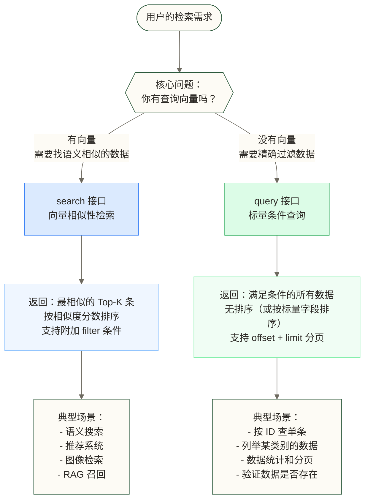
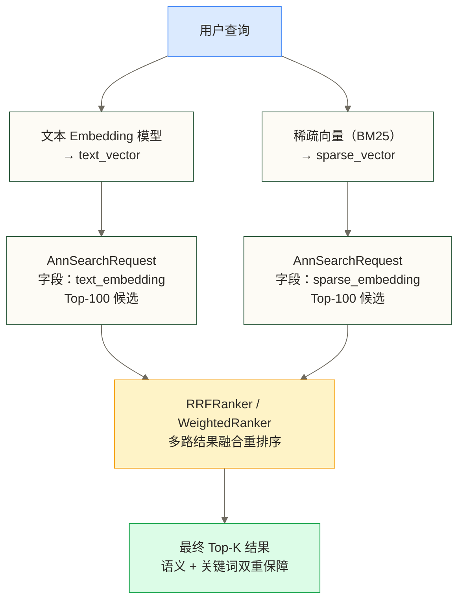
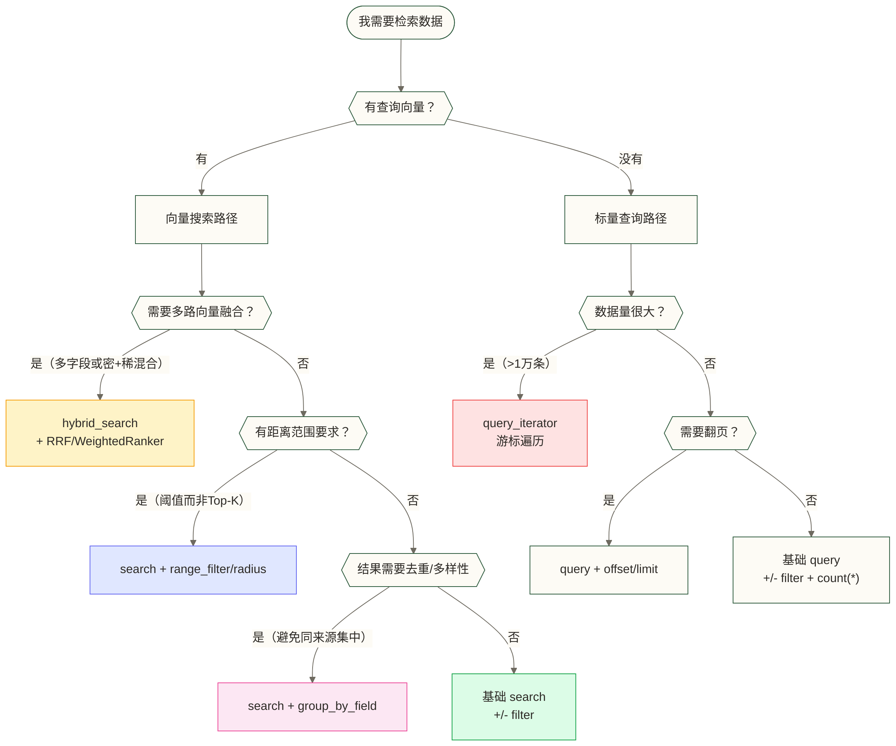

# 查询与搜索详解

> [!abstract] 本文能给你什么
> - **彻底理解 Search 和 Query 的本质差异**，知道什么场景该用哪个
> - **掌握所有向量搜索变体**：基础 ANN、过滤搜索、范围搜索、分组搜索
> - **学会混合搜索**：多向量融合 + RRF/加权重排序的调用示例，向量生成部分需自行实现
> - **理解相似度分数的含义**，能正确解读和处理搜索结果
> - **学会迭代器的使用**，处理大批量数据遍历场景

搜索是 Milvus 的核心能力，但很多人只用到了最基础的 `search`，不知道 Milvus 还有过滤搜索、范围搜索、分组搜索、混合搜索等丰富的查询模式。每种查询模式背后都有特定的适用场景，用对了能大幅提升检索质量，用错了只会让结果更差。

本文从本质理解出发，覆盖常用查询接口，并提供调用示例和参数解释。示例依赖已创建、建索引并加载的 Collection，以及读者提供的查询向量；混合检索中的向量生成函数为待实现占位，不是独立可运行的完整项目。

---

## 目录

- [[#Search vs Query 的本质区别]]
- [[#向量搜索（Search）完整解析]]
- [[#过滤搜索（Filtered Search）]]
- [[#标量查询（Query）]]
- [[#混合搜索（Hybrid Search）]]
- [[#范围搜索（Range Search）]]
- [[#分组搜索（Grouping Search）]]
- [[#迭代器（Iterator）]]
- [[#搜索结果处理]]
- [[#性能调优与最佳实践]]

---

## Search vs Query 的本质区别

Milvus 有两个完全不同的检索接口：`search` 和 `query`。很多初学者会混用它们，导致拿到错误的结果或者用了错误的方法。



> [!note] 一句话区分
> - `search`：**给我一个向量，找最像它的 K 条数据**（向量相似性问题）
> - `query`：**给我一个布尔表达式，找所有满足条件的数据**（集合过滤问题）

---

## 向量搜索（Search）完整解析

### 基础 ANN 搜索

最基本的向量搜索：给一个查询向量，返回最相似的 K 条结果。

```python
from pymilvus import MilvusClient

client = MilvusClient(uri="http://localhost:19530")

# 基础搜索
results = client.search(
    collection_name="movies",        # 要搜索的 Collection
    data=[query_vector],             # 查询向量列表，支持批量查询（多个向量）
    anns_field="embedding",          # 向量字段名（有多个向量字段时必须指定）
    limit=10,                        # 返回最相似的前 K 条（Top-K）
    output_fields=["title", "genre", "year"],   # 返回的标量字段
    search_params={
        "metric_type": "COSINE",     # 相似度度量方式
        "params": {"ef": 100}        # 索引特定的搜索参数
    }
)

# 结果结构
for hits in results:          # results 是一个列表，对应每个查询向量的结果
    for hit in hits:          # hits 是该查询向量的 Top-K 结果
        print(f"ID: {hit['id']}")
        print(f"相似度分数: {hit['distance']}")
        print(f"标题: {hit['entity']['title']}")
        print(f"类型: {hit['entity']['genre']}")
        print("---")
```

### 参数逐一解析

**`data`：查询向量**

支持批量查询，同时传入多个查询向量：

```python
# 单个查询
data=[query_vector]              # query_vector 是长度为 dim 的 list[float]

# 批量查询（同时搜索多个向量，性能比循环调用 search 更好）
data=[query_vec_1, query_vec_2, query_vec_3]
# 返回 results[0]、results[1]、results[2] 分别对应三个查询向量的结果
```

**`limit`：Top-K 数量**

`limit` 不是越大越好。增大 `limit` 会增加返回及后处理的数据量，也会改变下游可用候选数量；最终召回效果需结合索引、搜索参数、候选规模和评测指标判断，不能只由 `limit` 或 `search_params` 单独决定。

```python
# 常见配置建议
limit=10    # 搜索结果直接展示给用户
limit=50    # 后续有精排（reranker）逻辑
limit=100   # 混合搜索的候选集
```

**`output_fields`：输出字段**

只返回必要的字段，减少网络传输：

```python
# 只返回 ID（最轻量，适合只需要 ID 再去另一个存储取详情的场景）
output_fields=["id"]

# 返回展示所需字段
output_fields=["title", "genre", "rating"]

# 返回所有字段（慎用，向量字段通常很大）
output_fields=["*"]

# 包含向量字段本身（通常不需要，向量很大会拖慢速度）
output_fields=["title", "embedding"]
```

> [!warning] output_fields 包含向量字段的代价
> 向量字段数据量巨大（1536维 float32 = 6KB/条），如果 `output_fields` 包含向量字段，返回 100 条结果就需要传输 600KB 的向量数据。除非你有特殊需求（比如做二次计算），否则不要在 `output_fields` 中包含向量字段。

**`search_params`：控制搜索精度与速度的核心参数**

`search_params` 的具体参数取决于索引类型，不同索引的搜索参数完全不同：

```python
# HNSW 索引的搜索参数
search_params_hnsw = {
    "metric_type": "COSINE",
    "params": {
        "ef": 100    # 搜索时候选节点数，越大召回率越高但越慢
                     # 建议范围：limit 的 2-10 倍，常用 64~512
    }
}

# IVF_FLAT 索引的搜索参数
search_params_ivf = {
    "metric_type": "L2",
    "params": {
        "nprobe": 16    # 搜索的桶数量，越大召回率越高但越慢
                        # 建议范围：4~128，常用 16~32
    }
}

# SCANN 索引的搜索参数
search_params_scann = {
    "metric_type": "COSINE",
    "params": {
        "reorder_k": 100    # 重排序候选数，比 limit 大即可
    }
}

# DiskANN 索引的搜索参数（适合大规模数据，内存不足时）
search_params_diskann = {
    "metric_type": "COSINE",
    "params": {
        "search_list": 100    # 候选列表大小，越大越准但 I/O 越多
    }
}
```

> [!tip] 如何选 ef / nprobe 的值
> 通用原则：先用较小的值（ef=50, nprobe=8），测试召回率（ground truth 对比）。如果召回率不够，逐步加大，找到"召回率达标的最小搜索参数"，以此平衡精度和延迟。

### 批量查询性能对比

```python
import time

query_vectors = [get_embedding(q) for q in queries]    # 假设有 100 个查询

# 方式一：循环单次 search（不推荐）
start = time.time()
results_loop = []
for vec in query_vectors:
    r = client.search("movies", data=[vec], limit=10)
    results_loop.append(r[0])
print(f"循环方式耗时：{time.time() - start:.2f}s")

# 方式二：批量 search（推荐）
start = time.time()
results_batch = client.search("movies", data=query_vectors, limit=10)
print(f"批量方式耗时：{time.time() - start:.2f}s")
# 批量方式可减少网络往返次数；可将加速 5-20 倍作为待测假设，但本文未提供支持该倍数的实测结果，实际差异取决于批大小、网络、索引和服务端负载
```

---

## 过滤搜索（Filtered Search）

过滤搜索是在向量相似性搜索的基础上，附加标量字段的过滤条件。这是 Milvus 最常用的复合查询模式。

### 过滤表达式完整语法指南

**比较运算符**

```python
# 等于与不等于
filter='genre == "sci-fi"'
filter='genre != "horror"'

# 数值比较
filter='year > 2020'
filter='year >= 2020'
filter='rating < 8.0'
filter='rating <= 7.5'
```

**逻辑运算符**

```python
# AND：同时满足多个条件
filter='genre == "sci-fi" and year > 2020'
filter='rating > 7.0 and year >= 2015 and genre != "horror"'

# OR：满足任意条件
filter='genre == "sci-fi" or genre == "fantasy"'

# NOT：取反
filter='not (genre == "horror")'

# 混合使用（括号控制优先级）
filter='(genre == "sci-fi" or genre == "action") and year > 2015 and rating > 7.0'
```

**范围运算符**

```python
# in：在集合中
filter='genre in ["sci-fi", "fantasy", "action"]'

# not in：不在集合中
filter='genre not in ["horror", "adult"]'

# 数值范围（等价于 >= and <=）
filter='year in [2020, 2021, 2022, 2023]'    # 离散值列表
```

**字符串运算符**

```python
# like：模糊匹配（% 是通配符）
filter='title like "Star%"'          # 以 "Star" 开头
filter='title like "%Wars%"'         # 包含 "Wars"
filter='title like "%Jedi"'          # 以 "Jedi" 结尾

# 注意：like 查询的执行代价取决于匹配模式、已建索引及版本支持，不能一概视为全表扫描；大数据量下应结合实际配置测试
```

**JSON 字段查询**

```python
# JSON 字段的简单键值查询
filter='metadata["source"] == "arxiv"'
filter='metadata["year"] > 2022'
filter='metadata["is_public"] == true'

# JSON 嵌套查询
filter='metadata["location"]["city"] == "Beijing"'

# JSON 数组包含查询
filter='json_contains(metadata["authors"], "张三")'

# 多条件组合
filter='metadata["source"] == "arxiv" and metadata["citations"] > 100'
```

**Array 字段查询**

```python
# 包含特定元素
filter='array_contains(tags, "机器学习")'

# 包含所有指定元素（AND）
filter='array_contains_all(tags, ["机器学习", "NLP"])'

# 包含任意一个元素（OR）
filter='array_contains_any(tags, ["深度学习", "机器学习", "AI"])'

# 数组长度
filter='array_length(tags) >= 3'
filter='array_length(tags) == 0'    # 空标签的数据
```

### 完整过滤搜索示例

```python
from pymilvus import MilvusClient

client = MilvusClient(uri="http://localhost:19530")

# 场景：在电影向量库中，找与查询向量语义最近的科幻片
# 条件：2015年后上映、评分 >= 7.5、不是恐怖类型
results = client.search(
    collection_name="movies",
    data=[query_vector],
    anns_field="embedding",
    limit=10,
    filter='genre == "sci-fi" and year > 2015 and rating >= 7.5',
    output_fields=["title", "genre", "year", "rating"],
    search_params={
        "metric_type": "COSINE",
        "params": {"ef": 200}    # 示例搜索参数；是否需要增大 ef 应结合过滤模式、索引和召回评测判断
    }
)

for hits in results:
    for hit in hits:
        print(f"[{hit['distance']:.4f}] {hit['entity']['title']} "
              f"({hit['entity']['year']}) - {hit['entity']['rating']}分")
```

### Filter 对性能和召回率的影响

> [!warning] 高选择性过滤会降低有效召回率
> 严格的 filter 条件可能影响搜索延迟、召回率和返回数量，但不能统一解释为先获取 ANN Top-K 再删除不满足条件的候选。标准过滤先按标量条件限定搜索范围，迭代过滤则在搜索迭代中检查候选；返回数量还受满足条件的数据量及搜索配置影响。
>
> **解决方案：**
> 1. 加大 `ef`（HNSW）或 `nprobe`（IVF），扫描更多候选
> 2. 检查满足过滤条件的记录数，并根据实际过滤模式和索引评测搜索参数；`range_filter` 用于限定距离范围，不是补足过滤候选的通用方法
> 3. 考虑将高选择性条件单独用 `query` 接口处理，再做二次向量排序

**标量字段索引加速 Filter**

为高频过滤的标量字段添加索引，可以大幅加速 filter 的执行：

```python
# 为 genre 字段添加倒排索引
index_params = MilvusClient.prepare_index_params()
index_params.add_index(
    field_name="genre",
    index_type="INVERTED"    # 适合 VarChar、Bool 等离散值字段
)

# 为 year 字段添加 STL_SORT 索引（适合范围查询）
index_params.add_index(
    field_name="year",
    index_type="STL_SORT"    # 适合数值范围查询
)

# 为 tags（Array字段）添加倒排索引
index_params.add_index(
    field_name="tags",
    index_type="INVERTED"
)

client.create_index("movies", index_params)
```

---

## 标量查询（Query）

`query` 接口不使用向量，只根据标量条件过滤数据，返回满足条件的所有记录。

### 基础查询

```python
from pymilvus import MilvusClient

client = MilvusClient(uri="http://localhost:19530")

# 基础条件查询
results = client.query(
    collection_name="movies",
    filter='genre == "sci-fi" and year > 2020',
    output_fields=["id", "title", "genre", "year"],
    limit=100                    # 最多返回 100 条
)

for item in results:
    print(f"ID: {item['id']}, 标题: {item['title']}, 年份: {item['year']}")
```

### 按 ID 精确查询

```python
# 通过主键 ID 查询单条数据
result = client.get(
    collection_name="movies",
    ids=[12345]                   # 支持批量查询多个 ID
)

# 等价的 query 写法
result = client.query(
    collection_name="movies",
    filter="id in [12345, 67890, 11111]",
    output_fields=["*"]
)
```

### 分页查询（Pagination）

```python
page_size = 20

# 第一页
page1 = client.query(
    collection_name="movies",
    filter='genre == "sci-fi"',
    output_fields=["id", "title", "year"],
    limit=page_size,
    offset=0                # 从第 0 条开始
)

# 第二页
page2 = client.query(
    collection_name="movies",
    filter='genre == "sci-fi"',
    output_fields=["id", "title", "year"],
    limit=page_size,
    offset=page_size        # 跳过第一页
)

# 第 N 页
def query_page(collection, filter_expr, fields, page_num, page_size=20):
    return client.query(
        collection_name=collection,
        filter=filter_expr,
        output_fields=fields,
        limit=page_size,
        offset=(page_num - 1) * page_size
    )
```

> [!warning] 深度分页的性能问题
> `offset` 很大时（如 `offset=10000`），深度分页可能增加查询开销；具体性能变化取决于实现、数据规模和查询配置，本文没有提供线性下降的测量依据。如果需要遍历大量数据，优先考虑 [[#迭代器（Iterator）]]，并检查当前环境支持的分页范围。

### Count 查询

```python
# 统计满足条件的数据总量
result = client.query(
    collection_name="movies",
    filter='genre == "sci-fi"',
    output_fields=["count(*)"]    # 使用 count(*) 只返回数量，不返回数据
)
total_count = result[0]["count(*)"]
print(f"科幻片总数：{total_count}")

# 无条件统计 Collection 总数据量（等价于 get_collection_stats）
result = client.query(
    collection_name="movies",
    filter="",                    # 空字符串表示无条件
    output_fields=["count(*)"]
)
total = result[0]["count(*)"]
```

### Query vs Search 的选择决策

| 情况 | 用 Search | 用 Query |
|------|-----------|----------|
| 有查询向量，要找语义相似的内容 | 是 | 否 |
| 只知道 ID，要取对应的数据 | 否 | 是（用 get 或 query） |
| 需要列举某个分类下的所有数据 | 否 | 是 |
| 需要统计数据量 | 否 | 是（count） |
| 先过滤、再按向量相似度排序 | 是（带 filter） | 否 |
| 验证某条数据是否存在 | 否 | 是 |

---

## 混合搜索（Hybrid Search）

混合搜索允许在一次请求中执行多路向量搜索，并将多路结果融合重排序。这是实现高质量语义检索的关键技术。

### 核心架构



### 密集向量 + 稀疏向量混合检索（最经典的混合搜索）

这种模式同时利用语义相似性（密集向量）和关键词匹配（稀疏向量），在 RAG 场景中显著提升召回质量。

```python
from pymilvus import MilvusClient, AnnSearchRequest, RRFRanker, WeightedRanker

client = MilvusClient(uri="http://localhost:19530")

# 假设 Collection 有两个向量字段：
# - text_embedding: FloatVector(1536)，存储语义向量
# - sparse_embedding: SparseFloatVector，存储 BM25 权重

def get_dense_embedding(text: str) -> list[float]:
    """调用 OpenAI/Cohere 等模型获取密集向量"""
    # ... 实现略
    pass

def get_sparse_embedding(text: str) -> dict:
    """获取 BM25 稀疏向量（词索引 -> 权重）"""
    # 使用 pymilvus 内置的 BM25 工具或自定义实现
    # ... 实现略
    pass

def hybrid_search(query: str, top_k: int = 10) -> list:
    """
    混合检索：语义向量 + BM25 关键词，RRF 融合重排序
    """
    dense_vec = get_dense_embedding(query)
    sparse_vec = get_sparse_embedding(query)

    # 密集向量搜索请求
    dense_req = AnnSearchRequest(
        data=[dense_vec],
        anns_field="text_embedding",
        param={
            "metric_type": "COSINE",
            "params": {"ef": top_k * 5}    # HNSW 搜索参数 ef，不等同于返回给融合器的候选结果数
        },
        limit=top_k * 3    # 候选集放大，给重排序留余量
    )

    # 稀疏向量搜索请求
    sparse_req = AnnSearchRequest(
        data=[sparse_vec],
        anns_field="sparse_embedding",
        param={
            "metric_type": "IP",           # 稀疏向量用内积度量
            "params": {"drop_ratio_search": 0.2}  # 按较小权重丢弃查询稀疏向量中约 20% 的非零项，不是以 0.2 为绝对权重阈值
        },
        limit=top_k * 3
    )

    # RRF 融合：Reciprocal Rank Fusion，不需要关心各路分数的量纲
    # k=60 是 RRF 的平滑参数，通常不需要调整
    ranker = RRFRanker(k=60)

    results = client.hybrid_search(
        collection_name="documents",
        reqs=[dense_req, sparse_req],
        ranker=ranker,
        limit=top_k,
        output_fields=["doc_id", "content_preview", "source"]
    )

    return results[0]    # 返回第一个查询的结果

# 使用示例
hits = hybrid_search("向量数据库的索引原理", top_k=5)
for hit in hits:
    print(f"[{hit['distance']:.4f}] {hit['entity']['content_preview'][:80]}...")
```

### 多向量字段混合搜索（多模态场景）

```python
from pymilvus import AnnSearchRequest, WeightedRanker

def multimodal_search(text_vec: list, image_vec: list,
                       text_weight: float = 0.6,
                       image_weight: float = 0.4,
                       top_k: int = 10) -> list:
    """
    多模态混合搜索：文本语义 + 图像视觉特征加权融合
    适用于：商品搜索（输入文字+图片，找视觉和语义都相似的商品）
    """

    # 文本向量搜索
    text_req = AnnSearchRequest(
        data=[text_vec],
        anns_field="text_embedding",
        param={"metric_type": "COSINE", "params": {"ef": top_k * 5}},
        limit=top_k * 2
    )

    # 图像向量搜索
    image_req = AnnSearchRequest(
        data=[image_vec],
        anns_field="image_embedding",
        param={"metric_type": "L2", "params": {"ef": top_k * 5}},
        limit=top_k * 2
    )

    # WeightedRanker：对各路分数按度量类型归一化后进行加权融合
    # COSINE 与 L2 的原始分数不可直接比较，但不要求各路使用相同 metric_type
    # 权重应通过检索评测选择；不希望依赖分数尺度时可使用 RRFRanker
    ranker = WeightedRanker(text_weight, image_weight)

    results = client.hybrid_search(
        collection_name="products",
        reqs=[text_req, image_req],
        ranker=ranker,
        limit=top_k,
        output_fields=["product_id", "name", "price", "category"]
    )

    return results[0]

# WeightedRanker vs RRFRanker 的选择
# WeightedRanker：明确知道每路搜索的权重时使用（如文本60%，图像40%）
#                 内部按度量类型归一化分数，不要求各路使用相同 metric_type
# RRFRanker：    不确定各路权重，或者各路 metric_type 不同时使用
#                 基于排名融合，对量纲不敏感，更稳健
```

### 混合搜索 + 过滤条件

```python
# 混合搜索也支持附加 filter 条件（在每个 AnnSearchRequest 中指定）
dense_req = AnnSearchRequest(
    data=[dense_vec],
    anns_field="text_embedding",
    param={"metric_type": "COSINE", "params": {"ef": 200}},
    limit=50,
    expr='category == "技术" and created_at > 1704067200'    # filter 条件
)

sparse_req = AnnSearchRequest(
    data=[sparse_vec],
    anns_field="sparse_embedding",
    param={"metric_type": "IP", "params": {"drop_ratio_search": 0.2}},
    limit=50,
    expr='category == "技术" and created_at > 1704067200'    # 两路 filter 要一致
)
```

---

## 范围搜索（Range Search）

普通 ANN 搜索返回近似最相似的 Top-K 个向量；范围搜索在指定距离区间内检索结果，仍受 `limit` 和底层检索配置限制，不保证返回范围内所有向量。适合需要"相似度阈值"而不是"Top-K"的场景。

### 参数解释

```python
results = client.search(
    collection_name="images",
    data=[query_vector],
    anns_field="image_embedding",
    limit=1000,    # 范围内结果的上限（必须设置，防止返回过多数据）
    search_params={
        "metric_type": "L2",
        "params": {
            "radius": 1.0,         # 外边界：平方欧氏距离 < radius 的向量才考虑
            "range_filter": 0.1    # 内边界（可选）：距离 >= range_filter 的才返回
                                   # 即：range_filter <= distance <= radius
        }
    },
    output_fields=["image_id", "description"]
)
```

> [!tip] radius 和 range_filter 的直觉理解
> - `radius`：最大可接受距离（圆的半径），超过这个距离的向量一律排除
> - `range_filter`：最小距离（可选），用于排除过近的结果（比如排除完全相同的项）
>
> 搜索区间：`range_filter <= distance <= radius`

### 不同 Metric Type 下的参数含义

```python
# L2 距离（越小越相似）
# radius 是最大距离，range_filter 是最小距离
search_params_l2 = {
    "metric_type": "L2",
    "params": {
        "radius": 0.5,          # 只考虑平方欧氏距离 < 0.5 的向量
        "range_filter": 0.0     # 包含距离为 0 的结果；如需排除完全相同项，应另设条件或使用合适的正下界
    }
}

# COSINE 相似度（越大越相似，范围 -1 到 1）
# 注意：range_filter > radius（因为越大越好）
search_params_cosine = {
    "metric_type": "COSINE",
    "params": {
        "radius": 0.3,          # 只考虑余弦相似度 > 0.3 的向量
        "range_filter": 0.99    # 排除相似度 > 0.99 的结果；0.99 端点包含在区间内
    }
}

# IP（内积，值越大越相似）
search_params_ip = {
    "metric_type": "IP",
    "params": {
        "radius": 0.5,          # 只考虑 IP > 0.5
        "range_filter": 0.98    # 排除 IP > 0.98 的结果；0.98 端点包含在区间内
    }
}
```

> [!warning] COSINE 相似度下 radius 和 range_filter 的顺序
> L2 距离中，radius > range_filter（外大内小）。
> 但 COSINE 相似度中，**值越大越相似**，所以 range_filter > radius（内大外小）。
> 很多人在这里搞反，导致范围搜索返回空结果。

### 范围搜索的典型应用场景

```python
# 场景一：去重检测——检索与新文档高度相似的候选，受 limit 和底层检索配置限制
def find_near_duplicates(new_doc_vec, threshold=0.95):
    """检索余弦相似度 > threshold 的疑似重复候选，不保证穷尽。"""
    results = client.search(
        collection_name="documents",
        data=[new_doc_vec],
        limit=100,
        search_params={
            "metric_type": "COSINE",
            "params": {
                "radius": threshold,    # COSINE: 内边界
                "range_filter": 1.0    # COSINE: 包含 1.0 的相似度上界；是否检出全部相同向量仍受 limit 和底层检索配置限制
            }
        }
    )
    return results[0]

# 场景二：相似用户推荐——检索与目标用户足够相似的候选，最多返回 max_return 条
def find_similar_users(user_vec, min_similarity=0.8, max_return=200):
    results = client.search(
        collection_name="user_vectors",
        data=[user_vec],
        limit=max_return,
        search_params={
            "metric_type": "COSINE",
            "params": {
                "radius": min_similarity,    # 只考虑相似度 > min_similarity 的候选
                "range_filter": 0.9999       # 排除自身（相似度接近1.0）
            }
        }
    )
    return results[0]
```

---

## 分组搜索（Grouping Search）

分组搜索解决了一个常见问题：搜索结果集中在同一个来源（同一文档/同一作者/同一类别）。通过按某个字段分组，保证结果多样性。

### 问题场景

```text
不用分组的 RAG 搜索结果（问题）：
1. [0.95] 文档A - 第1段
2. [0.93] 文档A - 第2段
3. [0.91] 文档A - 第3段
4. [0.89] 文档A - 第4段    ← 前4条都来自同一文档！
5. [0.87] 文档B - 第1段
...

用分组搜索后（改善）：
1. [0.95] 文档A - 第1段    ← 文档A最相关的那段
2. [0.87] 文档B - 第1段    ← 文档B最相关的那段
3. [0.81] 文档C - 第2段    ← 文档C最相关的那段
...（每个文档只取最好的几段）
```

### 使用方式

```python
results = client.search(
    collection_name="documents",
    data=[query_vector],
    anns_field="embedding",
    limit=10,                            # 最终返回 10 个分组
    search_params={
        "metric_type": "COSINE",
        "params": {"ef": 200}
    },
    group_by_field="doc_id",            # 按 doc_id 字段分组
    group_size=2,                        # 每个分组最多返回 2 条（默认为 1）
    strict_group_size=False,             # False：不足 group_size 时也返回
    output_fields=["doc_id", "chunk_index", "content_preview"]
)

# 结果：最多返回 10 个不同 doc_id，每个最多 2 条 chunk
for hit in results[0]:
    print(f"文档: {hit['entity']['doc_id']}, "
          f"段落: {hit['entity']['chunk_index']}, "
          f"相似度: {hit['distance']:.4f}")
    print(f"内容: {hit['entity']['content_preview'][:60]}...")
    print()
```

> [!note] group_size 的含义
> - `group_size=1`：每个分组只取最相似的 1 条（默认值）
> - `group_size=2`：每个分组取最相似的 2 条
> - `strict_group_size=True`：如果某个分组没有足够的记录，该分组会被丢弃（保证每组都有 group_size 条）
> - `strict_group_size=False`（推荐）：即使不足 group_size 条，也保留该分组

### 分组搜索的典型场景

```python
# RAG：每篇文档最多返回 2 段，确保知识来源多样性
rag_results = client.search(
    collection_name="knowledge_base",
    data=[query_embedding],
    limit=5,           # 最多 5 篇文档
    search_params={"metric_type": "COSINE", "params": {"ef": 300}},
    group_by_field="doc_id",
    group_size=2,      # 每篇文档最多取 2 段
    output_fields=["doc_id", "content", "source"]
)

# 电商搜索：每个品牌最多展示 3 款商品，避免结果被某个品牌垄断
product_results = client.search(
    collection_name="products",
    data=[query_vec],
    limit=20,          # 最多 20 个品牌
    search_params={"metric_type": "COSINE", "params": {"ef": 500}},
    group_by_field="brand_id",
    group_size=3,      # 每个品牌最多展示 3 款
    output_fields=["product_id", "name", "brand_id", "price"]
)
```

---

## 迭代器（Iterator）

当需要遍历大量数据时（如数据导出、全量重计算、离线评测），用 `offset` 分页会越来越慢，应该使用**迭代器**，它基于游标机制高效遍历数据。

### search_iterator：遍历向量搜索结果

```python
from pymilvus import MilvusClient
from pymilvus.orm.iterator import SearchIterator

client = MilvusClient(uri="http://localhost:19530")

# 场景：分批检索余弦相似度 > 0.7 的候选，总返回量不超过 10000，不保证穷尽
search_iterator = client.search_iterator(
    collection_name="documents",
    data=[query_vector],
    anns_field="embedding",
    batch_size=200,                      # 每批返回 200 条
    limit=10000,                         # 总上限（防止无限遍历）
    search_params={
        "metric_type": "COSINE",
        "params": {
            "ef": 500,
            "radius": 0.7,               # 只考虑相似度 > 0.7 的候选
            "range_filter": 1.0
        }
    },
    output_fields=["doc_id", "content_preview"]
)

# 迭代器使用模式
all_results = []
try:
    while True:
        batch = search_iterator.next()
        if not batch:           # 没有更多数据时返回空列表
            break
        all_results.extend(batch)
        print(f"已获取 {len(all_results)} 条相似文档...")
finally:
    search_iterator.close()    # 必须关闭，释放服务端资源

print(f"总计找到 {len(all_results)} 条相似度 >= 0.7 的文档")
```

### query_iterator：遍历大量标量数据

```python
from pymilvus.orm.iterator import QueryIterator

# 场景：导出所有科幻类型的电影数据
query_iterator = client.query_iterator(
    collection_name="movies",
    filter='genre == "sci-fi"',
    output_fields=["id", "title", "year", "rating"],
    batch_size=500           # 每批 500 条
)

exported_data = []
try:
    while True:
        batch = query_iterator.next()
        if not batch:
            break
        exported_data.extend(batch)

        # 实时处理每批数据（如写入文件）
        for item in batch:
            print(f"{item['id']},{item['title']},{item['year']},{item['rating']}")

finally:
    query_iterator.close()

print(f"共导出 {len(exported_data)} 条科幻电影数据")
```

> [!tip] 什么时候用迭代器
> - 需要遍历超过 10000 条数据
> - 数据导出或离线批处理任务
> - 不知道总数据量，需要"扫到没有为止"
>
> 什么时候用 offset 分页：
> - 面向用户的翻页功能（页数有限，通常不超过 100 页）
> - 需要随机跳转到某一页

---

## 搜索结果处理

### 结果格式解析

```python
results = client.search(
    collection_name="movies",
    data=[query_vector],
    limit=5,
    output_fields=["title", "genre", "rating"]
)

# results 是一个列表，长度等于 data 中查询向量的数量
# results[i] 是第 i 个查询向量对应的 Top-K 结果
# results[i][j] 是第 i 个查询的第 j 名命中

for query_idx, hits in enumerate(results):
    print(f"=== 第 {query_idx + 1} 个查询的结果 ===")
    for rank, hit in enumerate(hits):
        print(f"  排名 {rank + 1}:")
        print(f"    主键 ID:  {hit['id']}")
        print(f"    相似度:   {hit['distance']:.6f}")
        print(f"    字段数据: {hit['entity']}")
        # hit['entity'] 是一个字典，包含 output_fields 指定的字段
        print(f"    标题:     {hit['entity']['title']}")
        print(f"    评分:     {hit['entity']['rating']}")
```

### 相似度分数的含义与数值范围

> [!warning] distance 字段的含义取决于 metric_type！
> Milvus 把分数统一放在 `distance` 字段，但不同 metric_type 的含义和方向完全相反：

| Metric Type | `distance` 的含义 | 数值范围 | 越接近哪个值越相似 |
|-------------|-----------------|---------|----------------|
| `L2` | 平方欧氏距离（越小越相似） | [0, +∞) | 0 |
| `COSINE` | 余弦相似度（越大越相似） | [-1, 1] | 1 |
| `IP` | 内积（越大越相似，向量未归一化时） | (-∞, +∞) | +∞ |

```python
# 根据 metric_type 正确解读分数
def interpret_score(distance: float, metric_type: str) -> str:
    """以下阈值仅为示例，应针对实际模型、数据集和任务评测校准。"""
    if metric_type == "COSINE":
        if distance > 0.9:
            return "高度相似"
        elif distance > 0.7:
            return "较为相似"
        elif distance > 0.5:
            return "有一定相似性"
        else:
            return "相似度较低"
    elif metric_type == "L2":
        if distance < 0.1:
            return "高度相似"
        elif distance < 0.5:
            return "较为相似"
        elif distance < 1.0:
            return "有一定相似性"
        else:
            return "相似度较低"
    else:
        return f"原始分数：{distance:.4f}"
```

### 分数归一化

当需要将不同路搜索的分数对比，或需要将 L2 距离转换为相似度时：

```python
import math

def l2_to_similarity(l2_distance: float) -> float:
    """将 L2 距离转换为 0-1 之间的相似度分数"""
    return 1.0 / (1.0 + l2_distance)

def cosine_to_percentage(cosine_sim: float) -> float:
    """将余弦相似度 [-1,1] 转换为百分比 [0,100]"""
    return (cosine_sim + 1) / 2 * 100

# 对多个结果的分数归一化（Min-Max）
def normalize_scores(hits: list, metric_type: str = "COSINE") -> list:
    if not hits:
        return []
    distances = [h['distance'] for h in hits]
    if metric_type in ["COSINE", "IP"]:
        # 分数越大越好：最大值归一化为 1
        max_d = max(distances)
        min_d = min(distances)
        denom = max_d - min_d if max_d != min_d else 1
        return [(h, (h['distance'] - min_d) / denom) for h in hits]
    else:  # L2
        # 距离越小越好：最小值归一化为 1
        max_d = max(distances)
        min_d = min(distances)
        denom = max_d - min_d if max_d != min_d else 1
        return [(h, 1 - (h['distance'] - min_d) / denom) for h in hits]

# 使用示例
hits = results[0]
normalized = normalize_scores(hits, metric_type="L2")
for hit, norm_score in normalized:
    print(f"原始距离: {hit['distance']:.4f}, 归一化相似度: {norm_score:.4f}")
```

---

## 性能调优与最佳实践

### 搜索延迟优化清单

```python
# 1. 确保数据已 load 到内存
client.load_collection("movies")         # 第一次需要，之后自动保持

# 2. 只返回必要的 output_fields
# 错误：output_fields=["*"]（返回所有字段，包含大向量）
# 正确：output_fields=["id", "title", "rating"]

# 3. 合理设置 search_params
# HNSW：ef = limit 的 2-5 倍就够（不要无限加大）
search_params = {"metric_type": "COSINE", "params": {"ef": 50}}   # limit=10 时

# 4. 批量搜索代替循环
results = client.search(collection_name="movies", data=batch_queries, limit=10)

# 5. 为标量过滤字段建索引
index_params.add_index(field_name="genre", index_type="INVERTED")
index_params.add_index(field_name="year",  index_type="STL_SORT")
```

### 召回率提升策略

```python
# 策略一：加大 ef（HNSW）或 nprobe（IVF）
high_recall_params = {"metric_type": "COSINE", "params": {"ef": 500}}

# 策略二：使用混合搜索（语义 + 关键词双重保障）
# 参见 [[#混合搜索（Hybrid Search）]] 章节

# 策略三：有 filter 时加大候选集
# 是否增大 ef 应结合标准过滤或迭代过滤模式评测；过滤严格并不意味着 ef 必须单调增大
filtered_params = {
    "metric_type": "COSINE",
    "params": {"ef": 1000}    # 严格 filter 场景，放大 ef
}

# 策略四：分组搜索保证结果多样性
# 参见 [[#分组搜索（Grouping Search）]] 章节
```

### 常见错误速查

| 错误现象 | 可能原因 | 解决方案 |
|---------|---------|---------|
| 返回结果数量少于 limit | 满足条件的数据不足，或过滤模式与检索配置限制了命中 | 先检查符合条件的记录数，再评测 ef/nprobe；仅在业务允许时放宽 filter |
| 搜索延迟很高 | output_fields 包含向量字段；ef 设置过大 | 去掉向量字段；减小 ef |
| 范围搜索返回空结果 | COSINE 下 radius 和 range_filter 写反了 | 检查参数方向（见 [[#范围搜索（Range Search）]]） |
| 混合搜索分数异常 | 度量配置、融合权重或对融合分数的解释不合适 | 检查各路索引与度量配置，评测 WeightedRanker 权重；需要排名融合时可使用 RRFRanker |
| 分页越翻越慢 | 大 offset 可能增加查询开销，具体取决于实现与配置 | 批量遍历优先考虑 [[#迭代器（Iterator）]]，并实测分页开销 |
| 结果高度重复（同文档） | 没有分组，多段来自同一文档 | 使用 group_by_field |

---

## 总结

Milvus 的查询体系可以用这张决策图来总结：



**核心查询接口速查：**

| 接口 | 用途 | 关键参数 |
|------|------|---------|
| `search` | 向量 ANN 搜索 | `data`, `limit`, `search_params` |
| `search` + `filter` | 向量搜索 + 标量过滤 | 加 `filter` 表达式 |
| `search` + `range` | 距离范围搜索 | `radius`, `range_filter` |
| `search` + `group_by_field` | 分组搜索去重 | `group_by_field`, `group_size` |
| `hybrid_search` | 多路向量混合搜索 | `AnnSearchRequest`, `RRFRanker` |
| `query` | 标量条件查询 | `filter`, `offset`, `limit` |
| `get` | 按 ID 精确查询 | `ids` |
| `search_iterator` | 大量向量搜索遍历 | `batch_size`, `limit` |
| `query_iterator` | 大量标量数据遍历 | `batch_size` |

**下一步：**
- 了解 Schema 设计如何影响查询性能 → 07-Schema设计与数据建模
- 学习索引类型选择如何改变 search_params 配置 → [[【技术与工具】/向量数据库/Milvus/06-索引类型与选型指南]]
- 把这些查询技巧应用到 RAG 系统 → 10-RAG集成实战
- 理解 Collection、Partition 等核心概念 → 03-核心概念详解

#Milvus #向量数据库 #向量搜索 #ANN搜索 #混合搜索 #RAG #技术/向量数据库
