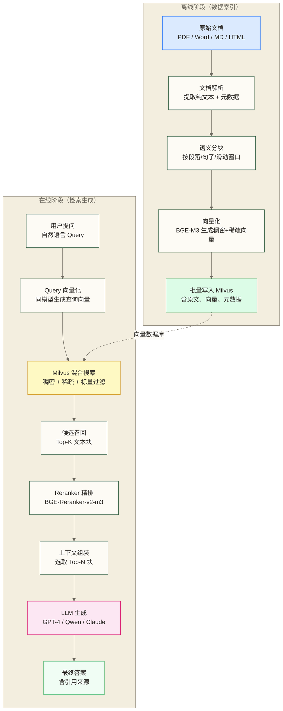

# Milvus RAG 集成实战

> [!abstract] 本文目标
> - **理解 RAG 架构**：掌握离线索引和在线检索的完整数据流
> - **设计 RAG 专用 Schema**：为多模态文档设计覆盖稠密 + 稀疏向量的混合搜索 Schema
> - **构建文档处理流水线**：PDF / Word / Markdown 解析、语义分块、向量化、批量入库
> - **集成主流框架**：提供 LangChain 和 LlamaIndex 集成示例，作为适配、测试与生产化实现的起点
> - **实现生产级优化**：Reranker 精排、Parent-Child 分块、增量更新、多租户隔离
> - **建立评估体系**：用 RAGAS 量化 RAG 质量，持续迭代优化

RAG（Retrieval-Augmented Generation，检索增强生成）是目前企业 AI 落地最成熟的技术路径。Milvus 在其中承担最关键的角色：以高性能向量检索为 LLM 提供精准的上下文，让模型从"胡说八道"变成"有依据地回答"。

本文以企业知识库为场景搭建 RAG 系统示例：处理 PDF / Word / Markdown 文档，支持中文语义搜索，集成 LangChain 和 LlamaIndex，并演示 Reranker 精排；生产使用还需完成代码适配、数据完整性测试、权限控制和业务验收。

阅读前置：08-查询与搜索详解 [[【技术与工具】/向量数据库/Milvus/06-索引类型与选型指南]] 09-生产运维与性能调优

扩展阅读：[[【AI 与大数据】/04-AI工程化/08-向量数据库与RAG工程实践]]

---

## 目录

- [[#一、RAG 系统架构设计]]
- [[#二、Milvus Collection 设计（RAG 专用）]]
- [[#三、文档处理流水线]]
- [[#四、LangChain + Milvus 集成]]
- [[#五、LlamaIndex + Milvus 集成]]
- [[#六、混合搜索 RAG（BGE-M3）]]
- [[#七、生产级优化]]
- [[#八、评估体系]]

---

## 一、RAG 系统架构设计

### 1.1 完整 RAG 数据流



### 1.2 关键设计决策

在动手之前，先明确几个影响全局的设计决策：

| 决策点 | 选项 | 本文选择 | 理由 |
|--------|------|---------|------|
| 向量模型 | OpenAI Ada / BGE-M3 / Jina | BGE-M3 | 中文优化，支持稠密+稀疏，本地部署 |
| 搜索策略 | 纯向量 / 纯 BM25 / 混合 | 混合搜索 | 兼顾语义和关键词，召回率更高 |
| 分块策略 | 固定大小 / 按句子 / 按段落 | Parent-Child | 小块检索精准，大块上下文完整 |
| 精排 | 无 / Cross-encoder / LLM | BGE-Reranker-v2-m3 | 本文选用的性能与效果折中方案，需在业务语料上评估 |
| 框架 | 纯 pymilvus / LangChain / LlamaIndex | 均覆盖 | 不同项目按需选择 |

---

## 二、Milvus Collection 设计（RAG 专用）

### 2.1 Schema 设计原则

RAG 场景的 Collection Schema 需要兼顾：
- **向量字段**：稠密向量（语义搜索） + 稀疏向量（关键词搜索）
- **文本字段**：原始文本（喂给 LLM） + 用于过滤的标量字段
- **元数据字段**：来源溯源（让用户知道答案来自哪里）

### 2.2 完整 Schema 代码

```python
from pymilvus import (
    connections, Collection, CollectionSchema, FieldSchema,
    DataType, utility
)

connections.connect(host="localhost", port="19530")

def create_rag_collection(collection_name: str = "enterprise_kb") -> Collection:
    """
    创建企业知识库 RAG 专用 Collection

    设计说明：
    - doc_id：业务文档 ID（主键），VARCHAR 支持 UUID 格式
    - chunk_id：块序号，用于还原文档顺序
    - text：原始文本内容，喂给 LLM 的核心字段
    - dense_vector：BGE-M3 生成的稠密向量（1024维），用于语义搜索
    - sparse_vector：BGE-M3 生成的稀疏向量，用于关键词搜索
    - parent_text：父块文本（Parent-Child 策略），检索用子块，上下文用父块
    - source：来源文件名，用于过滤和引用
    - page：页码，用于定位原文
    - created_at：入库时间戳，用于增量更新过滤
    - metadata：JSON 扩展字段，存放其他动态属性
    """

    # 检查是否已存在
    if utility.has_collection(collection_name):
        print(f"Collection {collection_name} 已存在，返回现有实例")
        return Collection(collection_name)

    fields = [
        # ===== 主键 =====
        FieldSchema(
            name="doc_id",
            dtype=DataType.VARCHAR,
            max_length=128,
            is_primary=True,
            description="业务文档块唯一ID，格式：{file_hash}_{chunk_index}"
        ),

        # ===== 文本字段 =====
        FieldSchema(
            name="text",
            dtype=DataType.VARCHAR,
            max_length=4096,    # 子块文本，约 500-1000 个 token
            description="用于检索的文本块（子块，较短）"
        ),
        FieldSchema(
            name="parent_text",
            dtype=DataType.VARCHAR,
            max_length=16384,   # 父块文本，约 2000-4000 个 token
            description="用于上下文的父块文本（较长），无 Parent-Child 时与 text 相同"
        ),

        # ===== 向量字段 =====
        FieldSchema(
            name="dense_vector",
            dtype=DataType.FLOAT_VECTOR,
            dim=1024,           # BGE-M3 输出 1024 维稠密向量
            description="BGE-M3 稠密向量，用于语义相似度搜索"
        ),
        FieldSchema(
            name="sparse_vector",
            dtype=DataType.SPARSE_FLOAT_VECTOR,
            description="BGE-M3 稀疏向量，用于关键词匹配（替代 BM25）"
        ),

        # ===== 来源追踪字段 =====
        FieldSchema(
            name="source",
            dtype=DataType.VARCHAR,
            max_length=512,
            description="来源文件名或 URL"
        ),
        FieldSchema(
            name="page",
            dtype=DataType.INT32,
            description="所在页码（-1 表示非分页文档）"
        ),
        FieldSchema(
            name="chunk_index",
            dtype=DataType.INT32,
            description="在原文档中的块序号，用于还原上下文"
        ),

        # ===== 时间与过滤字段 =====
        FieldSchema(
            name="created_at",
            dtype=DataType.INT64,
            description="入库时间戳（Unix 秒），用于增量更新和时效过滤"
        ),
        FieldSchema(
            name="tenant_id",
            dtype=DataType.VARCHAR,
            max_length=64,
            description="租户 ID，多租户 RAG 场景使用"
        ),
        FieldSchema(
            name="doc_type",
            dtype=DataType.VARCHAR,
            max_length=32,
            description="文档类型：pdf / word / markdown / html / txt"
        ),

        # ===== 扩展字段 =====
        FieldSchema(
            name="metadata",
            dtype=DataType.JSON,
            description="扩展元数据，如作者、部门、机密级别等动态属性"
        ),
    ]

    schema = CollectionSchema(
        fields=fields,
        description="企业知识库 RAG Collection，支持混合搜索",
        enable_dynamic_field=True   # 开启动态字段，允许插入 Schema 未定义的字段
    )

    collection = Collection(
        name=collection_name,
        schema=schema,
        consistency_level="Strong"  # 生产环境用 Strong 保证一致性
    )

    # ===== 创建索引 =====

    # 稠密向量索引（本文选用HNSW，召回率需结合语料与参数测试）
    dense_index = {
        "index_type": "HNSW",
        "metric_type": "COSINE",
        "params": {
            "M": 16,
            "efConstruction": 200
        }
    }
    collection.create_index(
        field_name="dense_vector",
        index_params=dense_index,
        index_name="dense_hnsw_index"
    )

    # 稀疏向量索引（SPARSE_INVERTED_INDEX）
    sparse_index = {
        "index_type": "SPARSE_INVERTED_INDEX",
        "metric_type": "IP",    # 稀疏向量用内积（Inner Product）
        "params": {"drop_ratio_build": 0.2}  # 构建时按权重排序丢弃最低的 20% 稀疏向量条目
    }
    collection.create_index(
        field_name="sparse_vector",
        index_params=sparse_index,
        index_name="sparse_index"
    )

    # 标量字段索引（加速过滤）
    collection.create_index(field_name="source")
    collection.create_index(field_name="tenant_id")
    collection.create_index(field_name="created_at")

    print(f"Collection {collection_name} 创建成功")
    collection.load()
    return collection
```

### 2.3 Schema 设计权衡

> [!note] 为什么选 VARCHAR 而不是 TEXT？
> Milvus 没有 TEXT 类型，VARCHAR 是存储文本的唯一选择。`max_length` 按字节计算，中文字符占 3 个字节。4096 字节约能存 1365 个中文字符（约 700 个 token），16384 字节约能存 5460 个中文字符（约 2730 个 token）。

> [!warning] 向量维度必须与模型输出一致
> BGE-M3 输出 1024 维稠密向量，如果你使用其他模型需要修改 `dim` 参数：
> - `BAAI/bge-base-zh-v1.5`：768 维
> - `text-embedding-3-small`（OpenAI）：1536 维
> - `text-embedding-3-large`（OpenAI）：3072 维
> - `jina-embeddings-v3`：1024 维

---

## 三、文档处理流水线

### 3.1 依赖安装

```bash
# 核心依赖
pip install pymilvus[model]  # 包含 BGE-M3 集成
pip install FlagEmbedding     # BGE-M3 官方库
pip install langchain langchain-community
pip install llama-index llama-index-vector-stores-milvus

# 文档解析依赖
pip install pypdf              # PDF 解析
pip install python-docx        # Word 解析
pip install markdown           # Markdown 解析
pip install beautifulsoup4     # HTML 解析
pip install unstructured       # 万能文档解析（支持表格、图片等）

# 其他工具
pip install tiktoken           # Token 计数
pip install tqdm               # 进度条
```

### 3.2 文档解析模块

```python
import os
import hashlib
from pathlib import Path
from typing import List, Dict, Any
from dataclasses import dataclass, field


@dataclass
class Document:
    """文档数据结构"""
    content: str                          # 原始文本
    source: str                           # 来源文件名
    page: int = -1                        # 页码
    doc_type: str = "unknown"             # 文档类型
    metadata: Dict[str, Any] = field(default_factory=dict)

    @property
    def content_hash(self) -> str:
        """基于内容生成唯一标识"""
        return hashlib.md5(self.content.encode()).hexdigest()[:16]


class DocumentParser:
    """
    多格式文档解析器
    支持：PDF、Word (.docx)、Markdown、HTML、纯文本
    """

    def parse(self, file_path: str) -> List[Document]:
        """自动识别文件类型并解析"""
        path = Path(file_path)
        suffix = path.suffix.lower()

        parser_map = {
            ".pdf": self._parse_pdf,
            ".docx": self._parse_word,
            # 旧式 .doc 不由 python-docx 支持，需先转换为 .docx
            ".md": self._parse_markdown,
            ".markdown": self._parse_markdown,
            ".html": self._parse_html,
            ".htm": self._parse_html,
            ".txt": self._parse_text,
        }

        parser = parser_map.get(suffix, self._parse_text)
        return parser(file_path)

    def _parse_pdf(self, file_path: str) -> List[Document]:
        """PDF 解析：按页提取文本，保留页码信息"""
        from pypdf import PdfReader

        reader = PdfReader(file_path)
        documents = []

        for page_num, page in enumerate(reader.pages):
            text = page.extract_text()
            if text and len(text.strip()) > 50:  # 过滤空页和过短页
                documents.append(Document(
                    content=text.strip(),
                    source=os.path.basename(file_path),
                    page=page_num + 1,
                    doc_type="pdf",
                    metadata={
                        "file_path": file_path,
                        "total_pages": len(reader.pages)
                    }
                ))

        return documents

    def _parse_word(self, file_path: str) -> List[Document]:
        """Word 解析：按段落提取，合并短段落"""
        from docx import Document as DocxDocument

        doc = DocxDocument(file_path)
        paragraphs = []
        current_text = []

        for para in doc.paragraphs:
            text = para.text.strip()
            if not text:
                continue

            # 合并短段落（避免碎片化）
            current_text.append(text)

            # 如果当前累积文本超过 500 字，分割一次
            full_text = "\n".join(current_text)
            if len(full_text) > 500:
                paragraphs.append(full_text)
                current_text = []

        if current_text:
            paragraphs.append("\n".join(current_text))

        return [
            Document(
                content=text,
                source=os.path.basename(file_path),
                doc_type="word",
                metadata={"file_path": file_path}
            )
            for text in paragraphs if text
        ]

    def _parse_markdown(self, file_path: str) -> List[Document]:
        """Markdown 解析：按标题层级分段"""
        with open(file_path, "r", encoding="utf-8") as f:
            content = f.read()

        # 按二级标题分割
        import re
        sections = re.split(r"\n## ", content)
        documents = []

        for i, section in enumerate(sections):
            if section.strip():
                # 还原标题标记
                text = section if i == 0 else "## " + section
                # 移除 Markdown 格式符号，保留纯文本
                clean_text = re.sub(r"[#*`\[\]()>]", "", text)
                clean_text = re.sub(r"\n{3,}", "\n\n", clean_text).strip()

                if len(clean_text) > 100:
                    documents.append(Document(
                        content=clean_text,
                        source=os.path.basename(file_path),
                        doc_type="markdown",
                        metadata={"file_path": file_path, "section_index": i}
                    ))

        return documents

    def _parse_html(self, file_path: str) -> List[Document]:
        """HTML 解析：提取正文，过滤导航/广告等噪音"""
        from bs4 import BeautifulSoup

        with open(file_path, "r", encoding="utf-8") as f:
            soup = BeautifulSoup(f.read(), "html.parser")

        # 移除噪音标签
        for tag in soup.find_all(["script", "style", "nav", "header", "footer", "aside"]):
            tag.decompose()

        text = soup.get_text(separator="\n", strip=True)
        text = "\n".join(line for line in text.splitlines() if line.strip())

        return [Document(
            content=text,
            source=os.path.basename(file_path),
            doc_type="html",
            metadata={"file_path": file_path}
        )]

    def _parse_text(self, file_path: str) -> List[Document]:
        """纯文本解析"""
        with open(file_path, "r", encoding="utf-8", errors="ignore") as f:
            content = f.read()

        return [Document(
            content=content,
            source=os.path.basename(file_path),
            doc_type="txt",
            metadata={"file_path": file_path}
        )]
```

### 3.3 语义分块模块

```python
from typing import List, Tuple
import tiktoken


class SemanticChunker:
    """
    语义分块器
    实现按段落分块、按句子合并及Parent-Child组合；以下列出四种常见策略供比较，固定大小与滑动窗口未提供独立实现

    策略对比：
    - fixed_size：简单可控，适合结构一致的文档
    - sentence：按句子分割，语义最完整，但长度不均匀
    - paragraph：按段落分割，自然边界，推荐首选
    - sliding_window：滑动窗口，信息覆盖最全，存储量翻倍
    """

    def __init__(self, model_name: str = "cl100k_base"):
        self.tokenizer = tiktoken.get_encoding(model_name)

    def count_tokens(self, text: str) -> int:
        return len(self.tokenizer.encode(text))

    def chunk_by_paragraph(
        self,
        text: str,
        max_tokens: int = 512,
        min_tokens: int = 50
    ) -> List[str]:
        """
        按段落分块（推荐策略）
        逻辑：合并短段落，分割超长段落，保持语义完整性
        """
        paragraphs = [p.strip() for p in text.split("\n\n") if p.strip()]
        chunks = []
        current_chunk = []
        current_tokens = 0

        for para in paragraphs:
            para_tokens = self.count_tokens(para)

            # 单段落超过 max_tokens，强制按句子切分
            if para_tokens > max_tokens:
                if current_chunk:
                    chunks.append("\n\n".join(current_chunk))
                    current_chunk, current_tokens = [], 0

                # 按句子切分超长段落
                sentence_chunks = self._split_long_paragraph(para, max_tokens)
                chunks.extend(sentence_chunks)
                continue

            # 加入当前段落会超过限制，先保存当前块
            if current_tokens + para_tokens > max_tokens and current_chunk:
                chunk_text = "\n\n".join(current_chunk)
                if self.count_tokens(chunk_text) >= min_tokens:
                    chunks.append(chunk_text)
                current_chunk, current_tokens = [], 0

            current_chunk.append(para)
            current_tokens += para_tokens

        # 处理最后一个块
        if current_chunk:
            chunk_text = "\n\n".join(current_chunk)
            if self.count_tokens(chunk_text) >= min_tokens:
                chunks.append(chunk_text)
            elif chunks:
                # 最后一块太短，合并到前一块
                chunks[-1] = chunks[-1] + "\n\n" + chunk_text

        return chunks

    def _split_long_paragraph(self, text: str, max_tokens: int) -> List[str]:
        """将超长段落按句子切分"""
        import re
        # 中英文句子分割
        sentences = re.split(r"([。！？\.\!\?])", text)

        # 重新合并标点符号
        merged_sentences = []
        for i in range(0, len(sentences), 2):
            if i + 1 < len(sentences):
                merged_sentences.append(sentences[i] + sentences[i+1])
            else:
                merged_sentences.append(sentences[i])

        return self.chunk_by_fixed_size_sentences(merged_sentences, max_tokens)

    def chunk_by_fixed_size_sentences(
        self,
        sentences: List[str],
        max_tokens: int = 512
    ) -> List[str]:
        """将句子列表按 max_tokens 合并成块"""
        chunks = []
        current_chunk = []
        current_tokens = 0

        for sent in sentences:
            sent_tokens = self.count_tokens(sent)
            if current_tokens + sent_tokens > max_tokens and current_chunk:
                chunks.append("".join(current_chunk))
                current_chunk, current_tokens = [], 0
            current_chunk.append(sent)
            current_tokens += sent_tokens

        if current_chunk:
            chunks.append("".join(current_chunk))

        return [c for c in chunks if c.strip()]

    def create_parent_child_chunks(
        self,
        text: str,
        child_max_tokens: int = 256,
        parent_max_tokens: int = 1024
    ) -> List[Tuple[str, str]]:
        """
        Parent-Child 分块策略
        返回：(child_text, parent_text) 的列表
        - child：用于向量检索（较短，语义精准）
        - parent：喂给 LLM（较长，上下文完整）
        """
        # 先生成父块
        parent_chunks = self.chunk_by_paragraph(text, max_tokens=parent_max_tokens)
        result = []

        for parent_chunk in parent_chunks:
            # 每个父块切分成多个子块
            child_chunks = self.chunk_by_paragraph(
                parent_chunk,
                max_tokens=child_max_tokens
            )

            # 每个子块都关联到同一个父块
            for child_chunk in child_chunks:
                result.append((child_chunk, parent_chunk))

        return result
```

### 3.4 向量化模块（BGE-M3）

```python
from FlagEmbedding import BGEM3FlagModel
import numpy as np
from typing import List, Dict, Any


class BGEM3Embedder:
    """
    BGE-M3 向量化模块
    同时生成稠密向量和稀疏向量，支持混合搜索
    本文选用 BGE-M3 演示中文 RAG，效果需在业务语料上与候选模型比较
    """

    def __init__(self, model_path: str = "BAAI/bge-m3", device: str = "cpu"):
        """
        model_path：模型路径或 Hugging Face 模型名
        device：'cpu' / 'cuda' / 'mps'（Mac M系列）
        """
        print(f"加载 BGE-M3 模型中（{device}）...")
        self.model = BGEM3FlagModel(
            model_path,
            use_fp16=(device != "cpu"),  # GPU 时用 fp16 加速
            device=device
        )
        print("BGE-M3 模型加载完成")

    def encode_batch(
        self,
        texts: List[str],
        batch_size: int = 32,
        return_sparse: bool = True
    ) -> Dict[str, Any]:
        """
        批量生成向量
        返回：
          - dense_vecs：稠密向量列表，shape=(N, 1024)
          - sparse_vecs：稀疏向量列表（字典格式，{token_id: weight}）
        """
        all_dense = []
        all_sparse = []

        for i in range(0, len(texts), batch_size):
            batch = texts[i:i+batch_size]

            outputs = self.model.encode(
                batch,
                batch_size=len(batch),
                max_length=8192,         # BGE-M3 支持最长 8192 token
                return_dense=True,
                return_sparse=return_sparse,
                return_colbert_vecs=False  # ColBERT 向量不需要，节省计算
            )

            all_dense.extend(outputs["dense_vecs"].tolist())

            if return_sparse:
                # 稀疏向量格式转换：从 {token_str: weight} 转为 Milvus 需要的格式
                for sparse_vec in outputs["lexical_weights"]:
                    # Milvus 稀疏向量格式：{int_index: float_weight}
                    sparse_dict = {
                        int(self.model.tokenizer.convert_tokens_to_ids(token)): float(weight)
                        for token, weight in sparse_vec.items()
                        if weight > 0
                    }
                    all_sparse.append(sparse_dict)

            if (i // batch_size) % 5 == 0:
                print(f"  向量化进度: {min(i+batch_size, len(texts))}/{len(texts)}")

        return {
            "dense_vecs": all_dense,
            "sparse_vecs": all_sparse if return_sparse else None
        }

    def encode_query(self, query: str) -> Dict[str, Any]:
        """
        对单个查询向量化
        注意：BGE-M3 的查询和文档向量化使用相同接口，无需区分
        """
        return self.encode_batch([query], batch_size=1)
```

### 3.5 完整写入流水线

```python
import time
import uuid
from pathlib import Path
from typing import List

from pymilvus import Collection, connections

# 假设以上各类已导入

def build_knowledge_base(
    doc_dir: str,
    collection_name: str = "enterprise_kb",
    tenant_id: str = "default",
    use_parent_child: bool = True
):
    """
    端到端知识库构建流水线

    参数：
    - doc_dir：文档目录路径
    - collection_name：Milvus Collection 名
    - tenant_id：租户 ID（多租户场景）
    - use_parent_child：是否使用 Parent-Child 分块策略
    """
    # ===== 初始化组件 =====
    connections.connect(host="localhost", port="19530")
    collection = create_rag_collection(collection_name)

    parser = DocumentParser()
    chunker = SemanticChunker()
    embedder = BGEM3Embedder(device="cpu")  # 生产环境换 "cuda"

    # ===== 扫描文档目录 =====
    supported_formats = {".pdf", ".docx", ".md", ".html", ".txt"}
    doc_files = [
        str(p) for p in Path(doc_dir).rglob("*")
        if p.suffix.lower() in supported_formats
    ]
    print(f"发现 {len(doc_files)} 个文档文件")

    # ===== 处理每个文档 =====
    all_records = []

    for file_path in doc_files:
        print(f"\n处理: {Path(file_path).name}")

        # Step 1：解析文档
        try:
            raw_docs = parser.parse(file_path)
        except Exception as e:
            print(f"  解析失败: {e}，跳过")
            continue

        # Step 2：分块
        chunks_for_embedding = []   # 用于向量化的文本（子块）
        parent_texts = []           # 父块文本
        chunk_metadata = []         # 元数据

        for doc in raw_docs:
            if use_parent_child:
                # Parent-Child 策略：256 token 子块 + 1024 token 父块
                pairs = chunker.create_parent_child_chunks(
                    doc.content,
                    child_max_tokens=256,
                    parent_max_tokens=1024
                )
                for child_text, parent_text in pairs:
                    chunks_for_embedding.append(child_text)
                    parent_texts.append(parent_text)
                    chunk_metadata.append({
                        "source": doc.source,
                        "page": doc.page,
                        "doc_type": doc.doc_type,
                        "metadata": doc.metadata
                    })
            else:
                # 普通策略：直接按段落分块
                chunks = chunker.chunk_by_paragraph(doc.content, max_tokens=512)
                for chunk in chunks:
                    chunks_for_embedding.append(chunk)
                    parent_texts.append(chunk)
                    chunk_metadata.append({
                        "source": doc.source,
                        "page": doc.page,
                        "doc_type": doc.doc_type,
                        "metadata": doc.metadata
                    })

        if not chunks_for_embedding:
            print(f"  {Path(file_path).name} 没有有效内容，跳过")
            continue

        # Step 3：批量向量化
        print(f"  分块数量: {len(chunks_for_embedding)}，开始向量化...")
        embedding_result = embedder.encode_batch(chunks_for_embedding, batch_size=32)

        # Step 4：组装写入数据
        current_ts = int(time.time())
        file_hash = hashlib.md5(file_path.encode()).hexdigest()[:8]

        for i, (child_text, dense_vec, sparse_vec, meta) in enumerate(zip(
            chunks_for_embedding,
            embedding_result["dense_vecs"],
            embedding_result["sparse_vecs"],
            chunk_metadata
        )):
            record = {
                "doc_id": f"{file_hash}_{i:06d}",
                "text": child_text[:4096],          # 确保不超过 VARCHAR 限制
                "parent_text": parent_texts[i][:16384],
                "dense_vector": dense_vec,
                "sparse_vector": sparse_vec,
                "source": meta["source"][:512],
                "page": meta["page"],
                "chunk_index": i,
                "created_at": current_ts,
                "tenant_id": tenant_id,
                "doc_type": meta["doc_type"],
                "metadata": meta["metadata"]
            }
            all_records.append(record)

        print(f"  处理完成：{len(chunks_for_embedding)} 个块")

    # ===== 批量写入 Milvus =====
    print(f"\n开始写入 Milvus，共 {len(all_records)} 条记录...")
    WRITE_BATCH = 500

    for i in range(0, len(all_records), WRITE_BATCH):
        batch = all_records[i:i+WRITE_BATCH]

        # 转换为列式格式（Milvus 要求）
        data = {
            "doc_id": [r["doc_id"] for r in batch],
            "text": [r["text"] for r in batch],
            "parent_text": [r["parent_text"] for r in batch],
            "dense_vector": [r["dense_vector"] for r in batch],
            "sparse_vector": [r["sparse_vector"] for r in batch],
            "source": [r["source"] for r in batch],
            "page": [r["page"] for r in batch],
            "chunk_index": [r["chunk_index"] for r in batch],
            "created_at": [r["created_at"] for r in batch],
            "tenant_id": [r["tenant_id"] for r in batch],
            "doc_type": [r["doc_type"] for r in batch],
            "metadata": [r["metadata"] for r in batch],
        }

        collection.insert(data)

        if i % (WRITE_BATCH * 10) == 0:
            print(f"  写入进度: {i}/{len(all_records)}")

    collection.flush()
    print(f"\n知识库构建完成！共写入 {collection.num_entities} 条记录")
    return collection
```

---

## 四、LangChain + Milvus 集成

### 4.1 基础集成

```python
from langchain_milvus import Milvus
from langchain_huggingface import HuggingFaceEmbeddings
from langchain_openai import ChatOpenAI
from langchain_core.prompts import ChatPromptTemplate
from langchain_core.runnables import RunnablePassthrough
from langchain_core.output_parsers import StrOutputParser

# ===== 1. 初始化 Embedding 模型 =====
embeddings = HuggingFaceEmbeddings(
    model_name="BAAI/bge-m3",
    model_kwargs={"device": "cpu"},
    encode_kwargs={"normalize_embeddings": True}  # 归一化，配合 COSINE 度量
)

# ===== 2. 连接 Milvus =====
vectorstore = Milvus(
    embedding_function=embeddings,
    collection_name="enterprise_kb",
    connection_args={
        "uri": "http://localhost:19530",
        # 云端 Milvus / Zilliz Cloud：
        # "uri": "https://your-cluster-id.api.zilliz.com",
        # "token": "your_api_key"
    },
    text_field="text",          # 存储文本的字段名
    vector_field="dense_vector", # 向量字段名
    drop_old=False,              # False = 使用现有 Collection，不清空
)

# ===== 3. 配置 Retriever =====
retriever = vectorstore.as_retriever(
    search_type="mmr",           # MMR（最大边际相关性）：减少重复结果
    search_kwargs={
        "k": 5,                  # 最终返回 5 条
        "fetch_k": 20,           # MMR 候选集大小（从 20 个中选 5 个）
        "lambda_mult": 0.7,      # 多样性系数（0=最多样，1=最相似）
        # 标量过滤（可选）：
        # "expr": "tenant_id == 'company_a' and created_at > 1700000000"
    }
)

# ===== 4. 构建 RAG Chain（LCEL 风格）=====
# 定义 Prompt 模板
SYSTEM_PROMPT = """你是一个专业的企业知识库助手。请基于以下检索到的文档内容，准确回答用户问题。

回答要求：
1. 只基于提供的文档内容回答，不要编造信息
2. 如果文档中没有相关信息，请明确说明"根据现有文档，无法回答此问题"
3. 在回答末尾注明信息来源（文档名称）
4. 用简洁清晰的中文回答

检索到的文档内容：
{context}

用户问题：{question}"""

prompt = ChatPromptTemplate.from_messages([
    ("system", SYSTEM_PROMPT),
    ("human", "{question}")
])

# 初始化 LLM
llm = ChatOpenAI(
    model="gpt-4o-mini",
    temperature=0,          # RAG 场景用 0，减少随机性
    max_tokens=2048
)

def format_docs(docs):
    """将检索结果格式化为 Prompt 输入"""
    formatted = []
    for i, doc in enumerate(docs, 1):
        source = doc.metadata.get("source", "未知来源")
        page = doc.metadata.get("page", "")
        page_info = f"（第{page}页）" if page and page != -1 else ""
        formatted.append(f"[文档{i}] 来源：{source}{page_info}\n{doc.page_content}")
    return "\n\n---\n\n".join(formatted)

# 构建完整 RAG Chain
rag_chain = (
    {
        "context": retriever | format_docs,
        "question": RunnablePassthrough()
    }
    | prompt
    | llm
    | StrOutputParser()
)

# ===== 5. 使用 =====
question = "公司的年假政策是什么？"
answer = rag_chain.invoke(question)
print(answer)
```

### 4.2 带引用溯源的高级 RAG Chain

```python
from langchain_core.runnables import RunnableParallel

def create_rag_chain_with_sources(vectorstore, llm):
    """
    带来源引用的 RAG Chain
    返回格式：{"answer": "...", "sources": [...]}
    """
    retriever = vectorstore.as_retriever(
        search_type="similarity_score_threshold",
        search_kwargs={
            "k": 5,
            "score_threshold": 0.5  # 过滤相关性低于 0.5 的结果
        }
    )

    SOURCE_PROMPT = """基于以下文档回答问题，并在回答中注明使用了哪些文档。

文档内容：
{context}

问题：{question}

要求：
- 用 [文档X] 标注引用来源
- 如果信息来自多个文档，分别标注"""

    prompt = ChatPromptTemplate.from_template(SOURCE_PROMPT)

    def retrieve_with_sources(question: str):
        docs = retriever.invoke(question)
        return {
            "docs": docs,
            "context": format_docs(docs),
            "question": question
        }

    chain = (
        retrieve_with_sources
        | RunnableParallel(
            answer=prompt | llm | StrOutputParser(),
            sources=lambda x: [
                {
                    "source": doc.metadata.get("source", "未知"),
                    "page": doc.metadata.get("page", ""),
                    "content_preview": doc.page_content[:200] + "..."
                }
                for doc in x["docs"]
            ]
        )
    )

    return chain

# 使用示例
chain = create_rag_chain_with_sources(vectorstore, llm)
result = chain.invoke("公司的报销流程是什么？")
print("答案：", result["answer"])
print("\n引用来源：")
for src in result["sources"]:
    print(f"  - {src['source']} 第{src['page']}页")
```

### 4.3 流式输出（Streaming）

```python
# 流式输出，适合前端实时显示
from langchain_core.callbacks import StreamingStdOutCallbackHandler

llm_streaming = ChatOpenAI(
    model="gpt-4o-mini",
    temperature=0,
    streaming=True,
    callbacks=[StreamingStdOutCallbackHandler()]
)

rag_chain_streaming = (
    {"context": retriever | format_docs, "question": RunnablePassthrough()}
    | prompt
    | llm_streaming
    | StrOutputParser()
)

# 流式调用
print("回答：", end="", flush=True)
for chunk in rag_chain_streaming.stream("公司的绩效考核标准是什么？"):
    print(chunk, end="", flush=True)
print()  # 换行
```

---

## 五、LlamaIndex + Milvus 集成

### 5.1 基础集成

```python
from llama_index.core import VectorStoreIndex, SimpleDirectoryReader, Settings
from llama_index.core import StorageContext
from llama_index.vector_stores.milvus import MilvusVectorStore
from llama_index.embeddings.huggingface import HuggingFaceEmbedding
from llama_index.llms.openai import OpenAI

# ===== 1. 配置全局设置 =====
Settings.embed_model = HuggingFaceEmbedding(
    model_name="BAAI/bge-m3"
)
Settings.llm = OpenAI(model="gpt-4o-mini", temperature=0)
Settings.chunk_size = 512
Settings.chunk_overlap = 50  # 块间重叠，减少信息丢失

# ===== 2. 初始化 Milvus Vector Store =====
vector_store = MilvusVectorStore(
    uri="http://localhost:19530",
    collection_name="enterprise_kb_llama",
    dim=1024,              # BGE-M3 输出维度
    overwrite=False,       # False = 使用现有数据，不清空
    metric_type="COSINE",
    # 如果 Collection 已存在，可以跳过维度设置：
    # dim=None
)

storage_context = StorageContext.from_defaults(vector_store=vector_store)

# ===== 3. 构建索引（首次使用时导入文档）=====
def build_index_from_directory(doc_dir: str) -> VectorStoreIndex:
    """从文档目录构建索引"""
    reader = SimpleDirectoryReader(
        input_dir=doc_dir,
        required_exts=[".pdf", ".docx", ".md", ".txt"],
        recursive=True
    )
    documents = reader.load_data()
    print(f"加载了 {len(documents)} 个文档页/块")

    index = VectorStoreIndex.from_documents(
        documents,
        storage_context=storage_context,
        show_progress=True
    )
    return index

# ===== 4. 加载已有索引（已有数据时直接使用）=====
def load_existing_index() -> VectorStoreIndex:
    """加载已有的 Milvus 索引，无需重新导入文档"""
    return VectorStoreIndex.from_vector_store(
        vector_store=vector_store,
        storage_context=storage_context
    )

# ===== 5. 查询 =====
index = load_existing_index()

query_engine = index.as_query_engine(
    similarity_top_k=5,
    response_mode="compact",    # compact / refine / tree_summarize
    streaming=False
)

response = query_engine.query("公司的产假政策是什么？")
print("答案：", response.response)
print("\n引用来源：")
for node in response.source_nodes:
    print(f"  - 相关度: {node.score:.3f} | 来源: {node.metadata.get('file_name', '未知')}")
```

### 5.2 高级查询引擎（SubQuestion + MultiStep）

```python
from llama_index.core.query_engine import SubQuestionQueryEngine
from llama_index.core.vector_stores import MetadataFilters, MetadataFilter
from llama_index.core.tools import QueryEngineTool, ToolMetadata

# 构建多个专题 Query Engine（每个对应不同 Collection 或过滤条件）
hr_query_engine = index.as_query_engine(
    similarity_top_k=3,
    filters=MetadataFilters(filters=[
        MetadataFilter(key="source", value="hr_policy.pdf")
    ])
)

finance_query_engine = index.as_query_engine(
    similarity_top_k=3,
    filters=MetadataFilters(filters=[
        MetadataFilter(key="source", value="finance_manual.pdf")
    ])
)

# 将多个专题引擎组合为子问题引擎
query_engine_tools = [
    QueryEngineTool(
        query_engine=hr_query_engine,
        metadata=ToolMetadata(
            name="hr_policy",
            description="人力资源政策，包括假期、薪资、绩效等"
        )
    ),
    QueryEngineTool(
        query_engine=finance_query_engine,
        metadata=ToolMetadata(
            name="finance_policy",
            description="财务制度，包括报销、预算、采购等"
        )
    ),
]

# SubQuestion：将复杂问题分解为子问题，分别检索后综合
sub_question_engine = SubQuestionQueryEngine.from_defaults(
    query_engine_tools=query_engine_tools,
    use_async=True   # 并行处理子问题，更快
)

response = sub_question_engine.query(
    "新员工入职第一年能请多少假？报销需要哪些材料？"
)
print(response.response)
```

---

## 六、混合搜索 RAG（BGE-M3）

### 6.1 为什么需要混合搜索

纯向量搜索的缺陷：
- **精确词匹配能力弱**：搜"发票"但文档里写的是"增值税专用发票"，向量搜索可能排名很低
- **专业术语、缩写不敏感**：GPT-4o、LLaMA-3、SOC2 这类专有名词，向量化后可能丢失特征

纯关键词搜索（BM25）的缺陷：
- **同义词识别差**：问"涨薪"，文档写"薪资调整"，BM25 找不到
- **语义理解为零**：不理解上下文，无法处理多义词

混合搜索融合两者优势：

```text
相关度得分 = α × 语义相似度（稠密向量）
           + (1-α) × 关键词匹配（稀疏向量/BM25）

或使用 RRF（Reciprocal Rank Fusion）融合：
RRF_score(d) = Σ 1/(k + rank_i(d))
```

### 6.2 完整混合搜索实现

```python
from pymilvus import (
    Collection, AnnSearchRequest, WeightedRanker, RRFRanker,
    connections
)
from FlagEmbedding import BGEM3FlagModel
from typing import List, Dict, Any


class HybridRAGRetriever:
    """
    混合搜索 RAG 检索器
    同时使用稠密向量（语义）+ 稀疏向量（关键词）
    """

    def __init__(
        self,
        collection_name: str = "enterprise_kb",
        model_name: str = "BAAI/bge-m3",
        device: str = "cpu"
    ):
        connections.connect(host="localhost", port="19530")
        self.collection = Collection(collection_name)
        self.collection.load()

        self.model = BGEM3FlagModel(
            model_name,
            use_fp16=(device != "cpu"),
            device=device
        )
        print(f"混合搜索检索器初始化完成，Collection: {collection_name}")

    def encode_query(self, query: str) -> Dict[str, Any]:
        """生成查询向量（同时生成稠密和稀疏）"""
        outputs = self.model.encode(
            [query],
            return_dense=True,
            return_sparse=True,
            return_colbert_vecs=False
        )

        dense_vec = outputs["dense_vecs"][0].tolist()
        sparse_vec = {
            int(self.model.tokenizer.convert_tokens_to_ids(token)): float(weight)
            for token, weight in outputs["lexical_weights"][0].items()
            if weight > 0
        }

        return {"dense": dense_vec, "sparse": sparse_vec}

    def retrieve(
        self,
        query: str,
        top_k: int = 10,
        tenant_id: str = None,
        fusion_strategy: str = "rrf",  # "rrf" 或 "weighted"
        dense_weight: float = 0.6,
        sparse_weight: float = 0.4
    ) -> List[Dict]:
        """
        混合搜索检索

        fusion_strategy:
        - "rrf"：RRF 融合，更鲁棒，不需要调权重（推荐）
        - "weighted"：加权融合，可控性更强
        """
        # Step 1：生成查询向量
        query_vecs = self.encode_query(query)

        # Step 2：构建过滤条件
        expr = ""
        if tenant_id:
            expr = f'tenant_id == "{tenant_id}"'

        # Step 3：构建稠密搜索请求
        dense_request = AnnSearchRequest(
            data=[query_vecs["dense"]],
            anns_field="dense_vector",
            param={"metric_type": "COSINE", "params": {"ef": 100}},
            limit=top_k * 2,  # 候选集放大 2 倍，给融合留空间
            expr=expr
        )

        # Step 4：构建稀疏搜索请求
        sparse_request = AnnSearchRequest(
            data=[query_vecs["sparse"]],
            anns_field="sparse_vector",
            param={"metric_type": "IP", "params": {"drop_ratio_search": 0.2}},
            limit=top_k * 2,
            expr=expr
        )

        # Step 5：执行混合搜索
        if fusion_strategy == "rrf":
            ranker = RRFRanker(k=60)  # k=60 是 RRF 的平滑参数
        else:
            ranker = WeightedRanker(dense_weight, sparse_weight)

        results = self.collection.hybrid_search(
            reqs=[dense_request, sparse_request],
            ranker=ranker,
            limit=top_k,
            output_fields=["text", "parent_text", "source", "page", "chunk_index"]
        )

        # Step 6：格式化结果
        hits = []
        for hit in results[0]:
            hits.append({
                "id": hit.id,
                "score": hit.score,
                "text": hit.entity.get("text", ""),
                "parent_text": hit.entity.get("parent_text", ""),
                "source": hit.entity.get("source", ""),
                "page": hit.entity.get("page", -1),
                "chunk_index": hit.entity.get("chunk_index", 0)
            })

        return hits

    def retrieve_and_answer(
        self,
        query: str,
        llm_client,
        top_k: int = 5,
        use_parent_text: bool = True,  # True=用父块上下文，False=用子块
        tenant_id: str = None
    ) -> Dict[str, Any]:
        """
        完整的 RAG 流程：检索 → 组装上下文 → 生成答案
        """
        # Step 1：检索
        hits = self.retrieve(query, top_k=top_k, tenant_id=tenant_id)

        if not hits:
            return {
                "answer": "抱歉，未在知识库中找到相关信息。",
                "sources": [],
                "hits": []
            }

        # Step 2：组装上下文（使用父块文本，信息更完整）
        context_parts = []
        for i, hit in enumerate(hits, 1):
            context_text = hit["parent_text"] if use_parent_text else hit["text"]
            source_info = f"{hit['source']}"
            if hit["page"] > 0:
                source_info += f"（第{hit['page']}页）"
            context_parts.append(f"[文档{i}] 来源：{source_info}\n{context_text}")

        context = "\n\n---\n\n".join(context_parts)

        # Step 3：调用 LLM
        messages = [
            {
                "role": "system",
                "content": """你是企业知识库助手。基于提供的文档回答问题。
要求：仅使用文档中的信息，用[文档X]标注引用，
无相关信息时说明"文档中未找到相关信息"。"""
            },
            {
                "role": "user",
                "content": f"文档内容：\n{context}\n\n问题：{query}"
            }
        ]

        response = llm_client.chat.completions.create(
            model="gpt-4o-mini",
            messages=messages,
            temperature=0,
            max_tokens=2048
        )

        answer = response.choices[0].message.content

        return {
            "answer": answer,
            "sources": [{"source": h["source"], "page": h["page"],
                        "score": h["score"]} for h in hits],
            "hits": hits
        }


# 使用示例
from openai import OpenAI

retriever = HybridRAGRetriever(
    collection_name="enterprise_kb",
    device="cpu"
)
llm_client = OpenAI()

result = retriever.retrieve_and_answer(
    query="员工可以申请哪些类型的假期？",
    llm_client=llm_client,
    top_k=5,
    use_parent_text=True,
    tenant_id="company_a"  # 多租户过滤
)

print("答案：\n", result["answer"])
print("\n来源文档：")
for src in result["sources"]:
    print(f"  [{src['score']:.3f}] {src['source']} 第{src['page']}页")
```

### 6.3 混合搜索效果对比

```python
def compare_search_strategies(retriever: HybridRAGRetriever, queries: List[str]):
    """
    对比三种搜索策略的召回结果
    帮助选择最适合业务场景的策略
    """
    for query in queries:
        print(f"\n查询：{query}")
        print("=" * 60)

        # 只用稠密向量
        dense_hits = retriever.collection.search(
            data=[retriever.encode_query(query)["dense"]],
            anns_field="dense_vector",
            param={"metric_type": "COSINE", "params": {"ef": 64}},
            limit=3,
            output_fields=["text", "source"]
        )

        print("稠密向量搜索（语义）：")
        for hit in dense_hits[0]:
            print(f"  [{hit.score:.3f}] {hit.entity.get('text', '')[:80]}...")

        # 只用稀疏向量
        sparse_hits = retriever.collection.search(
            data=[retriever.encode_query(query)["sparse"]],
            anns_field="sparse_vector",
            param={"metric_type": "IP", "params": {"drop_ratio_search": 0.2}},
            limit=3,
            output_fields=["text", "source"]
        )

        print("\n稀疏向量搜索（关键词）：")
        for hit in sparse_hits[0]:
            print(f"  [{hit.score:.3f}] {hit.entity.get('text', '')[:80]}...")

        # 混合搜索
        hybrid_hits = retriever.retrieve(query, top_k=3)

        print("\n混合搜索（RRF融合）：")
        for hit in hybrid_hits:
            print(f"  [{hit['score']:.3f}] {hit['text'][:80]}...")
```

---

## 七、生产级优化

### 7.1 Reranker 二阶段精排

向量检索的召回阶段（第一阶段）追求高召回率，第二阶段的 Reranker 负责精确排序：

```python
from FlagEmbedding import FlagReranker
from typing import List, Dict


class TwoStageRAGPipeline:
    """
    两阶段 RAG 流水线：向量召回 → Reranker 精排

    为什么需要 Reranker？
    - 向量检索用 Bi-Encoder（独立编码查询和文档），速度快但精度有限
    - Reranker 用 Cross-Encoder（拼接查询和文档一起编码），精度高但速度慢
    - 两阶段组合：向量搜索快速召回 Top-20，Reranker 精排取 Top-5
    """

    def __init__(self, retriever: HybridRAGRetriever):
        self.retriever = retriever

        # BGE-Reranker-v2-m3：本文选用的多语言 Reranker，中文效果需结合业务数据评估
        print("加载 Reranker 模型...")
        self.reranker = FlagReranker(
            "BAAI/bge-reranker-v2-m3",
            use_fp16=False   # CPU 推理用 fp32
        )
        print("Reranker 加载完成")

    def retrieve_and_rerank(
        self,
        query: str,
        recall_k: int = 20,   # 第一阶段召回数量
        rerank_k: int = 5,    # 精排后取 Top K
        tenant_id: str = None
    ) -> List[Dict]:
        """
        两阶段检索：向量召回 + Reranker 精排
        """
        # 第一阶段：向量混合搜索，召回较多候选
        candidates = self.retriever.retrieve(
            query=query,
            top_k=recall_k,
            tenant_id=tenant_id
        )

        if not candidates:
            return []

        # 第二阶段：Reranker 精排
        # 构建 (query, passage) 对
        query_passage_pairs = [
            [query, candidate["text"]]
            for candidate in candidates
        ]

        # 计算精排分数（Cross-Encoder 打分）
        rerank_scores = self.reranker.compute_score(
            query_passage_pairs,
            normalize=True  # 归一化到 [0, 1]
        )

        # 将分数添加到候选列表
        for candidate, score in zip(candidates, rerank_scores):
            candidate["rerank_score"] = score

        # 按精排分数重新排序
        reranked = sorted(
            candidates,
            key=lambda x: x["rerank_score"],
            reverse=True
        )

        # 过滤低分结果
        top_results = [r for r in reranked[:rerank_k] if r["rerank_score"] > 0.3]

        return top_results
```

### 7.2 增量更新（文档修改后的向量更新）

```python
import hashlib
import time
from pymilvus import Collection


class IncrementalUpdater:
    """
    增量更新管理器
    处理文档修改、新增、删除的向量数据同步
    """

    def __init__(self, collection: Collection, embedder: BGEM3Embedder):
        self.collection = collection
        self.embedder = embedder

    def update_document(self, file_path: str, tenant_id: str = "default"):
        """
        更新单个文档的向量数据
        策略：先删除旧数据，再写入新数据（delete + insert）
        """
        source = os.path.basename(file_path)

        # Step 1：删除该文件的所有旧向量
        print(f"删除 {source} 的旧向量数据...")
        delete_expr = f'source == "{source}" and tenant_id == "{tenant_id}"'
        self.collection.delete(delete_expr)
        self.collection.flush()  # 确保删除生效

        # Step 2：重新解析并写入
        print(f"重新写入 {source} 的向量数据...")
        parser = DocumentParser()
        chunker = SemanticChunker()

        raw_docs = parser.parse(file_path)
        all_records = []
        file_hash = hashlib.md5(file_path.encode()).hexdigest()[:8]
        current_ts = int(time.time())

        for doc in raw_docs:
            pairs = chunker.create_parent_child_chunks(doc.content)
            chunks = [child for child, _ in pairs]
            parents = [parent for _, parent in pairs]

            if not chunks:
                continue

            embedding_result = self.embedder.encode_batch(chunks)

            for i, (child, parent, dense, sparse) in enumerate(zip(
                chunks, parents,
                embedding_result["dense_vecs"],
                embedding_result["sparse_vecs"]
            )):
                all_records.append({
                    "doc_id": f"{file_hash}_v{current_ts}_{i:06d}",
                    "text": child[:4096],
                    "parent_text": parent[:16384],
                    "dense_vector": dense,
                    "sparse_vector": sparse,
                    "source": source,
                    "page": doc.page,
                    "chunk_index": i,
                    "created_at": current_ts,
                    "tenant_id": tenant_id,
                    "doc_type": doc.doc_type,
                    "metadata": doc.metadata
                })

        if all_records:
            # 列式写入
            data = {key: [r[key] for r in all_records] for key in all_records[0]}
            self.collection.insert(data)
            self.collection.flush()
            print(f"更新完成：{source}，共写入 {len(all_records)} 个块")

        return len(all_records)

    def delete_document(self, source_name: str, tenant_id: str = "default"):
        """删除文档的所有向量数据"""
        expr = f'source == "{source_name}" and tenant_id == "{tenant_id}"'
        self.collection.delete(expr)
        self.collection.flush()
        print(f"已删除 {source_name} 的所有向量数据")
```

### 7.3 多租户 RAG

```python
class MultiTenantRAG:
    """
    多租户 RAG 系统
    每个租户的数据通过 tenant_id 字段隔离，共享同一个 Collection
    相比为每个租户建独立 Collection，节省资源且管理简单
    """

    def __init__(self, retriever: HybridRAGRetriever, reranker_pipeline: TwoStageRAGPipeline):
        self.retriever = retriever
        self.pipeline = reranker_pipeline

    def query(
        self,
        query: str,
        tenant_id: str,
        llm_client,
        top_k: int = 5
    ) -> Dict:
        """租户隔离的 RAG 查询"""
        # 检索时自动添加租户过滤
        hits = self.pipeline.retrieve_and_rerank(
            query=query,
            recall_k=20,
            rerank_k=top_k,
            tenant_id=tenant_id  # 关键：按租户过滤
        )

        if not hits:
            return {
                "answer": "抱歉，您的知识库中未找到相关信息。",
                "tenant_id": tenant_id,
                "sources": []
            }

        # 构建上下文（确保只包含该租户的数据）
        context = "\n\n---\n\n".join([
            f"[文档{i+1}] 来源：{h['source']}\n{h['parent_text']}"
            for i, h in enumerate(hits)
        ])

        messages = [
            {"role": "system", "content": "你是企业知识库助手，基于文档准确回答问题。"},
            {"role": "user", "content": f"文档：\n{context}\n\n问题：{query}"}
        ]

        response = llm_client.chat.completions.create(
            model="gpt-4o-mini",
            messages=messages,
            temperature=0
        )

        return {
            "answer": response.choices[0].message.content,
            "tenant_id": tenant_id,
            "sources": [{"source": h["source"], "page": h["page"],
                        "rerank_score": h.get("rerank_score", 0)} for h in hits]
        }
```

---

## 八、评估体系

### 8.1 为什么需要评估

RAG 系统的质量评估是工程落地最容易被忽视、但最重要的环节：
- 没有评估，就不知道系统究竟好不好
- 没有量化指标，就无法持续优化
- 没有基线，换了参数不知道是否真的改善了

### 8.2 RAGAS 评估框架

```bash
pip install ragas datasets
```

```python
from ragas import evaluate
from ragas.metrics import (
    context_precision,      # 检索结果的精确率（有多少真正有用）
    context_recall,         # 检索结果的召回率（是否包含了所有必要信息）
    answer_relevancy,       # 答案与问题的相关性
    faithfulness,           # 答案是否忠实于检索内容（不捏造）
    context_entity_recall,  # 关键实体的召回率
)
from datasets import Dataset
from typing import List, Dict


def evaluate_rag_system(
    rag_pipeline,  # 你的 RAG 系统（实现 query 方法）
    test_dataset: List[Dict],
    llm_client
) -> Dict:
    """
    使用 RAGAS 框架评估 RAG 系统质量

    test_dataset 格式：
    [
        {
            "question": "年假是多少天？",
            "ground_truth": "根据公司政策，入职满一年的员工享有10天年假。",
            "ground_truth_contexts": ["员工手册第3章规定..."]  # 可选
        },
        ...
    ]
    """
    questions = []
    answers = []
    contexts = []
    ground_truths = []

    print(f"开始评估，共 {len(test_dataset)} 个测试样本...")

    for item in test_dataset:
        question = item["question"]
        ground_truth = item["ground_truth"]

        # 执行 RAG 查询
        result = rag_pipeline.retrieve_and_answer(
            query=question,
            llm_client=llm_client,
            top_k=5
        )

        questions.append(question)
        answers.append(result["answer"])
        contexts.append([h["text"] for h in result["hits"]])
        ground_truths.append(ground_truth)

    # 构建评估数据集
    eval_dataset = Dataset.from_dict({
        "question": questions,
        "answer": answers,
        "contexts": contexts,
        "ground_truth": ground_truths
    })

    # 执行评估
    print("执行 RAGAS 评估...")
    eval_results = evaluate(
        dataset=eval_dataset,
        metrics=[
            context_precision,
            context_recall,
            answer_relevancy,
            faithfulness,
        ]
    )

    print("\n===== RAG 系统评估报告 =====")
    print(f"检索精确率 (Context Precision):  {eval_results['context_precision']:.3f}")
    print(f"检索召回率 (Context Recall):      {eval_results['context_recall']:.3f}")
    print(f"答案相关性 (Answer Relevancy):    {eval_results['answer_relevancy']:.3f}")
    print(f"答案忠实度 (Faithfulness):        {eval_results['faithfulness']:.3f}")

    return eval_results
```

### 8.3 构建评估数据集

```python
def auto_generate_test_dataset(
    sample_docs: List[str],  # 样本文档内容
    llm_client,
    n_questions: int = 50
) -> List[Dict]:
    """
    用 LLM 自动生成评估数据集（Q&A 对）
    适合初期没有人工标注数据集的情况
    """
    test_data = []

    for doc_text in sample_docs[:10]:  # 选取部分文档生成问题
        prompt = f"""基于以下文档内容，生成 5 个测试问答对。

文档内容：
{doc_text[:2000]}

要求：
1. 问题要基于文档中的具体信息
2. 答案要能直接从文档中找到
3. 包含不同类型的问题（事实性、数值、条件性）

输出格式（JSON 列表）：
[
    {{"question": "...", "answer": "..."}},
    ...
]"""

        response = llm_client.chat.completions.create(
            model="gpt-4o-mini",
            messages=[{"role": "user", "content": prompt}],
            temperature=0.3,
            response_format={"type": "json_object"}
        )

        import json
        try:
            qa_pairs = json.loads(response.choices[0].message.content)
            if isinstance(qa_pairs, list):
                for qa in qa_pairs:
                    test_data.append({
                        "question": qa.get("question", ""),
                        "ground_truth": qa.get("answer", ""),
                        "source_doc": doc_text[:500]
                    })
        except:
            pass

    print(f"自动生成了 {len(test_data)} 个测试样本")
    return test_data[:n_questions]
```

### 8.4 评估指标说明

| 指标 | 计算逻辑 | 好的分数 | 优化方向 |
|------|---------|---------|---------|
| Context Precision | 检索到的文档中，真正与答案相关的比例 | > 0.8 | 提高 Reranker 精度 |
| Context Recall | 回答问题所需的信息，有多少比例被检索到 | > 0.7 | 优化检索策略，增大 top_k |
| Answer Relevancy | 生成的答案与问题的语义相关程度 | > 0.8 | 优化 Prompt，降低 temperature |
| Faithfulness | 答案中的陈述有多少比例能在检索文档中找到依据 | > 0.9 | 强化 Prompt 约束，减少幻觉 |

> [!tip] 评估分数的参考范围
> - **示例初步目标**：可暂以 4 项指标均 > 0.75 作为实验目标，不代表生产验收标准
> - **示例进阶目标**：可暂设为均 > 0.85，需结合业务数据校准
> - **假设性高分区间**：可将均约 0.88-0.92 作为待验证的实验目标，不代表已测成绩或当前行业 SOTA
>
> 如果 Faithfulness 低于 0.7，可优先检查答案中的无依据陈述、生成与评估上下文是否一致，以及评估模型的判定；该阈值是示例预警值，不能单凭分数断定模型在编造信息。

---

## 小结

企业级 RAG 系统的完整技术栈：

```mermaid
%%{init: {"theme":"base","themeVariables":{"fontFamily":"PingFang SC, -apple-system, Source Han Serif SC, serif","fontSize":"16px","background":"#FDFBF5","primaryColor":"#FDFBF5","primaryTextColor":"#2D2A26","primaryBorderColor":"#6E6A60","secondaryColor":"#E8EFE8","secondaryBorderColor":"#8FA890","secondaryTextColor":"#2D2A26","tertiaryColor":"#FDFBF5","tertiaryBorderColor":"#9A9488","tertiaryTextColor":"#6E6A60","lineColor":"#6E6A60","textColor":"#2D2A26","mainBkg":"#FDFBF5","nodeBorder":"#2D5A3D","clusterBkg":"#F3EEDF","clusterBorder":"#9A9488","edgeLabelBackground":"#FDFBF5"},"flowchart":{"htmlLabels":true,"curve":"basis","padding":20,"nodeSpacing":60,"rankSpacing":70,"useMaxWidth":false},"themeCSS":".node rect, .node polygon, .node circle { stroke-width: 1.5px; } .edgePath .path { stroke-width: 1.5px; } .cluster-label .nodeLabel, .cluster-label foreignObject { color: #2D2A26 !important; } .edgeLabel, .edgeLabel foreignObject { color: #2D2A26 !important; background-color: #FDFBF5; } .edgeLabel rect { fill: #FDFBF5; }"}}%%
graph LR
    A["文档解析<br/>PDF/Word/MD"] --> B["语义分块<br/>Parent-Child"]
    B --> C["BGE-M3 向量化<br/>稠密+稀疏"]
    C --> D["Milvus 混合搜索<br/>HNSW + 稀疏索引"]
    D --> E["BGE-Reranker 精排<br/>两阶段召回"]
    E --> F["LLM 生成<br/>GPT-4 / Qwen"]
    F --> G["RAGAS 评估<br/>持续优化"]

    style D fill:#fef9c3,stroke:#ca8a04
    style E fill:#dcfce7,stroke:#16a34a
```



**生产级 RAG 的关键工程决策回顾：**

| 决策 | 推荐方案 | 理由 |
|------|---------|------|
| 向量模型 | BGE-M3 | 中文优化，同时支持稠密+稀疏，免费本地部署 |
| 分块策略 | Parent-Child | 检索精准 + 上下文完整，两全其美 |
| 搜索策略 | 混合搜索（RRF） | 语义 + 关键词互补，召回率显著提升 |
| 精排 | BGE-Reranker-v2-m3 | Cross-Encoder 二阶段精排，本地部署，效果需在业务语料上评估 |
| 评估 | RAGAS | 四项指标全面，自动化评估 |

**下一步学习路径：**
- 09-生产运维与性能调优 — 将 RAG 系统背后的 Milvus 调到最优状态
- [[【AI 与大数据】/04-AI工程化/08-向量数据库与RAG工程实践]] — 更广泛的 RAG 工程实践，包括多模态和长文档 RAG

---

#Milvus #RAG #LangChain #LlamaIndex #向量数据库 #大语言模型 #BGE #混合搜索 #企业知识库 #生产实践
