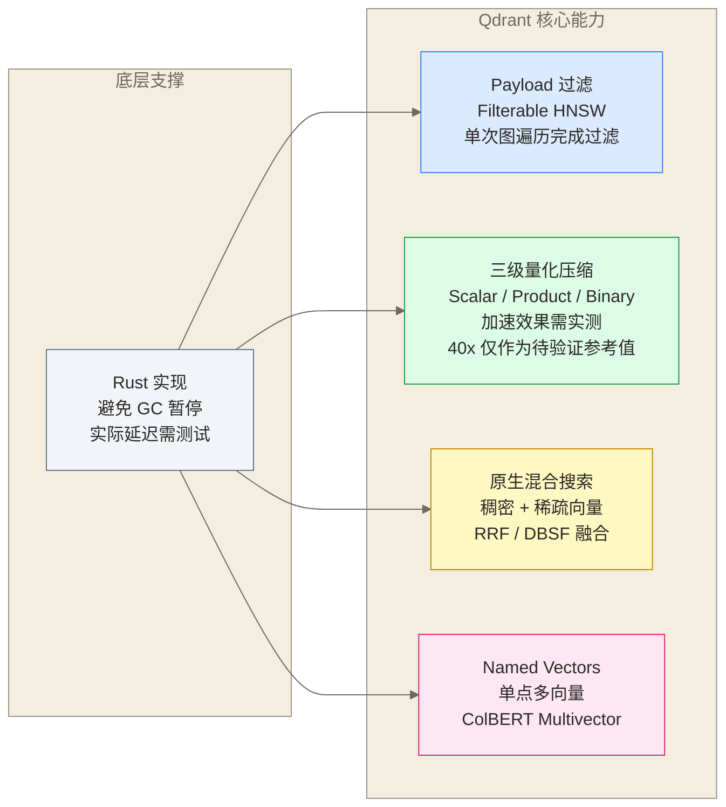
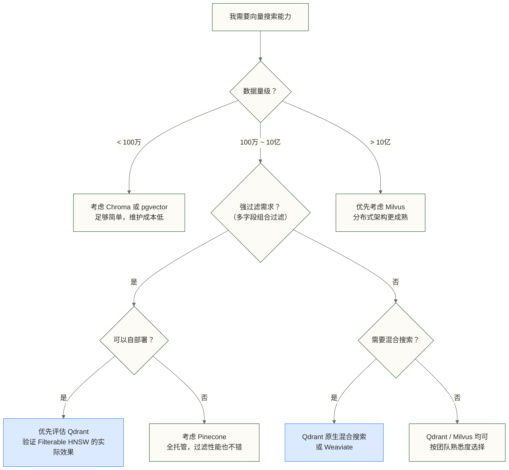

# Qdrant 学习路线图

> [!abstract] 这份路线图能给你什么
> - **学习目标**：通过系统化的文档体系，掌握 Qdrant 从快速上手到生产级部署的完整技能栈
> - **设计理念**：围绕 Qdrant 的核心差异化能力——Payload 过滤、量化压缩、混合搜索——构建有深度的知识体系
> - **预计时长**：总计 18-30 小时，覆盖入门、进阶、生产三个阶段
> - **适用背景**：有 Python 基础，正在选型向量数据库，或者需要高性能向量搜索的工程师

Qdrant（发音同 "quadrant"）是当前向量数据库赛道里最值得认真学习的开源项目之一。它用 Rust 写成，可避免垃圾回收暂停；实际内存占用和延迟仍取决于索引配置、数据规模、硬件与负载；它的 Payload 过滤架构是目前所有开源向量库里最聪明的设计之一；它对量化的支持最为完整——Scalar、Product、Binary 三种方案开箱即用。

如果你正在为一个对**过滤性能**有强诉求的场景选型（电商搜索、知识库检索、用户画像匹配），或者你的团队对**Rust 系统级性能**有偏好，Qdrant 很可能是你的最优解。这份路线图帮你以最高效的方式掌握它。

---

## 前置知识要求

在开始 Qdrant 之前，建议具备以下基础：

| 前置知识 | 要求程度 | 说明 |
|---------|---------|------|
| Python 基础 | 必须 | Qdrant Client 主要使用 Python SDK，需要会基本的 class 和异步编程 |
| 向量与嵌入概念 | 推荐 | 理解"把文本/图像转成向量"的基本原理 |
| Docker 基础 | 推荐 | 最常见的 Qdrant 本地部署方式是 Docker |
| REST API 概念 | 了解即可 | Qdrant 提供完整的 HTTP REST 和 gRPC 接口 |
| 数据库基本概念 | 了解即可 | 理解索引、过滤、CRUD 的含义 |

**推荐先读**：
- 向量数据库选型指南 — 在宏观视角下了解 Qdrant 的定位，明确为何选 Qdrant
- ANN 算法原理 — 理解 HNSW 等近似最近邻算法的核心原理
- Embedding 选型 — 明确什么样的向量适合放入 Qdrant

> [!tip] 已经用过 Milvus 或 Chroma？
> 如果你有其他向量数据库使用经验，可以快速浏览第 01 篇（了解差异），然后直接从第 04 篇（Payload 过滤）开始深入 Qdrant 的独特能力。Qdrant 的数据模型比 Milvus 简洁很多，上手成本低。

---

## 整体学习路径

```mermaid
%%{init: {"theme":"base","themeVariables":{"fontFamily":"PingFang SC, -apple-system, Source Han Serif SC, serif","fontSize":"16px","background":"#FDFBF5","primaryColor":"#FDFBF5","primaryTextColor":"#2D2A26","primaryBorderColor":"#6E6A60","secondaryColor":"#E8EFE8","secondaryBorderColor":"#8FA890","secondaryTextColor":"#2D2A26","tertiaryColor":"#FDFBF5","tertiaryBorderColor":"#9A9488","tertiaryTextColor":"#6E6A60","lineColor":"#6E6A60","textColor":"#2D2A26","mainBkg":"#FDFBF5","nodeBorder":"#2D5A3D","clusterBkg":"#F3EEDF","clusterBorder":"#9A9488","edgeLabelBackground":"#FDFBF5"},"flowchart":{"htmlLabels":true,"curve":"basis","padding":20,"nodeSpacing":60,"rankSpacing":70,"useMaxWidth":false},"themeCSS":".node rect, .node polygon, .node circle { stroke-width: 1.5px; } .edgePath .path { stroke-width: 1.5px; } .cluster-label .nodeLabel, .cluster-label foreignObject { color: #2D2A26 !important; } .edgeLabel, .edgeLabel foreignObject { color: #2D2A26 !important; background-color: #FDFBF5; } .edgeLabel rect { fill: #FDFBF5; }"}}%%
flowchart TB
    subgraph "阶段一：入门（1-2周）"
        A1["01-Qdrant概述与核心定位<br/>定位、核心特性、与 Milvus 的差异"]
        A2["02-快速上手<br/>Docker 部署 + 第一个搜索应用"]
        A3["03-核心概念详解<br/>Collection / Point / Payload / Named Vectors"]
        A1 --> A2 --> A3
    end

    subgraph "阶段二：进阶（2-3周）"
        B1["04-Payload过滤深度解析<br/>filterable HNSW 的工作原理与性能优势"]
        B2["05-量化压缩实战<br/>Scalar / Product / Binary 三种方案对比"]
        B3["06-混合搜索与稀疏向量<br/>稠密+稀疏，BM25+语义，RRF 融合"]
        B4["07-Named Vectors与多向量<br/>单点多向量、ColBERT Multivector"]
        B1 --> B2 --> B3 --> B4
    end

    subgraph "阶段三：生产（2-3周）"
        C1["08-索引调优与性能优化<br/>HNSW 参数、ef_construct、m 值选择"]
        C2["09-集群部署与分布式架构<br/>Sharding、Replication、故障恢复"]
        C3["10-RAG集成与生产实践<br/>LangChain / LlamaIndex / 生产级调优"]
        C1 --> C2 --> C3
    end

    A3 --> B1
    B4 --> C1

    style A1 fill:#dbeafe,stroke:#3b82f6
    style A2 fill:#dbeafe,stroke:#3b82f6
    style A3 fill:#dbeafe,stroke:#3b82f6
    style B1 fill:#dcfce7,stroke:#16a34a
    style B2 fill:#dcfce7,stroke:#16a34a
    style B3 fill:#dcfce7,stroke:#16a34a
    style B4 fill:#dcfce7,stroke:#16a34a
    style C1 fill:#fef9c3,stroke:#ca8a04
    style C2 fill:#fef9c3,stroke:#ca8a04
    style C3 fill:#fce7f3,stroke:#db2777
```

---

## 各阶段详解

### 阶段一：入门（预计 1-2 周，5-7 小时）

**目标**：建立对 Qdrant 的完整认知，并跑通第一个搜索应用。读完这三篇，你能清楚地说出：Qdrant 是什么、它和 Milvus/Weaviate 的本质区别、它的核心数据模型如何设计。

---

**[[【技术与工具】/向量数据库/Qdrant/01-Qdrant概述与核心定位]]**（约 60 分钟）

Qdrant 的起点文档。重点不是"功能列表堆砌"，而是讲清楚三件事：Qdrant 用 Rust 写成的工程含义（可避免垃圾回收暂停，但内存开销和延迟仍需结合具体配置与负载评估）；Qdrant 的 Payload 过滤设计如何工作，以及如何在具体负载下评估其效果；以及在 Milvus、Weaviate、pgvector 的对比坐标里，Qdrant 的精准定位是什么。

读完之后你应该能回答：什么场景首选 Qdrant？Qdrant 和 Milvus 在架构上的核心差异是什么？

---

**02-快速上手**（约 75 分钟）

最短路径跑通 Qdrant：Docker 一行命令启动，用 Python Client 创建 Collection，写入 Point，执行第一次向量搜索。这篇不讲原理，只讲如何最快速地建立"动手感"。

重点覆盖：Docker 部署、Qdrant Cloud 免费 tier 使用、Python SDK 基本操作、第一个带 Payload 过滤的查询。

---

**03-核心概念详解**（约 60 分钟）

Qdrant 的数据模型比 Milvus 更简洁，但有自己的概念体系需要理解：

- **Collection**：向量集合，类比数据库的"表"
- **Point**：基本存储单元，包含 ID + 向量 + Payload
- **Payload**：结构化元数据，支持复杂过滤
- **Named Vectors**：一个 Point 携带多个命名向量
- **Segment**：底层存储单元，索引管理的基本粒度

这些概念会贯穿后续所有文档，需要在这里打牢基础。

---

**阶段一完成检验**：
- [ ] 能说清楚 Qdrant 在向量数据库生态中的定位
- [ ] 本地或 Qdrant Cloud 成功运行了第一个搜索查询
- [ ] 理解 Point、Payload、Named Vectors 三个核心概念
- [ ] 能解释 Qdrant 的 Payload 过滤为什么比"先搜后过滤"快

---

### 阶段二：进阶（预计 2-3 周，8-12 小时）

**目标**：深入掌握 Qdrant 的四个核心差异化能力。这个阶段完成后，你能在实际业务场景中充分利用 Qdrant 的独特优势，而不是把它当成一个普通的向量存储。

---

**04-Payload过滤深度解析**（约 90 分钟）

这是 Qdrant 最值得深入学习的能力。大多数向量数据库的过滤是"先 ANN 搜索，再在结果集上过滤"（后过滤）或"先过滤出候选集，再在候选集内搜索"（前过滤），两种方案都有严重的召回率或性能问题。

Qdrant 的解法不同——它将 Payload 索引信息**嵌入 HNSW 图的边**，让过滤和向量搜索在同一次图遍历中完成（Filterable HNSW）。此外，Qdrant 的查询规划器会根据过滤选择率自动切换搜索策略：高选择率走 HNSW，低选择率直接走 Payload 倒排索引。

这篇还覆盖所有 Payload 类型（integer、float、keyword、text、bool、geo、datetime）和过滤条件的写法。

---

**05-量化压缩实战**（约 75 分钟）

量化是 Qdrant 的另一个核心竞争力。三种方案各有适用场景：

- **Scalar Quantization（标量量化）**：float32 → int8，内存减少 75%，搜索速度提升 28%-60%，精度损失可接受
- **Product Quantization（乘积量化）**：将向量分段压缩，内存压缩比更高（最高 64x），适合超大数据集
- **Binary Quantization（二值量化）**：float32 → 1bit，内存压缩 32x，搜索速度提升最高 40x，需要向量分布满足特定条件

这篇包含三种方案的详细配置、精度/速度 trade-off 分析，以及"用 Binary 存储 + Scalar 查询"这种高级组合技的使用场景。

---

**06-混合搜索与稀疏向量**（约 90 分钟）

纯向量搜索有一个痛点：无法捕捉精确的关键词匹配。"iPhone 15 Pro Max 256GB"这样的精确查询，语义向量搜索可能会把"iPhone 14 Pro"排在前面。

Qdrant 的解法是**原生稀疏向量支持**：用 SPLADE 或 BM25 生成稀疏向量，与稠密向量存在同一个 Collection 里（Named Vectors 机制），查询时两路并行，用 RRF（Reciprocal Rank Fusion）或 DBSF（Distribution-Based Score Fusion）合并结果。

这篇还覆盖 Qdrant 的 Query API——一个统一的查询接口，用声明式方式描述复杂的混合搜索 Pipeline。

---

**07-Named Vectors与多向量**（约 60 分钟）

Named Vectors 是 Qdrant 的一个独特特性：一个 Point 可以携带多个命名向量，每个向量可以有不同的维度和距离度量。

实际应用场景：
- 同一个商品存储"标题向量"和"描述向量"两路，分别用于不同的检索场景
- Matryoshka Embedding（可变维度，一个模型输出多种维度）
- ColBERT 多向量：每个 Token 一个向量，存入 Multivector 结构，用 MaxSim 距离做精确重排序

---

**阶段二完成检验**：
- [ ] 能解释 Filterable HNSW 和普通后过滤的本质区别
- [ ] 配置过 Scalar Quantization 并测量了精度/速度变化
- [ ] 实现过稠密+稀疏的混合搜索，并对比了纯向量搜索的效果
- [ ] 设计过一个使用 Named Vectors 的多向量 Schema

---

### 阶段三：生产（预计 2-3 周，6-10 小时）

**目标**：从"能用"到"在生产中稳定运行"。这个阶段关注性能调优、集群部署和与 AI 框架的深度集成。

---

**08-索引调优与性能优化**（约 90 分钟）

HNSW 索引的两个核心参数决定了你系统的性能上限：

- **`m`**（每个节点的最大连接数）：值越大，图越稠密，召回率越高，但内存占用和构建时间也越大
- **`ef_construct`**（构建时的候选集大小）：影响索引质量，值越大，离线索引构建越慢但在线搜索精度越高

这篇还覆盖：搜索时的 `ef` 参数调优、内存 vs 磁盘 vs 量化的组合策略、Collection 级别的优化配置（`on_disk_payload`、`memmap_threshold`）、以及 Qdrant 1.16 引入的 ACORN 过滤搜索算法。

---

**09-集群部署与分布式架构**（约 90 分钟）

Qdrant 的集群模式通过 Sharding 和 Replication 实现水平扩展：

- **Sharding**：Collection 数据分片，每个 Shard 存储一部分数据，支持自定义分片键（用于多租户场景）
- **Replication**：每个 Shard 有多个副本，自动故障转移，读写负载均衡
- **Qdrant 1.13 的 Re-sharding**：在线重新分片，无需停机

这篇覆盖 Docker Compose 集群部署、Kubernetes Helm Chart 部署、以及 Qdrant 1.16 引入的 Tiered Multitenancy（分层多租户）架构设计。

---

**10-RAG集成与生产实践**（约 120 分钟）

端到端的生产 RAG 系统构建：

- 文档 Pipeline：分块策略、Embedding 模型选型、批量写入的并发控制
- LangChain 集成：`Qdrant` VectorStore，稀疏向量支持，自定义检索链
- LlamaIndex 集成：`QdrantVectorStore` 配置，混合检索节点
- 生产调优清单：如何诊断召回质量差的问题、Payload 索引最佳实践、冷启动问题处理

---

**阶段三完成检验**：
- [ ] 能根据数据规模和精度要求合理设置 HNSW 的 m 和 ef_construct
- [ ] 完成过 Qdrant 集群（至少 2 节点）的部署和 Shard 配置
- [ ] 用 LangChain 或 LlamaIndex 构建过一个混合检索 RAG 系统
- [ ] 能分析并优化一个召回质量不达标的向量检索场景

---

## 本系列文档导航

| 序号 | 文档 | 阶段 | 预计时长 | 核心价值 |
|------|------|------|---------|---------|
| 00 | [[【技术与工具】/向量数据库/Qdrant/00-Qdrant学习路线图]] | 导航 | 15 分钟 | 全局视野，选择学习路径 |
| 01 | [[【技术与工具】/向量数据库/Qdrant/01-Qdrant概述与核心定位]] | 入门 | 60 分钟 | 理解 Qdrant 的本质定位 |
| 02 | 02-快速上手 | 入门 | 75 分钟 | 建立第一手动手感 |
| 03 | 03-核心概念详解 | 入门 | 60 分钟 | 打牢数据模型基础 |
| 04 | 04-Payload过滤深度解析 | 进阶 | 90 分钟 | Qdrant 最核心的差异化能力 |
| 05 | 05-量化压缩实战 | 进阶 | 75 分钟 | 内存/速度极限优化 |
| 06 | 06-混合搜索与稀疏向量 | 进阶 | 90 分钟 | 稠密+稀疏，超越纯语义搜索 |
| 07 | 07-Named Vectors与多向量 | 进阶 | 60 分钟 | 单点多向量的工程设计 |
| 08 | 08-索引调优与性能优化 | 生产 | 90 分钟 | 系统级性能调优 |
| 09 | 09-集群部署与分布式架构 | 生产 | 90 分钟 | 高可用生产部署 |
| 10 | 10-RAG集成与生产实践 | 生产 | 120 分钟 | 落地 AI 应用的终点站 |

---

## Qdrant 核心特色地图

> [!info] Qdrant 的四大差异化能力
> Qdrant 的竞争力不在于"最多功能"或"最大规模"，而在于四个细分能力的极致打磨。了解这四个能力，就能判断 Qdrant 是否适合你的场景。

---

## Qdrant 在向量数据库生态中的位置

> [!info] 如何读这张表
> 这是一张定位图，而不是评分表。每款产品都有最适合的场景，Qdrant 的优势场景是**中大规模 + 强过滤需求 + 自部署**。

| 产品 | 语言底层 | 过滤性能 | 量化支持 | 混合搜索 | 最适合场景 |
|------|---------|---------|---------|---------|-----------|
| **Qdrant** | Rust | 最优（Filterable HNSW） | 最完整（3种） | 原生支持 | 过滤场景、中大规模、自部署 |
| Milvus | Go + C++ | 较好 | 支持 | 支持 | 超大规模（亿级+）、企业级 |
| Weaviate | Go | 一般 | 部分支持 | 原生支持 | 多模态、知识图谱语义 |
| pgvector | C（PG扩展） | 依赖 PG 索引 | 不支持 | 手动实现 | 已有 PostgreSQL 技术栈 |
| Chroma | Python | 一般 | 不支持 | 不支持 | 原型开发、小规模验证 |
| Pinecone | 托管服务 | 较好 | 托管优化 | 支持 | 不想运维、预算充足 |

**Qdrant 的核心竞争力**：在需要**复杂 Payload 过滤**且对**延迟可预测性**有要求的场景（如电商搜索、个性化推荐、合规知识库），Qdrant 可作为重点评估的开源候选方案，是否最适合需结合实际数据、召回目标、延迟和运维约束验证。

---

## 适合人群与不适合人群

> [!check] 适合学 Qdrant 的你
> - 正在构建的系统需要**向量搜索 + 结构化过滤**组合（如"查找相似商品，要求价格在 100-500 元之间"）
> - 对系统延迟可预测性有要求，不能接受 GC 暂停带来的 P99 尖刺
> - 数据量在**百万到十亿**区间，且预计未来 2 年仍在这个区间
> - 希望用量化技术大幅降低向量存储的内存成本
> - 正在构建 RAG 系统，需要混合检索（语义 + 关键词）来提升召回质量
> - 喜欢简洁的 API 设计，希望避免 Milvus 的高运维复杂度

> [!warning] 可能暂时不适合你
> - 数据量超过十亿，且需要极致的写入吞吐量——Milvus 在这个量级更成熟
> - 已经在用 PostgreSQL，且数据量在千万以内——pgvector 够用，无需引入新的基础设施
> - 没有 Docker 基础，希望零运维——Pinecone 或 Qdrant Cloud 是更好的起点
> - 主要需求是知识图谱式的关系推理，而不是向量相似性——Weaviate 更适合

---

## Qdrant 技术选型快速决策树

---

## 推荐的学习方式

**最低成本的入门方式**：使用 Qdrant Cloud 的免费 Cluster（1GB 存储，无需信用卡），配合 Python SDK，在 Jupyter Notebook 里完成第 01-03 篇的核心代码实验。不需要本地安装任何服务。

**最高效的深化方式**：在学完第 04 篇 Payload 过滤后，拿一个真实的业务数据集（哪怕只有 10 万条）做过滤性能测试，对比加 Payload 索引前后的查询速度。实际数字会让你对 Filterable HNSW 的价值有直观感受。

**量化能力的验证方式**：第 05 篇学完后，立刻在你的数据集上测试 Scalar Quantization，记录内存占用和 P50/P99 延迟的变化。这往往是最让工程师"惊艳"的 Qdrant 特性。

**团队学习顺序建议**：

| 角色 | 重点文档 | 目标 |
|------|---------|------|
| 产品/业务同学 | 01 | 了解向量搜索能力边界，判断适用场景 |
| 后端工程师 | 01、02、03、04 | 快速集成 Qdrant 到服务 |
| 数据工程师 | 04、05、08 | 掌握过滤优化和量化压缩 |
| AI 应用开发 | 02、06、07、10 | 混合搜索 + RAG 集成 |
| 基础设施/SRE | 08、09 | 生产部署和性能调优 |

---

## 与 Milvus 学习路线的对比

已经学过 Milvus 的读者，可以快速定位两个系列的差异：

| 维度 | Milvus 路线图 | Qdrant 路线图 |
|------|------|------|
| 核心架构重点 | 分布式云原生四层架构 | Filterable HNSW + Payload 索引 |
| 量化支持 | 基础支持 | 三种量化，配置最灵活 |
| 适用规模 | 亿级以上 | 百万到十亿 |
| 部署复杂度 | 高（依赖 etcd、MinIO、Pulsar） | 低（单进程或 Docker） |
| 独特特性 | 超大规模分布式 | 过滤性能、量化、Named Vectors |
| 学习曲线 | 陡峭（架构复杂） | 平缓（API 简洁） |

---

> [!quote] 一句话定位
> Qdrant 不追求"最大规模"，它追求的是在真实工程约束下（内存有限、延迟敏感、过滤复杂）把向量搜索做到极致。选择 Qdrant，是选择一个工程上"想明白了"的向量数据库。

**立即开始**：[[【技术与工具】/向量数据库/Qdrant/01-Qdrant概述与核心定位]]

---

**创建时间**：2026-03-11
**文档总数**：10 篇专精文档
**覆盖范围**：Qdrant 入门 → 进阶特性 → 生产部署 → RAG 集成

#Qdrant #向量数据库 #学习路线 #RAG #AI工程 #Rust #向量搜索
