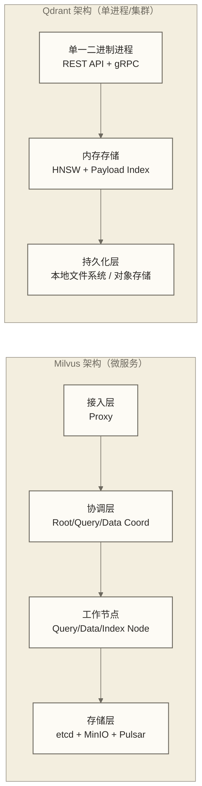

# Qdrant 概述与核心定位

> [!abstract] 本文要解决的三个问题
> 1. **Qdrant 是什么**：它的定位、历史背景、解决的核心问题
> 2. **Qdrant 为什么不一样**：五大核心特性的深度解析，尤其是 Payload 过滤和量化
> 3. **Qdrant 适合谁**：与 Milvus、Weaviate、pgvector 的横向对比，以及选型决策逻辑

---

## 目录

- [[#什么是 Qdrant]]
- [[#Qdrant 的诞生背景]]
- [[#核心特性深度解析]]
  - [[#Rust 实现的性能优势]]
  - [[#Payload 过滤：向量数据库里最聪明的设计]]
  - [[#三级量化压缩]]
  - [[#原生混合搜索]]
  - [[#Named Vectors 与多向量支持]]
- [[#横向对比：Qdrant vs 主流向量数据库]]
- [[#适用场景分析]]
- [[#部署模式详解]]
- [[#总结]]

---

## 什么是 Qdrant

**Qdrant**（读音同英文单词 "quadrant"，即"象限"）是一个用 **Rust 语言编写的开源向量数据库**，专为高维向量的相似性搜索而设计。它由德国公司 Qdrant Solutions GmbH 于 2021 年开源，项目代码托管于 GitHub，采用 Apache 2.0 许可证。

> [!note] 名字的含义
> "Qdrant" 是 "quadrant"（象限）的缩写变形，象征在高维向量空间中精确定位和检索。这个名字也暗示了它对多维度数据的专注。

用一句话定位：**Qdrant 是一个为生产环境优化的向量相似性搜索引擎，核心竞争力是极致的过滤性能、完整的量化支持和原生混合搜索能力。**

它不是：
- 一个通用数据库（没有 JOIN，没有事务，不存标量数据作为主要数据）
- 一个图数据库（不做关系推理）
- 一个全文搜索引擎（但可以通过稀疏向量模拟 BM25 效果）

它是：
- 一个以向量相似性为核心，以结构化 Payload 为辅助过滤手段的**专用向量搜索引擎**
- 一个 REST API 和 gRPC 接口完备、支持 Python/JS/Rust/Go/.NET/Java 多语言客户端的**工程友好型数据库**
- 一个支持单机部署到分布式集群的**弹性部署架构**

---

## Qdrant 的诞生背景

### 向量搜索的需求爆发

2020 年前后，随着大型语言模型和 Embedding 技术的普及，"把非结构化数据（文本、图像、音频）转换成向量，然后做相似性搜索"这个范式开始在工程界快速落地。

典型场景包括：
- **语义搜索**：用户搜"苹果公司最新手机"，返回语义相关结果而不仅仅是包含"苹果"关键词的文档
- **RAG（检索增强生成）**：给 LLM 喂入相关上下文，减少幻觉，提升问答质量
- **图像相似性**：以图搜图，电商商品检索
- **推荐系统**：基于用户 Embedding 找到相似用户或相似商品

### 早期方案的局限

工程师们最初用的是 **FAISS**（Facebook AI Similarity Search）——一个 C++ 库，在单机 ANN 搜索上性能出色。但 FAISS 很快暴露出工程局限：

- **只是一个库，不是服务**：需要自己写 HTTP API、数据持久化、并发控制
- **过滤能力极弱**：FAISS 本身没有元数据过滤，需要在外层做"先搜后过滤"，召回率损失严重
- **无法水平扩展**：单机内存装不下的数据集，FAISS 束手无策
- **运维成本高**：没有成熟的监控、备份、滚动升级方案

这个背景下，专门的向量数据库开始出现：Milvus（2019）、Weaviate（2019）、Pinecone（2019，闭源）、Qdrant（2021）相继诞生。

### Qdrant 的设计哲学

Qdrant 的核心团队在设计之初就做了两个关键决策，深刻影响了它的技术路径：

1. **用 Rust 而不是 Go 或 Python**：选择了内存安全、无 GC 的语言，避免语言运行时 GC 停顿；实际延迟的可预测性仍取决于资源竞争、I/O、后台任务和查询负载
2. **把 Payload 过滤当成一等公民**：没有把过滤作为"加在向量搜索上面的一层"，而是从索引设计层就考虑过滤，研发了 Filterable HNSW 算法

这两个决策使 Qdrant 在过滤场景下有着独特的性能优势，也成为它区别于其他向量数据库的核心标签。

---

## 核心特性深度解析

### Rust 实现的性能优势

Qdrant 是主流向量数据库中**唯一**一个用 Rust 完整实现的产品（相比之下，Milvus 用 Go，Weaviate 用 Go，Chroma 核心用 Python，pgvector 用 C）。这个语言选择带来的不只是"更快"这么简单。

#### 无 GC 的延迟可预测性

Go、Java、Python 等语言都有垃圾回收（GC）机制。GC 会在运行时暂停进程（Stop-the-World 或并发 GC），导致延迟出现**不规律的尖峰**。在 P99 延迟指标下，这个尖峰往往是 P50 的 5-10 倍。

Rust 通过所有权系统（Ownership）在**编译时**检查内存使用规则，并在运行时按生命周期释放资源，不需要追踪式 GC。这意味着：
- 不会出现由追踪式 GC 引起的停顿
- P99/P50 延迟比和高并发下的延迟标准差仍需在目标负载下测量
- 内存压力仍可能通过分配、缺页、I/O 或资源竞争影响性能，不能据此保证不存在性能悬崖

对于 SLA 要求严格的生产场景（如在线搜索、实时推荐），这个特性的价值远超过"平均速度快 20%"。

#### 极低的内存开销

Rust 没有运行时（runtime）的额外开销。同等数据量下，Qdrant 的进程内存占用通常低于 Go 实现的竞品。这在内存资源受限的场景（如边缘部署、小规模 VPS）下非常关键。

#### 与其他语言实现的对比

| 实现语言 | 代表产品 | GC 延迟抖动 | 内存效率 | 并发模型 |
|---------|---------|-----------|---------|---------|
| **Rust** | **Qdrant** | **无** | **最高** | **异步 + 所有权** |
| Go | Milvus, Weaviate | 有（并发 GC，抖动较小） | 较高 | Goroutine |
| Java/JVM | Elasticsearch | 有（Full GC 风险） | 较低 | 线程池 |
| Python | Chroma（部分） | 有 GIL 限制 | 低 | 多进程 |
| C（PG扩展） | pgvector | 无（共享 PG 进程） | 高 | PG 进程模型 |

> [!tip] Rust 性能的另一面
> Rust 的内存安全保证是通过编译器检查实现的，这意味着开发效率比 Go 低（编译更严格，学习曲线更陡）。Qdrant 选择承担这个开发成本，换来的是运行时的极致性能——这个权衡在底层基础设施产品上是合理的。

---

### Payload 过滤：向量数据库里最聪明的设计

这是 Qdrant 最重要的差异化特性，也是理解 Qdrant 定位的关键。

#### 向量过滤的三种策略

在向量数据库中，"找到最相似的向量，同时满足某些条件（如价格 < 100，类别 = 电子产品）"是极其常见的需求。实现这个需求有三种经典策略：

**策略一：后过滤（Post-filtering）**

流程：先做 ANN 搜索，得到 Top-K 候选结果，再对候选结果应用过滤条件。

问题：如果过滤条件很严苛（比如 1% 的文档满足条件），Top-K 结果里可能大多数都被过滤掉，最终返回结果数量不足。要保证足够的结果数，需要先取出很多候选，计算浪费严重。

**策略二：前过滤（Pre-filtering）**

流程：先用倒排索引找到满足过滤条件的候选集，再在候选集内做 ANN 搜索。

问题：候选集内的 ANN 搜索无法利用预先建好的 HNSW 图，只能做暴力搜索（线性扫描）。当候选集规模很大时（如 50% 的文档满足条件），性能急剧下降。

**策略三：Qdrant 的 Filterable HNSW（过滤感知图搜索）**

Qdrant 的解法从根本上不同：

```text
传统方案：
[HNSW 图] + [独立 Payload 索引] → 先搜 → 再过滤

Qdrant 方案：
[扩展 HNSW 图（含 Payload 索引信息）] → 搜索时同步过滤
```

具体实现原理：
1. Qdrant 为每个 Payload 字段建立**独立的倒排索引**（Payload Index）
2. 在构建 HNSW 图时，Qdrant 会在图中**额外添加连接边**，这些边基于 Payload 索引值——使得满足过滤条件的节点之间有更短的图路径
3. 搜索时，图遍历过程中只访问**满足过滤条件的节点**，不满足条件的节点被跳过，无需回溯

这样做的结果是：**过滤和向量搜索在同一次图遍历中完成**，既不会出现后过滤的召回不足，也不会出现前过滤的候选集内暴力搜索。

#### 智能查询规划器

Qdrant 还内置了一个**查询规划器（Query Planner）**，根据过滤条件的选择率（selectivity）自动选择最优策略：

```text
高选择率（大部分数据满足过滤条件）
  → 使用 Filterable HNSW
  → 图遍历天然跳过不满足的节点

低选择率（少量数据满足过滤条件）
  → 直接走 Payload 倒排索引定位候选集
  → 候选集小，暴力搜索比 HNSW 图遍历更快
```

这个自适应策略旨在针对不同过滤选择率选择合适的搜索路径；实际性能仍取决于数据分布、索引配置和查询负载，不能据此保证任意过滤选择率下的性能，也不能直接推断其优于其他数据库。

#### 实际性能数据

根据 2025 年的独立 Benchmark 数据：

- 在 10% 过滤率的场景下，Qdrant 相比"先 ANN 后过滤"方案的搜索吞吐量提升约 **1.2x-1.5x**，同时召回率保持更高
- 在高过滤率场景下（95% 数据满足条件），Qdrant 的 QPS 下降幅度最小（其他方案因为候选集过大而显著下降）
- 过滤条件生效后，搜索实际上因为跳过了大量节点而**比无过滤搜索更快**

#### Payload 支持的数据类型

Qdrant 的 Payload 支持多种数据类型，每种类型都有对应的索引和过滤算子：

| 类型 | 示例 | 支持的过滤操作 |
|------|------|--------------|
| `keyword` | `"category": "electronics"` | match, match_any, except |
| `integer` | `"price": 299` | range (gte, lte, gt, lt) |
| `float` | `"score": 4.7` | range |
| `bool` | `"in_stock": true` | match |
| `text` | `"description": "..."` | full-text match（需建 text 索引） |
| `geo` | `{"lat": 40.7, "lon": -74.0}` | geo_bounding_box, geo_radius, geo_polygon |
| `datetime` | `"created_at": "2024-01-15T..."` | range（时间范围查询） |
| `uuid` | `"user_id": "550e8400-..."` | match |

> [!warning] 关于 Payload Index
> Payload 过滤的性能优势**依赖于提前建立 Payload Index**。如果不建索引，Qdrant 会退化为对每个 Point 的 Payload 做线性扫描，性能会很差。
>
> 最佳实践：在创建 Collection 后、写入数据前，就把所有会用于过滤的 Payload 字段的索引建好。

---

### 三级量化压缩

向量存储最大的成本是内存。一个 1536 维的 float32 向量（OpenAI text-embedding-3-small 的输出）需要 6KB 内存。1 亿个这样的向量就需要 600GB 内存——这已经超过了大多数服务器的单机内存上限。

Qdrant 提供三种量化方案来解决这个问题：

#### 方案一：Scalar Quantization（标量量化）

**原理**：将每个向量维度的 `float32` 值（4 字节）压缩为 `int8`（1 字节）。

压缩过程：找到向量所有维度的最大值和最小值，将 float32 的数值范围线性映射到 [-128, 127] 的整数区间。

```text
原始：[0.23, -0.87, 0.45, ..., 0.12]  // float32，每维 4 字节
量化后：[29, -111, 57, ..., 15]         // int8，每维 1 字节
```

**效果**：
- 内存减少 **75%**（4 字节 → 1 字节）
- 搜索速度提升 **28%-60%**（CPU 的 SIMD 指令对整数向量计算效率更高）
- 精度损失：极小，Recall@10 通常下降不超过 1-2%

**适用场景**：几乎所有场景的首选量化方案，是精度和性能的最佳平衡点。

#### 方案二：Product Quantization（乘积量化，PQ）

**原理**：将高维向量切分成多个子空间，每个子空间独立做聚类量化，用聚类 ID 代替原始值。

```text
1536 维向量 → 分成 96 个子空间（每个 16 维）
每个子空间 → 用 256 个聚类中心近似（需要 8 bit 表示）
压缩结果：96 × 8 bit = 96 字节（原来 6144 字节，压缩比 64x）
```

**效果**：
- 内存减少最高 **64x**（压缩比远高于 Scalar）
- 精度损失：明显高于 Scalar，Recall@10 可能下降 5-15%
- 搜索速度：对距离计算做了近似，速度提升明显，但不如 Binary

**适用场景**：超大数据集（几亿以上）且内存极度受限的场景，需要接受一定精度损失换取内存大幅降低。

#### 方案三：Binary Quantization（二值量化）

**原理**：将每个维度的 float32 值用 1 bit 表示——大于 0 为 1，小于等于 0 为 0。

```text
原始：[0.23, -0.87, 0.45, -0.12, ...]  // float32
量化后：[1, 0, 1, 0, ...]              // 1 bit，每维 1/8 字节
```

**效果**：
- 内存减少 **32x**（1536 维向量从 6KB → 192 字节）
- 搜索速度提升最高 **40x**（XOR + Popcount 指令，CPU 的最强武器）
- 精度损失：高度依赖向量分布是否**以零为中心**（zero-centered distribution）

**适用条件**：不是所有模型都适合 Binary Quantization。OpenAI 的 Ada 002、text-embedding-3 系列和 Cohere embed 系列经过验证效果较好（因为这些模型的向量分布接近以零为中心的高斯分布）。BERT 类模型通常不适合。

**高级用法——组合量化**：

```python
# 存储用 Binary（最省内存），查询时用原始向量（最高精度）
# 这是 Qdrant 推荐的"两全其美"方案
{
    "binary": {
        "always_ram": True  # Binary 量化向量放内存
    }
}
# 搜索时设置 oversampling，先用 Binary 快速缩小候选集
# 再用原始向量对候选集做精确重排
search_params = {"oversampling": 3.0, "rescore": True}
```

通过 oversampling + rescore 机制，Qdrant 能在保持 Binary Quantization 超高速度的同时，将召回率恢复到接近原始精度水平。

#### 三种量化方案对比

| 量化方案 | 压缩比 | 速度提升 | 精度损失 | 适用场景 |
|---------|-------|---------|---------|---------|
| **Scalar** | 4x | 1.3x-1.6x | 极小（<2%） | 通用首选 |
| **Product** | 最高 64x | 2x-5x | 中等（5-15%） | 超大数据集，内存极限 |
| **Binary** | 32x | 最高 40x | 高（需 rescore 补偿） | 支持 BQ 的模型，极致速度 |

---

### 原生混合搜索

#### 为什么纯向量搜索不够

语义向量搜索的优点是理解语义，缺点是对精确关键词不敏感。举个例子：

- 查询："iPhone 15 Pro Max 256GB 深空黑"
- 向量搜索可能返回："iPhone 14 Pro Max 512GB 深空灰"（语义相似，但关键参数都不对）
- 期望结果：精确匹配 256GB 和深空黑

反过来，纯关键词搜索（BM25）无法理解语义，"苹果手机"搜不到只写"Apple iPhone"的文档。

**混合搜索**（Hybrid Search）通过组合稠密向量（Dense Vector，捕捉语义）和稀疏向量（Sparse Vector，捕捉关键词）来解决这个问题。

#### Qdrant 的稀疏向量实现

Qdrant 从 1.7.0 版本起原生支持稀疏向量存储和搜索：

```python
# 稀疏向量的结构：只存非零维度的索引和值
sparse_vector = SparseVector(
    indices=[42, 1337, 29],   # 非零维度的索引（词汇表中的词 ID）
    values=[0.32, 0.87, 0.15] # 对应的权重值
)
```

稀疏向量由 SPLADE（Sparse Lexical and Expansion Model）这类模型生成，它能将文本中每个词的重要性量化为向量空间中的权重。相比传统 BM25，SPLADE 还能做**词汇扩展**——搜索"手机"也能匹配"智能机""移动设备"等相关词。

#### Query API：统一的混合搜索接口

Qdrant 的 Query API 提供了声明式的混合搜索描述方式：

```python
from qdrant_client.models import QueryRequest, FusionQuery, Fusion

results = client.query_points(
    collection_name="products",
    query=FusionQuery(
        fusion=Fusion.RRF,   # Reciprocal Rank Fusion 合并策略
        queries=[
            # 第一路：稠密向量语义搜索
            QueryRequest(
                query=dense_embedding,   # 1536 维稠密向量
                using="dense",
                limit=20
            ),
            # 第二路：稀疏向量关键词搜索
            QueryRequest(
                query=sparse_vector,     # SPLADE 稀疏向量
                using="sparse",
                limit=20
            ),
        ]
    ),
    # 叠加 Payload 过滤
    query_filter=models.Filter(
        must=[
            models.FieldCondition(
                key="price",
                range=models.Range(gte=100, lte=500)
            )
        ]
    ),
    limit=10
)
```

#### 两种融合策略

**RRF（Reciprocal Rank Fusion）**：
- 根据每路结果的排名位置计算综合得分：`score = sum(1 / (rank + k))`
- 位置越靠前，得分越高；两路都排名靠前的结果得分加倍
- 对各路分数的绝对量纲不敏感，适合不同量纲的向量合并

**DBSF（Distribution-Based Score Fusion）**：
- 根据每路分数的统计分布（均值和标准差）做归一化，然后合并
- 适合各路搜索分数量纲比较接近的场景

---

### Named Vectors 与多向量支持

#### Named Vectors：单点多向量

Qdrant 允许一个 Point 携带多个命名向量，每个向量可以有不同的维度和距离度量。

实际工程意义：

**场景一：多模型 Embedding**
```python
# 同一个商品，用两个不同模型分别生成向量
# 标题向量（用于标题搜索）+ 描述向量（用于描述搜索）
point = PointStruct(
    id=1001,
    vector={
        "title_vector": [0.12, 0.45, ...],   # 384 维，sentence-bert
        "desc_vector": [0.33, -0.21, ...],    # 1536 维，text-embedding-3
    },
    payload={"title": "iPhone 15", "price": 5999}
)

# 可以针对任意一个 Named Vector 单独搜索
results = client.search(
    collection_name="products",
    query_vector=("title_vector", query_title_embedding),
    limit=10
)
```

**场景二：Matryoshka Embedding（套娃嵌入）**

Matryoshka 模型（如 OpenAI text-embedding-3 系列）支持截断输出：同一模型可以输出 256、512、1536 等多种维度的向量，维度越高精度越高，越低速度越快。

通过 Named Vectors，可以在同一个 Collection 里存储多个维度版本，先用低维向量快速粗召回，再用高维向量精排。

**场景三：稠密 + 稀疏组合（混合搜索的基础）**
```python
# 同一个文档，同时存储稠密向量和稀疏向量
point = PointStruct(
    id=doc_id,
    vector={
        "dense": dense_embedding,    # text-embedding-3 的稠密输出
        "sparse": sparse_embedding,  # SPLADE 的稀疏输出
    },
    payload={"content": text, "category": "tech"}
)
```

#### Multivector：ColBERT 支持

Qdrant 支持在单个 Named Vector 槽位里存储**一组向量**（Multivector），这是为 ColBERT 这类多向量检索模型设计的。

ColBERT 的工作方式：为文档中的每个 Token 分别生成一个向量，查询时用 MaxSim（最大相似度）操作——取查询 Token 与文档所有 Token 向量的最大相似度之和作为最终得分。

这种方式比单向量表示精度更高（能捕捉词级别的语义匹配），代价是存储量更大、计算更复杂。Qdrant 是少数原生支持 Multivector 存储和 MaxSim 距离计算的向量数据库。

```python
# ColBERT 多向量：每个 Token 一个向量
# 文档有 128 个 Token，每个 Token 128 维向量 → 128×128 的矩阵
multivector_point = PointStruct(
    id=doc_id,
    vector={
        "colbert": [[0.12, ...], [0.33, ...], ...]  # 128 × 128 的向量矩阵
    }
)
```

---

## 横向对比：Qdrant vs 主流向量数据库

> [!info] 对比视角说明
> 这个对比基于 2025 年各产品的最新版本（Qdrant 1.16+，Milvus 2.4+，Weaviate 1.24+）。向量数据库领域迭代极快，建议结合官方最新文档参考。

### 综合特性对比

| 特性维度 | **Qdrant** | **Milvus** | **Weaviate** | **pgvector** |
|---------|-----------|-----------|-------------|-------------|
| **实现语言** | Rust | Go + C++ | Go | C（PostgreSQL 扩展） |
| **开源协议** | Apache 2.0 | Apache 2.0 | BSD-3 | PostgreSQL License |
| **过滤性能** | 最优（Filterable HNSW） | 较好 | 一般 | 依赖 PG 索引 |
| **量化支持** | 最完整（Scalar/Product/Binary） | Scalar、IVF压缩 | 部分支持 | 不支持 |
| **混合搜索** | 原生（Query API） | 支持 | 原生（GraphQL） | 手动实现 |
| **Named Vectors** | 支持 | 支持（多 Field） | 支持 | 不支持 |
| **Multivector** | 支持（ColBERT） | 不支持 | 不支持 | 不支持 |
| **分布式扩展** | 支持（Sharding+Replication） | 原生分布式 | 支持 | 不支持 |
| **适用规模** | 百万-十亿 | 亿级-千亿 | 百万-十亿 | 百万以内 |
| **部署复杂度** | 低-中 | 高 | 中 | 极低（PG 插件） |
| **延迟可预测性** | 极高（无 GC） | 中（Go GC） | 中（Go GC） | 高（PG 进程模型） |
| **生态成熟度** | 快速增长 | 最成熟 | 较成熟 | 依托 PG 生态 |
| **云托管版本** | Qdrant Cloud | Zilliz Cloud | Weaviate Cloud | Supabase、Neon 等 |

### 与 Milvus 的深度对比

Qdrant 和 Milvus 是最常被放在一起比较的两款产品，也是选型时最容易纠结的一对。



**架构哲学差异**：
- Milvus 是微服务架构，每个组件独立扩展，非常适合超大规模（百亿级）场景，代价是部署复杂度极高（需要 etcd、MinIO、Pulsar 等依赖）
- Qdrant 是单进程架构（集群模式通过 Raft 协调多节点），部署极简，单机性能极强，规模上限在十亿量级

**详细对比**：

| 对比维度 | Qdrant | Milvus |
|---------|--------|--------|
| 部署最小单元 | 单个 Docker 容器，无外部依赖 | 需要 etcd、MinIO、消息队列 |
| 规模上限 | 约 10 亿向量 | 千亿级向量（理论） |
| Payload 过滤 | Filterable HNSW，各选择率均佳 | 较好，但没有 Qdrant 全面 |
| 量化支持 | Scalar + Product + Binary | 主要是 Scalar 和 IVF 压缩 |
| 混合搜索 | 原生 Query API，配置简单 | 支持，配置相对复杂 |
| 运维成本 | 低 | 高 |
| 学习曲线 | 平缓 | 陡峭（需理解多组件架构） |
| 写入吞吐量 | 中等 | 高（专为高写入优化） |
| 社区规模 | 快速增长 | 最大 |

**选择建议**：
- 数据量 < 5 亿，且有过滤需求 → 首选 Qdrant
- 数据量 > 10 亿，或有极高写入吞吐要求 → Milvus 更合适
- 团队运维能力有限 → Qdrant（部署更简单）
- 企业级合规和生态支持 → Milvus（更成熟的 CNCF 项目）

### 与 Weaviate 的对比

Weaviate 是另一个常见的比较对象，两者都支持混合搜索，但设计哲学不同：

| 对比维度 | Qdrant | Weaviate |
|---------|--------|---------|
| 核心优势 | 过滤性能、量化、Rust 性能 | 知识图谱、GraphQL、AI-Native |
| 混合搜索 | 稠密+稀疏，RRF/DBSF | BM25+向量，内置 reranker |
| 数据建模 | 灵活 Payload | GraphQL Schema，类-属性模型 |
| 量化支持 | 完整 | 部分 |
| 多模态 | 通过多 Named Vector | 内置多模态 Module |
| 适合场景 | 过滤复杂、延迟敏感 | 语义网络、多模态、GraphQL 生态 |

**选择建议**：
- 需要在向量搜索结果中做复杂关系推理（如知识图谱）→ Weaviate
- 需要极致的过滤性能和量化压缩 → Qdrant
- 团队对 GraphQL 更熟悉 → Weaviate
- 团队对 REST API 更熟悉 → Qdrant

### 与 pgvector 的对比

pgvector 是 PostgreSQL 的向量扩展，适合已经在用 PostgreSQL 的团队：

| 对比维度 | Qdrant | pgvector |
|---------|--------|---------|
| 部署方式 | 独立服务 | PostgreSQL 插件 |
| 向量索引 | HNSW（Filterable） | HNSW、IVFFlat |
| 过滤性能 | 专门优化 | 依赖 PG 查询优化器 |
| 量化支持 | 完整 | 不支持（需手动实现） |
| 混合搜索 | 原生支持 | 需结合 PG 全文搜索手动实现 |
| 适用规模 | 亿级 | 千万以内 |
| 事务支持 | 不支持 | 完整 ACID |
| SQL 支持 | 不支持 | 完整 SQL |

**选择建议**：
- 已有 PostgreSQL，数据量 < 1000 万，不想引入新组件 → pgvector
- 数据量超过千万，或有强过滤/混合搜索需求 → Qdrant

---

## 适用场景分析

### 最适合 Qdrant 的场景

**场景一：电商商品向量搜索（强过滤需求）**

典型需求："找到与这个商品最相似的商品，价格在 200-800 元，库存大于 0，类别是服装"

Qdrant 的 Filterable HNSW 在这个场景下远超其他方案，因为多字段组合过滤是常态，而不是偶尔用到的功能。

**场景二：企业知识库 RAG（混合检索需求）**

典型需求：用户提问，系统检索相关文档，喂给 LLM 生成回答。纯语义搜索会漏掉精确名词匹配（如产品型号、人名、专有名词）。

Qdrant 的混合搜索（稠密 + SPLADE 稀疏）在这个场景下能显著提升召回质量。

**场景三：图像相似性搜索（量化需求）**

典型需求：以图搜图，数据集 5000 万张图片，服务器内存 256GB。

假设使用输出 1024 维向量的 CLIP 模型，5000 万个 float32 向量本体约占 204.8GB；int8 标量量化表示约占 51.2GB，1 bit 二值量化表示约占 6.4GB（均按十进制 GB 计算）。这些数字不包含原始向量保留、索引、Payload 和其他运行开销；二值量化的适用性与提速幅度需在实际数据上测试，不能预设为 40x。

**场景四：个性化推荐（Named Vectors 多特征建模）**

典型需求：用户 Embedding 由多个模型生成（行为模型 + 内容偏好模型 + 社交关系模型），搜索时按不同权重组合多路向量的结果。

Qdrant 的 Named Vectors + Query API 能优雅地表达这个多路融合需求。

**场景五：实时低延迟搜索（Rust 性能保障）**

典型需求：在线广告投放，P99 延迟要求 < 50ms，不接受 GC 导致的延迟毛刺。

Qdrant 的 Rust 实现避免了语言运行时 GC 带来的停顿，但高并发下仍可能因资源竞争、I/O 或后台任务出现延迟尖峰；P99/P50 的延迟比是否稳定需要在目标负载下测量。

### 不适合 Qdrant 的场景

**不适合场景一：数据量超过十亿，且写入吞吐要求高**

Qdrant 的写入路径没有为超大规模写入做专门优化，在千亿向量级别，Milvus 的分布式架构（独立的 DataNode、IndexNode）更合适。

**不适合场景二：需要事务和复杂关系查询**

Qdrant 是专用向量搜索引擎，不支持 SQL、JOIN、事务（ACID）。如果你的业务需要复杂关系查询（如"找到和 A 相似的商品，且 A 的卖家好评率 > 4.8"），需要在应用层联合多个系统，或者用 pgvector 在 PostgreSQL 中直接做。

**不适合场景三：已经深度使用 PostgreSQL 且数据量不大**

如果你的所有数据都在 PostgreSQL，数据量在千万以内，pgvector 让你在不引入新基础设施的前提下获得向量搜索能力——这个"零额外运维成本"的优势在很多团队里是决定性的。

**不适合场景四：需要内置 ML 模型管理**

Weaviate 有 Modules 系统，可以直接配置 Embedding 模型（如 text2vec-openai），让数据库自动调用模型生成向量。Qdrant 没有这个功能，需要在应用层自己管理 Embedding 生成。

---

## 部署模式详解

Qdrant 提供三种部署模式，从单机到全托管均有覆盖：

### 模式一：本地开发模式

**Docker 部署**（最推荐的本地部署方式）：

```bash
# 拉取并启动 Qdrant
docker run -p 6333:6333 -p 6334:6334 \
    -v $(pwd)/qdrant_storage:/qdrant/storage \
    qdrant/qdrant

# 或者使用 docker-compose
# docker-compose.yml:
# services:
#   qdrant:
#     image: qdrant/qdrant
#     ports:
#       - "6333:6333"
#       - "6334:6334"
#     volumes:
#       - ./qdrant_storage:/qdrant/storage
```

启动后，REST API 在 `http://localhost:6333`，gRPC 在 `localhost:6334`，Web UI 在 `http://localhost:6333/dashboard`。

**Python SDK 本地模式**（适合 Notebook 和原型）：

```python
from qdrant_client import QdrantClient

# 内存模式（进程退出后数据消失）
client = QdrantClient(":memory:")

# 持久化到本地目录（不需要 Docker）
client = QdrantClient(path="/tmp/qdrant_data")
```

> [!tip] 开发阶段推荐用 :memory: 模式
> 在写业务代码的阶段，用内存模式的 Client 可以完全省去启动 Docker 的步骤，每次运行代码都从干净状态开始，非常适合迭代开发。

### 模式二：自托管生产部署

**单节点生产部署**（适合中等规模）：

```yaml
# qdrant-config.yaml
storage:
  storage_path: /var/lib/qdrant/storage

service:
  host: 0.0.0.0
  http_port: 6333
  grpc_port: 6334

# 关键性能配置
optimizers:
  default_segment_number: 8
  memmap_threshold_kb: 200000  # 超过 200MB 的向量使用 mmap

# TLS 配置（生产环境建议开启）
tls:
  cert: /path/to/cert.pem
  key: /path/to/key.pem
  ca_cert: /path/to/ca.pem
```

**Kubernetes 集群部署**（适合大规模）：

```bash
# 使用官方 Helm Chart
helm repo add qdrant https://qdrant.github.io/qdrant-helm

helm install qdrant qdrant/qdrant \
    --set replicaCount=3 \
    --set persistence.size=100Gi \
    --set resources.requests.memory=16Gi
```

Qdrant 集群通过 **Raft 共识协议**管理集群状态，Shard 分片存储在不同节点，Replica 副本保证高可用。

### 模式三：Qdrant Cloud（全托管）

Qdrant 官方提供全托管云服务，支持 AWS、GCP、Azure 三大云平台，提供免费 Cluster（1GB 存储）：

1. 注册 [cloud.qdrant.io](https://cloud.qdrant.io)
2. 创建 Cluster（选择云平台和区域）
3. 获取 API Key 和 Endpoint URL
4. 用 SDK 连接：

```python
from qdrant_client import QdrantClient

client = QdrantClient(
    url="https://your-cluster.cloud.qdrant.io:6333",
    api_key="your-api-key"
)
```

**Qdrant Cloud 适合场景**：
- 不想管理基础设施的团队
- 快速验证 Qdrant 能力（免费 Cluster）
- 对云平台有强依赖（AWS/GCP/Azure 内同区域通信，延迟最低）

**对比自托管的权衡**：

| 维度 | 自托管 | Qdrant Cloud |
|------|-------|-------------|
| 运维成本 | 高 | 极低 |
| 数据控制权 | 完全自主 | 在云平台上 |
| 定制能力 | 完整 | 受限 |
| 费用 | 硬件成本 | 按用量计费 |
| SLA 保障 | 自己负责 | 官方 SLA |

---

## 总结

Qdrant 的定位非常清晰：**一个专为过滤密集型、延迟敏感型向量搜索场景设计的高性能开源向量数据库**。

它的核心价值主张可以用四个维度来概括：

1. **Rust 底层**：避免语言运行时 GC 停顿，可作为 P99 延迟敏感场景的候选方案；是否满足延迟目标或优于其他方案需在目标负载下测试
2. **Filterable HNSW**：将过滤条件纳入向量检索过程，并结合查询规划选择搜索路径；不同过滤选择率下的效率及与其他实现的差异，需结合数据分布、索引配置和查询负载评估
3. **完整量化体系**：Scalar/Product/Binary 三种量化方案覆盖不同的压缩与精度权衡；“零精度损失”和“40x 速度提升”不能作为普遍保证，具体效果需结合向量分布、重排设置及测试条件评估
4. **原生混合搜索**：稠密向量 + 稀疏向量 + Payload 过滤，用统一的 Query API 表达，无需在应用层复杂拼接

如果你正在为一个有**复杂过滤需求**或**内存压力较大**的向量搜索场景选型，Qdrant 应该是你第一个深入评估的选项。

---

> [!info] 下一步
> - 准备动手？前往 02-快速上手 用 Docker 跑起第一个 Qdrant 实例
> - 想深入了解过滤原理？直接跳到 04-Payload过滤深度解析
> - 在考虑量化方案？查看 05-量化压缩实战
> - 还在选型阶段？对比 向量数据库选型指南 和 Milvus 学习路线图

---

**创建时间**：2026-03-11
**参考版本**：Qdrant 1.16.x
**相关文档**：[[【技术与工具】/向量数据库/Qdrant/00-Qdrant学习路线图]] | ANN 算法原理 | Embedding 选型指南

#Qdrant #向量数据库 #Rust #Payload过滤 #量化 #混合搜索 #RAG #AI工程 #向量搜索
