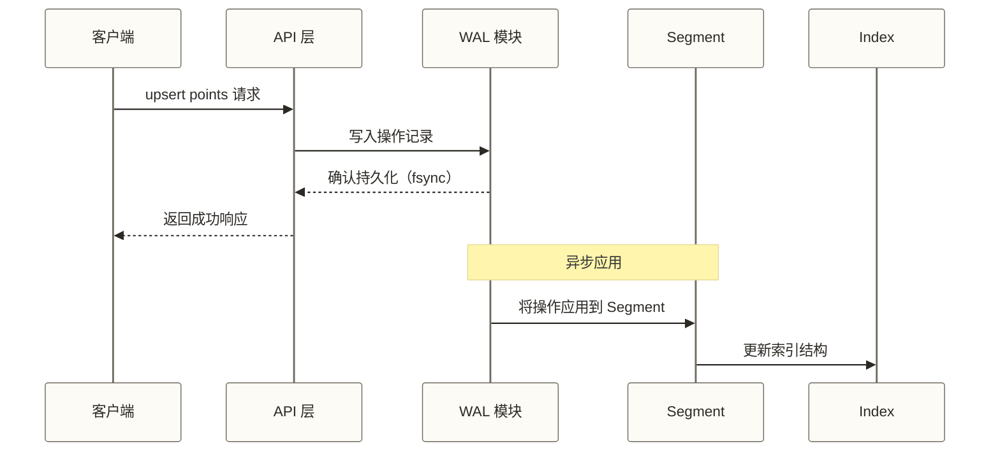
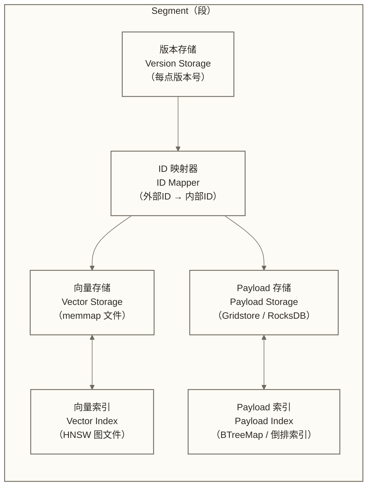
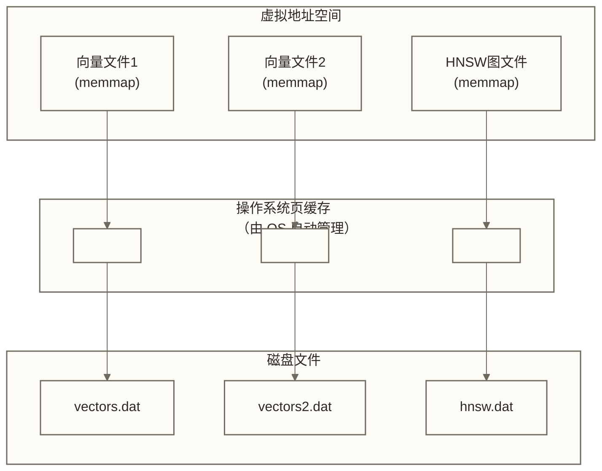
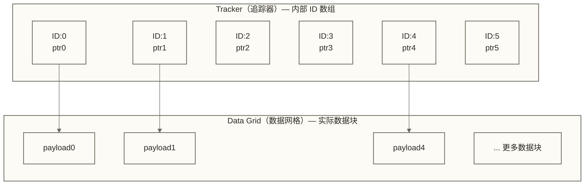
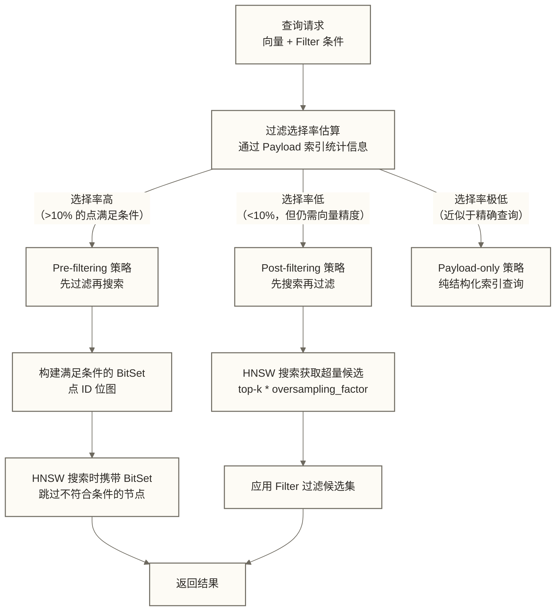
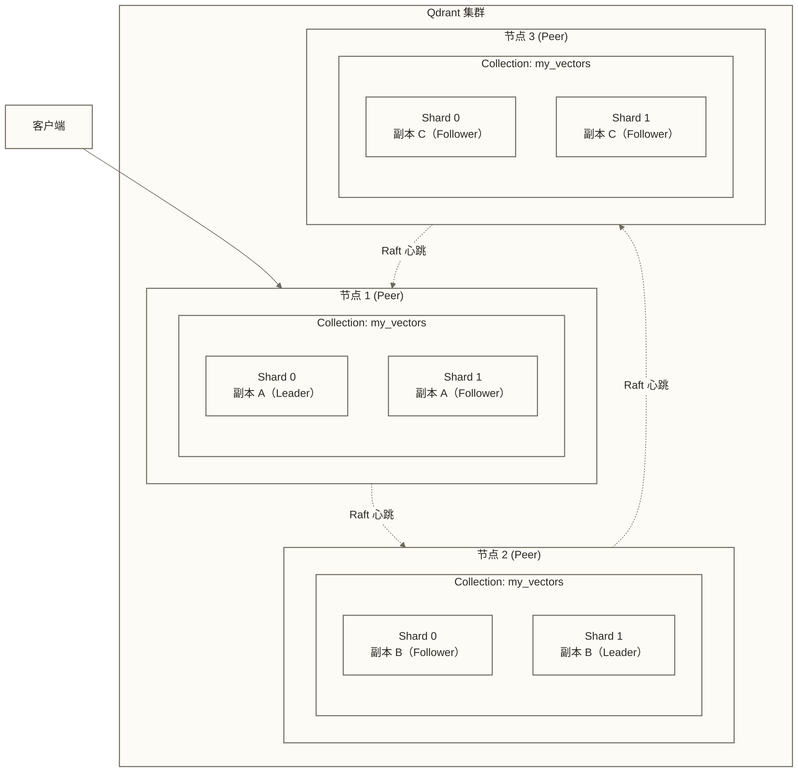
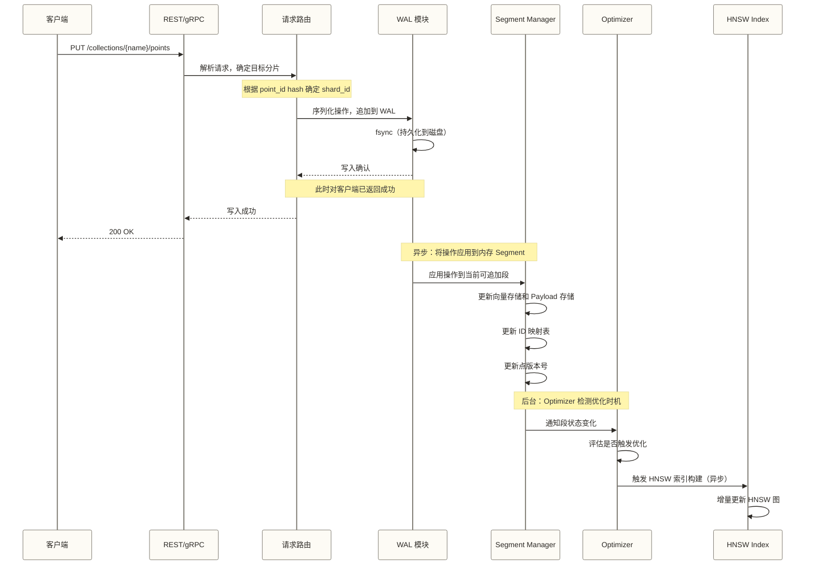
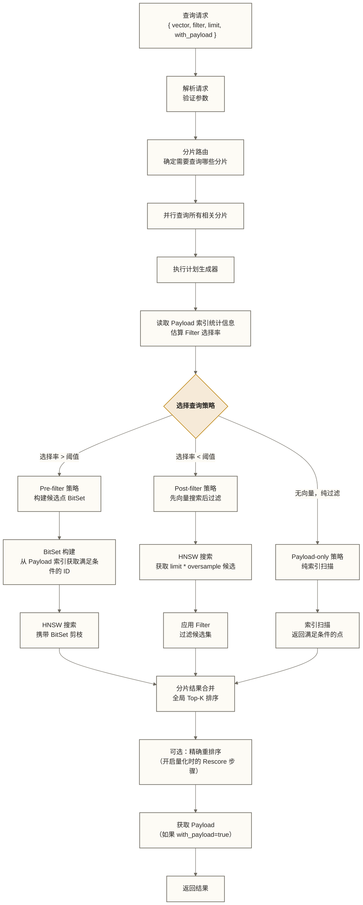

# Qdrant 架构深度解析

> [!abstract] 文档概述
> 本文深入剖析 Qdrant 向量数据库的内部架构，涵盖存储引擎设计、HNSW 索引机制、分布式集群拓扑、Rust 语言优势，以及完整的读写路径。适合需要理解 Qdrant 底层原理、进行容量规划和性能调优的工程师阅读。

## 目录

- [[#整体架构概览]]
- [[#存储引擎深度解析]]
  - [[#WAL 写前日志]]
  - [[#Segment 段结构]]
  - [[#内存映射文件 memmap]]
  - [[#Gridstore 自定义 KV 引擎]]
- [[#索引层架构]]
  - [[#HNSW 图索引]]
  - [[#Payload 索引协作机制]]
  - [[#Inline Storage 优化]]
- [[#分布式架构]]
  - [[#三层拓扑结构]]
  - [[#Raft 共识协议]]
  - [[#分片策略]]
  - [[#副本集与容错]]
- [[#Rust 的工程优势]]
- [[#写入路径详解]]
- [[#查询路径详解]]
- [[#量化原理与工程实现]]
  - [[#Scalar Quantization]]
  - [[#Product Quantization]]
  - [[#Binary Quantization]]
  - [[#非对称量化策略]]
- [[#性能基准与对比]]

---

## 整体架构概览

Qdrant 是一个用 **Rust** 编写的高性能向量搜索引擎，其设计哲学围绕三个核心目标展开：**可预测的低延迟**、**高吞吐写入**和**内存效率**。

```mermaid
%%{init: {"theme":"base","themeVariables":{"fontFamily":"PingFang SC, -apple-system, Source Han Serif SC, serif","fontSize":"16px","background":"#FDFBF5","primaryColor":"#FDFBF5","primaryTextColor":"#2D2A26","primaryBorderColor":"#6E6A60","secondaryColor":"#E8EFE8","secondaryBorderColor":"#8FA890","secondaryTextColor":"#2D2A26","tertiaryColor":"#FDFBF5","tertiaryBorderColor":"#9A9488","tertiaryTextColor":"#6E6A60","lineColor":"#6E6A60","textColor":"#2D2A26","mainBkg":"#FDFBF5","nodeBorder":"#2D5A3D","clusterBkg":"#F3EEDF","clusterBorder":"#9A9488","edgeLabelBackground":"#FDFBF5"},"flowchart":{"htmlLabels":true,"curve":"basis","padding":20,"nodeSpacing":60,"rankSpacing":70,"useMaxWidth":false},"themeCSS":".node rect, .node polygon, .node circle { stroke-width: 1.5px; } .edgePath .path { stroke-width: 1.5px; } .cluster-label .nodeLabel, .cluster-label foreignObject { color: #2D2A26 !important; } .edgeLabel, .edgeLabel foreignObject { color: #2D2A26 !important; background-color: #FDFBF5; } .edgeLabel rect { fill: #FDFBF5; }"}}%%
graph TB
    classDef default fill:#FDFBF5,stroke:#6E6A60,color:#2D2A26,stroke-width:1.5px
    classDef startend fill:#2D2A26,stroke:#2D2A26,color:#FDFBF5,font-weight:bold
    classDef decision fill:#F6EAD8,stroke:#C08A1A,color:#2D2A26,font-weight:bold
    classDef hub fill:#3B5A80,stroke:#3B5A80,color:#FDFBF5,font-weight:bold
    classDef io fill:#E5EAF0,stroke:#3B5A80,color:#2D2A26
    classDef accent fill:#A6432C,stroke:#A6432C,color:#FDFBF5,font-weight:bold
    classDef storage fill:#F3EEDF,stroke:#9A9488,color:#2D2A26
    subgraph CLIENT["客户端层"]
        REST["REST API<br/>HTTP/1.1 & HTTP/2"]
        GRPC["gRPC API<br/>Protocol Buffers"]
        SDK["客户端 SDK<br/>Python / TypeScript / Rust / Go"]
    end

    subgraph API["API 网关层"]
        ROUTER["请求路由器<br/>Actix-Web"]
        AUTH["认证/授权<br/>API Key & JWT"]
    end

    subgraph CONSENSUS["共识层（分布式模式）"]
        RAFT["Raft 共识模块<br/>集群拓扑管理"]
        TOPO["拓扑状态机<br/>节点/分片映射"]
    end

    subgraph COLLECTION["Collection 管理层"]
        CM["Collection Manager<br/>元数据管理"]
        SHARD_MGR["Shard Manager<br/>分片路由"]
    end

    subgraph SHARD["Shard 层"]
        LOCAL["Local Shard<br/>本地分片"]
        PROXY["Proxy Shard<br/>转发代理"]
        REPLICA["Replica Set<br/>副本集"]
    end

    subgraph STORAGE["存储引擎层"]
        WAL["WAL<br/>写前日志"]
        SEG_MGR["Segment Manager<br/>段管理器"]
        SEG_A["Appendable Segment<br/>可追加段"]
        SEG_I["Immutable Segment<br/>不可变段"]
        OPTIMIZER["Segment Optimizer<br/>后台优化器"]
    end

    subgraph INDEX["索引层"]
        HNSW["HNSW 向量索引<br/>图结构"]
        PAY_IDX["Payload 索引<br/>结构化过滤"]
        ID_MAP["ID Mapper<br/>内外部 ID 映射"]
    end

    subgraph PERSIST["持久化层"]
        MEMMAP["内存映射文件<br/>memmap2"]
        GRIDSTORE["Gridstore<br/>自定义 KV 存储"]
        ROCKSDB["RocksDB<br/>旧版兼容"]
    end

    SDK --> REST
    SDK --> GRPC
    REST --> ROUTER
    GRPC --> ROUTER
    ROUTER --> AUTH
    AUTH --> RAFT
    AUTH --> CM
    RAFT --> TOPO
    CM --> SHARD_MGR
    SHARD_MGR --> LOCAL
    SHARD_MGR --> PROXY
    LOCAL --> REPLICA
    REPLICA --> WAL
    WAL --> SEG_MGR
    SEG_MGR --> SEG_A
    SEG_MGR --> SEG_I
    SEG_A --> OPTIMIZER
    OPTIMIZER --> SEG_I
    SEG_A --> HNSW
    SEG_I --> HNSW
    HNSW --> PAY_IDX
    HNSW --> ID_MAP
    SEG_A --> MEMMAP
    SEG_I --> MEMMAP
    PAY_IDX --> GRIDSTORE
    PAY_IDX --> ROCKSDB
    class CLIENT,REST,GRPC,SDK,API,ROUTER,AUTH,CONSENSUS,RAFT,TOPO,COLLECTION,CM,SHARD_MGR,SHARD,LOCAL,PROXY,REPLICA,STORAGE,WAL,SEG_MGR,SEG_A,SEG_I,OPTIMIZER,INDEX,HNSW,PAY_IDX,ID_MAP,PERSIST,MEMMAP,GRIDSTORE,ROCKSDB default
```



> [!note] 架构特点
> Qdrant 的架构刻意将**共识路径**与**数据路径**分离。集群拓扑变更通过 Raft 走共识，但点操作（写入/查询）绕过共识直接操作本地分片，最大化写入吞吐量。

与 Milvus 架构 相比，Qdrant 的架构更加扁平，没有独立的协调节点（Coordinator Node），每个节点既是数据节点又参与集群管理，降低了运维复杂度。

---

## 存储引擎深度解析

Qdrant 的存储引擎是其性能优势的核心来源。理解存储引擎的工作原理，是优化 Qdrant 性能的前提。

### WAL 写前日志

WAL（Write-Ahead Log，写前日志）是保证数据持久性的第一道防线。



**WAL 的核心配置项：**

| 参数 | 类型 | 默认值 | 说明 |
|------|------|--------|------|
| `wal_capacity_mb` | integer | 32 | 单个 WAL 段的大小（MB） |
| `wal_segments_ahead` | integer | 0 | 提前预分配的 WAL 段数量 |

**WAL 的工作机制：**

1. **顺序追加写入**：所有变更操作（upsert/delete/update）都以追加方式写入 WAL 文件，顺序写性能极高
2. **持久化确认**：WAL 写入并调用 `fsync` 后，才向客户端返回成功，保证 crash-safe
3. **版本号管理**：每个操作携带单调递增的版本号（LSN），用于冲突检测和恢复
4. **崩溃恢复**：系统重启时，从最后一个已知稳定状态重放 WAL，恢复内存中的 Segment 状态

> [!tip] 性能调优
> 在高写入场景下，可适当增大 `wal_capacity_mb`（如 128MB），减少 WAL 段的切换频率。但过大的单段会延长崩溃恢复时间。

**WAL 与 Segment 的版本协作：**

```text
WAL 操作序列：  [op@v1] → [op@v2] → [op@v3] → [op@v4] → [op@v5]
                                      ↓
Segment 已应用：[op@v1] → [op@v2] → [op@v3]  ← 最新稳定版本
                                               ↑
                               崩溃恢复从 v3 开始重放 v4、v5
```

### Segment 段结构

Segment 是 Qdrant 存储的核心逻辑单元，每个 Segment 是一个**自包含的向量存储单元**。



**Segment 的两种类型：**

**可追加段（Appendable Segment）**：
- 接受新的点写入、删除和更新操作
- 使用 RAM 索引（可配置为磁盘索引）
- 通常是集合中最新的活跃段
- 索引构建是增量式的，可能不是最优的

**不可变段（Immutable / Non-appendable Segment）**：
- 只支持读取和删除，不接受新写入
- 索引经过充分优化（完整 HNSW 图构建）
- 由后台 Optimizer 从可追加段转换而来
- 提供最佳的查询性能

**段版本控制机制：**

```text
每个 Segment 维护两个版本：
1. Segment 版本：段级别的最新操作版本，用于 WAL 恢复
2. 点版本：每个 Point 各自的版本号，用于多副本写入的冲突解决

当副本之间出现冲突时，版本号更高的写入胜出（Last-Write-Wins）
```

**后台 Optimizer 的触发条件：**

Qdrant 的 Optimizer 是一个后台线程，持续监控 Segment 状态并触发优化：

| 优化器类型 | 触发条件 | 操作 |
|-----------|---------|------|
| Merge Optimizer | 小 Segment 数量超过阈值 | 合并多个小段为大段 |
| Indexing Optimizer | 可追加段中点数超过阈值 | 为段构建完整 HNSW 索引 |
| Vacuum Optimizer | 删除比例超过阈值 | 清理已删除点，压缩段 |

> [!warning] 优化器与查询的协调
> Optimizer 在工作时，Qdrant 通过原子快照机制保证查询的一致性——查询始终看到一致的段视图，不受后台优化影响。这是 Qdrant 实现"无锁读取"的关键。

### 内存映射文件 memmap

内存映射文件（Memory-Mapped File）是 Qdrant 存储向量数据的主要方式，这是其高性能的重要来源。

**工作原理：**



**memmap 的关键优势：**

1. **零拷贝访问**：向量数据从磁盘读入页缓存后，Rust 代码可以直接通过指针访问，无需额外的内存拷贝
2. **OS 统一管理**：缓存替换由操作系统 LRU 策略自动处理，无需应用层维护复杂的缓存逻辑
3. **超大数据集支持**：向量总量可以远超物理 RAM，热数据自然留在内存，冷数据透明地从磁盘加载
4. **SIMD 友好**：连续的内存布局对 AVX2/AVX-512 等 SIMD 指令非常友好，加速向量距离计算

**两种 RAM 使用策略对比：**

| 策略 | `on_disk: false`（默认） | `on_disk: true` |
|------|------------------------|-----------------|
| 向量存储位置 | 全量加载到 RAM | 只有访问过的页在内存 |
| 查询延迟 | 极低（纳秒级内存访问） | 较低（可能有磁盘 IO） |
| RAM 消耗 | 高（等于向量数据总量） | 低（仅热数据） |
| 适用场景 | 数据量 < RAM，追求极致延迟 | 数据量 >> RAM，节省成本 |

### Gridstore 自定义 KV 引擎

2025 年，Qdrant 发布了自研的 **Gridstore** 键值存储引擎，替代了之前使用的 RocksDB。

**为什么放弃 RocksDB？**

RocksDB 作为 LSM-Tree 架构的 KV 存储，其 **Compaction 机制**会导致不可预测的延迟毛刺（latency spikes）。在向量搜索场景中，P99 延迟的稳定性至关重要，而 Compaction 会在后台抢占 IO 资源，破坏延迟的可预测性。

**Gridstore 的设计原理：**

Qdrant 的内部 ID 始终是**连续的整数**（0, 1, 2, 3, ...），这一特性使得可以设计一种专为此场景优化的存储结构：



**Gridstore 的核心优势：**

- **O(1) 查找**：给定内部 ID，直接通过数组索引定位数据，无需 B-Tree 或 LSM 树的多层查找
- **无 Compaction**：数据更新采用 append-and-invalidate 策略，定期 vacuum 时批量整理
- **延迟优化目标**：减少 RocksDB Compaction 对 IO 的干扰；这不代表消除所有延迟毛刺，实际表现仍受磁盘、缓存、并发和后台整理影响
- **局部性好**：相邻 ID 的数据在物理上也相邻，缓存命中率高

---

## 索引层架构

### HNSW 图索引

HNSW（Hierarchical Navigable Small World）是 Qdrant 用于向量相似性搜索的核心索引算法。Qdrant 在标准 HNSW 基础上做了大量工程优化。

> [!info] 基础算法
> 若需了解 HNSW 的数学原理和算法细节，请参考 ANN 算法原理。

**HNSW 的层次结构：**

| 层级 | 密度 | 说明 |
|------|------|------|
| Layer L（顶层） | 极稀疏 | 节点最少，长距离连接，快速定位大区域 |
| Layer 2 | 稀疏 | 中距离连接，逐步缩小范围 |
| Layer 1 | 中等 | 较密集的邻居连接 |
| Layer 0（底层） | 最密集 | 包含所有向量节点，短距离精确连接；查询入口点（Entry Point）在此层完成最终搜索 |

**Qdrant 对 HNSW 的关键参数：**

| 参数 | 作用 | 典型值 | 影响 |
|------|------|--------|------|
| `m` | 每层最大连接数 | 16 | 增大提升召回率，增加内存/构建时间 |
| `ef_construct` | 构建时的候选队列大小 | 100 | 增大提升索引质量，但构建更慢 |
| `ef` (search) | 搜索时的候选队列大小 | 128 | 增大提升召回率，增加搜索延迟 |
| `full_scan_threshold` | 小集合直接扫描的阈值 | 10000 | 小于此值使用暴力搜索 |
| `max_indexing_threads` | 构建索引的并行线程数 | 0（自动） | 影响索引构建速度 |

**Qdrant HNSW 的工程优化：**

1. **GPU 加速索引构建（2025）**：支持使用 GPU 加速 HNSW 图的构建过程，显著缩短大规模数据的索引时间
2. **Inline Storage**：将量化后的向量直接嵌入 HNSW 图文件，减少图遍历时的 IO 跳转次数
3. **SIMD 距离计算**：对 x86_64（AVX2/AVX-512）和 ARM（NEON）平台分别实现了 SIMD 优化的距离计算函数
4. **异步 IO（io_uring）**：在支持的 Linux 内核上，使用 io_uring 进行异步磁盘 IO，最大化磁盘吞吐
5. **并发安全读取**：通过 Rust 的所有权系统保证图遍历的并发安全，无需读锁

```mermaid
%%{init: {"theme":"base","themeVariables":{"fontFamily":"PingFang SC, -apple-system, Source Han Serif SC, serif","fontSize":"16px","background":"#FDFBF5","primaryColor":"#FDFBF5","primaryTextColor":"#2D2A26","primaryBorderColor":"#6E6A60","secondaryColor":"#E8EFE8","secondaryBorderColor":"#8FA890","secondaryTextColor":"#2D2A26","tertiaryColor":"#FDFBF5","tertiaryBorderColor":"#9A9488","tertiaryTextColor":"#6E6A60","lineColor":"#6E6A60","textColor":"#2D2A26","mainBkg":"#FDFBF5","nodeBorder":"#2D5A3D","clusterBkg":"#F3EEDF","clusterBorder":"#9A9488","edgeLabelBackground":"#FDFBF5"},"flowchart":{"htmlLabels":true,"curve":"basis","padding":20,"nodeSpacing":60,"rankSpacing":70,"useMaxWidth":false},"themeCSS":".node rect, .node polygon, .node circle { stroke-width: 1.5px; } .edgePath .path { stroke-width: 1.5px; } .cluster-label .nodeLabel, .cluster-label foreignObject { color: #2D2A26 !important; } .edgeLabel, .edgeLabel foreignObject { color: #2D2A26 !important; background-color: #FDFBF5; } .edgeLabel rect { fill: #FDFBF5; }"}}%%
graph LR
    classDef default fill:#FDFBF5,stroke:#6E6A60,color:#2D2A26,stroke-width:1.5px
    classDef startend fill:#2D2A26,stroke:#2D2A26,color:#FDFBF5,font-weight:bold
    classDef decision fill:#F6EAD8,stroke:#C08A1A,color:#2D2A26,font-weight:bold
    classDef hub fill:#3B5A80,stroke:#3B5A80,color:#FDFBF5,font-weight:bold
    classDef io fill:#E5EAF0,stroke:#3B5A80,color:#2D2A26
    classDef accent fill:#A6432C,stroke:#A6432C,color:#FDFBF5,font-weight:bold
    classDef storage fill:#F3EEDF,stroke:#9A9488,color:#2D2A26
    subgraph BUILD["HNSW 构建阶段"]
        P["新插入点<br/>向量数据"] --> LEVEL["随机确定层级<br/>指数分布采样"]
        LEVEL --> SEARCH["在各层搜索<br/>最近邻候选"]
        SEARCH --> CONNECT["建立 M 条连接<br/>双向边"]
        CONNECT --> PRUNE["启发式剪枝<br/>保留多样性连接"]
    end

    subgraph QUERY["HNSW 查询阶段"]
        Q["查询向量"] --> ENTRY["从顶层入口点开始"]
        ENTRY --> GREEDY["贪心搜索下降<br/>逐层逼近"]
        GREEDY --> BEAM["底层 Beam Search<br/>ef 大小的候选集"]
        BEAM --> RANK["按距离排序<br/>返回 Top-K"]
    end
    class BUILD,P,LEVEL,SEARCH,CONNECT,PRUNE,QUERY,Q,ENTRY,GREEDY,BEAM,RANK default
```



### Payload 索引协作机制

Qdrant 最强大的能力之一是**向量搜索与结构化过滤的深度融合**。

**两种过滤策略的抉择：**



**Pre-filtering 的实现细节：**

Qdrant 在进行 HNSW 图遍历时，通过一个 `Filterable` 接口将过滤逻辑注入到搜索路径中。在计算候选点是否进入 ef 候选队列时，先检查该点是否满足 Filter 条件，不满足则直接跳过，不参与距离计算。

这种方式比"先搜索后过滤"效率高很多，因为 HNSW 的图遍历路径是自适应的，会自然地收敛到满足条件的点的邻域。

**Payload 索引的数据结构：**

| 索引类型 | 底层数据结构 | 适用字段类型 | 支持的操作 |
|---------|------------|------------|-----------|
| Keyword 索引 | HashMap + 倒排表 | keyword/string | 精确匹配、多值 Match |
| Integer 索引 | BTreeMap | integer | 范围查询、精确匹配 |
| Float 索引 | BTreeMap | float | 范围查询 |
| Full-Text 索引 | 倒排索引（分词） | text | 文本搜索、词频匹配 |
| Geo 索引 | R-Tree | geo（经纬度） | 半径查询、矩形查询、多边形查询 |
| Bool 索引 | Bitset | bool | 精确匹配 |
| Datetime 索引 | BTreeMap | datetime | 时间范围查询 |
| UUID 索引 | HashMap | uuid | 精确匹配 |

### Inline Storage 优化

Inline Storage 是 Qdrant 2024-2025 年引入的重要性能优化，专门针对磁盘上的 HNSW 搜索场景。

**传统方式的 IO 模式：**

```text
HNSW 图遍历：
  读节点A的邻居列表 → 随机 IO 读取向量A → 计算距离
  读节点B的邻居列表 → 随机 IO 读取向量B → 计算距离
  读节点C的邻居列表 → 随机 IO 读取向量C → 计算距离

每次图节点访问 = 2次随机 IO（读邻居列表 + 读向量）
```

**Inline Storage 方式的 IO 模式：**

```text
HNSW 图文件（inline）：
  [节点A | 邻居列表A | 量化向量A] → 1次 IO 读取所有信息
  [节点B | 邻居列表B | 量化向量B] → 1次 IO 读取所有信息

每次图节点访问 = 1次 IO（图结构和向量合并存储）
```

> [!warning] Inline Storage 的代价
> 启用 `inline_storage` 会使 HNSW 索引文件体积增大 **3-4 倍**（因为量化向量被复制嵌入图中）。需要在 IO 性能与存储空间之间权衡取舍。

---

## 分布式架构

### 三层拓扑结构

Qdrant 的分布式架构采用清晰的三层设计：



**三层结构说明：**

**第一层：Collection（集合）**
- 逻辑上的数据容器，等价于关系数据库的"表"
- 同一个 Collection 的数据分散在集群所有节点上
- Collection 的元数据（配置、分片映射）通过 Raft 共识在全集群同步

**第二层：Shard（分片）**
- Collection 的数据水平分割单元
- 每个 Shard 负责 Collection 中的一个子集（通过哈希或自定义路由决定）
- Shard 数量在 Collection 创建时指定，后期可以动态调整（v1.7+）

**第三层：Replica（副本）**
- 每个 Shard 可以有多个副本，分布在不同节点
- 副本提供高可用性（故障切换）和读取扩展能力
- 副本组织为 `ReplicaSet`，内部有 Leader/Follower 角色区分

### Raft 共识协议

Qdrant 使用 **Raft** 协议管理集群拓扑，但刻意将其范围限定为仅管理"元数据"，而非所有操作：

**Raft 管理的内容（走共识）：**
- 节点加入/离开集群
- Collection 创建/删除
- 分片迁移/重新平衡
- 副本的角色变更（Leader 选举）

**不走 Raft 的内容（直接操作）：**
- 点的写入（upsert/delete/update）
- 向量搜索查询
- Payload 索引的查询

> [!info] 设计哲学
> Qdrant 的设计者认为：向量数据库的核心 workload 是**高频的点操作和搜索**，如果每次写入都走 Raft 共识（如 Milvus 的早期版本），延迟会显著增加。通过将共识限制在拓扑变更，Qdrant 实现了更好的写入性能。

### 分片策略

**自动分片（默认）：**

点通过对其 ID 取哈希后模 `shard_number` 来决定归属的分片：

```ini
shard_id = hash(point_id) % shard_number
```

这保证了点均匀分布在所有分片上，但缺乏局部性——相关的点（如同一用户的所有向量）可能分散在不同分片。

**自定义分片（Custom Sharding）：**

v1.7+ 版本引入了自定义分片键（Shard Key），支持租户级隔离：

```json
{
  "shard_key": "tenant_id_123",
  "points": [...]
}
```

这对多租户场景非常重要：
- 同一租户的所有点被路由到同一个（或少数几个）分片
- 查询时指定 `shard_key`，只搜索相关分片，避免全局扫描
- 可以将不同租户的分片分配到不同节点，实现物理隔离

**分片数量的规划原则：**

| 集合规模 | 建议分片数 | 说明 |
|---------|----------|------|
| < 100万点 | 1-2 | 单分片避免分布式开销 |
| 100万-1000万 | 4-8 | 与节点数相近 |
| 1000万-1亿 | 8-16（假设性规划示例） | 若假设每分片目标为 50-100MB，必须另行核算维度、编码格式、索引、副本及原始向量开销；点数与分片数本身不能支持该容量结论 |
| > 1亿 | 16+ | 根据内存压力动态调整 |

### 副本集与容错

**写入一致性模型：**

Qdrant 提供可配置的写入一致性级别（`write_consistency_factor`）：

```ini
write_consistency_factor = 1：写入一个副本即返回成功（最终一致性）
write_consistency_factor = 2：需要 2 个副本确认；确认数量本身不能证明强一致性，返回时机和一致性还受请求条件、写入排序及故障状态影响
write_consistency_factor = "majority"：需要多数副本确认
```

**读取一致性模型：**

```ini
read_consistency = "local"：读本地副本（最低延迟，可能读到旧数据）
read_consistency = "majority"：从多数副本读取，返回版本最新的（强一致）
read_consistency = "all"：所有副本响应，取最新版本
```

**故障容错示意：**

```text
集群规模   副本数   可容忍故障节点数
3 节点     1       0（无冗余）
3 节点     2       1
3 节点     3       1（Quorum = 2）
5 节点     2       1
5 节点     3       2（Quorum = 3）
```

---

## Rust 的工程优势

Qdrant 选择 Rust 作为实现语言是深思熟虑的决定，这带来了超越语言层面的系统设计优势。

### 内存安全与零 GC 停顿

**GC 停顿对向量搜索的危害：**

```text
Go / Java / Python 运行时的 GC 停顿示意：

时间 →  |----查询----|--GC Stop-the-World--|----查询----|
延迟：   p50: 5ms         Stop: 50-200ms      p50: 5ms

GC 停顿使得 P99 延迟远高于 P50，对 SLA 造成严重影响
```

**Rust 的所有权系统：**

```rust
// Rust 的所有权保证内存安全，无需 GC
// 向量数据的生命周期由编译器静态检查

fn search_vectors<'a>(
    index: &'a HnswIndex,    // 借用索引（只读引用）
    query: &[f32],            // 借用查询向量
    ef: usize,
) -> Vec<ScoredPoint> {      // 返回值的内存由调用方持有
    // 编译器保证 index 在搜索期间不被释放
    // 无需运行时引用计数或 GC
    index.search(query, ef)
}
```

**待验证的性能比较假设：**
- 可比较 Qdrant 与 Go/Java 实现的向量数据库的 P99/P50 延迟比，但无 GC 不足以单独证明整体延迟抖动更低
- “相同数据集下内存使用比 Go 实现低 **2-3 倍**”仅保留为假设性比较示例；本文未提供对应测试出处、具体实现和运行条件，不能作为实测结论

### 零拷贝数据访问

```rust
// memmap2 crate 提供零拷贝的内存映射
use memmap2::MmapMut;

let mmap = MmapMut::map_mut(&file)?;
// mmap 直接是磁盘文件在虚拟地址空间的映射
// 读取向量时，数据从 OS 页缓存直接访问，无内存拷贝

let vector: &[f32] = unsafe {
    std::slice::from_raw_parts(
        mmap.as_ptr().add(offset) as *const f32,
        dimension,
    )
};
// vector 是对 mmap 的零拷贝引用
// 对这个切片进行 SIMD 计算，效率与纯内存操作相同
```

### SIMD 硬件加速

Qdrant 为不同 CPU 架构分别实现了距离计算的 SIMD 优化：

```text
x86_64 平台：
  - SSE4.2：128位 SIMD，4个 f32 并行处理
  - AVX2：256位 SIMD，8个 f32 并行处理
  - AVX-512：512位 SIMD，16个 f32 并行处理

ARM 平台：
  - NEON：128位 SIMD，4个 f32 并行处理
  - SVE：可变长度 SIMD（高端 ARM 芯片）

性能收益（以 1536 维向量为例）：
  标量计算：1536次乘加操作
  AVX2：1536/8 = 192次向量指令（约8倍加速）
  AVX-512：1536/16 = 96次向量指令（约16倍加速）
```

### 异步并发模型

```text
Qdrant 使用 Tokio 异步运行时，基于以下原则设计并发：

1. IO 密集型操作（网络、磁盘）：异步非阻塞
2. CPU 密集型操作（向量距离计算）：多线程并行
3. 后台任务（Optimizer、索引构建）：独立线程池

这种设计避免了：
- 大量线程的上下文切换开销
- 线程等待 IO 时的资源浪费
- 后台任务阻塞查询路径
```

---

## 写入路径详解

理解写入路径对于正确配置 Qdrant 的写入一致性和性能至关重要。



**多副本写入的协调：**

在启用副本的场景下，写入请求的处理如下：

```text
1. 请求到达任意节点（该节点可能是目标分片的 Leader 或非 Leader）

2. 如果当前节点是目标分片的 Leader：
   - 写入本地 WAL 并应用
   - 异步/同步转发给 Follower（取决于 write_consistency_factor）
   - 根据配置决定等待多少副本确认

3. 如果当前节点不是 Leader：
   - 将请求转发给对应分片的 Leader 节点
   - 等待 Leader 返回结果后，回复客户端

4. 版本冲突解决：
   - 如果同一点在多个副本有不同版本，以版本号更高者为准
   - 这是 Last-Write-Wins (LWW) 策略
```

---

## 查询路径详解

Qdrant 的查询路径集成了向量搜索和结构化过滤，下面是完整的执行计划生成过程。



**查询的关键优化技术：**

**1. 分布式并行搜索**

在多分片集群中，查询被广播到所有相关分片并行执行。每个分片独立完成局部的 Top-K 搜索后，协调节点（实际上是接收请求的节点）合并所有分片的结果，进行全局 Top-K 排序。

**2. 量化加速与 Rescore 精修**

```text
开启量化时的两阶段查询：

阶段1（快速候选筛选）：
  - 使用量化向量（int8 或 1位）进行 HNSW 搜索
  - 内存使用少，计算速度快（8倍-40倍加速）
  - 获取 top-(k * rescore_multiplier) 个候选

阶段2（精确重排序）：
  - 对候选集使用原始 float32 向量重新计算精确距离
  - 通常 rescore_multiplier = 3~10
  - 在召回率和性能之间取得平衡
```

**3. Payload 的懒加载**

默认情况下，向量搜索阶段**不读取 Payload**，只返回点 ID 和分数。只有当 `with_payload=true` 时，才在最终步骤批量获取 Payload 数据。这使得搜索路径保持轻量，避免不必要的 IO。

---

## 量化原理与工程实现

量化是 Qdrant 降低内存使用、提升搜索速度的关键技术。Qdrant 支持三种量化方式，各有适用场景。

### Scalar Quantization

标量量化（SQ）将 `float32` 向量压缩为 `int8` 整数向量，实现 **4倍内存压缩**。

**数学原理：**

```text
对于维度 d 的向量 v ∈ R^d：

1. 统计阶段（构建索引时）：
   - 扫描所有向量，找到每个维度的最小值 min_d 和最大值 max_d
   - 或者使用分位数截断（如 0.5% 和 99.5%），消除极值影响

2. 量化公式：
   quantized[d] = round((v[d] - min_d) / (max_d - min_d) * 255) - 128

   结果范围：[-128, 127]，即 int8

3. 反量化公式（近似恢复量化前的数值；精确重排序应使用原始向量）：
   v[d] ≈ (quantized[d] + 128) / 255 * (max_d - min_d) + min_d
```

**Qdrant 配置：**

```json
{
  "quantization_config": {
    "scalar": {
      "type": "int8",
      "quantile": 0.99,
      "always_ram": true
    }
  }
}
```

**`always_ram` 参数的意义：**
- `true`：量化向量常驻内存，原始向量可以存在磁盘。适合内存有限但需要快速 Rescore 的场景
- `false`：量化向量也可以落盘，极端节省内存

**性能特点：**
- 内存压缩：4倍
- 搜索加速：1.5-2倍（int8 的 SIMD 运算比 float32 更快）
- 召回率影响：轻微（>95% 召回率，取决于 rescore 设置）
- 适用性：几乎所有场景，是最通用的量化方式

### Product Quantization

乘积量化（PQ）将高维向量分解为若干子空间，每个子空间独立量化，实现更高的压缩比。

**数学原理：**

```text
以 128 维向量为例，m=8 个子空间，每个子空间 16 维：

原始向量: [d0, d1, ..., d127]  → 128 × 4 bytes = 512 bytes

分解为子向量：
  sub0: [d0, ..., d15]    → 聚类到256个中心 → 1 byte (中心编号)
  sub1: [d16, ..., d31]   → 聚类到256个中心 → 1 byte
  ...
  sub7: [d112, ..., d127] → 聚类到256个中心 → 1 byte

PQ 编码：[c0, c1, c2, c3, c4, c5, c6, c7] → 8 bytes

压缩比：512 / 8 = 64倍！
```

**Codebook 的训练（离线阶段）：**

```text
1. 对每个子空间，收集所有向量的对应子向量
2. 使用 K-Means 聚类（K=256），得到 256 个聚类中心
3. 聚类中心形成 Codebook（码本）
4. 查询时预计算查询子向量到每个 Codebook 条目的距离
   → 距离查找表（Distance Table），避免重复计算
```

**Qdrant PQ 配置：**

```json
{
  "quantization_config": {
    "product": {
      "compression": "x4",
      "always_ram": true
    }
  }
}
```

压缩倍率选项：`x4`、`x8`、`x16`、`x32`、`x64`

**性能特点：**
- 内存压缩：4-64倍（高度可配置）
- 搜索加速：2-4倍
- 召回率影响：中等（需要更多 rescore 才能维持高召回率）
- 适用场景：内存极度受限，可接受一定精度损失

### Binary Quantization

二进制量化（BQ）是最激进的量化方式，将每个 `float32` 维度压缩为 **1 个 bit**，实现 **32倍内存压缩**和高达 **40倍的搜索加速**。

**数学原理：**

```text
量化规则：
  bit = 1 if v[d] > 0 else 0

距离计算（以 cosine 为例）：
  原始：dot_product(q, v) / (||q|| * ||v||)

  量化后（Hamming 距离的 POPCNT 加速）：
  distance ≈ popcount(xor(bq(q), bq(v))) / dimension

  POPCNT 指令：计算整数中 1 的个数，单条指令处理 64 位 → 64 维
  对 1536 维向量：只需 1536/64 = 24 条 POPCNT 指令！
```

**为什么 Binary Quantization 能保持高精度？**

关键在于向量的**中心化分布**假设：如果向量维度的分布以 0 为中心（均值≈0），则正负分界点（0）是一个好的二值化阈值，能保留大部分相对顺序信息。

这对于许多文本 embedding 模型（如 OpenAI text-embedding-3-large）是成立的，因此 BQ 对这类模型效果很好。

**Qdrant 的 2-bit 和 1.5-bit 量化（2025 新特性）：**

```text
1-bit：32倍压缩，最快速度
1.5-bit：相对 float32 的理论编码压缩比约为 21.33 倍（32 / 1.5，不含额外存储开销），精度表现需结合数据和实现评估
2-bit：16倍压缩，比 1-bit 显著更好的精度

选择建议：
  - 高维向量（>768维）+ 充分训练的模型 → 1-bit BQ
  - 中等维度（256-768维）→ 2-bit BQ
  - 模型分布不够集中 → SQ 更稳健
```

**BQ 配置：**

```json
{
  "quantization_config": {
    "binary": {
      "always_ram": true
    }
  }
}
```

### 非对称量化策略

Qdrant 2024 年引入的**非对称量化**是一种组合策略，融合了 BQ 的存储效率和 SQ 的查询精度：

```text
存储侧（数据库中的向量）：Binary Quantization
  → 1-bit 存储，RAM 使用极低

查询侧（查询向量的量化）：Scalar Quantization (int8)
  → 保留更高精度的查询信号

距离计算：int8 查询向量 × 1-bit 存储向量
  → 利用 int8 的 SIMD 指令加速，同时保留更好的查询精度

效果：
  - 内存使用接近 BQ（32倍压缩）
  - 搜索精度明显优于对称 BQ
  - 需要更少的 rescore 次数即可达到目标召回率
```

---

## 性能基准与对比

以下数值暂作为假设性性能示例保留；本文未提供可追溯的官方或社区测试出处及完整测试条件，不应将其视为实测结果或容量规划依据。

**内存使用对比（100万个 1536 维 float32 向量）：**

| 存储方式 | 内存使用 | 压缩比 | 典型召回率 |
|---------|---------|--------|----------|
| 原始 float32 | ~6 GB | 1x | 100% |
| Scalar int8 | ~1.5 GB | 4x | >97% |
| Binary 1-bit | ~190 MB | 32x | >95%（需 rescore） |
| Binary 2-bit | ~380 MB | 16x | >97%（需少量 rescore） |
| Product x64 | ~95 MB | 64x | >90%（需更多 rescore） |

**查询延迟对比（单节点，ef=128，Top-10，无 Filter）：**

| 配置 | P50 延迟 | P99 延迟 | QPS（单线程） |
|------|---------|---------|-------------|
| 全内存，无量化 | 2ms | 5ms | 500 |
| 全内存，SQ int8 | 1.5ms | 4ms | 700 |
| 全内存，BQ | 0.3ms | 1ms | 3000+ |
| 磁盘，inline storage | 8ms | 25ms | 125 |
| 磁盘，inline + BQ | 3ms | 10ms | 300 |

> [!warning] 基准数据仅供参考
> 实际性能因硬件配置、向量维度、数据分布、查询 Filter 复杂度而有显著差异。建议在自己的数据集上进行基准测试。

**与其他向量数据库的横向对比：**

| 特性 | Qdrant | Milvus | Weaviate | Pinecone |
|------|--------|--------|----------|----------|
| 实现语言 | Rust | Go/C++ | Go | 专有 |
| GC 停顿 | 无 | 有（Go GC） | 有（Go GC） | 未知 |
| P99 延迟稳定性 | 极好 | 良好 | 良好 | 良好 |
| 内存效率 | 极高 | 高 | 中等 | 未知 |
| 二进制量化 | 支持（原生） | 不支持 | 支持（实验） | 不支持 |
| 自托管复杂度 | 低 | 高 | 中等 | 不支持 |
| 多向量支持 | 支持 | 支持 | 支持 | 有限 |

---

> [!summary] 本文要点回顾
> 1. **存储引擎**：WAL 保证持久性 → Segment 管理数据 → Gridstore 的设计目标包括减少 RocksDB Compaction 带来的延迟干扰，具体替代范围和效果取决于版本与运行条件
> 2. **索引架构**：HNSW 负责向量近似搜索，Payload 索引负责结构化过滤，两者深度协作
> 3. **分布式**：Collection → Shard → Replica 三层结构，Raft 仅管理拓扑，数据操作绕过共识
> 4. **Rust 优势**：零 GC 停顿、零拷贝内存访问、编译期内存安全、原生 SIMD 支持
> 5. **量化**：SQ（4x）→ BQ（32x）→ PQ（64x），非对称量化融合 BQ 存储效率与 SQ 查询精度

## 延伸阅读

- Qdrant 学习路线图 - 系统学习路径规划
- 核心概念详解 - Collection、Point、Vector、Payload 深度解析
- ANN 算法原理 - HNSW 数学基础
- Milvus 架构对比 - 两种架构设计哲学的对比

#Qdrant #向量数据库 #存储引擎 #HNSW #分布式架构 #Rust #量化 #技术与工具
