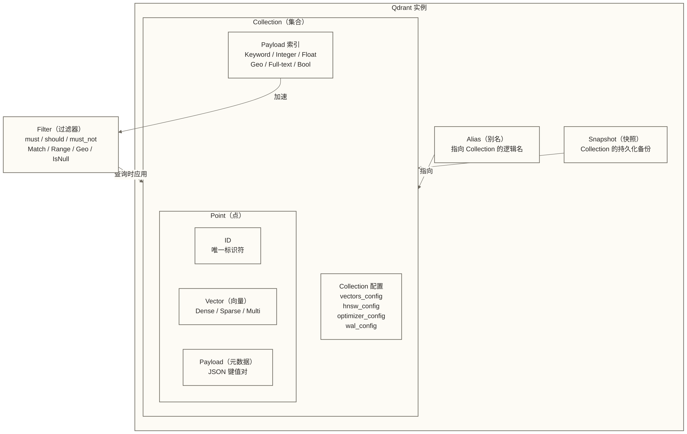
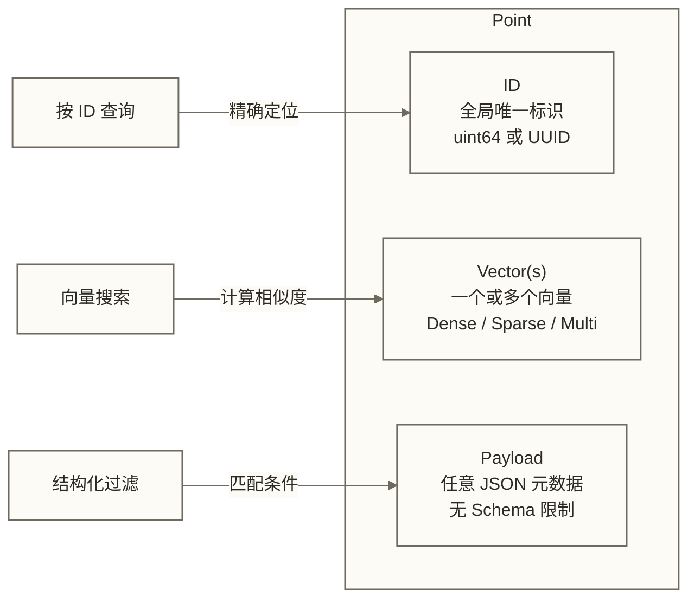
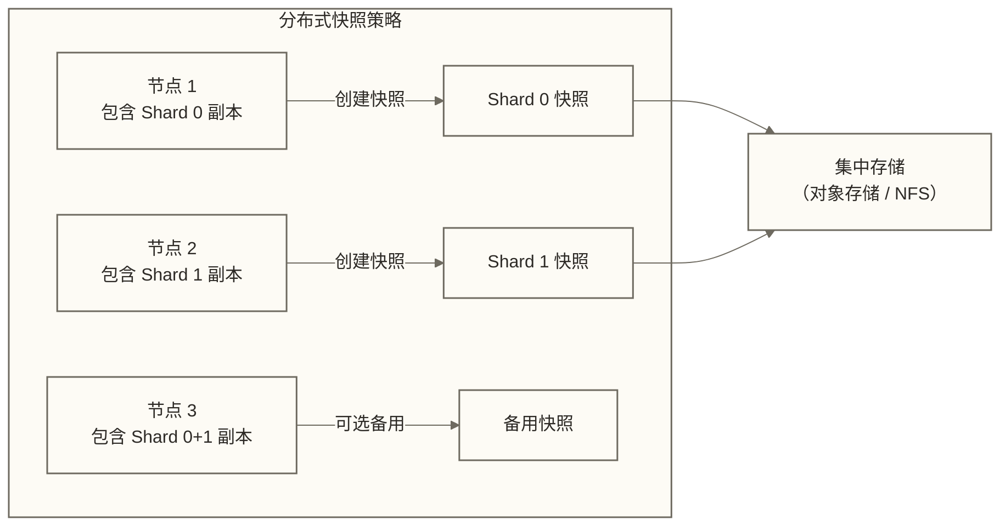

# Qdrant 核心概念详解

> [!abstract] 文档概述
> 本文系统地梳理 Qdrant 的核心数据模型与操作概念，包括 Collection、Point、Vector、Payload、Filter、Snapshot 和 Alias 七大模块。通过详尽的配置说明、类型对比和实战代码示例，帮助工程师建立对 Qdrant 数据模型的完整认知。

## 目录

- [[#概念体系总览]]
- [[#Collection 集合]]
  - [[#Collection 的本质]]
  - #向量配置 vectors_config
  - #HNSW 配置 hnsw_config
  - #优化器配置 optimizer_config
  - #WAL 配置 wal_config
  - #量化配置 quantization_config
  - [[#Collection 操作 API]]
- [[#Point 点]]
  - [[#Point 的组成结构]]
  - [[#Point ID 设计]]
  - [[#Point 的版本控制]]
  - [[#批量操作与性能]]
- [[#Vector 向量]]
  - [[#Dense Vector 稠密向量]]
  - [[#Sparse Vector 稀疏向量]]
  - [[#MultiVector 多向量]]
  - [[#Named Vectors 命名向量]]
  - [[#距离度量类型]]
- [[#Payload 元数据]]
  - [[#Payload 的字段类型]]
  - [[#Payload 的存储策略]]
  - [[#Payload 操作 API]]
  - [[#嵌套 Payload 访问]]
- [[#Payload 索引]]
  - [[#索引类型详解]]
  - [[#Full-text 全文索引]]
  - [[#Geo 地理索引]]
  - [[#索引管理 API]]
- [[#Filter 过滤器]]
  - #逻辑组合：must / should / must_not
  - [[#Match 精确匹配条件]]
  - [[#Range 范围条件]]
  - [[#Geo 地理条件]]
  - [[#IsNull / IsEmpty 空值条件]]
  - [[#Nested 嵌套对象条件]]
  - [[#HasId 点 ID 条件]]
  - [[#Filter 性能优化策略]]
- [[#Snapshot 快照]]
  - [[#快照的适用场景]]
  - [[#快照操作 API]]
  - [[#分布式快照策略]]
- [[#Alias 别名]]
  - [[#别名的核心价值]]
  - [[#零停机版本切换]]
  - [[#别名操作 API]]
- [[#数据模型设计最佳实践]]

---

## 概念体系总览

在开始深入每个概念之前，先建立整体的概念地图：



**Qdrant 与关系数据库的类比：**

| Qdrant 概念 | 关系数据库类比 | 关键区别 |
|------------|-------------|---------|
| Collection | Table（表） | 以向量为中心，无固定列 Schema |
| Point | Row（行） | 包含向量，不仅仅是结构化数据 |
| Payload | Columns（列） | 动态 JSON，无需预定义结构 |
| Payload 索引 | Column Index | 仅对查询频繁字段创建 |
| Filter | WHERE 子句 | 与向量搜索深度融合 |
| Alias | View（视图） | 轻量级名称映射，而非物化视图 |
| Snapshot | Database Backup | 二进制级别的数据快照 |

---

## Collection 集合

### Collection 的本质

Collection 是 Qdrant 中**数据组织的最高层级**，类似于关系数据库中的"表"，但具有以下特点：

1. **向量中心**：每个 Collection 必须声明向量的维度和距离度量
2. **动态 Payload**：不像传统表需要预定义所有列，Payload 是自由形式的 JSON
3. **物理隔离**：不同 Collection 的数据完全隔离，不同 Collection 的向量维度可以不同
4. **配置丰富**：向量索引、优化器、WAL、量化等参数均在 Collection 级别配置

> [!tip] 何时创建多个 Collection？
> - 不同业务域（如"商品向量"和"用户向量"）
> - 不同向量维度（不同 embedding 模型的输出）
> - 不同的索引参数需求
> - 不同的数据访问模式（高频查询 vs 批量分析）

### 向量配置 vectors_config

`vectors_config` 是 Collection 的核心配置，定义了存储何种向量以及如何组织。

**单一向量配置（简单场景）：**

```json
PUT /collections/products
{
  "vectors": {
    "size": 1536,
    "distance": "Cosine",
    "on_disk": false,
    "datatype": "float32"
  }
}
```

**多命名向量配置（高级场景）：**

```json
PUT /collections/products_multi
{
  "vectors": {
    "text_embedding": {
      "size": 1536,
      "distance": "Cosine",
      "on_disk": true
    },
    "image_embedding": {
      "size": 768,
      "distance": "Dot",
      "on_disk": false
    },
    "price_vector": {
      "size": 128,
      "distance": "Euclid",
      "on_disk": false
    }
  },
  "sparse_vectors": {
    "bm25_sparse": {
      "index": {
        "full_scan_threshold": 5000
      }
    }
  }
}
```

**向量配置参数详解：**

| 参数 | 类型 | 可选值 | 说明 |
|------|------|--------|------|
| `size` | integer | 任意正整数 | 向量维度，必须与 embedding 模型输出一致 |
| `distance` | string | Cosine / Dot / Euclid / Manhattan | 距离度量类型 |
| `on_disk` | boolean | true / false | 向量是否存储在磁盘（否则常驻内存） |
| `datatype` | string | float32 / float16 / uint8 | 向量元素的数值类型 |
| `multivector_config` | object | - | 多向量配置，见 MultiVector 章节 |
| `hnsw_config` | object | - | 该向量专属的 HNSW 配置（覆盖 Collection 级别） |
| `quantization_config` | object | - | 该向量专属的量化配置 |

**`datatype` 的存储影响：**

| datatype | 每维度占用 | 1536 维向量占用 | 精度 |
|----------|----------|----------------|------|
| float32（默认） | 4 bytes | 6,144 bytes | 最高（IEEE 754 单精度） |
| float16 | 2 bytes | 3,072 bytes | 高（约 3 位小数精度） |
| uint8 | 1 byte | 1,536 bytes | 中（预量化，需归一化到 0-255） |

> [!note] float16 vs Scalar Quantization
> `datatype: float16` 是在**写入阶段**就以半精度存储，不可逆。而 Scalar Quantization 是在向量存储后，额外构建一个 int8 的量化副本，原始 float32 数据仍然保留（用于 Rescore）。两者各有适用场景。

### HNSW 配置 hnsw_config

`hnsw_config` 控制向量索引的构建参数和存储方式，直接影响搜索精度与性能。

```json
PUT /collections/my_collection
{
  "hnsw_config": {
    "m": 16,
    "ef_construct": 100,
    "full_scan_threshold": 10000,
    "max_indexing_threads": 0,
    "on_disk": false,
    "payload_m": 16,
    "inline_storage": false
  }
}
```

**参数深度说明：**

**`m`（默认：16）**

HNSW 图中每个节点在每一层的最大出边数量。这是影响索引质量最重要的参数：

```ini
m=8:   内存使用少，图质量一般，适合内存受限场景
m=16:  默认值，在大多数场景下平衡良好
m=32:  更高的召回率，但内存使用约增加 1 倍，构建时间更长
m=64:  极高召回率，用于对精度要求极高的场景

HNSW 图内存估算（近似）：
  memory_per_point ≈ m * 2 * 8 bytes（考虑双向边）
  1M 点，m=16：约 256 MB 仅用于图结构（不含向量数据）
```

**`ef_construct`（默认：100）**

构建索引时的候选队列大小，决定索引质量：

```ini
ef_construct=50:  快速构建，索引质量一般
ef_construct=100: 默认，良好的质量与速度平衡
ef_construct=200: 可用于测试更高索引质量；构建时间约2倍仅作为待测试假设，不代表实际结果
ef_construct=500: 接近最优索引，适合离线批量建索引场景

注意：ef_construct 是构建阶段参数，不直接设置搜索候选数；它改变索引质量，也可能间接影响搜索性能
      但更好的索引质量 = 相同 ef 下更高的召回率
```

**`full_scan_threshold`（默认：10000）**

full_scan_threshold 按向量数据量（KB）计，而非按点数计；查询规划器可据候选向量数据量选择全量扫描，不能将10000直接解释为1万个点。

```text
设计逻辑：
  HNSW 有固定的图构建开销和内存占用
  对于小数据集（<1万点），暴力扫描反而更快
  因为 HNSW 图的层级遍历有固定的常数开销

实践建议：
  生产环境通常保持默认值（10000）
  如果数据集确定很大且召回率优先，可设为 0（始终使用 HNSW）
```

**`on_disk`（默认：false）**

将 HNSW 图结构存储在磁盘而非内存：

```ini
on_disk=false（默认）：
  图结构全部在内存，图遍历无 IO 开销
  内存使用：向量数据 + HNSW 图；图内存取决于层级、连接数和实现，本文的简化估算不能替代实际测量

on_disk=true：
  图结构通过 memmap 映射，访问时按需从磁盘加载
  冷启动慢，但热数据后性能仍可接受
  配合 inline_storage=true 效果更好
```

**`inline_storage`（默认：false）**

将量化向量内嵌到 HNSW 图文件中（见 #Inline Storage 优化 章节）：

```text
适用条件：
  1. on_disk=true（磁盘模式，IO 次数是瓶颈）
  2. 已配置量化（有量化向量可以嵌入）

不适用：
  纯内存模式（on_disk=false），因为内存中无需减少 IO
```

### 优化器配置 optimizer_config

Optimizer 是 Qdrant 的后台工作线程，负责将可追加段（Appendable Segment）转换为优化的不可变段，并清理碎片。

```json
PUT /collections/my_collection
{
  "optimizers_config": {
    "deleted_threshold": 0.2,
    "vacuum_min_vector_number": 1000,
    "default_segment_number": 0,
    "max_segment_size": 200000,
    "memmap_threshold": 200000,
    "indexing_threshold": 20000,
    "flush_interval_sec": 5,
    "max_optimization_threads": 1
  }
}
```

**参数详解：**

| 参数 | 默认值 | 说明 |
|------|--------|------|
| `deleted_threshold` | 0.2 | 触发 Vacuum 的删除比例阈值（20% 已删除则触发清理） |
| `vacuum_min_vector_number` | 1000 | 触发 Vacuum 的最小向量数量（避免过于频繁的小段清理） |
| `default_segment_number` | 0（自动） | 默认 Segment 数量，0 表示根据 CPU 核数自动确定 |
| `max_segment_size` | 200000 | 单个 Segment 的向量数据量上限配置，单位为KB，不是点数；具体默认值以部署配置为准 |
| `memmap_threshold` | 200000 | 使用memmap存储向量的数据量阈值，单位为KB，不是点数；具体默认值以部署配置为准 |
| `indexing_threshold` | 20000 | 触发向量索引构建的数据量阈值，单位为KB，不是点数；具体默认值以部署配置为准 |
| `flush_interval_sec` | 5 | 强制将内存 Segment 数据刷到磁盘的间隔（秒） |
| `max_optimization_threads` | 1 | 并发优化任务数（增大可加速索引构建，但消耗更多 CPU） |

**优化器的工作流程：**

```text
新点写入 → 落入 Appendable Segment（RAM 中）
                ↓ 达到 indexing_threshold（按向量数据量KB计）
         Indexing Optimizer 触发
                ↓ 构建 HNSW 索引
         转换为 Immutable Segment
                ↓ 多个小段积累
         Merge Optimizer 触发
                ↓ 合并小段为大段
         超过 max_segment_size
                ↓
         分裂为两个新 Immutable Segment
                ↓ 大量删除操作
         Vacuum Optimizer 触发
                ↓
         重建 Segment，物理删除已标记数据
```

> [!warning] 高写入场景的调优
> 如果写入速度远快于 Optimizer 处理速度，会导致大量 Appendable Segment 堆积，查询时需要扫描更多 Segment，性能下降。此时可考虑：
> 1. 增大 `max_optimization_threads`
> 2. 暂时提高 `indexing_threshold`（减少触发频率）
> 3. 批量写入后手动触发优化

### WAL 配置 wal_config

WAL（Write-Ahead Log）配置控制持久化行为：

```json
PUT /collections/my_collection
{
  "wal_config": {
    "wal_capacity_mb": 32,
    "wal_segments_ahead": 0
  }
}
```

| 参数 | 默认值 | 说明 |
|------|--------|------|
| `wal_capacity_mb` | 32 | 单个 WAL 段的最大大小（MB） |
| `wal_segments_ahead` | 0 | 提前预分配的 WAL 段数（减少 IO 抖动） |

**WAL 大小的权衡：**

```text
较小的 wal_capacity_mb（如 8MB）：
  + WAL 段切换更频繁，旧段可以更早清理
  + 单次崩溃恢复需要重放的数据更少
  - 频繁分配新 WAL 段，可能产生 IO 开销

较大的 wal_capacity_mb（如 128MB）：
  + 减少 WAL 段的分配频率
  + 高写入场景下 IO 效率更高
  - 崩溃恢复时间可能更长
```

### 量化配置 quantization_config

量化配置在 Collection 级别设置默认量化策略，可被向量级别的配置覆盖：

```json
PUT /collections/my_collection
{
  "quantization_config": {
    "scalar": {
      "type": "int8",
      "quantile": 0.99,
      "always_ram": true
    }
  }
}
```

三种量化方式的配置结构，详见 架构深度解析 中的量化章节。

### Collection 操作 API

**创建 Collection：**

```python
from qdrant_client import QdrantClient
from qdrant_client.models import Distance, VectorParams, HnswConfigDiff

client = QdrantClient(host="localhost", port=6333)

client.create_collection(
    collection_name="my_products",
    vectors_config=VectorParams(
        size=1536,
        distance=Distance.COSINE,
        on_disk=True,
    ),
    hnsw_config=HnswConfigDiff(
        m=16,
        ef_construct=100,
        on_disk=True,
        inline_storage=False,  # 本示例未配置量化，不启用量化向量内嵌
    ),
)
```

**查看 Collection 信息：**

```bash
GET /collections/my_products
```

**删除 Collection：**

```bash
DELETE /collections/my_products
```

**更新 Collection 配置（在线变更）：**

```python
from qdrant_client.models import OptimizersConfigDiff

client.update_collection(
    collection_name="my_products",
    optimizer_config=OptimizersConfigDiff(
        indexing_threshold=50000,
        max_optimization_threads=2,
    ),
)
```

> [!tip] 在线配置更新的注意事项
> `hnsw_config` 的 `m` 和 `ef_construct` 参数更新后，只对**新建的 Segment** 生效。已有的 Segment 需要重建才能使用新配置。可以通过触发 Vacuum 操作来强制重建。

---

## Point 点

### Point 的组成结构

Point 是 Qdrant 的**基本数据单元**，类似于关系数据库中的一行记录，但包含向量信息：

```json
{
  "id": "a3c4e7f1-9b2d-4e8a-b123-456789abcdef",
  "vector": [0.1, 0.2, 0.3, ...],
  "payload": {
    "title": "iPhone 15 Pro",
    "price": 999.99,
    "category": "electronics",
    "in_stock": true,
    "tags": ["smartphone", "apple", "5G"],
    "location": {
      "lon": 116.397428,
      "lat": 39.90923
    }
  }
}
```

**Point 的三个组成部分：**



### Point ID 设计

Qdrant 支持无符号整数和 UUID 两种 Point ID；无需在创建 Collection 时固定 ID 类型，同一 Collection 内可以使用这两种类型。

**类型1：unsigned integer（无符号整数）**

```json
{
  "id": 42,
  "vector": [...]
}
```

- 范围：0 到 18,446,744,073,709,551,615（uint64）
- 优点：内存效率最高，整数比较最快
- 缺点：需要自行管理 ID 分配，避免冲突
- 适用场景：有现成整数主键的业务（如数据库自增 ID）

**类型2：UUID（通用唯一标识符）**

```json
{
  "id": "550e8400-e29b-41d4-a716-446655440000",
  "vector": [...]
}
```

- 格式：符合 RFC 4122 的标准 UUID 字符串
- 优点：全球唯一，无需中央协调分配
- 缺点：相比整数 ID 占用更多内存（16 bytes vs 8 bytes）
- 适用场景：分布式系统、微服务架构、需要外部系统生成 ID

**ID 选择策略：**

```text
推荐使用整数 ID 当：
  - 存在现成的业务主键（数据库 ID、订单号等）
  - 追求极致的内存效率
  - 单节点或可集中管理 ID 分配

推荐使用 UUID 当：
  - 多个系统/服务并发写入，无法集中分配 ID
  - 需要在不同 Collection 间引用同一实体
  - 使用客户端生成 ID（离线批量导入场景）
```

### Point 的版本控制

Qdrant 为每个 Point 维护一个**版本号**（Version），这是实现多副本一致性的基础：

```text
版本号语义：
  - 每次对某个 Point 的写操作（upsert/update/delete），版本号自动递增
  - 版本号单调递增，不可回退
  - 跨副本的写入冲突以版本号较高者为准（Last-Write-Wins）

版本号的实际用途：
  1. WAL 恢复：确保每个操作只被应用一次
  2. 副本同步：Follower 判断自己是否落后于 Leader
  3. 冲突解决：并发写入同一 Point 时，以最新版本为准
```

### 批量操作与性能

Qdrant 的 upsert 操作支持批量写入，单次请求可包含大量 Point：

```python
from qdrant_client.models import PointStruct

# 批量写入（推荐：每批 100-1000 个点）
client.upsert(
    collection_name="my_products",
    points=[
        PointStruct(
            id=i,
            vector=[0.1] * 1536,  # 仅用于演示批量写入结构；实际应使用模型生成的1536维向量
            payload={"name": f"product_{i}", "price": i * 10.0}
        )
        for i in range(1000)
    ],
    wait=True,  # 等待操作应用到 Segment（同步模式）
)
```

**`wait` 参数的语义：**

```ini
wait=True（同步模式）：
  等待 WAL 写入 AND Segment 应用完成才返回
  等待写入操作应用完成；后续查询的可见性还取决于副本状态、读取一致性及相关配置，不能据此保证任意下一次查询立即看到新数据
  写入延迟较高

wait=False（异步模式）：
  WAL 写入后立即返回
  Segment 应用在后台进行
  写入延迟极低，但短时间内查询可能看不到新数据

生产场景建议：
  - 批量导入：wait=False（提高吞吐量）
  - 实时写入：wait=True（等待操作应用完成；读取可见性仍需结合副本状态与一致性配置）
```

**批量写入的性能优化：**

| 策略 | 说明 | 效果 |
|------|------|------|
| 批次大小 100-1000 | 平衡 HTTP 开销与处理时间 | 假设性性能参考：相对单点写入提升5-20倍；本文未提供实测条件，不代表实际收益 |
| gRPC 代替 REST | 减少序列化开销 | 假设性性能参考：提升约1.2-1.5倍；实际效果取决于请求规模、序列化与网络条件 |
| 并发多批次 | 多线程并发发送 | 可将随CPU核数扩展作为测试假设，但吞吐量还受服务端资源、网络、磁盘及并发竞争限制 |
| wait=False | 减少等待 Segment 应用 | 延迟降低，吞吐量提升 |

---

## Vector 向量

### Dense Vector 稠密向量

稠密向量（Dense Vector）是最常见的向量类型，每个维度都有一个浮点值：

```json
{
  "id": 1,
  "vector": [0.1, -0.3, 0.5, 0.2, -0.1, ...]
}
```

**稠密向量的特点：**

```text
维度：通常 128 ~ 4096 维（取决于 embedding 模型）
  - OpenAI text-embedding-3-small: 1536 维
  - OpenAI text-embedding-3-large: 3072 维
  - CLIP ViT-B/32: 512 维
  - Sentence-BERT: 768 维
  - E5-large: 1024 维

所有维度均有值（非零密度 ≈ 100%）
适用：语义搜索、图像搜索、推荐系统的大多数场景
```

### Sparse Vector 稀疏向量

稀疏向量（Sparse Vector）只存储非零维度的索引和值，适合高维稀疏数据：

```json
{
  "id": 1,
  "vector": {
    "bm25_sparse": {
      "indices": [1234, 5678, 9012],
      "values": [0.8, 0.5, 0.3]
    }
  }
}
```

**稀疏向量的结构：**

```text
indices：非零维度的索引数组（uint32，范围 0 ~ 4,294,967,295）
values：对应维度的值数组（float32）

约束：
  1. indices 和 values 长度必须相同
  2. indices 中不能有重复值
  3. 两个数组顺序要一一对应

示例（BM25 关键词权重）：
  "机器学习" → 词汇表 ID = 1234，TF-IDF = 0.8
  "深度学习"  → 词汇表 ID = 5678，TF-IDF = 0.5
  "神经网络"  → 词汇表 ID = 9012，TF-IDF = 0.3
```

**稀疏向量的索引（稀疏倒排索引）：**

Qdrant 为稀疏向量维护一个**倒排索引**（Inverted Index），这与传统的全文检索引擎类似，但在向量层面实现：

```text
索引结构：
  词汇 ID 1234 → [点 ID: 1, 5, 23, 456, ...]
  词汇 ID 5678 → [点 ID: 1, 7, 89, ...]
  词汇 ID 9012 → [点 ID: 1, 3, 67, ...]

查询时：
  1. 找出查询向量的所有非零维度
  2. 从倒排索引中获取每个维度对应的候选点列表
  3. 计算候选点与查询向量的点积（dot product）
  4. 返回分数最高的 Top-K 点
```

**稀疏向量的核心用途：BM25 混合搜索**

```python
# 混合搜索：Dense（语义）+ Sparse（关键词）
client.query_points(
    collection_name="documents",
    prefetch=[
        # 语义检索（Dense Vector）
        models.Prefetch(
            query=[0.1, 0.2, ...],   # dense embedding
            using="text_dense",
            limit=50,
        ),
        # 关键词检索（Sparse Vector）
        models.Prefetch(
            query=models.SparseVector(
                indices=[1234, 5678],
                values=[0.8, 0.5],
            ),
            using="bm25_sparse",
            limit=50,
        ),
    ],
    query=models.FusionQuery(fusion=models.Fusion.RRF),  # RRF 融合排序
    limit=10,
)
```

> [!info] 稀疏向量的限制
> 1. 稀疏向量**必须命名**（不能是 Collection 的"默认向量"）
> 2. 稀疏向量**必须**与稠密向量有不同的名称
> 3. 稀疏向量的距离度量**只支持点积（Dot Product）**
> 4. `full_scan_threshold` 控制何时使用倒排索引 vs 暴力扫描

### MultiVector 多向量

MultiVector（多向量）允许单个 Point 关联**多个向量**，用于 ColBERT 等后期交互模型：

```json
{
  "id": 1,
  "vector": {
    "colbert": [
      [0.1, 0.2, 0.3, ...],
      [0.4, 0.5, 0.6, ...],
      [0.7, 0.8, 0.9, ...]
    ]
  }
}
```

**MultiVector 的配置：**

```json
PUT /collections/colbert_docs
{
  "vectors": {
    "colbert": {
      "size": 128,
      "distance": "Cosine",
      "multivector_config": {
        "comparator": "max_sim"
      }
    }
  }
}
```

**`max_sim` 比较器的原理：**

```text
ColBERT 的 MaxSim 操作：

查询：[q1, q2, q3]（3 个 token 的向量）
文档：[d1, d2, d3, d4, d5]（5 个 token 的向量）

MaxSim 计算：
  对查询的每个向量 qi，找到文档中与其最相似的向量 dj
  score = sum(max_j(sim(qi, dj)) for qi in query)

这模拟了词汇级别的精确匹配语义，比单向量的 CLS 表示更精确
```

**MultiVector 的适用场景：**

| 场景 | 说明 |
|------|------|
| ColBERT 文档检索 | 每个 token 一个向量，实现 token-level 交互 |
| 图像-文本多视角 | 同一图像从不同角度/描述的多个向量 |
| 文档多段落表示 | 长文档拆分为多段，每段一个向量 |

### Named Vectors 命名向量

Named Vectors（命名向量）是 Qdrant 的重要设计，允许一个 Point 关联多个不同类型/维度的向量：

```json
{
  "id": 1,
  "vector": {
    "title_embedding": [0.1, 0.2, ...],
    "body_embedding": [0.3, 0.4, ...],
    "image_embedding": [0.5, 0.6, ...]
  },
  "payload": {
    "title": "Qdrant Introduction",
    "body": "Qdrant is a vector database...",
    "image_url": "https://example.com/img.png"
  }
}
```

**命名向量的查询：**

```python
# 指定使用哪个向量进行搜索
client.query_points(
    collection_name="articles",
    query=[0.1, 0.2, ...],
    using="title_embedding",  # 指定向量名称
    limit=10,
)
```

**Named Vectors 的工程价值：**

1. **减少数据冗余**：相关的不同向量表示归属同一 Point，Payload 只需存一份
2. **联合查询**：先用 title 向量召回候选，再用 body 向量精排
3. **多模态统一**：文本和图像向量挂载同一 Point，实现跨模态搜索
4. **向量局部更新**：可以只更新某个命名向量，不影响其他向量

### 距离度量类型

Qdrant 支持四种向量距离度量，需在 Collection 创建时指定：

| 距离类型 | 公式 | 值域 | 语义 | 适用场景 |
|---------|------|------|------|---------|
| Cosine | `cos(θ)`（返回相似度分数） | [-1, 1] | 分数越大越相似，1表示同方向 | 文本语义相似度（最常用） |
| Dot | `dot(a, b)`（返回点积分数） | (-∞, +∞) | 分数越大越相似 | 单位归一化向量的排序与Cosine一致；推荐系统 |
| Euclid | `||a - b||₂` | [0, +∞) | 0=完全相同 | 空间距离搜索，图像特征 |
| Manhattan | `||a - b||₁` | [0, +∞) | L1 距离 | 稀疏特征，鲁棒性场景 |

**Cosine vs Dot 的选择：**

```text
理论上，对于已归一化（||v|| = 1）的向量：
  Cosine相似度(a, b) = dot(a, b)
  两者等价，但 Dot Product 计算更快（省去归一化步骤）

实际推荐：
  如果你的 embedding 模型输出已归一化向量 → 使用 Dot
  如果不确定是否归一化 → 使用 Cosine（更安全）
  OpenAI 的 embedding → 两者均可（输出已归一化）
```

---

## Payload 元数据

### Payload 的字段类型

Payload 是 Qdrant 为每个 Point 存储的 JSON 元数据。虽然是动态 Schema，但 Qdrant 识别和优化以下具体类型：

**1. Keyword（关键词）**

```json
{
  "status": "active",
  "category": "electronics",
  "tags": ["new", "sale", "featured"]
}
```

- 存储：原始字符串，不分词
- 用途：精确匹配、多值过滤
- 索引：HashMap（O(1) 查询）
- 适用：分类标签、状态字段、枚举值

**2. Integer（整数）**

```json
{
  "price_cents": 9999,
  "stock_count": 156,
  "year": 2024
}
```

- 存储：int64 整数
- 用途：范围查询、精确匹配、数值排序
- 索引：BTreeMap（O(log n) 范围查询）

**3. Float（浮点数）**

```json
{
  "rating": 4.5,
  "price": 99.99,
  "discount_rate": 0.15
}
```

- 存储：float64 浮点数
- 用途：范围查询、数值过滤
- 索引：BTreeMap

**4. Bool（布尔值）**

```json
{
  "is_available": true,
  "is_featured": false,
  "has_discount": true
}
```

- 存储：true/false
- 用途：精确匹配
- 索引：Bitset（极度高效）

**5. Datetime（日期时间）**

```json
{
  "created_at": "2024-01-15T10:30:00Z",
  "expires_at": "2024-12-31T23:59:59+08:00"
}
```

- 存储：遵循 RFC 3339 / ISO 8601 格式
- 用途：时间范围查询
- 索引：BTreeMap（时间戳）
- 支持时区：自动转换为 UTC 存储

**6. Geo（地理坐标）**

```json
{
  "location": {
    "lon": 116.397428,
    "lat": 39.90923
  }
}
```

- 存储：经纬度对象
- 用途：地理范围查询（圆形、矩形、多边形）
- 索引：R-Tree

**7. Text（全文文本）**

```json
{
  "description": "This is a high-performance vector database written in Rust.",
  "title": "Qdrant: Vector Search Engine"
}
```

- 存储：原始字符串
- 用途：全文搜索（模糊匹配、词语搜索）
- 索引：倒排索引（Inverted Index）
- 与 Keyword 区别：Text 会分词，Keyword 不分词

**8. UUID（唯一标识符）**

```json
{
  "user_id": "550e8400-e29b-41d4-a716-446655440000",
  "session_id": "7f3f5d2a-1234-5678-abcd-ef0123456789"
}
```

- 存储：UUID 字符串
- 用途：精确匹配（外键关联）
- 索引：HashMap

### Payload 的存储策略

Qdrant 提供两种 Payload 存储策略，在 Collection 级别配置：

```json
PUT /collections/my_collection
{
  "on_disk_payload": true
}
```

| 策略 | `on_disk_payload: false`（默认） | `on_disk_payload: true` |
|------|--------------------------------|------------------------|
| 存储位置 | 内存（Gridstore/RocksDB） | 磁盘（memmap 文件） |
| 访问延迟 | 极低（内存访问） | 较低（可能有 IO） |
| RAM 消耗 | 高（Payload 全部在内存） | 低（按需加载） |
| 适用场景 | Payload 较小，查询频繁 | Payload 较大，内存有限 |

**Payload 大小的估算：**

```text
典型 Payload 大小：
  最小（几个字段）：< 1 KB / 点
  中等（数十个字段）：1-10 KB / 点
  大型（含长文本）：10-100 KB / 点

100万个点，平均 Payload = 5 KB：
  总 Payload 内存 = 100万 × 5 KB = 5 GB

如果 RAM 中无法容纳 5 GB 的 Payload：
  → 启用 on_disk_payload=true，按需从磁盘加载
```

### Payload 操作 API

**设置/覆盖 Payload（set_payload）：**

```python
# 覆盖指定字段（其他字段不变）
client.set_payload(
    collection_name="my_products",
    payload={
        "status": "sold_out",
        "last_updated": "2024-01-15T10:30:00Z"
    },
    points=[1, 2, 3],  # 批量操作多个点
)
```

**覆盖全部 Payload（overwrite_payload）：**

```python
# 完全替换 Payload（旧字段会被删除）
client.overwrite_payload(
    collection_name="my_products",
    payload={"status": "active"},  # 只保留 status 字段
    points=[1],
)
```

**删除特定 Payload 字段：**

```python
client.delete_payload(
    collection_name="my_products",
    keys=["temporary_flag", "debug_info"],
    points=[1, 2, 3],
)
```

**清除全部 Payload：**

```python
client.clear_payload(
    collection_name="my_products",
    points_selector=models.FilterSelector(
        filter=models.Filter(
            must=[
                models.FieldCondition(
                    key="status",
                    match=models.MatchValue(value="deprecated"),
                )
            ]
        )
    ),
)
```

### 嵌套 Payload 访问

Qdrant 支持访问嵌套的 JSON 字段，使用点号（`.`）表示路径：

```json
{
  "id": 1,
  "payload": {
    "product": {
      "details": {
        "color": "red",
        "size": "L"
      },
      "prices": [
        {"currency": "USD", "amount": 99.99},
        {"currency": "CNY", "amount": 699.00}
      ]
    }
  }
}
```

```python
# 访问嵌套字段
models.FieldCondition(
    key="product.details.color",
    match=models.MatchValue(value="red"),
)

# 访问数组元素中的字段（嵌套对象数组）
models.FieldCondition(
    key="product.prices[].currency",
    match=models.MatchValue(value="USD"),
)
```

---

## Payload 索引

没有索引的 Payload 字段仍然可以过滤，但需要全量扫描所有 Segment。创建索引后，过滤操作从 O(n) 降为 O(log n) 或 O(1)。

### 索引类型详解

**Keyword 索引（精确匹配）：**

```python
client.create_payload_index(
    collection_name="my_products",
    field_name="category",
    field_schema=models.PayloadSchemaType.KEYWORD,
)
```

底层使用 HashMap，支持：
- `MatchValue`：精确匹配单值
- `MatchAny`：匹配多值中的任一个
- `MatchExcept`：排除匹配

**Integer 索引（范围查询 + 精确匹配）：**

```python
from qdrant_client.models import IntegerIndexParams, IntegerIndexType

client.create_payload_index(
    collection_name="my_products",
    field_name="price_cents",
    field_schema=models.PayloadFieldSchema(
        type=models.PayloadSchemaType.INTEGER,
        params=IntegerIndexParams(
            type=IntegerIndexType.INTEGER,
            lookup=True,   # 启用精确匹配（MatchValue）
            range=True,    # 启用范围查询（Range）
        ),
    ),
)
```

**Float 索引（范围查询）：**

```python
client.create_payload_index(
    collection_name="my_products",
    field_name="rating",
    field_schema=models.PayloadSchemaType.FLOAT,
)
```

**Bool 索引（极致高效）：**

```python
client.create_payload_index(
    collection_name="my_products",
    field_name="is_available",
    field_schema=models.PayloadSchemaType.BOOL,
)
```

Bool 索引内部使用 Bitset，过滤操作通过位运算实现，是最快的索引类型。

**Datetime 索引（时间范围）：**

```python
client.create_payload_index(
    collection_name="events",
    field_name="created_at",
    field_schema=models.PayloadSchemaType.DATETIME,
)
```

**UUID 索引（精确 UUID 匹配）：**

```python
client.create_payload_index(
    collection_name="my_products",
    field_name="user_id",
    field_schema=models.PayloadSchemaType.UUID,
)
```

### Full-text 全文索引

全文索引是 Text 类型字段的专用索引，支持词语级别的搜索：

```python
from qdrant_client.models import TextIndexParams, TokenizerType

client.create_payload_index(
    collection_name="documents",
    field_name="content",
    field_schema=models.PayloadFieldSchema(
        type=models.PayloadSchemaType.TEXT,
        params=TextIndexParams(
            type="text",
            tokenizer=TokenizerType.WORD,  # 分词方式
            min_token_len=2,               # 最短 token 长度
            max_token_len=20,              # 最长 token 长度
            lowercase=True,               # 转小写（大小写不敏感）
        ),
    ),
)
```

**分词器类型：**

| Tokenizer | 说明 | 适用语言 |
|-----------|------|---------|
| `word` | 按空白字符和标点分词 | 英语、欧洲语言 |
| `whitespace` | 仅按空白字符分词（不处理标点） | 英语（精确控制） |
| `prefix` | 生成所有前缀 token（支持前缀搜索） | 自动补全场景 |
| `multilingual` | 多语言 Unicode 感知分词 | 中文、日文等非空格分隔语言 |

> [!warning] 中文全文搜索的注意事项
> 中文文本由于词语之间没有空格，`word` 分词器对中文效果很差——它会把整句话当作一个 token。
> 对中文场景，应该使用 `multilingual` 分词器，或在写入前进行预处理（如使用 jieba 分词后存储分词结果）。

**全文搜索的使用：**

```python
# 全文搜索过滤
models.FieldCondition(
    key="content",
    match=models.MatchText(text="vector database"),
)
```

### Geo 地理索引

```python
client.create_payload_index(
    collection_name="restaurants",
    field_name="location",
    field_schema=models.PayloadSchemaType.GEO,
)
```

Geo 索引的底层是 R-Tree（矩形树），支持：
- **圆形查询**：以某点为圆心，半径 r 内的所有点
- **矩形查询**：经纬度矩形框内的所有点
- **多边形查询**：任意多边形区域内的所有点（v1.7+）

### 索引管理 API

**查看 Collection 的所有索引：**

```bash
GET /collections/my_products
# 在返回的 payload_schema 字段中查看已创建的索引
```

**删除索引：**

```python
client.delete_payload_index(
    collection_name="my_products",
    field_name="category",
)
```

**索引创建的时机建议：**

```text
建议在数据写入之前创建索引，而非之后。
如果在数据写入后创建索引，Qdrant 会进行一次全量扫描来构建索引，
对于大规模数据集这会消耗较长时间和资源。

最佳实践：
  1. 创建 Collection
  2. 创建 Payload 索引
  3. 批量写入数据（数据写入时索引同步维护）
```

---

## Filter 过滤器

Filter 是 Qdrant 实现向量搜索与结构化查询融合的关键机制，支持灵活的逻辑组合和丰富的条件类型。

### 逻辑组合：must / should / must_not

Qdrant 的 Filter 采用**布尔逻辑树**结构：

```text
must       → AND（所有条件都必须满足）
should     → OR（至少一个条件满足）
must_not   → NOT（所有条件都不能满足）
```

**完整示例：**

```python
models.Filter(
    must=[
        # 必须：category = "electronics"
        models.FieldCondition(
            key="category",
            match=models.MatchValue(value="electronics"),
        ),
        # 必须：is_available = true
        models.FieldCondition(
            key="is_available",
            match=models.MatchValue(value=True),
        ),
    ],
    should=[
        # 应该满足之一：brand = "Apple" 或 brand = "Samsung"
        models.FieldCondition(
            key="brand",
            match=models.MatchValue(value="Apple"),
        ),
        models.FieldCondition(
            key="brand",
            match=models.MatchValue(value="Samsung"),
        ),
    ],
    must_not=[
        # 不能：status = "discontinued"
        models.FieldCondition(
            key="status",
            match=models.MatchValue(value="discontinued"),
        ),
    ],
)
```

**等价的 SQL 语义：**

```sql
WHERE category = 'electronics'
  AND is_available = true
  AND (brand = 'Apple' OR brand = 'Samsung')
  AND status != 'discontinued'
```

**嵌套逻辑：**

```python
# 复杂的嵌套条件
models.Filter(
    must=[
        models.Filter(
            should=[
                models.FieldCondition(key="tier", match=models.MatchValue(value="premium")),
                models.Filter(
                    must=[
                        models.FieldCondition(key="rating", range=models.Range(gte=4.5)),
                        models.FieldCondition(key="review_count", range=models.Range(gte=100)),
                    ]
                ),
            ]
        )
    ]
)
```

### Match 精确匹配条件

**MatchValue（单值精确匹配）：**

```python
# 字符串匹配
models.FieldCondition(key="status", match=models.MatchValue(value="active"))

# 整数匹配
models.FieldCondition(key="year", match=models.MatchValue(value=2024))

# 布尔匹配
models.FieldCondition(key="is_featured", match=models.MatchValue(value=True))
```

**MatchAny（多值匹配，IN 操作）：**

```python
# 等价于 SQL: WHERE category IN ('phones', 'tablets', 'laptops')
models.FieldCondition(
    key="category",
    match=models.MatchAny(any=["phones", "tablets", "laptops"]),
)
```

**MatchExcept（排除匹配，NOT IN 操作）：**

```python
# 等价于 SQL: WHERE status NOT IN ('deleted', 'archived')
models.FieldCondition(
    key="status",
    match=models.MatchExcept(**{"except": ["deleted", "archived"]}),
)
```

**MatchText（全文搜索匹配）：**

```python
# 在已创建全文索引的字段上搜索
models.FieldCondition(
    key="description",
    match=models.MatchText(text="machine learning"),
)
```

### Range 范围条件

Range 条件适用于数值（Integer/Float）和时间（Datetime）字段：

```python
from qdrant_client.models import Range, DatetimeRange

# 价格范围：100 <= price <= 500
models.FieldCondition(
    key="price",
    range=Range(gte=100.0, lte=500.0),
)

# 半开区间：rating > 4.0
models.FieldCondition(
    key="rating",
    range=Range(gt=4.0),
)

# 时间范围查询（Datetime 字段专用）
models.FieldCondition(
    key="created_at",
    range=DatetimeRange(
        gte="2024-01-01T00:00:00Z",
        lt="2024-12-31T23:59:59Z",
    ),
)
```

**Range 参数：**

| 参数 | 含义 | 示例 |
|------|------|------|
| `gt` | 大于（不含） | `gt=100` 表示 > 100 |
| `gte` | 大于等于（含） | `gte=100` 表示 >= 100 |
| `lt` | 小于（不含） | `lt=500` 表示 < 500 |
| `lte` | 小于等于（含） | `lte=500` 表示 <= 500 |

### Geo 地理条件

**GeoRadius（圆形范围）：**

```python
from qdrant_client.models import GeoPoint, GeoRadius

# 北京天安门 5km 范围内的餐厅
models.FieldCondition(
    key="location",
    geo_radius=GeoRadius(
        center=GeoPoint(lon=116.397428, lat=39.90923),
        radius=5000.0,  # 单位：米
    ),
)
```

**GeoBoundingBox（矩形范围）：**

```python
from qdrant_client.models import GeoBoundingBox

# 北京市的大致经纬度矩形
models.FieldCondition(
    key="location",
    geo_bounding_box=GeoBoundingBox(
        top_left=GeoPoint(lon=115.7, lat=41.1),
        bottom_right=GeoPoint(lon=117.4, lat=39.4),
    ),
)
```

**GeoPolygon（多边形范围，精确行政区划）：**

```python
from qdrant_client.models import GeoPolygon, GeoLineString

# 使用多边形精确框定不规则区域
models.FieldCondition(
    key="location",
    geo_polygon=GeoPolygon(
        exterior=GeoLineString(
            points=[
                GeoPoint(lon=116.0, lat=39.5),
                GeoPoint(lon=117.0, lat=39.5),
                GeoPoint(lon=117.0, lat=40.5),
                GeoPoint(lon=116.0, lat=40.5),
                GeoPoint(lon=116.0, lat=39.5),  # 闭合多边形
            ]
        ),
        interiors=[],  # 可选：多边形中的"空洞"
    ),
)
```

### IsNull / IsEmpty 空值条件

```python
# 匹配字段值为 null 的点；缺失字段使用 IsEmpty 条件
models.IsNullCondition(
    is_null=models.PayloadField(key="discount_rate")
)

# 匹配字段不存在、值为 null 或为空数组的点；空字符串不属于此处的空值条件
models.IsEmptyCondition(
    is_empty=models.PayloadField(key="tags")
)
```

**使用场景：**

```text
IsNull：
  - 找出字段显式为null的点（数据补全场景）
  - 过滤分类字段显式为null的内容；缺失字段使用IsEmpty条件

IsEmpty：
  - 找出标签列表为空的产品
  - 审计无内容的记录
```

### Nested 嵌套对象条件

对于数组中的嵌套对象，使用 `Nested` 过滤器确保条件在**同一对象**内成立：

```python
# 假设 Payload 结构：
# { "prices": [{"currency": "USD", "amount": 99}, {"currency": "CNY", "amount": 699}] }

# 错误方式（不用 Nested）：
# 以下条件可能匹配到：currency="USD" 来自第一个元素，amount<100 来自第一个元素
# 但如果 USD 价格是 200，CNY 价格是 99，下面的条件仍然会错误匹配
models.Filter(
    must=[
        models.FieldCondition(key="prices[].currency", match=models.MatchValue(value="USD")),
        models.FieldCondition(key="prices[].amount", range=Range(lte=100)),
    ]
)

# 正确方式（使用 Nested）：
# 确保 currency="USD" 和 amount<100 来自同一个数组元素
models.Filter(
    must=[
        models.NestedCondition(
            nested=models.Nested(
                key="prices",
                filter=models.Filter(
                    must=[
                        models.FieldCondition(key="currency", match=models.MatchValue(value="USD")),
                        models.FieldCondition(key="amount", range=Range(lte=100)),
                    ]
                ),
            )
        )
    ]
)
```

### HasId 点 ID 条件

有时需要将向量搜索结果限定在特定 Point ID 的集合内：

```python
from qdrant_client.models import HasIdCondition

# 只在指定 ID 的点中搜索
models.Filter(
    must=[
        HasIdCondition(has_id=[1, 5, 23, 456, 789])
    ]
)
```

**使用场景：**

```markdown
- 对已知候选集进行重排序（如从 Redis 获取候选 ID 后再向量排序）
- A/B 实验中只在测试组用户的 ID 范围内搜索
- 增量索引：只搜索新增的点
```

### Filter 性能优化策略

**策略1：只对高频过滤字段创建索引**

```text
原则：不是所有 Payload 字段都需要索引
  创建索引的字段：查询时 80% 以上的请求都会用到的过滤字段
  不建议索引的字段：偶尔使用的字段、基数极高的字段（如 UUID 字段）

索引的内存成本：
  每个索引都需要额外的内存
  Keyword 索引：约 50-200 bytes/点（取决于字段基数）
  Integer/Float 索引：约 50-100 bytes/点
```

**策略2：利用选择率优化 Filter 顺序**

```text
Qdrant 会自动估算各个条件的选择率，选择最优的执行顺序
但可以通过选择合适的 Filter 组合帮助优化器做出更好的决策：

高选择率（少量结果）的条件放在 must 中：
  should 条件的选择率是各子条件选择率的并集，总体更高
  must 条件的选择率是各子条件的交集，可以大幅减少候选集
```

**策略3：避免全量 Payload 扫描**

```text
在没有 Payload 索引的字段上过滤时，Qdrant 需要：
  1. 遍历所有候选点
  2. 读取每个点的 Payload
  3. 执行条件匹配

这是 O(n) 操作，在大集合上极慢。
解决方案：为常用过滤字段创建对应类型的 Payload 索引。
```

---

## Snapshot 快照

Snapshot 是 Qdrant 提供的数据备份与迁移机制，支持 Collection 级别和整个存储的快照。

### 快照的适用场景

| 场景 | 说明 |
|------|------|
| 灾难恢复 | 从快照恢复误删除的 Collection 或损坏的数据 |
| 数据迁移 | 从一个 Qdrant 实例迁移到另一个实例（不同版本/不同机器） |
| 环境复制 | 将生产环境数据同步到测试环境 |
| 版本升级 | 在 Qdrant 大版本升级前备份数据 |
| 数据分析 | 对某个时间点的快照进行离线分析 |

### 快照操作 API

**创建 Collection 快照：**

```python
# 创建快照（异步操作，返回快照信息）
snapshot_info = client.create_snapshot(
    collection_name="my_products",
)
print(f"快照名称: {snapshot_info.name}")
print(f"快照大小: {snapshot_info.size} bytes")
print(f"创建时间: {snapshot_info.creation_time}")
```

```bash
# REST API
POST /collections/my_products/snapshots
```

**列出所有快照：**

```python
snapshots = client.list_snapshots(collection_name="my_products")
for snap in snapshots:
    print(f"{snap.name}: {snap.size} bytes, created at {snap.creation_time}")
```

**下载快照（到本地文件）：**

```bash
# 直接下载到本地
GET /collections/my_products/snapshots/{snapshot_name}
# 返回 .snapshot 文件（二进制格式）
```

**从快照恢复 Collection：**

```python
# 方式1：从Qdrant服务端可访问的文件恢复，并非直接读取客户端本地文件
client.recover_snapshot(
    collection_name="my_products_restored",
    location="file:///path/to/snapshot.snapshot",
)

# 方式2：从 URL 恢复（适合分布式场景）
client.recover_snapshot(
    collection_name="my_products_restored",
    location="http://other-qdrant-host:6333/collections/my_products/snapshots/snapshot_name",
)
```

**删除快照：**

```python
client.delete_snapshot(
    collection_name="my_products",
    snapshot_name="my_products-12345678-0.snapshot",
)
```

**整个存储的全量快照：**

```bash
# 对整个 Qdrant 实例的所有数据创建快照
POST /snapshots

# 列出全量快照
GET /snapshots

# 恢复全量快照（需要 Qdrant 实例重启）
PUT /snapshots/recover
```

### 分布式快照策略

在多节点集群中，快照操作有额外的考虑：



**分布式场景的快照注意事项：**

1. **覆盖实际分片与节点**：集群模式下，节点的Collection快照覆盖该节点持有的数据，不能将一次请求视为所有节点的完整备份；备份任务需确保每个实际分片都有可恢复的快照，并记录分片与节点对应关系

2. **一致性保证**：Qdrant 不保证跨分片的精确时间点一致性（即没有全局快照事务），但在大多数应用场景中这是可接受的

3. **快照不包含 Alias**：Collection 的别名需要单独记录和恢复

4. **推荐恢复方式**：

```bash
# 集群环境优先使用 REST API 恢复（而非直接文件操作）
# 此请求不能单独保证整个集群恢复完成；仍需处理分片覆盖、恢复优先级及目标拓扑
PUT /collections/my_products/snapshots/recover
{
  "location": "http://storage-server/backups/my_products.snapshot"
}
```

---

## Alias 别名

### 别名的核心价值

Alias（别名）是指向 Collection 的**逻辑名称**，可以随时原子地将别名从一个 Collection 切换到另一个 Collection。

这看似简单，却解决了向量数据库生产运营中一个常见的棘手问题：**如何在不停机的情况下更新向量索引？**

**典型场景：**

```text
问题：embedding 模型从 v1 升级到 v2，所有向量需要重新生成
挑战：重建向量索引需要数小时，期间不能中断线上服务

朴素解决方案（有停机）：
  1. 停止服务
  2. 删除旧集合，创建新集合
  3. 重新生成所有向量并写入
  4. 重启服务

Alias 解决方案（在查询模型同步切换、增量数据追平且容量充足等条件满足时，可支持零停机）：
  1. 创建新集合 products_v2（后台写入，不影响现有服务）
  2. 服务继续使用别名 products → products_v1
  3. 数据写入完成后，原子切换：products → products_v2
  4. 删除旧集合 products_v1（可选）
```

### 零停机版本切换

**Step 1：创建并填充新 Collection（后台）**

```python
# 用新模型生成向量，写入新 Collection
client.create_collection(
    collection_name="products_v2",
    vectors_config=VectorParams(size=3072, distance=Distance.COSINE),
)

# 批量写入新的向量（这一步可能需要几小时）
for batch in get_all_products_batches():
    new_vectors = new_embedding_model.encode(batch)
    client.upsert(
        collection_name="products_v2",
        points=[
            PointStruct(id=p["id"], vector=v, payload=p["payload"])
            for p, v in zip(batch, new_vectors)
        ]
    )
```

**Step 2：创建初始别名（如果不存在）**

```python
# 首次部署时，创建别名指向 v1
client.update_aliases(
    change_aliases_operations=[
        models.CreateAliasOperation(
            create_alias=models.CreateAlias(
                collection_name="products_v1",
                alias_name="products",
            )
        )
    ]
)
```

**Step 3：原子切换别名（零停机）**

```python
# 在单个原子操作中：删除旧别名 + 创建新别名
# 不存在"别名不指向任何 Collection"的中间状态
client.update_aliases(
    change_aliases_operations=[
        models.DeleteAliasOperation(
            delete_alias=models.DeleteAlias(alias_name="products")
        ),
        models.CreateAliasOperation(
            create_alias=models.CreateAlias(
                collection_name="products_v2",
                alias_name="products",
            )
        ),
    ]
)
# 别名切换改变集合名称路由；查询模型须同步切换，且不能据此保证所有副本立即可见
```

**Step 4：清理旧 Collection（可选）**

```python
# 确认新集合运行稳定后，删除旧集合
# 建议保留 24-48 小时作为回滚窗口
client.delete_collection("products_v1")
```

**回滚操作（如果新版本有问题）：**

```python
# 快速回滚：将别名切回旧 Collection
client.update_aliases(
    change_aliases_operations=[
        models.DeleteAliasOperation(
            delete_alias=models.DeleteAlias(alias_name="products")
        ),
        models.CreateAliasOperation(
            create_alias=models.CreateAlias(
                collection_name="products_v1",  # 切回旧版本
                alias_name="products",
            )
        ),
    ]
)
```

### 别名操作 API

**列出所有别名：**

```python
aliases = client.get_aliases()
for alias in aliases.aliases:
    print(f"{alias.alias_name} → {alias.collection_name}")
```

**查询某 Collection 的所有别名：**

```python
collection_aliases = client.get_collection_aliases(
    collection_name="products_v2"
)
```

**删除别名：**

```python
client.update_aliases(
    change_aliases_operations=[
        models.DeleteAliasOperation(
            delete_alias=models.DeleteAlias(alias_name="products")
        )
    ]
)
```

**别名与 Collection 同名的情况：**

```text
别名名称不能与已有 Collection 名称冲突；应使用独立的业务逻辑名作为别名。

建议：
  使用有意义的命名区分 Collection 和 Alias
  Collection：products_v1, products_v2（带版本号）
  Alias：products（业务逻辑名，无版本号）
```

---

## 数据模型设计最佳实践

### 向量维度与模型匹配

```text
原则：Collection 的 vector.size 必须严格匹配 embedding 模型的输出维度

常见模型维度参考：
  OpenAI text-embedding-3-small: 1536（可缩减至 512）
  OpenAI text-embedding-3-large: 3072（可缩减至 256）
  BAAI/bge-large-zh-v1.5: 1024
  BAAI/bge-m3 (dense): 1024
  Cohere embed-v3: 1024
  Sentence-BERT (all-MiniLM-L6-v2): 384

错误示例：
  模型输出 1536 维，但 Collection 配置了 768 维
  → upsert 时报错
```

### Payload 设计原则

```text
原则1：只存储需要过滤或展示的字段
  向量已经编码了语义信息，不需要在 Payload 中重复存储大量文本
  建议：存储 ID、关键元数据、显示用字段；避免存储大型 raw 文本

原则2：预处理高基数字段
  城市名：保持字符串（基数数百，适合 Keyword 索引）
  用户 ID：考虑整数化（提升索引效率）
  时间：使用 ISO 8601 格式（支持 Datetime 索引的范围查询）

原则3：扁平化嵌套结构（如果嵌套层次过深）
  深层嵌套的访问路径更难维护
  如果嵌套对象不需要作为整体进行 Nested 过滤，考虑扁平化存储
```

### 集合规模与分片规划

```text
单 Collection 的规模上限（经验值）：
  内存充足时：无硬性上限，已有亿级点的案例
  实践建议：单 Segment 不超过 500万点

分片规划：
  单节点场景：1-2 个分片
  3 节点集群：6 个分片（每节点 2 个，冗余度 replication_factor=2）
  10 节点集群：20 个分片（每节点 2 个，replication_factor=2）

  关键原则：分片数应是节点数的整数倍，保证均匀分布
```

### 内存预算计算

```text
单个 Collection 的内存需求估算：

向量内存（全内存模式）：
  N 个点 × D 维 × 4 bytes（float32）
  例：100万点 × 1536维 × 4 = 6.1 GB

HNSW 图内存：
  N 个点 × m × 2 × 8 bytes（约）
  例：100万点 × 16 × 2 × 8 = 256 MB

Payload 内存（on_disk_payload=false）：
  N 个点 × 平均 Payload 大小
  例：100万点 × 2 KB = 2 GB

Payload 索引内存：
  每个索引约 N × 50-200 bytes
  例：5 个索引，100万点 × 100 bytes = 500 MB

总计（粗略估算）：6.1 + 0.26 + 2 + 0.5 ≈ 9 GB

建议：预留 1.5-2 倍的估算内存作为安全余量
```

### 查询模式优化

```text
高频查询模式1：语义搜索 + 状态过滤
  → 为 status 字段创建 Keyword 索引
  → 使用 must 条件（高选择率场景用 Pre-filtering）

高频查询模式2：地理位置 + 类别过滤
  → 为 location 创建 Geo 索引
  → 为 category 创建 Keyword 索引
  → 通常地理过滤选择率更低，配合 Post-filtering

高频查询模式3：时间范围 + 语义搜索
  → 为 created_at 创建 Datetime 索引
  → 时间范围过滤通常选择率较高，用 Pre-filtering

混合搜索（Hybrid Search）模式：
  → 配置 Dense + Sparse 命名向量
  → 使用 RRF（Reciprocal Rank Fusion）合并结果
  → 适合电商搜索、文档检索等需要关键词+语义的场景
```

---

> [!summary] 核心概念速查卡
> | 概念 | 一句话总结 | 关键配置/参数 |
> |------|-----------|-------------|
> | Collection | 向量数据的顶级容器，类似数据库的表 | size, distance, hnsw_config |
> | Point | 基本数据单元 = ID + Vector(s) + Payload | id（uint64 或 UUID） |
> | Dense Vector | 所有维度有值的传统 embedding | size, distance, on_disk |
> | Sparse Vector | 只存非零维度，适合关键词权重 | indices + values，必须命名 |
> | MultiVector | 一个 Point 多个向量，用于 ColBERT | comparator: max_sim |
> | Payload | 动态 JSON 元数据，用于过滤和展示 | on_disk_payload |
> | Payload 索引 | 加速结构化过滤的辅助索引 | Keyword/Integer/Float/Geo/Text |
> | Filter | 向量搜索时的结构化条件 | must/should/must_not |
> | Snapshot | 数据备份的二进制快照 | 定期创建，存储到外部 |
> | Alias | Collection 的逻辑别名 | 原子切换名称映射；配合模型和数据同步可支持零停机升级 |

## 延伸阅读

- Qdrant 学习路线图 - 系统学习路径
- Qdrant 架构深度解析 - 存储引擎与分布式架构
- ANN 算法原理 - HNSW 数学基础与向量搜索原理
- Milvus 架构对比 - 两种主流向量数据库的设计哲学

#Qdrant #向量数据库 #Collection #Point #Vector #Payload #Filter #Snapshot #Alias #技术与工具
