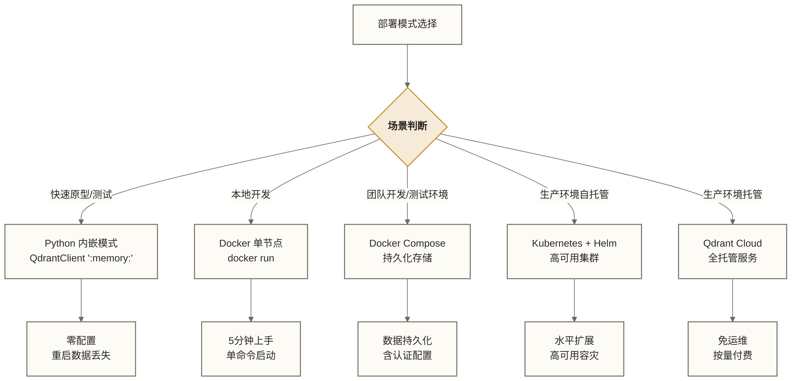
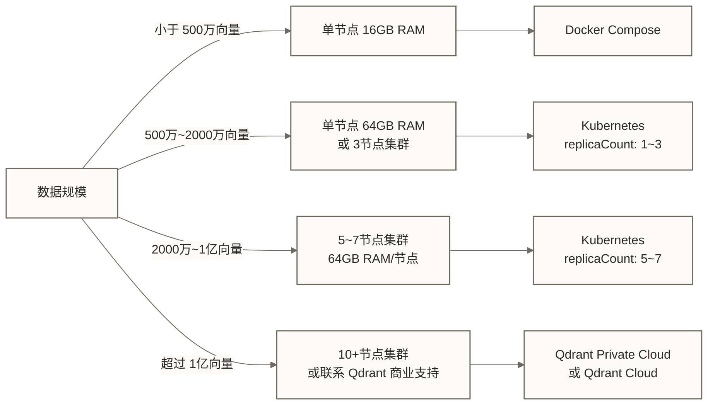

# Qdrant 安装与部署完全指南

> [!tip] 文档定位
> 本文覆盖 Qdrant 从本地开发到生产环境的全部部署模式，包括 Docker、Kubernetes/Helm、托管云服务三大类场景。无论你是快速体验还是搭建高可用集群，都能在这里找到对应方案。

## 目录

- [[#部署模式全景]]
- [[#本地开发环境]]
  - [[#Python 内嵌模式]]
  - [[#Docker 单节点快速启动]]
- [[#生产部署方案]]
  - [[#Docker Compose 持久化部署]]
  - #Kubernetes Helm 部署
  - [[#Qdrant Cloud 托管服务]]
- [[#配置文件详解]]
  - [[#config.yaml 完整参数说明]]
  - [[#TLS 与认证配置]]
- [[#资源规划参考]]
- [[#常见问题排查]]

---

## 部署模式全景

Qdrant 提供从轻量内嵌到企业级集群的完整部署谱系，核心端口设计如下：

| 端口 | 用途 | 说明 |
|------|------|------|
| 6333 | REST API + Web UI | 客户端主要访问端口 |
| 6334 | gRPC API | 高性能低延迟通信 |
| 6335 | 集群内部 Raft 通信 | 不得对外暴露 |



> [!note] 选型建议
> - **学习和演示**：Python 内嵌模式，零依赖，代码即配置
> - **个人项目/小团队**：Docker Compose，5分钟搭建完毕
> - **企业生产**：Kubernetes + Helm，支持水平扩展和滚动升级
> - **不想维护基础设施**：Qdrant Cloud，计费方式以所选套餐的当前条款为准；本文后文采用按 RAM 按小时计费的描述，不应据此认定按向量数量计费。

---

## 本地开发环境

### Python 内嵌模式

Python 内嵌模式是 Qdrant 最轻量的使用方式，无需安装任何服务端组件，数据完全存在内存或本地文件中。适合快速原型验证、单元测试、Notebook 演示等场景。

#### 安装 Python 客户端

```bash
# 基础安装
pip install qdrant-client

# 含 FastEmbed（推荐，内置轻量级向量化能力）
pip install "qdrant-client[fastembed]"

# 含异步支持（用于 async/await 场景）
pip install "qdrant-client[async]"

# 完整安装（含所有可选依赖）
pip install "qdrant-client[fastembed,async]"
```

#### 内存模式（数据不持久化）

```python
from qdrant_client import QdrantClient

# 内存模式：最简单，重启后数据消失
client = QdrantClient(":memory:")

from importlib.metadata import version
print(f"Qdrant 客户端版本: {version('qdrant-client')}")
print("内存模式已就绪，无需启动任何服务")
```

> [!warning] 内存模式注意事项
> 内存模式下所有数据在进程结束后丢失，仅用于测试和演示，不适合需要数据持久化的场景。

#### 本地文件模式（数据持久化）

```python
from qdrant_client import QdrantClient
import os

# 指定本地存储目录
db_path = "./qdrant_local_db"
os.makedirs(db_path, exist_ok=True)

client = QdrantClient(path=db_path)
print(f"本地文件模式已就绪，数据保存至: {db_path}")
```

> [!tip] 文件模式 vs 内存模式
> - `:memory:` — 内存中运行，速度最快，进程结束数据销毁
> - `path="./db"` — 持久化到磁盘，重启后数据保留，适合本地开发

---

### Docker 单节点快速启动

Docker 模式启动完整的 Qdrant 服务端，具备全部 API 能力，是本地开发的推荐方式。

#### 前置要求

```bash
# 验证 Docker 已安装
docker --version
# 期望输出: Docker version 27.x.x

# 确保 Docker Daemon 运行中
docker info | grep "Server Version"
```

#### 最简单启动命令

```bash
# 拉取最新镜像并启动（数据不持久化）
docker run -d \
  --name qdrant \
  -p 6333:6333 \
  -p 6334:6334 \
  qdrant/qdrant

# 验证启动成功
curl http://localhost:6333/
# 期望返回: {"title":"qdrant - vector search engine","version":"..."}
```

#### 带持久化存储启动

```bash
# 数据挂载到宿主机目录
docker run -d \
  --name qdrant \
  -p 6333:6333 \
  -p 6334:6334 \
  -v $(pwd)/qdrant_storage:/qdrant/storage \
  qdrant/qdrant

echo "Web UI 访问地址: http://localhost:6333/dashboard"
```

#### 指定特定版本启动

```bash
# 生产环境建议锁定版本号，避免自动升级带来的不兼容
docker run -d \
  --name qdrant-v1-13 \
  -p 6333:6333 \
  -p 6334:6334 \
  -v $(pwd)/qdrant_storage:/qdrant/storage \
  qdrant/qdrant:v1.13.4

# 查看所有可用版本
# https://hub.docker.com/r/qdrant/qdrant/tags
```

#### 常用 Docker 管理命令

```bash
# 查看运行状态
docker ps | grep qdrant

# 查看实时日志
docker logs -f qdrant

# 停止服务
docker stop qdrant

# 重启服务
docker restart qdrant

# 删除容器（数据保留在挂载目录）
docker rm qdrant

# 进入容器调试
docker exec -it qdrant bash
```

#### 访问 Web UI

Qdrant 内置了图形化管理界面，无需额外安装：

```text
http://localhost:6333/dashboard
```

Web UI 提供以下功能：
- 查看所有 Collection 列表及统计信息
- 可视化浏览和搜索 Points
- 执行 REST API 请求
- 查看集群状态（分布式模式）

---

## 生产部署方案

### Docker Compose 持久化部署

Docker Compose 是中小型项目的理想选择，相比单个 `docker run` 命令，它提供更清晰的配置管理和更方便的启停操作。

#### 基础版 docker-compose.yml

```yaml
# docker-compose.yml
version: "3.8"

services:
  qdrant:
    image: qdrant/qdrant:v1.13.4   # 生产环境锁定版本
    container_name: qdrant
    restart: unless-stopped          # 异常退出自动重启，手动 stop 不重启
    ports:
      - "6333:6333"                  # REST API + Web UI
      - "6334:6334"                  # gRPC API
    volumes:
      - qdrant_storage:/qdrant/storage     # 持久化数据
      - ./config:/qdrant/config:ro         # 自定义配置（只读挂载）
    environment:
      # 基础配置通过环境变量覆盖，优先级高于配置文件
      QDRANT__LOG_LEVEL: INFO
    healthcheck:
      test: ["CMD", "curl", "-f", "http://localhost:6333/healthz"]
      interval: 30s
      timeout: 10s
      retries: 3
      start_period: 30s

volumes:
  qdrant_storage:
    driver: local
```

#### 生产增强版（含认证+资源限制）

```yaml
# docker-compose.prod.yml
version: "3.8"

services:
  qdrant:
    image: qdrant/qdrant:v1.13.4
    container_name: qdrant-prod
    restart: unless-stopped
    ports:
      - "127.0.0.1:6333:6333"        # 绑定到 localhost，通过 Nginx 反代对外暴露
      - "127.0.0.1:6334:6334"        # gRPC 同样只绑定本地
    volumes:
      - qdrant_storage:/qdrant/storage
      - ./config/config.yaml:/qdrant/config/production.yaml:ro
      - ./tls:/qdrant/tls:ro          # TLS 证书目录（若启用 TLS）
    environment:
      # API Key 认证（强烈建议生产环境开启）
      QDRANT__SERVICE__API_KEY: "${QDRANT_API_KEY}"
      # 只读 API Key（用于查询服务，权限隔离）
      QDRANT__SERVICE__READ_ONLY_API_KEY: "${QDRANT_READ_ONLY_KEY}"
      # 日志级别
      QDRANT__LOG_LEVEL: WARN
      # 存储路径（容器内）
      QDRANT__STORAGE__STORAGE_PATH: "/qdrant/storage"
    deploy:
      resources:
        limits:
          cpus: "4.0"                  # 限制最多使用 4 个 CPU 核心
          memory: 8G                   # 限制最大内存 8GB
        reservations:
          cpus: "2.0"                  # 声明 CPU 预留值，是否生效取决于运行模式和调度器
          memory: 4G                   # 声明内存预留值，不构成所有 Compose 环境下的资源保证
    ulimits:
      nofile:
        soft: 65536
        hard: 65536
    healthcheck:
      test: ["CMD", "curl", "-f", "http://localhost:6333/healthz"]
      interval: 30s
      timeout: 10s
      retries: 5
      start_period: 60s
    logging:
      driver: "json-file"
      options:
        max-size: "100m"
        max-file: "5"

  # Nginx 反向代理（可选，用于域名绑定和 TLS 终止）
  nginx:
    image: nginx:1.27-alpine
    container_name: qdrant-nginx
    restart: unless-stopped
    ports:
      - "443:443"
      - "80:80"
    volumes:
      - ./nginx/nginx.conf:/etc/nginx/nginx.conf:ro
      - ./tls:/etc/nginx/tls:ro
    depends_on:
      qdrant:
        condition: service_healthy

volumes:
  qdrant_storage:
    driver: local
    driver_opts:
      type: none
      o: bind
      device: /data/qdrant/storage    # 指向高性能存储挂载点（如 SSD）
```

#### 环境变量文件 .env

```bash
# .env（不要提交到代码仓库！）
QDRANT_API_KEY=your-very-secret-api-key-here-change-me
QDRANT_READ_ONLY_KEY=your-read-only-key-here-change-me
```

#### Nginx 反代配置（nginx/nginx.conf）

```nginx
# nginx/nginx.conf
events {
    worker_connections 1024;
}

http {
    upstream qdrant_backend {
        server qdrant:6333;
    }

    # HTTP 重定向到 HTTPS
    server {
        listen 80;
        server_name qdrant.yourdomain.com;
        return 301 https://$host$request_uri;
    }

    # HTTPS 终止
    server {
        listen 443 ssl http2;
        server_name qdrant.yourdomain.com;

        ssl_certificate     /etc/nginx/tls/cert.pem;
        ssl_certificate_key /etc/nginx/tls/key.pem;
        ssl_protocols       TLSv1.2 TLSv1.3;

        # 传递客户端 API Key
        location / {
            proxy_pass http://qdrant_backend;
            proxy_set_header Host $host;
            proxy_set_header X-Real-IP $remote_addr;
            proxy_set_header X-Forwarded-For $proxy_add_x_forwarded_for;
            proxy_read_timeout 300s;
            proxy_connect_timeout 10s;

            # 限制 Dashboard 访问（仅内网）
            # allow 10.0.0.0/8;
            # deny all;
        }
    }
}
```

#### 启动与管理

```bash
# 首次启动
docker-compose -f docker-compose.prod.yml up -d

# 查看状态
docker-compose -f docker-compose.prod.yml ps

# 查看日志
docker-compose -f docker-compose.prod.yml logs -f qdrant

# 升级版本（修改 image 标签后执行）
docker-compose -f docker-compose.prod.yml pull
docker-compose -f docker-compose.prod.yml up -d

# 停止服务（数据保留）
docker-compose -f docker-compose.prod.yml down

# 完全清理（含数据卷，谨慎操作！）
docker-compose -f docker-compose.prod.yml down -v
```

---

### Kubernetes / Helm 部署

Kubernetes + Helm 是企业生产环境的首选方案，提供水平扩展、自动故障恢复、滚动升级等能力。

#### 前置要求

```bash
# 验证工具版本
kubectl version --client
# 期望: v1.28+

helm version
# 期望: v3.14+

# 验证集群连接
kubectl cluster-info
kubectl get nodes
```

#### 添加 Qdrant Helm 仓库

```bash
# 添加官方 Helm 仓库
helm repo add qdrant https://qdrant.github.io/qdrant-helm

# 更新仓库索引
helm repo update

# 查看可用版本
helm search repo qdrant/qdrant --versions | head -10

# 查看默认 values
helm show values qdrant/qdrant > qdrant-default-values.yaml
```

#### 创建命名空间

```bash
# 为 Qdrant 创建独立命名空间
kubectl create namespace qdrant

# 查看命名空间
kubectl get ns qdrant
```

#### 创建 API Key Secret

```bash
# 创建包含 API Key 的 Secret（安全方式，不在 values.yaml 明文存储）
kubectl create secret generic qdrant-apikey \
  --from-literal=api-key="your-super-secret-api-key" \
  --from-literal=read-only-api-key="your-read-only-api-key" \
  --namespace qdrant
```

#### 生产级 values.yaml

```yaml
# qdrant-values.yaml
# Qdrant Helm Chart 生产配置
# helm install qdrant qdrant/qdrant -n qdrant -f qdrant-values.yaml

# ============================================================
# 副本数量（单节点开发用 1，生产建议 3+）
# ============================================================
replicaCount: 3

# ============================================================
# 镜像配置
# ============================================================
image:
  repository: qdrant/qdrant
  tag: "v1.13.4"        # 生产环境锁定版本
  pullPolicy: IfNotPresent

# ============================================================
# Qdrant 业务配置
# ============================================================
config:
  cluster:
    enabled: true         # 多副本必须开启集群模式
    p2p:
      port: 6335          # 集群内部通信端口

  service:
    # API Key 认证（从 Secret 读取，推荐）
    api_key: ""           # 留空，通过 env 变量注入

  storage:
    # 将未建立 Payload 索引的 Payload 数据放在磁盘，减少内存占用
    on_disk_payload: true

    # HNSW 索引全局默认配置（可被每个 Collection 覆盖）
    hnsw_index:
      m: 16                 # 图连接数参数，影响召回率、内存和构建开销
      ef_construct: 100     # 构建索引时的候选集大小
      full_scan_threshold: 10000  # 全扫描阈值，单位为 KB，不是向量条数

    # 优化器配置
    optimizers:
      deleted_threshold: 0.2      # 删除比例阈值，结合其他优化条件使用
      vacuum_min_vector_number: 1000
      default_segment_number: 0   # 0 表示自动

# ============================================================
# 资源限制（根据数据量和 QPS 调整）
# ============================================================
resources:
  requests:
    cpu: "2"
    memory: "4Gi"
  limits:
    cpu: "4"
    memory: "8Gi"

# ============================================================
# 持久化存储
# ============================================================
persistence:
  enabled: true
  storageClassName: "premium-rwo"    # 使用 SSD StorageClass
  size: "100Gi"                      # 根据向量数据量估算
  accessMode: ReadWriteOnce

# ============================================================
# API Key 从 Secret 注入
# ============================================================
extraEnv:
  - name: QDRANT__SERVICE__API_KEY
    valueFrom:
      secretKeyRef:
        name: qdrant-apikey
        key: api-key
  - name: QDRANT__SERVICE__READ_ONLY_API_KEY
    valueFrom:
      secretKeyRef:
        name: qdrant-apikey
        key: read-only-api-key
  - name: QDRANT__LOG_LEVEL
    value: "WARN"

# ============================================================
# Service 配置
# ============================================================
service:
  type: ClusterIP          # 内部服务，通过 Ingress 对外暴露
  ports:
    rest: 6333
    grpc: 6334
    p2p: 6335

# ============================================================
# Ingress 配置（通过域名访问）
# ============================================================
ingress:
  enabled: true
  ingressClassName: nginx
  annotations:
    nginx.ingress.kubernetes.io/proxy-read-timeout: "300"
    nginx.ingress.kubernetes.io/proxy-body-size: "50m"
    cert-manager.io/cluster-issuer: "letsencrypt-prod"
  hosts:
    - host: qdrant.yourdomain.com
      paths:
        - path: /
          pathType: Prefix
  tls:
    - secretName: qdrant-tls
      hosts:
        - qdrant.yourdomain.com

# ============================================================
# Pod 反亲和性（让副本分散到不同节点）
# ============================================================
affinity:
  podAntiAffinity:
    preferredDuringSchedulingIgnoredDuringExecution:
      - weight: 100
        podAffinityTerm:
          labelSelector:
            matchExpressions:
              - key: app
                operator: In
                values:
                  - qdrant
          topologyKey: kubernetes.io/hostname

# ============================================================
# Pod 中断预算（保证升级时最少保留副本数）
# ============================================================
podDisruptionBudget:
  enabled: true
  minAvailable: 2           # 至少保持 2 个副本在线

# ============================================================
# 探针配置
# ============================================================
livenessProbe:
  httpGet:
    path: /healthz
    port: 6333
  initialDelaySeconds: 30
  periodSeconds: 30
  timeoutSeconds: 10
  failureThreshold: 3

readinessProbe:
  httpGet:
    path: /readyz
    port: 6333
  initialDelaySeconds: 10
  periodSeconds: 10
  timeoutSeconds: 5
  failureThreshold: 3

# ============================================================
# 节点选择器（可选，让 Qdrant 跑在特定节点）
# ============================================================
nodeSelector: {}
  # node-type: vector-db    # 取消注释以启用节点选择

tolerations: []

# ============================================================
# 监控（Prometheus ServiceMonitor）
# ============================================================
metrics:
  serviceMonitor:
    enabled: true           # 需要安装 kube-prometheus-stack
    interval: 30s
```

#### 执行部署

```bash
# 首次安装
helm install qdrant qdrant/qdrant \
  --namespace qdrant \
  --values qdrant-values.yaml \
  --wait \
  --timeout 5m

# 验证部署
kubectl get all -n qdrant
kubectl get pods -n qdrant -w

# 查看 Pod 日志
kubectl logs -n qdrant -l app.kubernetes.io/name=qdrant -f

# 端口转发到本地（测试用）
kubectl port-forward -n qdrant svc/qdrant 6333:6333
curl http://localhost:6333/

# 升级（修改 values.yaml 后执行）
helm upgrade qdrant qdrant/qdrant \
  --namespace qdrant \
  --values qdrant-values.yaml

# 查看升级历史
helm history qdrant -n qdrant

# 回滚到修订号 1；若需上一修订，请先通过 helm history 确认目标修订号
helm rollback qdrant 1 -n qdrant

# 卸载（数据 PVC 默认保留）
helm uninstall qdrant -n qdrant
```

#### 存储容量规划

```bash
# 查看 PVC 状态
kubectl get pvc -n qdrant

# PVC 扩容（需要 StorageClass 支持动态扩容）
kubectl patch pvc qdrant-storage-qdrant-0 \
  -n qdrant \
  --type merge \
  -p '{"spec":{"resources":{"requests":{"storage":"200Gi"}}}}'
```

#### 集群健康检查

```bash
# 通过 REST API 检查集群状态
kubectl exec -n qdrant qdrant-0 -- \
  curl -s http://localhost:6333/cluster | python3 -m json.tool

# 期望输出（3 副本集群示例）:
# {
#   "result": {
#     "status": "enabled",
#     "peer_id": 123456,
#     "peers": {
#       "123456": {"uri": "http://qdrant-0.qdrant-headless:6335/"},
#       "789012": {"uri": "http://qdrant-1.qdrant-headless:6335/"},
#       "345678": {"uri": "http://qdrant-2.qdrant-headless:6335/"}
#     },
#     "raft_info": {
#       "term": 1,
#       "commit": 42,
#       "leader": 123456
#     }
#   }
# }
```

---

### Qdrant Cloud 托管服务

Qdrant Cloud 是官方提供的全托管向量数据库服务，适合不想运维基础设施的团队。

#### 特点对比

| 维度 | 自托管 | Qdrant Cloud |
|------|--------|--------------|
| 运维成本 | 高 | 几乎为零 |
| 启动速度 | 需要配置 | 1分钟内 |
| 可控性 | 完全可控 | 有限 |
| 合规性 | 数据不出境 | 依赖云服务商 |
| 成本模式 | 固定服务器费用 | 按 RAM 按小时计费 |
| 免费额度 | 无 | 若当前套餐提供 1GB 免费额度，可用于试验；适用条件和有效期以服务条款为准 |

#### 注册和创建集群

```bash
# 1. 访问 https://cloud.qdrant.io 注册账号
# 2. 创建新集群，选择云服务商和地区
# 3. 获取连接信息：
#    - Cluster URL: https://your-cluster-id.us-east4-0.gcp.cloud.qdrant.io
#    - API Key: 在控制台生成

# 4. 验证连接
curl -H "api-key: your-api-key" \
  https://your-cluster-id.us-east4-0.gcp.cloud.qdrant.io/healthz
```

#### Python 客户端连接 Cloud

```python
from qdrant_client import QdrantClient

# 连接 Qdrant Cloud
client = QdrantClient(
    url="https://your-cluster-id.us-east4-0.gcp.cloud.qdrant.io",
    api_key="your-qdrant-cloud-api-key",
    timeout=30,           # 网络延迟稍大，适当增加超时
    prefer_grpc=True,     # 使用 gRPC 提升性能
)

# 验证连接
collections = client.get_collections()
print(f"Cloud 连接成功，当前 Collection 数: {len(collections.collections)}")
```

> [!tip] Cloud 免费套餐
> 若当前套餐提供 1GB 免费集群，可用于个人项目和 MVP 验证，额度及有效期以服务条款为准。以 100 万条 768 维 float32 向量为容量假设，仅裸向量数据就约需 2.86GiB，尚未包含索引和 Payload，不能据此承诺 1GB 足够；本文后续表格列出的 all-MiniLM-L6-v2 维度为 384。

---

## 配置文件详解

### config.yaml 完整参数说明

Qdrant 通过 `config/config.yaml` 管理所有配置项，环境变量（`QDRANT__SECTION__KEY`格式）可覆盖任意配置项。

#### 完整配置模板

```yaml
# /qdrant/config/config.yaml
# Qdrant 完整配置参考（含注释）

# ============================================================
# 日志配置
# ============================================================
log_level: INFO       # 可选: TRACE, DEBUG, INFO, WARN, ERROR

# ============================================================
# 存储配置
# ============================================================
storage:
  # 数据主存储路径（容器内路径）
  storage_path: ./storage

  # 快照存储路径（用于备份和恢复）
  snapshots_path: ./snapshots

  # 暂存路径（上传临时文件）
  temp_path: ./tmp

  # Payload 存储策略
  # true: Payload 存储在磁盘（内存友好）
  # false: Payload 存储在内存（读取更快）
  on_disk_payload: false

  # ========================================================
  # HNSW 索引全局默认配置
  # 可被每个 Collection 的 hnsw_config 参数覆盖
  # ========================================================
  hnsw_index:
    # 每个节点的最大连接数
    # 值域: 4 ~ 10000，推荐: 16（平衡精度和内存）
    # 增大 m 提升精度，但内存消耗和构建时间同比增长
    m: 16

    # 构建索引时的候选集大小（ef_construction）
    # 越大索引质量越好，构建越慢
    # 推荐: 100
    ef_construct: 100

    # 全扫描阈值，单位为 KB；不是向量条数，也不是业务检索准确率保证
    full_scan_threshold: 10000

    # 最大并行索引构建线程数
    # 0: 自动（根据 CPU 核数决定）
    max_indexing_threads: 0

    # 是否将 HNSW 图存储在磁盘（降低内存占用，增加查询延迟）
    on_disk: false

    # Payload 索引的专用 m 参数（可选，默认与 m 相同）
    # payload_m: null

  # ========================================================
  # WAL（Write-Ahead Log）配置
  # ========================================================
  wal:
    # WAL 每个文件的大小（MB）
    # 较大的值减少文件数量，较小的值加快恢复速度
    wal_capacity_mb: 32

    # WAL 段数量
    # 较多的段允许更高的写入并发
    wal_segments_ahead: 0

  # ========================================================
  # 优化器配置
  # ========================================================
  optimizers:
    # 已删除向量占比超过此阈值时触发压缩（清理墓碑）
    # 0.0 ~ 1.0，推荐 0.2
    deleted_threshold: 0.2

    # 触发 Vacuum 的最小向量数量
    vacuum_min_vector_number: 1000

    # 默认 Segment 数量（0 = 自动）
    default_segment_number: 0

    # 优化器目标 Segment 大小上限，单位为 KB，不是向量条数
    # null = 使用服务端默认策略
    max_segment_size: null

    # 向量存储切换到内存映射的容量阈值，单位为 KB，不是向量条数
    memmap_threshold: null

    # 建立向量索引的容量阈值，单位为 KB，不是向量条数
    # 未建立索引时可使用全扫描；这不等于业务检索准确率为 100%
    indexing_threshold: 20000

    # Flush 间隔（秒）
    # 控制数据写入磁盘的频率，越小越安全，越大吞吐越高
    flush_interval_sec: 5

    # 最大同时运行的优化任务数
    max_optimization_threads: 1

  # ========================================================
  # 量化配置（降低内存占用，可能略微降低精度）
  # ========================================================
  quantization: null    # 全局默认不启用量化
  # 若要启用 Scalar 量化:
  # quantization:
  #   scalar:
  #     type: int8
  #     quantile: 0.99
  #     always_ram: true

# ============================================================
# 服务配置
# ============================================================
service:
  # 监听地址（0.0.0.0 接受所有网络接口）
  host: 0.0.0.0

  # HTTP REST API 端口
  http_port: 6333

  # gRPC 端口（null = 禁用 gRPC）
  grpc_port: 6334

  # 最大请求体大小（MB）
  max_request_size_mb: 32

  # API Key 认证
  api_key: null            # 生产环境必须设置！
  read_only_api_key: null  # 只读 API Key（可选）

  # 跨域资源共享配置（null = 禁用 CORS）
  cors_allow_origin: null  # 如需开启：设置为 "*" 或具体域名

  # JWT RBAC 认证（Enterprise 功能）
  jwt_rbac: false

  # gRPC TLS 支持
  enable_tls: false

# ============================================================
# 集群配置（分布式模式）
# ============================================================
cluster:
  # 是否启用集群模式
  enabled: false

  # P2P 通信配置
  p2p:
    port: 6335

  # Consensus（共识算法）配置
  consensus:
    # 心跳超时（毫秒）
    tick_period_ms: 100

    # 引导超时（秒）
    bootstrap_timeout_sec: 10

# ============================================================
# TLS 配置（若 service.enable_tls: true 则必须配置）
# ============================================================
tls:
  # 证书文件路径
  cert: ./tls/cert.pem

  # 私钥文件路径
  key: ./tls/key.pem

  # CA 证书路径（用于客户端证书验证，可选）
  # ca_cert: ./tls/ca.pem

  # TLS 版本要求
  # tls_config: null
```

#### 环境变量覆盖规则

配置项的层级用 `__` 连接，作为环境变量名前缀 `QDRANT__`：

```bash
# 等价配置示例
# config.yaml:              service.api_key: "secret"
# 环境变量:                 QDRANT__SERVICE__API_KEY=secret

# config.yaml:              storage.hnsw_index.m: 32
# 环境变量:                 QDRANT__STORAGE__HNSW_INDEX__M=32

# config.yaml:              cluster.enabled: true
# 环境变量:                 QDRANT__CLUSTER__ENABLED=true
```

> [!tip] 环境变量优先级
> 环境变量的优先级高于配置文件中的同名配置项，这使得你可以在 CI/CD 或 Kubernetes 中灵活覆盖配置，而不需要修改配置文件本身。

---

### TLS 与认证配置

#### 生成自签名证书（开发测试用）

```bash
# 创建证书目录
mkdir -p tls

# 生成私钥
openssl genrsa -out tls/key.pem 2048

# 生成自签名证书（有效期 365 天）
openssl req -new -x509 \
  -key tls/key.pem \
  -out tls/cert.pem \
  -days 365 \
  -subj "/C=CN/ST=Beijing/L=Beijing/O=MyCompany/CN=qdrant.local" \
  -addext "subjectAltName=DNS:qdrant.local,IP:127.0.0.1"

# 验证证书
openssl x509 -in tls/cert.pem -text -noout | grep -E "Subject:|Validity"
```

#### 启用 TLS 的 Docker 运行命令

```bash
docker run -d \
  --name qdrant-tls \
  -p 6333:6333 \
  -p 6334:6334 \
  -v $(pwd)/qdrant_storage:/qdrant/storage \
  -v $(pwd)/tls:/qdrant/tls:ro \
  -e QDRANT__SERVICE__ENABLE_TLS=1 \
  -e QDRANT__TLS__CERT=/qdrant/tls/cert.pem \
  -e QDRANT__TLS__KEY=/qdrant/tls/key.pem \
  -e QDRANT__SERVICE__API_KEY=your-secret-key \
  qdrant/qdrant

# 验证 HTTPS 访问（自签名证书需要 -k 跳过验证）
curl -k -H "api-key: your-secret-key" https://localhost:6333/
```

#### Python 客户端连接带 TLS 的实例

```python
from qdrant_client import QdrantClient

# 连接启用了 TLS 和 API Key 的自托管实例
client = QdrantClient(
    host="qdrant.yourdomain.com",
    port=6333,
    https=True,
    api_key="your-secret-key",
    # 自签名证书需要跳过验证（生产环境不推荐）
    # verify=False,
    # 或者指定 CA 证书
    # verify="/path/to/ca.pem",
)
```

#### 认证方式对比

| 认证方式 | 适用场景 | 配置复杂度 | 安全级别 |
|---------|---------|-----------|---------|
| 无认证 | 纯内网开发 | 无需配置 | 低 |
| API Key | 大多数场景 | 简单 | 中 |
| 只读 API Key | 查询服务隔离 | 简单 | 中 |
| TLS + API Key | 公网暴露 | 需要证书 | 高 |
| JWT RBAC | 企业多租户 | 复杂 | 最高 |

---

## 资源规划参考

合理的资源规划是稳定运行的基础，以下是根据向量数量估算资源需求的参考公式。

### 内存估算

```markdown
# 向量内存占用估算公式
内存(GB) = 向量数量 × 维度数 × 字节数 / 1024^3

# 常见模型的估算示例（以 100 万向量为基准）
```

| 模型 | 维度 | 单向量大小 | 100万向量内存 | 含HNSW索引内存 |
|------|------|-----------|-------------|----------------|
| all-MiniLM-L6-v2 | 384 | 1.5 KB | ~1.5 GB | ~3 GB |
| all-mpnet-base-v2 | 768 | 3 KB | ~3 GB | ~6 GB |
| text-embedding-3-small | 1536 | 6 KB | ~6 GB | ~12 GB |
| text-embedding-3-large | 3072 | 12 KB | ~12 GB | ~24 GB |

> [!warning] 内存规划原则
> - HNSW 索引本身占用约等于向量数据 1~2 倍的内存
> - Payload 数据需要额外内存（大小取决于 Payload 内容）
> - 建议预留 20%~30% 的内存余量用于系统和缓存
> - 生产环境总内存 = 估算值 × 2.5（包含索引 + Payload + 系统余量）

### CPU 规划

| 场景 | 推荐 CPU | 说明 |
|------|---------|------|
| 纯查询 | 4~8 核 | 向量搜索高度并行 |
| 写入密集 | 8~16 核 | 索引构建消耗 CPU |
| 混合读写 | 8~16 核 | 均衡分配 |
| 大规模集群单节点 | 16~32 核 | 建议使用分布式 |

### 磁盘 I/O 要求

```text
推荐磁盘类型: NVMe SSD（最优）> SATA SSD > HDD（不推荐）

最低 IOPS 要求:
  - 写入密集: 10,000+ IOPS
  - 读取密集: 5,000+ IOPS
  - 混合场景: 8,000+ IOPS

不支持的存储类型:
  - NFS（网络文件系统）
  - S3/对象存储（不支持直接挂载）
  - iSCSI 支持（需验证）
```

### 节点规模建议



---

## 常见问题排查

### 启动失败排查

```bash
# 查看详细错误日志
docker logs qdrant 2>&1 | tail -50

# 常见错误 1: 端口已占用
# Error: Address already in use (os error 98)
lsof -i :6333     # macOS/Linux
netstat -ano | findstr 6333  # Windows
# 解决: 停止占用端口的进程，或修改 Qdrant 端口

# 常见错误 2: 存储路径权限不足
# Error: Permission denied (os error 13)
ls -la ./qdrant_storage    # 检查目录权限
chmod 755 ./qdrant_storage # 修复权限
# 或在 Docker 中指定用户
docker run --user 1000:1000 ...

# 常见错误 3: 内存不足
# Error: Cannot allocate memory (os error 12)
free -h    # 检查可用内存
# 解决: 增加内存，或调整 HNSW 参数降低内存占用
```

### 性能问题排查

```bash
# 检查集合的索引状态（indexed_vectors_count 应接近 vectors_count）
curl http://localhost:6333/collections/my_collection | python3 -m json.tool

# 输出示例中关注这些字段:
# "status": "green"                    -- 绿色表示健康
# "vectors_count": 1000000             -- 总向量数
# "indexed_vectors_count": 1000000     -- 已建索引向量数
# "optimizer_status": {"ok": true}     -- 优化器状态

# 原强制优化命令没有有效接口依据，以下仅保留为不可执行的原示例。
# 不要用它修复索引延迟；应结合目标服务端版本的优化器配置和日志判断。
# curl -X POST http://localhost:6333/collections/my_collection/index \
#   -H "Content-Type: application/json" \
#   -d '{"wait": true}'
```

### Kubernetes 常见问题

```bash
# Pod 无法调度（资源不足）
kubectl describe pod -n qdrant qdrant-0 | grep -A 10 "Events:"
# 解决: 检查节点资源，或降低资源请求

# PVC Pending 状态
kubectl describe pvc -n qdrant qdrant-storage-qdrant-0
# 常见原因: StorageClass 不存在，或没有可用节点满足存储要求

# 查看 Qdrant 集群内部通信状态
kubectl exec -n qdrant qdrant-0 -- curl -s http://localhost:6333/cluster
```

---

## 相关文档

- Qdrant 学习路线图 — 全局学习路径
- 核心概念详解 — Collection、Point、Payload 等概念
- 第一个 Qdrant 应用 — 基于本文部署环境的实战开发
- Milvus 安装对比 — 两款主流向量数据库部署方式对比
- 向量数据库选型指南 — 选型决策框架

#Qdrant #向量数据库 #Docker #Kubernetes #Helm #部署运维
