# 第一个 Qdrant 应用：从零构建语义搜索引擎

> [!tip] 文档定位
> 本文是面向初学者的动手实践教程，带你从零构建一个完整的文章语义搜索系统。通过 Python 示例覆盖连接、创建、写入、搜索、过滤的完整操作链路；部分片段依赖前文初始化，FastAPI 集成及性能调优片段还需结合维护说明补齐运行条件，不能视为全部可直接运行。

## 目录

- [[#应用概述与目标]]
- [[#环境准备]]
- [[#连接 Qdrant]]
- [[#创建 Collection]]
- [[#数据准备与向量化]]
- [[#批量插入数据]]
- [[#基础向量搜索]]
- [[#带 Payload 过滤的搜索]]
- [[#异步操作模式]]
- [[#完整端到端示例：文章语义搜索系统]]
- [[#常见操作速查]]
- [[#性能调优建议]]

---

## 应用概述与目标

### 我们要构建什么

本文将从零构建一个**文章语义搜索引擎**。给定一段自然语言查询（如"如何优化 Spark 性能"），系统能够从文章库中找到语义最相近的内容，即使文章中没有出现查询中的关键词。

```mermaid
%%{init: {"theme":"base","themeVariables":{"fontFamily":"PingFang SC, -apple-system, Source Han Serif SC, serif","fontSize":"16px","background":"#FDFBF5","primaryColor":"#FDFBF5","primaryTextColor":"#2D2A26","primaryBorderColor":"#6E6A60","secondaryColor":"#E8EFE8","secondaryBorderColor":"#8FA890","secondaryTextColor":"#2D2A26","tertiaryColor":"#FDFBF5","tertiaryBorderColor":"#9A9488","tertiaryTextColor":"#6E6A60","lineColor":"#6E6A60","textColor":"#2D2A26","mainBkg":"#FDFBF5","nodeBorder":"#2D5A3D","clusterBkg":"#F3EEDF","clusterBorder":"#9A9488","edgeLabelBackground":"#FDFBF5"},"flowchart":{"htmlLabels":true,"curve":"basis","padding":20,"nodeSpacing":60,"rankSpacing":70,"useMaxWidth":false},"themeCSS":".node rect, .node polygon, .node circle { stroke-width: 1.5px; } .edgePath .path { stroke-width: 1.5px; } .cluster-label .nodeLabel, .cluster-label foreignObject { color: #2D2A26 !important; } .edgeLabel, .edgeLabel foreignObject { color: #2D2A26 !important; background-color: #FDFBF5; } .edgeLabel rect { fill: #FDFBF5; }"}}%%
graph LR
    classDef default fill:#FDFBF5,stroke:#6E6A60,color:#2D2A26,stroke-width:1.5px
    classDef startend fill:#2D2A26,stroke:#2D2A26,color:#FDFBF5,font-weight:bold
    classDef decision fill:#F6EAD8,stroke:#C08A1A,color:#2D2A26,font-weight:bold
    classDef hub fill:#3B5A80,stroke:#3B5A80,color:#FDFBF5,font-weight:bold
    classDef io fill:#E5EAF0,stroke:#3B5A80,color:#2D2A26
    classDef accent fill:#A6432C,stroke:#A6432C,color:#FDFBF5,font-weight:bold
    classDef storage fill:#F3EEDF,stroke:#9A9488,color:#2D2A26
    A[原始文章文本] --> B[sentence-transformers<br/>向量化模型]
    B --> C[384维浮点向量]
    C --> D[Qdrant Collection<br/>存储向量+Payload]

    E[用户输入查询] --> F[同一向量化模型]
    F --> G[查询向量]
    G --> H[Qdrant 向量搜索<br/>余弦相似度]
    H --> I[Top-K 相关文章]
    D --> H
    class A,B,C,D,E,F,G,H,I default
```



### 技术选型说明

| 组件 | 选型 | 原因 |
|------|------|------|
| 向量数据库 | Qdrant（本地内嵌模式） | 零配置，适合教学 |
| 向量化模型 | all-MiniLM-L6-v2 | 384维，体积小，精度好 |
| Python 客户端 | qdrant-client 1.x | 官方维护，API 最完整 |
| 距离度量 | Cosine（余弦相似度） | 文本语义匹配的标准选择 |

> [!note] 为什么选择语义搜索而不是关键词搜索？
> 关键词搜索（如 Elasticsearch 的 BM25）依赖词语的字面匹配。语义搜索通过向量空间中的距离衡量含义的接近程度。例如查询"服务器挂了"，语义搜索可能匹配包含"节点宕机"、"实例不可用"的文章，效果取决于模型和语料；仅依赖字面词项的关键词搜索可能漏检，但配置同义词或查询扩展后也可能匹配这些表达。

---

## 环境准备

### 系统要求

```text
Python 版本: 3.8+（推荐 3.11+）
内存:       最低 2GB（模型加载约占 100~500MB）
磁盘:       最低 500MB（模型下载）
网络:       首次运行需要下载模型（约 90MB）
```

### 创建虚拟环境

```bash
# 创建项目目录
mkdir qdrant-semantic-search
cd qdrant-semantic-search

# 创建虚拟环境（推荐，避免依赖污染）
python -m venv .venv

# 激活虚拟环境
# macOS / Linux:
source .venv/bin/activate

# Windows:
.venv\Scripts\activate

# 验证 Python 环境
python --version
which python    # macOS/Linux
```

### 安装依赖

```bash
# 方式一：最小化安装（推荐入门）
pip install qdrant-client sentence-transformers

# 方式二：仅供使用 FastEmbed 的其他实现；本文后续代码使用 SentenceTransformer，仍需安装 sentence-transformers
pip install "qdrant-client[fastembed]"

# 方式三：完整安装（异步 + FastEmbed + gRPC）
pip install "qdrant-client[fastembed,async]" sentence-transformers numpy

# 验证安装
python -c "from importlib.metadata import version; print('qdrant-client:', version('qdrant-client'))"
python -c "from sentence_transformers import SentenceTransformer; print('sentence-transformers: OK')"
```

### 创建 requirements.txt

```text
# requirements.txt
qdrant-client>=1.7.0
sentence-transformers>=2.7.0
numpy>=1.24.0
```

```bash
# 根据 requirements.txt 安装
pip install -r requirements.txt
```

> [!warning] 首次运行下载模型
> 第一次使用 `SentenceTransformer("all-MiniLM-L6-v2")` 时，会自动从 Hugging Face 下载约 90MB 的模型文件。国内环境可能需要设置镜像代理：
> ```bash
> export HF_ENDPOINT=https://hf-mirror.com
> ```

---

## 连接 Qdrant

Qdrant 支持三种连接方式，开发和生产场景各有不同的最优选择。

### 方式一：内存模式（最简单）

```python
# connect_memory.py
from qdrant_client import QdrantClient

# 内存模式：无需任何服务端，数据存在内存中
# 进程结束后数据销毁
client = QdrantClient(":memory:")

print("内存模式连接成功")
from importlib.metadata import version
print(f"客户端版本: {version('qdrant-client')}")

# 验证：列出所有 Collection
collections = client.get_collections()
print(f"当前 Collection 数量: {len(collections.collections)}")
```

### 方式二：本地 Docker 服务

```python
# connect_local.py
from qdrant_client import QdrantClient

# 连接本地 Docker 运行的 Qdrant 实例
# 前提：docker run -p 6333:6333 -p 6334:6334 qdrant/qdrant
client = QdrantClient(
    host="localhost",
    port=6333,
    # 若启用了 gRPC，可以使用以下参数提升性能
    # prefer_grpc=True,
    # grpc_port=6334,
    timeout=10,    # 连接超时（秒）
)

# 也可以使用 URL 方式
# client = QdrantClient(url="http://localhost:6333")

try:
    # 健康检查
    result = client.get_collections()
    print(f"本地 Qdrant 连接成功")
    print(f"当前 Collection 数: {len(result.collections)}")
except Exception as e:
    print(f"连接失败，请检查 Qdrant 是否已启动: {e}")
    print("启动命令: docker run -p 6333:6333 qdrant/qdrant")
```

### 方式三：Qdrant Cloud 托管服务

```python
# connect_cloud.py
from qdrant_client import QdrantClient
import os

# 从环境变量读取凭证（安全实践，不硬编码密钥）
QDRANT_URL = os.getenv("QDRANT_URL", "https://your-cluster.cloud.qdrant.io")
QDRANT_API_KEY = os.getenv("QDRANT_API_KEY", "your-api-key-here")

client = QdrantClient(
    url=QDRANT_URL,
    api_key=QDRANT_API_KEY,
    timeout=30,         # Cloud 网络延迟稍大
    prefer_grpc=True,   # gRPC 在 Cloud 场景性能更好
)

try:
    info = client.get_collections()
    print(f"Qdrant Cloud 连接成功: {QDRANT_URL}")
    print(f"当前 Collection 数: {len(info.collections)}")
except Exception as e:
    print(f"Cloud 连接失败: {e}")
```

### 连接器工厂函数（推荐封装方式）

```python
# qdrant_helper.py
from qdrant_client import QdrantClient
from typing import Optional
import os

def get_qdrant_client(
    mode: str = "memory",
    host: str = "localhost",
    port: int = 6333,
    url: Optional[str] = None,
    api_key: Optional[str] = None,
    local_path: Optional[str] = None,
) -> QdrantClient:
    """
    工厂函数：根据模式创建 Qdrant 客户端

    Args:
        mode: "memory" | "local" | "cloud" | "file"
        host: 本地服务 host（mode="local"）
        port: 本地服务端口（mode="local"）
        url: 完整 URL（mode="cloud"）
        api_key: API Key（mode="cloud" 或本地启用认证时）
        local_path: 本地文件路径（mode="file"）

    Returns:
        已初始化的 QdrantClient 实例
    """
    if mode == "memory":
        client = QdrantClient(":memory:")
        print("[Qdrant] 内存模式就绪")

    elif mode == "file":
        path = local_path or "./qdrant_data"
        client = QdrantClient(path=path)
        print(f"[Qdrant] 文件模式就绪: {path}")

    elif mode == "local":
        client = QdrantClient(host=host, port=port, api_key=api_key)
        print(f"[Qdrant] 本地服务连接: http://{host}:{port}")

    elif mode == "cloud":
        client = QdrantClient(
            url=url or os.getenv("QDRANT_URL"),
            api_key=api_key or os.getenv("QDRANT_API_KEY"),
            timeout=30,
            prefer_grpc=True,
        )
        print(f"[Qdrant] Cloud 连接: {url}")

    else:
        raise ValueError(f"不支持的连接模式: {mode}")

    return client


# 使用示例
if __name__ == "__main__":
    # 开发环境使用内存模式
    client = get_qdrant_client(mode="memory")
```

---

## 创建 Collection

Collection 是 Qdrant 中存储向量的基本单元，类似关系型数据库的"表"。创建时需要指定向量的维度和距离度量方式。

### 基础 Collection 创建

```python
# create_collection.py
from qdrant_client import QdrantClient
from qdrant_client.models import (
    VectorParams,
    Distance,
)

client = QdrantClient(":memory:")

COLLECTION_NAME = "articles"
VECTOR_SIZE = 384         # all-MiniLM-L6-v2 输出维度
DISTANCE = Distance.COSINE  # 文本语义搜索推荐使用余弦相似度

# 创建 Collection
client.create_collection(
    collection_name=COLLECTION_NAME,
    vectors_config=VectorParams(
        size=VECTOR_SIZE,
        distance=DISTANCE,
    ),
)

# 验证创建结果
collection_info = client.get_collection(COLLECTION_NAME)
print(f"Collection '{COLLECTION_NAME}' 创建成功")
print(f"  向量维度: {collection_info.config.params.vectors.size}")
print(f"  距离度量: {collection_info.config.params.vectors.distance}")
print(f"  当前向量数: {collection_info.points_count}")
```

### vectors_config 参数详解

```python
# vectors_config_explained.py
from qdrant_client.models import VectorParams, Distance, HnswConfigDiff, QuantizationConfig, ScalarQuantization, ScalarType

# 完整配置示例（生产环境推荐）
client.create_collection(
    collection_name="articles_advanced",
    vectors_config=VectorParams(
        # ====================================================
        # 必填参数
        # ====================================================
        # 向量维度（必须与实际嵌入模型输出维度一致）
        # 常见维度: 384（MiniLM）、768（BERT）、1536（OpenAI small）
        size=384,

        # 距离度量方式
        # Distance.COSINE  — 余弦相似度，文本/图像最常用
        # Distance.EUCLID  — 欧式距离，坐标/回归场景
        # Distance.DOT     — 点积，已归一化的向量（更快）
        # Distance.MANHATTAN — 曼哈顿距离
        distance=Distance.COSINE,

        # ====================================================
        # 可选参数
        # ====================================================
        # 是否将向量存储到磁盘（降低内存占用，增加查询延迟）
        # on_disk=False,    # 默认 False（内存中）

        # HNSW 索引配置（覆盖全局默认值）
        # hnsw_config=HnswConfigDiff(
        #     m=16,              # 节点连接数（精度/内存权衡）
        #     ef_construct=100,  # 构建时候选集
        #     full_scan_threshold=10000,  # 小数据集暴力扫描阈值
        #     on_disk=False,     # HNSW 图是否存磁盘
        # ),

        # 量化配置（压缩内存，可能略降低精度）
        # quantization_config=ScalarQuantization(
        #     scalar=ScalarQuantizationConfig(
        #         type=ScalarType.INT8,   # float32 转 int8 的理论单元素存储减少 75%，不代表总内存减少 75%
        #         quantile=0.99,
        #         always_ram=True,        # 量化后的向量保持在内存中
        #     )
        # ),
    ),
)
```

### 多向量 Collection（高级）

```python
# multi_vector_collection.py
from qdrant_client.models import VectorParams, Distance

# 同一个 Collection 支持多个向量字段（如：文本向量 + 图像向量）
client.create_collection(
    collection_name="multimodal_articles",
    vectors_config={
        # 文本语义向量
        "text": VectorParams(size=384, distance=Distance.COSINE),
        # 图像向量（如 CLIP 模型输出）
        "image": VectorParams(size=512, distance=Distance.COSINE),
        # 标题向量（单独建索引，提升标题匹配准确性）
        "title": VectorParams(size=384, distance=Distance.COSINE),
    },
)

print("多向量 Collection 创建成功")
```

### 删除和重建 Collection

```python
# manage_collection.py
from qdrant_client.models import VectorParams, Distance

COLLECTION_NAME = "articles"

# 检查 Collection 是否存在
def collection_exists(client, name: str) -> bool:
    collections = client.get_collections().collections
    return any(c.name == name for c in collections)

# 破坏性重建（先删除再创建，会删除已有数据；仅用于可丢弃的练习数据或已备份场景）
def recreate_collection(client, name: str, vector_size: int):
    if collection_exists(client, name):
        print(f"删除已有 Collection: {name}")
        client.delete_collection(name)

    client.create_collection(
        collection_name=name,
        vectors_config=VectorParams(size=vector_size, distance=Distance.COSINE),
    )
    print(f"Collection '{name}' 已重建")

# 使用示例
client = QdrantClient(":memory:")
recreate_collection(client, COLLECTION_NAME, vector_size=384)
```

> [!tip] Collection 命名建议
> - 使用小写字母和下划线：`article_vectors`，`user_embeddings`
> - 避免使用空格和特殊字符
> - 名称应体现业务含义，便于维护

---

## 数据准备与向量化

将文本数据转换为向量是整个流程的核心步骤。这里使用 `sentence-transformers` 库中的 `all-MiniLM-L6-v2` 模型。

### 加载向量化模型

```python
# embedding_model.py
from sentence_transformers import SentenceTransformer
import numpy as np
import time

# 加载模型（首次运行会自动下载，约 90MB）
print("正在加载向量化模型...")
start = time.time()

model = SentenceTransformer("all-MiniLM-L6-v2")

print(f"模型加载完成，耗时: {time.time() - start:.1f}s")
print(f"向量维度: {model.get_sentence_embedding_dimension()}")  # 输出: 384

# 单条文本向量化测试
text = "Apache Spark 是一个分布式计算框架"
vector = model.encode(text)
print(f"文本: {text}")
print(f"向量类型: {type(vector)}, 形状: {vector.shape}, 数据类型: {vector.dtype}")
# 输出: 向量类型: <class 'numpy.ndarray'>, 形状: (384,), 数据类型: float32
```

### 常用向量化模型对比

| 模型名称 | 维度 | 模型大小 | 速度 | 多语言 | 推荐场景 |
|---------|------|---------|------|--------|---------|
| all-MiniLM-L6-v2 | 384 | 80MB | 极快 | 否（英文为主） | 入门、英文内容 |
| all-mpnet-base-v2 | 768 | 420MB | 中等 | 否（英文为主） | 英文高精度 |
| paraphrase-multilingual-MiniLM-L12-v2 | 384 | 470MB | 快 | 是（50+语言） | 中文/多语言 |
| text2vec-base-chinese | 768 | 400MB | 中等 | 中文 | 中文专用 |
| BAAI/bge-small-zh-v1.5 | 512 | 93MB | 快 | 中文 | 中文高性价比 |

> [!tip] 中文内容推荐
> 对于中文知识库，推荐使用 `paraphrase-multilingual-MiniLM-L12-v2` 或 `BAAI/bge-small-zh-v1.5`。前者多语言支持好，后者中文专项优化，精度更高。
>
> ```python
> # 中文专用模型加载
> model = SentenceTransformer("BAAI/bge-small-zh-v1.5")
> # 注意: BGE 模型在查询时需要加前缀 "为这个句子生成表示以用于检索相关文章："
> query = "为这个句子生成表示以用于检索相关文章：如何优化 Spark 性能"
> ```

### 批量向量化

```python
# batch_encoding.py
from sentence_transformers import SentenceTransformer
import numpy as np
import time

model = SentenceTransformer("all-MiniLM-L6-v2")

# 示例文章数据
articles = [
    "Apache Spark 是一个用于大规模数据处理的开源分布式计算框架",
    "Kafka 是一个分布式事件流平台，广泛用于实时数据管道",
    "Flink 提供有状态的流处理，支持事件时间和精确一次语义",
    "Qdrant 是一个高性能向量数据库，专为 AI 应用设计",
    "数据湖架构允许以原始格式存储大量结构化和非结构化数据",
    "HDFS 是 Hadoop 生态系统中的分布式文件系统",
    "HBase 是基于 Hadoop 的分布式 NoSQL 数据库",
    "Hive 提供基于 Hadoop 的数据仓库功能，支持 HiveQL 查询",
    "Presto 是 Facebook 开发的分布式 SQL 查询引擎",
    "ClickHouse 是一个高性能列式数据库，适合 OLAP 场景",
]

# 批量编码（自动使用 GPU 如果可用）
print(f"开始向量化 {len(articles)} 篇文章...")
start = time.time()

vectors = model.encode(
    articles,
    batch_size=32,          # 批处理大小，根据内存调整
    show_progress_bar=True, # 显示进度条
    normalize_embeddings=True,  # 归一化（使用余弦相似度时推荐）
    convert_to_numpy=True,  # 返回 numpy 数组
)

print(f"向量化完成，耗时: {time.time() - start:.2f}s")
print(f"输出形状: {vectors.shape}")        # (10, 384)
print(f"内存占用: {vectors.nbytes / 1024:.1f} KB")
print(f"向量范数（归一化后应为 1.0）: {np.linalg.norm(vectors[0]):.4f}")
```

---

## 批量插入数据

向量化完成后，将向量和元数据（Payload）一起存入 Qdrant。

### 基础 upsert 操作

```python
# upsert_basic.py
from qdrant_client import QdrantClient
from qdrant_client.models import PointStruct, VectorParams, Distance
from sentence_transformers import SentenceTransformer
import uuid

client = QdrantClient(":memory:")
model = SentenceTransformer("all-MiniLM-L6-v2")

# 创建 Collection
client.create_collection(
    collection_name="articles",
    vectors_config=VectorParams(size=384, distance=Distance.COSINE),
)

# 准备数据
articles = [
    {
        "id": 1,
        "title": "Spark 性能调优实战",
        "content": "Apache Spark 是一个用于大规模数据处理的分布式计算框架",
        "category": "大数据框架",
        "author": "张工",
        "views": 1500,
        "tags": ["Spark", "性能优化", "大数据"],
    },
    {
        "id": 2,
        "title": "Kafka 消息队列详解",
        "content": "Kafka 是一个分布式事件流平台，广泛用于实时数据管道和消息传递",
        "category": "消息队列",
        "author": "李工",
        "views": 2300,
        "tags": ["Kafka", "消息队列", "实时处理"],
    },
    {
        "id": 3,
        "title": "Flink 流处理入门",
        "content": "Flink 提供有状态的流处理，支持事件时间语义和精确一次处理语义",
        "category": "流处理",
        "author": "王工",
        "views": 1800,
        "tags": ["Flink", "流处理", "实时计算"],
    },
]

# 向量化文章内容
contents = [a["content"] for a in articles]
vectors = model.encode(contents, normalize_embeddings=True)

# 构建 PointStruct 列表
points = [
    PointStruct(
        id=article["id"],          # 支持整数 ID 或 UUID
        vector=vector.tolist(),    # numpy array 转换为 list
        payload={                  # 存储任意 JSON 兼容的元数据
            "title": article["title"],
            "content": article["content"],
            "category": article["category"],
            "author": article["author"],
            "views": article["views"],
            "tags": article["tags"],
        },
    )
    for article, vector in zip(articles, vectors)
]

# 执行 upsert（insert + update 的合并操作）
operation_info = client.upsert(
    collection_name="articles",
    points=points,
    wait=True,    # 等待操作完成（确保写后读一致性）
)

print(f"upsert 完成")
print(f"操作状态: {operation_info.status}")
print(f"当前 Collection 向量数: {client.get_collection('articles').points_count}")
```

### 大批量数据写入

```python
# upsert_batch.py
from qdrant_client import QdrantClient
from qdrant_client.models import PointStruct, VectorParams, Distance
from sentence_transformers import SentenceTransformer
import numpy as np
import time
from typing import List, Dict, Any

def batch_upsert(
    client: QdrantClient,
    collection_name: str,
    data: List[Dict[str, Any]],
    model: SentenceTransformer,
    text_field: str = "content",
    batch_size: int = 100,
    id_field: str = "id",
) -> int:
    """
    批量 upsert 向量数据，自动分批处理

    Args:
        client: Qdrant 客户端
        collection_name: 目标 Collection 名称
        data: 原始数据列表
        model: 向量化模型
        text_field: 用于向量化的文本字段名
        batch_size: 每批处理的数量（推荐 64~256）
        id_field: 作为 Point ID 的字段名

    Returns:
        成功写入的 Point 数量
    """
    total = len(data)
    inserted = 0

    print(f"开始批量写入 {total} 条数据，批大小: {batch_size}")
    start_time = time.time()

    for batch_start in range(0, total, batch_size):
        batch = data[batch_start: batch_start + batch_size]

        # 批量向量化
        texts = [item[text_field] for item in batch]
        vectors = model.encode(texts, normalize_embeddings=True, show_progress_bar=False)

        # 构建 Points
        points = []
        for item, vector in zip(batch, vectors):
            # 构建 Payload（排除 ID 字段和向量字段）
            payload = {k: v for k, v in item.items() if k != id_field}

            points.append(PointStruct(
                id=item[id_field],
                vector=vector.tolist(),
                payload=payload,
            ))

        # 执行 upsert
        client.upsert(
            collection_name=collection_name,
            points=points,
            wait=True,
        )

        inserted += len(batch)
        elapsed = time.time() - start_time
        speed = inserted / elapsed
        eta = (total - inserted) / speed if speed > 0 else 0

        print(f"  进度: {inserted}/{total} ({100*inserted/total:.1f}%) "
              f"| 速度: {speed:.0f} 条/秒 "
              f"| 预计剩余: {eta:.0f}s")

    total_time = time.time() - start_time
    print(f"\n批量写入完成！共 {inserted} 条，总耗时: {total_time:.1f}s")
    return inserted


# 生成测试数据
def generate_test_data(n: int) -> List[Dict[str, Any]]:
    """生成 n 条测试文章数据"""
    categories = ["大数据框架", "消息队列", "流处理", "数据仓库", "机器学习"]
    topics = [
        "Spark 分布式计算原理与实践",
        "Kafka 消息队列高吞吐量设计",
        "Flink 实时流处理架构",
        "Hive 数据仓库查询优化",
        "机器学习模型部署最佳实践",
        "数据湖与数据仓库架构选型",
        "ClickHouse OLAP 性能调优",
        "Kubernetes 大数据集群管理",
        "数据质量监控与治理体系",
        "向量数据库在推荐系统中的应用",
    ]

    data = []
    for i in range(n):
        topic = topics[i % len(topics)]
        category = categories[i % len(categories)]
        data.append({
            "id": i + 1,
            "title": f"{topic} - 第{i+1}篇",
            "content": f"本文详细介绍{topic}，涵盖核心概念、架构设计和最佳实践。",
            "category": category,
            "author": f"作者_{i % 5 + 1}",
            "views": (i * 137 + 500) % 5000,
            "publish_year": 2023 + (i % 3),
            "tags": [category, topic.split(" ")[0]],
        })
    return data


# 使用示例
if __name__ == "__main__":
    client = QdrantClient(":memory:")
    model = SentenceTransformer("all-MiniLM-L6-v2")

    client.create_collection(
        collection_name="articles",
        vectors_config=VectorParams(size=384, distance=Distance.COSINE),
    )

    # 生成 500 条测试数据并批量写入
    test_data = generate_test_data(500)
    batch_upsert(
        client=client,
        collection_name="articles",
        data=test_data,
        model=model,
        text_field="content",
        batch_size=100,
    )

    # 验证写入结果
    info = client.get_collection("articles")
    print(f"\nCollection 状态:")
    print(f"  向量数: {info.points_count}")
    print(f"  索引状态: {info.status}")
```

### Point ID 类型说明

```python
# point_id_types.py
from qdrant_client.models import PointStruct
import uuid

# Qdrant 支持两种 ID 类型：

# 类型 1：unsigned int（无符号整数）
# 适合：数据库中有自增 ID 的场景
point_int_id = PointStruct(
    id=42,                     # 非负整数
    vector=[0.1, 0.2, 0.3],
    payload={"title": "整数 ID 示例"},
)

# 类型 2：UUID 字符串
# 适合：分布式系统、没有统一 ID 序列的场景
point_uuid = PointStruct(
    id=str(uuid.uuid4()),      # 标准 UUID 字符串
    vector=[0.1, 0.2, 0.3],
    payload={"title": "UUID 示例"},
)

# 注意：同一个 Collection 内可以同时使用无符号整数 ID 和 UUID
# 应保持业务记录与 Point ID 的映射稳定，避免重复 ID 覆盖已有数据
```

---

## 基础向量搜索

数据写入完成后，可以执行向量相似度搜索。Qdrant 的 `search` 方法返回与查询向量最相似的 Top-K 个结果。

### 基础搜索

```python
# basic_search.py
from qdrant_client import QdrantClient
from qdrant_client.models import PointStruct, VectorParams, Distance, ScoredPoint
from sentence_transformers import SentenceTransformer
from typing import List

# （假设 client 和 model 已初始化，Collection 已写入数据）
# 参考上面的批量写入示例完成准备工作

def semantic_search(
    client: QdrantClient,
    model: SentenceTransformer,
    query: str,
    collection_name: str = "articles",
    top_k: int = 5,
) -> List[ScoredPoint]:
    """
    执行语义搜索

    Args:
        query: 自然语言查询文本
        top_k: 返回最相似结果的数量

    Returns:
        ScoredPoint 列表，按相似度降序排列
    """
    # 将查询文本转换为向量
    query_vector = model.encode(query, normalize_embeddings=True).tolist()

    # 执行向量搜索
    results = client.search(
        collection_name=collection_name,
        query_vector=query_vector,
        limit=top_k,              # 返回 Top-K 结果
        with_payload=True,        # 返回 Payload 数据（search 默认 True）
        with_vectors=False,       # 不返回向量本身（节省带宽）
        score_threshold=0.3,      # 示例最低相似度阈值；余弦相似度范围为 -1~1，阈值需按语料评估
    )

    return results


def print_search_results(results: List[ScoredPoint], query: str):
    """格式化打印搜索结果"""
    print(f"\n查询: 「{query}」")
    print(f"找到 {len(results)} 条结果:")
    print("-" * 60)

    for rank, hit in enumerate(results, 1):
        print(f"#{rank} 相似度: {hit.score:.4f}")
        if hit.payload:
            print(f"   标题: {hit.payload.get('title', 'N/A')}")
            print(f"   分类: {hit.payload.get('category', 'N/A')}")
            print(f"   内容: {hit.payload.get('content', '')[:80]}...")
        print()


# 执行不同类型的查询
queries = [
    "分布式计算框架性能优化",
    "实时数据流处理",
    "消息传递中间件",
    "数据仓库查询加速",
]

for query in queries:
    results = semantic_search(client, model, query, top_k=3)
    print_search_results(results, query)
```

### 搜索参数详解

```python
# search_params.py
from qdrant_client.models import SearchParams

# 完整搜索参数示例
results = client.search(
    collection_name="articles",
    query_vector=query_vector,

    # ====================================================
    # 结果控制参数
    # ====================================================
    limit=10,               # 最多返回多少条（默认 10）
    offset=0,               # 分页偏移量（用于翻页）
    score_threshold=0.0,    # 示例最低分数阈值；余弦相似度范围为 -1~1

    # ====================================================
    # 数据返回参数
    # ====================================================
    with_payload=True,      # 返回完整 Payload
    # 也可以只返回特定字段:
    # with_payload=["title", "category"],
    # 或使用 PayloadSelectorInclude:
    # with_payload={"include": ["title", "category"]},
    # with_payload={"exclude": ["content"]},  # 排除大字段

    with_vectors=False,     # 返回向量数据（默认 False，节省带宽）

    # ====================================================
    # HNSW 搜索精度控制
    # ====================================================
    search_params=SearchParams(
        # ef 参数：搜索时的候选集大小
        # 越大精度越高，速度越慢
        # 可从 64~512 试调；未指定时使用服务端默认搜索配置，不应将其等同于构建参数 ef_construct
        hnsw_ef=128,

        # 是否精确搜索（暴力扫描，精度 100% 但很慢）
        exact=False,

        # 量化搜索策略（若 Collection 启用了量化）
        # quantization=QuantizationSearchParams(
        #     ignore=False,
        #     rescore=True,
        #     oversampling=2.0,
        # ),
    ),
)
```

### 通过 ID 获取 Point

```python
# get_by_id.py

# 获取单个 Point
point = client.retrieve(
    collection_name="articles",
    ids=[1],               # 支持整数 ID 列表
    with_payload=True,
    with_vectors=False,
)
print(f"Point ID: {point[0].id}")
print(f"Payload: {point[0].payload}")

# 批量获取多个 Point
points = client.retrieve(
    collection_name="articles",
    ids=[1, 2, 3, 4, 5],
    with_payload=True,
)
print(f"获取到 {len(points)} 个 Points")
```

---

## 带 Payload 过滤的搜索

Qdrant 的强大之处在于支持向量搜索与结构化过滤的组合查询。过滤在 ANN（近似最近邻）计算之前或之后应用，大幅缩小搜索空间，精度和速度兼顾。

### 基础过滤搜索

```python
# filter_search.py
from qdrant_client.models import Filter, FieldCondition, MatchValue, Range

# 过滤条件 1：精确匹配（category == "大数据框架"）
category_filter = Filter(
    must=[
        FieldCondition(
            key="category",
            match=MatchValue(value="大数据框架"),
        )
    ]
)

results = client.search(
    collection_name="articles",
    query_vector=query_vector,
    query_filter=category_filter,  # 应用过滤条件
    limit=5,
    with_payload=True,
)

print("过滤条件：category == '大数据框架'")
for hit in results:
    print(f"  [{hit.score:.3f}] {hit.payload['title']} | {hit.payload['category']}")
```

### 过滤条件全览

```python
# filter_types.py
from qdrant_client.models import (
    Filter,
    FieldCondition,
    MatchValue,       # 精确匹配
    MatchAny,         # 多值匹配（IN）
    MatchText,        # 全文包含匹配
    Range,            # 数值范围
    DatetimeRange,    # 时间范围
    GeoBoundingBox,   # 地理围栏
    GeoRadius,        # 地理半径
    IsNullCondition,  # 字段为 null
    IsEmptyCondition, # 字段为空
    HasIdCondition,   # 按 ID 过滤
    NestedCondition,  # 嵌套条件
    FilterSelector,   # 过滤选择器
)

# ============================================================
# 单条件过滤
# ============================================================

# 精确匹配字符串
exact_filter = Filter(must=[
    FieldCondition(key="category", match=MatchValue(value="大数据框架"))
])

# 多值匹配（相当于 SQL IN）
any_filter = Filter(must=[
    FieldCondition(key="category", match=MatchAny(any=["大数据框架", "流处理"]))
])

# 数值范围过滤（views >= 1000 AND views <= 3000）
range_filter = Filter(must=[
    FieldCondition(
        key="views",
        range=Range(gte=1000, lte=3000)
        # gte: >= , gt: > , lte: <= , lt: <
    )
])

# 文本包含匹配（content 包含 "Spark"）
text_filter = Filter(must=[
    FieldCondition(key="content", match=MatchText(text="Spark"))
])

# 年份过滤（publish_year >= 2024）
year_filter = Filter(must=[
    FieldCondition(key="publish_year", range=Range(gte=2024))
])

# ============================================================
# 复合条件过滤
# ============================================================

# must：所有条件必须满足（AND）
and_filter = Filter(
    must=[
        FieldCondition(key="category", match=MatchValue(value="大数据框架")),
        FieldCondition(key="views", range=Range(gte=1000)),
    ]
)

# should：至少满足一个条件（OR）
or_filter = Filter(
    should=[
        FieldCondition(key="category", match=MatchValue(value="大数据框架")),
        FieldCondition(key="category", match=MatchValue(value="流处理")),
    ]
)

# must_not：不满足任何条件（NOT）
not_filter = Filter(
    must_not=[
        FieldCondition(key="category", match=MatchValue(value="机器学习")),
    ]
)

# 复杂组合：(category IN ['大数据框架','流处理']) AND (views >= 500) AND NOT (author == '作者_1')
complex_filter = Filter(
    must=[
        FieldCondition(
            key="category",
            match=MatchAny(any=["大数据框架", "流处理"])
        ),
        FieldCondition(key="views", range=Range(gte=500)),
    ],
    must_not=[
        FieldCondition(key="author", match=MatchValue(value="作者_1")),
    ]
)

# ============================================================
# 数组字段过滤（tags 包含 "Spark"）
# ============================================================
tag_filter = Filter(must=[
    FieldCondition(
        key="tags",                      # 数组类型字段
        match=MatchValue(value="Spark")  # 数组中包含该值
    )
])
```

### 为 Payload 字段建立索引

```python
# payload_index.py
from qdrant_client.models import PayloadSchemaType

# 为经常用于过滤的字段建立索引，大幅提升过滤查询性能
# 建议：在大量数据写入前建立索引

client.create_payload_index(
    collection_name="articles",
    field_name="category",
    field_schema=PayloadSchemaType.KEYWORD,  # 字符串精确匹配
)

client.create_payload_index(
    collection_name="articles",
    field_name="views",
    field_schema=PayloadSchemaType.INTEGER,  # 整数范围查询
)

client.create_payload_index(
    collection_name="articles",
    field_name="publish_year",
    field_schema=PayloadSchemaType.INTEGER,
)

client.create_payload_index(
    collection_name="articles",
    field_name="tags",
    field_schema=PayloadSchemaType.KEYWORD,  # 数组关键词索引
)

# 全文索引（用于 MatchText 过滤）
client.create_payload_index(
    collection_name="articles",
    field_name="content",
    field_schema=PayloadSchemaType.TEXT,     # 全文索引
)

print("Payload 索引创建完成")
```

> [!warning] 什么时候需要 Payload 索引？
> - 数据量 > 10,000 条时，过滤字段建议加索引
> - 没有索引时，Qdrant 会暴力扫描所有 Points 的 Payload，性能下降明显
> - 建索引会略微增加内存消耗，是空间换时间的经典权衡

### 完整过滤搜索示例

```python
# filter_search_complete.py

def filtered_search(
    client,
    model,
    query: str,
    category: str = None,
    min_views: int = None,
    max_views: int = None,
    author: str = None,
    tags: list = None,
    top_k: int = 5,
) -> list:
    """
    带多维度过滤条件的语义搜索

    Args:
        query: 搜索关键词
        category: 限定分类（精确匹配）
        min_views: 最低阅读量
        max_views: 最高阅读量
        author: 限定作者
        tags: 限定标签列表（OR 关系）
        top_k: 返回结果数量
    """
    from qdrant_client.models import Filter, FieldCondition, MatchValue, MatchAny, Range

    # 动态构建过滤条件
    must_conditions = []
    should_conditions = []

    if category:
        must_conditions.append(
            FieldCondition(key="category", match=MatchValue(value=category))
        )

    if min_views is not None or max_views is not None:
        range_params = {}
        if min_views is not None:
            range_params["gte"] = min_views
        if max_views is not None:
            range_params["lte"] = max_views
        must_conditions.append(
            FieldCondition(key="views", range=Range(**range_params))
        )

    if author:
        must_conditions.append(
            FieldCondition(key="author", match=MatchValue(value=author))
        )

    if tags:
        # 任一标签匹配即可（OR）
        for tag in tags:
            should_conditions.append(
                FieldCondition(key="tags", match=MatchValue(value=tag))
            )

    # 构建最终过滤器（无条件时为 None）
    query_filter = None
    if must_conditions or should_conditions:
        query_filter = Filter(
            must=must_conditions if must_conditions else None,
            should=should_conditions if should_conditions else None,
        )

    # 执行搜索
    query_vector = model.encode(query, normalize_embeddings=True).tolist()

    results = client.search(
        collection_name="articles",
        query_vector=query_vector,
        query_filter=query_filter,
        limit=top_k,
        with_payload=True,
        score_threshold=0.2,
    )

    return results


# 使用示例
results = filtered_search(
    client, model,
    query="分布式计算性能优化",
    category="大数据框架",
    min_views=500,
)

print(f"\n过滤搜索结果（分类=大数据框架，阅读量>=500）:")
for hit in results:
    print(f"  [{hit.score:.3f}] {hit.payload['title']} | 阅读:{hit.payload['views']}")
```

### 滚动翻页（Scroll）

```python
# scroll_example.py
from qdrant_client.models import Filter, FieldCondition, MatchValue

# Scroll 用于遍历满足条件的所有 Points，不基于向量相似度
# 常用场景：数据导出、批量处理、数据统计

# 翻页遍历所有"大数据框架"分类的文章
offset = None   # None 表示从头开始
page = 0
all_points = []

while True:
    results, next_offset = client.scroll(
        collection_name="articles",
        scroll_filter=Filter(must=[
            FieldCondition(key="category", match=MatchValue(value="大数据框架"))
        ]),
        limit=10,                  # 每页 10 条
        offset=offset,             # 当前页起始位置
        with_payload=True,
        with_vectors=False,
    )

    all_points.extend(results)
    page += 1
    print(f"第 {page} 页：获取 {len(results)} 条，next_offset: {next_offset}")

    if next_offset is None:        # None 表示已到最后一页
        break
    offset = next_offset           # 更新偏移量

print(f"\n共遍历 {len(all_points)} 条「大数据框架」分类文章")
```

---

## 异步操作模式

Qdrant Python 客户端从 v1.6.1 开始提供完整的异步 API，适合高并发 Web 服务场景（如 FastAPI）。

### 异步客户端基础

```python
# async_client.py
import asyncio
from qdrant_client import AsyncQdrantClient
from qdrant_client.models import VectorParams, Distance, PointStruct

async def main():
    # 创建异步客户端
    client = AsyncQdrantClient(":memory:")

    # 异步创建 Collection
    await client.create_collection(
        collection_name="async_articles",
        vectors_config=VectorParams(size=384, distance=Distance.COSINE),
    )

    # 异步 upsert
    await client.upsert(
        collection_name="async_articles",
        points=[
            PointStruct(id=1, vector=[0.1] * 384, payload={"title": "异步示例"}),
            PointStruct(id=2, vector=[0.2] * 384, payload={"title": "并发搜索"}),
        ],
        wait=True,
    )

    # 异步搜索
    results = await client.search(
        collection_name="async_articles",
        query_vector=[0.15] * 384,
        limit=2,
        with_payload=True,
    )

    print(f"异步搜索结果: {len(results)} 条")
    for hit in results:
        print(f"  [{hit.score:.4f}] {hit.payload['title']}")

    # 关闭连接
    await client.close()


# 在 Jupyter Notebook 中使用 await 直接调用
# await main()

# 普通 Python 脚本中使用 asyncio.run
if __name__ == "__main__":
    asyncio.run(main())
```

### 与 FastAPI 集成

```python
# fastapi_example.py
from fastapi import FastAPI, HTTPException
from pydantic import BaseModel
from qdrant_client import AsyncQdrantClient
from qdrant_client.models import VectorParams, Distance, Filter, FieldCondition, MatchValue
from sentence_transformers import SentenceTransformer
from typing import List, Optional
import asyncio

app = FastAPI(title="语义搜索 API", version="1.0.0")

# 全局初始化（实际项目中使用 lifespan 事件管理）
qdrant_client = AsyncQdrantClient(":memory:")
embedding_model = SentenceTransformer("all-MiniLM-L6-v2")
COLLECTION = "articles"


class SearchRequest(BaseModel):
    query: str
    top_k: int = 5
    category: Optional[str] = None
    min_score: float = 0.0


class SearchResult(BaseModel):
    id: int
    score: float
    title: str
    category: str
    content: str


@app.get("/health")
async def health():
    return {"status": "ok", "collection": COLLECTION}


@app.post("/search", response_model=List[SearchResult])
async def search(request: SearchRequest):
    """执行语义搜索"""
    # 向量化（在线程池中运行，避免阻塞事件循环）
    loop = asyncio.get_event_loop()
    query_vector = await loop.run_in_executor(
        None,
        lambda: embedding_model.encode(request.query, normalize_embeddings=True).tolist()
    )

    # 构建过滤条件
    query_filter = None
    if request.category:
        query_filter = Filter(must=[
            FieldCondition(key="category", match=MatchValue(value=request.category))
        ])

    # 执行搜索
    results = await qdrant_client.search(
        collection_name=COLLECTION,
        query_vector=query_vector,
        query_filter=query_filter,
        limit=request.top_k,
        with_payload=True,
        score_threshold=request.min_score,
    )

    if not results:
        return []

    return [
        SearchResult(
            id=hit.id,
            score=round(hit.score, 4),
            title=hit.payload.get("title", ""),
            category=hit.payload.get("category", ""),
            content=hit.payload.get("content", "")[:200],
        )
        for hit in results
    ]


# 启动: uvicorn fastapi_example:app --reload
```

---

## 完整端到端示例：文章语义搜索系统

将前面所有知识整合，构建一个完整的、可直接运行的文章语义搜索系统。

### 项目结构

| 文件名 | 说明 |
|--------|------|
| `requirements.txt` | 依赖清单 |
| `config.py` | 配置管理 |
| `data_loader.py` | 数据加载与处理 |
| `search_engine.py` | 搜索引擎核心类 |
| `main.py` | 主程序入口 |
| `demo.ipynb` | Jupyter 演示 |

### config.py

```python
# config.py
from dataclasses import dataclass
from typing import Optional
import os


@dataclass
class QdrantConfig:
    """Qdrant 连接配置"""
    # 本地模式
    mode: str = "memory"          # "memory" | "local" | "cloud" | "file"
    host: str = "localhost"
    port: int = 6333
    # Cloud 模式
    url: Optional[str] = None
    api_key: Optional[str] = None
    # 文件模式
    local_path: str = "./qdrant_data"

    @classmethod
    def from_env(cls) -> "QdrantConfig":
        """从环境变量读取配置"""
        url = os.getenv("QDRANT_URL")
        api_key = os.getenv("QDRANT_API_KEY")

        if url and api_key:
            return cls(mode="cloud", url=url, api_key=api_key)
        else:
            return cls(mode="memory")


@dataclass
class EmbeddingConfig:
    """向量化模型配置"""
    model_name: str = "all-MiniLM-L6-v2"
    vector_size: int = 384
    batch_size: int = 64
    normalize: bool = True


@dataclass
class SearchConfig:
    """搜索配置"""
    collection_name: str = "knowledge_articles"
    default_top_k: int = 10
    score_threshold: float = 0.3
    hnsw_ef: int = 128
```

### data_loader.py

```python
# data_loader.py
from typing import List, Dict, Any
import json
import os


# 样例知识库数据（大数据技术主题）
KNOWLEDGE_BASE = [
    {
        "id": 1,
        "title": "Apache Spark 架构原理深度解析",
        "content": "Spark 是一个统一的分析引擎，用于大规模数据处理。它基于 RDD（弹性分布式数据集）抽象，通过 DAG 调度器实现任务的高效执行。核心组件包括 Spark Core、Spark SQL、Spark Streaming、MLlib 和 GraphX。",
        "category": "大数据框架",
        "subcategory": "计算引擎",
        "tags": ["Spark", "RDD", "DAG", "分布式计算"],
        "difficulty": "中级",
        "views": 3500,
        "likes": 280,
        "author": "数据架构师_A",
        "publish_year": 2024,
    },
    {
        "id": 2,
        "title": "Spark 性能调优实战指南",
        "content": "Spark 性能优化涵盖多个层面：数据倾斜处理（Salting、广播变量）、内存管理（executor.memory、memoryFraction）、序列化优化（Kryo）、并行度调整（spark.default.parallelism）以及 AQE（自适应查询执行）。",
        "category": "大数据框架",
        "subcategory": "性能优化",
        "tags": ["Spark", "性能优化", "数据倾斜", "AQE"],
        "difficulty": "高级",
        "views": 4200,
        "likes": 350,
        "author": "数据架构师_A",
        "publish_year": 2024,
    },
    {
        "id": 3,
        "title": "Apache Kafka 消息队列原理与实践",
        "content": "Kafka 是一个分布式事件流平台，基于发布-订阅模型。核心概念包括 Topic（主题）、Partition（分区）、Offset（偏移量）、Consumer Group（消费者组）。Kafka 通过顺序 I/O 和零拷贝技术实现高吞吐量。",
        "category": "消息队列",
        "subcategory": "流式平台",
        "tags": ["Kafka", "消息队列", "发布订阅", "流处理"],
        "difficulty": "中级",
        "views": 5100,
        "likes": 420,
        "author": "数据工程师_B",
        "publish_year": 2025,
    },
    {
        "id": 4,
        "title": "Kafka 高可用集群部署与运维",
        "content": "Kafka 高可用部署需要配置多 Broker 集群、ZooKeeper/KRaft 元数据管理、副本因子（Replication Factor >= 3）、ISR（同步副本集合）、ACK 确认机制。监控指标包括 Consumer Lag、Leader Election Rate。",
        "category": "消息队列",
        "subcategory": "运维管理",
        "tags": ["Kafka", "高可用", "集群部署", "运维"],
        "difficulty": "高级",
        "views": 2800,
        "likes": 190,
        "author": "数据工程师_B",
        "publish_year": 2025,
    },
    {
        "id": 5,
        "title": "Flink 流处理核心概念详解",
        "content": "Flink 提供有状态的流处理能力，核心特性：事件时间（Event Time）vs 处理时间（Processing Time）、Watermark 机制、State Backend（RocksDB/Heap）、Checkpoint 与 Savepoint、窗口操作（滚动、滑动、会话窗口）。",
        "category": "流处理",
        "subcategory": "流计算引擎",
        "tags": ["Flink", "流处理", "Watermark", "状态管理"],
        "difficulty": "中级",
        "views": 3900,
        "likes": 310,
        "author": "实时计算专家_C",
        "publish_year": 2024,
    },
    {
        "id": 6,
        "title": "Flink CDC 实时数据同步实战",
        "content": "Flink CDC（变更数据捕获）基于 Debezium 实现数据库到数据湖的实时同步。支持 MySQL、PostgreSQL、MongoDB 等数据源。通过 Changelog 流实现精确一次语义，适用于实时数仓、数据同步场景。",
        "category": "流处理",
        "subcategory": "数据同步",
        "tags": ["Flink", "CDC", "实时同步", "数据湖"],
        "difficulty": "高级",
        "views": 4600,
        "likes": 380,
        "author": "实时计算专家_C",
        "publish_year": 2025,
    },
    {
        "id": 7,
        "title": "数据湖架构选型：Delta Lake vs Apache Iceberg vs Apache Hudi",
        "content": "开放表格式比较示例：可比较 Delta Lake 与 Databricks 生态的集成、Iceberg 与 Snowflake/Hive/Flink 等系统的兼容情况，以及 Hudi 的 Upsert 和增量处理能力；具体支持范围取决于组件版本与集成方式，不据此给出标准化程度排名。选型需考虑现有技术栈、ACID 事务需求、时间旅行深度。",
        "category": "数据架构",
        "subcategory": "数据湖",
        "tags": ["数据湖", "Delta Lake", "Iceberg", "Hudi", "选型"],
        "difficulty": "高级",
        "views": 6200,
        "likes": 510,
        "author": "数据架构师_D",
        "publish_year": 2025,
    },
    {
        "id": 8,
        "title": "ClickHouse OLAP 查询性能优化",
        "content": "ClickHouse 性能优化策略：合理设计分区键和排序键（ORDER BY）、使用物化视图预计算聚合、列存储充分利用压缩（LZ4/ZSTD）、避免大表 JOIN（使用字典或 JOIN 的局部性）、合理设置 max_threads 并行度。",
        "category": "数据仓库",
        "subcategory": "列式数据库",
        "tags": ["ClickHouse", "OLAP", "性能优化", "列存储"],
        "difficulty": "高级",
        "views": 3200,
        "likes": 260,
        "author": "数据工程师_E",
        "publish_year": 2024,
    },
    {
        "id": 9,
        "title": "向量数据库选型指南：Qdrant vs Milvus vs Weaviate",
        "content": "向量数据库比较示例：Qdrant 以 Rust 实现，可评估其内存使用与过滤能力；Milvus 支持多种索引类型，可评估其生态适配性；Weaviate 内置模块化 ML 能力，可评估其 RAG 集成方式。上述比较是检索样例语料，不代表性能或生态排名。选型关键：向量数量、QPS 要求、过滤复杂度。",
        "category": "向量数据库",
        "subcategory": "选型指南",
        "tags": ["Qdrant", "Milvus", "向量数据库", "选型"],
        "difficulty": "中级",
        "views": 7800,
        "likes": 620,
        "author": "AI工程师_F",
        "publish_year": 2025,
    },
    {
        "id": 10,
        "title": "RAG（检索增强生成）系统构建实战",
        "content": "RAG 系统核心组件：文档解析（PDF/Word/HTML）、文本切片（Chunk Strategy）、向量化（Embedding Model）、向量检索（Vector Store）、提示词工程（Prompt Template）、LLM 生成。关键指标：检索召回率、答案准确性。",
        "category": "AI应用",
        "subcategory": "RAG",
        "tags": ["RAG", "LLM", "向量检索", "AI应用"],
        "difficulty": "高级",
        "views": 9500,
        "likes": 780,
        "author": "AI工程师_F",
        "publish_year": 2025,
    },
    {
        "id": 11,
        "title": "Kubernetes 大数据集群管理最佳实践",
        "content": "K8s 管理大数据集群要点：使用 StatefulSet 部署有状态服务（Kafka/Zookeeper）、配置 PodAntiAffinity 分散副本、合理设置 Resource Requests/Limits、使用 StorageClass 动态供应 PV、配置 HPA 自动扩缩容。",
        "category": "云原生",
        "subcategory": "容器编排",
        "tags": ["Kubernetes", "大数据", "容器化", "运维"],
        "difficulty": "高级",
        "views": 2900,
        "likes": 230,
        "author": "云架构师_G",
        "publish_year": 2024,
    },
    {
        "id": 12,
        "title": "数据质量体系建设与数据治理实践",
        "content": "数据质量体系涵盖六个维度：完整性、准确性、一致性、时效性、唯一性、有效性。治理工具：Great Expectations（规则定义）、Apache Atlas（元数据管理）、DataHub（数据目录）。PDCA 循环持续改进数据质量。",
        "category": "数据治理",
        "subcategory": "数据质量",
        "tags": ["数据治理", "数据质量", "元数据管理"],
        "difficulty": "中级",
        "views": 4100,
        "likes": 330,
        "author": "数据治理专家_H",
        "publish_year": 2025,
    },
]


def load_knowledge_base() -> List[Dict[str, Any]]:
    """加载知识库数据"""
    return KNOWLEDGE_BASE


def get_texts_for_embedding(articles: List[Dict[str, Any]]) -> List[str]:
    """
    提取用于向量化的文本
    策略：标题 + 内容组合，提升语义完整性
    """
    return [
        f"{article['title']}。{article['content']}"
        for article in articles
    ]
```

### search_engine.py

```python
# search_engine.py
from qdrant_client import QdrantClient
from qdrant_client.models import (
    VectorParams, Distance, PointStruct,
    Filter, FieldCondition, MatchValue, MatchAny, Range,
    SearchParams, PayloadSchemaType,
)
from sentence_transformers import SentenceTransformer
from typing import List, Dict, Any, Optional
import logging
import time

logger = logging.getLogger(__name__)


class ArticleSearchEngine:
    """
    文章语义搜索引擎

    功能:
        - 文章向量化存储
        - 语义相似度搜索
        - 多维度 Payload 过滤
        - 搜索结果格式化
    """

    def __init__(
        self,
        qdrant_client: QdrantClient,
        embedding_model: SentenceTransformer,
        collection_name: str = "knowledge_articles",
        vector_size: int = 384,
    ):
        self.client = qdrant_client
        self.model = embedding_model
        self.collection_name = collection_name
        self.vector_size = vector_size
        self._initialized = False

    def initialize(self, force_recreate: bool = False) -> None:
        """
        初始化搜索引擎：创建 Collection 并建立 Payload 索引

        Args:
            force_recreate: 是否强制重建（删除已有数据）
        """
        # 检查是否需要重建
        collections = {c.name for c in self.client.get_collections().collections}

        if self.collection_name in collections:
            if force_recreate:
                logger.info(f"删除已有 Collection: {self.collection_name}")
                self.client.delete_collection(self.collection_name)
            else:
                logger.info(f"Collection 已存在: {self.collection_name}，跳过创建")
                self._initialized = True
                return

        # 创建 Collection
        logger.info(f"创建 Collection: {self.collection_name} (dim={self.vector_size})")
        self.client.create_collection(
            collection_name=self.collection_name,
            vectors_config=VectorParams(
                size=self.vector_size,
                distance=Distance.COSINE,
            ),
        )

        # 建立 Payload 索引（提升过滤查询性能）
        indexes = [
            ("category", PayloadSchemaType.KEYWORD),
            ("subcategory", PayloadSchemaType.KEYWORD),
            ("difficulty", PayloadSchemaType.KEYWORD),
            ("author", PayloadSchemaType.KEYWORD),
            ("tags", PayloadSchemaType.KEYWORD),
            ("views", PayloadSchemaType.INTEGER),
            ("likes", PayloadSchemaType.INTEGER),
            ("publish_year", PayloadSchemaType.INTEGER),
            ("title", PayloadSchemaType.TEXT),
            ("content", PayloadSchemaType.TEXT),
        ]

        for field_name, field_schema in indexes:
            self.client.create_payload_index(
                collection_name=self.collection_name,
                field_name=field_name,
                field_schema=field_schema,
            )
            logger.debug(f"已建索引: {field_name} ({field_schema})")

        logger.info(f"Collection 初始化完成，已建立 {len(indexes)} 个 Payload 索引")
        self._initialized = True

    def index_articles(
        self,
        articles: List[Dict[str, Any]],
        text_fields: List[str] = None,
        batch_size: int = 64,
    ) -> int:
        """
        批量索引文章数据

        Args:
            articles: 文章列表
            text_fields: 用于生成向量的文本字段（默认组合 title + content）
            batch_size: 批处理大小

        Returns:
            成功索引的文章数量
        """
        if not self._initialized:
            raise RuntimeError("请先调用 initialize() 方法")

        if text_fields is None:
            # 默认使用标题 + 内容的组合
            texts = [f"{a['title']}。{a['content']}" for a in articles]
        else:
            texts = [" ".join(str(a.get(f, "")) for f in text_fields) for a in articles]

        total = len(articles)
        indexed = 0

        logger.info(f"开始索引 {total} 篇文章...")
        start_time = time.time()

        for batch_start in range(0, total, batch_size):
            batch_articles = articles[batch_start: batch_start + batch_size]
            batch_texts = texts[batch_start: batch_start + batch_size]

            # 批量向量化
            vectors = self.model.encode(
                batch_texts,
                normalize_embeddings=True,
                show_progress_bar=False,
            )

            # 构建 PointStruct 列表
            points = [
                PointStruct(
                    id=article["id"],
                    vector=vector.tolist(),
                    payload={k: v for k, v in article.items() if k != "id"},
                )
                for article, vector in zip(batch_articles, vectors)
            ]

            # 写入 Qdrant
            self.client.upsert(
                collection_name=self.collection_name,
                points=points,
                wait=True,
            )

            indexed += len(batch_articles)
            logger.info(f"  已索引: {indexed}/{total}")

        elapsed = time.time() - start_time
        logger.info(f"索引完成！{indexed} 篇文章，耗时 {elapsed:.1f}s")
        return indexed

    def search(
        self,
        query: str,
        top_k: int = 5,
        category: Optional[str] = None,
        difficulty: Optional[str] = None,
        tags: Optional[List[str]] = None,
        min_views: Optional[int] = None,
        min_year: Optional[int] = None,
        score_threshold: float = 0.2,
    ) -> List[Dict[str, Any]]:
        """
        语义搜索（支持多维度过滤）

        Args:
            query: 搜索查询文本
            top_k: 返回结果数量
            category: 限定分类
            difficulty: 限定难度（"初级"/"中级"/"高级"）
            tags: 标签过滤（任一匹配）
            min_views: 最低阅读量
            min_year: 最低发布年份
            score_threshold: 最低相似度阈值

        Returns:
            格式化的搜索结果列表
        """
        # 构建过滤条件
        must_conditions = []
        should_conditions = []

        if category:
            must_conditions.append(
                FieldCondition(key="category", match=MatchValue(value=category))
            )

        if difficulty:
            must_conditions.append(
                FieldCondition(key="difficulty", match=MatchValue(value=difficulty))
            )

        if min_views:
            must_conditions.append(
                FieldCondition(key="views", range=Range(gte=min_views))
            )

        if min_year:
            must_conditions.append(
                FieldCondition(key="publish_year", range=Range(gte=min_year))
            )

        if tags:
            for tag in tags:
                should_conditions.append(
                    FieldCondition(key="tags", match=MatchValue(value=tag))
                )

        query_filter = None
        if must_conditions or should_conditions:
            query_filter = Filter(
                must=must_conditions or None,
                should=should_conditions or None,
            )

        # 向量化查询
        query_vector = self.model.encode(
            query, normalize_embeddings=True
        ).tolist()

        # 执行搜索
        hits = self.client.search(
            collection_name=self.collection_name,
            query_vector=query_vector,
            query_filter=query_filter,
            limit=top_k,
            with_payload=True,
            with_vectors=False,
            score_threshold=score_threshold,
            search_params=SearchParams(hnsw_ef=128),
        )

        # 格式化结果
        return [
            {
                "rank": rank,
                "id": hit.id,
                "score": round(hit.score, 4),
                "title": hit.payload.get("title", ""),
                "content": hit.payload.get("content", "")[:150] + "...",
                "category": hit.payload.get("category", ""),
                "subcategory": hit.payload.get("subcategory", ""),
                "difficulty": hit.payload.get("difficulty", ""),
                "tags": hit.payload.get("tags", []),
                "views": hit.payload.get("views", 0),
                "author": hit.payload.get("author", ""),
                "publish_year": hit.payload.get("publish_year", ""),
            }
            for rank, hit in enumerate(hits, 1)
        ]

    def get_stats(self) -> Dict[str, Any]:
        """获取 Collection 统计信息"""
        info = self.client.get_collection(self.collection_name)
        return {
            "collection_name": self.collection_name,
            "total_points": info.points_count,
            "indexed_vectors": info.indexed_vectors_count,
            "status": str(info.status),
            "vector_size": self.vector_size,
        }
```

### main.py

```python
# main.py
"""
文章语义搜索系统 - 完整演示

运行方式:
    python main.py

前置条件:
    pip install qdrant-client sentence-transformers
"""

import logging
from qdrant_client import QdrantClient
from sentence_transformers import SentenceTransformer

from data_loader import load_knowledge_base, get_texts_for_embedding
from search_engine import ArticleSearchEngine

# 配置日志
logging.basicConfig(
    level=logging.INFO,
    format="%(asctime)s [%(levelname)s] %(message)s",
    datefmt="%H:%M:%S",
)
logger = logging.getLogger(__name__)


def print_results(results, query: str, filters: dict = None):
    """美观打印搜索结果"""
    filter_str = ""
    if filters:
        filter_str = " | 过滤: " + ", ".join(f"{k}={v}" for k, v in filters.items() if v)

    print(f"\n{'='*65}")
    print(f"查询: 「{query}」{filter_str}")
    print(f"找到 {len(results)} 条结果")
    print("-" * 65)

    if not results:
        print("  (无匹配结果)")
        return

    for result in results:
        print(f"#{result['rank']}  相似度: {result['score']:.4f}  [{result['difficulty']}]")
        print(f"    标题: {result['title']}")
        print(f"    分类: {result['category']} > {result['subcategory']}")
        print(f"    标签: {', '.join(result['tags'])}")
        print(f"    摘要: {result['content'][:80]}...")
        print(f"    作者: {result['author']} | 阅读: {result['views']:,} | {result['publish_year']}")
        print()


def run_demo(engine: ArticleSearchEngine):
    """运行演示搜索"""

    demo_cases = [
        # (查询文本, 过滤条件字典)
        ("分布式计算框架性能优化", {}),
        ("实时数据流处理与状态管理", {"category": "流处理"}),
        ("数据湖和 Lakehouse 架构比较", {}),
        ("向量数据库在 AI 场景的应用", {"min_views": 5000}),
        ("消息队列高可用部署方案", {"difficulty": "高级"}),
        ("大数据平台运维监控", {"tags": ["Kafka", "Kubernetes"]}),
        ("如何提升查询速度", {"category": "数据仓库"}),
    ]

    for query, filters in demo_cases:
        results = engine.search(
            query=query,
            top_k=3,
            **filters,
        )
        print_results(results, query, filters)


def main():
    logger.info("=== 文章语义搜索系统启动 ===")

    # ====================================================
    # 1. 初始化 Qdrant 客户端
    # ====================================================
    logger.info("初始化 Qdrant 客户端（内存模式）...")
    qdrant = QdrantClient(":memory:")

    # 若要连接本地 Docker：
    # qdrant = QdrantClient(host="localhost", port=6333)

    # 若要连接 Qdrant Cloud：
    # import os
    # qdrant = QdrantClient(url=os.getenv("QDRANT_URL"), api_key=os.getenv("QDRANT_API_KEY"))

    # ====================================================
    # 2. 加载向量化模型
    # ====================================================
    logger.info("加载向量化模型（all-MiniLM-L6-v2）...")
    model = SentenceTransformer("all-MiniLM-L6-v2")
    logger.info(f"模型就绪，向量维度: {model.get_sentence_embedding_dimension()}")

    # ====================================================
    # 3. 创建搜索引擎并初始化
    # ====================================================
    engine = ArticleSearchEngine(
        qdrant_client=qdrant,
        embedding_model=model,
        collection_name="knowledge_articles",
        vector_size=384,
    )
    engine.initialize(force_recreate=True)

    # ====================================================
    # 4. 加载并索引知识库数据
    # ====================================================
    logger.info("加载知识库数据...")
    articles = load_knowledge_base()
    logger.info(f"共加载 {len(articles)} 篇文章")

    engine.index_articles(articles, batch_size=32)

    # 输出统计信息
    stats = engine.get_stats()
    logger.info(f"索引状态: {stats}")

    # ====================================================
    # 5. 执行演示搜索
    # ====================================================
    logger.info("开始执行演示搜索...")
    run_demo(engine)

    # ====================================================
    # 6. 交互式搜索（可选）
    # ====================================================
    print("\n" + "="*65)
    print("进入交互式搜索模式（输入 'q' 退出）")
    print("="*65)

    while True:
        query = input("\n请输入搜索关键词: ").strip()
        if query.lower() in ("q", "quit", "exit", ""):
            print("已退出搜索。")
            break

        results = engine.search(query=query, top_k=5)
        print_results(results, query)


if __name__ == "__main__":
    main()
```

### 运行输出示意（以下排名、分数和耗时仅作为格式示例，不代表已提供可复现的实测结果）

```text
=== 文章语义搜索系统启动 ===
初始化 Qdrant 客户端（内存模式）...
加载向量化模型（all-MiniLM-L6-v2）...
模型就绪，向量维度: 384
创建 Collection: knowledge_articles (dim=384)
Collection 初始化完成，已建立 10 个 Payload 索引
加载知识库数据...
共加载 12 篇文章
开始索引 12 篇文章...
  已索引: 12/12
索引完成！12 篇文章，耗时 0.8s

=================================================================
查询: 「分布式计算框架性能优化」
找到 3 条结果
-----------------------------------------------------------------
#1  相似度: 0.8912  [高级]
    标题: Spark 性能调优实战指南
    分类: 大数据框架 > 性能优化
    标签: Spark, 性能优化, 数据倾斜, AQE
    摘要: Spark 性能优化涵盖多个层面：数据倾斜处理（Salting、广播变量）、...
    作者: 数据架构师_A | 阅读: 4,200 | 2024

#2  相似度: 0.7453  [中级]
    标题: Apache Spark 架构原理深度解析
    分类: 大数据框架 > 计算引擎
    标签: Spark, RDD, DAG, 分布式计算
    摘要: Spark 是一个统一的分析引擎，用于大规模数据处理。...
    作者: 数据架构师_A | 阅读: 3,500 | 2024

#3  相似度: 0.5831  [高级]
    标题: ClickHouse OLAP 查询性能优化
    分类: 数据仓库 > 列式数据库
    标签: ClickHouse, OLAP, 性能优化, 列存储
    摘要: ClickHouse 性能优化策略：合理设计分区键和排序键...
    作者: 数据工程师_E | 阅读: 3,200 | 2024
```

---

## 常见操作速查

### 数据管理操作

```python
# quick_reference.py
from qdrant_client.models import PointIdsList, FilterSelector, Filter, FieldCondition, MatchValue

# ====================================================
# 更新 Payload（不重新计算向量）
# ====================================================

# 设置（覆盖）Payload 字段
client.set_payload(
    collection_name="articles",
    payload={"views": 9999, "featured": True},
    points=[1, 2, 3],         # 指定 Point ID 列表
)

# 追加 Payload 字段（不影响其他字段）
client.set_payload(
    collection_name="articles",
    payload={"last_updated": "2026-03-11"},
    points=[1],
)

# 删除 Payload 中的特定字段
client.delete_payload(
    collection_name="articles",
    keys=["temp_field", "draft"],
    points=[1, 2],
)

# 按过滤条件更新 Payload（批量操作）
client.set_payload(
    collection_name="articles",
    payload={"status": "archived"},
    points=FilterSelector(
        filter=Filter(must=[
            FieldCondition(key="publish_year", match=MatchValue(value=2023))
        ])
    ),
)

# ====================================================
# 删除 Points
# ====================================================

# 按 ID 删除
client.delete(
    collection_name="articles",
    points_selector=PointIdsList(points=[10, 11, 12]),
)

# 按过滤条件删除（批量）
client.delete(
    collection_name="articles",
    points_selector=FilterSelector(
        filter=Filter(must=[
            FieldCondition(key="status", match=MatchValue(value="archived"))
        ])
    ),
)

# ====================================================
# 统计和管理
# ====================================================

# 统计满足条件的 Point 数量
count = client.count(
    collection_name="articles",
    count_filter=Filter(must=[
        FieldCondition(key="category", match=MatchValue(value="大数据框架"))
    ]),
    exact=True,    # 精确计数（慢但准确）
)
print(f"大数据框架类文章数: {count.count}")

# 创建快照（备份）
snapshot = client.create_snapshot(collection_name="articles")
print(f"快照创建成功: {snapshot.name}")

# 列出所有快照
snapshots = client.list_snapshots(collection_name="articles")
for s in snapshots:
    print(f"  {s.name}: {s.size} bytes")
```

### 推荐搜索（基于已有 Point）

```python
# recommend_search.py

# 基于某个已有 Point 的向量进行推荐（不需要重新计算向量）
recommendations = client.recommend(
    collection_name="articles",
    positive=[1, 2],    # 正样本 Point ID（"我喜欢这些"）
    negative=[5],       # 负样本 Point ID（"我不喜欢这个"）
    limit=5,
    with_payload=True,
    score_threshold=0.3,
)

print("基于第 1、2 篇文章的推荐（排除第 5 篇的风格）:")
for hit in recommendations:
    print(f"  [{hit.score:.4f}] {hit.payload['title']}")
```

---

## 性能调优建议

### 写入性能优化

```python
# performance_write.py
from qdrant_client.models import OptimizersConfigDiff

# 1. 批量写入而非逐条写入
# 错误做法（慢）:
for article in articles:
    client.upsert(collection_name="articles", points=[...])

# 正确做法（快，减少网络往返）:
client.upsert(collection_name="articles", points=[...batch_of_100...])

# 2. 大量数据写入时临时关闭优化器
collection_info = client.get_collection("articles")
client.update_collection(
    collection_name="articles",
    optimizer_config=OptimizersConfigDiff(
        indexing_threshold=0,    # 暂停索引构建（写入更快）
    ),
)
# ... 批量写入 ...
# 写入完成后恢复
client.update_collection(
    collection_name="articles",
    optimizer_config=OptimizersConfigDiff(
        indexing_threshold=20000,  # 恢复默认值
    ),
)
```

### 搜索性能优化

```python
# performance_search.py

# 1. 按需返回 Payload 字段（减少数据传输量）
results = client.search(
    collection_name="articles",
    query_vector=query_vector,
    limit=10,
    with_payload=["title", "category", "score"],  # 只返回需要的字段
    with_vectors=False,                            # 不返回向量
)

# 2. 合理设置 hnsw_ef（精度/速度权衡）
# hnsw_ef 控制查询候选集，ef_construct 控制索引构建候选集；未指定 hnsw_ef 时使用服务端默认搜索配置
# 降低 hnsw_ef 可以提升搜索速度，但会降低精度
from qdrant_client.models import SearchParams

results = client.search(
    collection_name="articles",
    query_vector=query_vector,
    limit=10,
    search_params=SearchParams(hnsw_ef=64),  # 速度优先
    # search_params=SearchParams(hnsw_ef=256),  # 精度优先
)

# 3. 为频繁过滤的字段建立 Payload 索引
# （已在 search_engine.py 的 initialize() 方法中实现）

# 4. 评估量化压缩（float32 转 int8 的理论单元素存储减少 75%；总内存及检索质量变化需实测）
from qdrant_client.models import ScalarQuantization, ScalarQuantizationConfig, ScalarType

client.update_collection(
    collection_name="articles",
    quantization_config=ScalarQuantization(
        scalar=ScalarQuantizationConfig(
            type=ScalarType.INT8,
            quantile=0.99,
            always_ram=True,  # 量化向量保留在内存
        )
    ),
)
```

> [!tip] 生产环境核心调优原则
> 1. **批量操作**：单次 upsert 100~500 条，避免逐条写入
> 2. **Payload 索引**：在服务端环境为常用过滤字段评估建立索引；收益取决于数据量、过滤选择性和执行计划，不应断言所有无索引查询都会全表扫描
> 3. **字段选择**：只返回展示需要的 Payload 字段
> 4. **向量归一化**：使用余弦相似度时，编码时加 `normalize_embeddings=True`
> 5. **hnsw_ef 调优**：精度要求高时调大（128~256），速度优先时调小（32~64）
> 6. **量化**：内存有限时可评估 Scalar 量化；float32 转 int8 的理论单元素存储减少 75%，不等于总内存减少 75%；精度损失 < 5% 仅可作为待验证假设，需结合语料、重评分策略及评估指标测量

---

## 相关文档

- Qdrant 学习路线图 — 全局学习路径规划
- 核心概念详解 — Collection、Point、Payload、Filter 深度解析
- 安装与部署 — 本文使用的 Qdrant 部署方式详解
- Milvus 安装对比 — 另一主流向量数据库的部署方案
- 向量数据库选型指南 — 在 Qdrant/Milvus/Weaviate 之间选型

#Qdrant #向量数据库 #Python #语义搜索 #sentence-transformers #实战教程 #RAG
