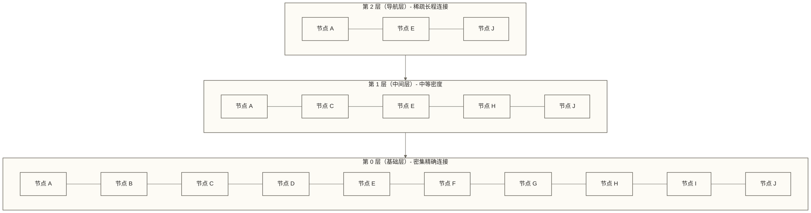
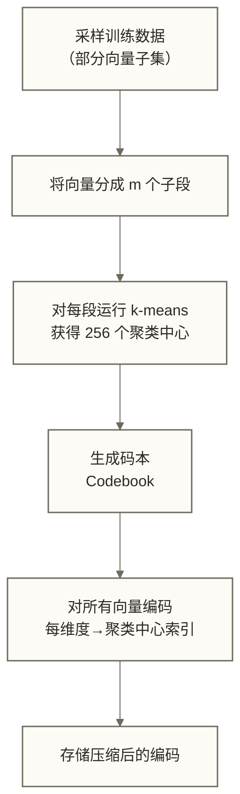
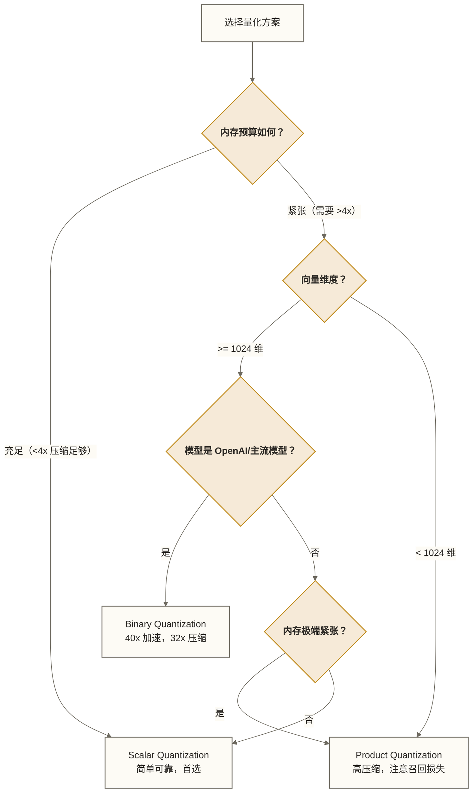
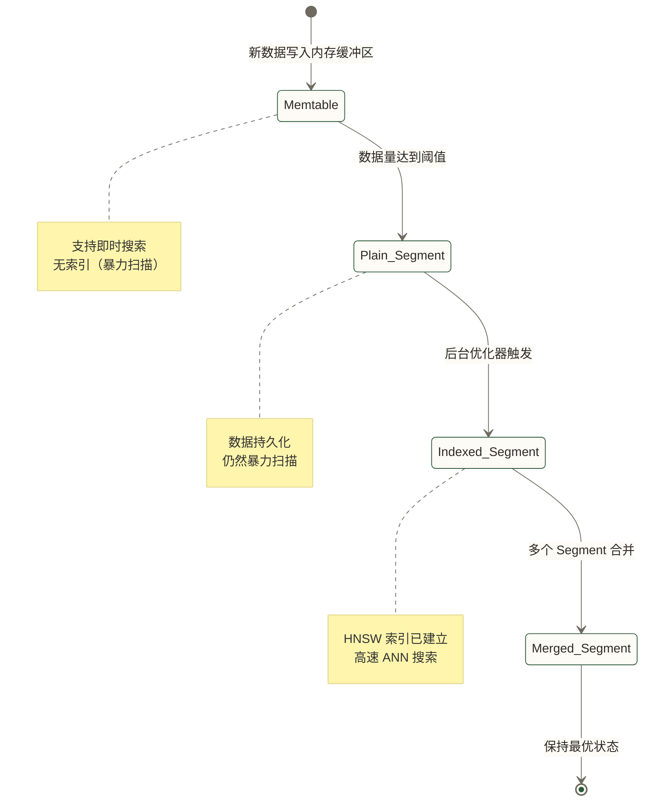
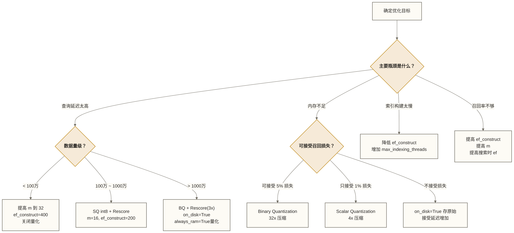

# Qdrant 索引与量化配置深度指南

> [!abstract] 文档概述
> 本文深入解析 Qdrant 的索引机制与量化压缩体系。索引决定搜索的速度与精度，量化决定内存占用与计算效率。掌握这两个维度的配置，是将 Qdrant 从"能用"推向"好用"的关键跨越。

## 目录

- [[#一、HNSW 索引原理回顾]]
- #二、hnsw_config 参数全解析
- [[#三、m 值选择的工程公式]]
- #四、on_disk 模式：低内存的生产之道
- [[#五、Scalar Quantization 标量量化]]
- [[#六、Product Quantization 乘积量化]]
- [[#七、Binary Quantization 二进制量化]]
- [[#八、三种量化方案横向对比]]
- [[#九、Rescore 重排机制]]
- [[#十、Named Vectors 独立索引策略]]
- [[#十一、稀疏向量索引]]
- [[#十二、索引构建生命周期]]
- [[#十三、调优决策树]]
- [[#十四、生产环境配置案例]]

---

## 一、HNSW 索引原理回顾

### 1.1 为什么 Qdrant 选择 HNSW

在向量数据库的索引赛道上，主流方案包括：

| 索引类型 | 代表实现 | 特点 |
|---------|---------|------|
| 精确搜索（暴力扫描）| Flat Index | 100% 召回，O(N) 复杂度 |
| 基于树结构 | KD-Tree、Ball Tree | 低维有效，高维退化 |
| 基于量化 | IVF+PQ | 内存高效，需训练阶段 |
| 基于图结构 | HNSW | 高召回+高速度，工程首选 |

HNSW（Hierarchical Navigable Small World）是工程实践中常用的近似最近邻（ANN）索引之一，其适用性取决于数据分布、召回目标、内存和负载。Qdrant 基于 HNSW 进行了深度定制，加入了 **可过滤 HNSW**（Filterable HNSW）能力，这是其核心差异化优势之一。

### 1.2 HNSW 分层图结构

HNSW 的本质是一个**多层有向图**：



**搜索过程**：
1. 从最高层的入口点开始贪心搜索
2. 逐层下降，每层找局部最近邻
3. 在第 0 层进行精细搜索，返回 top-K 结果

**建图过程**：
- 每个新插入节点随机分配到某一层（层数越高概率越低）
- 在每层中，通过贪心搜索找到 `ef_construct` 个候选邻居
- 从候选中选择最优的 `m` 个节点建立双向连接

---

## 二、hnsw_config 参数全解析

### 2.1 参数清单

Qdrant 的 HNSW 配置通过 `hnsw_config` 对象传入，支持**集合级别**和**向量级别**两种粒度的配置。

```python
from qdrant_client import QdrantClient
from qdrant_client.models import (
    VectorParams, Distance, HnswConfigDiff
)

client = QdrantClient(url="http://localhost:6333")

client.create_collection(
    collection_name="my_collection",
    vectors_config=VectorParams(
        size=1536,
        distance=Distance.COSINE
    ),
    hnsw_config=HnswConfigDiff(
        m=16,                      # 每个节点最大连接数
        ef_construct=200,          # 建图时的候选邻居数
        full_scan_threshold=10000, # 全量扫描阈值，单位为向量数据大小的 KB，不是向量条数
        max_indexing_threads=4,    # 构建索引使用的线程数
        on_disk=False,             # 是否将索引存储在磁盘
        payload_m=16               # Payload 过滤索引的 m 值
    )
)
```

### 2.2 核心参数详解

#### `m`：图的连接密度

`m` 控制每个节点在 HNSW 图中的**最大连接数**（第 0 层为 `2*m`，其他层为 `m`）。

```text
m 值  → 更多连接 → 更高召回 → 更多内存 → 更慢构建
m 值  → 更少连接 → 更低召回 → 更少内存 → 更快构建
```

**图连接内存的简化示意估算（未完整计入第 0 层连接容量及其他结构开销，不可作为容量上限）**：

```text
HNSW 图内存 ≈ num_vectors × m × (层数均值 ≈ 1.3) × sizeof(node_id)
```

以 node_id 为 4 字节举例：
- 100 万向量，m=16：≈ 100万 × 16 × 1.3 × 4 字节 ≈ **83 MB**
- 100 万向量，m=32：≈ 100万 × 32 × 1.3 × 4 字节 ≈ **167 MB**

**推荐范围**：

| 场景 | 推荐 m 值 | 说明 |
|------|---------|------|
| 内存严苛 | 8 - 12 | 降低图密度，牺牲部分召回 |
| 通用场景 | 16 | Qdrant 默认值，平衡选择 |
| 高召回要求 | 32 - 64 | 召回率 >99%，内存翻倍 |
| 极高精度 | 64 - 128 | 接近精确搜索，适合小数据集 |

#### `ef_construct`：建图质量

`ef_construct` 决定**构建索引时**每个节点考虑的候选邻居数量。值越大，建图质量越高，但建图速度越慢。

> [!important] 约束关系
> `ef_construct` 必须大于 `m`，否则选出的邻居数量不足以填满节点连接槽。
> 推荐关系：`ef_construct >= 2 × m`，通常设为 `m × 10 ~ m × 20`。

**配置组合参考**：

```python
# 快速构建（CI/CD 测试环境）
fast_config = HnswConfigDiff(m=8, ef_construct=50)

# 平衡配置（大多数生产场景）
balanced_config = HnswConfigDiff(m=16, ef_construct=200)

# 高质量配置（要求 99%+ 召回）
quality_config = HnswConfigDiff(m=32, ef_construct=400)

# 极致质量（离线索引构建）
premium_config = HnswConfigDiff(m=64, ef_construct=800)
```

#### `full_scan_threshold`：全量扫描阈值

该参数以向量数据大小的 KB 为单位，为查询规划选择扫描路径提供阈值；实际选择还与分段及过滤后估计候选规模有关，不能按全集合向量条数直接判断。

```text
full_scan_threshold：向量数据大小阈值，单位 KB
扫描或 HNSW 路径：结合分段、索引状态及过滤后估计候选规模选择
```

> [!tip] 实践建议
> 对于精度敏感场景（如金融风控），可适当提高此阈值，让更多查询走精确搜索路径，在数据量不大时避免 ANN 误差。
> 默认值为 20000。

#### `max_indexing_threads`：构建并发度

控制 HNSW 索引构建的并行线程数。

```python
# 专用索引服务器：充分利用 CPU
HnswConfigDiff(max_indexing_threads=0)  # 0 = 使用所有可用核心

# 混合负载服务器：预留计算资源给查询
HnswConfigDiff(max_indexing_threads=4)  # 限制 4 个线程
```

> [!warning] 注意
> 增加索引线程会消耗更多 CPU，在写入密集期间可能影响查询延迟。

#### `payload_m`：Payload 索引的图密度

这是 Qdrant 可过滤 HNSW 特有的参数。Qdrant 为 Payload 字段维护额外的图边，`payload_m` 控制这些附加边的密度。

```python
HnswConfigDiff(
    m=16,
    payload_m=16  # 通常与 m 相同，或设为 m 的一半以节省内存
)
```

### 2.3 运行时搜索参数 `ef`

`ef`（有时写作 `hnsw_ef`）是**查询时**的参数，控制搜索过程中维护的候选集大小：

```python
from qdrant_client.models import SearchRequest, SearchParams

results = client.search(
    collection_name="my_collection",
    query_vector=[0.1, 0.2, ...],
    limit=10,
    search_params=SearchParams(
        hnsw_ef=128,    # 搜索候选集大小，越大越准确但越慢
        exact=False     # True = 强制精确搜索（忽略 HNSW）
    )
)
```

**ef 与召回率的关系**：

| ef 值 | 预期召回率 | 延迟倍数 |
|-------|----------|---------|
| 32 | ~95% | 1x |
| 64 | ~98% | 1.5x |
| 128 | ~99% | 2.5x |
| 256 | ~99.5% | 4x |
| exact=True | 100% | 10-50x |

---

## 三、m 值选择的工程公式

### 3.1 基于向量维度的经验公式

```text
推荐 m ≈ max(4, min(64, dim / 100))
```

计算示例：
- 384 维（小模型）：按此经验公式，m ≈ max(4, min(64, 3.84)) = **4**；实际候选值仍需测试。
- 768 维（BERT base）：m ≈ max(4, min(64, 7.68)) ≈ **8~16**
- 1536 维（text-embedding-3-small）：m ≈ max(4, min(64, 15.36)) ≈ **16**
- 3072 维（text-embedding-3-large）：m ≈ max(4, min(64, 30.72)) ≈ **32**

### 3.2 基于数据规模的调整

```python
def recommend_m(num_vectors: int, vector_dim: int, memory_budget_gb: float) -> int:
    """
    根据数据规模和内存预算推荐 m 值

    Args:
        num_vectors: 向量总数
        vector_dim: 向量维度
        memory_budget_gb: HNSW 图结构可用内存（GB）

    Returns:
        推荐的 m 值
    """
    # 向量本身占用的内存（float32）
    vector_memory_gb = num_vectors * vector_dim * 4 / (1024**3)

    # 可分配给图结构的内存
    graph_budget_bytes = memory_budget_gb * (1024**3)

    # m = graph_budget / (num_vectors * 1.3 * 4)
    # 1.3 为层数系数，4 为 node_id 字节数
    max_m = graph_budget_bytes / (num_vectors * 1.3 * 4)

    # 基于维度的基础推荐
    dim_based_m = max(4, min(64, vector_dim // 100))

    # 取两者中的较小值
    recommended_m = min(int(max_m), dim_based_m)

    # 对齐到常用值
    common_values = [4, 8, 12, 16, 24, 32, 48, 64]
    eligible_values = [x for x in common_values if x <= recommended_m]
    if not eligible_values:
        raise ValueError("按当前粗略估算，预算不足以支持最小候选 m=4")
    return max(eligible_values)

# 使用示例
m = recommend_m(
    num_vectors=1_000_000,
    vector_dim=1536,
    memory_budget_gb=2.0  # 为图结构分配 2GB
)
print(f"推荐 m 值：{m}")  # 输出：推荐 m 值：16
```

### 3.3 基于召回率目标的公式

```text
目标召回 95%：ef_construct ≈ m × 5,  ef_search ≈ m × 2
目标召回 99%：ef_construct ≈ m × 10, ef_search ≈ m × 4
目标召回 99.9%：ef_construct ≈ m × 20, ef_search ≈ m × 8
```

---

## 四、on_disk 模式：低内存的生产之道

### 4.1 内存布局问题

默认情况下，Qdrant 的向量数据和 HNSW 图都存储在**内存映射文件**（mmap）中。操作系统会根据访问频率智能管理哪些页面驻留在 RAM 中。

但在数据量极大时（例如 1 亿个 1536 维 float32 向量的原始编码为 614.4 GB（约 572.2 GiB）），完整加载到内存是不现实的。

### 4.2 on_disk 模式原理

```python
client.create_collection(
    collection_name="large_collection",
    vectors_config=VectorParams(
        size=1536,
        distance=Distance.COSINE,
        on_disk=True  # 向量数据存磁盘
    ),
    hnsw_config=HnswConfigDiff(
        m=16,
        ef_construct=200,
        on_disk=True  # HNSW 图也存磁盘
    )
)
```

**两个 `on_disk` 的区别**：

| 配置位置 | 作用 | 影响 |
|---------|------|------|
| `VectorParams.on_disk=True` | 向量原始数据存磁盘 | 内存减少 80%+，查询需磁盘 I/O |
| `HnswConfigDiff.on_disk=True` | HNSW 图结构存磁盘 | 图遍历需磁盘 I/O，延迟增加 |

### 4.3 on_disk 的性能影响

```mermaid
%%{init: {"theme":"base","themeVariables":{"fontFamily":"PingFang SC, -apple-system, Source Han Serif SC, serif","fontSize":"16px","background":"#FDFBF5","primaryColor":"#FDFBF5","primaryTextColor":"#2D2A26","primaryBorderColor":"#6E6A60","secondaryColor":"#E8EFE8","secondaryBorderColor":"#8FA890","secondaryTextColor":"#2D2A26","tertiaryColor":"#FDFBF5","tertiaryBorderColor":"#9A9488","tertiaryTextColor":"#6E6A60","lineColor":"#6E6A60","textColor":"#2D2A26","mainBkg":"#FDFBF5","nodeBorder":"#2D5A3D","clusterBkg":"#F3EEDF","clusterBorder":"#9A9488","edgeLabelBackground":"#FDFBF5"},"flowchart":{"htmlLabels":true,"curve":"basis","padding":20,"nodeSpacing":60,"rankSpacing":70,"useMaxWidth":false},"themeCSS":".node rect, .node polygon, .node circle { stroke-width: 1.5px; } .edgePath .path { stroke-width: 1.5px; } .cluster-label .nodeLabel, .cluster-label foreignObject { color: #2D2A26 !important; } .edgeLabel, .edgeLabel foreignObject { color: #2D2A26 !important; background-color: #FDFBF5; } .edgeLabel rect { fill: #FDFBF5; }"}}%%
graph LR
    classDef default fill:#FDFBF5,stroke:#6E6A60,color:#2D2A26,stroke-width:1.5px
    classDef startend fill:#2D2A26,stroke:#2D2A26,color:#FDFBF5,font-weight:bold
    classDef decision fill:#F6EAD8,stroke:#C08A1A,color:#2D2A26,font-weight:bold
    classDef hub fill:#3B5A80,stroke:#3B5A80,color:#FDFBF5,font-weight:bold
    classDef io fill:#E5EAF0,stroke:#3B5A80,color:#2D2A26
    classDef accent fill:#A6432C,stroke:#A6432C,color:#FDFBF5,font-weight:bold
    classDef storage fill:#F3EEDF,stroke:#9A9488,color:#2D2A26
    A["查询请求"] --> B{"HNSW 图<br/>是否在内存？"}
    B -->|"on_disk=False<br/>图在内存"| C["图遍历：纳秒级"]
    B -->|"on_disk=True<br/>图在磁盘"| D["SSD I/O：微秒级<br/>HDD I/O：毫秒级"]
    C --> E{"向量数据<br/>是否在内存？"}
    D --> E
    E -->|"in memory"| F["距离计算：纳秒级"]
    E -->|"on_disk"| G["加载向量：微秒级"]
    F --> H["返回结果"]
    G --> H
    class B,E decision
    class A,C,D,F,G,H default
```



### 4.4 量化 + on_disk 的黄金组合

在大规模场景下，最佳策略是**量化压缩 + on_disk**：

```python
client.create_collection(
    collection_name="massive_collection",
    vectors_config=VectorParams(
        size=1536,
        distance=Distance.COSINE,
        on_disk=True  # 原始向量存磁盘（用于 rescore）
    ),
    hnsw_config=HnswConfigDiff(
        m=16,
        ef_construct=100,
        on_disk=True
    ),
    quantization_config=ScalarQuantizationConfig(
        scalar=ScalarQuantization(
            type=ScalarType.INT8,
            always_ram=True  # 量化后的向量常驻内存
        )
    )
)
```

**效果**：
- 假设有 1 亿个 1536 维向量，原始 float32 编码为 614.4 GB（约 572.2 GiB），存磁盘
- 量化后 int8 编码为 153.6 GB（约 143.1 GiB），常驻 RAM，用于粗排；以上均不含图结构等开销
- HNSW 图存磁盘，热点页面由 OS 缓存
- Rescore 时按需从磁盘读取原始向量

---

## 五、Scalar Quantization 标量量化

### 5.1 原理：float32 → int8

标量量化（SQ）是最直观的压缩方式：将每个维度的 float32 值映射到 int8 范围（-128 到 127）。

**映射公式**：

```ini
int8_value = round((float_value - min_val) / (max_val - min_val) × 255) - 128

还原公式：
float_approx = (int8_value + 128) / 255 × (max_val - min_val) + min_val
```

其中 `min_val` 和 `max_val` 从训练数据中统计得出。

### 5.2 内存压缩效果

```text
原始 float32：4 字节/维度
量化 int8：   1 字节/维度

压缩比：4x
```

对于 100 万个 1536 维向量：
- 原始：100万 × 1536 × 4 = **5.86 GB**
- SQ后：100万 × 1536 × 1 = **1.47 GB**

### 5.3 配置方式

```python
from qdrant_client.models import (
    ScalarQuantizationConfig, ScalarQuantization, ScalarType
)

# 在创建集合时配置
client.create_collection(
    collection_name="sq_collection",
    vectors_config=VectorParams(size=768, distance=Distance.COSINE),
    quantization_config=ScalarQuantizationConfig(
        scalar=ScalarQuantization(
            type=ScalarType.INT8,        # 当前仅支持 INT8
            quantile=0.99,               # 用于确定映射范围的分位数
            always_ram=True              # 量化向量是否始终驻留内存
        )
    )
)

# 或对已有集合更新量化配置
client.update_collection(
    collection_name="existing_collection",
    quantization_config=ScalarQuantizationConfig(
        scalar=ScalarQuantization(
            type=ScalarType.INT8,
            quantile=0.99,
            always_ram=False
        )
    )
)
```

### 5.4 `quantile` 参数详解

`quantile` 用于处理**离群值**。若直接使用向量的 min/max 范围，少数极端值会导致大多数值被压缩到很窄的范围，损失精度。

```python
# quantile=0.99 的含义：
# 用第 0.5% ~ 99.5% 分位数范围进行映射
# 超出范围的值被截断到边界

# quantile=0.95：更激进截断，精度稍低但对离群值更鲁棒
# quantile=1.0：使用完整 min/max，最大保留精度
```

**召回率 vs quantile 的关系**：

| quantile | 召回率（@top10） | 说明 |
|---------|---------------|------|
| 0.95 | ~98% | 离群值截断较多 |
| 0.99 | ~99% | 推荐默认值 |
| 1.00 | ~99.5% | 完整范围，精度最高 |

### 5.5 SIMD 加速原理

标量量化的另一个优势是 **int8 运算的 SIMD 加速**：

```text
CPU SIMD 寄存器宽度：256 bit（AVX2）或 512 bit（AVX-512）

float32 计算：256 bit / 32 bit = 一次处理 8 个维度
int8 计算：  256 bit / 8 bit  = 一次处理 32 个维度

速度提升：4x（理论上限）
```

Qdrant 内部使用 Rust 实现，充分利用 SIMD 指令集，int8 距离计算比 float32 快约 2-4 倍。

---

## 六、Product Quantization 乘积量化

### 6.1 原理：分段压缩

乘积量化（PQ）将高维向量**分割成多个子空间**，对每个子空间独立进行 k-means 聚类，用聚类中心的索引替代原始数据。

```text
原始向量 d=1536 维 → 分成 m=96 段，每段 16 维
每段独立聚类：256 个中心（8 bit 编码）
存储：96 段 × 1 字节 = 96 字节

原始大小：1536 × 4 = 6144 字节
压缩后：96 字节
压缩比：64x
```

### 6.2 PQ 训练阶段

PQ 需要预先训练，Qdrant 在后台自动完成：



### 6.3 配置方式

```python
from qdrant_client.models import (
    ProductQuantizationConfig, ProductQuantization, CompressionRatio
)

client.create_collection(
    collection_name="pq_collection",
    vectors_config=VectorParams(size=1536, distance=Distance.COSINE),
    quantization_config=ProductQuantizationConfig(
        product=ProductQuantization(
            compression=CompressionRatio.X16,  # 压缩比选项
            always_ram=True
        )
    )
)
```

**压缩比选项**：

| CompressionRatio | 压缩倍数 | 子段数（1536维） | 每段维度 |
|-----------------|---------|----------------|---------|
| X4 | 4x | 1536 段 | 1 维 |
| X8 | 8x | 768 段 | 2 维 |
| X16 | 16x | 384 段 | 4 维 |
| X32 | 32x | 192 段 | 8 维 |
| X64 | 64x | 96 段 | 16 维 |

> [!warning] PQ 的局限性
> - **不支持 SIMD 加速**：PQ 距离计算（查表法）对 SIMD 不友好，比 SQ 更慢
> - **需要训练数据**：初始数据不足时，码本质量差
> - **召回率损失更大**：相比 SQ，相同压缩比下召回率更低
> - **推荐场景**：超大数据集（亿级），内存严重受限，能接受较低召回率

### 6.4 ADC（非对称距离计算）

PQ 使用**非对称距离计算**提高精度：

```text
对称计算（低精度）：
  距离(压缩A, 压缩B) = 码本查表

非对称计算（高精度，Qdrant 使用）：
  距离(原始Query, 压缩向量) = 对每个子段，计算 Query子段 与 各聚类中心的距离
```

ADC 允许查询向量保持 float32 精度，只压缩存储的向量，显著减少精度损失。

---

## 七、Binary Quantization 二进制量化

### 7.1 原理：最激进的压缩

二进制量化（BQ）将每个浮点维度压缩为 **1 bit**：

```text
量化规则：
  float_value >= 0 → 1
  float_value < 0  → 0

1536 维 float32 向量：
  原始：1536 × 4 = 6144 字节 = 6 KB
  BQ后：1536 / 8 = 192 字节

压缩比：32x
内存节省：96.9%
```

### 7.2 距离计算的神奇加速

BQ 的真正威力在于**汉明距离**（Hamming Distance）计算的极速运行：

```text
float32 余弦相似度：1536 次乘法 + 1535 次加法 + 2 次开方
汉明距离：        1536 bit XOR + 1536 bit POPCOUNT

CPU 原生指令：
  POPCNT 指令：一次处理 64 bit，计算 64 维的汉明距离
  1536 维 = 24 次 POPCNT 指令

理论加速比：约 40x（相比 float32 余弦相似度）
```

### 7.3 配置方式

```python
from qdrant_client.models import (
    BinaryQuantizationConfig, BinaryQuantization
)

client.create_collection(
    collection_name="bq_collection",
    vectors_config=VectorParams(
        size=1536,
        distance=Distance.COSINE  # BQ 最适合余弦相似度
    ),
    quantization_config=BinaryQuantizationConfig(
        binary=BinaryQuantization(
            always_ram=True  # 推荐始终驻留内存
        )
    )
)
```

### 7.4 BQ 的适用条件

> [!important] BQ 不是万能的
> BQ 的召回率高度依赖模型输出的向量分布。以下条件下 BQ 效果好：

**适合 BQ 的场景**：
- **OpenAI text-embedding-ada-002、text-embedding-3-***：这些模型输出的向量经过 L2 归一化，维度分布对称，BQ 召回率可达 95%+
- **高维向量（≥1024 维）**：高维下信息更分散，量化损失相对更小
- **余弦相似度度量**：BQ 对余弦相似度的近似质量优于欧式距离

**不适合 BQ 的场景**：
- 低维向量（< 512 维）
- 向量分布极不均匀的模型
- 使用欧氏距离（L2）度量
- 对召回率要求极高（>99.5%）

### 7.5 不同模型的 BQ 召回率假设示例

以下数值暂作为未开启 Rescore 时的模型召回率假设示例保留；本文未提供可追溯的官方基准来源及测试条件，不将其作为官方实测结果：

| 模型 | 向量维度 | BQ 召回率(@top10) |
|------|---------|-----------------|
| text-embedding-3-large | 3072 | ~98% |
| text-embedding-3-small | 1536 | ~96% |
| text-embedding-ada-002 | 1536 | ~95% |
| all-MiniLM-L6-v2 | 384 | ~85% |
| GTE-base | 768 | ~90% |

---

## 八、三种量化方案横向对比

### 8.1 综合对比表

| 维度 | Scalar (SQ) | Product (PQ) | Binary (BQ) |
|------|------------|-------------|------------|
| **压缩比** | 4x | 4x ~ 64x | 32x |
| **召回率损失** | 极低（<1%） | 中等（2-5%） | 低-中（取决于模型） |
| **计算速度** | 2-4x 加速 | 1-2x 加速 | 最高 40x 加速 |
| **内存节省** | 75% | 75%~98% | 96.9% |
| **需要训练** | 否（自动统计） | 是（k-means） | 否 |
| **SIMD 支持** | 是（int8） | 否 | 是（位运算） |
| **适用维度** | 任意 | 高维（>512） | 高维（>1024） |
| **适用场景** | 通用首选 | 超大规模存储 | OpenAI 等主流模型 |
| **工程复杂度** | 低 | 中 | 低 |

### 8.2 内存占用对比（1M 向量，1536 维）

```text
原始 float32：    5.86 GB  ████████████████████████ 100%
SQ int8：        1.47 GB  ██████                    25%
BQ binary：      0.18 GB  █                         3%
PQ X16：         约 0.36 GiB（仅编码）               6.25%
PQ X64：         约 0.089 GiB（仅编码）              1.5625%
```

### 8.3 选择决策树



---

## 九、Rescore 重排机制

### 9.1 量化召回损失的解决方案

量化不可避免地引入精度损失。Qdrant 通过 **Rescore（重排）机制**在保留量化速度优势的同时，大幅恢复召回率：

```mermaid
%%{init: {"theme":"base","themeVariables":{"fontFamily":"PingFang SC, -apple-system, Source Han Serif SC, serif","fontSize":"16px","background":"#FDFBF5","primaryColor":"#FDFBF5","primaryTextColor":"#2D2A26","primaryBorderColor":"#6E6A60","secondaryColor":"#E8EFE8","secondaryBorderColor":"#8FA890","secondaryTextColor":"#2D2A26","tertiaryColor":"#FDFBF5","tertiaryBorderColor":"#9A9488","tertiaryTextColor":"#6E6A60","lineColor":"#6E6A60","textColor":"#2D2A26","mainBkg":"#FDFBF5","nodeBorder":"#2D5A3D","clusterBkg":"#F3EEDF","clusterBorder":"#9A9488","edgeLabelBackground":"#FDFBF5"},"flowchart":{"htmlLabels":true,"curve":"basis","padding":20,"nodeSpacing":60,"rankSpacing":70,"useMaxWidth":false},"themeCSS":".node rect, .node polygon, .node circle { stroke-width: 1.5px; } .edgePath .path { stroke-width: 1.5px; } .cluster-label .nodeLabel, .cluster-label foreignObject { color: #2D2A26 !important; } .edgeLabel, .edgeLabel foreignObject { color: #2D2A26 !important; background-color: #FDFBF5; } .edgeLabel rect { fill: #FDFBF5; }"}}%%
graph LR
    classDef default fill:#FDFBF5,stroke:#6E6A60,color:#2D2A26,stroke-width:1.5px
    classDef startend fill:#2D2A26,stroke:#2D2A26,color:#FDFBF5,font-weight:bold
    classDef decision fill:#F6EAD8,stroke:#C08A1A,color:#2D2A26,font-weight:bold
    classDef hub fill:#3B5A80,stroke:#3B5A80,color:#FDFBF5,font-weight:bold
    classDef io fill:#E5EAF0,stroke:#3B5A80,color:#2D2A26
    classDef accent fill:#A6432C,stroke:#A6432C,color:#FDFBF5,font-weight:bold
    classDef storage fill:#F3EEDF,stroke:#9A9488,color:#2D2A26
    A["查询向量"] --> B["BQ/SQ/PQ 粗排<br/>（量化向量）<br/>快速找出候选集 top-K×N"]
    B --> C["候选集扩大<br/>（如取 top 100）"]
    C --> D["原始 float32 向量<br/>精排 top-K"]
    D --> E["最终结果<br/>top-10"]
    class A,B,C,D,E default
```



**核心思想**：用量化向量快速缩小候选范围，用原始向量精确排名。

### 9.2 配置 Rescore

```python
from qdrant_client.models import SearchParams, QuantizationSearchParams

results = client.search(
    collection_name="bq_collection",
    query_vector=[0.1, 0.2, ...],
    limit=10,
    search_params=SearchParams(
        quantization=QuantizationSearchParams(
            ignore=False,       # 不忽略量化（使用量化加速）
            rescore=True,       # 开启重排（精度恢复）
            oversampling=3.0    # 过采样倍数：先取 10×3=30 个候选
        )
    )
)
```

### 9.3 oversampling 参数

`oversampling` 是 Rescore 最关键的参数，控制**粗排候选集的扩大倍数**：

```text
最终需要 limit=10 个结果
oversampling=2.0 → 粗排取 20 个候选 → 精排后返回 10
oversampling=3.0 → 粗排取 30 个候选 → 精排后返回 10
oversampling=5.0 → 粗排取 50 个候选 → 精排后返回 10
```

**oversampling 对召回率的提升**（Binary Quantization，OpenAI 1536维）：

| oversampling | 召回率(@top10) | 延迟增加 |
|------------|--------------|--------|
| 1.0（不扩大候选集；是否重排由 rescore 决定） | ~95%（示例假设，非实测结论） | 0%（示例基线） |
| 2.0 | ~98% | +20% |
| 3.0 | ~99% | +40% |
| 5.0 | ~99.5% | +80% |
| 10.0 | ~99.9% | +150% |

> [!tip] 推荐配置
> 对于 BQ：`oversampling=2.0` 到 `3.0` 是甜点区，用 40% 的延迟换取 4% 的召回提升。
> 对于 SQ：`oversampling=1.5` 通常足够，因为 SQ 精度损失极小。

### 9.4 量化 + Rescore 的完整性能对比

以下按 100 万个 1536 维向量、搜索 top-10 保留为未验证的假设对比：延迟和召回率不是实测结论，内存列主要表示向量编码容量而非实例总内存。Rescore 仍需访问原始向量，表中 SQ 行未指定其存储位置；float32 存储本身不保证 100% 召回，100% 仅可作为相同条件下精确搜索基线的假设。

| 方案 | 延迟 | 内存 | 召回率 | 适用场景 |
|------|------|------|-------|---------|
| 原始 float32 | 50ms | 5.86GB | 100% | 精度要求极高 |
| SQ + Rescore | 25ms | 1.47GB | 99.5% | 通用生产推荐 |
| BQ（无Rescore） | 5ms | 0.18GB | 95% | 大规模粗排 |
| BQ + Rescore(3x) | 8ms | 0.18GB（+5.86GB磁盘） | 99% | 大规模精准搜索 |

---

## 十、Named Vectors 独立索引策略

### 10.1 多向量集合的场景

现代 RAG 和多模态应用中，同一个文档可能需要存储多种向量：

```python
from qdrant_client.models import VectorsConfig

# 多向量配置：每种向量独立的 HNSW 参数
client.create_collection(
    collection_name="multimodal_collection",
    vectors_config={
        # 文本向量：高维，需要高质量索引
        "text": VectorParams(
            size=1536,
            distance=Distance.COSINE,
            hnsw_config=HnswConfigDiff(
                m=32,
                ef_construct=400,
                on_disk=False
            )
        ),
        # 图像向量：中维，平衡配置
        "image": VectorParams(
            size=512,
            distance=Distance.COSINE,
            hnsw_config=HnswConfigDiff(
                m=16,
                ef_construct=200,
                on_disk=True  # 将该命名向量的 HNSW 图存磁盘；不设置原始向量的存储位置
            )
        ),
        # 摘要向量：小维，低内存配置
        "summary": VectorParams(
            size=384,
            distance=Distance.COSINE,
            hnsw_config=HnswConfigDiff(
                m=8,
                ef_construct=100
            )
        )
    }
)
```

### 10.2 为不同向量配置不同量化

```python
client.create_collection(
    collection_name="hybrid_quantization",
    vectors_config={
        "dense": VectorParams(
            size=1536,
            distance=Distance.COSINE,
            quantization_config=BinaryQuantizationConfig(
                binary=BinaryQuantization(always_ram=True)
            )
        ),
        "colbert": VectorParams(
            size=128,
            distance=Distance.COSINE,
            quantization_config=ScalarQuantizationConfig(
                scalar=ScalarQuantization(
                    type=ScalarType.INT8,
                    always_ram=True
                )
            )
        )
    }
)
```

### 10.3 搜索时指定向量

```python
# 仅使用文本向量搜索
text_results = client.search(
    collection_name="multimodal_collection",
    query_vector=("text", text_embedding),
    limit=10
)

# 使用图像向量搜索
image_results = client.search(
    collection_name="multimodal_collection",
    query_vector=("image", image_embedding),
    limit=10
)

# 混合搜索（多向量结果通过 RRF 倒数排名融合）
from qdrant_client.models import Prefetch, FusionQuery, Fusion

hybrid_results = client.query_points(
    collection_name="multimodal_collection",
    prefetch=[
        Prefetch(
            query=text_embedding,
            using="text",
            limit=50
        ),
        Prefetch(
            query=image_embedding,
            using="image",
            limit=50
        )
    ],
    query=FusionQuery(fusion=Fusion.RRF),  # 倒数排名融合
    limit=10
)
```

---

## 十一、稀疏向量索引

### 11.1 稀疏向量的应用场景

稀疏向量（Sparse Vector）主要用于**词汇匹配**（BM25、SPLADE 等模型输出），与稠密向量结合实现混合搜索：

```python
from qdrant_client.models import SparseVectorParams, SparseIndexParams

client.create_collection(
    collection_name="hybrid_search",
    vectors_config={
        "dense": VectorParams(
            size=1536,
            distance=Distance.COSINE
        )
    },
    sparse_vectors_config={
        "sparse": SparseVectorParams(
            index=SparseIndexParams(
                on_disk=False  # 稀疏索引是否存磁盘
            )
        )
    }
)
```

### 11.2 稀疏向量的索引机制

稀疏向量不使用 HNSW，而是基于**倒排索引**（Inverted Index）：

```text
词汇 "machine"  → [点ID 1, 点ID 5, 点ID 23, ...]
词汇 "learning" → [点ID 1, 点ID 7, 点ID 45, ...]
词汇 "python"   → [点ID 3, 点ID 7, 点ID 89, ...]
```

查询时取并集，计算点积得分，内存效率极高。

### 11.3 插入稀疏向量

```python
from qdrant_client.models import PointStruct, SparseVector

client.upsert(
    collection_name="hybrid_search",
    points=[
        PointStruct(
            id=1,
            vector={
                # 稠密向量
                "dense": [0.1, 0.2, 0.3, ...],
                # 稀疏向量：只存非零维度
                "sparse": SparseVector(
                    indices=[42, 156, 891, 1204],
                    values=[0.85, 0.63, 0.41, 0.29]
                )
            },
            payload={"title": "Machine Learning with Python"}
        )
    ]
)
```

---

## 十二、索引构建生命周期

### 12.1 Segment 分段机制

Qdrant 不会对每次插入立即重建索引，而是采用**分段（Segment）**管理策略：



### 12.2 触发索引构建的条件

```python
# 在 collection 的优化器配置中控制
from qdrant_client.models import OptimizersConfigDiff

client.update_collection(
    collection_name="my_collection",
    optimizer_config=OptimizersConfigDiff(
        # 触发索引构建的向量数据大小阈值（KB），不是向量条数
        indexing_threshold=20000,

        # 将向量存储转换为内存映射存储的大小阈值（KB）
        memmap_threshold=200000,

        # 已删除向量的比例超过此值时触发清理
        deleted_threshold=0.2,

        # 单个 Segment 的最大向量数据大小（KB），不是 Segment 个数
        max_segment_size=100000,

        # 最大优化任务并行数
        max_optimization_threads=2,

        # 数据刷写间隔（秒），不是数据积压阈值
        flush_interval_sec=5
    )
)
```

### 12.3 轮询优化器状态（不强制触发优化）

```python
# 轮询优化器状态；状态为 ok 不等同于所有段已完成索引优化
import time

while True:
    collection_info = client.get_collection("my_collection")
    optimizer_status = collection_info.optimizer_status

    if str(optimizer_status) == "ok":
        print("优化器状态为 ok；仍需结合集合状态与索引进度判断完成情况")
        break

    print(f"优化中：{optimizer_status}")
    time.sleep(2)
```

---

## 十三、调优决策树

### 13.1 场景分类与推荐配置



### 13.2 关键配置参数速查

| 目标 | 关键参数 | 推荐值 |
|------|---------|-------|
| 最高召回率 | `m`, `ef_construct`, `ef` | m=32, ef_c=400, ef=256 |
| 最低延迟 | `m`, `ef`，开启 BQ | m=8, ef=32, BQ |
| 最小内存 | `on_disk`, 量化 | BQ + on_disk=True |
| 最快构建 | `ef_construct`, `threads` | ef_c=50, threads=16 |
| 过滤友好 | `payload_m` | payload_m = m |

---

## 十四、生产环境配置案例

### 14.1 案例一：RAG 知识库（通用场景）

**示例假设与目标**：500 万文档，1536 维，以查询 P99 延迟 < 50ms 为目标；本文未提供达标测试结果。

```python
client.create_collection(
    collection_name="rag_knowledge_base",
    vectors_config=VectorParams(
        size=1536,
        distance=Distance.COSINE,
        on_disk=False,  # 内存充足，不用磁盘
        quantization_config=ScalarQuantizationConfig(
            scalar=ScalarQuantization(
                type=ScalarType.INT8,
                quantile=0.99,
                always_ram=True
            )
        )
    ),
    hnsw_config=HnswConfigDiff(
        m=16,
        ef_construct=200,
        full_scan_threshold=10000,
        on_disk=False
    ),
    optimizer_config=OptimizersConfigDiff(
        indexing_threshold=20000,
        max_optimization_threads=4
    )
)

# 搜索时配置
results = client.search(
    collection_name="rag_knowledge_base",
    query_vector=query_embedding,
    limit=5,
    search_params=SearchParams(
        hnsw_ef=128,
        quantization=QuantizationSearchParams(
            rescore=True,
            oversampling=2.0
        )
    )
)
```

**编码容量估算与待验证性能假设**：
- SQ 编码：500万 × 1536 × 1字节 = 7.68 GB（约 7.15 GiB）；原始 float32 向量为 30.72 GB（约 28.61 GiB）。本配置原始向量 on_disk=False，SQ 编码大小不是实例总内存，还需计入原始向量、HNSW 图及运行开销。
- 召回率假设：~99.5%，需通过实际数据测试确认。
- 查询延迟假设：10-30ms，未给出硬件、并发和测量条件，不能作为性能承诺。

### 14.2 案例二：大规模图像搜索

**示例假设与目标**：1 亿图像，512 维 CLIP 向量，以实例内存 < 32GB 为目标；需评估该向量分布的 BQ 召回损失、图缓存和重排 I/O，本文未提供达标测试结果。

```python
client.create_collection(
    collection_name="image_search",
    vectors_config=VectorParams(
        size=512,
        distance=Distance.COSINE,
        on_disk=True,  # 向量存磁盘（1亿 × 512 × 4B = 204.8 GB，约 190.73 GiB）
        quantization_config=BinaryQuantizationConfig(
            binary=BinaryQuantization(
                always_ram=True  # BQ 编码为 204.8 GB/32=6.4 GB（约 5.96 GiB）；不含图、缓存及运行开销
            )
        )
    ),
    hnsw_config=HnswConfigDiff(
        m=16,
        ef_construct=100,
        on_disk=True  # 图结构也存磁盘
    )
)

# 搜索时使用 Rescore 提升精度
results = client.search(
    collection_name="image_search",
    query_vector=image_embedding,
    limit=20,
    search_params=SearchParams(
        hnsw_ef=64,
        quantization=QuantizationSearchParams(
            rescore=True,
            oversampling=3.0  # 取 60 个候选，精排返回 20
        )
    )
)
```

### 14.3 案例三：实时推荐系统

**示例假设与目标**：1000 万商品向量，256 维，写入频繁，以查询 P99 < 20ms 为目标；本文未提供达标测试结果。

```python
client.create_collection(
    collection_name="recommendation",
    vectors_config=VectorParams(
        size=256,
        distance=Distance.DOT,
        on_disk=False
    ),
    hnsw_config=HnswConfigDiff(
        m=12,
        ef_construct=100,
        full_scan_threshold=5000,
        max_indexing_threads=2  # 预留 CPU 给查询
    ),
    optimizer_config=OptimizersConfigDiff(
        indexing_threshold=10000,
        flush_interval_sec=2,   # 设置刷写间隔为 2 秒；不保证查询可见性或数据新鲜度
        max_optimization_threads=1  # 最小化优化对查询的干扰
    )
)
```

---

## 总结

Qdrant 的索引与量化系统体现了工程实践中**精度与效率的精妙平衡**：

1. **HNSW 是基础**：理解 `m` 和 `ef_construct` 的关系，根据数据规模和内存预算做出合理选择
2. **量化是杠杆**：SQ 是通用首选，BQ 在大规模 OpenAI 向量场景下有压倒性优势，PQ 是内存极端受限的最后手段
3. **Rescore 是保险**：开启 Rescore + 适度 oversampling，在量化带来速度和内存优势的同时，将精度损失降到可接受范围
4. **on_disk 是扩展**：向量和图结构均支持磁盘存储，配合 SSD 可实现数十亿级别的向量搜索

## 相关文档

- [[【技术与工具】/向量数据库/00-向量数据库选型指南|向量数据库选型指南]]
- [[【技术与工具】/向量数据库/Qdrant/07-Payload与过滤设计|Payload与过滤设计]]
- [[【技术与工具】/向量数据库/Milvus/06-索引类型与选型指南|Milvus 索引类型对比]]
- [[【技术与工具】/Presto/02-Presto架构原理|分布式查询引擎原理]]

#向量数据库 #Qdrant #HNSW #量化压缩 #索引优化 #RAG #性能调优
