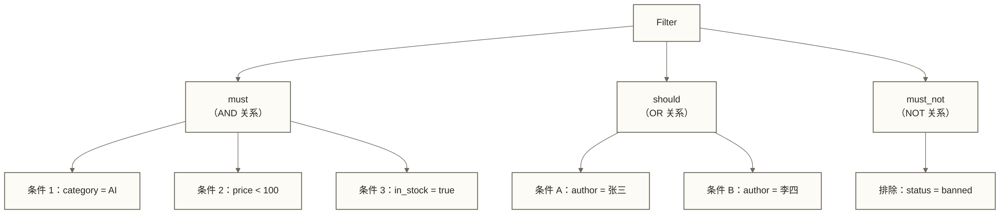
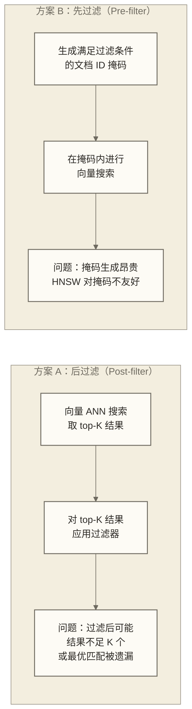
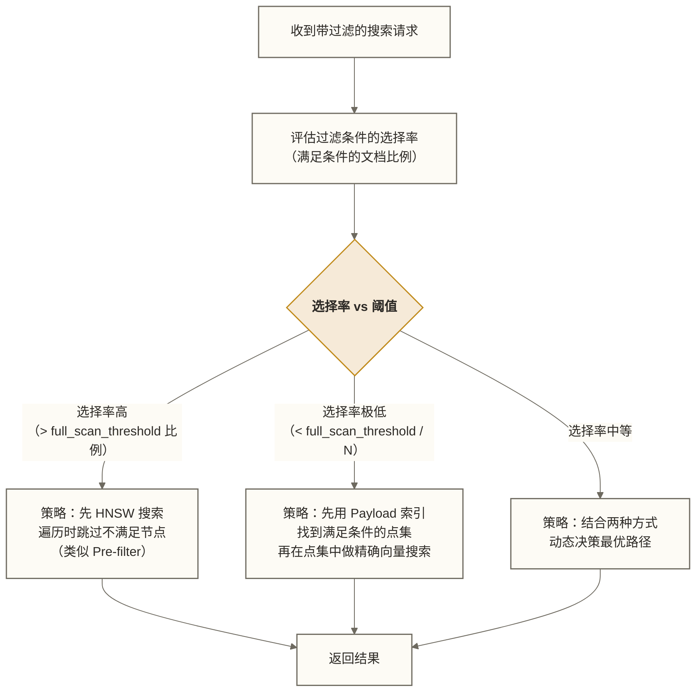
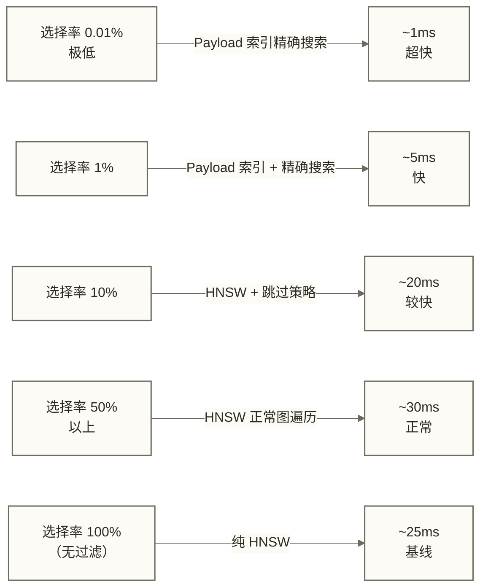

# Qdrant Payload 与过滤设计深度指南

> [!abstract] 文档概述
> Qdrant 最重要的差异化能力，不是存储向量，而是**在向量搜索中精确过滤**。本文深入解析 Payload 类型系统、过滤器语法、过滤执行机制，以及如何设计让过滤性能接近原生向量搜索速度的架构方案。

## 目录

- [[#一、Payload 是什么]]
- [[#二、Payload 类型系统]]
- [[#三、Payload 索引类型详解]]
- [[#四、创建与管理 Payload 索引]]
- [[#五、过滤器基础语法]]
- [[#六、条件类型全解析]]
- [[#七、嵌套过滤与组合技巧]]
- [[#八、Qdrant 过滤执行机制深度解析]]
- [[#九、Prefilter 与 Postfilter 的内幕]]
- [[#十、过滤性能优化策略]]
- [[#十一、实战场景一：电商商品搜索]]
- [[#十二、实战场景二：多租户知识库]]
- [[#十三、实战场景三：时间范围语义查询]]
- [[#十四、实战场景四：地理位置搜索]]
- [[#十五、Payload 设计最佳实践]]

---

## 一、Payload 是什么

### 1.1 向量数据库中的元数据

在 Qdrant 中，**Payload** 是附加在每个向量点（Point）上的结构化元数据。可以把它理解为：

```text
Qdrant 的 Point = 向量 + Payload

类比：
  MySQL 的行 = 索引列（向量）+ 业务列（Payload）
  Elasticsearch 的文档 = 向量字段 + 文本字段
```

一个完整的点（Point）结构如下：

```python
from qdrant_client.models import PointStruct

point = PointStruct(
    id=1001,                    # 唯一标识（int 或 UUID）
    vector=[0.1, 0.2, 0.3],   # 向量数据（语义信息）
    payload={                   # Payload（结构化业务信息）
        "title": "深度学习入门",
        "author": "张三",
        "category": "技术/AI",
        "price": 59.9,
        "tags": ["深度学习", "Python", "入门"],
        "published_at": "2024-01-15T10:30:00Z",
        "rating": 4.8,
        "in_stock": True,
        "location": {
            "lat": 39.9042,
            "lon": 116.4074
        }
    }
)
```

### 1.2 Payload 与过滤的关系

Payload 的核心价值在于**支持向量搜索中的精确过滤**：

```text
纯向量搜索：语义相近 → 得分高
带过滤的搜索：语义相近 AND 满足业务条件 → 得分高

示例：
  查询："推荐一本 Python 机器学习书"
  过滤：price < 100 AND category = "技术/AI" AND in_stock = true
```

没有 Payload 过滤，向量数据库只是语义搜索引擎；有了高效的 Payload 过滤，才能支撑真实的业务应用。

---

## 二、Payload 类型系统

### 2.1 基础类型

Qdrant 的 Payload 是**动态模式**（Schema-free）的 JSON 格式，自动推断字段类型：

| 类型 | JSON 示例 | Qdrant 内部类型 | 支持的索引 |
|------|----------|----------------|---------|
| 整数 | `"count": 42` | Integer | keyword, range |
| 浮点数 | `"price": 59.9` | Float | range |
| 字符串 | `"title": "书名"` | Keyword / Text | keyword, text(全文) |
| 布尔 | `"in_stock": true` | Bool | keyword |
| 日期时间 | `"date": "2024-01-15T10:30:00Z"` | Datetime | datetime, range |
| 数组 | `"tags": ["AI", "Python"]` | Array | keyword（每个元素独立索引）|
| 对象 | `"location": {"lat": 39.9, "lon": 116.4}` | Object/Geo | geo |
| UUID | `"id": "550e8400-e29b-..."` | Keyword | keyword |
| Null | `"field": null` | Null | IsNull 过滤 |

### 2.2 字符串的两种索引模式

字符串字段有两种索引模式，语义不同：

```python
from qdrant_client.models import (
    PayloadSchemaType, TextIndexParams, TokenizerType
)

# Keyword 索引：精确匹配（类似 SQL 的 = 操作）
client.create_payload_index(
    collection_name="books",
    field_name="category",
    field_schema=PayloadSchemaType.KEYWORD
)

# Text 索引：全文检索（分词后的倒排索引）
client.create_payload_index(
    collection_name="books",
    field_name="description",
    field_schema=TextIndexParams(
        type="text",
        tokenizer=TokenizerType.WORD,  # 按词分词
        min_token_len=2,               # 最小词长
        max_token_len=20,              # 最大词长
        lowercase=True                 # 转小写
    )
)
```

**关键区别**：

| 特性 | Keyword 索引 | Text 索引 |
|------|------------|---------|
| 匹配方式 | 精确匹配 | 词汇匹配 |
| 大小写 | 敏感 | 可配置 |
| 匹配范围 | 完整值精确匹配 | 按分词结果匹配词项，不等同于任意子串或编辑距离模糊匹配 |
| 过滤条件 | Match.value | Match.text |
| 适用字段 | 分类、状态、ID | 标题、内容、描述 |

### 2.3 嵌套对象的处理

Qdrant 支持嵌套 JSON 对象，通过**点号路径**访问嵌套字段：

```python
# 假设 Payload 结构如下
payload = {
    "product": {
        "name": "iPhone 16",
        "specs": {
            "storage": 256,
            "color": "黑色"
        }
    },
    "seller": {
        "name": "官方旗舰店",
        "rating": 4.9
    }
}

# 为嵌套字段创建索引（点号分隔路径）
client.create_payload_index(
    collection_name="products",
    field_name="product.specs.storage",
    field_schema=PayloadSchemaType.INTEGER
)

client.create_payload_index(
    collection_name="products",
    field_name="seller.rating",
    field_schema=PayloadSchemaType.FLOAT
)

# 使用嵌套字段过滤
from qdrant_client.models import Filter, FieldCondition, Range

results = client.search(
    collection_name="products",
    query_vector=query_vec,
    query_filter=Filter(
        must=[
            FieldCondition(
                key="product.specs.storage",
                range=Range(gte=128)
            ),
            FieldCondition(
                key="seller.rating",
                range=Range(gte=4.5)
            )
        ]
    ),
    limit=10
)
```

### 2.4 数组字段的特殊行为

数组字段中，**每个元素都可以独立匹配**：

```python
# Payload 示例
{
    "tags": ["AI", "Python", "机器学习", "深度学习"]
}

# 以下过滤会匹配上面的文档：
# tags 包含 "Python" → 匹配（元素级别的匹配）
filter = Filter(
    must=[
        FieldCondition(
            key="tags",
            match=MatchValue(value="Python")
        )
    ]
)
```

> [!note] 数组过滤语义
> Qdrant 对数组字段的 `Match` 操作是"包含"语义（Array Contains），而不是"等于"语义。只要数组中有一个元素匹配，整个文档就被认为满足条件。

---

## 三、Payload 索引类型详解

### 3.1 八种索引类型

| 索引类型 | 适用数据 | 支持的查询 | 内存开销 |
|---------|---------|----------|---------|
| `keyword` | 枚举值、标签、ID | 精确匹配、集合匹配 | 低 |
| `integer` | 整数计数、ID | 范围查询、精确匹配 | 低 |
| `float` | 价格、分数、评分 | 范围查询 | 中 |
| `bool` | 状态标志 | 精确匹配 | 极低 |
| `datetime` | 时间戳、日期 | 范围查询、时间段过滤 | 低 |
| `text` | 长文本 | 全文关键词匹配 | 高（倒排索引）|
| `geo` | 经纬度坐标 | 地理范围、地理框 | 中 |
| `uuid` | UUID 格式的 ID | 精确匹配 | 低 |

### 3.2 有无索引的性能差异

> [!important] 索引是过滤性能的核心
> 无索引时，Qdrant 需要扫描所有文档的 Payload 来判断是否满足过滤条件。有索引时，可以直接定位到满足条件的文档集合。

**假设性性能对比示例（假设100万文档，选择率1%；以下数值不代表已提供测试依据的实测结果）**：

| 场景 | 无索引耗时 | 有索引耗时 | 加速比 |
|------|---------|---------|-------|
| 精确匹配（keyword） | ~120ms | ~2ms | 60x |
| 范围查询（float） | ~150ms | ~5ms | 30x |
| 地理范围 | ~200ms | ~10ms | 20x |
| 全文检索（text） | 无法高效支持 | ~15ms | N/A |

### 3.3 索引与内存的权衡

```text
每个 keyword 索引：约 num_unique_values × 8 字节 + 倒排列表
每个 float/int 索引：基于 B-Tree，约 num_docs × 16 字节
每个 text 索引：基于倒排，约 num_tokens × 20 字节（可能很大）
```

**实践建议**：
- 只为**频繁用于过滤**的字段创建索引
- 低基数字段（如布尔值、状态）索引成本极低，无脑创建
- 高基数字段（如 UUID、用户 ID）的 keyword 索引需要评估内存占用
- `text` 索引最昂贵，只为真正需要全文搜索的字段创建

---

## 四、创建与管理 Payload 索引

### 4.1 创建索引的时机

```python
from qdrant_client.models import (
    PayloadSchemaType, DatetimeIndexParams,
    FloatIndexParams, IntegerIndexParams, UuidIndexParams
)

# 推荐：在集合创建后、数据导入前创建所有索引
# 这比数据导入后再创建快得多（避免重建）

client.create_collection("books", vectors_config=...)

# 立即创建所有需要的索引
indexes_to_create = [
    ("category", PayloadSchemaType.KEYWORD),
    ("price", PayloadSchemaType.FLOAT),
    ("published_year", PayloadSchemaType.INTEGER),
    ("in_stock", PayloadSchemaType.BOOL),
    ("created_at", PayloadSchemaType.DATETIME),
    ("author_id", PayloadSchemaType.UUID),
]

for field_name, schema_type in indexes_to_create:
    client.create_payload_index(
        collection_name="books",
        field_name=field_name,
        field_schema=schema_type
    )
```

### 4.2 完整的索引配置选项

```python
# Integer 索引：支持范围查询优化
client.create_payload_index(
    collection_name="books",
    field_name="view_count",
    field_schema=IntegerIndexParams(
        type="integer",
        lookup=True,    # 是否支持精确查找优化
        range=True      # 是否支持范围查询优化
    )
)

# Datetime 索引
client.create_payload_index(
    collection_name="events",
    field_name="event_time",
    field_schema=DatetimeIndexParams(
        type="datetime",
        is_tenant=False  # 是否作为租户隔离字段（影响优化策略）
    )
)

# Keyword 索引（支持租户优化）
client.create_payload_index(
    collection_name="documents",
    field_name="tenant_id",
    field_schema=PayloadSchemaType.KEYWORD,
    # is_tenant=True  # 对多租户场景进行特殊优化（即将支持）
)
```

### 4.3 查看已有索引

```python
collection_info = client.get_collection("books")
print("Payload 索引信息：")
for field_name, field_info in collection_info.payload_schema.items():
    print(f"  {field_name}: {field_info.data_type}, 点数={field_info.points}")
```

### 4.4 删除索引

```python
# 当某个字段不再用于过滤时，删除索引释放内存
client.delete_payload_index(
    collection_name="books",
    field_name="old_category"
)
```

---

## 五、过滤器基础语法

### 5.1 Filter 的三大逻辑运算

Qdrant 的过滤器采用**声明式 JSON 语法**，类似 Elasticsearch 的 bool query：

```python
from qdrant_client.models import Filter, FieldCondition, MatchValue, Range

# 逻辑结构
filter = Filter(
    must=[...],      # AND：所有条件都必须满足
    should=[...],    # OR：至少一个条件满足
    must_not=[...]   # NOT：所有条件都不满足
)
```

**逻辑关系图示**：



### 5.2 最简单的过滤示例

```python
# 场景：找语义相关的书，且只要技术类、价格低于 100 元的在售书

results = client.search(
    collection_name="books",
    query_vector=query_embedding,
    query_filter=Filter(
        must=[
            FieldCondition(
                key="category",
                match=MatchValue(value="技术")  # 精确匹配
            ),
            FieldCondition(
                key="price",
                range=Range(lt=100.0)            # 小于 100
            ),
            FieldCondition(
                key="in_stock",
                match=MatchValue(value=True)     # 布尔精确匹配
            )
        ]
    ),
    limit=10
)
```

### 5.3 过滤 vs 不过滤的 API 区别

```python
# 不过滤：纯向量搜索
results = client.search(
    collection_name="books",
    query_vector=embedding,
    limit=10
)

# 带过滤：向量搜索 + 结构化过滤
results = client.search(
    collection_name="books",
    query_vector=embedding,
    query_filter=Filter(must=[...]),
    limit=10
)

# 纯过滤（不用向量）：类似 SQL 查询
results = client.scroll(
    collection_name="books",
    scroll_filter=Filter(must=[...]),
    limit=100
)

# Count 统计
count = client.count(
    collection_name="books",
    count_filter=Filter(must=[...]),
    exact=True
)
```

---

## 六、条件类型全解析

### 6.1 MatchValue：精确匹配

```python
from qdrant_client.models import MatchValue

# 字符串精确匹配（大小写敏感）
FieldCondition(key="status", match=MatchValue(value="active"))

# 整数精确匹配
FieldCondition(key="category_id", match=MatchValue(value=42))

# 布尔匹配
FieldCondition(key="is_verified", match=MatchValue(value=True))
```

### 6.2 MatchAny：集合匹配（IN 操作）

```python
from qdrant_client.models import MatchAny

# 相当于 SQL 的 WHERE category IN ('技术', 'AI', '编程')
FieldCondition(
    key="category",
    match=MatchAny(any=["技术", "AI", "编程"])
)

# 相当于 WHERE tag_id IN (1, 5, 10, 25)
FieldCondition(
    key="tag_id",
    match=MatchAny(any=[1, 5, 10, 25])
)
```

### 6.3 MatchExcept：排除匹配（NOT IN 操作）

```python
from qdrant_client.models import MatchExcept

# 相当于 SQL 的 WHERE status NOT IN ('deleted', 'banned', 'pending')
FieldCondition(
    key="status",
    match=MatchExcept(**{"except": ["deleted", "banned", "pending"]})
)
```

### 6.4 MatchText：全文检索

```python
from qdrant_client.models import MatchText

# 在 description 字段中搜索包含 "机器学习" 的文档
# 注意：需要先创建 text 类型索引
FieldCondition(
    key="description",
    match=MatchText(text="机器学习")
)
```

> [!note] MatchText 的工作方式
> MatchText 对输入文本进行分词，然后查找**所有词都出现在字段中**的文档（AND 语义）。这与 Elasticsearch 的 match 查询类似。

### 6.5 Range：范围查询

```python
from qdrant_client.models import Range

# 价格区间 [50, 200)
FieldCondition(
    key="price",
    range=Range(gte=50.0, lt=200.0)
)

# 只设置下界：评分 >= 4.0
FieldCondition(
    key="rating",
    range=Range(gte=4.0)
)

# 只设置上界：库存 < 10（紧俏商品）
FieldCondition(
    key="stock_count",
    range=Range(lt=10)
)

# 整数范围：2020 ~ 2024 年出版
FieldCondition(
    key="published_year",
    range=Range(gte=2020, lte=2024)
)
```

**Range 的四个参数**：

| 参数 | 含义 | SQL 对应 |
|------|------|---------|
| `gt` | 大于（严格） | `> value` |
| `gte` | 大于等于 | `>= value` |
| `lt` | 小于（严格） | `< value` |
| `lte` | 小于等于 | `<= value` |

### 6.6 DatetimeRange：时间范围

```python
from qdrant_client.models import DatetimeRange
from datetime import datetime, timedelta, timezone

# 最近 7 天的内容
now = datetime.now(timezone.utc)
seven_days_ago = now - timedelta(days=7)

FieldCondition(
    key="created_at",
    range=DatetimeRange(
        gte=seven_days_ago,
        lte=now
    )
)

# 字符串格式也支持（ISO 8601）
FieldCondition(
    key="published_at",
    range=DatetimeRange(
        gte="2024-01-01T00:00:00Z",
        lt="2025-01-01T00:00:00Z"
    )
)
```

### 6.7 IsNull 与 IsEmpty

```python
from qdrant_client.models import IsNullCondition, IsEmptyCondition

# 找出 description 字段为 null 的记录
Filter(
    must=[
        IsNullCondition(is_null={"key": "description"})
    ]
)

# 找出 tags 数组为空的记录（[] 空数组或字段不存在）
Filter(
    must=[
        IsEmptyCondition(is_empty={"key": "tags"})
    ]
)

# 注意：在 must_not 中使用，可以过滤掉空值
Filter(
    must_not=[
        IsNullCondition(is_null={"key": "description"})
    ]
)
```

### 6.8 HasId：按 ID 过滤

```python
from qdrant_client.models import HasIdCondition

# 只在指定 ID 的点中搜索
Filter(
    must=[
        HasIdCondition(has_id=[101, 205, 367, 489])
    ]
)

# 排除某些 ID（黑名单）
Filter(
    must_not=[
        HasIdCondition(has_id=[999, 1000])  # 排除这些已删除的点
    ]
)
```

### 6.9 GeoRadius：地理圆形范围

```python
from qdrant_client.models import GeoRadius, GeoPoint

# 找北京天安门广场 5km 范围内的餐厅
FieldCondition(
    key="location",  # 对应 {"lat": ..., "lon": ...} 的字段
    geo_radius=GeoRadius(
        center=GeoPoint(lat=39.9042, lon=116.4074),
        radius=5000.0  # 单位：米
    )
)
```

### 6.10 GeoBoundingBox：地理矩形范围

```python
from qdrant_client.models import GeoBoundingBox, GeoPoint

# 用矩形框定上海市大致范围
FieldCondition(
    key="location",
    geo_bounding_box=GeoBoundingBox(
        top_left=GeoPoint(lat=31.50, lon=120.85),     # 西北角
        bottom_right=GeoPoint(lat=30.70, lon=121.97)  # 东南角
    )
)
```

### 6.11 NestedCondition：嵌套条件

对于数组对象（Object 数组），可以使用 `nested` 条件确保多个条件作用于**同一个数组元素**：

```python
from qdrant_client.models import NestedCondition

# Payload 示例：
# {
#     "reviews": [
#         {"score": 5, "verified": true},
#         {"score": 2, "verified": false}
#     ]
# }

# 不使用 nested：以下条件可能跨不同数组元素匹配（错误）
# 此处代码检查 verified=true，当前样例第一条评论已同时满足两个条件。
# 若要展示跨元素误匹配，可将第一条 verified 改为 false、第二条改为 true；此时非 nested 条件可能分别匹配两条评论，而 nested 条件不匹配。
wrong_filter = Filter(
    must=[
        FieldCondition(key="reviews[].score", range=Range(gte=4)),
        FieldCondition(key="reviews[].verified", match=MatchValue(value=True))
    ]
)

# 使用 nested：确保条件作用于同一元素（正确）
# 只匹配：同时满足 score>=4 AND verified=true 的评论存在
correct_filter = Filter(
    must=[
        NestedCondition(
            nested={
                "key": "reviews",
                "filter": Filter(
                    must=[
                        FieldCondition(
                            key="score",
                            range=Range(gte=4)
                        ),
                        FieldCondition(
                            key="verified",
                            match=MatchValue(value=True)
                        )
                    ]
                )
            }
        )
    ]
)
```

---

## 七、嵌套过滤与组合技巧

### 7.1 复杂逻辑的组合

```python
# 业务需求：
# 搜索相关内容，满足以下条件：
# (类别是"技术"或"科学") AND (价格 < 80 OR 用户已购买) AND 不是草稿状态

complex_filter = Filter(
    must=[
        # 类别条件（OR）
        Filter(
            should=[
                FieldCondition(
                    key="category",
                    match=MatchValue(value="技术")
                ),
                FieldCondition(
                    key="category",
                    match=MatchValue(value="科学")
                )
            ]
        ),
        # 可获取条件（OR）
        Filter(
            should=[
                FieldCondition(
                    key="price",
                    range=Range(lt=80.0)
                ),
                FieldCondition(
                    key="user_purchased",
                    match=MatchValue(value=True)
                )
            ]
        )
    ],
    must_not=[
        FieldCondition(
            key="status",
            match=MatchValue(value="draft")
        )
    ]
)

results = client.search(
    collection_name="books",
    query_vector=query_embedding,
    query_filter=complex_filter,
    limit=10
)
```

### 7.2 Filter 嵌套的规律

```python
# Filter 可以作为 must/should/must_not 的元素，实现任意深度嵌套
# 这等价于 SQL 的括号嵌套

# SQL：WHERE (A AND B) OR (C AND D)
sql_equivalent = Filter(
    should=[
        Filter(
            must=[
                FieldCondition(key="A", match=MatchValue(value="a")),
                FieldCondition(key="B", match=MatchValue(value="b"))
            ]
        ),
        Filter(
            must=[
                FieldCondition(key="C", match=MatchValue(value="c")),
                FieldCondition(key="D", match=MatchValue(value="d"))
            ]
        )
    ]
)
```

### 7.3 应该避免的过滤反模式

```python
# 反模式 1：在 must 里使用空的 should（相当于无条件）
bad_filter = Filter(
    must=[
        Filter(should=[])  # 空的 should 会匹配所有文档，浪费计算
    ]
)

# 反模式 2：对非索引字段使用复杂过滤
# 如果 "custom_field" 没有创建索引，以下过滤会全量扫描
bad_filter_2 = Filter(
    must=[
        FieldCondition(
            key="custom_field_no_index",
            range=Range(gte=100)  # 性能极差
        )
    ]
)

# 反模式 3：should 条件包含低选择性字段
# 如果 should 中某个条件匹配 80% 的文档，整体过滤效率极低
```

---

## 八、Qdrant 过滤执行机制深度解析

### 8.1 传统方案的困境

向量数据库中，过滤与向量搜索的结合是一个经典难题：



**后过滤的问题**：
- 如果过滤条件很严格（选择率 1%），ANN 返回的 top-100 中可能只有 0-2 个满足条件
- 需要大量过采样（oversample），导致 ANN 搜索变慢

**先过滤的问题**：
- 生成全量 ID 掩码本身是 O(N) 操作
- 将掩码传给 HNSW 算法，导致图遍历时大量跳过节点，效率低

### 8.2 Qdrant 的创新：可过滤 HNSW

Qdrant 的解决方案是**在 HNSW 图中直接嵌入过滤信息**：

```mermaid
%%{init: {"theme":"base","themeVariables":{"fontFamily":"PingFang SC, -apple-system, Source Han Serif SC, serif","fontSize":"16px","background":"#FDFBF5","primaryColor":"#FDFBF5","primaryTextColor":"#2D2A26","primaryBorderColor":"#6E6A60","secondaryColor":"#E8EFE8","secondaryBorderColor":"#8FA890","secondaryTextColor":"#2D2A26","tertiaryColor":"#FDFBF5","tertiaryBorderColor":"#9A9488","tertiaryTextColor":"#6E6A60","lineColor":"#6E6A60","textColor":"#2D2A26","mainBkg":"#FDFBF5","nodeBorder":"#2D5A3D","clusterBkg":"#F3EEDF","clusterBorder":"#9A9488","edgeLabelBackground":"#FDFBF5"},"flowchart":{"htmlLabels":true,"curve":"basis","padding":20,"nodeSpacing":60,"rankSpacing":70,"useMaxWidth":false},"themeCSS":".node rect, .node polygon, .node circle { stroke-width: 1.5px; } .edgePath .path { stroke-width: 1.5px; } .cluster-label .nodeLabel, .cluster-label foreignObject { color: #2D2A26 !important; } .edgeLabel, .edgeLabel foreignObject { color: #2D2A26 !important; background-color: #FDFBF5; } .edgeLabel rect { fill: #FDFBF5; }"}}%%
graph TD
    classDef default fill:#FDFBF5,stroke:#6E6A60,color:#2D2A26,stroke-width:1.5px
    classDef startend fill:#2D2A26,stroke:#2D2A26,color:#FDFBF5,font-weight:bold
    classDef decision fill:#F6EAD8,stroke:#C08A1A,color:#2D2A26,font-weight:bold
    classDef hub fill:#3B5A80,stroke:#3B5A80,color:#FDFBF5,font-weight:bold
    classDef io fill:#E5EAF0,stroke:#3B5A80,color:#2D2A26
    classDef accent fill:#A6432C,stroke:#A6432C,color:#FDFBF5,font-weight:bold
    classDef storage fill:#F3EEDF,stroke:#9A9488,color:#2D2A26
    subgraph "标准 HNSW 图"
        N1["节点 A"] --- N2["节点 B"]
        N2 --- N3["节点 C"]
        N3 --- N4["节点 D"]
        N1 --- N3
    end

    subgraph "可过滤 HNSW 图（Qdrant）"
        M1["节点 A<br/>category=技术"] --- M2["节点 B<br/>category=AI"]
        M2 --- M3["节点 C<br/>category=技术"]
        M3 --- M4["节点 D<br/>category=教育"]
        M1 --- M3
        M1 -.->|"payload_m 附加边<br/>同类别快速跳转"| M5["节点 E<br/>category=技术"]
        M3 -.->|"payload_m 附加边"| M5
    end
    class N1,N2,N3,N4,M1,M2,M3,M4,M5 default
```



**核心机制**：在 HNSW 图中，除了普通的相似度边（m 条），还额外添加了基于 Payload 的**附加边**（payload_m 条）。当使用特定过滤条件时，这些附加边使得算法能够在满足过滤条件的节点间高效跳转，避免访问大量不满足条件的节点。

### 8.3 自适应查询规划器

以下以过滤条件选择率为线索示意查询策略选择，不代表已核实的版本实现，也不保证规划器总能选择最优策略：



> [!important] 每个 Segment 独立规划
> Qdrant 的规划是**按 Segment 独立执行**的。同一个查询在不同 Segment 上可能使用不同策略，因为各 Segment 的数据分布可能不同。

### 8.4 `full_scan_threshold` 与过滤的关系

`full_scan_threshold` 不仅控制何时使用 HNSW，也影响过滤策略：

```python
# 当过滤后的候选点数 < full_scan_threshold 时：
# 规划器倾向于：先用 Payload 索引找候选，再暴力精确搜索
# 这种情况下 100% 召回，速度也可能更快

# 当过滤后的候选点数 >> full_scan_threshold 时：
# 规划器倾向于：HNSW 搜索 + 跳过不满足的节点

# 配置建议：
hnsw_config = HnswConfigDiff(
    full_scan_threshold=10000  # 约为集合总大小的 1%~5%
)
```

---

## 九、Prefilter 与 Postfilter 的内幕

### 9.1 Qdrant 的术语澄清

在 Qdrant 官方讨论中，"Prefilter" 指的是**过滤优先**策略（先确定候选集，再向量搜索），"Postfilter" 指的是**向量优先**策略（先向量搜索，再过滤）。

Qdrant **两者都支持**，并通过查询规划器自动选择：

```python
# 强制使用 exact 模式（等同于先过滤再精确搜索）
results = client.search(
    collection_name="books",
    query_vector=query_embedding,
    query_filter=Filter(must=[...]),
    limit=10,
    search_params=SearchParams(
        exact=True  # 强制精确搜索，相当于 Pre-filter + 暴力搜索
    )
)
```

### 9.2 高选择性 vs 低选择性的不同策略

**高选择性过滤**（满足条件的文档多，如 80%）：

```text
场景：过滤出"价格 < 1000 元"的商品（80% 的商品满足）
策略：HNSW 图遍历，遇到不满足的节点直接跳过
效果：接近无过滤的 HNSW 搜索速度，开销很小
```

**低选择性过滤**（满足条件的文档少，如 0.1%）：

```text
场景：过滤出"品牌=某小众品牌"的商品（0.1% 满足）
策略：用 Payload 索引找到所有满足条件的点（假设 1000 个）
      在这 1000 个点中做精确向量搜索（1000 次距离计算）
效果：速度极快，且 100% 召回
```

**中等选择性**（如 5%~30%）：

```text
策略：根据 Segment 大小和索引覆盖情况动态决策
可能：分段使用不同策略后合并结果
```

### 9.3 过滤策略的性能边界



> [!tip] 反直觉的结论
> 在极低选择率场景下，过滤搜索可能比无过滤搜索**更快**！因为候选集小，精确搜索的计算量极少，避免了 HNSW 图遍历的开销。

---

## 十、过滤性能优化策略

### 10.1 核心优化原则

```text
优化原则 1：高频过滤字段必须建索引
优化原则 2：复合过滤中，选择率最低的条件放在 must 的第一位（Qdrant 会优先评估）
优化原则 3：避免在非索引字段上使用范围查询
优化原则 4：对于固定枚举值，使用 MatchAny 而不是多个 should 条件
优化原则 5：租户隔离字段优先索引
```

### 10.2 复合过滤的顺序优化

```python
# 场景：过滤"特定品牌 + 价格区间 + 有库存"
# 假设：品牌选择率 2%，价格选择率 30%，有库存选择率 90%

# 次优写法（选择率高的条件在前，增加无效计算）
suboptimal_filter = Filter(
    must=[
        FieldCondition(key="in_stock", match=MatchValue(value=True)),  # 90% 通过
        FieldCondition(key="price", range=Range(lt=500)),               # 30% 通过
        FieldCondition(key="brand", match=MatchValue(value="Apple"))    # 2% 通过
    ]
)

# 最优写法（选择率低的条件在前，快速缩小范围）
optimal_filter = Filter(
    must=[
        FieldCondition(key="brand", match=MatchValue(value="Apple")),   # 先过滤到 2%
        FieldCondition(key="price", range=Range(lt=500)),                # 再过滤
        FieldCondition(key="in_stock", match=MatchValue(value=True))    # 最后检查
    ]
)
```

> [!note] 实际效果
> Qdrant 内部会进行一定程度的条件重排优化，但明确将高选择性条件放在前面仍然有助于减少不必要的评估。

### 10.3 使用 MatchAny 替代多个 should

```python
# 低效：多个 should 条件
slow_filter = Filter(
    should=[
        FieldCondition(key="category", match=MatchValue(value="AI")),
        FieldCondition(key="category", match=MatchValue(value="机器学习")),
        FieldCondition(key="category", match=MatchValue(value="深度学习")),
        FieldCondition(key="category", match=MatchValue(value="数据科学"))
    ]
)

# 高效：单个 MatchAny 条件
fast_filter = Filter(
    must=[
        FieldCondition(
            key="category",
            match=MatchAny(any=["AI", "机器学习", "深度学习", "数据科学"])
        )
    ]
)
```

### 10.4 分段数据的过滤优化

对于时序数据（新数据访问频繁，旧数据访问少），可以利用 Qdrant 的多集合策略：

```python
# 热数据集合：近 30 天；任意子区间查询仍需集合内部时间过滤
# 本例约定各集合使用 created_at 时间字段，查询区间为 [start_date, end_date)，时间边界使用一致时区。
# thirty_days_ago 与 get_cold_collections 由应用维护；各集合须采用可比较的向量与评分配置。
hot_collection = "docs_hot"  # 是否创建 datetime 索引应依据查询频率和实际性能评估

# 冷数据集合：30 天以前，本例按季度分集合
cold_collection_2024_q1 = "docs_2024_q1"  # 2024 年 Q1 数据

# 查询时根据时间范围选择集合
def search_with_time_range(query_vec, start_date, end_date):
    results = []

    # 判断是否包含热数据范围
    if end_date >= thirty_days_ago:
        hot_results = client.search(
            collection_name="docs_hot",
            query_vector=query_vec,
            query_filter=Filter(must=[FieldCondition(
                key="created_at",
                range=DatetimeRange(gte=start_date, lt=end_date)
            )]),
            limit=20
        )
        results.extend(hot_results)

    # 查询对应时间段的冷数据集合
    for collection in get_cold_collections(start_date, end_date):
        cold_results = client.search(
            collection_name=collection,
            query_vector=query_vec,
            query_filter=Filter(must=[FieldCondition(
                key="created_at",
                range=DatetimeRange(gte=start_date, lt=end_date)
            )]),
            limit=20
        )
        results.extend(cold_results)

    # 合并排序返回 top-10
    return sorted(results, key=lambda x: x.score, reverse=True)[:10]
```

### 10.5 must_not 的性能注意事项

`must_not` 在大数据集上可能影响性能，因为它需要维护一个"排除集合"：

```python
# 低效：must_not 包含大量 ID
bad_filter = Filter(
    must_not=[
        HasIdCondition(has_id=list(range(100000)))  # 排除 10 万个 ID，代价高
    ]
)

# 更好的方案：使用 status 字段标记删除，而不是依赖 must_not + HasId
# 在 Payload 中维护 deleted=true，然后用 must_not + MatchValue 过滤
good_filter = Filter(
    must_not=[
        FieldCondition(key="deleted", match=MatchValue(value=True))
    ]
)
```

---

## 十一、实战场景一：电商商品搜索

### 11.1 数据模型设计

```python
# 电商商品的 Payload 设计
product_payload = {
    "title": "Nike Air Max 270",           # 商品标题（text 索引）
    "brand": "Nike",                        # 品牌（keyword 索引）
    "category": "运动鞋",                   # 类目（keyword 索引）
    "price": 899.0,                         # 价格（float 索引）
    "original_price": 1299.0,              # 原价（float 索引）
    "discount_rate": 0.31,                 # 折扣率（float 索引）
    "in_stock": True,                       # 库存状态（bool）
    "stock_count": 150,                    # 库存数量（integer 索引）
    "rating": 4.8,                         # 评分（float 索引）
    "review_count": 2847,                  # 评论数（integer 索引）
    "tags": ["跑步", "气垫", "男款"],       # 标签（keyword 索引）
    "size_options": [38, 39, 40, 41, 42], # 可选尺码（integer 索引）
    "color": "黑色",                        # 颜色（keyword 索引）
    "is_official": True,                   # 是否官方商品
    "seller_id": "nike_official_store",    # 卖家 ID（keyword 索引）
    "created_at": "2024-03-01T00:00:00Z", # 上架时间（datetime 索引）
    "updated_at": "2024-11-20T10:30:00Z"  # 更新时间（datetime 索引）
}
```

### 11.2 创建索引

```python
# 为所有过滤字段创建索引
product_indexes = [
    ("brand", PayloadSchemaType.KEYWORD),
    ("category", PayloadSchemaType.KEYWORD),
    ("price", PayloadSchemaType.FLOAT),
    ("original_price", PayloadSchemaType.FLOAT),
    ("discount_rate", PayloadSchemaType.FLOAT),
    ("in_stock", PayloadSchemaType.BOOL),
    ("stock_count", PayloadSchemaType.INTEGER),
    ("rating", PayloadSchemaType.FLOAT),
    ("review_count", PayloadSchemaType.INTEGER),
    ("tags", PayloadSchemaType.KEYWORD),
    ("size_options", PayloadSchemaType.INTEGER),
    ("color", PayloadSchemaType.KEYWORD),
    ("seller_id", PayloadSchemaType.KEYWORD),
    ("created_at", PayloadSchemaType.DATETIME),
    ("title", TextIndexParams(type="text", tokenizer=TokenizerType.WORD, lowercase=True))
]

for field_name, schema in product_indexes:
    client.create_payload_index(
        collection_name="products",
        field_name=field_name,
        field_schema=schema
    )
```

### 11.3 典型搜索场景

```python
# 场景 1：用户搜索"跑步鞋"，过滤 Nike 品牌，价格 500-1000，有货，尺码 42
def search_running_shoes(user_query_embedding, brand=None, min_price=None,
                          max_price=None, size=None):

    must_conditions = [
        FieldCondition(key="in_stock", match=MatchValue(value=True))
    ]

    if brand:
        must_conditions.append(
            FieldCondition(key="brand", match=MatchValue(value=brand))
        )

    if min_price is not None or max_price is not None:
        price_range = {}
        if min_price is not None: price_range["gte"] = min_price
        if max_price is not None: price_range["lte"] = max_price
        must_conditions.append(
            FieldCondition(key="price", range=Range(**price_range))
        )

    if size:
        must_conditions.append(
            FieldCondition(key="size_options", match=MatchValue(value=size))
        )

    return client.search(
        collection_name="products",
        query_vector=user_query_embedding,
        query_filter=Filter(must=must_conditions),
        limit=20,
        with_payload=["title", "brand", "price", "rating", "in_stock"]
    )

# 场景 2：双十一大促 - 搜索折扣力度大的商品
promo_filter = Filter(
    must=[
        FieldCondition(key="discount_rate", range=Range(gte=0.3)),  # 折扣 30% 以上
        FieldCondition(key="in_stock", match=MatchValue(value=True)),
        FieldCondition(key="rating", range=Range(gte=4.5)),
        FieldCondition(
            key="created_at",
            range=DatetimeRange(gte="2024-01-01T00:00:00Z")  # 今年上架的新品
        )
    ],
    must_not=[
        FieldCondition(key="brand", match=MatchAny(any=["杂牌A", "杂牌B"]))
    ]
)
```

---

## 十二、实战场景二：多租户知识库

### 12.1 多租户隔离的核心挑战

在 SaaS 知识库场景中，不同企业客户的数据必须严格隔离：

```text
方案对比：

方案 A：每个租户独立集合
优点：完全隔离，索引最优
缺点：集合数量可能爆炸（万级租户 = 万个集合）

方案 B：单集合 + tenant_id 过滤（Qdrant 推荐方案）
优点：集合管理简单，资源复用
缺点：需要确保过滤性能
```

### 12.2 单集合多租户的实现

```python
# Step 1：创建集合时为 tenant_id 创建高优先级索引
client.create_collection(
    collection_name="knowledge_base",
    vectors_config=VectorParams(size=1536, distance=Distance.COSINE),
    hnsw_config=HnswConfigDiff(m=16, ef_construct=200)
)

client.create_payload_index(
    collection_name="knowledge_base",
    field_name="tenant_id",
    field_schema=PayloadSchemaType.KEYWORD  # keyword 索引，精确查找
)

# Step 2：写入时带上 tenant_id
client.upsert(
    collection_name="knowledge_base",
    points=[
        PointStruct(
            id=1,
            vector=embedding_1,
            payload={
                "tenant_id": "company_abc",
                "title": "产品使用手册 v2.0",
                "content_type": "manual",
                "created_at": "2024-11-01T00:00:00Z",
                "author": "产品团队",
                "is_public": False
            }
        ),
        PointStruct(
            id=2,
            vector=embedding_2,
            payload={
                "tenant_id": "company_xyz",  # 不同租户
                "title": "API 接口文档",
                "content_type": "api_doc",
                "created_at": "2024-10-15T00:00:00Z"
            }
        )
    ]
)

# Step 3：演示查询时添加租户 ID 过滤。
# 生产环境须由服务端根据已认证身份确定并授权 tenant_id，且约束全部读写入口；仅此函数不能保证用户无法绕过。
def tenant_search(tenant_id: str, user_query: list, content_type=None):
    """
    租户过滤搜索示例：仅查询传入tenant_id对应的内容；调用方必须由服务端认证授权绑定，示例本身不保证租户隔离
    """
    must_conditions = [
        # 租户 ID 过滤是第一优先级
        FieldCondition(
            key="tenant_id",
            match=MatchValue(value=tenant_id)
        )
    ]

    if content_type:
        must_conditions.append(
            FieldCondition(
                key="content_type",
                match=MatchAny(any=content_type if isinstance(content_type, list) else [content_type])
            )
        )

    return client.search(
        collection_name="knowledge_base",
        query_vector=user_query,
        query_filter=Filter(must=must_conditions),
        limit=5,
        with_payload=["title", "content_type", "created_at"]
    )

# 使用示例
results = tenant_search(
    tenant_id="company_abc",
    user_query=query_embedding,
    content_type=["manual", "faq"]
)
```

### 12.3 多租户的索引优化建议

```python
# 如果某个租户数据量极大（如头部客户），考虑为其专用集合
# 其他中小租户共用集合

# 也可以按租户规模分层：
# - 大租户（>10万文档）：独立集合
# - 中租户（1万-10万）：共享集合A（每个集合最多10个租户）
# - 小租户（<1万）：共享集合B（可以合并更多租户）

# 关键指标：tenant_id 的基数（唯一值数量）
# 基数高（如 10000 个租户）→ keyword 索引仍然高效
# 基数超过 100 万 → 评估是否需要其他策略
```

---

## 十三、实战场景三：时间范围语义查询

### 13.1 新闻/内容平台的时效性搜索

```python
from datetime import datetime, timedelta, timezone

# 内容平台需求：搜索相关内容，但优先返回近期内容
# 同时要能按时间段精确过滤

def time_aware_search(
    query_embedding: list,
    time_range_days: int = 7,     # 最近 N 天
    category: str = None,
    min_read_count: int = 100
) -> list:
    """时间感知的语义搜索"""

    now = datetime.now(timezone.utc)
    cutoff = now - timedelta(days=time_range_days)

    must_conditions = [
        FieldCondition(
            key="published_at",
            range=DatetimeRange(gte=cutoff, lte=now)
        ),
        FieldCondition(
            key="read_count",
            range=Range(gte=min_read_count)
        ),
        FieldCondition(
            key="status",
            match=MatchValue(value="published")
        )
    ]

    if category:
        must_conditions.append(
            FieldCondition(
                key="category",
                match=MatchValue(value=category)
            )
        )

    results = client.search(
        collection_name="news_articles",
        query_vector=query_embedding,
        query_filter=Filter(must=must_conditions),
        limit=10,
        with_payload=["title", "published_at", "category", "read_count", "summary"]
    )

    return results


# 高级场景：时间衰减加权（Recency Boost）
# Qdrant 不原生支持分数修改，可在应用层实现
def search_with_recency_boost(query_embedding, decay_factor=0.1):
    # 1. 搜索（不限时间，但排除太旧的内容）
    results = client.search(
        collection_name="news_articles",
        query_vector=query_embedding,
        query_filter=Filter(
            must=[
                FieldCondition(
                    key="published_at",
                    range=DatetimeRange(gte="2024-01-01T00:00:00Z")
                )
            ]
        ),
        limit=50,
        with_payload=["title", "published_at"]
    )

    # 2. 在应用层计算时间衰减分数
    now = datetime.now(timezone.utc)

    def time_decay_score(result):
        published = datetime.fromisoformat(
            result.payload["published_at"].replace("Z", "+00:00")
        )
        days_old = (now - published).days
        # 时间衰减公式：score × e^(-decay_factor × days)
        import math
        time_weight = math.exp(-decay_factor * days_old)
        return result.score * time_weight

    # 3. 重新排序
    reranked = sorted(results, key=time_decay_score, reverse=True)
    return reranked[:10]
```

### 13.2 复杂时间条件组合

```python
# 场景：查找"本周一至当前时刻及上周末发布的热门内容"（使用 should 组合相邻时间段）
today = datetime.now(timezone.utc)
monday = (today - timedelta(days=today.weekday())).replace(hour=0, minute=0, second=0, microsecond=0)
last_saturday = monday - timedelta(days=2)
last_sunday = monday - timedelta(days=1)

# 使用 should 组合时间段；本例各段相邻，整体覆盖上周六零点至当前时刻
time_filter = Filter(
    must=[
        # 热门内容要求
        FieldCondition(key="read_count", range=Range(gte=1000)),
    ],
    should=[
        # 本周一到今天
        FieldCondition(
            key="published_at",
            range=DatetimeRange(gte=monday, lte=today)
        ),
        # 上周六
        FieldCondition(
            key="published_at",
            range=DatetimeRange(
                gte=last_saturday,
                lt=last_sunday
            )
        ),
        # 上周日
        FieldCondition(
            key="published_at",
            range=DatetimeRange(
                gte=last_sunday,
                lt=monday
            )
        )
    ]
)
```

---

## 十四、实战场景四：地理位置搜索

### 14.1 本地商家推荐系统

```python
# 本地生活场景：搜索"附近的意大利餐厅，支持外卖，评分 4.5 以上"
def search_nearby_restaurant(
    query_embedding: list,
    user_lat: float,
    user_lon: float,
    radius_meters: int = 3000,
    cuisine_type: str = None,
    min_rating: float = 4.0,
    supports_delivery: bool = None
):
    must_conditions = [
        # 地理位置过滤
        FieldCondition(
            key="location",
            geo_radius=GeoRadius(
                center=GeoPoint(lat=user_lat, lon=user_lon),
                radius=float(radius_meters)
            )
        ),
        # 营业状态
        FieldCondition(
            key="is_open",
            match=MatchValue(value=True)
        ),
        # 最低评分
        FieldCondition(
            key="rating",
            range=Range(gte=min_rating)
        )
    ]

    if cuisine_type:
        must_conditions.append(
            FieldCondition(
                key="cuisine_type",
                match=MatchAny(any=cuisine_type if isinstance(cuisine_type, list) else [cuisine_type])
            )
        )

    if supports_delivery is not None:
        must_conditions.append(
            FieldCondition(
                key="supports_delivery",
                match=MatchValue(value=supports_delivery)
            )
        )

    return client.search(
        collection_name="restaurants",
        query_vector=query_embedding,
        query_filter=Filter(must=must_conditions),
        limit=10,
        with_payload=["name", "cuisine_type", "rating", "location",
                       "price_level", "delivery_fee", "phone"]
    )

# 实际调用
results = search_nearby_restaurant(
    query_embedding=get_embedding("意大利餐厅 披萨 意面"),
    user_lat=31.2304,  # 上海
    user_lon=121.4737,
    radius_meters=2000,
    cuisine_type=["意大利料理", "西餐"],
    min_rating=4.5,
    supports_delivery=True
)
```

### 14.2 城市级别的地理矩形查询

```python
# 场景：批量获取某城市范围内的所有门店，用于数据分析

# 上海市大致边界
shanghai_bounds = GeoBoundingBox(
    top_left=GeoPoint(lat=31.88, lon=120.85),
    bottom_right=GeoPoint(lat=30.67, lon=122.12)
)

# 滚动查询所有上海门店
all_shanghai_stores = []
next_page_offset = None

while True:
    response = client.scroll(
        collection_name="stores",
        scroll_filter=Filter(
            must=[
                FieldCondition(
                    key="location",
                    geo_bounding_box=shanghai_bounds
                ),
                FieldCondition(
                    key="status",
                    match=MatchValue(value="active")
                )
            ]
        ),
        limit=1000,
        offset=next_page_offset,
        with_payload=["name", "location", "district", "store_type"]
    )

    all_shanghai_stores.extend(response[0])

    if response[1] is None:
        break
    next_page_offset = response[1]

print(f"上海活跃门店总数：{len(all_shanghai_stores)}")
```

---

## 十五、Payload 设计最佳实践

### 15.1 字段命名规范

```python
# 推荐的字段命名约定
good_payload = {
    # 使用 snake_case
    "tenant_id": "abc",
    "created_at": "2024-01-01T00:00:00Z",
    "is_deleted": False,

    # 布尔字段用 is_ 或 has_ 前缀，语义清晰
    "is_verified": True,
    "has_images": False,

    # 枚举字段用完整单词
    "status": "active",     # 而不是 "s" 或 "st"
    "content_type": "article",

    # 时间字段统一用 ISO 8601 + UTC
    "updated_at": "2024-01-15T10:30:00.000Z"
}
```

### 15.2 避免过度存储

```python
# 反模式：在 Payload 存储大型文本（浪费内存）
bad_payload = {
    "title": "标题",
    "full_content": "非常长的文章全文... （5000字）"  # 不要存全文！
}

# 推荐：只存用于过滤和展示的字段
good_payload = {
    "title": "标题",
    "summary": "摘要（200字以内）",  # 用于展示
    "category": "技术",              # 用于过滤
    "doc_url": "s3://bucket/path"   # 全文通过外部存储获取
}
```

### 15.3 Payload 更新策略

```python
# 更新单个字段（不影响其他字段）
client.set_payload(
    collection_name="products",
    payload={"price": 799.0, "in_stock": True},
    points=[1001, 1002, 1003]  # 批量更新多个点
)

# 删除特定字段
client.delete_payload(
    collection_name="products",
    keys=["old_field", "deprecated_tag"],
    points=[1001]
)

# 清空所有 Payload（慎用）
client.clear_payload(
    collection_name="products",
    points=[9999]
)

# 带过滤条件的批量更新（对满足条件的点批量修改）
client.set_payload(
    collection_name="products",
    payload={"is_on_sale": False},
    points=Filter(
        must=[
            FieldCondition(key="sale_end_date", range=DatetimeRange(lt=datetime.now(timezone.utc)))
        ]
    )
)
```

### 15.4 Payload 索引的完整生命周期管理

```python
# 实践建议：用代码管理索引的"期望状态"（类似 Terraform）

EXPECTED_INDEXES = {
    "tenant_id": PayloadSchemaType.KEYWORD,
    "category": PayloadSchemaType.KEYWORD,
    "status": PayloadSchemaType.KEYWORD,
    "price": PayloadSchemaType.FLOAT,
    "rating": PayloadSchemaType.FLOAT,
    "created_at": PayloadSchemaType.DATETIME,
    "is_deleted": PayloadSchemaType.BOOL,
}

def sync_indexes(collection_name: str):
    """确保集合的索引与期望状态一致"""
    collection_info = client.get_collection(collection_name)
    current_indexes = set(collection_info.payload_schema.keys())
    expected_indexes = set(EXPECTED_INDEXES.keys())

    # 创建缺失的索引
    for field_name in expected_indexes - current_indexes:
        print(f"创建索引：{field_name}")
        client.create_payload_index(
            collection_name=collection_name,
            field_name=field_name,
            field_schema=EXPECTED_INDEXES[field_name]
        )

    # 删除多余的索引（可选，避免误删）
    extra = current_indexes - expected_indexes
    if extra:
        print(f"警告：以下索引不在期望配置中：{extra}")
```

### 15.5 数据建模决策指南

| 问题 | 建议 |
|------|------|
| 这个字段会用于过滤吗？ | 是 → 创建 Payload 索引 |
| 字段的唯一值数量？ | < 1000：keyword；> 10000：考虑索引内存成本 |
| 字段是否会频繁更新？ | 频繁更新的字段不适合作为主要过滤维度 |
| 需要按分词结果匹配文本吗？ | 是 → text 索引；完整值精确匹配 → keyword 索引；任意子串或编辑距离模糊匹配不能据此认定受支持 |
| 数值是否需要范围查询？ | 是 → float/integer 索引 |
| 有地理坐标吗？ | 是 → geo 索引（`{"lat": x, "lon": y}` 格式）|
| 有时间字段需要区间查询？ | 是 → datetime 索引（ISO 8601 格式）|

---

## 总结

Payload 与过滤设计是 Qdrant 最核心的差异化能力，也是大多数实际应用成功落地的关键：

1. **Payload 是业务语义的载体**：设计好 Payload 结构，建立合理的字段规范，为后续过滤打好基础
2. **索引是过滤性能的重要优化手段**：为需要的过滤字段评估并建立合适类型的索引，实际收益取决于数据分布、查询条件及部署配置，不构成性能保证
3. **过滤器语法灵活强大**：must/should/must_not 的组合能表达任意复杂的业务逻辑
4. **查询规划需要结合实际配置理解**：过滤选择率可作为分析执行策略的线索；在候选集很小且其他条件适合时，过滤搜索可能比全量搜索更快，不能据此保证最优策略或性能收益
5. **业务场景决定设计**：多租户用 tenant_id 隔离，电商用多维度复合过滤，时序数据用 datetime 索引，地理场景用 geo 索引

## 相关文档

- [[【技术与工具】/向量数据库/Qdrant/06-索引与量化配置|索引与量化配置]]
- [[【技术与工具】/向量数据库/00-向量数据库选型指南|向量数据库选型指南]]
- Milvus 查询与搜索详解

#向量数据库 #Qdrant #Payload #过滤器 #混合搜索 #多租户 #地理搜索 #性能优化
