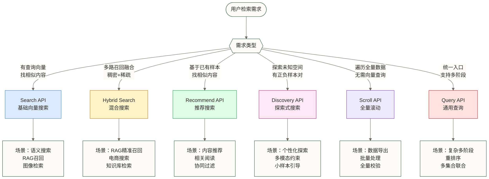
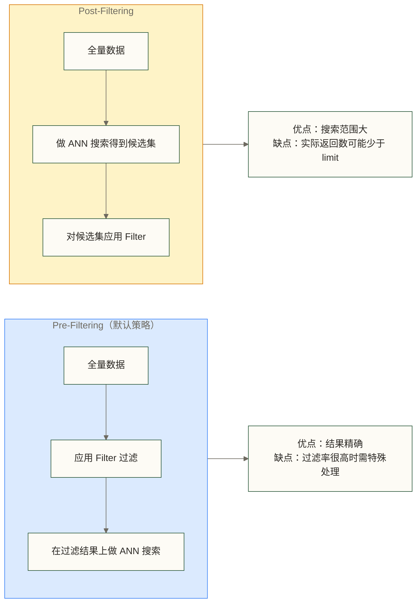
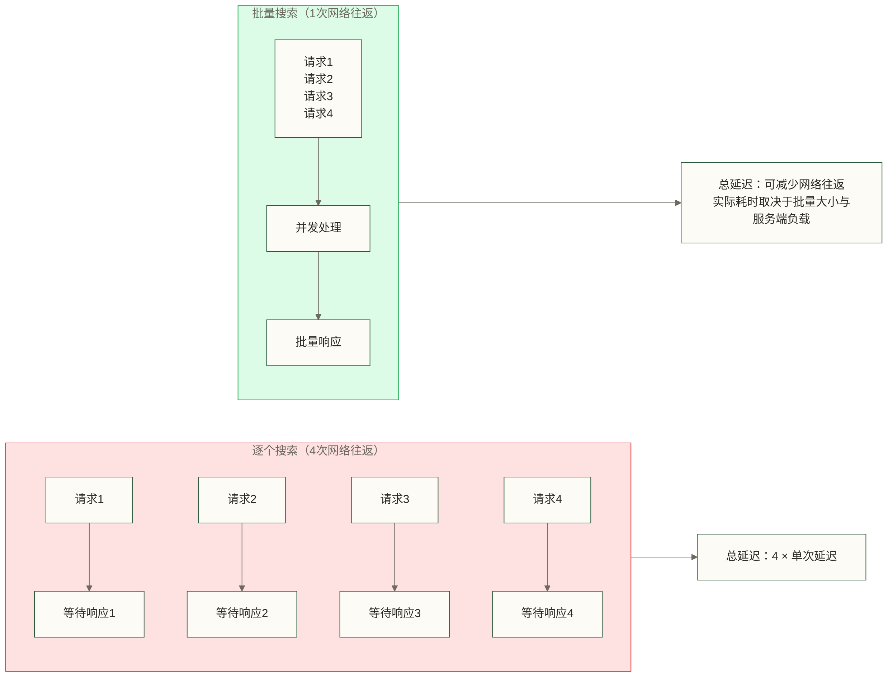
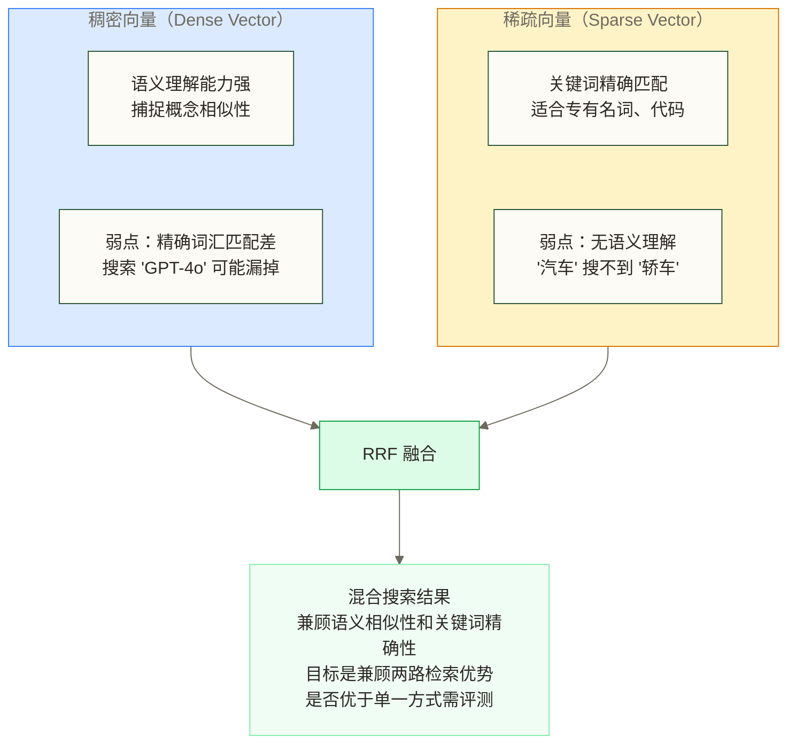
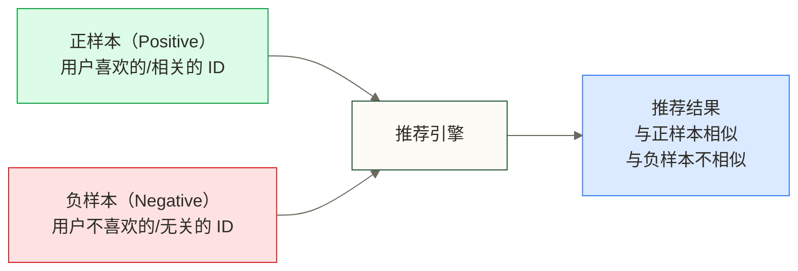
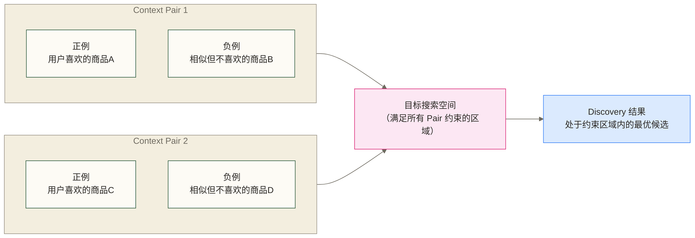
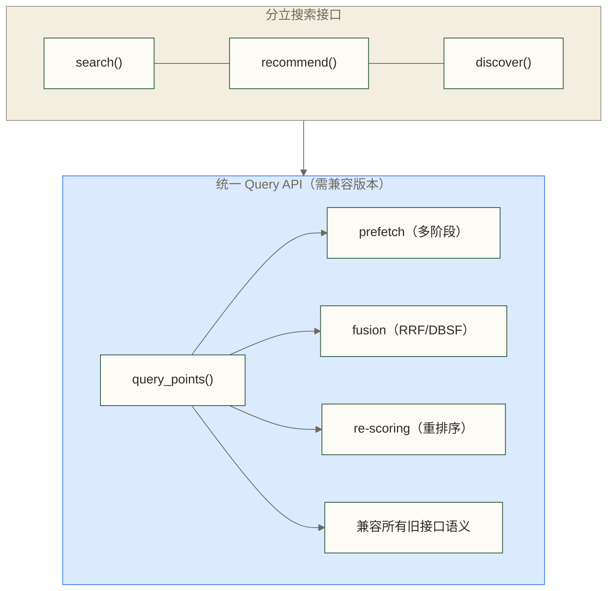

# Qdrant 搜索与查询详解

> [!abstract] 本文能给你什么
> - **掌握 Qdrant 全部搜索接口**：从基础向量搜索到批量搜索、混合搜索
> - **深度理解混合搜索原理**：稠密向量 + 稀疏向量 + RRF 融合的完整实现
> - **学会 Recommend API 与 Discovery API**：Qdrant 独有的探索式检索能力
> - **掌握 Scroll API**：高效遍历全量数据的正确姿势
> - **理解 filter 的使用时机与性能影响**，避免常见陷阱

Qdrant 不只是一个"传统"向量数据库，它的搜索能力已经远超简单的 ANN 最近邻查询。Qdrant 提供了统一的 **Query API**；使用前需确认服务端与客户端版本支持该接口，将向量搜索、推荐、探索、混合搜索全部整合到一个接口里，极大降低了使用复杂度。

理解 Qdrant 的搜索体系，才能真正发挥它在 RAG、推荐系统、语义检索等场景下的威力。

---

## 目录

- [[#Qdrant 搜索体系全景]]
- [[#基础向量搜索（Search API）]]
- [[#过滤器（Filter）深度解析]]
- [[#批量搜索（Search Batch）]]
- [[#混合搜索（Hybrid Search）]]
- [[#Recommend API：基于样本的推荐]]
- [[#Discovery API：探索式搜索]]
- [[#Scroll API：全量数据遍历]]
- [[#Query API：统一查询接口]]
- [[#搜索结果后处理]]
- [[#场景选型与最佳实践]]

---

## Qdrant 搜索体系全景

Qdrant 提供了多种搜索接口，每种接口适用于不同的业务场景。



> [!tip] 选型原则
> - **有明确查询文本/图像** → Search API 或 Hybrid Search
> - **基于用户历史行为推荐** → Recommend API
> - **需要在特定语义空间内探索** → Discovery API
> - **数据迁移、全量处理** → Scroll API
> - **复杂多阶段检索、需要 prefetch** → Query API

---

## 基础向量搜索（Search API）

### 最简单的向量搜索

向量搜索的本质：给定一个查询向量，在集合中找到最相似的 K 个向量。

```python
from qdrant_client import QdrantClient, models
from qdrant_client.models import Filter, FieldCondition, MatchValue

client = QdrantClient(url="http://localhost:6333")

# 准备查询向量（通常由 embedding 模型生成）
query_vector = [0.1, 0.2, 0.3, ...]  # 维度与集合一致

# 最基础的向量搜索
results = client.search(
    collection_name="my_collection",
    query_vector=query_vector,
    limit=10  # 返回 Top-10
)

for result in results:
    print(f"ID: {result.id}, Score: {result.score:.4f}")
    print(f"Payload: {result.payload}")
```

### search() 参数全解析

`search()` 是 Qdrant 最核心的接口，理解每个参数至关重要。

```python
results = client.search(
    collection_name="articles",  # 集合名称

    # ---- 查询向量相关 ----
    query_vector=("content_vector", query_vector),
    # 当集合有多个命名向量时，使用元组 (向量名, 向量值)
    # 只有一个默认向量时，直接传列表即可

    # ---- 过滤条件 ----
    query_filter=Filter(
        must=[
            FieldCondition(
                key="category",
                match=MatchValue(value="technology")
            )
        ]
    ),
    # 先过滤再搜索（pre-filtering），Qdrant 默认策略

    # ---- 结果数量 ----
    limit=10,    # 返回结果数，默认 10
    offset=0,    # 跳过前 N 个结果（用于分页，但不推荐大偏移量）

    # ---- 分数阈值 ----
    score_threshold=0.75,
    # 阈值方向取决于距离类型：余弦与点积保留高分结果，欧氏距离保留低距离结果
    # 余弦相似度范围：[-1, 1]，0.75 表示较高相似度

    # ---- 返回内容控制 ----
    with_payload=True,     # 返回 payload（默认 True）
    with_vectors=False,    # 返回原始向量（默认 False，会增大响应体积）

    # ---- 搜索参数（影响精度和速度） ----
    search_params=models.SearchParams(
        hnsw_ef=128,    # HNSW 搜索时探索的候选节点数
                        # 越大精度越高，速度越慢，默认等于 ef_construct
        exact=False,    # True = 暴力精确搜索，False = ANN 近似搜索
                        # exact=True 仅适用于小数据集验证场景
        quantization=models.QuantizationSearchParams(
            ignore=False,      # 是否忽略量化，使用原始向量
            rescore=True,      # 量化搜索后用原始向量重新打分（提升精度）
            oversampling=2.0,  # 过采样倍数，先召回 limit*2 再重排
        )
    )
)
```

### 参数调优速查表

| 参数 | 默认值 | 调高效果 | 调低效果 | 建议 |
|------|--------|----------|----------|------|
| `limit` | 10 | 结果更多，延迟略增 | 结果更少，更快 | 按业务需求设置 |
| `hnsw_ef` | 同 ef_construct | 精度更高，延迟更大 | 精度降低，更快 | 128~512 之间调整 |
| `score_threshold` | 无 | 余弦/点积条件更严格；欧氏距离条件更宽松 | 余弦/点积条件更宽松；欧氏距离条件更严格 | 按距离类型与实际分数分布确定 |
| `oversampling` | 1.0 | 量化精度更高 | 量化精度降低 | 启用量化时设 2.0~3.0 |

### 命名向量搜索

当集合包含多个命名向量字段时，需要指定使用哪个向量进行搜索：

```python
from qdrant_client.models import NamedVector, NamedSparseVector, SparseVector

# 搜索特定命名向量
results = client.search(
    collection_name="multimodal_collection",
    query_vector=NamedVector(
        name="image_vector",       # 使用图像向量字段
        vector=[0.1, 0.2, ...]    # 图像 embedding
    ),
    limit=5
)

# 场景：同一集合存储了 text_vector 和 image_vector
# 可以分别用不同向量进行语义搜索
```

### score_threshold 的正确使用

```python
# 不同相似度计算方式下，分数范围不同
# 余弦相似度（COSINE）：[-1, 1]，1 表示完全相同
# 点积（DOT）：无界，依赖向量模长
# 欧氏距离（EUCLID）：[0, +∞)，0 表示完全相同（越小越相似）
# 注意：分数排序与阈值方向取决于距离类型；余弦和点积分数越大越相似，欧氏距离越小越相似

# 余弦相似度场景下的阈值参考
results = client.search(
    collection_name="articles",
    query_vector=query_vector,
    score_threshold=0.80,  # 只返回非常相似的结果
    limit=20               # 上限 20，但实际可能因阈值返回更少
)

# 实践建议：先不设阈值，观察返回分数的分布
# 再根据业务需要确定合理的截断点
```

> [!warning] offset 分页的局限
> Qdrant 的 `offset` 参数会让系统先计算出 `limit + offset` 个结果再跳过前 `offset` 个，**大偏移量时性能很差**。如需遍历大量数据，请使用 [[#Scroll API：全量数据遍历]] 代替。

---

## 过滤器（Filter）深度解析

Qdrant 的过滤器是其核心差异化能力之一，支持将向量搜索与结构化过滤无缝结合。

### 过滤器的工作原理



> [!note] Qdrant 的智能选择
> Qdrant 会根据过滤后数据量自动选择最优策略：当过滤后数据量足够大时用 Pre-Filtering，数据量很小时会切换为暴力搜索，无需手动干预。

### 基础过滤条件

```python
from qdrant_client.models import (
    Filter, FieldCondition, MatchValue, MatchAny,
    Range, GeoBoundingBox, GeoPoint, IsNullCondition,
    IsEmptyCondition
)

# 1. 精确匹配（keyword 类型字段）
filter_exact = Filter(
    must=[
        FieldCondition(key="status", match=MatchValue(value="published"))
    ]
)

# 2. 多值匹配（in 查询）
filter_any = Filter(
    must=[
        FieldCondition(
            key="category",
            match=MatchAny(any=["tech", "science", "ai"])
        )
    ]
)

# 3. 数值范围过滤
filter_range = Filter(
    must=[
        FieldCondition(
            key="price",
            range=Range(gte=10.0, lte=100.0)  # 10 <= price <= 100
            # gte: >=, lte: <=, gt: >, lt: <
        )
    ]
)

# 4. 全文搜索（text 类型字段，需要先创建全文索引）
from qdrant_client.models import MatchText
filter_text = Filter(
    must=[
        FieldCondition(
            key="description",
            match=MatchText(text="machine learning")
        )
    ]
)

# 5. 地理位置过滤
filter_geo = Filter(
    must=[
        FieldCondition(
            key="location",
            geo_bounding_box=GeoBoundingBox(
                top_left=GeoPoint(lon=116.0, lat=40.0),
                bottom_right=GeoPoint(lon=117.0, lat=39.0)
            )
        )
    ]
)
```

### 复合逻辑过滤

```python
# must（AND 逻辑）：所有条件都必须满足
filter_and = Filter(
    must=[
        FieldCondition(key="category", match=MatchValue(value="tech")),
        FieldCondition(key="year", range=Range(gte=2023))
    ]
)

# should（OR 逻辑）：至少一个条件满足
filter_or = Filter(
    should=[
        FieldCondition(key="tag", match=MatchValue(value="AI")),
        FieldCondition(key="tag", match=MatchValue(value="ML"))
    ]
)

# must_not（NOT 逻辑）：不能满足这些条件
filter_not = Filter(
    must_not=[
        FieldCondition(key="status", match=MatchValue(value="deleted")),
        FieldCondition(key="is_spam", match=MatchValue(value=True))
    ]
)

# 嵌套复合：(category = "tech") AND (tag = "AI" OR tag = "ML")
filter_complex = Filter(
    must=[
        FieldCondition(key="category", match=MatchValue(value="tech")),
        Filter(
            should=[
                FieldCondition(key="tag", match=MatchValue(value="AI")),
                FieldCondition(key="tag", match=MatchValue(value="ML"))
            ]
        )
    ]
)
```

### 嵌套对象和数组过滤

```python
# Payload 结构示例：
# {
#   "metadata": {
#     "author": "Zhang Wei",
#     "tags": ["python", "data", "ml"]
#   }
# }

# 嵌套字段过滤（使用点号路径）
filter_nested = Filter(
    must=[
        FieldCondition(
            key="metadata.author",
            match=MatchValue(value="Zhang Wei")
        )
    ]
)

# 数组中的元素过滤
filter_array = Filter(
    must=[
        FieldCondition(
            key="metadata.tags",
            match=MatchValue(value="python")  # 数组中包含 "python"
        )
    ]
)
```

> [!tip] 过滤器性能优化
> 对过滤字段创建 payload 索引能显著提升过滤性能：
> ```python
> client.create_payload_index(
>     collection_name="articles",
>     field_name="category",
>     field_schema="keyword"  # 类型：keyword / integer / float / geo / text
> )
> ```
> 高基数字段（如 user_id）建索引收益最大，低基数字段（如 status）收益较小。

---

## 批量搜索（Search Batch）

当业务需要同时执行多个独立的向量搜索请求时，批量搜索能显著提升吞吐量。

### 为什么需要批量搜索



### search_batch() 使用方法

```python
from qdrant_client.models import SearchRequest, Filter, FieldCondition, MatchValue

# 构建多个搜索请求
search_queries = [
    SearchRequest(
        vector=query_vector_1,
        filter=Filter(
            must=[FieldCondition(key="type", match=MatchValue(value="article"))]
        ),
        limit=5,
        with_payload=True
    ),
    SearchRequest(
        vector=query_vector_2,
        filter=Filter(
            must=[FieldCondition(key="type", match=MatchValue(value="video"))]
        ),
        limit=10,
        score_threshold=0.7
    ),
    SearchRequest(
        vector=query_vector_3,
        limit=3,
        with_vectors=True  # 这个请求需要返回向量
    )
]

# 批量执行
batch_results = client.search_batch(
    collection_name="content_library",
    requests=search_queries
)

# 结果是一个列表，每个元素对应一个请求的结果
for i, results in enumerate(batch_results):
    print(f"Query {i+1} results: {len(results)} items")
    for result in results:
        print(f"  ID: {result.id}, Score: {result.score:.4f}")
```

### 实际应用场景

```python
# 场景：用户提问时，同时在多个知识库中并行检索
async def multi_collection_search(query_vector):
    """在多个集合中并行搜索，聚合结果"""

    # 方式1：批量搜索同一集合的多个查询
    results = client.search_batch(
        collection_name="knowledge_base",
        requests=[
            SearchRequest(vector=query_vector, limit=5,
                          filter=Filter(must=[FieldCondition(
                              key="domain", match=MatchValue(value="tech"))])),
            SearchRequest(vector=query_vector, limit=5,
                          filter=Filter(must=[FieldCondition(
                              key="domain", match=MatchValue(value="business"))])),
            SearchRequest(vector=query_vector, limit=5,
                          filter=Filter(must=[FieldCondition(
                              key="domain", match=MatchValue(value="science"))]))
        ]
    )

    # 聚合不同域的结果
    all_results = []
    for domain_results in results:
        all_results.extend(domain_results)

    # 按分数排序去重
    all_results.sort(key=lambda x: x.score, reverse=True)
    return all_results[:10]
```

---

## 混合搜索（Hybrid Search）

混合搜索是 Qdrant 最重要的差异化能力之一，也是现代 RAG 系统的标配。

### 为什么需要混合搜索



### 集合配置：同时存储稠密和稀疏向量

混合搜索的前提是集合中同时存储两种向量：

```python
from qdrant_client.models import (
    VectorParams, SparseVectorParams, Distance,
    SparseIndexParams
)

client.create_collection(
    collection_name="hybrid_articles",
    vectors_config={
        # 稠密向量：语义搜索（BGE-M3 / text-embedding-3-large 等）
        "dense": VectorParams(
            size=1024,              # 向量维度
            distance=Distance.COSINE
        )
    },
    sparse_vectors_config={
        # 稀疏向量：关键词搜索（BM25 / SPLADE / BGE-M3 稀疏输出）
        "sparse": SparseVectorParams(
            index=SparseIndexParams(
                on_disk=False  # 稀疏索引是否存储在磁盘
            )
        )
    }
)
```

### 数据写入：同时插入两种向量

```python
from qdrant_client.models import PointStruct, SparseVector

# 假设使用 BGE-M3 模型，它能同时输出稠密和稀疏向量
# 也可以用 SPLADE 生成稀疏向量，用其他模型生成稠密向量

def generate_vectors(text: str):
    """生成稠密和稀疏向量（示意，实际需调用模型）"""
    # 稠密向量（1024维连续浮点数）
    dense_vector = dense_model.encode(text)

    # 稀疏向量（indices: 非零维度下标, values: 对应权重）
    sparse_output = sparse_model.encode(text)
    sparse_vector = SparseVector(
        indices=sparse_output.indices.tolist(),  # [42, 1337, 5500, ...]
        values=sparse_output.values.tolist()      # [0.8, 0.3, 0.6, ...]
    )
    return dense_vector, sparse_vector

# 批量插入
points = []
for doc in documents:
    dense_vec, sparse_vec = generate_vectors(doc["content"])
    points.append(
        PointStruct(
            id=doc["id"],
            vector={
                "dense": dense_vec,
                "sparse": sparse_vec
            },
            payload={
                "title": doc["title"],
                "content": doc["content"],
                "category": doc["category"]
            }
        )
    )

client.upsert(
    collection_name="hybrid_articles",
    points=points
)
```

### RRF 融合搜索（推荐方式）

**Reciprocal Rank Fusion（RRF）** 是混合搜索的核心算法。

```python
from qdrant_client.models import (
    Prefetch, FusionQuery, Fusion,
    NamedVector, NamedSparseVector, SparseVector, Query
)

# 生成查询向量
query_text = "大语言模型的 Transformer 架构原理"
query_dense, query_sparse = generate_vectors(query_text)

# 使用 Query API 实现 RRF 混合搜索
results = client.query_points(
    collection_name="hybrid_articles",

    # prefetch：先分别执行稠密和稀疏搜索，获取候选集
    prefetch=[
        # 稠密向量搜索：语义相关性
        Prefetch(
            query=query_dense,
            using="dense",
            limit=20          # 召回 20 个候选
        ),
        # 稀疏向量搜索：关键词匹配
        Prefetch(
            query=SparseVector(
                indices=query_sparse.indices,
                values=query_sparse.values
            ),
            using="sparse",
            limit=20
        )
    ],

    # 使用 RRF 对两路结果进行融合排序
    query=FusionQuery(fusion=Fusion.RRF),
    limit=10,
    with_payload=True
)
```

### RRF 算法原理

```python
# RRF 分数计算公式：
# score(d) = sum( 1 / (k + rank_i(d)) )
# 本算例假设 k=60，用于演示平滑常数的作用，不表示 Qdrant 的默认参数
# rank_i(d) 是文档 d 在第 i 路搜索中的排名（从1开始）

# 示例：文档 A 在稠密搜索中排名第1，在稀疏搜索中排名第3
# RRF_score(A) = 1/(60+1) + 1/(60+3) = 0.01639 + 0.01587 = 0.03226

# 文档 B 只在稠密搜索中出现，排名第2
# RRF_score(B) = 1/(60+2) + 0 = 0.01613

# 文档 A > 文档 B，说明两路都相关的文档更受青睐

# RRF 的核心优势：
# 1. 不依赖各路搜索的绝对分数，只用排名，避免分数量纲不一致问题
# 2. 两路都高分的文档会被明显提升
# 3. 只在一路出现的文档分数会被"惩罚"
```

### 带过滤的混合搜索

```python
from qdrant_client.models import Filter, FieldCondition, MatchValue

# 混合搜索 + 元数据过滤
results = client.query_points(
    collection_name="hybrid_articles",
    prefetch=[
        Prefetch(
            query=query_dense,
            using="dense",
            limit=20,
            # 在 prefetch 层面过滤（推荐，减少后续处理量）
            filter=Filter(
                must=[FieldCondition(
                    key="language",
                    match=MatchValue(value="zh")
                )]
            )
        ),
        Prefetch(
            query=SparseVector(
                indices=query_sparse.indices,
                values=query_sparse.values
            ),
            using="sparse",
            limit=20,
            filter=Filter(
                must=[FieldCondition(
                    key="language",
                    match=MatchValue(value="zh")
                )]
            )
        )
    ],
    query=FusionQuery(fusion=Fusion.RRF),
    limit=10
)
```

### 使用 FastEmbed 简化混合搜索

Qdrant 官方提供了 FastEmbed 库，可以内置生成稠密和稀疏向量：

```python
from qdrant_client import QdrantClient

# FastEmbed 集成：自动处理稠密和稀疏向量生成
client = QdrantClient(url="http://localhost:6333")

# 使用内置 embedding 的混合搜索
# 此处只展示文本查询入口；稠密与稀疏模型需分别配置，不能据此认定已自动生成 BGE-M3 稀疏向量或完成两路融合
results = client.query(
    collection_name="hybrid_articles",
    query_text="Transformer architecture explained",  # 直接传文本
    using="dense",  # 或者自动处理
    limit=10
)
```

> [!tip] BGE-M3 是混合搜索的首选模型
> BGE-M3 能同时输出稠密向量（1024维）和稀疏向量，一个模型解决两个问题。相比分别用两个模型，语义一致性更好，工程实现也更简单。

---

## Recommend API：基于样本的推荐

Recommend API 不需要查询向量，而是基于已有的 point（文档）来找相似内容，非常适合推荐系统场景。

### 核心概念



### 基础推荐

```python
# 基于已有 point ID 推荐相似内容
results = client.recommend(
    collection_name="articles",

    # 正样本：用户已读/已点赞的文章 ID
    positive=[42, 100, 255],

    # 负样本（可选）：用户已标记不感兴趣的文章 ID
    negative=[10, 99],

    # 使用哪个向量字段进行推荐（命名向量场景）
    using="content_vector",

    # 其他标准搜索参数
    limit=10,
    score_threshold=0.6,
    with_payload=True,
    query_filter=Filter(
        must=[FieldCondition(
            key="published",
            match=MatchValue(value=True)
        )]
    )
)

print(f"推荐了 {len(results)} 篇文章")
for r in results:
    print(f"  {r.payload['title']} (score: {r.score:.4f})")
```

### 使用原始向量作为样本

不仅可以用已有 point 的 ID，也可以直接传入向量：

```python
from qdrant_client.models import RecommendRequest

# 用原始向量作为正/负样本
results = client.recommend(
    collection_name="products",
    positive=[
        [0.1, 0.2, 0.3, ...],  # 直接传向量
        123,                    # 或者传已有 point 的 ID
    ],
    negative=[
        456,                    # 用户明确不感兴趣的商品 ID
    ],
    limit=20
)
```

### 批量推荐

```python
from qdrant_client.models import RecommendRequest

# 为多个用户同时生成推荐
batch_recommend = client.recommend_batch(
    collection_name="articles",
    requests=[
        RecommendRequest(
            positive=user1_liked_ids,
            negative=user1_disliked_ids,
            limit=10,
            filter=Filter(must=[FieldCondition(
                key="language", match=MatchValue(value="zh"))])
        ),
        RecommendRequest(
            positive=user2_liked_ids,
            limit=10
        ),
        RecommendRequest(
            positive=user3_liked_ids,
            negative=user3_disliked_ids,
            limit=5,
            score_threshold=0.7
        )
    ]
)

for user_idx, recommendations in enumerate(batch_recommend):
    print(f"User {user_idx+1}: {len(recommendations)} recommendations")
```

### Recommend API 的计算原理

```python
# average_vector 推荐策略通过计算查询向量检索；其他策略不能仅用这一公式解释
# average_vector 策略：无负样本时使用正样本均值；有负样本时使用 2 * mean(positive_vectors) - mean(negative_vectors)
# 然后在集合中找与 query_vector 最相似的结果

# 这意味着：
# - 多个正样本会取平均，代表"用户喜好方向"
# - 有负样本时，从正样本均值的两倍中减去负样本均值，引导检索方向
# - 负样本的作用是"引导"而非"过滤"
#   （与 filter 不同，负样本是软约束，不是硬过滤）

# 最佳实践：
# 正样本 3-5 个效果最佳，过多会平均效应导致方向不明确
# 负样本 1-3 个足够，主要用于避免明显不相关的方向
```

---

## Discovery API：探索式搜索

Discovery API 是 Qdrant 独有的功能，灵感来源于机器学习中的**对比学习**（Contrastive Learning）。

### 对比传统搜索的差异

| 维度 | 传统向量搜索 | Discovery API |
|------|------------|---------------|
| 输入 | 单一查询向量 | 目标向量 + 上下文对（正负样本对） |
| 结果导向 | 找最近邻 | 在约束空间内找最合适的点 |
| 适用场景 | 明确语义检索 | 探索性、个性化、多模态约束 |
| 典型应用 | 文档检索、以图搜图 | 个性化商品探索、多条件联合约束 |

### Context Pairs 概念



### Discovery Search（目标 + 上下文）

```python
from qdrant_client.models import ContextExamplePair, DiscoverRequest

# 场景：用户想找类似商品A但风格不要像商品B的产品
target_vector = [0.1, 0.2, ...]  # 目标方向（用户的大致偏好）

results = client.discover(
    collection_name="products",

    # 目标向量：用户大致感兴趣的方向
    target=target_vector,

    # 上下文对：{正例, 负例} 对，约束搜索空间
    context=[
        ContextExamplePair(
            positive=100,   # 用户喜欢商品 #100
            negative=200    # 但不喜欢与 #200 类似的风格
        ),
        ContextExamplePair(
            positive=150,   # 还喜欢商品 #150
            negative=300    # 但不要 #300 那种风格
        )
    ],

    limit=10,
    with_payload=True
)
```

### Context Search（纯上下文，无目标）

当没有明确目标方向，只有样本对时，使用 Context Search：

```python
# 纯粹基于上下文对的探索
# 找到"处于正例区域但远离负例区域"的点
results = client.discover(
    collection_name="products",

    # 不传 target，只传 context
    context=[
        ContextExamplePair(positive=10, negative=20),
        ContextExamplePair(positive=30, negative=40),
        ContextExamplePair(positive=50, negative=60),
    ],

    limit=10
)

# 应用场景：
# 用户只给出了几组"我喜欢A但不是B那种"的偏好
# 系统在整个向量空间中找到最满足这些偏好的商品
```

### Discovery API 实际应用案例

```python
# 案例：个性化视频推荐
# 场景：用户喜欢科技视频但不喜欢太学术的，喜欢短视频但不喜欢广告多的

video_results = client.discover(
    collection_name="videos",

    # 目标：最近看过并标记喜欢的视频
    target=liked_video_id,

    context=[
        # 喜欢科普向，但不要学术论文解读
        ContextExamplePair(
            positive=popular_science_video_id,
            negative=academic_lecture_id
        ),
        # 喜欢中短视频，但不要带货视频
        ContextExamplePair(
            positive=short_tutorial_id,
            negative=shopping_ad_id
        )
    ],

    query_filter=Filter(
        must=[
            FieldCondition(key="duration_minutes", range=Range(lte=30)),
            FieldCondition(key="language", match=MatchValue(value="zh"))
        ]
    ),
    limit=20
)
```

> [!note] Discovery vs Recommend 的选择
> - **Recommend**：你有明确的"喜欢/不喜欢"的 point 列表，想找最相似的 → 用 Recommend
> - **Discovery**：你有成对的约束（在A和B之间更偏向A），想在这种约束下探索 → 用 Discovery
> - Discovery 对用户行为数据的粒度要求更高，但个性化程度也更强

---

## Scroll API：全量数据遍历

当需要遍历集合中的所有数据（或大量数据），不需要向量相似性排序时，使用 Scroll API。

### Scroll 的工作机制

```mermaid
%%{init: {"theme":"base","themeVariables":{"fontFamily":"PingFang SC, -apple-system, Source Han Serif SC, serif","fontSize":"16px","background":"#FDFBF5","primaryColor":"#FDFBF5","primaryTextColor":"#2D2A26","primaryBorderColor":"#6E6A60","secondaryColor":"#E8EFE8","secondaryBorderColor":"#8FA890","secondaryTextColor":"#2D2A26","tertiaryColor":"#FDFBF5","tertiaryBorderColor":"#9A9488","tertiaryTextColor":"#6E6A60","lineColor":"#6E6A60","textColor":"#2D2A26","mainBkg":"#FDFBF5","nodeBorder":"#2D5A3D","clusterBkg":"#F3EEDF","clusterBorder":"#9A9488","edgeLabelBackground":"#FDFBF5"},"flowchart":{"htmlLabels":true,"curve":"basis","padding":20,"nodeSpacing":60,"rankSpacing":70,"useMaxWidth":false},"themeCSS":".node rect, .node polygon, .node circle { stroke-width: 1.5px; } .edgePath .path { stroke-width: 1.5px; } .cluster-label .nodeLabel, .cluster-label foreignObject { color: #2D2A26 !important; } .edgeLabel, .edgeLabel foreignObject { color: #2D2A26 !important; background-color: #FDFBF5; } .edgeLabel rect { fill: #FDFBF5; }"}}%%
flowchart LR
    Start(["开始"]) --> S1["scroll(offset=None)"]
    S1 --> Res1["返回：第1批数据<br/>next_page_offset=xxx"]
    Res1 --> Check{{"next_page_offset<br/>是否为 None？"}}
    Check -->|"否"| S2["scroll(offset=next_page_offset)"]
    S2 --> Res2["返回：第2批数据<br/>next_page_offset=yyy"]
    Res2 --> Check
    Check -->|"是"| End(["遍历完成"])

    style Start fill:#dcfce7,stroke:#16a34a
    style End fill:#dbeafe,stroke:#3b82f6
```



### 基础 Scroll 使用

```python
# 遍历集合中的所有数据（无向量搜索）
all_points = []
next_page_offset = None

while True:
    # 获取一批数据
    points, next_page_offset = client.scroll(
        collection_name="articles",
        offset=next_page_offset,    # 分页游标
        limit=100,                  # 每批获取 100 条
        with_payload=True,          # 返回 payload
        with_vectors=False,         # 通常不需要返回向量
        order_by=None               # 默认按 point ID 排序
    )

    all_points.extend(points)
    print(f"已获取 {len(all_points)} 条数据")

    # 没有更多数据时退出
    if next_page_offset is None:
        break

print(f"总计遍历 {len(all_points)} 条数据")
```

### 带过滤的 Scroll

```python
# 获取所有状态为 "pending" 的待处理文档
pending_points = []
next_offset = None

filter_condition = Filter(
    must=[FieldCondition(
        key="status",
        match=MatchValue(value="pending")
    )]
)

while True:
    points, next_offset = client.scroll(
        collection_name="tasks",
        scroll_filter=filter_condition,
        offset=next_offset,
        limit=200,
        with_payload=True
    )

    if not points:
        break

    pending_points.extend(points)

    if next_offset is None:
        break

print(f"找到 {len(pending_points)} 个待处理任务")
```

### Scroll 的典型应用场景

```python
# 场景1：数据迁移 - 从一个集合迁移到另一个集合
def migrate_collection(source: str, target: str, transform_fn=None):
    """将数据从 source 集合迁移到 target 集合"""
    offset = None
    total_migrated = 0

    while True:
        points, offset = client.scroll(
            collection_name=source,
            offset=offset,
            limit=500,
            with_payload=True,
            with_vectors=True  # 迁移时需要向量
        )

        if not points:
            break

        # 将读取记录转换为写入点；目标集合需预先具有兼容的向量配置
        write_points = [
            PointStruct(id=p.id, vector=p.vector, payload=p.payload)
            for p in points
        ]

        # 可选：转换函数接收并返回 PointStruct
        if transform_fn:
            write_points = [transform_fn(p) for p in write_points]

        # 写入目标集合
        client.upsert(
            collection_name=target,
            points=write_points
        )

        total_migrated += len(points)
        print(f"已迁移 {total_migrated} 条")

        if offset is None:
            break

# 场景2：批量重新计算 payload 字段
def update_all_payloads(collection_name: str, update_fn):
    """遍历所有 point，根据现有 payload 更新某个字段"""
    offset = None

    while True:
        points, offset = client.scroll(
            collection_name=collection_name,
            offset=offset,
            limit=100,
            with_payload=True
        )

        if not points:
            break

        for point in points:
            new_payload = update_fn(point.payload)
            client.set_payload(
                collection_name=collection_name,
                payload=new_payload,
                points=[point.id]
            )

        if offset is None:
            break
```

> [!warning] Scroll vs search 的性能差异
> - **Scroll**：分页遍历，无向量相似度计算，适合全量操作；逐批处理且不累积全部结果时可控制客户端内存占用
> - **search + 大 limit**：会执行完整的 ANN 搜索，再截取结果，**不要用 search 来遍历全量数据**
> - 如果需要按某个标量字段排序后遍历，可以配合 `order_by` 参数

---

## Query API：统一查询接口

`query_points()` 提供向量搜索、推荐、探索和多阶段检索的统一入口；接口与查询类型的可用范围取决于服务端和客户端版本，全量遍历仍可使用 Scroll API。

### Query API 的优势



### 多阶段检索（Prefetch + Re-scoring）

Query API 的杀手级功能：多阶段检索 + 重排序。

```python
from qdrant_client.models import Prefetch, Query

# 三阶段检索：粗排 → 精排 → 最终返回
results = client.query_points(
    collection_name="large_collection",

    prefetch=[
        # 第一阶段：用量化向量快速粗排，召回 1000 个候选
        Prefetch(
            query=query_vector,
            using="dense",
            limit=1000,
            params=models.SearchParams(
                quantization=models.QuantizationSearchParams(
                    ignore=False,   # 使用量化向量（快速）
                    rescore=False   # 不重打分
                )
            )
        )
    ],

    # 第二阶段：在 1000 个候选上用原始向量精确重排
    query=query_vector,
    using="dense",
    params=models.SearchParams(
        quantization=models.QuantizationSearchParams(
            ignore=True,    # 不用量化，用原始向量重排
        )
    ),
    limit=10  # 最终返回 10 个
)

# 效果：
# 第一阶段：量化向量快速从百万条数据中召回 1000 个候选（极快）
# 第二阶段：原始向量对 1000 个候选精确重排（精度高，因为候选集小）
# 整体：可将快 10-50 倍、精度接近全量搜索设为待验证的假设目标；实际收益取决于数据、量化配置、候选数量与硬件，需测量延迟和召回率
```

### 嵌套 Prefetch（复杂多阶段）

```python
# 示例：同一集合内的多向量、多阶段检索
results = client.query_points(
    collection_name="final_collection",
    prefetch=[
        # 在 final_collection 的稀疏候选集上执行稠密检索
        Prefetch(
            query=query_dense,
            using="dense_vector",
            limit=100,
            prefetch=[
                # 嵌套 prefetch：先在 final_collection 内部做稀疏搜索
                Prefetch(
                    query=SparseVector(indices=..., values=...),
                    using="sparse_vector",
                    limit=200
                )
            ]
        )
    ],
    query=FusionQuery(fusion=Fusion.RRF),
    limit=10
)
```

---

## 搜索结果后处理

### 理解 Qdrant 的相似度分数

```python
# Qdrant 的分数含义取决于距离类型，不能统一按越大越好解释
# 余弦相似度：直接使用 [-1, 1]，1 表示完全相同
# 欧氏距离：距离越小越相似；不要按 1/(1+distance) 解读返回分数
# 点积：直接使用原始值

# 分数解读建议（余弦相似度场景）
def interpret_score(score: float) -> str:
    if score >= 0.95:
        return "极高相似度（几乎相同）"
    elif score >= 0.85:
        return "高相似度（强相关）"
    elif score >= 0.70:
        return "中高相似度（相关）"
    elif score >= 0.50:
        return "中等相似度（可能相关）"
    else:
        return "低相似度（可能不相关）"

# 注意：不同模型训练方式不同，分数分布差异很大
# 建议针对自己的模型和数据建立分数基准线
```

### 结果去重与后处理

```python
# 场景：同一集合、分数可比且越大越好的多路召回结果去重
# 欧氏距离需改为保留最低分；跨集合需使用集合名与 ID 的组合键
# 不同模型或分数量纲的结果需先采用融合等方式，不能直接比较原始分数
def deduplicate_results(results, key="id"):
    """在上述适用条件下按 ID 去重，保留分数最高的"""
    seen = {}
    for r in results:
        r_id = getattr(r, key)
        if r_id not in seen or seen[r_id].score < r.score:
            seen[r_id] = r
    return sorted(seen.values(), key=lambda x: x.score, reverse=True)

# 场景：从搜索结果提取结构化数据（用于 RAG）
def extract_context_for_rag(results, max_tokens=2000):
    """从搜索结果提取文本上下文，用于 RAG"""
    contexts = []
    total_tokens = 0

    for r in results:
        text = r.payload.get("content", "")
        token_count = len(text) // 4  # 粗略估算 token 数

        if total_tokens + token_count > max_tokens:
            break

        contexts.append({
            "score": r.score,
            "title": r.payload.get("title", ""),
            "content": text,
            "source": r.payload.get("url", "")
        })
        total_tokens += token_count

    return contexts
```

---

## 场景选型与最佳实践

### 各 API 选型总结

| 场景 | 推荐 API | 关键配置 |
|------|----------|----------|
| 基础语义搜索 | `search()` | `hnsw_ef`、`score_threshold` |
| 语义 + 精确关键词 | `query_points()` + Hybrid | RRF、稠密+稀疏双向量 |
| 基于历史行为推荐 | `recommend()` | 正负样本、`using` 参数 |
| 个性化约束探索 | `discover()` | Context Pairs |
| 全量数据遍历/迁移 | `scroll()` | 分批、游标 |
| 多阶段粗排精排 | `query_points()` + Prefetch | 量化粗排、原始向量精排 |
| 并发多个独立搜索 | `search_batch()` | 批量请求数组 |

### RAG 最佳实践

```python
# RAG 检索流程示例：混合融合或单路搜索，然后提取上下文
def rag_retrieve(
    query: str,
    collection: str = "knowledge_base",
    top_k: int = 5,
    use_hybrid: bool = True
):
    """
    RAG 检索示例：RRF 混合融合或纯稠密搜索；未包含独立重排阶段
    """
    # 1. 生成查询向量
    dense_vec = embed_model.encode(query)
    sparse_vec = sparse_model.encode(query) if use_hybrid else None

    if use_hybrid and sparse_vec is not None:
        # 2a. 混合搜索（推荐）
        results = client.query_points(
            collection_name=collection,
            prefetch=[
                Prefetch(query=dense_vec, using="dense", limit=top_k * 3),
                Prefetch(
                    query=SparseVector(
                        indices=sparse_vec.indices,
                        values=sparse_vec.values
                    ),
                    using="sparse",
                    limit=top_k * 3
                )
            ],
            query=FusionQuery(fusion=Fusion.RRF),
            limit=top_k,
            with_payload=True
        )
    else:
        # 2b. 纯稠密搜索（备选）
        results = client.search(
            collection_name=collection,
            query_vector=dense_vec,
            limit=top_k,
            score_threshold=0.6,
            with_payload=True
        )

    # 3. 提取上下文
    return [
        {
            "content": r.payload["content"],
            "source": r.payload.get("title", ""),
            "score": r.score
        }
        for r in (results.points if hasattr(results, 'points') else results)
    ]
```

> [!tip] 生产环境搜索调优清单
> - [ ] 对高频过滤字段创建 payload 索引
> - [ ] 启用向量量化（标量/乘积量化）减少内存，配合 rescore 改善候选集内的排序精度；不能保证召回率，需评测候选遗漏
> - [ ] 根据数据规模调整 `hnsw_ef`（小数据集 64，大数据集 256+）
> - [ ] 混合搜索中 dense 和 sparse 的 prefetch limit 设为最终 limit 的 2-3 倍
> - [ ] 不要用 `search + 大 offset` 分页，用 Scroll API 代替
> - [ ] 生产环境启用 async 客户端，提高并发吞吐量

---

## 小结

Qdrant 的搜索体系是一个层次分明、功能完整的体系：

1. **基础层**：`search()` + `filter` 满足 80% 的场景
2. **进阶层**：混合搜索（Hybrid Search）提升 RAG 召回质量
3. **特色层**：`Recommend API` 和 `Discovery API` 支持个性化推荐场景
4. **工程层**：`scroll()` 支持全量遍历，`search_batch()` 支持高吞吐并发
5. **统一层**：`query_points()` 的 Prefetch + Fusion 机制支持任意复杂的多阶段检索

理解了这个体系，就能为不同的业务场景选择最合适的搜索方案。

## 相关文档

- [[【技术与工具】/向量数据库/Qdrant/01-Qdrant概述与核心定位|Qdrant 概述与核心定位]]
- [[【技术与工具】/向量数据库/Qdrant/02-Qdrant架构深度解析|架构深度解析]]
- 集合管理与数据建模
- [[【技术与工具】/向量数据库/Milvus/06-索引类型与选型指南|Milvus 索引类型与选型指南（对照阅读）]]
- 数据写入与更新操作
- 生产运维与性能调优
- [[【技术与工具】/向量数据库/00-向量数据库选型指南|向量数据库选型指南]]
- Milvus 查询与搜索详解
