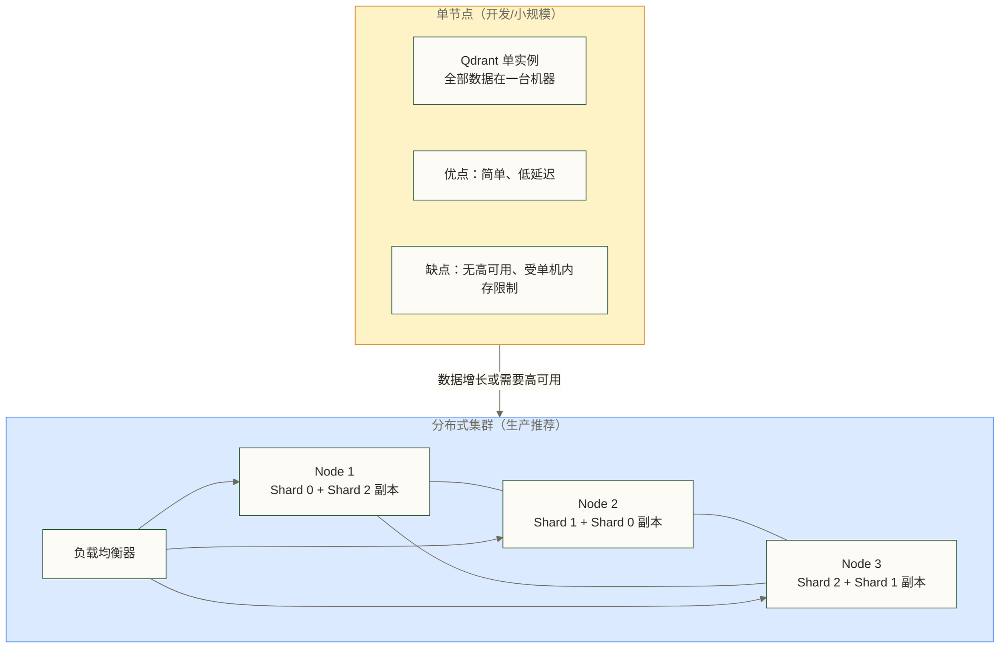
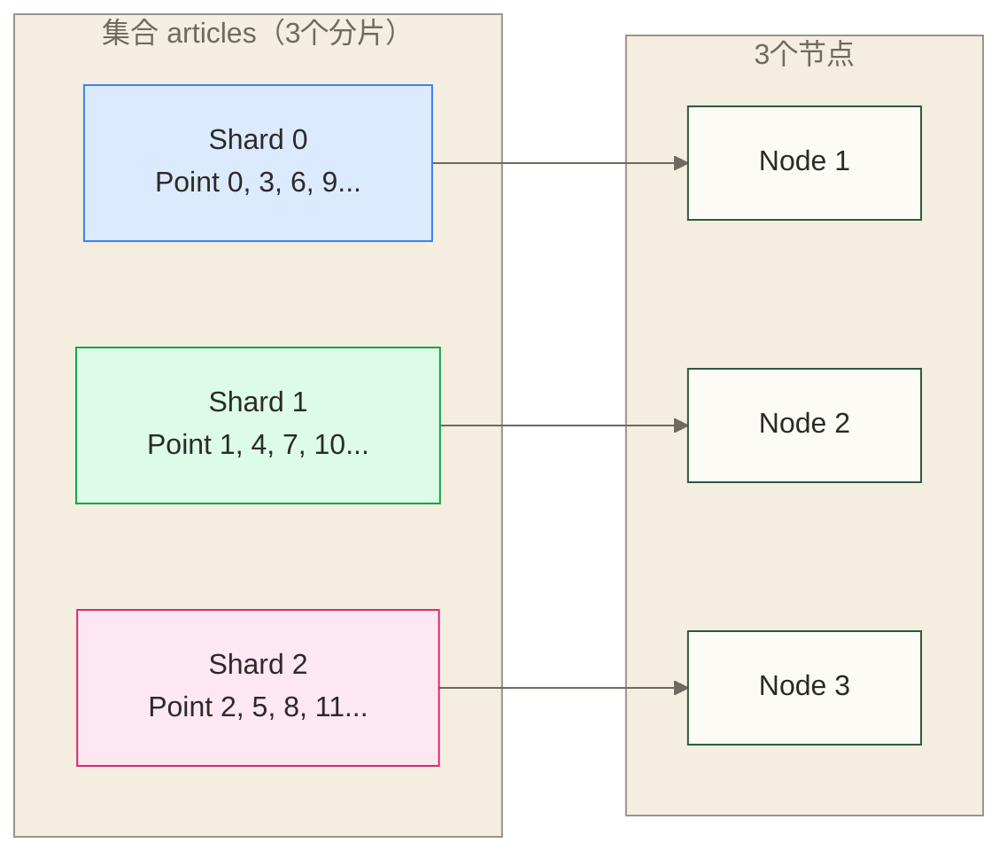
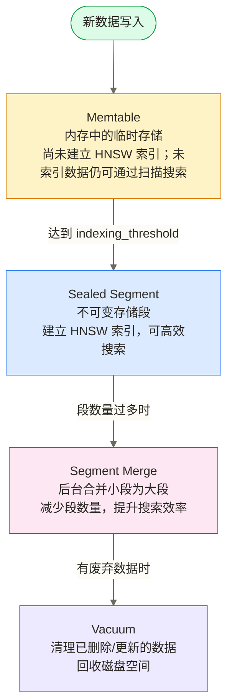

# Qdrant 生产运维与性能调优

> [!abstract] 本文能给你什么
> - **掌握 Qdrant 集群的分片与副本配置**，理解如何规划高可用架构
> - **深度理解 Optimizer 调优**，让后台优化流程为你所用
> - **学会内存管理策略**：on_disk、mmap、量化三种方案的权衡与选择
> - **规划 Prometheus 监控与告警**，了解关键指标；示例指标、标签及集合字段需与实际部署版本对应
> - **掌握三大性能调优场景**：写入吞吐、查询延迟、大规模数据
> - **熟练使用 Snapshot API** 实现备份、恢复和跨集群迁移

把 Qdrant 跑在生产环境中，和在本地 demo 里运行是两件完全不同的事。本文覆盖了从集群规划、参数调优到监控告警、容灾恢复的完整运维知识体系，是将 Qdrant 推向生产的必读指南。

---

## 目录

- [[#生产架构全景]]
- [[#集群分片与副本]]
- [[#Optimizer 调优深度解析]]
- [[#内存管理策略]]
- [[#向量量化（Quantization）]]
- [[#监控与告警]]
- [[#性能调优三大场景]]
- [[#备份与恢复]]
- [[#扩缩容操作]]
- [[#生产部署 Checklist]]

---

## 生产架构全景

### 单节点 vs 集群



### 集群节点规划参考

| 数据规模 | 推荐节点数 | 分片数 | 副本数 | 说明 |
|---------|-----------|--------|--------|------|
| < 100 万向量 | 1 | 1 | 1 | 单节点足够 |
| 100万 - 1000万 | 3 | 3 | 2 | 最小生产集群 |
| 1000万 - 5000万 | 5-6 | 5-6 | 2 | 中型集群 |
| 5000万+ | 10+ | 10-20 | 2-3 | 大规模集群 |

> [!tip] 黄金法则
> - **节点数 >= 3** 可作为共识可用性规划的参考条件；节点故障后的服务可用性仍取决于故障范围、副本分布与健康状态及读写策略
> - **副本数 >= 2** 可提供数据冗余，但不单独保证单节点故障时零数据丢失；还需考虑副本健康、写入确认及故障范围
> - **分片数一旦创建后无法修改**（只能重建集合），需要提前规划

---

## 集群分片与副本

### 分片（Sharding）基础概念

分片将集合的数据水平分散到多个节点，是集群横向扩展的基础。



### 创建集合时配置分片

```python
from qdrant_client import QdrantClient
from qdrant_client.models import (
    VectorParams, Distance, ShardingMethod
)

client = QdrantClient(url="http://qdrant-cluster:6333")

# 方式1：自动分片（推荐，Qdrant 自动均衡）
client.create_collection(
    collection_name="articles",
    vectors_config=VectorParams(
        size=1024,
        distance=Distance.COSINE
    ),
    shard_number=6,           # 总分片数（建议：节点数的 1-2 倍）
    replication_factor=2,     # 每个分片的副本数（含主分片）
    write_consistency_factor=1,  # 写入时至少同步到几个副本才算成功
                                 # 1：要求至少一个副本确认写入
                                 # 2：要求至少两个副本确认写入；不单独保证读写强一致性

    # 分片策略：auto（默认）或 custom
    sharding_method=ShardingMethod.AUTO
    # AUTO：Qdrant 自动将新 point 均匀分配到各分片
    # CUSTOM：用户自定义每个 point 归属哪个分片（需传 shard_key）
)
```

### 自定义分片（Custom Sharding）

Custom Sharding 允许按业务逻辑控制数据分布，适合多租户场景：

```python
from qdrant_client.models import ShardKeySelector

# 创建支持自定义分片的集合
client.create_collection(
    collection_name="multi_tenant_data",
    vectors_config=VectorParams(size=768, distance=Distance.COSINE),
    shard_number=3,
    sharding_method=ShardingMethod.CUSTOM
)

# 为每个租户创建专属分片键
client.create_shard_key(
    collection_name="multi_tenant_data",
    shard_key="tenant_A",       # 分片键
    shards_number=1,            # 该键占几个分片
    replication_factor=2
)

client.create_shard_key(
    collection_name="multi_tenant_data",
    shard_key="tenant_B",
    shards_number=1,
    replication_factor=2
)

# 写入数据时指定分片键
from qdrant_client.models import PointStruct

client.upsert(
    collection_name="multi_tenant_data",
    points=[
        PointStruct(id=1, vector=[...], payload={"content": "..."})
    ],
    shard_key_selector="tenant_A"  # 写入到 tenant_A 的分片
)

# 查询时也可以只搜索特定分片（提高查询效率）
results = client.search(
    collection_name="multi_tenant_data",
    query_vector=[...],
    limit=10,
    shard_key_selector=ShardKeySelector(shard_keys=["tenant_A"])
    # 只在 tenant_A 的分片上搜索，不扫描其他租户数据
)
```

### 副本配置与容错

```python
# 查看集合的分片和副本状态
collection_info = client.get_collection("articles")
print(f"状态：{collection_info.status}")
print(f"分片数：{collection_info.config.params.shard_number}")
print(f"副本数：{collection_info.config.params.replication_factor}")

# 查看集群中每个节点上的分片分布
cluster_info = client.get_collection_cluster_info("articles")
for shard in cluster_info.local_shards:
    print(f"本节点分片: ID={shard.shard_id}, 状态={shard.state}")

for shard in cluster_info.remote_shards:
    print(f"远端分片: ID={shard.shard_id}, 节点={shard.peer_id}")
```

### 分片迁移（手动负载均衡）

```python
from qdrant_client.models import MoveShard, ReplicateShard

# 将分片从一个节点移动到另一个节点
# 场景：节点负载不均衡，需要手动调整
client.update_collection_cluster_setup(
    collection_name="articles",
    operation=MoveShard(
        shard_id=0,
        from_peer_id=1234567890,  # 源节点 ID（从 cluster info 获取）
        to_peer_id=9876543210     # 目标节点 ID
    )
)

# 增加分片副本（提升可用性或读性能）
client.update_collection_cluster_setup(
    collection_name="articles",
    operation=ReplicateShard(
        shard_id=1,
        from_peer_id=1234567890,
        to_peer_id=1111111111   # 添加到新节点
    )
)
```

> [!warning] 分片数规划的重要性
> Qdrant 的分片数在集合创建后**无法修改**。如果分片数设置不足，未来扩容时只能：
> 1. 创建新集合（更多分片）
> 2. 用 Scroll API 将旧数据迁移过去
> 3. 删除旧集合
> 建议按**未来 2-3 年的数据规模**提前规划分片数。

---

## Optimizer 调优深度解析

### Qdrant 的后台优化流程

Qdrant 的写入性能之所以优秀，关键在于它的**分层存储 + 异步优化**机制。



### optimizer_config 参数详解

```python
from qdrant_client.models import OptimizersConfigDiff

# 创建集合时指定 optimizer 配置
client.create_collection(
    collection_name="articles",
    vectors_config=VectorParams(size=1024, distance=Distance.COSINE),
    optimizers_config=OptimizersConfigDiff(

        # ---- 索引触发阈值 ----
        indexing_threshold=20000,
        # 当段内向量数据容量达到索引阈值时，触发建立 HNSW 索引；阈值单位为 KB，不是向量条数
        # 默认：20000
        # 调高（如 100000）：适合批量写入场景，减少优化频率，写入更快
        # 调低（如 5000）：数据更快可被 HNSW 索引，搜索更快，但写入时频繁触发优化
        # 极端情况：设为 0 禁用索引（纯暴力搜索，适合极小数据集）

        # ---- mmap 触发阈值 ----
        memmap_threshold=50000,
        # 当 Segment 中的向量数据容量达到阈值时，使用 mmap 存储；阈值单位为 KB，不是向量条数
        # 此处设置为50000 KB；容量阈值不按1024维向量条数换算
        # 设置场景：
        # - 内存充足：调高或设为 None（永不使用 mmap）
        # - 内存紧张：调低（如 10000），更多数据存到磁盘
        # - 超大数据集：配合 on_disk=True 使用

        # ---- vacuum 触发条件 ----
        vacuum_min_vector_number=1000,
        # Segment 中的向量数量达到此最小门槛后，才考虑 vacuum（还需满足删除比例等条件）
        # 避免对未达到最小向量数量门槛的Segment执行vacuum；触发还需满足删除比例等条件

        deleted_threshold=0.2,
        # 当 Segment 中已删除数据比例超过此值时触发 vacuum
        # 默认：0.2（即 20% 的数据被标记删除才 vacuum）
        # 调低：更积极回收磁盘空间，但影响写入性能

        # ---- 优化线程数 ----
        max_optimization_threads=2,
        # 后台优化使用的最大线程数
        # 建议：CPU 核数的 1/4 到 1/2，避免影响正常查询
        # 批量写入时可临时调高，查询密集时调低

        # ---- 分段大小 ----
        max_segment_size=200000,
        # 单个 Segment 的最大向量数据容量，单位为 KB，不是向量条数
        # 用于限制优化器形成的Segment大小，不能理解为现有Segment超过此值就立即触发分裂
        # 太大：合并耗时长；太小：Segment 数量多，查询需扫描更多段
    )
)
```

### 动态更新 optimizer 配置

```python
# 不需要重建集合，可以随时更新 optimizer 参数
client.update_collection(
    collection_name="articles",
    optimizer_config=OptimizersConfigDiff(
        indexing_threshold=0,           # 临时禁用索引（批量写入前）
        max_optimization_threads=8      # 写入期间加速优化
    )
)

# 批量写入完成后恢复正常配置
client.update_collection(
    collection_name="articles",
    optimizer_config=OptimizersConfigDiff(
        indexing_threshold=20000,       # 恢复正常索引阈值
        max_optimization_threads=2      # 恢复正常线程数
    )
)
```

> [!tip] 批量写入的黄金流程
> 1. `indexing_threshold` 设为 0（禁用索引，写入速度最快）
> 2. 执行所有批量写入（`upsert` 操作）
> 3. 恢复 `indexing_threshold` 为正常值
> 4. 等待后台优化完成（监控 `status` 从 `yellow` 变为 `green`）
> 5. 开始接受查询流量

### 监控优化状态

```python
# 查看集合当前优化状态
collection_info = client.get_collection("articles")

print(f"集合状态: {collection_info.status}")
# green：一切正常，所有段都已优化
# yellow：正在优化中（有后台任务），仍可正常搜索
# red：某个节点不可用，可能影响搜索

print(f"优化器状态: {collection_info.optimizer_status}")
# ok：优化线程正常运行
# error：优化遇到错误

# 查看各段的详细信息
segments = client.get_collection("articles").segments_count
print(f"当前段数量: {segments}")
# 段数量很多时说明需要等待合并完成
```

---

## 内存管理策略

### 三种存储模式对比

```mermaid
%%{init: {"theme":"base","themeVariables":{"fontFamily":"PingFang SC, -apple-system, Source Han Serif SC, serif","fontSize":"16px","background":"#FDFBF5","primaryColor":"#FDFBF5","primaryTextColor":"#2D2A26","primaryBorderColor":"#6E6A60","secondaryColor":"#E8EFE8","secondaryBorderColor":"#8FA890","secondaryTextColor":"#2D2A26","tertiaryColor":"#FDFBF5","tertiaryBorderColor":"#9A9488","tertiaryTextColor":"#6E6A60","lineColor":"#6E6A60","textColor":"#2D2A26","mainBkg":"#FDFBF5","nodeBorder":"#2D5A3D","clusterBkg":"#F3EEDF","clusterBorder":"#9A9488","edgeLabelBackground":"#FDFBF5"},"flowchart":{"htmlLabels":true,"curve":"basis","padding":20,"nodeSpacing":60,"rankSpacing":70,"useMaxWidth":false},"themeCSS":".node rect, .node polygon, .node circle { stroke-width: 1.5px; } .edgePath .path { stroke-width: 1.5px; } .cluster-label .nodeLabel, .cluster-label foreignObject { color: #2D2A26 !important; } .edgeLabel, .edgeLabel foreignObject { color: #2D2A26 !important; background-color: #FDFBF5; } .edgeLabel rect { fill: #FDFBF5; }"}}%%
flowchart LR
    subgraph RAM["纯 RAM 存储"]
        R1["向量存储在内存"]
        R2["查询最快（微秒级）"]
        R3["受物理内存严格限制<br/>1024维 float32 = 4KB/向量<br/>100万向量 ≈ 4GB"]
    end

    subgraph Mmap["mmap 存储"]
        M1["向量存储在磁盘文件<br/>通过 mmap 映射到内存"]
        M2["热数据由 OS 缓存<br/>冷数据从磁盘读取"]
        M3["可存储超过内存容量的数据<br/>查询延迟取决于缓存命中率"]
    end

    subgraph OnDisk["on_disk 存储"]
        D1["向量和索引全部在磁盘<br/>按需读取"]
        D2["内存占用最小"]
        D3["适合超大数据集<br/>配合量化可达最佳效果"]
    end

    RAM --> |"内存不足"| Mmap
    Mmap --> |"数据更大"| OnDisk

    style RAM fill:#dcfce7,stroke:#16a34a
    style Mmap fill:#fef3c7,stroke:#d97706
    style OnDisk fill:#fee2e2,stroke:#dc2626
```



### 配置向量的磁盘存储

```python
from qdrant_client.models import VectorParams, Distance, OnDiskPayload

# 方式1：创建集合时启用 on_disk
client.create_collection(
    collection_name="large_collection",
    vectors_config=VectorParams(
        size=1024,
        distance=Distance.COSINE,
        on_disk=True       # 向量存储在磁盘，仍需考虑操作系统缓存及其他内存开销
    ),
    # payload 也存储在磁盘（适合 payload 数据量大的场景）
    on_disk_payload=True
)

# 方式2：多命名向量时，分别控制
client.create_collection(
    collection_name="multi_vector",
    vectors_config={
        "dense": VectorParams(
            size=1024,
            distance=Distance.COSINE,
            on_disk=True    # 稠密向量存磁盘（节省内存）
        ),
        "sparse": SparseVectorParams(
            index=SparseIndexParams(on_disk=True)  # 稀疏索引也存磁盘
        )
    }
)
```

### mmap 阈值配置

```python
# mmap 阈值控制：多大的 Segment 会被迁移到 mmap 存储
client.create_collection(
    collection_name="articles",
    vectors_config=VectorParams(size=1024, distance=Distance.COSINE),
    optimizers_config=OptimizersConfigDiff(
        # memmap_threshold：按Segment中的向量数据容量控制mmap触发阈值，单位为KB
        # 容量阈值不是向量条数
        memmap_threshold=100000  # 设置为100000 KB，而非10万条向量
    )
)
```

### 内存容量规划

```python
# 内存需求计算公式
# RAM 需求 = 向量数 × 维度 × 字节数 × 1.2（HNSW 索引额外开销）

def estimate_memory(num_vectors: int, dimension: int,
                    dtype: str = "float32") -> dict:
    """估算内存需求"""
    bytes_per_dim = {"float32": 4, "float16": 2, "int8": 1, "binary": 0.125}
    bytes_per_vector = dimension * bytes_per_dim.get(dtype, 4)

    raw_memory_gb = num_vectors * bytes_per_vector / (1024**3)
    hnsw_overhead = raw_memory_gb * 0.2  # HNSW 约 20% 额外开销
    total_gb = raw_memory_gb + hnsw_overhead

    return {
        "raw_vectors_gb": round(raw_memory_gb, 2),
        "hnsw_overhead_gb": round(hnsw_overhead, 2),
        "total_gb": round(total_gb, 2),
        "recommended_ram_gb": round(total_gb * 1.5, 2)  # 留 50% 余量
    }

# 示例：100万个 1024维 float32 向量
print(estimate_memory(1_000_000, 1024, "float32"))
# 输出：{'raw_vectors_gb': 3.81, 'hnsw_overhead_gb': 0.76,
#        'total_gb': 4.57, 'recommended_ram_gb': 6.86}

# 使用 int8 量化后：内存减少 75%
print(estimate_memory(1_000_000, 1024, "int8"))
# 输出：{'raw_vectors_gb': 0.95, 'hnsw_overhead_gb': 0.19,
#        'total_gb': 1.14, 'recommended_ram_gb': 1.71}
```

---

## 向量量化（Quantization）

量化是在内存和精度之间取平衡的核心手段，也是 Qdrant 的重要特性。

### 三种量化方式对比

| 量化方式 | 压缩比 | 精度损失 | 适用场景 |
|---------|--------|----------|----------|
| 标量量化（SQ / Int8） | 4x | 极小 | 绝大多数场景的首选 |
| 乘积量化（PQ） | 16x - 64x | 中等 | 超大规模数据，内存极度受限 |
| 二进制量化（BQ） | 32x | 较大 | 高维向量 + 精度要求不高 |

### 标量量化（Scalar Quantization）

```python
from qdrant_client.models import (
    ScalarQuantizationConfig, ScalarType, QuantizationConfig
)

# 创建集合时启用标量量化
client.create_collection(
    collection_name="articles",
    vectors_config=VectorParams(size=1024, distance=Distance.COSINE),
    quantization_config=ScalarQuantizationConfig(
        scalar=models.ScalarQuantization(
            type=ScalarType.INT8,    # Float32 → Int8，4x 压缩
            quantile=0.99,           # 使用 99% 分位数确定量化范围
                                     # 过滤极端值，量化精度更高
            always_ram=True          # 量化向量保持在 RAM 中（配合 on_disk 使用）
                                     # 原始向量在磁盘，量化向量在 RAM
                                     # 搜索时用 RAM 中的量化向量快速召回
                                     # 重排时读磁盘上的原始向量精确打分
        )
    )
)
```

### 乘积量化（Product Quantization）

```python
from qdrant_client.models import ProductQuantizationConfig, CompressionRatio

client.create_collection(
    collection_name="large_collection",
    vectors_config=VectorParams(size=1536, distance=Distance.COSINE),
    quantization_config=ProductQuantizationConfig(
        product=models.ProductQuantization(
            compression=CompressionRatio.X16,  # 16x 压缩
            # 可选：X4, X8, X16, X32, X64
            # 压缩比越高，精度损失越大
            always_ram=True
        )
    )
)
```

### 二进制量化（Binary Quantization）

```python
from qdrant_client.models import BinaryQuantizationConfig

# 二进制量化：每个维度只用 1 bit（正/负）
# 1024维 float32(4KB) → 1024 bit = 128 bytes，压缩 32x
client.create_collection(
    collection_name="ultra_large",
    vectors_config=VectorParams(size=1536, distance=Distance.DOT),
    # 注意：二进制量化对点积距离效果最好
    # 对余弦相似度也有效，对欧氏距离效果差
    quantization_config=BinaryQuantizationConfig(
        binary=models.BinaryQuantization(
            always_ram=True
        )
    )
)
```

### 量化搜索参数配置

量化会降低精度，通过 `rescore` 和 `oversampling` 可以补偿精度损失：

```python
from qdrant_client.models import SearchParams, QuantizationSearchParams

results = client.search(
    collection_name="articles",
    query_vector=query_vector,
    limit=10,
    search_params=SearchParams(
        quantization=QuantizationSearchParams(
            ignore=False,      # False：使用量化向量搜索（默认）
                               # True：忽略量化，用原始向量搜索（精确但慢）

            rescore=True,      # 量化召回后，用原始向量重新精确打分
                               # 显著提升精度，推荐开启
                               # 原理：量化向量快速召回 Top-N 候选
                               #       然后对候选集读取原始向量重新排序

            oversampling=2.0   # 召回倍数（用于 rescore）
                               # limit=10，oversampling=2.0
                               # → 先量化召回 20 个候选，再精确重排取 Top-10
                               # 推荐范围：1.5 - 3.0
        )
    )
)
```

### 量化的最佳实践组合

```python
# 生产推荐配置：on_disk 原始向量 + RAM 量化向量 + rescore 重排
# 效果：内存占用小（量化），精度高（rescore），速度快（量化召回）

# 第一步：创建集合
client.create_collection(
    collection_name="prod_collection",
    vectors_config=VectorParams(
        size=1024,
        distance=Distance.COSINE,
        on_disk=True       # 原始向量存磁盘（省内存）
    ),
    quantization_config=ScalarQuantizationConfig(
        scalar=models.ScalarQuantization(
            type=ScalarType.INT8,
            quantile=0.99,
            always_ram=True    # 量化向量保持在 RAM（快速召回）
        )
    )
)

# 第二步：搜索时启用 rescore
results = client.search(
    collection_name="prod_collection",
    query_vector=query_vector,
    limit=10,
    search_params=SearchParams(
        hnsw_ef=128,
        quantization=QuantizationSearchParams(
            rescore=True,
            oversampling=2.5   # 先召回 25 个，精排取 10 个
        )
    )
)

# 内存效果：1024维 1000万向量
# 不量化：~40GB RAM
# Int8量化表示约10GB，可作为量化向量本身的容量估算；原始向量存盘仍可能产生缓存开销
# 启用rescore后的召回率及总RAM需求需实测，不能由量化表示大小推定总内存只用10GB
```

> [!note] 2025年新量化特性
> Qdrant 1.9+ 支持 1.5-bit 和 2-bit 量化（介于 Binary 和 Int8 之间），在超高压缩比场景下提供更好的精度权衡。同时支持**非对称量化**（Asymmetric Quantization），在不对称分布的向量数据上精度更高。

---

## 监控与告警

### Prometheus 监控配置

Qdrant 原生暴露 Prometheus 格式的指标，无需额外插件。

```yaml
# prometheus.yml 配置
scrape_configs:
  - job_name: 'qdrant'
    static_configs:
      - targets: ['qdrant-node1:6333', 'qdrant-node2:6333', 'qdrant-node3:6333']
    metrics_path: '/metrics'
    scrape_interval: 15s
```

```bash
# 手动查看指标（返回 Prometheus 格式的文本）
curl http://localhost:6333/metrics

# 示例输出（部分）：
# HELP app_info Information about the Qdrant instance
# TYPE app_info gauge
# app_info{name="qdrant",version="1.9.0"} 1

# HELP collections_total Total number of collections
# TYPE collections_total gauge
# collections_total 5

# HELP rest_responses_total Total number of REST responses
# TYPE rest_responses_total counter
# rest_responses_total{method="GET",status="200"} 12453

# HELP grpc_responses_duration_seconds gRPC response duration
# TYPE grpc_responses_duration_seconds histogram
# grpc_responses_duration_seconds_bucket{...}
```

### 关键监控指标

```python
# 通过 Qdrant API 查看集合指标
collection_info = client.get_collection("articles")

# 关键健康指标
health_metrics = {
    # 1. 集合状态（最重要）
    "status": collection_info.status,
    # green：正常
    # yellow：优化中（正常，但写入会略慢）
    # red：节点故障（需要立即告警）

    # 2. 向量数量
    "vectors_count": collection_info.vectors_count,
    "indexed_vectors_count": collection_info.indexed_vectors_count,
    # indexed / total 比例低 → 优化还在进行中

    # 3. 待优化段数
    "optimizer_status": collection_info.optimizer_status,

    # 4. 磁盘和内存使用
    "disk_usage": collection_info.disk_data_size,
    "ram_usage": collection_info.ram_data_size,

    # 5. Point 数量
    "points_count": collection_info.points_count,
}
```

### Prometheus 关键指标速查

| 指标名称 | 类型 | 说明 | 告警阈值建议 |
|---------|------|------|------------|
| `app_info` | Gauge | Qdrant 实例信息 | - |
| `collections_total` | Gauge | 集合总数 | - |
| `rest_responses_total` | Counter | REST API 响应计数（按状态码） | 5xx 率 > 1% 告警 |
| `grpc_responses_duration_seconds` | Histogram | gRPC 响应延迟 | p99 > 500ms 告警 |
| `rest_responses_duration_seconds` | Histogram | REST 响应延迟 | p99 > 1s 告警 |
| `vectors_count` | Gauge | 向量总数（按集合） | - |
| `memory_usage_bytes` | Gauge | 内存使用量 | > 80% 物理内存告警 |
| `disk_usage_bytes` | Gauge | 磁盘使用量 | > 85% 告警 |

### Grafana Dashboard 配置

```json
// qdrant-dashboard.json（关键 Panel 示例）

// Panel 1：查询延迟 P50/P95/P99
{
  "title": "Search Latency",
  "type": "graph",
  "targets": [
    {
      "expr": "histogram_quantile(0.50, rate(rest_responses_duration_seconds_bucket{endpoint='/collections/{name}/points/search'}[5m]))",
      "legendFormat": "p50"
    },
    {
      "expr": "histogram_quantile(0.99, rate(rest_responses_duration_seconds_bucket{endpoint='/collections/{name}/points/search'}[5m]))",
      "legendFormat": "p99"
    }
  ]
}

// Panel 2：写入 QPS
{
  "title": "Upsert QPS",
  "type": "stat",
  "targets": [
    {
      "expr": "rate(rest_responses_total{method='PUT', endpoint=~'.*/upsert'}[1m])"
    }
  ]
}

// Panel 3：集合状态
{
  "title": "Collection Status",
  "type": "table",
  "targets": [
    {
      "expr": "qdrant_collection_status"
    }
  ]
}
```

### 健康检查 API

```python
# Qdrant 提供专用的健康检查接口
import httpx

def check_qdrant_health(base_url: str) -> dict:
    """检查 Qdrant 服务健康状态"""
    endpoints = {
        "liveness": f"{base_url}/",
        "readiness": f"{base_url}/readiness",
    }

    results = {}
    for name, url in endpoints.items():
        try:
            resp = httpx.get(url, timeout=5)
            results[name] = {
                "status": resp.status_code,
                "ok": resp.status_code == 200
            }
        except Exception as e:
            results[name] = {"status": "error", "ok": False, "error": str(e)}

    return results

# GET /          → 返回版本信息，服务存活
# GET /readiness → 返回 {"status": "ok"}，服务就绪
# GET /healthz   → Kubernetes 健康检查
# GET /livez     → Kubernetes 存活检查
```

### Kubernetes 部署配置

```yaml
# qdrant-deployment.yaml（关键监控部分）
apiVersion: apps/v1
kind: StatefulSet
metadata:
  name: qdrant
spec:
  template:
    spec:
      containers:
        - name: qdrant
          image: qdrant/qdrant:v1.9.0
          ports:
            - containerPort: 6333  # REST API
            - containerPort: 6334  # gRPC
            - containerPort: 6335  # P2P（集群内部通信）

          # 健康检查
          livenessProbe:
            httpGet:
              path: /livez
              port: 6333
            initialDelaySeconds: 30
            periodSeconds: 10

          readinessProbe:
            httpGet:
              path: /readiness
              port: 6333
            initialDelaySeconds: 10
            periodSeconds: 5

          # 资源限制
          resources:
            requests:
              memory: "4Gi"
              cpu: "2"
            limits:
              memory: "8Gi"
              cpu: "4"

          # 持久化存储
          volumeMounts:
            - name: qdrant-storage
              mountPath: /qdrant/storage

  volumeClaimTemplates:
    - metadata:
        name: qdrant-storage
      spec:
        accessModes: ["ReadWriteOnce"]
        resources:
          requests:
            storage: 100Gi
        storageClassName: fast-ssd  # 使用 SSD 存储类
```

---

## 性能调优三大场景

### 场景一：最大化写入吞吐量

```python
import asyncio
from qdrant_client import AsyncQdrantClient
from qdrant_client.models import PointStruct, OptimizersConfigDiff

async def high_throughput_ingest(
    documents: list,
    collection_name: str = "articles",
    batch_size: int = 1000
):
    """高吞吐量批量写入"""

    # 使用异步客户端
    client = AsyncQdrantClient(url="http://localhost:6333")

    # 步骤1：暂时禁用索引，让写入速度最大化
    await client.update_collection(
        collection_name=collection_name,
        optimizer_config=OptimizersConfigDiff(
            indexing_threshold=0  # 0 = 禁用自动索引
        )
    )

    # 步骤2：分批写入
    total = 0
    for i in range(0, len(documents), batch_size):
        batch = documents[i:i + batch_size]
        points = [
            PointStruct(
                id=doc["id"],
                vector=doc["embedding"],
                payload={k: v for k, v in doc.items() if k != "embedding"}
            )
            for doc in batch
        ]

        await client.upsert(
            collection_name=collection_name,
            points=points,
            wait=False  # 异步写入，不等待确认（吞吐量更高）
                        # 注意：wait=False 时数据可能尚未持久化
        )
        total += len(batch)
        print(f"已写入 {total}/{len(documents)}")

    # 步骤3：恢复索引
    await client.update_collection(
        collection_name=collection_name,
        optimizer_config=OptimizersConfigDiff(
            indexing_threshold=20000  # 恢复正常值
        )
    )

    # 步骤4：等待索引建立完成
    while True:
        info = await client.get_collection(collection_name)
        if info.status.value == "green":
            print("索引建立完成！")
            break
        print(f"索引建立中... ({info.indexed_vectors_count}/{info.vectors_count})")
        await asyncio.sleep(5)

# 写入吞吐量优化要点：
# - 异步客户端（AsyncQdrantClient）：避免阻塞
# - 批量大小 500-2000：太小网络开销大，太大内存压力大
# - wait=False：异步写入，提升吞吐量（注意数据安全性）
# - 写入期间禁用索引：大批量写入时效果显著
```

### 场景二：最小化查询延迟

```python
# 低延迟查询的关键参数组合

# 1. 预热 HNSW 索引（冷启动优化）
# Qdrant 支持通过配置预热向量到内存
# 在 config.yaml 中：
# storage:
#   performance:
#     vectors_io_threads: 4  # 预热并行度

# 2. 调整 HNSW 参数（在索引创建时设置）
from qdrant_client.models import HnswConfigDiff

client.create_collection(
    collection_name="low_latency",
    vectors_config=VectorParams(
        size=1024,
        distance=Distance.COSINE,
        hnsw_config=HnswConfigDiff(
            m=32,               # 每个节点的最大连接数
                                # 默认 16，越大精度越高但内存更多
                                # 延迟优先场景：16-32
                                # 精度优先场景：32-64

            ef_construct=200,   # 建索引时的候选集大小
                                # 默认 100，越大索引质量越好但建索引更慢

            full_scan_threshold=10000,
                                # 数据量小于此值时使用暴力搜索
                                # 小数据集时暴力搜索比 HNSW 更快

            on_disk=False       # HNSW 图结构存储位置
                                # False：图在 RAM（默认，延迟最低）
                                # True：图在磁盘（节省内存但延迟增加）
        )
    )
)

# 3. 搜索时的参数优化
results = client.search(
    collection_name="low_latency",
    query_vector=query_vector,
    limit=10,
    search_params=SearchParams(
        hnsw_ef=64,      # 搜索时的候选集
                         # 默认等于 ef_construct，可以调低以换速度
                         # 但精度会下降：建议 ef >= limit*2
        exact=False      # 确保使用 ANN，不要暴力搜索
    )
)

# 延迟优化总结（按收益排序）
# 1. 量化（Int8）+ always_ram：可将延迟降低 40-60%作为待验证假设；float32 转 int8 的量化向量表示缩小 75%，不等于总内存减少 75%
# 2. 调低 hnsw_ef：可将每降一半、延迟降低 30%作为待验证假设；实际延迟与召回率变化需针对工作负载测量
# 3. HNSW 图保持在 RAM（on_disk=False）
# 4. 使用 gRPC 而非 REST（可将延迟降低约 30%作为待验证假设，不作为通用性能结论）
# 5. 连接池 + 异步客户端（减少连接建立开销）
```

### 场景三：大规模数据（内存溢出处理）

```python
# 场景：数据量超过可用内存，需要混合使用磁盘

# 最佳组合：原始向量 on_disk + 量化向量 RAM + HNSW 图 RAM
client.create_collection(
    collection_name="massive_collection",
    vectors_config=VectorParams(
        size=1024,
        distance=Distance.COSINE,
        on_disk=True,           # 原始向量存磁盘
        hnsw_config=HnswConfigDiff(
            on_disk=False       # HNSW 图保持在 RAM（关键！图在RAM才能快速导航）
        )
    ),
    quantization_config=ScalarQuantizationConfig(
        scalar=models.ScalarQuantization(
            type=ScalarType.INT8,
            always_ram=True     # 量化向量在 RAM（快速召回候选）
        )
    ),
    on_disk_payload=True,       # payload 也存磁盘
    optimizers_config=OptimizersConfigDiff(
        memmap_threshold=10000  # 更早触发 mmap（低内存场景）
    )
)

# 内存占用分析（1000万个 1024维向量）：
# 原始向量（on_disk）：约38GB磁盘；仍可能占用操作系统缓存及其他内存
# HNSW 图（RAM）：约 8GB（m=16，每个节点约 800 bytes）
# Int8 量化向量（always_ram）：约 10GB
# payload（on_disk）：减少常驻内存需求，但仍需考虑缓存及payload索引内存
# 总 RAM 需求：约 18-20GB（原本需要 60GB+）

# 搜索配置（磁盘 IO 优化）
results = client.search(
    collection_name="massive_collection",
    query_vector=query_vector,
    limit=10,
    search_params=SearchParams(
        hnsw_ef=256,    # 量化召回时用较大 ef 补偿精度损失
        quantization=QuantizationSearchParams(
            rescore=True,       # 用磁盘上的原始向量重排（小批量读盘）
            oversampling=3.0    # 召回 30 个再精排出 10 个
        )
    )
)
```

### 性能对比假设示例（以下数值未提供测试依据，不作为实测基准）

| 配置方案 | 1000万向量 RAM 需求 | 搜索 P99 延迟 | 精度（Recall@10） |
|---------|-------------------|--------------|-----------------|
| 全 RAM（float32） | ~60GB | ~5ms | 0.99 |
| Int8 量化 + 全 RAM | ~16GB | ~3ms | 0.97 |
| on_disk + 量化 + rescore | ~18GB | ~15ms | 0.96 |
| on_disk + HNSW on_disk | ~2GB | ~50ms | 0.93 |

---

## 备份与恢复

### Snapshot API 概述

Qdrant 的 Snapshot 是集合某一时刻的完整快照，包含向量数据、payload、索引配置。

```mermaid
%%{init: {"theme":"base","themeVariables":{"fontFamily":"PingFang SC, -apple-system, Source Han Serif SC, serif","fontSize":"16px","background":"#FDFBF5","primaryColor":"#FDFBF5","primaryTextColor":"#2D2A26","primaryBorderColor":"#6E6A60","secondaryColor":"#E8EFE8","secondaryBorderColor":"#8FA890","secondaryTextColor":"#2D2A26","tertiaryColor":"#FDFBF5","tertiaryBorderColor":"#9A9488","tertiaryTextColor":"#6E6A60","lineColor":"#6E6A60","textColor":"#2D2A26","mainBkg":"#FDFBF5","nodeBorder":"#2D5A3D","clusterBkg":"#F3EEDF","clusterBorder":"#9A9488","edgeLabelBackground":"#FDFBF5"},"flowchart":{"htmlLabels":true,"curve":"basis","padding":20,"nodeSpacing":60,"rankSpacing":70,"useMaxWidth":false},"themeCSS":".node rect, .node polygon, .node circle { stroke-width: 1.5px; } .edgePath .path { stroke-width: 1.5px; } .cluster-label .nodeLabel, .cluster-label foreignObject { color: #2D2A26 !important; } .edgeLabel, .edgeLabel foreignObject { color: #2D2A26 !important; background-color: #FDFBF5; } .edgeLabel rect { fill: #FDFBF5; }"}}%%
flowchart LR
    Create(["创建快照"]) --> File["Snapshot 文件<br/>（.snapshot 格式，实为 tar 包）"]
    File --> Download["下载到本地<br/>或上传到 S3/OSS"]
    Download --> Restore["恢复到同集群<br/>或迁移到新集群"]
    Restore --> Done(["恢复完成"])

    style Create fill:#dcfce7,stroke:#16a34a
    style Done fill:#dbeafe,stroke:#3b82f6
```



### 创建快照

```python
# 为单个集合创建快照
snapshot_info = client.create_snapshot(
    collection_name="articles"
)
print(f"快照名称：{snapshot_info.name}")
print(f"创建时间：{snapshot_info.creation_time}")
print(f"文件大小：{snapshot_info.size} bytes")

# 列出所有快照
snapshots = client.list_snapshots(collection_name="articles")
for s in snapshots:
    print(f"  {s.name} - {s.creation_time} - {s.size/1024/1024:.1f}MB")

# 创建全库快照（所有集合）
full_snapshot = client.create_full_snapshot()
```

### 下载快照

```python
import httpx
from pathlib import Path

def download_snapshot(
    base_url: str,
    collection_name: str,
    snapshot_name: str,
    save_path: str
):
    """下载快照到本地"""
    url = f"{base_url}/collections/{collection_name}/snapshots/{snapshot_name}"
    save_file = Path(save_path) / snapshot_name

    with httpx.stream("GET", url) as response:
        response.raise_for_status()
        total = int(response.headers.get("content-length", 0))
        downloaded = 0

        with open(save_file, "wb") as f:
            for chunk in response.iter_bytes(chunk_size=8192):
                f.write(chunk)
                downloaded += len(chunk)
                if total > 0:
                    pct = downloaded / total * 100
                    print(f"\r下载进度: {pct:.1f}%", end="")

    print(f"\n快照已保存至：{save_file}")
    return save_file

# 使用示例
download_snapshot(
    base_url="http://localhost:6333",
    collection_name="articles",
    snapshot_name="articles-2026-03-11-120000.snapshot",
    save_path="/backup/qdrant"
)
```

### 从快照恢复

```python
# 方式1：在线恢复（直接从 URL 恢复）
client.recover_snapshot(
    collection_name="articles_restored",   # 目标集合名（可以是新集合）
    location="http://backup-server/articles-backup.snapshot"
    # 也可以是本地路径：file:///backup/articles.snapshot
)

# 方式2：上传本地文件恢复
with open("/backup/articles.snapshot", "rb") as f:
    client.upload_snapshot(
        collection_name="articles_restored",
        snapshot=f
    )

# 恢复后检查状态
import time
while True:
    info = client.get_collection("articles_restored")
    if info.status.value == "green":
        print(f"恢复完成！共 {info.points_count} 条数据")
        break
    print(f"恢复中... 当前状态: {info.status}")
    time.sleep(3)
```

### 自动化备份方案

```python
import schedule
import time
from datetime import datetime

class QdrantBackupManager:
    """Qdrant 自动化备份管理器"""

    def __init__(self, client: QdrantClient, backup_dir: str, s3_bucket: str = None):
        self.client = client
        self.backup_dir = Path(backup_dir)
        self.s3_bucket = s3_bucket

    def backup_collection(self, collection_name: str):
        """备份单个集合"""
        print(f"[{datetime.now()}] 开始备份集合：{collection_name}")

        # 创建快照
        snapshot = self.client.create_snapshot(collection_name)

        # 下载到本地
        local_path = download_snapshot(
            base_url="http://localhost:6333",
            collection_name=collection_name,
            snapshot_name=snapshot.name,
            save_path=str(self.backup_dir)
        )

        # 可选：上传到 S3
        if self.s3_bucket:
            self._upload_to_s3(local_path, collection_name)

        # 清理服务端快照（避免占用 Qdrant 存储）
        self.client.delete_snapshot(
            collection_name=collection_name,
            snapshot_name=snapshot.name
        )

        # 清理本地旧备份（保留最近 7 天）
        self._cleanup_old_backups(collection_name, keep_days=7)

        print(f"[{datetime.now()}] 集合 {collection_name} 备份完成")

    def backup_all_collections(self):
        """备份所有集合"""
        collections = self.client.get_collections().collections
        for col in collections:
            try:
                self.backup_collection(col.name)
            except Exception as e:
                print(f"备份集合 {col.name} 失败: {e}")

    def _cleanup_old_backups(self, collection_name: str, keep_days: int):
        """清理过期备份"""
        cutoff = datetime.now().timestamp() - keep_days * 86400
        for f in self.backup_dir.glob(f"{collection_name}*.snapshot"):
            if f.stat().st_mtime < cutoff:
                f.unlink()
                print(f"  删除过期备份：{f.name}")

# 设置定时备份
manager = QdrantBackupManager(
    client=client,
    backup_dir="/backup/qdrant",
    s3_bucket="my-backup-bucket"
)

# 每天凌晨 3 点备份
schedule.every().day.at("03:00").do(manager.backup_all_collections)

while True:
    schedule.run_pending()
    time.sleep(60)
```

### 跨集群迁移

```python
# 场景：从旧 Qdrant 集群迁移到新集群
# 推荐方案：Snapshot + 网络恢复

def migrate_collection(
    source_url: str,
    target_url: str,
    collection_name: str
):
    """跨集群迁移集合"""
    source_client = QdrantClient(url=source_url)
    target_client = QdrantClient(url=target_url)

    print(f"1. 在源集群创建快照...")
    snapshot = source_client.create_snapshot(collection_name)

    # 快照 URL（可以通过反向代理暴露出来）
    snapshot_url = f"{source_url}/collections/{collection_name}/snapshots/{snapshot.name}"

    print(f"2. 在目标集群从快照恢复...")
    target_client.recover_snapshot(
        collection_name=collection_name,
        location=snapshot_url   # 从源集群直接拉取快照
    )

    print(f"3. 等待恢复完成...")
    import time
    while True:
        info = target_client.get_collection(collection_name)
        if info.status.value == "green":
            break
        time.sleep(5)

    print(f"4. 初步核对数据条数（条数相同不能证明向量和 payload 一致）...")
    source_count = source_client.get_collection(collection_name).points_count
    target_count = target_client.get_collection(collection_name).points_count
    assert source_count == target_count, f"数据不一致！{source_count} vs {target_count}"

    print(f"5. 清理源集群快照...")
    source_client.delete_snapshot(collection_name, snapshot.name)

    print(f"迁移完成！共迁移 {target_count} 条数据")
```

---

## 扩缩容操作

### 水平扩展（添加节点）

```yaml
# docker-compose 集群扩展示例
# 在现有 3 节点基础上添加第 4 个节点

version: '3.8'
services:
  qdrant-node4:
    image: qdrant/qdrant:v1.9.0
    environment:
      QDRANT__CLUSTER__ENABLED: "true"
      QDRANT__CLUSTER__P2P__PORT: 6335
      # 加入现有集群的任意节点
      QDRANT__CLUSTER__CONSENSUS__TICK_PERIOD_MS: 100
    command: >
      ./qdrant
      --bootstrap http://qdrant-node1:6335
    volumes:
      - qdrant-node4-data:/qdrant/storage
    networks:
      - qdrant-network
```

```python
# 添加节点后，手动迁移分片以实现负载均衡
# 查看当前各节点的分片分布
cluster_info = client.get_collection_cluster_info("articles")

# 手动将分片从旧节点移到新节点
client.update_collection_cluster_setup(
    collection_name="articles",
    operation=MoveShard(
        shard_id=2,
        from_peer_id=old_node_id,  # 从负载重的节点
        to_peer_id=new_node_id     # 移到新节点
    )
)
```

### 集合数据量增长的应对策略

```python
# 场景：现有集合分片数不足，数据量已超出单分片上限

# 方案：创建新集合（更多分片）+ 数据迁移

# 第一步：创建新集合（更多分片）
client.create_collection(
    collection_name="articles_v2",
    vectors_config=VectorParams(size=1024, distance=Distance.COSINE),
    shard_number=12,          # 从 6 增加到 12 个分片
    replication_factor=2
)

# 第二步：用 Scroll API 迁移数据
offset = None
total_migrated = 0

while True:
    points, offset = client.scroll(
        collection_name="articles",
        offset=offset,
        limit=1000,
        with_payload=True,
        with_vectors=True
    )

    if not points:
        break

    client.upsert(
        collection_name="articles_v2",
        points=points
    )

    total_migrated += len(points)
    print(f"已迁移 {total_migrated} 条")

    if offset is None:
        break

# 第三步：切换流量到新集合（应用层修改集合名称）
# 第四步：验证后删除旧集合
print(f"迁移完成，共 {total_migrated} 条数据")
```

---

## 生产部署 Checklist

### 部署前规划

```python
# Qdrant 生产部署前评估脚本

def production_readiness_check(
    num_vectors: int,
    dimension: int,
    expected_qps: int,
    availability_requirement: str  # "high" or "standard"
):
    """生产部署就绪性评估"""

    # 1. 内存规划
    raw_memory_gb = num_vectors * dimension * 4 / (1024**3)
    with_quantization_gb = raw_memory_gb / 4  # Int8 量化

    print("=== 内存规划 ===")
    print(f"原始向量内存：{raw_memory_gb:.1f} GB")
    print(f"Int8 量化后内存：{with_quantization_gb:.1f} GB（推荐）")

    # 2. 节点规划
    if availability_requirement == "high":
        min_nodes = 3
        replication = 2
    else:
        min_nodes = 1
        replication = 1

    shard_number = max(min_nodes * 2, num_vectors // 5_000_000)

    print("\n=== 集群规划 ===")
    print(f"建议节点数：{min_nodes}+")
    print(f"建议分片数：{shard_number}")
    print(f"建议副本数：{replication}")

    # 3. QPS 能力评估
    # 单节点搜索 QPS 参考：
    # 内存内搜索：1000-5000 QPS（取决于集合大小和 ef 参数）
    # 磁盘搜索：100-500 QPS
    estimated_qps = min_nodes * 2000  # 保守估算

    print("\n=== 性能评估 ===")
    print(f"目标 QPS：{expected_qps}")
    print(f"示例假设 QPS：{estimated_qps}（不是实测容量，需压测验证）")
    if expected_qps > estimated_qps:
        print("警告：预期 QPS 超出估算，建议增加节点或优化参数")

    # 4. 关键配置建议
    print("\n=== 配置建议 ===")
    recommendations = []
    if num_vectors > 1_000_000:
        recommendations.append("启用 Int8 标量量化 + always_ram=True")
    if num_vectors > 10_000_000:
        recommendations.append("向量存储 on_disk=True，节省 RAM")
    if expected_qps > 1000:
        recommendations.append("使用 gRPC 客户端代替 REST")
        recommendations.append("启用连接池，使用 AsyncQdrantClient")
    if availability_requirement == "high":
        recommendations.append("write_consistency_factor=2（要求至少两个副本确认写入，不单独保证强一致性）")
        recommendations.append("每日自动快照备份")

    for rec in recommendations:
        print(f"  - {rec}")

production_readiness_check(
    num_vectors=5_000_000,
    dimension=1024,
    expected_qps=500,
    availability_requirement="high"
)
```

### 生产运维 Checklist

> [!note] 部署前必检
> - [ ] 分片数按未来 2-3 年数据规模规划
> - [ ] 副本数 >= 2（高可用要求）
> - [ ] 内存预留：实际使用量的 1.5 倍以上
> - [ ] SSD 存储（HDD 延迟无法满足向量搜索需求）
> - [ ] 网络带宽：集群内部带宽 >= 10Gbps
> - [ ] Prometheus 监控已配置并连接 Grafana
> - [ ] 告警规则已设置（状态 red、内存 > 80%、延迟 p99 > 阈值）
> - [ ] 定时快照已配置（建议每天备份）
> - [ ] 快照已测试恢复流程（没测试过的备份不算备份）

> [!warning] 常见生产陷阱
> - [ ] 不要使用 `wait=False` 写入后立即查询（可能查不到）
> - [ ] 不要用 `search + 大 offset` 做全量遍历（用 Scroll）
> - [ ] 不要在生产环境用 `exact=True` 搜索大集合（全量扫描）
> - [ ] 不要忽视 `optimizer_status` 的 yellow 状态持续时间过长
> - [ ] 不要用单一副本部署高可用场景（副本数 >= 2）

> [!tip] 性能优化优先级
> 1. 向量量化（Int8 + rescore）：可优先开展实验；float32转int8的量化向量表示缩小75%，总内存变化和召回率损失需实测
> 2. payload 索引：对高频过滤字段必建索引
> 3. 异步客户端：高并发场景必须
> 4. gRPC 代替 REST：可将延迟降低约30%作为实验假设，实际收益需在相同工作负载下测量
> 5. on_disk 存储：超大数据集使用，配合量化效果最佳

---

## 小结

Qdrant 的生产运维涉及多个层面，核心要点：

1. **集群规划**：节点数 >= 3，分片数提前规划好，副本数 >= 2 是高可用设计的一项条件，还需满足副本健康、共识可用和读写策略等要求
2. **Optimizer 调优**：理解分层存储和异步优化机制，批量写入时临时禁用索引
3. **内存管理**：Int8 量化 + always_ram + on_disk 原始向量是大规模数据的黄金组合
4. **监控体系**：接入 Prometheus，重点关注集合状态、查询延迟 p99、内存使用率
5. **备份策略**：定期 Snapshot + 测试过的恢复流程，快照恢复优于数据重建
6. **扩容方案**：数据量增长时提前规划，分片数不足时通过迁移解决

## 相关文档

- [[【技术与工具】/向量数据库/Qdrant/01-Qdrant概述与核心定位|Qdrant 概述与核心定位]]
- [[【技术与工具】/向量数据库/Qdrant/02-Qdrant架构深度解析|架构深度解析]]
- 安装与部署
- 集合管理与数据建模
- [[【技术与工具】/向量数据库/Milvus/06-索引类型与选型指南|Milvus 索引类型与选型指南（跨数据库参考）]]
- 数据写入与更新操作
- [[【技术与工具】/向量数据库/Qdrant/08-搜索与查询详解|搜索与查询详解]]
- Milvus 生产运维与性能调优
- [[【技术与工具】/向量数据库/00-向量数据库选型指南|向量数据库选型指南]]
