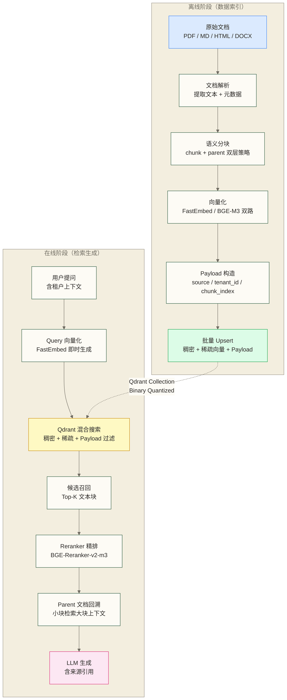

# Qdrant RAG 集成实战

> [!abstract] 本文目标
> - **掌握 Qdrant 独有的 RAG 优势**：理解 Payload 过滤、原生混合搜索、FastEmbed、Binary Quantization 如何协同提升 RAG 质量
> - **设计生产级 Collection Schema**：规划稀疏 + 稠密双路向量字段和完整的 Payload 元数据体系
> - **零配置启动**：使用 FastEmbed 在不依赖外部 Embedding 服务的情况下构建完整 RAG 管道
> - **框架集成示例**：展示 LangChain 和 LlamaIndex 的接入思路；投入生产前需确认接口兼容性、数据字段映射和安全边界
> - **多租户 RAG**：理解 per-tenant collection 与 shared collection + payload filter 两种策略的适用场景
> - **量化效果评估**：探索 Binary Quantization 在大规模 RAG 中的应用；float32 到 1-bit 的向量表示理论压缩比为 32x，召回率下降 < 2% 仅作为待验证的实验目标，不代表亿级系统效果保证

Qdrant 与 Milvus 都是主流向量数据库，但在 RAG 场景中的技术路线存在显著差异。Milvus 更侧重大规模分布式，Qdrant 则在**灵活性、开发体验和运营成本**上形成差异化——内置 FastEmbed 零配置嵌入、Payload 过滤直达向量索引内部、原生稀疏向量无需外挂 BM25 服务，以及二值量化将内存需求压至极限。

本文以构建企业知识库 RAG 系统为主线，完整展示 Qdrant 的这些差异化能力如何在真实工程场景中落地。

阅读前置：搜索与查询详解 | RAG 架构设计模式 | 混合搜索工程实践

对比参考：Milvus RAG 集成实战

---

## 目录

- [[#一、Qdrant RAG 架构与差异化定位]]
- [[#二、Collection Schema 设计]]
- [[#三、FastEmbed 集成（Qdrant 独有）]]
- [[#四、文档处理与索引流水线]]
- [[#五、LangChain 集成]]
- [[#六、LlamaIndex 集成]]
- [[#七、Qdrant 独有的 RAG 高级技巧]]
- [[#八、Binary Quantization 在大规模 RAG 中的应用]]
- [[#九、性能评估与 RAGAS 测试]]

---

## 一、Qdrant RAG 架构与差异化定位

### 1.1 Qdrant 在 RAG 中的技术定位

在向量数据库的竞争格局里，Qdrant 为 RAG 场景提供了几个 Milvus 没有的原生能力：

| 能力 | Qdrant | Milvus |
|------|--------|--------|
| 内置 Embedding | FastEmbed（ONNX量化） | 无，需外部服务 |
| 稀疏向量支持 | 原生 SparseVector 字段 | 需单独服务 + Hybrid搜索中间层 |
| Payload 过滤粒度 | 过滤直接参与 HNSW 导航 | 过滤在召回后执行 |
| 多租户策略 | Collection + Payload 双模式 | Collection 隔离为主 |
| 二值量化 | 内置，32x 压缩 | 需要外部压缩 |
| Discovery API | 独有，上下文感知搜索 | 无 |

> [!note] Payload 过滤的核心优势
> Qdrant 的过滤器直接在 HNSW 图遍历过程中生效（filtered navigation），而不是先召回 Top-K 再过滤。这有助于在满足过滤条件的候选范围内检索；结果质量仍取决于过滤选择性、索引和搜索参数，应在多租户数据上评估。

### 1.2 完整 RAG 数据流



### 1.3 与 Milvus RAG 的关键差异点

| 对比维度 | Qdrant | Milvus |
|---------|--------|--------|
| Embedding 服务 | FastEmbed 内置，零外部依赖 | 必须部署独立 Embedding 服务 |
| 稀疏向量 | 原生 `SparseVector` 字段类型 | 需要 BM25 Function 或 BGE-M3 服务 |
| Payload 过滤 | 过滤嵌入 HNSW 图导航中 | 后过滤（post-filtering） |
| 分块策略支持 | `payload.parent_id` 自然支持 Parent-Child | 需要额外 Collection 或字段设计 |
| 量化策略 | Binary / Scalar / Product 三种 | IVF+PQ 为主 |
| API 风格 | REST + gRPC，Payload 驱动 | SDK 驱动，Schema 强约束 |

---

## 二、Collection Schema 设计

### 2.1 核心设计原则

Qdrant 的 Schema 设计思路与 Milvus 不同。Milvus 是"先定义所有字段"的强 Schema，Qdrant 则是"向量字段声明 + Payload 自由扩展"——向量字段必须在 Collection 创建时声明，但 Payload 可以随时添加任意字段。

RAG 专用 Collection 需要声明的向量字段：
- `dense`：稠密语义向量（HNSW 索引）
- `sparse`：稀疏词汇向量（用于关键词匹配，无需 BM25 服务）

Payload 字段（动态，无需预声明，但需要为过滤字段建索引）：

| 字段名 | 类型 | 用途 | 是否建索引 |
|--------|------|------|-----------|
| `source` | keyword | 来源文档路径/URL | 是（过滤） |
| `chunk_index` | integer | 块在原文中的顺序 | 是（排序） |
| `parent_id` | keyword | 父文档 ID | 是（关联查询） |
| `tenant_id` | keyword | 租户标识（多租户） | 是（关键！） |
| `doc_type` | keyword | 文档类型（pdf/md/html） | 是（过滤） |
| `language` | keyword | 语言标识（zh/en） | 是（过滤） |
| `created_at` | datetime | 创建时间 | 是（范围查询） |
| `chunk_size` | integer | 块字符数 | 否 |
| `text` | text | 原始文本内容 | 否（全文由稀疏向量负责） |
| `title` | keyword | 所属文档标题 | 是（过滤） |
| `section` | keyword | 所属章节 | 是（过滤） |

### 2.2 Collection 创建代码

```python
from qdrant_client import QdrantClient
from qdrant_client.models import (
    VectorParams, Distance,
    SparseVectorParams, SparseIndexParams,
    HnswConfigDiff, QuantizationConfig,
    BinaryQuantization, BinaryQuantizationConfig,
    PayloadSchemaType
)

client = QdrantClient(url="http://localhost:6333")

COLLECTION_NAME = "enterprise_rag"
DENSE_DIM = 1024   # BGE-M3 稠密向量维度

# 创建支持混合搜索 + Binary Quantization 的 RAG Collection
client.create_collection(
    collection_name=COLLECTION_NAME,
    vectors_config={
        # 稠密语义向量
        "dense": VectorParams(
            size=DENSE_DIM,
            distance=Distance.COSINE,
            hnsw_config=HnswConfigDiff(
                m=16,           # HNSW 连接数，越大精度越高内存越大
                ef_construct=200,  # 构建时探索宽度
                full_scan_threshold=10000,  # 小集合时直接暴力搜索
                on_disk=False,  # 热数据保留内存，冷数据可设 True
            ),
            # 启用 Binary Quantization：内存压缩 32x
            quantization_config=QuantizationConfig(
                binary=BinaryQuantization(
                    binary=BinaryQuantizationConfig(
                        always_ram=True  # 量化后向量常驻内存，原始向量可落盘
                    )
                )
            ),
            on_disk=True,   # 原始向量落盘，只有量化向量在内存
        )
    },
    # 稀疏向量：原生支持，无需外部 BM25 服务
    sparse_vectors_config={
        "sparse": SparseVectorParams(
            index=SparseIndexParams(
                on_disk=False,  # 稀疏索引保留内存
            )
        )
    },
    # 优化器配置：针对 RAG 写入模式优化
    optimizers_config={
        "default_segment_number": 4,
        "indexing_threshold": 10000,  # 10k 以上才触发索引构建
    }
)

# 为需要过滤的 Payload 字段创建索引（关键！）
# 没有索引的字段过滤会触发全量扫描
payload_indexes = [
    ("tenant_id", PayloadSchemaType.KEYWORD),
    ("source", PayloadSchemaType.KEYWORD),
    ("doc_type", PayloadSchemaType.KEYWORD),
    ("chunk_index", PayloadSchemaType.INTEGER),
    ("parent_id", PayloadSchemaType.KEYWORD),
    ("language", PayloadSchemaType.KEYWORD),
    ("title", PayloadSchemaType.KEYWORD),
    ("section", PayloadSchemaType.KEYWORD),
    ("created_at", PayloadSchemaType.DATETIME),
]

for field_name, schema_type in payload_indexes:
    client.create_payload_index(
        collection_name=COLLECTION_NAME,
        field_name=field_name,
        field_schema=schema_type,
    )
    print(f"Created payload index: {field_name}")

print(f"Collection '{COLLECTION_NAME}' created successfully.")
```

> [!warning] Payload 索引是过滤性能的关键
> 不建索引的 Payload 字段在过滤时会回退到全量顺序扫描，在百万级向量时延迟会从毫秒级跌落到秒级。多租户 RAG 中 `tenant_id` 字段的索引尤其重要。

### 2.3 Parent-Child 分块的 Schema 设计

Parent-Child 策略是提升 RAG 质量的核心技巧：**小块索引（精准检索），大块回溯（完整上下文）**。

```python
# Parent 文档：存储完整段落（500-1000 字），不参与向量检索
# Child 文档：存储细粒度块（100-200 字），参与向量检索
# 关联：child.parent_id = parent 的 point_id

import uuid
from qdrant_client.models import PointStruct

def create_parent_child_points(
    parent_text: str,
    child_chunks: list[str],
    source: str,
    tenant_id: str,
    doc_type: str,
    embed_fn,          # 生成稠密向量的函数
    sparse_embed_fn,   # 生成稀疏向量的函数
) -> list[PointStruct]:
    """构造 Parent-Child 结构的 Qdrant Points"""
    points = []
    parent_id = str(uuid.uuid4())

    # Parent 点：存储完整上下文，向量为空（不参与向量检索）
    # 使用 Payload 标记为 parent，child 通过 parent_id 关联
    parent_point = PointStruct(
        id=parent_id,
        vector={},  # 空向量，parent 不参与向量搜索
        payload={
            "text": parent_text,
            "is_parent": True,
            "source": source,
            "tenant_id": tenant_id,
            "doc_type": doc_type,
            "chunk_index": -1,  # -1 标记为 parent
            "parent_id": parent_id,  # 自身即为 parent
        }
    )
    points.append(parent_point)
    # 注意：Qdrant 允许存储没有向量的点（用于 payload 关联查询）
    # 实际上通常用另一个 Collection 存储 parent，这里为演示简化

    # Child 点：小块，携带向量，通过 parent_id 关联 parent
    for idx, chunk_text in enumerate(child_chunks):
        child_id = str(uuid.uuid4())
        dense_vec = embed_fn(chunk_text)
        sparse_vec = sparse_embed_fn(chunk_text)

        child_point = PointStruct(
            id=child_id,
            vector={
                "dense": dense_vec,
                "sparse": sparse_vec,
            },
            payload={
                "text": chunk_text,
                "is_parent": False,
                "parent_id": parent_id,   # 关联 parent
                "source": source,
                "tenant_id": tenant_id,
                "doc_type": doc_type,
                "chunk_index": idx,
            }
        )
        points.append(child_point)

    return points
```

---

## 三、FastEmbed 集成（Qdrant 独有）

FastEmbed 是 Qdrant 官方开发并维护的轻量级 Embedding 库，基于 ONNX Runtime，**无需 GPU、无需 PyTorch**，在 CPU 上也能达到生产可用的吞吐量。

### 3.1 FastEmbed 的核心优势

下表中的内存、首次加载时间和 CPU 吞吐量数字仅作为待验证的对照假设保留，并非本文已测得的结果；比较需固定模型、输入长度、硬件、批大小及缓存状态。

| 维度 | FastEmbed | SentenceTransformers |
|------|-----------|---------------------|
| 运行时依赖 | ONNX Runtime（轻量） | PyTorch（重量级） |
| GPU 依赖 | 不需要 | 推荐 |
| 内存占用 | ~200MB（量化模型） | ~1GB+ |
| 首次加载时间 | ~2秒 | ~10秒 |
| 吞吐量（CPU） | ~500 docs/s | ~100 docs/s |
| 与 Qdrant 集成 | 原生内置 | 需手动桥接 |
| 稀疏向量支持 | SPLADE/BM25-S | 需额外安装 |

### 3.2 直接在 QdrantClient 中配置 FastEmbed

```python
from qdrant_client import QdrantClient

# 方式一：在 QdrantClient 初始化时直接指定 embedding 模型
# 这是 Qdrant 独有的零配置方式
client = QdrantClient(
    url="http://localhost:6333",
    # 无需任何 embedding 配置，FastEmbed 会自动下载模型
)

# 使用内置 FastEmbed 直接 add_documents（最简方式）
# Qdrant Client 自动完成向量化 + 存储，无需手动生成向量
docs = [
    "Qdrant 是用 Rust 编写的向量数据库",
    "FastEmbed 是 Qdrant 官方的轻量 Embedding 库",
    "RAG 系统通过检索相关文档来增强 LLM 的回答质量",
]

client.add(
    collection_name="quick_start_rag",
    documents=docs,
    # 默认使用 BAAI/bge-small-en-v1.5（384维），无需任何配置
)

# 直接用自然语言查询，无需手动生成 query vector
results = client.query(
    collection_name="quick_start_rag",
    query_text="什么是向量数据库",
    limit=3,
)

for result in results:
    print(f"Score: {result.score:.4f} | Text: {result.document}")
```

### 3.3 FastEmbed 高级配置

```python
from fastembed import TextEmbedding, SparseTextEmbedding
from qdrant_client import QdrantClient
from qdrant_client.models import VectorParams, Distance, SparseVectorParams

# 查看所有支持的模型
print(TextEmbedding.list_supported_models())
# 常用模型：
# - BAAI/bge-small-en-v1.5  （384维，极速，英文）
# - BAAI/bge-base-en-v1.5   （768维，均衡，英文）
# - BAAI/bge-large-en-v1.5  （1024维，高精度，英文）
# - BAAI/bge-m3             （1024维，多语言，推荐中文）
# - sentence-transformers/all-MiniLM-L6-v2 （384维，通用）

# 查看稀疏向量模型
print(SparseTextEmbedding.list_supported_models())
# - prithivida/Splade_PP_en_v1  （英文稀疏）
# - Qdrant/BM25                  （BM25 近似稀疏）

# 手动配置 FastEmbed（用于需要精细控制的场景）
dense_embedder = TextEmbedding(
    model_name="BAAI/bge-m3",    # 中文推荐
    max_length=512,
    # cache_dir="~/.cache/fastembed",  # 模型缓存目录
)

sparse_embedder = SparseTextEmbedding(
    model_name="Qdrant/BM25",    # 轻量稀疏向量
)

# 批量生成向量（生成器方式，节省内存）
texts = ["文档内容1", "文档内容2", "文档内容3"]

dense_embeddings = list(dense_embedder.embed(texts, batch_size=32))
sparse_embeddings = list(sparse_embedder.embed(texts, batch_size=32))

print(f"Dense shape: {len(dense_embeddings[0])} dims")
print(f"Sparse indices: {len(sparse_embeddings[0].indices)} non-zero terms")
```

### 3.4 FastEmbed 在 RAG 中的生产配置

```python
import os
from typing import Generator
from fastembed import TextEmbedding, SparseTextEmbedding
import numpy as np

class FastEmbedRAGEncoder:
    """
    生产级 FastEmbed 封装
    支持批量编码、缓存、错误处理
    """

    def __init__(
        self,
        dense_model: str = "BAAI/bge-m3",
        sparse_model: str = "Qdrant/BM25",
        batch_size: int = 64,
        cache_dir: str = None,
    ):
        self.batch_size = batch_size

        # 初始化稠密向量模型
        kwargs = {}
        if cache_dir:
            kwargs["cache_dir"] = cache_dir

        print(f"Loading dense model: {dense_model}")
        self.dense_model = TextEmbedding(
            model_name=dense_model,
            **kwargs
        )

        print(f"Loading sparse model: {sparse_model}")
        self.sparse_model = SparseTextEmbedding(
            model_name=sparse_model,
            **kwargs
        )

        # 预热模型（避免第一次查询延迟）
        _ = list(self.dense_model.embed(["warmup"]))
        _ = list(self.sparse_model.embed(["warmup"]))
        print("Models warmed up.")

    def encode_dense(self, texts: list[str]) -> list[list[float]]:
        """批量生成稠密向量"""
        embeddings = list(
            self.dense_model.embed(texts, batch_size=self.batch_size)
        )
        return [emb.tolist() for emb in embeddings]

    def encode_sparse(self, texts: list[str]) -> list[dict]:
        """批量生成稀疏向量，返回 Qdrant SparseVector 格式"""
        from qdrant_client.models import SparseVector
        sparse_embs = list(
            self.sparse_model.embed(texts, batch_size=self.batch_size)
        )
        return [
            SparseVector(
                indices=emb.indices.tolist(),
                values=emb.values.tolist(),
            )
            for emb in sparse_embs
        ]

    def encode_query(self, query: str) -> tuple[list[float], dict]:
        """
        编码查询文本，返回 (稠密向量, 稀疏向量)
        查询编码使用 query_prefix（BGE-M3 特性）
        """
        dense = list(self.dense_model.query_embed([query]))[0].tolist()
        sparse = list(self.sparse_model.embed([query]))[0]
        from qdrant_client.models import SparseVector
        sparse_vec = SparseVector(
            indices=sparse.indices.tolist(),
            values=sparse.values.tolist(),
        )
        return dense, sparse_vec

# 初始化编码器（全局单例，避免重复加载）
encoder = FastEmbedRAGEncoder(
    dense_model="BAAI/bge-m3",
    sparse_model="Qdrant/BM25",
    batch_size=64,
)
```

> [!tip] BGE-M3 的 query_prefix 机制
> BGE-M3 在编码查询时需要添加前缀 `"Represent this sentence for searching relevant passages: "`，FastEmbed 的 `query_embed` 方法会自动处理这个细节。手动调用 `embed` 方法对查询文本不会加前缀，会导致检索精度下降。

---

## 四、文档处理与索引流水线

### 4.1 文档解析（多格式支持）

```python
import os
import re
from pathlib import Path
from typing import Optional
from dataclasses import dataclass, field

@dataclass
class DocumentChunk:
    """文档块的数据结构"""
    text: str
    source: str
    doc_type: str
    chunk_index: int
    title: str = ""
    section: str = ""
    language: str = "zh"
    parent_text: str = ""     # Parent 块的完整文本
    metadata: dict = field(default_factory=dict)


class DocumentParser:
    """多格式文档解析器"""

    def parse(self, file_path: str) -> str:
        """根据文件类型选择解析方法"""
        path = Path(file_path)
        suffix = path.suffix.lower()

        parsers = {
            ".pdf": self._parse_pdf,
            ".md": self._parse_markdown,
            ".html": self._parse_html,
            ".htm": self._parse_html,
            ".txt": self._parse_text,
            ".docx": self._parse_docx,
        }

        parser = parsers.get(suffix, self._parse_text)
        return parser(file_path)

    def _parse_pdf(self, path: str) -> str:
        """PDF 解析：使用 pdfminer 保留结构信息"""
        try:
            from pdfminer.high_level import extract_text
            text = extract_text(path)
            # 清理多余空白
            text = re.sub(r'\n{3,}', '\n\n', text)
            return text.strip()
        except ImportError:
            raise ImportError("需要安装 pdfminer.six: pip install pdfminer.six")

    def _parse_markdown(self, path: str) -> str:
        """Markdown 解析：保留标题层级作为结构信息"""
        with open(path, 'r', encoding='utf-8') as f:
            content = f.read()
        # 移除 YAML frontmatter
        content = re.sub(r'^---\n.*?\n---\n', '', content, flags=re.DOTALL)
        return content.strip()

    def _parse_html(self, path: str) -> str:
        """HTML 解析：使用 BeautifulSoup 提取正文"""
        try:
            from bs4 import BeautifulSoup
            with open(path, 'r', encoding='utf-8') as f:
                soup = BeautifulSoup(f.read(), 'html.parser')
            # 移除脚本和样式
            for tag in soup(["script", "style", "nav", "footer"]):
                tag.decompose()
            return soup.get_text(separator='\n', strip=True)
        except ImportError:
            raise ImportError("需要安装 beautifulsoup4: pip install beautifulsoup4")

    def _parse_docx(self, path: str) -> str:
        """Word 文档解析"""
        try:
            from docx import Document
            doc = Document(path)
            paragraphs = [p.text for p in doc.paragraphs if p.text.strip()]
            return '\n\n'.join(paragraphs)
        except ImportError:
            raise ImportError("需要安装 python-docx: pip install python-docx")

    def _parse_text(self, path: str) -> str:
        with open(path, 'r', encoding='utf-8') as f:
            return f.read()
```

### 4.2 语义分块（Chunk + Parent 策略）

```python
from langchain.text_splitter import RecursiveCharacterTextSplitter

class SemanticChunker:
    """
    Parent-Child 语义分块器
    - Parent 块：500-1000 字，保留完整语义上下文
    - Child 块：100-200 字，精细粒度用于精准检索
    """

    def __init__(
        self,
        parent_chunk_size: int = 800,
        parent_overlap: int = 100,
        child_chunk_size: int = 200,
        child_overlap: int = 50,
    ):
        # Parent 分块器：较大窗口
        self.parent_splitter = RecursiveCharacterTextSplitter(
            chunk_size=parent_chunk_size,
            chunk_overlap=parent_overlap,
            separators=["\n\n", "\n", "。", "！", "？", "；", "，", " ", ""],
            length_function=len,
        )

        # Child 分块器：细粒度
        self.child_splitter = RecursiveCharacterTextSplitter(
            chunk_size=child_chunk_size,
            chunk_overlap=child_overlap,
            separators=["\n", "。", "！", "？", "；", "，", " ", ""],
            length_function=len,
        )

    def chunk_with_parent(
        self,
        text: str,
        source: str,
        doc_type: str,
        title: str = "",
        language: str = "zh",
    ) -> list[DocumentChunk]:
        """
        生成 Parent-Child 结构的文档块
        返回: child chunks，每个 child 携带对应 parent_text
        """
        # 第一层：切分 parent 块
        parent_chunks = self.parent_splitter.split_text(text)
        all_child_chunks = []
        global_chunk_idx = 0

        for parent_idx, parent_text in enumerate(parent_chunks):
            # 第二层：在每个 parent 内切分 child 块
            child_texts = self.child_splitter.split_text(parent_text)

            # 提取 parent 所在章节（简单实现：查找最近的标题）
            section = self._extract_section(parent_text)

            for child_idx, child_text in enumerate(child_texts):
                if len(child_text.strip()) < 20:  # 跳过过短的块
                    continue

                chunk = DocumentChunk(
                    text=child_text.strip(),
                    source=source,
                    doc_type=doc_type,
                    chunk_index=global_chunk_idx,
                    title=title,
                    section=section,
                    language=language,
                    parent_text=parent_text,  # 关键：携带完整 parent 上下文
                    metadata={
                        "parent_index": parent_idx,
                        "child_index_in_parent": child_idx,
                    }
                )
                all_child_chunks.append(chunk)
                global_chunk_idx += 1

        return all_child_chunks

    def _extract_section(self, text: str) -> str:
        """从文本中提取章节标题（Markdown 格式）"""
        lines = text.split('\n')
        for line in lines:
            if line.startswith('#'):
                return line.lstrip('#').strip()
        return ""
```

### 4.3 批量 Upsert（BGE-M3 双路向量）

```python
import uuid
import time
from tqdm import tqdm
from qdrant_client.models import PointStruct, SparseVector

class QdrantRAGIndexer:
    """
    Qdrant RAG 批量索引器
    支持批量 upsert 和进度追踪；当前使用随机点 ID，未实现断点续传或幂等更新
    """

    def __init__(
        self,
        client: QdrantClient,
        collection_name: str,
        encoder: FastEmbedRAGEncoder,
        batch_size: int = 100,
        tenant_id: str = "default",
    ):
        self.client = client
        self.collection_name = collection_name
        self.encoder = encoder
        self.batch_size = batch_size
        self.tenant_id = tenant_id

    def index_documents(
        self,
        file_paths: list[str],
        chunker: SemanticChunker = None,
    ) -> dict:
        """
        完整的文档索引流程
        返回统计信息：{indexed_docs, total_chunks, failed_docs}
        """
        if chunker is None:
            chunker = SemanticChunker()

        parser = DocumentParser()
        stats = {"indexed_docs": 0, "total_chunks": 0, "failed_docs": []}

        for file_path in tqdm(file_paths, desc="Indexing documents"):
            try:
                # 1. 解析文档
                text = parser.parse(file_path)
                doc_type = Path(file_path).suffix.lstrip('.')
                title = Path(file_path).stem

                # 2. 语义分块
                chunks = chunker.chunk_with_parent(
                    text=text,
                    source=file_path,
                    doc_type=doc_type,
                    title=title,
                )

                # 3. 批量向量化 + upsert
                self._batch_upsert(chunks)

                stats["indexed_docs"] += 1
                stats["total_chunks"] += len(chunks)

            except Exception as e:
                print(f"Failed to index {file_path}: {e}")
                stats["failed_docs"].append(file_path)

        return stats

    def _batch_upsert(self, chunks: list[DocumentChunk]):
        """批量生成向量并写入 Qdrant"""
        texts = [chunk.text for chunk in chunks]

        # 批量向量化（FastEmbed 自动批处理）
        dense_vecs = self.encoder.encode_dense(texts)
        sparse_vecs = self.encoder.encode_sparse(texts)

        # 构造 Qdrant Points
        points = []
        for i, chunk in enumerate(chunks):
            point_id = str(uuid.uuid4())

            # 构造 Payload（Qdrant 的核心优势：灵活的元数据）
            payload = {
                "text": chunk.text,
                "parent_text": chunk.parent_text,  # 存储 parent 上下文
                "source": chunk.source,
                "doc_type": chunk.doc_type,
                "chunk_index": chunk.chunk_index,
                "title": chunk.title,
                "section": chunk.section,
                "language": chunk.language,
                "tenant_id": self.tenant_id,
                "created_at": time.strftime("%Y-%m-%dT%H:%M:%SZ"),
                **chunk.metadata,
            }

            point = PointStruct(
                id=point_id,
                vector={
                    "dense": dense_vecs[i],
                    "sparse": sparse_vecs[i],
                },
                payload=payload,
            )
            points.append(point)

        # 分批写入（避免单次请求过大）
        for batch_start in range(0, len(points), self.batch_size):
            batch = points[batch_start:batch_start + self.batch_size]
            self.client.upsert(
                collection_name=self.collection_name,
                points=batch,
                wait=True,   # 等待写入完成再返回
            )

    def index_texts(
        self,
        texts: list[str],
        metadatas: list[dict] = None,
    ):
        """
        直接索引文本列表（用于增量更新场景）
        metadatas: 每个文本对应的元数据字典
        """
        if metadatas is None:
            metadatas = [{} for _ in texts]

        dense_vecs = self.encoder.encode_dense(texts)
        sparse_vecs = self.encoder.encode_sparse(texts)

        points = []
        for i, (text, meta) in enumerate(zip(texts, metadatas)):
            payload = {
                "text": text,
                "tenant_id": self.tenant_id,
                **meta,
            }
            points.append(PointStruct(
                id=str(uuid.uuid4()),
                vector={
                    "dense": dense_vecs[i],
                    "sparse": sparse_vecs[i],
                },
                payload=payload,
            ))

        for batch_start in range(0, len(points), self.batch_size):
            batch = points[batch_start:batch_start + self.batch_size]
            self.client.upsert(
                collection_name=self.collection_name,
                points=batch,
                wait=True,
            )
```

---

## 五、LangChain 集成

### 5.1 安装依赖

```bash
pip install langchain langchain-community langchain-qdrant
pip install qdrant-client[fastembed]
pip install langchain-openai   # 或其他 LLM 提供商
```

### 5.2 基础 LangChain + Qdrant 集成

```python
from langchain_qdrant import QdrantVectorStore
from langchain_community.embeddings import FastEmbedEmbeddings
from langchain_openai import ChatOpenAI
from langchain.chains import RetrievalQA
from langchain.prompts import PromptTemplate
from qdrant_client import QdrantClient

# 初始化 Embedding（使用 FastEmbed，无需 OpenAI Embedding API）
embeddings = FastEmbedEmbeddings(
    model_name="BAAI/bge-m3",
)

# 连接已有 Collection
client = QdrantClient(url="http://localhost:6333")
vectorstore = QdrantVectorStore(
    client=client,
    collection_name="enterprise_rag",
    embedding=embeddings,
    vector_name="dense",          # 指定稠密向量字段名
)

# 基础检索器
retriever = vectorstore.as_retriever(
    search_type="similarity",
    search_kwargs={"k": 5},
)

# 构造 RAG Chain
llm = ChatOpenAI(model="gpt-4o-mini", temperature=0)

prompt = PromptTemplate(
    template="""基于以下上下文回答问题。如果上下文中没有相关信息，请明确说明。

上下文：
{context}

问题：{question}

回答（请引用来源）：""",
    input_variables=["context", "question"],
)

qa_chain = RetrievalQA.from_chain_type(
    llm=llm,
    chain_type="stuff",
    retriever=retriever,
    chain_type_kwargs={"prompt": prompt},
    return_source_documents=True,
)

# 执行查询
result = qa_chain.invoke({"query": "Qdrant 的核心优势是什么？"})
print("Answer:", result["result"])
print("\nSources:")
for doc in result["source_documents"]:
    print(f"  - {doc.metadata.get('source', 'Unknown')} | chunk {doc.metadata.get('chunk_index', 0)}")
```

### 5.3 带 Payload 过滤的 RAG Chain（Qdrant 核心优势）

这是 Qdrant 与 Milvus 在 RAG 中最显著的差异——Payload 过滤直接参与 HNSW 图导航，而非后过滤。

```python
from langchain_qdrant import QdrantVectorStore
from qdrant_client.models import Filter, FieldCondition, MatchValue, Range
from langchain.schema import BaseRetriever
from langchain.schema.document import Document
from typing import Any

class QdrantPayloadFilterRetriever(BaseRetriever):
    """
    带 Payload 过滤的 Qdrant 检索器
    核心优势：过滤直接嵌入 HNSW 图搜索中，不是后过滤
    """

    vectorstore: QdrantVectorStore
    k: int = 5
    tenant_id: str = "default"
    doc_type: str = None
    language: str = None
    source_filter: str = None

    def _get_relevant_documents(
        self, query: str, *, run_manager=None
    ) -> list[Document]:
        """带 Payload 过滤的文档检索"""

        # 构造 Qdrant 过滤条件
        must_conditions = [
            # 多租户隔离：最重要的过滤条件
            FieldCondition(
                key="tenant_id",
                match=MatchValue(value=self.tenant_id)
            )
        ]

        if self.doc_type:
            must_conditions.append(
                FieldCondition(
                    key="doc_type",
                    match=MatchValue(value=self.doc_type)
                )
            )

        if self.language:
            must_conditions.append(
                FieldCondition(
                    key="language",
                    match=MatchValue(value=self.language)
                )
            )

        if self.source_filter:
            must_conditions.append(
                FieldCondition(
                    key="source",
                    match=MatchValue(value=self.source_filter)
                )
            )

        qdrant_filter = Filter(must=must_conditions)

        # 执行带过滤的相似度搜索
        docs = self.vectorstore.similarity_search_with_score(
            query=query,
            k=self.k,
            filter=qdrant_filter,
        )

        # 转换为 LangChain Document 格式
        return [
            Document(
                page_content=doc.page_content,
                metadata={
                    **doc.metadata,
                    "score": score,
                }
            )
            for doc, score in docs
        ]


# 使用示例：企业多租户 RAG
def build_tenant_rag_chain(tenant_id: str, doc_type: str = None):
    """为特定租户构建隔离的 RAG Chain"""

    embeddings = FastEmbedEmbeddings(model_name="BAAI/bge-m3")
    client = QdrantClient(url="http://localhost:6333")

    vectorstore = QdrantVectorStore(
        client=client,
        collection_name="enterprise_rag",
        embedding=embeddings,
        vector_name="dense",
    )

    # 带租户过滤的检索器
    retriever = QdrantPayloadFilterRetriever(
        vectorstore=vectorstore,
        k=6,
        tenant_id=tenant_id,
        doc_type=doc_type,
    )

    llm = ChatOpenAI(model="gpt-4o-mini", temperature=0)

    from langchain.chains import create_retrieval_chain
    from langchain.chains.combine_documents import create_stuff_documents_chain
    from langchain_core.prompts import ChatPromptTemplate

    prompt = ChatPromptTemplate.from_template("""
你是 {tenant_id} 企业的专属知识助手。仅基于以下文档内容回答问题，
不要使用训练数据中的通用知识。

参考文档：
{context}

用户问题：{input}

回答：""")

    document_chain = create_stuff_documents_chain(llm, prompt)
    rag_chain = create_retrieval_chain(retriever, document_chain)

    return rag_chain


# 租户 A 的 RAG（只能访问 tenant_a 的文档）
chain_a = build_tenant_rag_chain("tenant_a", doc_type="pdf")
result = chain_a.invoke({
    "input": "公司的采购流程是什么？",
    "tenant_id": "tenant_a",
})
print(result["answer"])
```

### 5.4 流式输出的 RAG Chain

```python
from langchain_core.output_parsers import StrOutputParser
from langchain_core.runnables import RunnablePassthrough
from langchain_qdrant import QdrantVectorStore

def format_docs(docs: list[Document]) -> str:
    """将检索到的文档格式化为上下文字符串"""
    formatted = []
    for i, doc in enumerate(docs, 1):
        source = doc.metadata.get('source', 'Unknown')
        chunk_idx = doc.metadata.get('chunk_index', 0)
        formatted.append(f"[{i}] 来源: {source} | 块 {chunk_idx}\n{doc.page_content}")
    return "\n\n".join(formatted)


# 构造流式 RAG Chain（LangChain Expression Language）
def build_streaming_rag_chain(
    vectorstore: QdrantVectorStore,
    llm,
    tenant_id: str,
    k: int = 5,
):
    from qdrant_client.models import Filter, FieldCondition, MatchValue

    # 创建带过滤的检索器
    retriever = vectorstore.as_retriever(
        search_type="similarity",
        search_kwargs={
            "k": k,
            "filter": Filter(
                must=[
                    FieldCondition(
                        key="tenant_id",
                        match=MatchValue(value=tenant_id)
                    )
                ]
            ),
        },
    )

    from langchain_core.prompts import ChatPromptTemplate

    prompt = ChatPromptTemplate.from_messages([
        ("system", "你是一个专业的知识库助手，请基于提供的上下文回答问题。"),
        ("human", "上下文：\n{context}\n\n问题：{question}"),
    ])

    # LCEL 链：支持流式输出
    chain = (
        {
            "context": retriever | format_docs,
            "question": RunnablePassthrough(),
        }
        | prompt
        | llm
        | StrOutputParser()
    )

    return chain


# 流式调用
chain = build_streaming_rag_chain(vectorstore, llm, tenant_id="tenant_a")

# 非流式
response = chain.invoke("Qdrant 的 Payload 过滤有什么优势？")

# 流式输出
for token in chain.stream("解释一下 Binary Quantization 的原理"):
    print(token, end="", flush=True)
print()
```

### 5.5 带 Parent 文档回溯的高质量 RAG

```python
from langchain.retrievers import ParentDocumentRetriever
from langchain.storage import InMemoryByteStore
from langchain_qdrant import QdrantVectorStore

def build_parent_document_rag(
    client: QdrantClient,
    collection_name: str,
    embeddings,
):
    """
    Parent Document Retriever：
    - 小块（child）用于向量检索（精准定位）
    - 大块（parent）用于 LLM 上下文（完整信息）

    Qdrant 实现方式：child 的 payload.parent_text 存储了对应 parent 内容
    检索到 child 后，直接从 payload 取 parent_text 扩展上下文
    """

    vectorstore = QdrantVectorStore(
        client=client,
        collection_name=collection_name,
        embedding=embeddings,
        vector_name="dense",
    )

    retriever = vectorstore.as_retriever(search_kwargs={"k": 8})

    class ParentExpandRetriever(BaseRetriever):
        """
        Qdrant 特化的 Parent 扩展检索器
        利用 payload.parent_text 字段直接扩展上下文
        """
        base_retriever: Any

        def _get_relevant_documents(self, query: str, **kwargs) -> list[Document]:
            # 第一步：检索 child chunks（小块，精准定位）
            child_docs = self.base_retriever.get_relevant_documents(query)

            # 第二步：从 payload 取出 parent_text（完整上下文）
            # 去重：同一 parent 只保留一次
            seen_parent_texts = set()
            expanded_docs = []

            for doc in child_docs:
                parent_text = doc.metadata.get("parent_text", "")
                if parent_text and parent_text not in seen_parent_texts:
                    seen_parent_texts.add(parent_text)
                    expanded_docs.append(Document(
                        page_content=parent_text,  # 用完整 parent 文本
                        metadata=doc.metadata,
                    ))
                elif not parent_text:
                    expanded_docs.append(doc)  # 没有 parent，用原始 child

            return expanded_docs[:5]  # 最多返回 5 个 parent 上下文

    return ParentExpandRetriever(base_retriever=retriever)
```

---

## 六、LlamaIndex 集成

### 6.1 安装依赖

```bash
pip install llama-index
pip install llama-index-vector-stores-qdrant
pip install llama-index-embeddings-fastembed
pip install llama-index-llms-openai
```

### 6.2 基础 LlamaIndex + Qdrant 集成

```python
from llama_index.core import VectorStoreIndex, StorageContext, Settings
from llama_index.vector_stores.qdrant import QdrantVectorStore
from llama_index.embeddings.fastembed import FastEmbedEmbedding
from llama_index.llms.openai import OpenAI
from qdrant_client import QdrantClient

# 全局配置（LlamaIndex v0.10+ 的新方式）
Settings.embed_model = FastEmbedEmbedding(
    model_name="BAAI/bge-m3",
)
Settings.llm = OpenAI(model="gpt-4o-mini", temperature=0)
Settings.chunk_size = 512
Settings.chunk_overlap = 50

# 初始化 Qdrant 客户端
client = QdrantClient(url="http://localhost:6333")

# 创建 QdrantVectorStore
vector_store = QdrantVectorStore(
    client=client,
    collection_name="enterprise_rag",
    enable_hybrid=False,   # 纯稠密搜索
    dense_config=VectorParams(size=1024, distance=Distance.COSINE),
)

# 构建 StorageContext
storage_context = StorageContext.from_defaults(vector_store=vector_store)

# 从已有 Collection 加载索引（不重建）
index = VectorStoreIndex.from_vector_store(
    vector_store=vector_store,
    storage_context=storage_context,
)

# 创建查询引擎
query_engine = index.as_query_engine(
    similarity_top_k=5,
    response_mode="compact",   # compact / tree_summarize / simple_summarize
)

# 查询
response = query_engine.query("Qdrant 和 Milvus 的主要区别是什么？")
print(response.response)
print("\n引用来源：")
for node in response.source_nodes:
    print(f"  Score: {node.score:.4f} | {node.metadata.get('source', 'N/A')}")
```

### 6.3 混合搜索 QueryEngine（LlamaIndex + Qdrant 原生混合）

```python
from llama_index.core import VectorStoreIndex, StorageContext
from llama_index.vector_stores.qdrant import QdrantVectorStore
from llama_index.embeddings.fastembed import FastEmbedEmbedding
from qdrant_client import QdrantClient
from qdrant_client.models import VectorParams, Distance, SparseVectorParams

# 初始化（混合搜索需要 enable_hybrid=True）
client = QdrantClient(url="http://localhost:6333")

# 混合搜索 VectorStore
hybrid_vector_store = QdrantVectorStore(
    client=client,
    collection_name="enterprise_rag_hybrid",
    # 启用混合搜索：同时使用稠密 + 稀疏向量
    enable_hybrid=True,
    # 稀疏向量使用 FastEmbed 内置的 SPLADE
    sparse_doc_fn=None,   # None 表示使用 Qdrant 默认的 FastEmbed sparse
    sparse_query_fn=None,
)

# 如果 collection 不存在则创建
if not client.collection_exists("enterprise_rag_hybrid"):
    from qdrant_client.models import SparseIndexParams
    client.create_collection(
        collection_name="enterprise_rag_hybrid",
        vectors_config={
            "text-dense": VectorParams(
                size=1024,
                distance=Distance.COSINE,
            )
        },
        sparse_vectors_config={
            "text-sparse": SparseVectorParams(
                index=SparseIndexParams(on_disk=False)
            )
        },
    )

# 索引文档
from llama_index.core import SimpleDirectoryReader

documents = SimpleDirectoryReader(
    input_dir="./knowledge_base",
    recursive=True,
    required_exts=[".md", ".pdf", ".txt"],
).load_data()

storage_context = StorageContext.from_defaults(
    vector_store=hybrid_vector_store
)

index = VectorStoreIndex.from_documents(
    documents,
    storage_context=storage_context,
    show_progress=True,
)

# 混合搜索 QueryEngine
# LlamaIndex 自动处理稠密 + 稀疏双路搜索 + RRF 融合
hybrid_query_engine = index.as_query_engine(
    similarity_top_k=8,
    sparse_top_k=12,          # 稀疏向量召回数（多于稠密，然后融合排序）
    vector_store_query_mode="hybrid",  # 关键：启用混合模式
    response_mode="tree_summarize",    # 多文档综合摘要
)

response = hybrid_query_engine.query(
    "如何在生产环境中部署 Qdrant 集群并实现高可用？"
)

print("混合搜索回答：")
print(response.response)
```

### 6.4 带 Metadata 过滤的 LlamaIndex 查询

```python
from llama_index.core.vector_stores import (
    MetadataFilter,
    MetadataFilters,
    FilterOperator,
    FilterCondition,
)

# 构造 LlamaIndex 元数据过滤器
# LlamaIndex 会自动转换为 Qdrant Payload Filter
filters = MetadataFilters(
    filters=[
        # 多租户隔离
        MetadataFilter(
            key="tenant_id",
            value="tenant_a",
            operator=FilterOperator.EQ,
        ),
        # 文档类型过滤
        MetadataFilter(
            key="doc_type",
            value="pdf",
            operator=FilterOperator.EQ,
        ),
    ],
    condition=FilterCondition.AND,
)

# 创建带过滤的查询引擎
filtered_query_engine = index.as_query_engine(
    similarity_top_k=5,
    filters=filters,
    vector_store_query_mode="hybrid",
)

response = filtered_query_engine.query("公司的财务政策是什么？")
print(response.response)
```

### 6.5 LlamaIndex 多文档路由 RAG

```python
from llama_index.core.tools import QueryEngineTool, ToolMetadata
from llama_index.core.query_engine import RouterQueryEngine
from llama_index.core.selectors import LLMSingleSelector

# 为不同文档类型构建独立的查询引擎
engines = {}

for doc_type in ["pdf", "md", "html"]:
    type_filters = MetadataFilters(
        filters=[
            MetadataFilter(key="doc_type", value=doc_type, operator=FilterOperator.EQ),
        ]
    )
    engines[doc_type] = index.as_query_engine(
        similarity_top_k=5,
        filters=type_filters,
        vector_store_query_mode="hybrid",
    )

# 构造路由查询引擎：LLM 自动选择最合适的引擎
router_engine = RouterQueryEngine(
    selector=LLMSingleSelector.from_defaults(),
    query_engine_tools=[
        QueryEngineTool(
            query_engine=engines["pdf"],
            metadata=ToolMetadata(
                name="pdf_docs",
                description="适用于 PDF 格式的正式文件，如报告、合同、规范"
            ),
        ),
        QueryEngineTool(
            query_engine=engines["md"],
            metadata=ToolMetadata(
                name="markdown_docs",
                description="适用于 Markdown 格式的技术文档、Wiki 和知识库"
            ),
        ),
        QueryEngineTool(
            query_engine=engines["html"],
            metadata=ToolMetadata(
                name="web_docs",
                description="适用于网页内容和 HTML 格式的在线文档"
            ),
        ),
    ],
)

# 自动路由到合适的文档类型
response = router_engine.query("技术规范文档中关于 API 设计的要求是什么？")
print(response.response)
```

---

## 七、Qdrant 独有的 RAG 高级技巧

### 7.1 多租户 RAG 策略选型

Qdrant 对多租户 RAG 提供两种策略，选择依据是租户数量和数据隔离需求：

| 策略 | 适用场景 | 优点 | 缺点 |
|------|---------|------|------|
| Per-tenant Collection | 租户数 < 100，高安全需求 | 完全隔离，独立索引无干扰 | Collection 数量多，管理复杂度高 |
| Shared Collection + Payload Filter | 租户数 100~10000，大多数 SaaS 场景 | 资源利用率高，单一管理入口 | 依赖 Payload 过滤，租户间数据同库 |
| Payload + Groups | 超大规模多租户，租户数 > 10000 | 最高资源利用率，Qdrant 优化的分组搜索 | 搜索时需指定 group |

**策略一：Per-tenant Collection（严格隔离）**

```python
class PerTenantRAG:
    """
    每租户独立 Collection 策略
    适合：企业级 SaaS，数据合规要求严格，租户数 < 100
    """

    def __init__(self, client: QdrantClient, encoder: FastEmbedRAGEncoder):
        self.client = client
        self.encoder = encoder
        self._tenant_collections = {}

    def create_tenant(self, tenant_id: str):
        """为新租户创建专属 Collection"""
        collection_name = f"rag_{tenant_id}"

        if not self.client.collection_exists(collection_name):
            self.client.create_collection(
                collection_name=collection_name,
                vectors_config={
                    "dense": VectorParams(size=1024, distance=Distance.COSINE)
                },
                sparse_vectors_config={
                    "sparse": SparseVectorParams()
                },
            )
            print(f"Created collection for tenant: {tenant_id}")

        self._tenant_collections[tenant_id] = collection_name

    def search(self, tenant_id: str, query: str, k: int = 5) -> list:
        """在租户专属 Collection 中搜索"""
        collection_name = self._tenant_collections.get(tenant_id)
        if not collection_name:
            raise ValueError(f"Tenant '{tenant_id}' not found")

        dense_vec, sparse_vec = self.encoder.encode_query(query)

        from qdrant_client.models import (
            SearchRequest, NamedVector, NamedSparseVector,
            Prefetch, FusionQuery, Fusion
        )

        # 混合搜索（无需过滤，因为整个 Collection 属于该租户）
        results = self.client.query_points(
            collection_name=collection_name,
            prefetch=[
                Prefetch(
                    query=dense_vec,
                    using="dense",
                    limit=k * 3,
                ),
                Prefetch(
                    query=sparse_vec,
                    using="sparse",
                    limit=k * 3,
                ),
            ],
            query=FusionQuery(fusion=Fusion.RRF),
            limit=k,
            with_payload=True,
        )
        return results.points
```

**策略二：Shared Collection + Payload Filter（推荐大多数场景）**

```python
class SharedCollectionRAG:
    """
    共享 Collection + Payload 过滤策略
    适合：大多数 SaaS 场景，租户数 100~10000

    Qdrant 的 Payload 过滤直接在 HNSW 图内执行（filtered navigation）
    不是简单的"先检索再过滤"；性能是否接近无过滤状态，取决于过滤选择性、索引、数据分布和搜索参数
    """

    def __init__(
        self,
        client: QdrantClient,
        collection_name: str,
        encoder: FastEmbedRAGEncoder,
    ):
        self.client = client
        self.collection_name = collection_name
        self.encoder = encoder

    def search(
        self,
        tenant_id: str,
        query: str,
        k: int = 5,
        doc_type: str = None,
        language: str = None,
        date_from: str = None,
    ) -> list:
        """
        带完整 Payload 过滤的混合搜索
        过滤直接在 HNSW 图导航中生效，非后过滤
        """
        from qdrant_client.models import (
            Filter, FieldCondition, MatchValue, DatetimeRange,
            Prefetch, FusionQuery, Fusion
        )

        dense_vec, sparse_vec = self.encoder.encode_query(query)

        # 构造过滤条件
        must_conditions = [
            FieldCondition(key="tenant_id", match=MatchValue(value=tenant_id))
        ]

        if doc_type:
            must_conditions.append(
                FieldCondition(key="doc_type", match=MatchValue(value=doc_type))
            )

        if language:
            must_conditions.append(
                FieldCondition(key="language", match=MatchValue(value=language))
            )

        if date_from:
            from qdrant_client.models import DatetimeRange
            must_conditions.append(
                FieldCondition(
                    key="created_at",
                    range=DatetimeRange(gte=date_from)
                )
            )

        payload_filter = Filter(must=must_conditions)

        # 混合搜索 + Payload 过滤（一次调用完成）
        results = self.client.query_points(
            collection_name=self.collection_name,
            prefetch=[
                Prefetch(
                    query=dense_vec,
                    using="dense",
                    limit=k * 3,
                    filter=payload_filter,   # 过滤嵌入 prefetch 中
                ),
                Prefetch(
                    query=sparse_vec,
                    using="sparse",
                    limit=k * 3,
                    filter=payload_filter,
                ),
            ],
            query=FusionQuery(fusion=Fusion.RRF),  # RRF 融合排序
            limit=k,
            with_payload=True,
        )
        return results.points
```

### 7.2 Discovery API 做 RAG 相关推荐

Discovery API 是 Qdrant 独有的"上下文感知搜索"——不仅指定目标向量，还指定"正例"和"负例"上下文，让搜索结果更符合语义意图。

```python
from qdrant_client.models import ContextExamplePair, DiscoverRequest

class QdrantDiscoveryRAG:
    """
    使用 Discovery API 的上下文感知 RAG
    场景：用户已阅读了某些文档，希望找"更多类似但有所扩展"的内容
    """

    def __init__(self, client: QdrantClient, collection_name: str):
        self.client = client
        self.collection_name = collection_name

    def discover_related(
        self,
        target_query: str,
        positive_doc_ids: list[str],    # 用户认为有帮助的文档 ID
        negative_doc_ids: list[str] = None,  # 用户认为无关的文档 ID
        encoder: FastEmbedRAGEncoder = None,
        k: int = 5,
        tenant_id: str = "default",
    ) -> list:
        """
        Discovery 搜索：结合目标查询 + 正负例文档
        比纯向量搜索更精准地捕捉用户意图

        使用场景：
        - 用户已阅读 doc_A，希望找"和 doc_A 类似且回答 query 的文档"
        - 排除用户已确认无关的文档（negative_doc_ids）
        """
        from qdrant_client.models import (
            Filter, FieldCondition, MatchValue,
            ContextExamplePair
        )

        dense_vec, _ = encoder.encode_query(target_query)

        payload_filter = Filter(
            must=[
                FieldCondition(key="tenant_id", match=MatchValue(value=tenant_id))
            ]
        )

        # 构造正负例对
        context = []
        if positive_doc_ids and negative_doc_ids:
            # 构造成对的正负例
            for pos_id, neg_id in zip(positive_doc_ids, negative_doc_ids):
                context.append(
                    ContextExamplePair(
                        positive=pos_id,   # point ID
                        negative=neg_id,
                    )
                )
        elif positive_doc_ids:
            # 只有正例
            for pos_id in positive_doc_ids:
                context.append(
                    ContextExamplePair(positive=pos_id)
                )

        results = self.client.discover(
            collection_name=self.collection_name,
            target=dense_vec,    # 目标查询向量
            context=context,      # 正负例约束
            filter=payload_filter,
            using="dense",
            limit=k,
            with_payload=True,
        )

        return results
```

### 7.3 Recommendation API 实现"更多类似内容"

```python
from qdrant_client.models import RecommendStrategy

class QdrantRecommendRAG:
    """
    使用 Recommendation API 的内容推荐
    适用场景：
    - 用户看完一篇文档，推荐相关文档
    - RAG 系统中的"相关阅读"功能
    - 基于已检索结果扩展召回范围
    """

    def __init__(self, client: QdrantClient, collection_name: str):
        self.client = client
        self.collection_name = collection_name

    def recommend_similar(
        self,
        positive_point_ids: list[str],     # 相关文档的 point ID
        negative_point_ids: list[str] = None,  # 不相关的文档 ID（可选）
        k: int = 5,
        tenant_id: str = "default",
        using: str = "dense",
    ) -> list:
        """
        基于已知相关文档推荐更多类似内容

        与 Discovery 的区别：
        - Recommendation: 已知哪些文档相关，找更多类似文档
        - Discovery: 有查询目标，同时用正负例引导搜索方向
        """
        from qdrant_client.models import Filter, FieldCondition, MatchValue

        payload_filter = Filter(
            must=[
                FieldCondition(key="tenant_id", match=MatchValue(value=tenant_id))
            ]
        )

        results = self.client.recommend(
            collection_name=self.collection_name,
            positive=positive_point_ids,
            negative=negative_point_ids or [],
            strategy=RecommendStrategy.AVERAGE_VECTOR,  # 平均向量策略
            using=using,
            filter=payload_filter,
            limit=k,
            with_payload=True,
        )

        return results

    def expand_rag_context(
        self,
        retrieved_point_ids: list[str],
        tenant_id: str,
        additional_k: int = 3,
    ) -> list:
        """
        RAG 上下文扩展：基于已检索的文档扩充更多相关文档
        在精排之前增加候选集，提高召回覆盖率
        """
        expanded = self.recommend_similar(
            positive_point_ids=retrieved_point_ids,
            k=additional_k,
            tenant_id=tenant_id,
        )

        # 过滤掉已存在的 IDs
        existing_ids = set(retrieved_point_ids)
        new_results = [r for r in expanded if str(r.id) not in existing_ids]

        return new_results
```

---

## 八、Binary Quantization 在大规模 RAG 中的应用

### 8.1 Binary Quantization 原理

Binary Quantization 是 Qdrant 独有的量化策略，将浮点向量压缩为 1-bit 二进制表示：

**量化过程**：原始向量（float32）经符号函数转换为二进制向量（1-bit）：正数→1，负数→0。

**内存对比（1024维，100万向量）**：

| 方案 | 内存占用 | 压缩比 |
|------|---------|--------|
| float32 原始向量 | ~4 GB | 1x |
| int8 标量量化 | ~1 GB | 4x |
| binary 二进制量化 | ~128 MB | 32x |

**待验证的精度目标，而非已测结果**：
- 高维向量（>= 512维）：可将召回率下降 < 2% 设为实验目标，维度本身不保证达标
- 1024维（BGE-M3）：可将召回率下降约 0.5-1% 设为实验目标，需在具体数据与搜索参数下验证
- 配合 oversampling 和原始向量重排可尝试改善召回率，但不能保证完全恢复精度

### 8.2 Binary Quantization 配置与使用

```python
from qdrant_client.models import (
    SearchParams,
    QuantizationSearchParams,
)

# 查询时的量化搜索参数
def search_with_binary_quantization(
    client: QdrantClient,
    collection_name: str,
    query_vector: list[float],
    k: int = 5,
    payload_filter=None,
    oversampling: float = 3.0,    # 超采样倍数，用于恢复精度
    rescore: bool = True,          # 是否用原始向量重排
) -> list:
    """
    带 Binary Quantization 的高效搜索

    关键参数说明：
    - oversampling: 实际候选数 = k * oversampling（从二进制向量快速初筛）
    - rescore: True 时用原始 float32 向量对候选重排（精度接近无量化）

    原理：
    1. 用二进制向量（128 MB）快速找 k * oversampling 个候选（极快）
    2. 用原始 float32 向量（4 GB，可在磁盘上）对候选重排（只需读少量数据）
    结果：速度接近纯二进制，精度接近纯 float32
    """
    results = client.search(
        collection_name=collection_name,
        query_vector=("dense", query_vector),
        limit=k,
        query_filter=payload_filter,
        search_params=SearchParams(
            quantization=QuantizationSearchParams(
                ignore=False,           # 不忽略量化（使用量化加速）
                rescore=rescore,        # 用原始向量重排
                oversampling=oversampling,  # 超采样系数
            ),
            exact=False,                # 不做精确搜索（允许近似）
        ),
        with_payload=True,
    )
    return results


# 性能基准测试
import time

def benchmark_quantization_impact(
    client: QdrantClient,
    collection_name: str,
    query_vector: list[float],
    k: int = 5,
):
    """对比三种搜索模式的性能"""

    results = {}

    # 模式 1：纯精确搜索（不使用量化）
    start = time.perf_counter()
    exact_results = client.search(
        collection_name=collection_name,
        query_vector=("dense", query_vector),
        limit=k,
        search_params=SearchParams(
            exact=True,
            quantization=QuantizationSearchParams(ignore=True),  # 忽略量化并使用精确搜索
        ),
    )
    results["exact"] = {
        "latency_ms": (time.perf_counter() - start) * 1000,
        "point_ids": [str(r.id) for r in exact_results],
    }

    # 模式 2：二进制量化（无重排）
    start = time.perf_counter()
    binary_results = client.search(
        collection_name=collection_name,
        query_vector=("dense", query_vector),
        limit=k,
        search_params=SearchParams(
            quantization=QuantizationSearchParams(
                ignore=False,
                rescore=False,   # 不重排，速度最快，精度最低
            ),
        ),
    )
    results["binary_no_rescore"] = {
        "latency_ms": (time.perf_counter() - start) * 1000,
        "point_ids": [str(r.id) for r in binary_results],
    }

    # 模式 3：二进制量化 + 重排（推荐生产配置）
    start = time.perf_counter()
    binary_rescore_results = client.search(
        collection_name=collection_name,
        query_vector=("dense", query_vector),
        limit=k,
        search_params=SearchParams(
            quantization=QuantizationSearchParams(
                ignore=False,
                rescore=True,       # 重排恢复精度
                oversampling=3.0,   # 3x 超采样
            ),
        ),
    )
    results["binary_with_rescore"] = {
        "latency_ms": (time.perf_counter() - start) * 1000,
        "point_ids": [str(r.id) for r in binary_rescore_results],
    }

    # 计算召回率（与精确搜索对比）
    exact_ids = set(results["exact"]["point_ids"])
    for mode in ["binary_no_rescore", "binary_with_rescore"]:
        mode_ids = set(results[mode]["point_ids"])
        recall = len(exact_ids & mode_ids) / len(exact_ids) if exact_ids else 0
        results[mode]["recall_vs_exact"] = f"{recall:.1%}"

    print("\nBinary Quantization 性能对比")
    print("=" * 60)
    for mode, stats in results.items():
        print(f"\n{mode}:")
        print(f"  延迟: {stats['latency_ms']:.2f} ms")
        if "recall_vs_exact" in stats:
            print(f"  召回率: {stats['recall_vs_exact']}")

    return results
```

### 8.3 大规模 RAG 内存架构

**100万文档 RAG 系统内存规划（使用 Binary Quantization）**：

| 组件 | 无量化内存 | Binary Quant 内存 | 备注 |
|------|----------|-----------------|------|
| 稠密向量（1024维 float32） | 4 GB | 128 MB | 量化版常驻内存 |
| 原始向量（float32） | 4 GB | 4 GB | 落盘，rescore 时读取 |
| 稀疏向量索引 | ~500 MB | ~500 MB | 无法量化 |
| HNSW 图结构 | ~800 MB | ~800 MB | 无法量化 |
| Payload 存储 | ~2 GB | ~2 GB | 无法量化 |
| **RAM 总需求** | **~11.3 GB** | **~3.4 GB** | **节省约 70%** |

**配置建议**：
- 量化向量（128 MB）：`always_ram=True`（始终在内存）
- 原始向量（4 GB）：`on_disk=True`（落盘，rescore 时读取）
- HNSW + Payload（~3 GB）：默认内存

---

## 九、性能评估与 RAGAS 测试

### 9.1 量化对 RAG 召回率的影响测试

```python
import statistics
from typing import Callable

class RAGRecallEvaluator:
    """
    评估不同搜索配置对 RAG 召回率的影响
    主要关注：Binary Quantization 对端到端 RAG 质量的影响
    """

    def __init__(
        self,
        client: QdrantClient,
        collection_name: str,
        encoder: FastEmbedRAGEncoder,
    ):
        self.client = client
        self.collection_name = collection_name
        self.encoder = encoder

    def evaluate_retrieval_recall(
        self,
        test_queries: list[dict],
        k: int = 5,
        search_configs: dict = None,
    ) -> dict:
        """
        test_queries 格式：
        [
            {
                "query": "查询文本",
                "relevant_ids": ["point_id_1", "point_id_2", ...]  # 标注的相关文档
            }
        ]

        search_configs: 要测试的搜索配置，默认测试三种
        """
        if search_configs is None:
            search_configs = {
                "exact": {"ignore": True},
                "binary_no_rescore": {"ignore": False, "rescore": False},
                "binary_rescore_3x": {"ignore": False, "rescore": True, "oversampling": 3.0},
            }

        results = {config_name: [] for config_name in search_configs}

        for test_case in test_queries:
            query = test_case["query"]
            relevant_ids = set(test_case["relevant_ids"])

            dense_vec, sparse_vec = self.encoder.encode_query(query)

            for config_name, quant_params in search_configs.items():
                search_result = self.client.search(
                    collection_name=self.collection_name,
                    query_vector=("dense", dense_vec),
                    limit=k,
                    search_params=SearchParams(
                        quantization=QuantizationSearchParams(**quant_params)
                    ),
                )

                retrieved_ids = set(str(r.id) for r in search_result)
                recall = len(relevant_ids & retrieved_ids) / len(relevant_ids) if relevant_ids else 0
                results[config_name].append(recall)

        # 计算平均指标
        summary = {}
        for config_name, recalls in results.items():
            summary[config_name] = {
                "mean_recall": statistics.mean(recalls),
                "std_recall": statistics.stdev(recalls) if len(recalls) > 1 else 0,
                "min_recall": min(recalls),
                "max_recall": max(recalls),
            }

        return summary
```

### 9.2 RAGAS 端到端评估

```python
def run_ragas_evaluation(
    rag_chain,
    test_dataset: list[dict],
) -> dict:
    """
    使用 RAGAS 评估 RAG 质量
    RAGAS 指标：
    - faithfulness: LLM 回答是否忠实于检索内容（不幻觉）
    - answer_relevancy: 回答是否切题
    - context_precision: 检索内容是否精准（排名靠前的上下文是否真的有用）
    - context_recall: 标准答案所需信息是否被检索到
    """
    try:
        from ragas import evaluate
        from ragas.metrics import (
            faithfulness,
            answer_relevancy,
            context_precision,
            context_recall,
        )
        from datasets import Dataset
    except ImportError:
        raise ImportError("pip install ragas datasets")

    # 准备 RAGAS 数据集格式
    questions = []
    ground_truths = []
    answers = []
    contexts = []

    for item in test_dataset:
        query = item["question"]
        ground_truth = item["ground_truth"]

        # 执行 RAG 查询
        result = rag_chain.invoke({"query": query})
        answer = result.get("result", "")
        source_docs = result.get("source_documents", [])

        questions.append(query)
        ground_truths.append([ground_truth])
        answers.append(answer)
        contexts.append([doc.page_content for doc in source_docs])

    # 构造 RAGAS Dataset
    ragas_dataset = Dataset.from_dict({
        "question": questions,
        "ground_truths": ground_truths,
        "answer": answers,
        "contexts": contexts,
    })

    # 执行评估
    evaluation_result = evaluate(
        ragas_dataset,
        metrics=[
            faithfulness,
            answer_relevancy,
            context_precision,
            context_recall,
        ],
    )

    print("\nRAGAS 评估结果")
    print("=" * 50)
    print(f"忠实度 (Faithfulness):      {evaluation_result['faithfulness']:.4f}")
    print(f"回答相关性 (Answer Rel.):   {evaluation_result['answer_relevancy']:.4f}")
    print(f"上下文精度 (Context Prec.): {evaluation_result['context_precision']:.4f}")
    print(f"上下文召回 (Context Rec.):  {evaluation_result['context_recall']:.4f}")

    return evaluation_result


# 对比不同搜索配置的 RAGAS 分数
def compare_search_strategies_with_ragas(
    client: QdrantClient,
    collection_name: str,
    encoder: FastEmbedRAGEncoder,
    llm,
    test_dataset: list[dict],
):
    """
    对比三种搜索策略的端到端 RAGAS 分数：
    1. 纯稠密向量搜索（无量化）
    2. 混合搜索（稠密 + 稀疏）
    3. 混合搜索 + Binary Quantization

    这是 Qdrant 独有的测试矩阵，帮助工程师确定最优配置
    """
    from langchain_qdrant import QdrantVectorStore
    from langchain_community.embeddings import FastEmbedEmbeddings
    from qdrant_client.models import Filter, FieldCondition, MatchValue

    strategies = {
        "dense_only": {
            "description": "纯稠密向量，无量化",
            "search_type": "similarity",
            "extra_kwargs": {},
        },
        "hybrid_no_quantization": {
            "description": "混合搜索（稠密+稀疏），无量化",
            "search_type": "mmr",
            "extra_kwargs": {"fetch_k": 20, "lambda_mult": 0.7},
        },
    }

    ragas_results = {}

    for strategy_name, config in strategies.items():
        print(f"\n评估策略: {strategy_name} - {config['description']}")

        embeddings = FastEmbedEmbeddings(model_name="BAAI/bge-m3")
        vectorstore = QdrantVectorStore(
            client=client,
            collection_name=collection_name,
            embedding=embeddings,
            vector_name="dense",
        )

        from langchain.chains import RetrievalQA
        from langchain.prompts import PromptTemplate

        retriever = vectorstore.as_retriever(
            search_type=config["search_type"],
            search_kwargs={"k": 5, **config["extra_kwargs"]},
        )

        prompt = PromptTemplate(
            template="基于上下文回答问题。\n\n上下文：{context}\n\n问题：{question}\n\n回答：",
            input_variables=["context", "question"],
        )

        chain = RetrievalQA.from_chain_type(
            llm=llm,
            retriever=retriever,
            chain_type_kwargs={"prompt": prompt},
            return_source_documents=True,
        )

        ragas_result = run_ragas_evaluation(chain, test_dataset)
        ragas_results[strategy_name] = ragas_result

    # 输出对比表格
    print("\n\n搜索策略 RAGAS 对比")
    print("=" * 80)
    header = f"{'策略':<35} {'Faithfulness':>12} {'AnswerRel':>10} {'CtxPrec':>8} {'CtxRec':>8}"
    print(header)
    print("-" * 80)

    for strategy_name, result in ragas_results.items():
        row = (
            f"{strategy_name:<35} "
            f"{result.get('faithfulness', 0):>12.4f} "
            f"{result.get('answer_relevancy', 0):>10.4f} "
            f"{result.get('context_precision', 0):>8.4f} "
            f"{result.get('context_recall', 0):>8.4f}"
        )
        print(row)

    return ragas_results
```

### 9.3 RAG 索引与检索组合示例

```python
"""
Qdrant RAG 索引与检索组合示例，尚未接入完整生成链路
本文涉及的技术包括，以下代码并未全部实现：
- FastEmbed 内置向量化
- BGE-M3 双路向量（稠密 + 稀疏）
- Binary Quantization（内存压缩 32x）
- Payload 过滤（多租户隔离）
- Parent-Child 分块（上下文扩展）
- LangChain 流式输出
"""

import os
from qdrant_client import QdrantClient

def build_production_rag_system(
    qdrant_url: str = "http://localhost:6333",
    collection_name: str = "prod_rag",
    openai_api_key: str = None,
):
    """组合 Qdrant 索引器与租户过滤搜索器，未接入完整生成链路或生产安全控制"""

    # 1. 初始化客户端
    client = QdrantClient(url=qdrant_url)

    # 2. 初始化编码器（FastEmbed，零外部依赖）
    encoder = FastEmbedRAGEncoder(
        dense_model="BAAI/bge-m3",
        sparse_model="Qdrant/BM25",
        batch_size=64,
    )

    # 3. 创建 Collection（含 Binary Quantization）
    if not client.collection_exists(collection_name):
        from qdrant_client.models import (
            VectorParams, Distance, SparseVectorParams,
            QuantizationConfig, BinaryQuantization, BinaryQuantizationConfig
        )
        client.create_collection(
            collection_name=collection_name,
            vectors_config={
                "dense": VectorParams(
                    size=1024,
                    distance=Distance.COSINE,
                    on_disk=True,
                    quantization_config=QuantizationConfig(
                        binary=BinaryQuantization(
                            binary=BinaryQuantizationConfig(always_ram=True)
                        )
                    ),
                )
            },
            sparse_vectors_config={
                "sparse": SparseVectorParams()
            },
        )
        # 创建 Payload 索引
        for field, schema in [
            ("tenant_id", "keyword"), ("source", "keyword"),
            ("doc_type", "keyword"), ("language", "keyword"),
        ]:
            from qdrant_client.models import PayloadSchemaType
            client.create_payload_index(
                collection_name=collection_name,
                field_name=field,
                field_schema=getattr(PayloadSchemaType, field.upper(), PayloadSchemaType.KEYWORD),
            )

    # 4. 构建索引器
    indexer = QdrantRAGIndexer(
        client=client,
        collection_name=collection_name,
        encoder=encoder,
        batch_size=100,
        tenant_id="company_a",  # 与下方使用示例的搜索租户一致；实际应用应由可信身份上下文确定
    )

    # 5. 构建多租户搜索器
    searcher = SharedCollectionRAG(
        client=client,
        collection_name=collection_name,
        encoder=encoder,
    )

    print("Production RAG system initialized successfully.")
    print(f"  Collection: {collection_name}")
    print(f"  Encoder: BGE-M3 (dense) + BM25 (sparse)")
    print(f"  Quantization: Binary (32x compression)")

    return {
        "client": client,
        "encoder": encoder,
        "indexer": indexer,
        "searcher": searcher,
    }


# 使用示例
if __name__ == "__main__":
    system = build_production_rag_system(
        qdrant_url="http://localhost:6333",
        collection_name="enterprise_knowledge_base",
    )

    # 索引文档
    stats = system["indexer"].index_documents(
        file_paths=["./docs/technical_spec.pdf", "./docs/user_guide.md"],
    )
    print(f"Indexed: {stats}")

    # 搜索（带租户隔离）
    results = system["searcher"].search(
        tenant_id="company_a",
        query="如何配置高可用集群？",
        k=5,
        doc_type="pdf",
    )

    for i, point in enumerate(results, 1):
        print(f"\n[{i}] Score: {point.score:.4f}")
        print(f"    Source: {point.payload.get('source', 'N/A')}")
        print(f"    Text: {point.payload.get('text', '')[:150]}...")
```

---

## 总结

Qdrant 在 RAG 场景中的差异化价值可以用四个关键词概括：

**零配置**（FastEmbed）- FastEmbed 可在客户端本地生成向量，不需要部署独立的 Embedding 服务；完整 RAG 管道仍需 Qdrant 服务、模型文件、解析与框架依赖，以及所选 LLM 的配置。

**精准过滤**（Payload Filter）- 过滤可参与向量检索过程，而不是简单地对已召回的 Top-K 做后置筛选；多租户 RAG 的检索质量仍需在具体过滤条件、索引和搜索参数下评估。本文未提供 Milvus 对应版本的比较依据，不能据此认定其不具备相关能力。

**原生混合**（Native Hybrid Search）- 稀疏向量是 Qdrant 的一等公民，无需部署 BM25 服务，本文示例使用 BGE-M3 稠密向量与 Qdrant/BM25 稀疏向量进行双路检索，未实现 BGE-M3 稀疏向量或 ColBERT 多向量检索。

**向量表示压缩**（Binary Quantization）- float32 到 1-bit 的向量表示理论比例为 32x，不等于整个系统的 RAM 压缩比。配合 rescore 的召回率下降不足 1% 可作为待验证目标；百万级 RAG 系统从 ~11 GB 到 ~3.4 GB 的数字仅保留为待验证容量假设，8.3 的副本计数、RAM 与磁盘口径及分块后向量数量尚未统一，不能作为成本或容量保证。

### 进阶学习路径

- 深入理解搜索机制：搜索与查询详解
- 通用 RAG 架构模式：RAG 架构设计模式
- 混合搜索工程实践：混合搜索工程实践
- 与 Milvus RAG 对比：Milvus RAG 集成实战

---

#Qdrant #RAG #向量数据库 #LangChain #LlamaIndex #FastEmbed #混合搜索 #多租户 #BGE-M3 #BinaryQuantization
