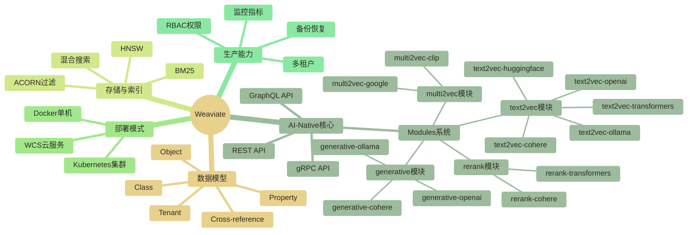

# Weaviate 学习路线图

> [!abstract] 这份路线图能给你什么
> - **学习目标**：系统掌握 Weaviate 从核心理念到生产落地的完整技能，重点理解它的 AI-Native 设计哲学
> - **设计理念**：沿着"理解设计 → 动手跑通 → 深入原理 → 生产落地"的真实工程路径走
> - **预计时长**：总计 15-25 小时，覆盖入门、进阶、生产、专家四个阶段
> - **适用背景**：有 Python 基础，想构建 AI 应用（RAG、语义搜索），或想深入理解 AI-Native 数据库设计理念

---

## 开篇：Weaviate 是一个自带翻译官的图书馆

想象两种图书馆：

**普通图书馆**：你想找量子计算的书，你得先知道"量子计算"这几个字，馆员按照书名索引去找。你的意图和图书馆的语言必须完全匹配。这是传统数据库，也是大多数向量数据库——它们只存储和检索，数据的"翻译"工作（把文字变成向量）你得自己搞定。

**带翻译官的图书馆**：你跟馆员说"我最近对宇宙和微观粒子的关系很感兴趣，想读点相关的"，翻译官立刻把你的意图翻译成图书馆能理解的格式，然后帮你找到量子力学、弦理论、宇宙学相关的书，甚至连那本你说不出名字的书也找到了。这就是 Weaviate——它内置了翻译官（Vectorizer 模块），数据进来时自动翻译，查询时自动理解语义。

这条路线重点关注 Weaviate 的一种使用方式：**配置相应 Vectorizer 模块后，将向量化与存储检索整合到应用流程中**。这一概括不表示其他向量数据库都不具备向量化集成能力，也不表示 Weaviate 无需模型或服务配置就会自动生成向量。

这一句话，是理解 Weaviate 全部设计决策的钥匙。

---

## 前置知识要求

在开始 Weaviate 之前，检查一下自己的底子：

| 前置知识 | 要求程度 | 说明 |
|---------|---------|------|
| Python 基础 | 必须 | 能写类、用 pip、操作字典列表 |
| 向量与嵌入概念 | 推荐 | 理解"把文本变成向量"是怎么回事，搜索相似性的基本原理 |
| REST API 基础 | 推荐 | Weaviate 的 API 调用方式偏重 HTTP，理解 GET/POST 有帮助 |
| Docker 基础 | 了解即可 | 本地部署需要 Docker，知道怎么跑 docker-compose 就够 |
| LLM/OpenAI API | 可选 | 要用 Generative 模块（内置 RAG）时需要，不是必须 |

**推荐先读**：
- 向量数据库选型指南 — 先搞清楚向量数据库这个大方向，理解为什么要用向量数据库
- Milvus学习路线图 — 如果你对比过 Milvus，理解 Weaviate 的差异点会更清晰

> [!tip] 已有 Milvus 或 Qdrant 使用经验？
> 恭喜你，你已经掌握了向量数据库的通用概念（向量索引、ANN 搜索、元数据过滤）。学 Weaviate 时，重点关注这三个 Weaviate 特有的东西：**Schema 的 Class/Property 模型**、**Modules 系统（这是核心差异）**、以及 **GraphQL API**。其他部分触类旁通。

---

## 整体学习路径

```mermaid
%%{init: {"theme":"base","themeVariables":{"fontFamily":"PingFang SC, -apple-system, Source Han Serif SC, serif","fontSize":"16px","background":"#FDFBF5","primaryColor":"#FDFBF5","primaryTextColor":"#2D2A26","primaryBorderColor":"#6E6A60","secondaryColor":"#E8EFE8","secondaryBorderColor":"#8FA890","secondaryTextColor":"#2D2A26","tertiaryColor":"#FDFBF5","tertiaryBorderColor":"#9A9488","tertiaryTextColor":"#6E6A60","lineColor":"#6E6A60","textColor":"#2D2A26","mainBkg":"#FDFBF5","nodeBorder":"#2D5A3D","clusterBkg":"#F3EEDF","clusterBorder":"#9A9488","edgeLabelBackground":"#FDFBF5"},"flowchart":{"htmlLabels":true,"curve":"basis","padding":20,"nodeSpacing":60,"rankSpacing":70,"useMaxWidth":false},"themeCSS":".node rect, .node polygon, .node circle { stroke-width: 1.5px; } .edgePath .path { stroke-width: 1.5px; } .cluster-label .nodeLabel, .cluster-label foreignObject { color: #2D2A26 !important; } .edgeLabel, .edgeLabel foreignObject { color: #2D2A26 !important; background-color: #FDFBF5; } .edgeLabel rect { fill: #FDFBF5; }"}}%%
flowchart TB
    subgraph "阶段一：入门（1-2周）"
        A1["01-Weaviate概述与核心定位<br/>AI-Native设计、Modules系统、GraphQL"]
        A2["02-Weaviate架构深度解析<br/>存储引擎、HNSW、分片机制"]
        A3["03-核心概念详解<br/>Class、Property、Schema、Object"]
        A1 --> A2 --> A3
    end

    subgraph "阶段二：进阶（2-3周）"
        B1["04-安装与部署<br/>WCS云服务 / Docker本地 / 生产集群"]
        B2["05-第一个Weaviate应用<br/>端到端跑通，感受AI-Native"]
        B3["06B-Modules系统与本地部署<br/>text2vec/multi2vec/generative模块"]
        B4["07-Schema设计与数据建模<br/>Class设计、cross-references、多租户"]
        B1 --> B2 --> B3 --> B4
    end

    subgraph "阶段三：生产（3-4周）"
        C1["08-查询与搜索详解<br/>nearText/nearVector/混合搜索/BM25"]
        C2["09-生产运维与性能调优<br/>监控、备份、RBAC、容量规划"]
        C1 --> C2
    end

    subgraph "阶段四：专家（持续深化）"
        D1["10-RAG集成实战<br/>内置Generative模块 / LangChain集成"]
    end

    A3 --> B1
    B4 --> C1
    C2 --> D1

    style A1 fill:#dbeafe,stroke:#3b82f6
    style A2 fill:#dbeafe,stroke:#3b82f6
    style A3 fill:#dbeafe,stroke:#3b82f6
    style B1 fill:#dcfce7,stroke:#16a34a
    style B2 fill:#dcfce7,stroke:#16a34a
    style B3 fill:#dcfce7,stroke:#16a34a
    style B4 fill:#dcfce7,stroke:#16a34a
    style C1 fill:#fef9c3,stroke:#ca8a04
    style C2 fill:#fef9c3,stroke:#ca8a04
    style D1 fill:#fce7f3,stroke:#db2777
```



---

## 四个阶段详解

### 阶段一：入门（第 1-2 周）

这个阶段的目标只有一个：**建立正确的心智模型**。Weaviate 的设计哲学和 Milvus/Qdrant 有根本差异，如果带着"向量数据库通用认知"直接上手，容易在 Modules 配置上踩坑。

**阶段目标**：能说清楚"Weaviate 的 AI-Native 意味着什么"，理解为什么它的 Schema 长这个样子，知道 Modules 是做什么的。

| 文档 | 核心收获 | 预计时间 |
|-----|---------|---------|
| [[【技术与工具】/向量数据库/Weaviate/01-Weaviate概述与核心定位]] | 理解 AI-Native 设计、Modules 体系、GraphQL 的选择逻辑 | 60 分钟 |
| [[【技术与工具】/向量数据库/Weaviate/02-Weaviate架构深度解析]] | 搞懂 HNSW 存储、分片、向量索引内部机制 | 90 分钟 |
| 03-核心概念详解 | 掌握 Class/Property/Object/Tenant 这些 Weaviate 专有概念 | 60 分钟 |

> [!note] 阶段一的关键问题
> 读完阶段一，你应该能回答：
> - Weaviate 说自己 "AI-Native"，具体体现在哪里？
> - Weaviate 的 GraphQL、REST 和 gRPC API 在这条学习路线中分别承担什么角色？
> - Class 和 SQL 里的 Table 有什么区别？

---

### 阶段二：进阶（第 2-3 周）

手不动起来，脑子里的概念都是空的。这个阶段从部署开始，一路跑通第一个真实应用，然后深入 Weaviate 最独特的两个模块：Modules 系统和 Schema 设计。

**阶段目标**：能独立部署 Weaviate（Docker），能写代码完成数据入库和语义搜索，理解各种 Vectorizer 模块的配置和使用。

| 文档 | 核心收获 | 预计时间 |
|-----|---------|---------|
| 04-安装与部署 | 三种部署方式（WCS/Docker/Kubernetes）实操 | 90 分钟 |
| [[【技术与工具】/向量数据库/Weaviate/05-第一个Weaviate应用]] | 端到端完成：入库 → 语义搜索 → 看结果 | 120 分钟 |
| [[【技术与工具】/向量数据库/Weaviate/06B-Modules系统与本地部署]] | text2vec-openai/cohere/transformers、multi2vec-clip、generative 模块全解析 | 120 分钟 |
| 07-Schema设计与数据建模 | Class 设计原则、cross-references、多租户隔离策略 | 90 分钟 |

> [!tip] 进阶阶段的重点提示
> **第 6 篇 Modules 系统是整个学习路径最重要的一篇**——它是 Weaviate 和其他向量数据库的核心差异所在。不要跳过，要读仔细。

---

### 阶段三：生产（第 3-4 周）

从"能跑"到"跑得好"，这一步很多人跳过了，然后在生产环境踩坑。

**阶段目标**：理解 Weaviate 的查询机制（包括混合搜索），能处理生产中的常见问题（内存压力、慢查询、权限管理）。

| 文档 | 核心收获 | 预计时间 |
|-----|---------|---------|
| 08-查询与搜索详解 | nearText/nearVector/BM25/混合搜索/Reranker 全覆盖 | 120 分钟 |
| 09-生产运维与性能调优 | RBAC（v1.28+）、监控指标、备份恢复、容量规划 | 120 分钟 |

> [!warning] 关于内存消耗
> Weaviate 的内存消耗相比 Qdrant 更高，在超过 5000 万向量的场景下需要认真规划容量。第 9 篇会详细讲这个问题。

---

### 阶段四：专家（持续深化）

RAG 是 Weaviate 的杀手锏场景。内置 Generative 模块让你不需要外部 LLM 调用框架就能完成检索增强生成。这一篇把 Weaviate 的所有能力整合到一个完整的 RAG 系统里。

| 文档 | 核心收获 | 预计时间 |
|-----|---------|---------|
| 10-RAG集成实战 | 内置 Generative 模块 RAG、LangChain/LlamaIndex 集成、生产级 RAG 架构 | 180 分钟 |

---

## Weaviate 与 Milvus/Qdrant 的概念对照

这是专门为"已经学过其他向量数据库"的人准备的速查表。

### 通用概念：三者都有，只是叫法不同

| 概念 | Milvus | Qdrant | Weaviate | 说明 |
|-----|--------|--------|---------|------|
| 数据容器 | Collection | Collection | Class | 存储同类向量对象的容器，类似 SQL 的 Table |
| 单条记录 | Entity | Point | Object | 一条数据记录 |
| 向量字段 | Float Vector Field | Vector | Vector Property | 存储高维向量的字段 |
| 元数据字段 | Scalar Field | Payload | Property | 非向量的结构化字段 |
| 索引算法 | HNSW/IVF/DiskANN | HNSW | HNSW | 向量近邻搜索算法 |
| ANN 搜索 | search() | search_points() | nearVector/nearText | 近似最近邻搜索 |
| 混合搜索 | Hybrid Search | Hybrid Search | Hybrid Search | 向量搜索 + 关键词搜索 |
| 租户隔离 | Partition | Collection 复制 | Tenant（多租户） | 逻辑/物理隔离方式 |

### Weaviate 独有：这些是 Weaviate 的专有设计

| 特性 | Weaviate 中的实现 | Milvus/Qdrant 中的对应 |
|-----|-----------------|----------------------|
| **内置向量化** | Modules（text2vec-*） | 不支持，需外部 Embedding 服务 |
| **Schema 类型系统** | DataType（text、int、date...） | Milvus 有 Schema，但类型更偏数据库；Qdrant 无固定 Schema |
| **内置 RAG** | generative-openai/cohere/ollama | 不支持，需接入 LangChain 等 |
| **GraphQL API** | 完整 GraphQL 接口 | 无，均为 REST + gRPC |
| **Cross-references** | Object 间相互引用（类似外键） | 无内置支持 |
| **多租户原生设计** | Class 级 Tenant，完整隔离 | Milvus 用 Partition，Qdrant 用独立 Collection |

> [!note] Cross-references 是什么
> Weaviate 里，一个 Object 可以引用另一个 Class 的 Object，类似数据库里的外键，但更灵活。例如：`Article` 对象可以引用 `Author` 对象，查询 Article 时可以直接"穿透"到 Author 的字段。这是关系型思维在向量数据库里的体现，Milvus 和 Qdrant 没有这个能力。

### Weaviate 没有但对手有的东西

| 能力 | Milvus | Qdrant | Weaviate |
|-----|--------|--------|---------|
| 极致写入吞吐 | 非常强（云原生分离架构） | 强 | 中等 |
| 超大规模（百亿向量） | 支持 | 支持 | 不推荐 |
| 量化压缩（PQ/SQ/BQ） | IVF-PQ | 三级量化（完整） | 部分支持 |
| ACID 事务 | 部分 | 部分 | 部分 |

---

## 三条不同背景的学习路线

根据你的出发点，学习 Weaviate 的侧重点不同：

### 路线 A：AI 应用工程师（最常见）

你的目标是用 Weaviate 快速构建 RAG 应用或语义搜索服务，不需要深入运维。

```text
01 → 05（直接跑第一个应用）→ 06（Modules 重点看）→ 10（RAG 实战）
```

**跳过**：02（架构细节）、09（生产调优）——等真的遇到问题再回来看。

---

### 路线 B：后端/数据工程师（生产导向）

你需要在生产环境部署和维护 Weaviate，关注稳定性、性能和成本。

```text
01 → 02（架构要懂）→ 03 → 04（部署实操）→ 07（Schema 设计）→ 09（运维调优）
```

**重点关注**：第 9 篇的内存管理和 RBAC（v1.28 新增）。

---

### 路线 C：技术选型决策者（对比导向）

你需要在 Weaviate/Milvus/Qdrant 中做选型，快速建立判断。

```text
01（先懂 AI-Native 是什么）→ 选型指南横向对比表 → 05（跑一遍感受）
```

**重点关注**：01 中的对比表、Modules 系统的使用成本分析。

---

## Weaviate 的知识图谱

以下是 Weaviate 各概念之间的关系图，帮助你在学习过程中定位自己在哪里：



---

## 学习中的常见误区

在正式开始之前，先了解这几个常见的认知误区，可以帮你少走弯路：

**误区一：以为 Weaviate 必须依赖外部 OpenAI API 才能用**

Weaviate 的 text2vec 模块支持本地 Hugging Face 模型（text2vec-transformers）和 Ollama 本地模型，完全可以离线使用。OpenAI/Cohere 集成是方便选项，不是唯一选项。

**误区二：以为 GraphQL 很难用**

Weaviate 的 GraphQL 查询语法相对直观。作为向量数据库的查询接口，它比通用 GraphQL 简单很多，而且 Python/JS 客户端封装了大量常用操作，你不需要手写 GraphQL 查询字符串。

**误区三：以为 Weaviate 只适合文本搜索**

multi2vec-clip 模块支持图文混合搜索（一个向量空间里存图片和文本），multi2vec-google 支持图文视频多模态。本路线将 Weaviate 的这些多模态模块作为学习对象；是否适合具体场景，需要结合模型支持、部署条件和检索效果判断，这里不作主流产品完整度排名。

**误区四：以为内置 RAG 就是全部**

内置 Generative 模块（`generate.singleResult` / `generate.groupedResult`）确实方便，但 Weaviate 也有完整的 LangChain、LlamaIndex 集成。两种方式不互斥，根据场景选择。

---

## 快速定向：你现在在哪里

用这个问题定位你当前的状态：

> "我现在对 Weaviate 了解多少？"

- **"完全不知道 Weaviate 是什么"** → 从 [[【技术与工具】/向量数据库/Weaviate/01-Weaviate概述与核心定位]] 开始，这是你唯一的起点
- **"知道它是向量数据库，但不知道 AI-Native 是什么意思"** → 依然从 01 开始，那篇文档专门解释这个
- **"用过 Milvus，想快速上手 Weaviate"** → 看前面的"通用概念对照表"，然后从 [[【技术与工具】/向量数据库/Weaviate/06B-Modules系统与本地部署]] 开始
- **"Weaviate 装好了，但不知道该怎么用"** → 直接跳到 [[【技术与工具】/向量数据库/Weaviate/05-第一个Weaviate应用]]，动手比看概念更有效
- **"在生产环境遇到性能问题"** → 去 09-生产运维与性能调优，那里有专门的排查指南

---

## 相关资源与延伸阅读

### 知识库内相关文档

- 向量数据库选型指南 — 选型决策框架
- Milvus 学习路线图 — 对比参照
- Qdrant 学习路线图 — 对比参照
- 向量数据库通用知识 — ANN 算法、HNSW 原理等基础内容

### 官方资源

- Weaviate 官方文档：[docs.weaviate.io](https://docs.weaviate.io)
- Weaviate Blog（版本更新通知）：[weaviate.io/blog](https://weaviate.io/blog)
- Weaviate GitHub：[github.com/weaviate/weaviate](https://github.com/weaviate/weaviate)
- Weaviate Forum（社区问答）：[forum.weaviate.io](https://forum.weaviate.io)

---

> [!quote] 开始之前的最后一句话
> Weaviate 的学习曲线有一个独特的形状：**前期有一道坡**（理解 AI-Native 和 Modules 系统需要时间），**但熟悉之后可能更顺手**（若所选模块适配应用需求，构建 AI 应用时可能减少部分集成工作；这里不作跨产品开发速度保证）。这篇路线图就是帮你把前期那道坡走得不那么陡。准备好了吗，出发。
