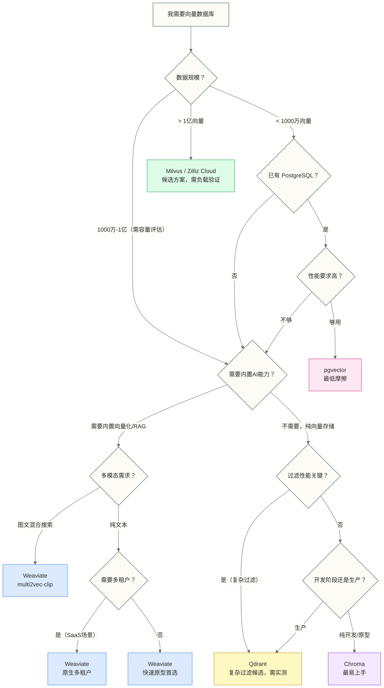

# Weaviate 概述与核心定位

> [!abstract] 本文要解决的四个问题
> 1. **Weaviate 是什么**：它的历史、定位，以及"AI-Native"这个词到底意味着什么
> 2. **Weaviate 为什么不一样**：Modules 系统、GraphQL API、内置 RAG 的深度解析
> 3. **Weaviate 适合谁**：哪些场景选它，哪些场景不选它（同样重要）
> 4. **横向对比**：与 Milvus、Qdrant、pgvector、Chroma 的全面比较

---

## 目录

- [[#一个不一样的开场白]]
- [[#Weaviate 是什么]]
- [[#AI-Native 的本质]]
- [[#Modules 系统：核心差异化能力]]
  - [[#Vectorizer 模块（text2vec）]]
  - [[#多模态模块（multi2vec）]]
  - [[#Generative 模块：内置 RAG]]
  - [[#Reranker 模块]]
- [[#GraphQL API：为什么不用 REST]]
- [[#多租户：原生设计而非事后添加]]
- [[#Weaviate 的版本演进]]
- [[#横向对比：五大向量数据库全面比较]]
- [[#选 Weaviate 的真实场景]]
- [[#不选 Weaviate 的场景]]
- [[#总结]]

---

## 一个不一样的开场白

大多数向量数据库的介绍都长这样：

> "XXX 是一个开源的向量数据库，支持 HNSW 索引，提供 REST API，可以做语义搜索..."

这种介绍的问题在于，它把所有向量数据库描述得几乎一样。读完你仍然不知道它有什么特别的。

所以我换个方式来介绍 Weaviate。

想象你要搭一个"知识问答机器人"。你有一堆文档，想让用户用自然语言问问题，机器人搜出相关段落，再调用 GPT 生成答案。

**用 Qdrant 或 Milvus 来做**，你的工作流是：
1. 准备文档
2. 调用 OpenAI Embedding API，把每段文字变成向量（你来负责）
3. 把向量 + 原文存进数据库
4. 查询时把问题也向量化（你来负责）
5. 做向量相似性搜索，拿到相关段落
6. 把段落和问题拼成 Prompt，调用 GPT（你来负责）
7. 返回结果

**用 Weaviate 来做**，你的工作流是：
1. 准备文档，配置用哪个 Vectorizer（比如 text2vec-openai）
2. 直接存原文进数据库（向量化是 Weaviate 自动做的）
3. 查询时直接传原始问题字符串，配置 generative 模块用哪个 LLM
4. 返回结果——搜索 + 生成一次完成

不是说 Weaviate 的方式一定更好，但它**把外部依赖内化成了内部模块**。这个设计哲学，就是 AI-Native 的实质。

---

## Weaviate 是什么

Weaviate（读音：WEE-vee-ate）是一个**开源的 AI-Native 向量数据库**，由荷兰公司 SeMI Technologies（后更名为 Weaviate）于 2019 年创立并开源。

**基本事实**：
- 语言：Go 语言实现（核心引擎），客户端支持 Python/JS/Go/Java/.NET/Curl
- 许可证：BSD-3-Clause（核心）+ Apache 2.0（部分组件）
- GitHub Stars：截至 2025 年底约 12,000+
- 本文讨论的版本：包含 v1.28；版本里程碑未提供可追溯依据，不能据此认定当前版本
- 托管服务：Weaviate Cloud Services（WCS），也有 AWS/GCP/Azure Marketplace

用一句话定位 Weaviate：**一个把 AI 能力（向量化、生成式 AI）内置到数据库层面的向量数据库，核心面向需要快速构建 AI 应用的工程团队。**

它不是：
- 一个通用关系数据库（没有 SQL，没有完整 JOIN，不做 OLTP）
- 一个图数据库（有 cross-references 但不做图遍历推理）
- 一个全文搜索引擎（有 BM25 混合搜索，但不是 Elasticsearch 的替代品）

它是：
- 一个以**语义相似性搜索**为核心的专用数据库
- 一个把**Embedding 服务和生成式 AI 服务集成进来**的应用层平台
- 一个**GraphQL 为一等公民**的 API 设计产品

---

## AI-Native 的本质

"AI-Native" 这个词被很多产品滥用，变成了营销词汇。但在 Weaviate 的语境里，它指向非常具体的技术设计：

### 传统向量数据库的工作方式

```text
你的代码 → [调用 Embedding API] → 向量 → [存入向量数据库] → [检索到向量] → [你的代码再处理]
```

向量数据库只负责"存向量、找向量"这一段，**数据进入之前的向量化**和**数据出来之后的生成**，都是你的责任。

### Weaviate AI-Native 的工作方式

```text
你的代码 → 原始文本/图片 → [Weaviate: 自动向量化 + 存储 + 检索 + 可选生成]
```

Weaviate 把 Embedding 这一步（向量化）和 Generation 这一步（调用 LLM 生成答案）内化进了数据库本身。这是通过 **Modules 系统**实现的。

### 为什么这很重要

这不只是少写几行代码的问题。它带来了几个实质性影响：

**影响一：模型迁移与数据一致性**。当 Embedding 模型升级时，需要评估历史数据与查询向量的兼容性，并规划必要的重新向量化。Weaviate 的模块配置可以声明向量化设置，但不能据此假定修改配置会自动完成历史数据的批量重新向量化；具体迁移方式取决于所用版本、模块和集合配置。

**影响二：调用编排的简洁性**。Weaviate 可以通过模块接管应用层的 Embedding 调用编排，减少自行编写封装服务的工作；但本地 sentence-transformers 等方案仍可能依赖需要单独部署和维护的推理服务。对于小团队和快速原型，应区分应用代码的简化与推理服务的运维成本。

**影响三：查询的自然性**。你可以直接用自然语言查询（`nearText: "关于量子计算的研究"`），Weaviate 在内部完成向量化再做搜索。这让查询语句更贴近业务意图。

> [!note] AI-Native 不等于没有成本
> 这个设计也有代价：你把一部分控制权交给了 Weaviate。如果你需要非常精细地控制 Embedding 过程（自定义预处理、特殊 tokenizer），Weaviate 的 Module 可能不够灵活。这是选型时需要权衡的点。

---

## Modules 系统：核心差异化能力

Modules 是 Weaviate 最独特的设计，也是理解它的关键。Weaviate 把所有 AI 能力抽象成"模块"，在 Schema 配置阶段就声明每个 Class 使用哪些模块。

模块分四类：

| 模块类型 | 功能 | 代表模块 |
|--------|------|---------|
| Vectorizer（向量化器） | 数据入库时自动生成向量 | text2vec-*、multi2vec-* |
| Generative（生成器） | 查询时调用 LLM 生成答案 | generative-openai、generative-ollama |
| Reranker（重排序器） | 对初步搜索结果重新排序 | rerank-cohere、rerank-transformers |
| Reader（其他） | 特定格式数据读取 | 较少使用 |

### Vectorizer 模块（text2vec）

Vectorizer 是最核心的模块类型。它在**数据写入时自动调用**，把文本/图片转换成向量，存储在 Weaviate 内部。你可以减少应用层的 Embedding 调用编排，但仍需提供外部 API 或本地推理服务；采用本地推理时，相应服务仍需要部署和维护。

**主要 text2vec 模块**：

#### text2vec-openai

调用 OpenAI 的 Embedding API（text-embedding-3-small、text-embedding-3-large 等）。

**适合**：快速原型、已经在用 OpenAI 生态的团队
**代价**：每次写入数据都会产生 OpenAI API 调用费用，数据量大时成本不可忽视

Schema 配置示例：
```json
{
  "class": "Article",
  "vectorizer": "text2vec-openai",
  "moduleConfig": {
    "text2vec-openai": {
      "model": "text-embedding-3-small",
      "dimensions": 1536
    }
  }
}
```

#### text2vec-cohere

调用 Cohere 的 Embedding API，Cohere 的 embed-v3 系列在多语言场景下表现出色。

**适合**：多语言内容（中文、法语等）场景，可将 Cohere 的多语言 Embedding 与 OpenAI 的相应模型作为候选，在目标语言和实际数据集上比较检索效果

#### text2vec-huggingface

调用 Hugging Face Inference API（托管在 HF 上的模型）。

**适合**：想用开源模型但不想自己部署的场景

#### text2vec-transformers

**本地运行** Hugging Face 的 sentence-transformers 模型，数据不出本地。

**适合**：数据隐私要求高（金融、医疗），不能调用外部 API；或者想用特定的领域微调模型

**典型部署**：
```yaml
# docker-compose.yml 片段
services:
  weaviate:
    image: semitechnologies/weaviate:latest
    environment:
      ENABLE_MODULES: 'text2vec-transformers'
      TRANSFORMERS_INFERENCE_API: 'http://t2v-transformers:8080'

  t2v-transformers:
    image: semitechnologies/transformers-inference:sentence-transformers-multi-qa-MiniLM-L6-cos-v1
```

#### text2vec-ollama（较新）

调用本地运行的 Ollama，使用 Ollama 中的 Embedding 模型（如 nomic-embed-text）。这是目前**本地化 + 易用性**平衡最好的方案之一，v1.27 引入。

> [!tip] 选哪个 text2vec？
> - **快速原型 / 已有 OpenAI Key**：text2vec-openai，最省事
> - **中文 / 多语言**：text2vec-cohere（embed-multilingual-v3.0）
> - **完全本地化 / 数据隐私**：text2vec-transformers 或 text2vec-ollama
> - **极致性能的领域模型**：text2vec-transformers（自定义模型）

---

### 多模态模块（multi2vec）

multi2vec 系列让 Weaviate 能把**不同类型的数据（文本、图片、视频）放在同一个向量空间**里，实现跨模态搜索。

**multi2vec-clip**

使用 OpenAI CLIP 模型，把图片和文本映射到同一个向量空间。这意味着你可以：
- 用文本搜图片（"一只在海边玩耍的金毛"）
- 用图片搜图片（上传一张图片，找相似的）
- 用图片搜文本

```python
# 用文本搜图片示例
result = client.query.get("Product", ["name", "image"]) \
    .with_near_text({"concepts": ["红色连衣裙"]}) \
    .do()
```

**multi2vec-google（原 multi2vec-palm）**

使用 Google 的多模态 Embedding，支持文本 + 图片 + 视频。v1.27 版本将原来的 `multi2vec-palm` 改名为 `multi2vec-google`，旧代码保持兼容。

> [!note] 多模态是 Weaviate 的差异化优势
> Milvus 和 Qdrant 也支持存储图片向量，但你需要自己跑 CLIP 模型生成向量。Weaviate 的 multi2vec-clip 模块把这一步内化了，对于构建多模态搜索应用来说，开发成本低得多。

---

### Generative 模块：内置 RAG

这是 Weaviate 最让人惊喜的能力：**在一次查询里，直接完成"检索 + 生成"的 RAG 全流程**，不需要在应用层写 LangChain 代码。

传统 RAG 的代码流程：
```python
# 传统 RAG（使用其他向量数据库）
query = "量子纠缠是如何工作的"

# Step 1：向量化查询
query_embedding = openai.embeddings.create(input=query, model="text-embedding-3-small")

# Step 2：向量搜索
results = vector_db.search(query_embedding.data[0].embedding, limit=3)

# Step 3：构建 Prompt
context = "\n".join([r["content"] for r in results])
prompt = f"根据以下内容回答问题：\n{context}\n\n问题：{query}"

# Step 4：调用 LLM
answer = openai.chat.completions.create(
    model="gpt-4",
    messages=[{"role": "user", "content": prompt}]
)
```

**Weaviate Generative 模块的 RAG**：
```python
# Weaviate 内置 RAG（Python 客户端 v3方法链示例，不适用于v4接口）
result = client.query.get("Article", ["title", "content"]) \
    .with_near_text({"concepts": ["量子纠缠"]}) \
    .with_generate(
        single_prompt="根据以下文章内容，用通俗的语言解释：{content}"
    ) \
    .with_limit(3) \
    .do()

# result 里直接包含 LLM 生成的答案
```

两种方式本质上做的事情一样，但 Weaviate 的方式把步骤 3 和步骤 4 转移到了数据库层，让应用代码更简洁。

**主要 Generative 模块**：

| 模块 | 对应 LLM | 适用场景 |
|-----|---------|---------|
| generative-openai | GPT-3.5/GPT-4/GPT-4o | 通用，效果最稳定 |
| generative-cohere | Command R/Command R+ | 成本敏感，多语言 |
| generative-google | Gemini 系列 | 已在 GCP 生态 |
| generative-ollama | 本地 Llama/Mistral 等 | 完全本地化，离线场景 |
| generative-anyscale | Mistral/Llama（托管） | 开源模型托管方案 |

**两种 Generative 查询模式**：

`generate.singleResult`：对每个检索到的对象**分别生成**一段文字
```python
.with_generate(single_prompt="用一句话总结这篇文章的核心观点：{content}")
# 返回：每个 Article 对象都附带一段 LLM 生成的摘要
```

`generate.groupedResult`：把所有检索结果**合并后一起处理**，生成综合回答
```python
.with_generate(grouped_task="根据以上所有文章，总结量子计算的最新进展")
# 返回：一个综合了所有检索结果的完整回答
```

> [!tip] singleResult vs groupedResult 怎么选
> - **问答场景**：`groupedResult`——把多个相关片段综合成一个答案，就是标准 RAG
> - **摘要/标注场景**：`singleResult`——对每条记录生成摘要、分类标签等
> - **混合场景**：先用 `singleResult` 生成每条的摘要，再用另一个查询做 `groupedResult`

---

### Reranker 模块

Reranker 模块对初步向量搜索的结果进行**语义重新排序**，提升最终排名的精准度。

```text
初步 ANN 搜索（召回 top-50）→ Reranker（精确打分）→ 最终 top-5
```

这个两阶段搜索是现代 RAG 系统的标准实践：ANN 搜索速度快但精度有损，Reranker 精度高但慢——分开处理，兼顾效率和质量。

**可用模块**：
- `rerank-cohere`：调用 Cohere Rerank API，质量高，有费用
- `rerank-transformers`：本地运行 cross-encoder 模型，无外部依赖

---

## GraphQL API：为什么不用 REST

这是很多新接触 Weaviate 的人第一个疑问：向量数据库通常用 REST API，Weaviate 为什么要用 GraphQL？

### 背景：Weaviate 的数据模型需要 GraphQL

Weaviate 的 Schema 设计有 **cross-references**——一个 Class 的对象可以引用另一个 Class 的对象（类似关系数据库的外键），查询时支持跨 Class 的关联查询。

举个例子：
- `Article` Class 有 `author` 字段，引用 `Author` Class
- 你想查询"关于 AI 的文章，同时返回作者的姓名和所在机构"

用 REST API 表达这个需求，你需要多次请求（先搜文章，再根据 authorId 查作者），或者 API 需要支持复杂的 query parameter 语法，很快变得难以维护。

GraphQL 天然就是为这种**嵌套关联查询**设计的：

```graphql
{
  Get {
    Article(
      nearText: { concepts: ["人工智能"] }
      limit: 5
    ) {
      title
      content
      author {
        ... on Author {
          name
          institution
        }
      }
      _additional {
        generate(
          groupedResult: {
            task: "总结这些文章的核心观点"
          }
        ) {
          groupedResult
        }
      }
    }
  }
}
```

这一个请求完成了：向量搜索 + 跨 Class 关联查询 + 内置 RAG 生成。用 REST API 设计这个接口会非常笨重。

### Weaviate 的三种 API

Weaviate 实际上提供三种 API，不是只有 GraphQL：

| API | 用途 | 特点 |
|-----|------|------|
| GraphQL | **查询**（搜索、过滤、聚合、生成） | 表达力最强，适合复杂查询 |
| REST | **管理**（Schema 增删改、对象 CRUD、备份等） | 标准 HTTP，适合管理操作 |
| gRPC | **高性能批量操作**（大批量写入、性能敏感的搜索） | v1.23+ 引入，延迟更低 |

Python 客户端（weaviate-client v4）对这三种 API 都做了封装，大多数时候你直接用 Python 方法调用，底层 API 的选择由客户端决定。

> [!note] 新版 Python 客户端（v4）
> Weaviate Python 客户端在 v4 版本做了大幅重构，API 风格从方法链式调用改为更 Pythonic 的方式。如果你看到的代码里有 `.with_near_text()` 这类方法链，那是 v3 客户端的写法。v4 客户端的写法更简洁，推荐使用 v4。

---

## 多租户：原生设计而非事后添加

多租户（Multi-tenancy）对于 B2B SaaS 产品来说是核心需求：不同客户的数据需要按租户隔离；如果还要求一个客户的查询不影响另一个客户的性能，则需要进一步评估共享计算资源下的资源隔离、限流和容量，不能仅凭独立数据分片保证。

大多数向量数据库的多租户是这样实现的：
- Milvus：用 Partition 隔离（逻辑隔离），或者每个租户一个 Collection（物理隔离）
- Qdrant：一般推荐每个租户一个 Collection（完全隔离）

**Weaviate 的多租户是原生设计，在 Class 级别内置**：

```json
{
  "class": "UserDocument",
  "multiTenancyConfig": {
    "enabled": true
  }
}
```

开启多租户后：
- 每个 Tenant 的数据物理隔离（独立的向量存储分片）
- 可以独立启用/停用每个 Tenant（节省存储成本，非活跃租户可"冻结"）
- 查询时指定 Tenant，Weaviate 自动路由到正确的分片

```python
# 写入时指定 tenant
with client.batch.dynamic() as batch:
    batch.add_object(
        collection="UserDocument",
        properties={"content": "用户文档内容"},
        tenant="tenant_user_001"
    )

# 查询时指定 tenant
user_docs = client.collections.get("UserDocument").with_tenant("tenant_user_001")
results = user_docs.query.near_text(query="相关查询", limit=5)
```

> [!tip] 多租户适合的场景
> - **SaaS 产品**：每个企业客户是一个 Tenant，数据完全隔离
> - **用户级数据隔离**：每个用户的文档库互不可见
> - **成本优化**：非活跃用户的数据可以"冷冻"（offload to disk），不占用内存

---

## Weaviate 的版本演进

了解版本演进有助于你评估文章/教程的时效性，避免用错误的旧代码踩坑。

| 版本 | 时间 | 核心变化 |
|-----|------|---------|
| v1.19 | 2023 Q1 | 多租户 GA，正式支持生产级多租户隔离 |
| v1.22 | 2023 Q3 | 混合搜索（BM25 + 向量）正式 GA |
| v1.23 | 2023 Q4 | gRPC API 引入，Python 客户端 v4 发布 |
| v1.25 | 2024 Q2 | Named Vectors（一个对象多个向量），多向量搜索 |
| v1.26 | 2024 Q3 | 多目标向量搜索（Multi-target Vector Search）增强 |
| v1.27 | 2024 Q4 | ACORN 过滤策略（大幅提升过滤搜索性能）、Jina V3 集成、text2vec-ollama 引入、Google 模块改名 |
| v1.28 | 2025 Q1 | RBAC 权限控制（技术预览）、异步向量索引增强、Voyage AI 集成、日语 kagome_ja tokenizer |

**重要里程碑说明**：

**v1.25 Named Vectors**：这是一个重要升级。在此之前，每个对象只有一个向量。Named Vectors 允许同一个对象有多个命名向量（比如：一篇文章同时有 `title_vector` 和 `content_vector`），搜索时可以针对特定向量。

**v1.27 ACORN 过滤**：向量数据库的一个经典难题是"带过滤条件的向量搜索"性能下降严重。ACORN（Adaptive Cross-Object Relationship Navigation）策略通过在 HNSW 图遍历时直接跳过不满足过滤条件的节点，大幅提升了过滤搜索的召回率和速度。

**v1.28 RBAC**：基于角色的访问控制。在 v1.28 之前，Weaviate 只有 API Key 认证，没有细粒度权限控制。v1.28 引入了内置角色（只读、读写、管理员）和自定义角色。注意：v1.28 的 RBAC 是"技术预览"状态，生产使用需要评估稳定性。

---

## 横向对比：五大向量数据库全面比较

> [!note] 对比说明
> 向量数据库产品迭代极快，以下对比基于 2025 年初状态。具体功能请以各产品官方文档为准。

### 整体定位对比

| 产品 | 核心定位 | 最擅长 | 主要语言 | 开源许可 |
|-----|---------|-------|---------|---------|
| **Weaviate** | AI-Native，内置向量化和 RAG | 快速构建 AI 应用，多模态搜索 | Go | BSD-3 |
| **Milvus** | 云原生，高性能大规模 | 超大数据集，高吞吐生产场景 | Go/C++ | Apache 2.0 |
| **Qdrant** | 高性能过滤搜索 | 精准过滤 + 向量搜索，内存效率 | Rust | Apache 2.0 |
| **pgvector** | PostgreSQL 插件 | 中小规模，已有 Postgres 架构 | C | PostgreSQL License |
| **Chroma** | 开发友好，本地优先 | 快速原型，Jupyter/本地开发 | Python | Apache 2.0 |

### 功能详细对比

| 功能维度 | Weaviate | Milvus | Qdrant | pgvector | Chroma |
|--------|---------|--------|--------|---------|--------|
| **内置 Embedding** | 原生（Modules） | 无（需外部） | 无（需外部） | 无（需外部） | 无（需外部） |
| **内置 RAG** | 原生（generative 模块） | 无 | 无 | 无 | 无 |
| **多模态** | 原生（multi2vec-clip） | 需自行处理 | 需自行处理 | 无 | 无 |
| **混合搜索** | BM25 + 向量 | 支持 | 支持（稀疏+密集） | 需配合 pg_trgm | 无内置 |
| **过滤搜索** | ACORN（v1.27+） | 支持 | 极强（Payload 过滤） | WHERE 子句 | 基础支持 |
| **多租户** | 原生（Class 级） | Partition/Collection | 推荐多 Collection | 表级隔离 | 无原生支持 |
| **GraphQL API** | 完整支持 | 无 | 无 | 无 | 无 |
| **RBAC 权限** | v1.28 技术预览 | 生产可用 | 基础 API Key | PostgreSQL 权限体系 | 无 |
| **量化压缩** | 部分支持 | IVF-PQ/SQ | 三级量化（完整） | 无 | 无 |
| **分布式集群** | 支持 | 原生云原生 | 支持 | 受 Postgres 限制 | 不建议 |

### 性能特征对比

| 性能维度 | Weaviate | Milvus | Qdrant | pgvector | Chroma |
|--------|---------|--------|--------|---------|--------|
| **查询延迟** | 中等（ms 级） | 极低（单位 ms） | 低（ms 级） | 中等（SQL 开销） | 中等 |
| **写入吞吐** | 中等 | 极高 | 高 | 受 Postgres 限制 | 低 |
| **内存消耗** | 偏高 | 中等（分离架构） | 低（量化优化） | 依赖 Postgres | 中等 |
| **最大规模** | 5000 万以内顺畅 | 百亿级 | 10 亿+ | 千万以内 | 百万级 |
| **过滤性能** | v1.27 后大幅改善 | 一般 | 最强 | SQL 原生优势 | 弱 |

### 生态与运维对比

| 运维维度 | Weaviate | Milvus | Qdrant | pgvector | Chroma |
|--------|---------|--------|--------|---------|--------|
| **部署复杂度** | 中等 | 较高（依赖 etcd/pulsar） | 低 | 低（有 Postgres 即可） | 极低 |
| **LangChain 集成** | 完整 | 完整 | 完整 | 完整 | 完整 |
| **LlamaIndex 集成** | 完整 | 完整 | 完整 | 完整 | 完整 |
| **云托管服务** | WCS（官方） | Zilliz Cloud | Qdrant Cloud | 各大云 Postgres | 无 |
| **文档质量** | 高 | 高 | 高 | 高 | 中等 |
| **社区活跃度** | 高 | 最高 | 高 | 极高（Postgres 生态） | 中等 |

---

## 选 Weaviate 的真实场景

以下是 Weaviate 在真实工程中最有竞争力的场景，不是官方营销，是从工程角度分析：

### 场景一：快速构建 AI 问答/搜索原型

**背景**：产品原型阶段，3 人小团队，想在 2 周内跑通"知识库问答"功能。

**为什么选 Weaviate**：text2vec-openai + generative-openai 模块，不需要写 Embedding 服务，不需要写 LLM 调用逻辑，一个 Weaviate + 几十行 Python 就能跑通完整 RAG。从"有想法"到"跑起来"最快。

**成本**：依赖 OpenAI API，数据量小时费用可接受。

---

### 场景二：需要图文混合搜索的电商/内容平台

**背景**：电商平台，商品有图片和文字描述，用户想"以图搜商品"或"用文字描述搜商品图片"。

**为什么选 Weaviate**：multi2vec-clip 把图片和文字放在同一个向量空间，原生支持跨模态搜索。Milvus 和 Qdrant 也能做，但需要自己跑 CLIP 推理服务，工程复杂度高很多。

---

### 场景三：SaaS 产品需要多租户知识库

**背景**：B2B SaaS，每个企业客户有自己的文档库，数据不能互相可见，100+ 个企业客户。

**为什么选 Weaviate**：原生多租户设计（一个 Class，N 个 Tenant），不需要为每个客户维护一套独立的向量数据库。Tenant 可以独立冻结/激活，非活跃客户不占用内存。

---

### 场景四：不想维护 Embedding 微服务

**背景**：数据工程团队，目前已经有很多微服务需要维护，不想再加一个"Embedding 服务"进来。

**为什么选 Weaviate**：text2vec-transformers 或 text2vec-ollama 模块可集成本地 Embedding 推理调用，部署时仍需提供并维护相应的 Transformers 推理服务或 Ollama 服务。它们可以减少应用层的调用编排代码，但不意味着消除了推理服务依赖。

---

### 场景五：语义 + 关键词混合搜索的内容平台

**背景**：新闻/内容平台，用户搜索习惯混合（有时用完整句子，有时用精确关键词），需要两种搜索模式兼顾。

**为什么选 Weaviate**：原生混合搜索（BM25 + 向量），通过 `alpha` 参数控制两者权重，支持在同一查询里平衡语义相似性和关键词精确匹配。

---

## 不选 Weaviate 的场景

**选型诚实原则**：每个工具都有适合和不适合的场景。这部分和"选 Weaviate"同样重要。

### 场景：超大规模（10 亿向量以上）

若以5000万及百亿向量作为容量规划的假设场景，应分别评估内存、分片、召回率、延迟与并发；这些规模数字不是本文已证明的产品能力边界。超大规模场景可将Weaviate、Milvus及Zilliz Cloud列为候选，通过实际负载测试选型。

**替代方案**：Milvus / Zilliz Cloud

---

### 场景：极致过滤性能（高基数过滤，大量并发）

虽然 v1.27 的 ACORN 策略大幅改善了过滤搜索性能，但 Qdrant 在这个领域依然是标杆。如果你的核心场景是"先严格过滤，再做向量搜索"（比如：只在 category=A AND price < 100 的商品里做向量搜索），Qdrant 的 Payload 过滤架构更专业。

**替代方案**：Qdrant

---

### 场景：不需要内置 AI 能力，但维护成本敏感

如果你已经有稳定的外部 Embedding 服务，不需要内置 RAG，只需要一个纯粹的"存向量、搜向量"的引擎——那么 Weaviate 的 Modules 系统对你来说是额外的复杂度，而不是价值。Qdrant（Rust 实现，内存占用低，运维简单）或 pgvector（有 Postgres 就能用）可能是更好的选择。

**替代方案**：Qdrant（高性能） / pgvector（已有 Postgres 架构）

---

### 场景：中小规模且已有 PostgreSQL 架构

如果你的数据量在千万向量以内，团队已经熟悉 PostgreSQL，pgvector 是最低摩擦的选择——不需要学新系统，数据和业务数据在同一个数据库，SQL 天然支持关联查询。

**替代方案**：pgvector

---

### 场景：开发阶段快速原型（不在乎生产能力）

纯粹的"跑通 demo"阶段，不需要生产级特性，Chroma 几行 pip install 就搞定，比 Weaviate 的 Docker 部署 + Schema 配置简单得多。

**替代方案**：Chroma

---

## 选型决策流程图



---

## 一个综合示例：感受 Weaviate 的 AI-Native

下面这段代码展示了 Weaviate 在实际使用中和其他向量数据库最大的差异——**你可以在数据库查询层面完成整个 RAG 流程**：

```python
import weaviate
import weaviate.classes as wvc

# 连接到 Weaviate 实例
client = weaviate.connect_to_local()

# 定义 Schema（声明使用哪个 Vectorizer 和 Generative 模块）
articles = client.collections.create(
    name="KnowledgeBase",
    vectorizer_config=wvc.config.Configure.Vectorizer.text2vec_openai(
        model="text-embedding-3-small"
    ),
    generative_config=wvc.config.Configure.Generative.openai(
        model="gpt-4o-mini"
    ),
    properties=[
        wvc.config.Property(name="title", data_type=wvc.config.DataType.TEXT),
        wvc.config.Property(name="content", data_type=wvc.config.DataType.TEXT),
        wvc.config.Property(name="source", data_type=wvc.config.DataType.TEXT),
    ]
)

# 写入数据（直接存原文，Weaviate 自动向量化）
with client.batch.dynamic() as batch:
    batch.add_object(
        collection="KnowledgeBase",
        properties={
            "title": "量子计算基础",
            "content": "量子计算利用量子叠加和纠缠原理...",
            "source": "physics_textbook"
        }
    )
    # 更多数据...

# 查询：语义搜索 + 内置 RAG，一次完成
kb = client.collections.get("KnowledgeBase")
response = kb.generate.near_text(
    query="量子纠缠如何工作",          # 直接用自然语言，无需手动向量化
    limit=3,
    grouped_task="根据上述内容，用通俗的语言解释量子纠缠的工作原理，给一个非专业读者看。"
)

print(response.generated)   # LLM 基于检索结果生成的答案
for obj in response.objects:
    print(f"- {obj.properties['title']}: {obj.properties['content'][:100]}...")

client.close()
```

**这段代码做了什么**：
1. 连接 Weaviate，声明用 `text2vec-openai` 做向量化，`generative-openai` 做生成
2. 直接把原始文本存进去（Weaviate 自动调用 OpenAI Embedding API，存储向量）
3. 查询时传入自然语言问题（Weaviate 自动向量化查询）
4. 同时声明一个 `grouped_task`，Weaviate 把检索到的 3 条结果喂给 GPT，返回综合答案
5. 整个 RAG 流程在一次 `generate.near_text()` 调用里完成

**对比**：同样的功能用 Qdrant + 手动 Embedding + 手动 LLM 调用，大约需要 60-80 行代码，还需要额外维护 OpenAI 客户端依赖和 Prompt 模板。

---

## 总结

Weaviate 的核心定位可以用一句话概括：**为需要快速构建 AI 应用的工程团队提供的、自带翻译官的向量数据库**。

它的三个最大差异化优势：
1. **Modules 系统**：把 Embedding 和 LLM 调用集成进数据库查询流程，减少应用层调用编排，但不消除外部 API 或本地推理服务依赖
2. **多模态支持**：multi2vec-clip 让图文混合搜索的工程成本大幅降低
3. **原生多租户**：Class 级 Tenant 隔离，SaaS 场景的首选方案

它的主要局限：
1. **超大规模场景不是强项**：5000 万以上需要慎重评估
2. **内存消耗偏高**：和 Qdrant 相比，内存效率有差距
3. **过滤性能虽然改善，但 Qdrant 依然是这个领域的标杆**

**选 Weaviate 的信号**：你需要快速构建 AI 应用，不想维护额外的 Embedding 微服务，或者有多模态/多租户需求。

**不选 Weaviate 的信号**：你需要极致性能、超大规模，或者你的核心诉求是纯粹的向量存储，不需要内置 AI 能力（这时候 Weaviate 的 Modules 系统是额外复杂度而不是价值）。

---

## 下一步

读完这篇概述，建议按以下顺序继续：

- [[【技术与工具】/向量数据库/Weaviate/02-Weaviate架构深度解析]] — 理解 HNSW 存储、分片机制、向量索引原理，为后续性能优化打基础
- 03-核心概念详解 — 深入 Class、Property、Object、Tenant 的所有细节
- 04-安装与部署 — 本地跑起来，学概念永远不如动手

如果你是带着"选 Weaviate 还是其他产品"这个问题来的，推荐同时看：
- 向量数据库选型指南 — 系统性的选型决策框架
- Qdrant 概述 — 最直接的对比参照
- Milvus 概述 — 大规模场景的对比参照
