# Weaviate 架构深度解析

> [!tip] 读前导引
> 理解 Weaviate 的架构，最好的比喻是**一家运营成熟的连锁书店总部**。每个门店（节点）只存一部分书，总部（协调层）知道去哪家门店找什么书，而 Modules 系统就是门店里的翻译员和阅读助手——你要找"关于爱情的书"，翻译员帮你把这句话转化为书架编号，再去精准取书。
> 理解了这个比喻，整个 Weaviate 的架构就有了骨架。

## 目录

- [[#整体架构全景]]
- [[#API 层：请求的入口]]
- [[#Modules 系统：可插拔的能力中心]]
- [[#存储引擎：数据的仓库]]
- [[#向量索引层：相似度搜索的核心]]
- [[#分布式架构：横向扩展的秘密]]
- [[#查询的完整生命周期]]
- [[#性能特征与资源规划]]
- [[#架构演进：从 v1.17 到 v1.32]]

---

## 整体架构全景

Weaviate 的整体架构由五个层次构成，从上到下，职责层层分明：

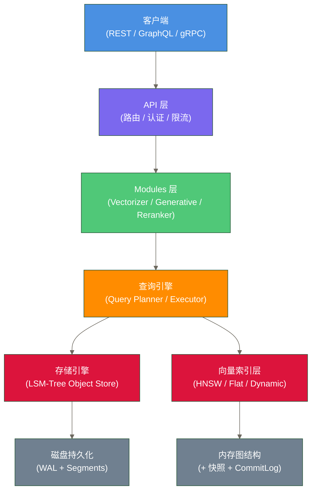

> [!note] 架构的核心设计哲学
> Weaviate 的设计遵循一个核心原则：**对象存储（标量数据）与向量索引严格分离**。这就像书店里把"书的摆放位置目录"（向量索引）和"书本身"（对象存储）分开管理——找书靠目录，存书靠货架，两套系统各自优化，互不干扰。

---

## API 层：请求的入口

### 三种协议并存

Weaviate 同时支持三种通信协议，各有适用场景：

| 协议 | 用途 | 特点 |
|------|------|------|
| REST API | CRUD 操作、管理操作 | 通用性强，调试方便 |
| GraphQL API | 复杂查询（向量搜索、混合搜索） | 灵活的查询语法，支持嵌套 |
| gRPC | 批量导入、v4 客户端默认协议 | 适合高效传输；比 REST 快 60-80%仅作为待测试的示例假设，不是通用保证 |

从 v4 Python 客户端开始，gRPC 成为默认的数据传输协议，REST 保留用于管理操作。这一转变可能改善传输与调用性能；**批量导入速度提升 60-80%、查询速度提升 3-4 倍仅可作为待测试的示例假设**，本文未提供支持这些比例的测试条件，实际收益取决于客户端、服务端、负载与部署配置。

### 认证与授权

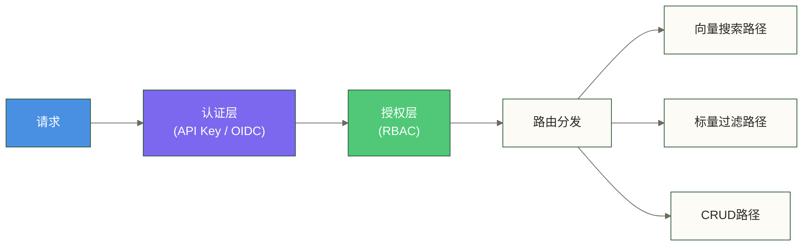

Weaviate 支持两种认证方式：
- **API Key**：简单直接，适合大多数场景
- **OIDC（OpenID Connect）**：企业级身份集成，支持 SSO

---

## Modules 系统：可插拔的能力中心

Weaviate 最有特色的设计之一是其**模块化架构**。如果说存储引擎是书店的货架，Modules 就是货架前的工作人员——有人负责把你的问题翻译成书架编号（Vectorizer），有人负责把找到的书读给你听（Generative），还有人负责在候选书单里帮你排出最相关的顺序（Reranker）。

### 三类核心模块

```mermaid
%%{init: {"theme":"base","themeVariables":{"fontFamily":"PingFang SC, -apple-system, Source Han Serif SC, serif","fontSize":"16px","background":"#FDFBF5","primaryColor":"#FDFBF5","primaryTextColor":"#2D2A26","primaryBorderColor":"#6E6A60","secondaryColor":"#E8EFE8","secondaryBorderColor":"#8FA890","secondaryTextColor":"#2D2A26","tertiaryColor":"#FDFBF5","tertiaryBorderColor":"#9A9488","tertiaryTextColor":"#6E6A60","lineColor":"#6E6A60","textColor":"#2D2A26","mainBkg":"#FDFBF5","nodeBorder":"#2D5A3D","clusterBkg":"#F3EEDF","clusterBorder":"#9A9488","edgeLabelBackground":"#FDFBF5"},"flowchart":{"htmlLabels":true,"curve":"basis","padding":20,"nodeSpacing":60,"rankSpacing":70,"useMaxWidth":false},"themeCSS":".node rect, .node polygon, .node circle { stroke-width: 1.5px; } .edgePath .path { stroke-width: 1.5px; } .cluster-label .nodeLabel, .cluster-label foreignObject { color: #2D2A26 !important; } .edgeLabel, .edgeLabel foreignObject { color: #2D2A26 !important; background-color: #FDFBF5; } .edgeLabel rect { fill: #FDFBF5; }"}}%%
graph TD
    INPUT["用户输入<br/>(文本/图像/音频)"] --> VM["Vectorizer 模块<br/>text2vec-openai<br/>text2vec-cohere<br/>img2vec-neural<br/>multi2vec-clip"]
    VM --> VECTOR["向量<br/>[0.23, -0.51, ...]"]
    VECTOR --> SEARCH["向量检索"]
    SEARCH --> RESULTS["候选结果集"]
    RESULTS --> RR["Reranker 模块<br/>reranker-cohere<br/>reranker-transformers"]
    RR --> RANKED["重排序结果"]
    RANKED --> GEN["Generative 模块<br/>generative-openai<br/>generative-cohere<br/>generative-ollama"]
    GEN --> ANSWER["最终答案<br/>(RAG 输出)"]

    style INPUT fill:#4A90E2,color:#fff
    style VM fill:#50C878,color:#fff
    style RR fill:#FF8C00,color:#fff
    style GEN fill:#7B68EE,color:#fff
    style ANSWER fill:#DC143C,color:#fff
```

#### Vectorizer 模块（向量化模块）

Vectorizer 模块负责把原始内容转化为向量。这是整个向量搜索流程的第一步，也是最关键的一步。

**核心工作流程：**

1. 在写入数据时：对象的 text 属性 → Vectorizer → 向量 → 存入索引
2. 在查询时：用户查询文本 → 同一个 Vectorizer → 查询向量 → 去索引里比对

> [!warning] 关键约束
> 写入时和查询时必须使用**同一个 Vectorizer**。就像你用中文建了索引，就必须用中文查询，不能用英文去搜中文建的索引（除非用多语言模型）。

常用的 Vectorizer 模块：

| 模块名 | 说明 | 向量维度 |
|--------|------|---------|
| `text2vec-openai` | 调用 OpenAI Embedding API | 1536 / 3072 |
| `text2vec-cohere` | 调用 Cohere Embed API | 1024 |
| `text2vec-transformers` | 本地部署 HuggingFace 模型 | 取决于模型 |
| `text2vec-ollama` | 本地 Ollama 模型 | 取决于模型 |
| `img2vec-neural` | 图像向量化 | 取决于模型 |
| `multi2vec-clip` | 多模态（文本+图像） | 取决于模型 |
| `none` | 不自动向量化，手动传入 | 自定义 |

#### Generative 模块（生成模块）

Generative 模块是实现 RAG（检索增强生成）的关键。检索到相关文档后，Generative 模块负责调用大语言模型，基于检索到的上下文生成最终答案。

```python
# 使用 Generative 模块的查询示例
response = collection.generate.near_text(
    query="量子计算的最新进展",
    limit=3,
    grouped_task="请基于以上文章，用中文总结量子计算的三个主要突破"
)
print(response.generated)
```

支持的生成模块：`generative-openai`、`generative-cohere`、`generative-anthropic`、`generative-ollama`（本地）、`generative-aws`

#### Reranker 模块（重排序模块）

Reranker 是搜索质量的"最后一道关卡"。初步的向量检索（ANN）为了速度，会牺牲一些精度，召回的候选集里可能有相关性稍差的结果。Reranker 使用更精细的交叉编码器模型，对候选集重新评分排序。

**工作原理：**
```text
ANN 检索（速度优先）→ 候选集 Top-100 → Reranker（精度优先）→ 最终结果 Top-10
```

这是"粗排 + 精排"的经典两阶段架构，在工业界的推荐系统和搜索系统中极为普遍。

### 模块的工作边界

模块的一个重要特性是**按 Collection 配置**。不同的 Collection 可以使用不同的 Vectorizer，这意味着你可以在同一个 Weaviate 实例里：
- `ProductCollection` 使用 `text2vec-openai` 的 text-embedding-3-large
- `LogCollection` 不用向量化，仅做全文检索
- `ImageCollection` 使用 `img2vec-neural`

---

## 存储引擎：数据的仓库

### LSM-Tree：写优化的存储结构

Weaviate 使用自研的基于 **LSM-Tree（Log-Structured Merge Tree）** 的存储引擎，这与 RocksDB、LevelDB 的设计理念相同，但针对向量数据库场景做了定制优化。

> [!note] 什么是 LSM-Tree？
> 想象一下记账的方式：你不是每次花了钱就去修改账本上的数字，而是把每一笔流水记在新的纸条上，积攒到一定数量后统一整理合并。LSM-Tree 就是这个逻辑——**批量写，异步合并**，用顺序 I/O 替代随机 I/O，写性能极高。

#### LSM-Tree 的工作流程

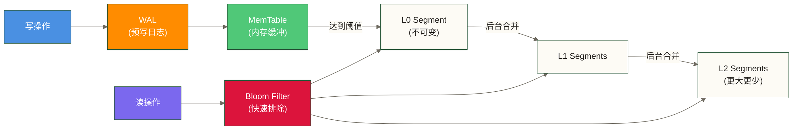

**各组件职责说明：**

- **WAL（Write-Ahead Log，预写日志）**：每次写入先追加到 WAL 文件，保证崩溃恢复能力。即使系统宕机，重启后可以从 WAL 重放操作。
- **MemTable**：内存中的有序数据结构，接收最新写入，读操作优先从这里查找。
- **Segment（不可变文件）**：MemTable 溢写到磁盘后形成 Segment，一旦创建不再修改。
- **Bloom Filter（布隆过滤器）**：每个 Segment 都有对应的 Bloom Filter，读取时先问 Bloom Filter"这个 key 是否可能存在"，判定不存在则直接跳过；判定可能存在时仍需继续查找，避免大量的无效磁盘读取。
- **后台合并（Compaction）**：多个小 Segment 合并成大 Segment，删除已标记删除的数据，维持读性能。

### 对象存储（Object Store）

每个 Weaviate 对象存储在 Object Store 中，包含以下信息：

| 字段 | 示例值 | 说明 |
|------|--------|------|
| UUID | `550e8400-e29b-41d4-a716-446655440000` | 全局唯一标识符 |
| Properties.title | `"Weaviate 架构解析"` | 标量属性：标题 |
| Properties.date | `2026-03-11` | 标量属性：日期 |
| Properties.category | `"数据库"` | 标量属性：分类 |
| Vector | `[0.23, -0.51, 0.88, ...]` | 向量（可选，由 Vectorizer 生成） |
| Cross-references | `hasAuthor → Author/uuid-xxx` | 引用到其他 Collection 的对象 |

> [!important] 对象存储与向量索引的分离
> 重点：**对象存储与向量索引承担不同职责，并独立管理**。对象可以携带向量数据，HNSW 图组织用于近似检索的连接关系；不能由索引职责分离推断向量数据只保存在图中，或不属于对象存储内容。查询时，HNSW 图找到最相似的 UUID 列表，再用这些 UUID 去 Object Store 取回完整对象。
>
> 这种分离设计的好处是：向量索引可以单独优化（全内存），对象存储可以单独优化（磁盘 LSM），各自在自己最擅长的领域发挥。

### 倒排索引（Inverted Index）

除向量索引外，Weaviate 为标量属性维护了**倒排索引**，支持精确过滤和全文搜索。

每个可过滤（`indexFilterable`）或可搜索（`indexSearchable`）的属性，都会在该 Shard 的存储引擎里创建一个独立的 Bucket（数据桶）。

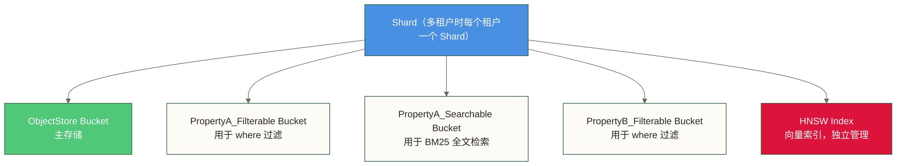

---

## 向量索引层：相似度搜索的核心

向量索引是向量数据库的心脏。Weaviate 提供三种向量索引类型，适应不同的数据规模和性能需求。

### HNSW：高性能的默认选择

**HNSW（Hierarchical Navigable Small World，层次化可导航小世界）** 是 Weaviate 的默认向量索引算法，也是当前业界最主流的 ANN（近似最近邻）算法。

> [!note] HNSW 的直觉理解
> 想象你要在一个城市里找离你最近的咖啡馆。笨办法是挨家挨户检查所有咖啡馆（精确最近邻，太慢）。HNSW 的聪明做法是：先在"全国地图"上粗定位到你所在的城市，再在"城市地图"上找到你所在的区，最后在"街道地图"上继续搜索较近的候选门店，但不保证找到距离最近的一家——多层导航，层层缩小范围，速度极快。

#### HNSW 图结构

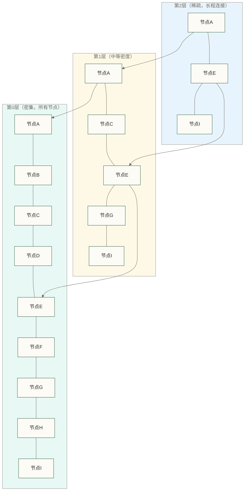

- **最底层（L0）**：包含所有节点，节点间连接密集，是执行更细粒度近似搜索的层，不保证精确最近邻
- **中间层**：节点数量减少，连接稀疏，用于区域导航
- **最顶层**：只有少数"枢纽"节点，用于快速全局定位

查询时从顶层入口开始，贪心地向目标方向移动，逐层下降，最终在底层执行近似最近邻搜索，不保证找到精确最近邻。

#### HNSW 的内存模型

**这是 Weaviate 资源规划中最关键的知识点**：HNSW 图完全驻留在内存中。

```text
HNSW 内存占用估算：
- 每个节点：8-10 字节 × maxConnections（每层）
- 底层允许 2 × maxConnections 条连接
- 默认 maxConnections = 32
- 示例：100万对象 × 32连接 × ~10B ≈ 320MB（仅按每节点32条连接计算的示意项，未完整计入底层双倍连接、上层连接及其他图结构开销）
- 加上向量本身：100万 × 1536维 × 4字节 ≈ 6.1GB
```

> [!warning] 内存是 HNSW 的硬约束
> HNSW 图不能分片存到磁盘再按需加载（不像 B-Tree），它必须整体在内存里才能高效工作。这是规划 Weaviate 节点内存时的核心约束——**数据规模 × 向量维度 × 4字节 ≈ 未压缩 float32 向量全部驻留内存时的向量数据量，不是通用最低内存需求**。

#### HNSW 持久化机制

虽然图在内存里，但 Weaviate 提供了完整的持久化方案，防止重启后数据丢失：

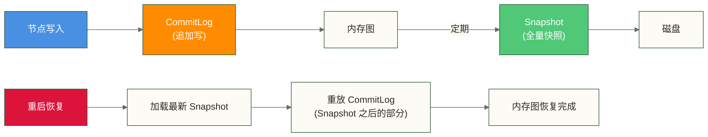

- **CommitLog**：每个写操作都追加到 CommitLog 文件，类似 WAL
- **Snapshot**：定期将整个 HNSW 图序列化到磁盘（快照）
- **恢复流程**：重启时，先加载最新 Snapshot，再重放 Snapshot 之后的 CommitLog

这就是为什么 Weaviate 重启时可能需要一段时间"加热"——它在把图从磁盘加载回内存。

#### HNSW 关键参数详解

| 参数 | 默认值 | 影响 | 调优建议 |
|------|--------|------|---------|
| `maxConnections` | 32 | 图的稠密程度，影响内存和召回率 | 高召回率需求可调至 64，内存紧张可降至 16 |
| `efConstruction` | 128 | 构建时的搜索宽度，影响构建速度和质量 | 调高提升索引质量，代价是更慢的导入 |
| `ef` | -1（动态） | 查询时的搜索宽度，影响查询速度和召回率 | -1 表示由动态 ef 控制 |
| `dynamicEfMin` | 100 | 动态 ef 的最小值 | 设置搜索宽度下限，不保证最低召回率 |
| `dynamicEfMax` | 500 | 动态 ef 的最大值 | 限制动态搜索宽度，不构成最坏查询时间保证 |
| `dynamicEfFactor` | 8 | ef = limit × factor | 通常无需调整 |

**三个参数的直觉理解：**

- `maxConnections`：每本书（节点）最多能和多少本相关书连接。越多连接，找书越准，但书架（内存）占用越大。
- `efConstruction`：建书目录时，对每本新书，你愿意花多少精力去确认它该和哪些书连接。精力越多，目录越准，但建目录越慢。
- `ef`：查书时，你愿意同时追踪多少条线索。线索越多，找到的结果越准，但找得越慢。

#### 量化压缩：HNSW + PQ / BQ / RQ

当数据量极大时，即使是 HNSW 也面临内存压力。Weaviate 支持三种量化方案来压缩向量：

| 量化方案 | 压缩比 | 精度损失 | 适用场景 |
|---------|--------|---------|---------|
| **PQ（Product Quantization，乘积量化）** | ~16x | 小（需 segment 数调优） | 百万级以上，平衡性能 |
| **BQ（Binary Quantization，二值量化）** | ~32x | 中等（依赖 oversampling 补偿） | 极大规模，对精度容忍度高 |
| **RQ（Rotational Quantization，旋转量化）** | ~4x | 极小 | 推荐默认，v1.32 引入 |

> [!tip] 2025 年最新推荐
> 可将**RQ（旋转量化）**减少约 75% 向量表示内存作为容量估算的示例假设，但这不等于整体 HNSW 内存减少 75%，也不保证召回率不显著下降。本文未提供所称团队内部测试的来源；生产选型应结合版本支持、向量分布、召回目标和实际测试。

### Flat Index：小数据量的简单选择

当 Collection 中的对象数量较少时，暴力遍历所有向量（Flat Index）比 HNSW 更高效——因为 HNSW 的图结构本身有开销，在数据量小时这个开销占比反而更大。

Flat Index 的特点：
- 不建图，所有向量存储在磁盘上
- 查询时加载到内存做精确计算
- 支持内存映射（memory-mapped files）
- **100% 召回率**，没有近似误差

> [!note] Flat vs HNSW 的切换点
> Weaviate 建议：当对象数少于 10,000 时，Flat Index 往往比 HNSW 更快且更省内存。

### Dynamic Index：智能自适应索引

Dynamic Index 是 Weaviate 为**多租户场景**量身定制的解决方案，解决了一个实际痛点：在多租户系统中，不同租户的数据量差异巨大，有的租户只有几百条记录，有的有几百万条。

```mermaid
%%{init: {"theme":"base","themeVariables":{"fontFamily":"PingFang SC, -apple-system, Source Han Serif SC, serif","fontSize":"16px","background":"#FDFBF5","primaryColor":"#FDFBF5","primaryTextColor":"#2D2A26","primaryBorderColor":"#6E6A60","secondaryColor":"#E8EFE8","secondaryBorderColor":"#8FA890","secondaryTextColor":"#2D2A26","tertiaryColor":"#FDFBF5","tertiaryBorderColor":"#9A9488","tertiaryTextColor":"#6E6A60","lineColor":"#6E6A60","textColor":"#2D2A26","mainBkg":"#FDFBF5","nodeBorder":"#2D5A3D","clusterBkg":"#F3EEDF","clusterBorder":"#9A9488","edgeLabelBackground":"#FDFBF5"},"flowchart":{"htmlLabels":true,"curve":"basis","padding":20,"nodeSpacing":60,"rankSpacing":70,"useMaxWidth":false},"themeCSS":".node rect, .node polygon, .node circle { stroke-width: 1.5px; } .edgePath .path { stroke-width: 1.5px; } .cluster-label .nodeLabel, .cluster-label foreignObject { color: #2D2A26 !important; } .edgeLabel, .edgeLabel foreignObject { color: #2D2A26 !important; background-color: #FDFBF5; } .edgeLabel rect { fill: #FDFBF5; }"}}%%
graph LR
    NEW["新租户"] --> FLAT["Flat Index<br/>(数据量 < 阈值)"]
    FLAT -->|超过阈值<br/>默认 10,000| CONVERT["自动转换"]
    CONVERT --> HNSW["HNSW Index<br/>(大规模高效搜索)"]

    style NEW fill:#4A90E2,color:#fff
    style FLAT fill:#50C878,color:#fff
    style CONVERT fill:#FF8C00,color:#fff
    style HNSW fill:#7B68EE,color:#fff
```

Dynamic Index 的工作逻辑：
1. 租户创建时，默认使用 Flat Index（轻量，无需建图开销）
2. 持续监控该租户的对象数量
3. 超过阈值（默认 10,000，可配置）后，自动在后台将 Flat Index 转换为 HNSW
4. 转换过程对查询透明，不影响服务

这就像书店的新馆藏——新书少的时候直接按顺序摆着（顺序查找），等书多了再建完整的索引目录。

---

## 分布式架构：横向扩展的秘密

### 整体集群架构

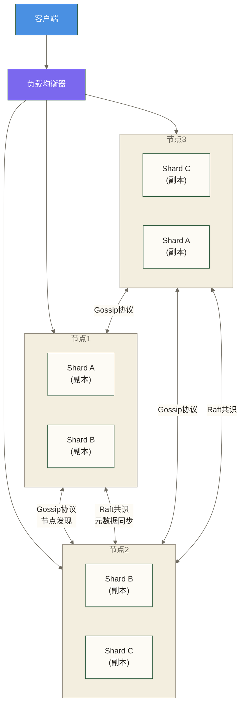

### Shard（分片）：数据分布的单元

Shard 是 Weaviate 分布式存储的基本单位。创建 Collection 时，可以指定分片数量（`shardingConfig.desiredCount`）。

**分片的分布规则：**
- 对象按 UUID 哈希分配到特定 Shard
- 每个 Shard 包含完整的数据（Object Store + 向量索引 + 倒排索引）
- Shards 分布在集群的不同节点上

**分片对查询的影响：**

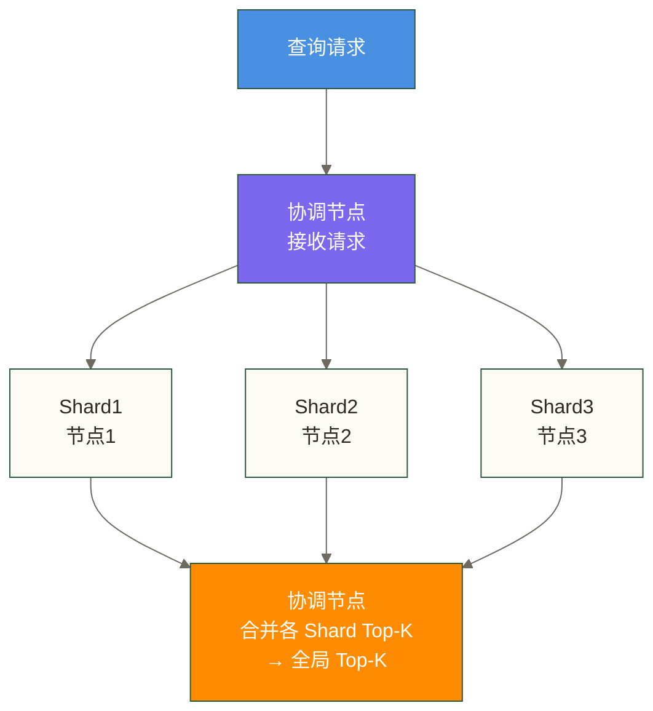

这种"scatter-gather"模式是分布式向量搜索的标准架构。

### Replica（副本）：高可用的保障

副本是 Shard 的完整拷贝，用于：
1. **容灾**：某节点故障时，其他副本可以继续服务
2. **读扩展**：多个副本可以分担读请求，提升吞吐量

**分片 + 副本的组合：**

```ini
desiredCount = 3（3个分片）
replicationFactor = 2（每个分片2个副本）
总 Shard 数 = 3 × 2 = 6
```

如果有 3 个节点，每个节点会持有 2 个 Shard 副本（分别属于不同分片，不区分固定主副本），形成互相备份的拓扑。

### 两种一致性机制：Raft vs 无主复制

Weaviate 的一个精妙设计是**元数据一致性和数据一致性采用不同的机制**。

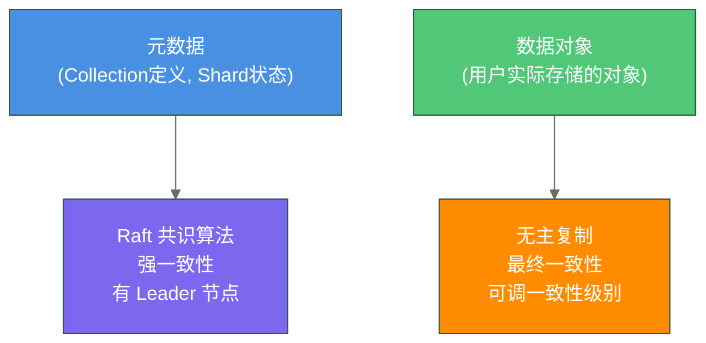

#### Raft：元数据的强一致性守卫

从 Weaviate v1.25 开始，Collection 定义、Shard 状态等**元数据**通过 Raft 算法在节点间同步。

Raft 的工作方式（简化版）：
1. 集群选举一个 **Leader 节点**
2. 所有元数据写操作都转发给 Leader
3. Leader 将变更写入 Raft 日志，并向 Follower 广播
4. **多数节点（quorum）确认**后，变更提交
5. Leader 通知所有节点应用变更

为什么元数据要用强一致性？因为 Collection 的 Schema 定义（有哪些属性、用什么向量化模块）如果不一致，会导致数据写入错误，这是不可接受的。

#### 无主复制：数据的灵活一致性

数据对象（用户存储的实际内容）采用**无主（Leaderless）复制**，类似 Amazon Dynamo 的设计。写操作可以发送到任意节点，该节点负责把写操作分发到持有该 Shard 所有副本的节点。

一致性级别可以按请求配置：

| 一致性级别 | 描述 | 适用场景 |
|-----------|------|---------|
| `ONE` | 只需1个副本确认 | 写入速度最快，可能读到旧数据 |
| `QUORUM` | 需要多数副本确认（⌊n/2⌋+1，n为副本总数） | 平衡性能和一致性（推荐） |
| `ALL` | 所有副本必须确认 | 确认要求最高，延迟与可用性受所有副本影响；不能仅据此推导所有场景的强一致性 |

### 节点发现：Gossip 协议

节点间通过 **Hashicorp Memberlist**（Gossip 协议的实现）维护集群成员状态：
- 每个节点周期性地与随机选取的节点交换状态信息
- 节点故障信息通过 Gossip"传染"扩散，无需中心化的故障检测
- 网络分区时能快速感知哪些节点不可达

---

## 查询的完整生命周期

一次向量相似度查询，从客户端发出到结果返回，经历了哪些步骤？以一个 GraphQL 查询为例：

```graphql
{
  Get {
    Article(
      nearText: { concepts: ["量子计算突破"] }
      where: { path: ["category"], operator: Equal, valueString: "科技" }
      limit: 10
    ) {
      title
      content
      _additional { distance }
    }
  }
}
```

### 完整查询链路

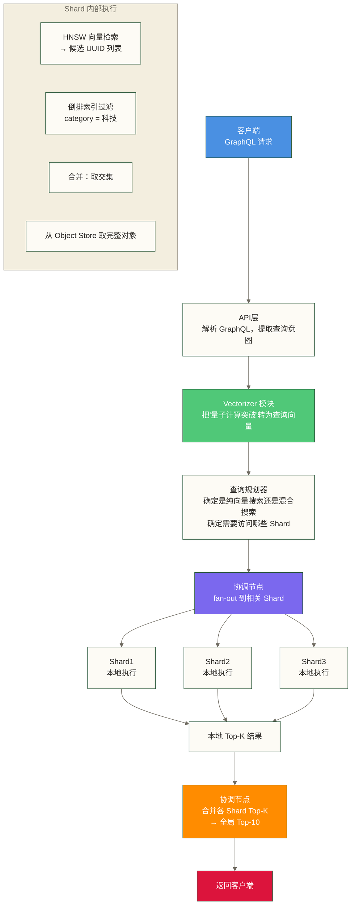

### 向量搜索与标量过滤的协作

当查询同时包含向量搜索和标量过滤时（如上面的例子），Weaviate 的处理策略影响查询性能。

**两种策略：**

**策略1：向量优先（Pre-filter 难以实现时）**
```text
HNSW 搜索 → Top-K candidates → 过滤 where 条件 → 结果
```
问题：如果 where 条件过滤掉大量结果，需要多次扩大搜索范围

**策略2：过滤优先（Pre-filter）**
```text
倒排索引 → 满足 where 条件的 UUID 集合 → HNSW 在该集合内搜索
```
Weaviate 使用 **允许列表（allow-list）** 机制：先从倒排索引取出满足条件的 UUID 集合，HNSW 搜索时只在这个集合内评分。

> [!tip] 过滤器的性能陷阱
> 如果 where 条件非常严苛（只有极少数对象满足），HNSW 的搜索效率会下降，因为它要在图里绕很多路才能找到满足条件的对象。这种情况下考虑使用纯 BM25 或调整数据建模。

### 混合搜索的执行流程

混合搜索（Hybrid Search）同时执行向量搜索和 BM25 关键词搜索，然后用 **RRF（Reciprocal Rank Fusion，倒数秩融合）** 或加权融合合并两个结果集：

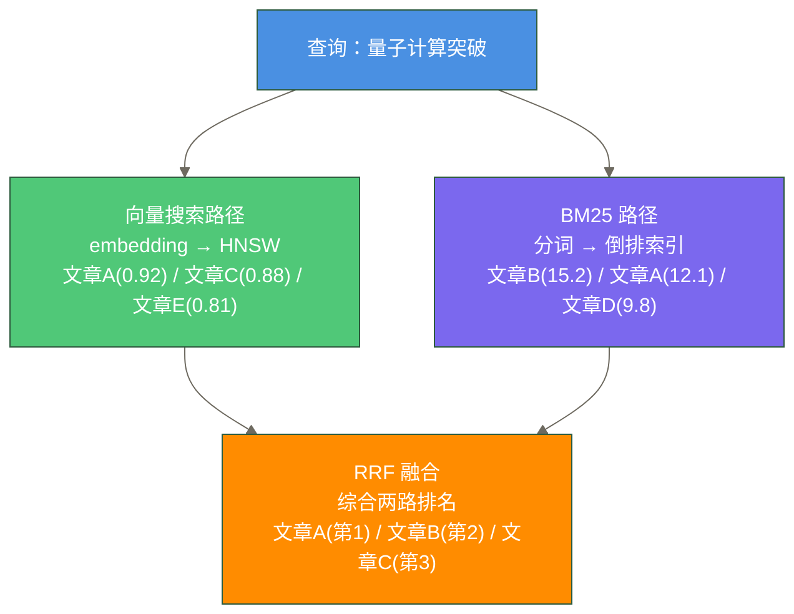

---

## 性能特征与资源规划

### 内存规划公式

规划 Weaviate 节点内存时，需要考虑三部分开销：

```text
总内存需求 = 向量内存 + HNSW图内存 + 对象缓存内存

向量内存 = 对象数 × 向量维度 × 4字节（float32）
         （使用RQ量化后 × 0.25）

图连接开销示意项 = 对象数 × maxConnections × 10字节
                 = 100万 × 32 × 10B ≈ 320MB
此项不是完整HNSW图内存估算，尚需考虑底层双倍连接、上层连接及其他图结构开销。

对象缓存内存 = 通常建议留 20-30% 内存给系统和对象缓存
```

**容量估算示例（非实测案例，不构成资源保证）：**

| 场景 | 对象数 | 向量维度 | 估算内存需求 |
|------|--------|---------|------------|
| 小型知识库 | 10万 | 1536 | ~1.2GB |
| 中型应用 | 100万 | 1536 | ~12GB |
| 大型应用（无量化） | 1000万 | 1536 | ~120GB |
| 大型应用（RQ量化） | 1000万 | 1536 | ~35GB |

### CPU 规划

- **写入密集型**：efConstruction 越高，单次写入 CPU 消耗越大；批量导入时 CPU 是主要瓶颈
- **读取密集型**：ef 越高，单次查询 CPU 消耗越大；并发查询时 CPU 是主要瓶颈
- 建议：**写入和查询分时段**，或者使用不同的节点承担写入和查询

### 磁盘规划

Weaviate 对磁盘的要求相对内存低得多（因为核心数据在内存里）：

- **Object Store**：可将原始数据大小的 2-5 倍作为待验证的空间预算假设；实际占用取决于索引、编码、删除数据及合并状态，LSM 写放大表示写入量增加，不等同于空间放大
- **HNSW CommitLog + Snapshot**：约等于内存中 HNSW 图的大小
- **WAL**：通常较小，周期性清理

建议使用 **SSD**，因为 LSM-Tree 的 Compaction 和 HNSW 快照加载都依赖较低的随机读延迟。

---

## 架构演进：从 v1.17 到 v1.32

理解 Weaviate 的架构演进，能帮助你更好地理解当前版本的设计决策。

### 关键版本里程碑

| 版本 | 时间 | 核心变化 |
|------|------|---------|
| v1.17 | 2022 | 引入模块化向量索引架构 |
| v1.20 | 2023 | 多租户（Multi-tenancy）正式发布 |
| v1.24 | 2024 | Dynamic Index 引入，BM25 性能优化 |
| v1.25 | 2024 | **Raft 共识替换原有元数据同步机制** |
| v1.26 | 2024 | RQ 量化实验性支持 |
| v1.32 | 2025 | 优化 HNSW 连接精度，进一步降低内存占用 |

### v4 Python 客户端：最重要的 API 变化

v4 客户端（2024 年 GA）带来了最大的使用体验变化：

**v3 风格（已废弃）：**
```python
# v3 - 使用字典，无类型检查
client.schema.create_class({
    "class": "Article",
    "properties": [{"name": "title", "dataType": ["text"]}]
})
result = client.query.get("Article", ["title"]).with_near_text(
    {"concepts": ["量子计算"]}
).do()
```

**v4 风格（当前标准）：**
```python
# v4 - 面向对象，类型安全，gRPC 加速
import weaviate.classes as wvc

collection = client.collections.create(
    name="Article",
    properties=[
        wvc.config.Property(name="title", data_type=wvc.config.DataType.TEXT),
    ],
    vectorizer_config=wvc.config.Configure.Vectorizer.text2vec_openai()
)

# 查询面向集合对象
articles = client.collections.get("Article")
result = articles.query.near_text(
    query="量子计算",
    limit=10
)
```

> [!important] 术语对齐
> v4 客户端 API 完成了从 `class` 到 `collection` 的全面重命名，与文档中的概念体系保持一致。如果你看到老代码里使用 `class`，那是 v3 时代的遗留写法。

---

## 延伸阅读

- Weaviate 快速入门
- 核心概念详解：Collection、Object、Cross-reference
- 向量索引配置与优化
- [[【技术与工具】/向量数据库/00-向量数据库选型指南|向量数据库选型指南]]
- HNSW 算法深度解析

#向量数据库 #Weaviate #架构 #HNSW #LSM-Tree #分布式系统
