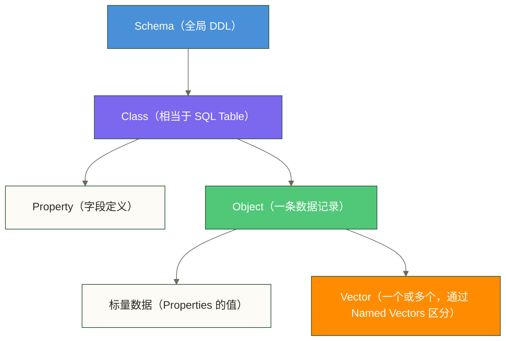
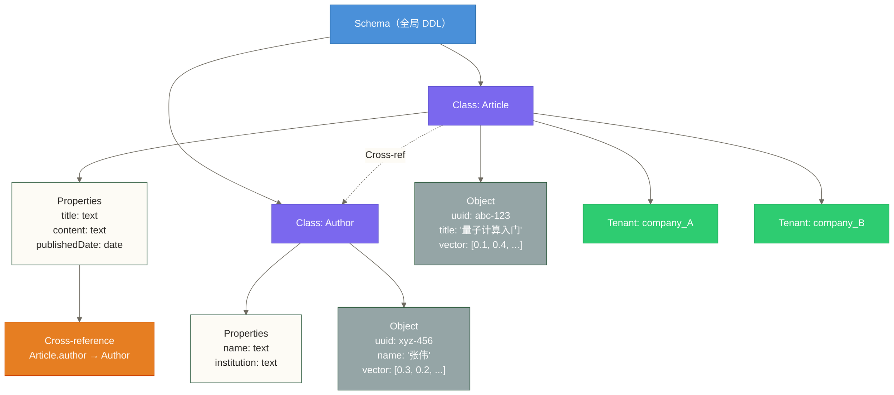
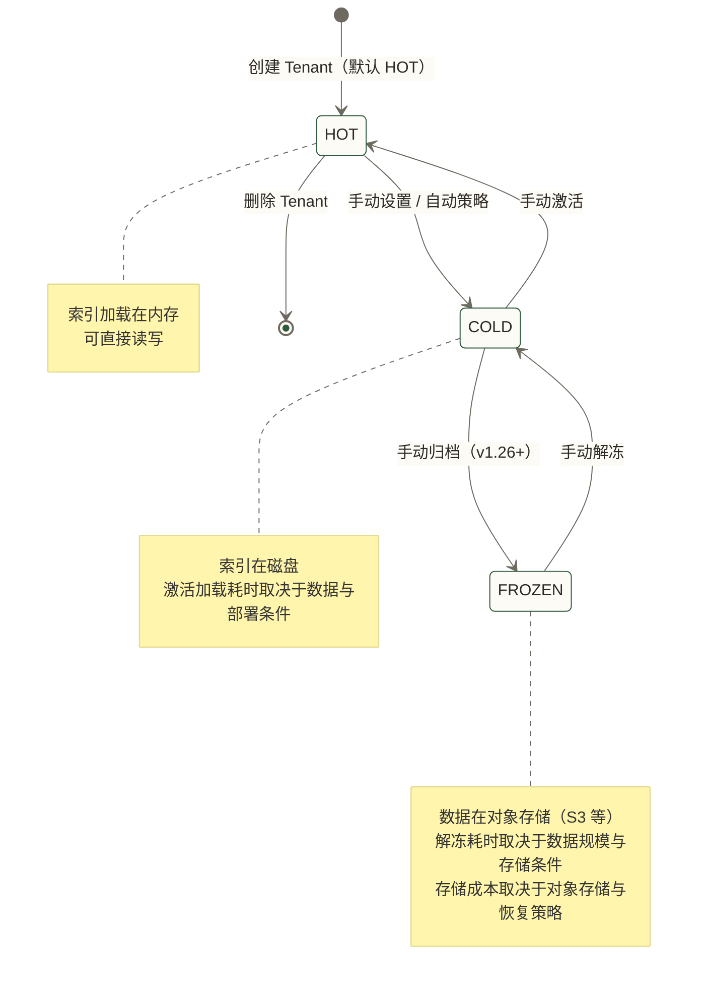

# Weaviate 核心概念详解

> [!tip] 读前导引
> 这篇文档的定位是 Weaviate 的**概念操作手册**。
>
> 如果你读完 [[【技术与工具】/向量数据库/Weaviate/01-Weaviate概述与核心定位]] 觉得"Weaviate 的思路挺有意思"，又在 [[【技术与工具】/向量数据库/Weaviate/02-Weaviate架构深度解析]] 里理解了它的存储机制，那么现在到了一个关键节点——你需要搞清楚 Weaviate 的**数据模型是怎么组织的**，才能开始写出正确的代码。
>
> Weaviate 的数据模型和 Milvus、Qdrant 有几个显著差异：Class 命名强制首字母大写、跨对象引用是一等公民、多租户是原生设计而非插件。这些不是细节，是影响你数据建模决策的核心机制。

## 目录

- [[#数据模型体系全览]]
- [[#Class：基本容器]]
  - [[#命名规范与约束]]
  - [[#一个 Class 对应一个向量空间]]
- [[#Property：字段定义]]
  - [[#数据类型速查表]]
  - [[#分词器（Tokenizer）配置]]
  - [[#特殊数据类型详解]]
- [[#Object：单条数据记录]]
- [[#Vector：向量存储]]
- [[#Schema：整体的 DDL]]
- [[#Cross-references：跨对象引用]]
  - [[#什么是 Cross-reference]]
  - [[#定义 Cross-reference Property]]
  - [[#插入时设置引用]]
  - [[#查询时穿透关联]]
  - [[#与 Milvus / Qdrant 的对比]]
- [[#Named Vectors：多向量]]
  - [[#什么是 Named Vectors]]
  - [[#使用场景]]
  - [[#配置方式与查询]]
- [[#Tenant：多租户]]
  - [[#原生多租户的设计哲学]]
  - [[#Tenant 状态管理]]
  - [[#与 Milvus Partition 的对比]]
  - [[#代码示例：完整多租户流程]]
- [[#UUID 管理]]
  - [[#自动生成 vs 自定义]]
  - [[#确定性 UUID：幂等写入的关键]]
- [[#数据模型横向对比]]
- [[#总结]]

---

## 数据模型体系全览

在 Weaviate 里，数据组织从大到小的层级是：



还有两个贯穿全局的机制：
- **Cross-references**：Object 之间的引用关系，类似外键，但可以跨 Class 穿透查询
- **Tenant**：数据隔离单元，每个 Tenant 有独立的物理存储



---

## Class：基本容器

Class 是 Weaviate 中最基本的数据容器。如果你熟悉关系数据库，可以把它理解为一张 Table；如果你用过 Milvus，它对应 Collection；在 Qdrant 里，它是 Collection。

### 命名规范与约束

> [!warning] Class 名称必须首字母大写
> 这是 Weaviate 的强制约束，不是建议。`article` 会报错，`Article` 才是合法的。
>
> 背后的原因：Weaviate 用大写首字母区分 Class 名称和 Property 名称，GraphQL Schema 的生成逻辑依赖这个约定。

**命名规则**：

| 规则 | 正确示例 | 错误示例 |
|------|---------|---------|
| 首字母必须大写 | `Article`、`UserDocument` | `article`、`userDocument` |
| 使用 PascalCase | `BlogPost`、`ProductItem` | `blog_post`、`product-item` |
| 纯字母和数字，无连字符 | `Article2024` | `Article-2024`、`Article_2024` |
| 区分大小写 | `Article` 和 `article` 是不同的 Class | — |

**实践建议**：Class 命名对应业务实体，用名词单数形式。`Article` 而不是 `Articles`，`UserDocument` 而不是 `UserDocuments`。

### 一个 Class 对应一个向量空间

这个特性很重要，直接影响数据建模的决策。

Weaviate 中，**每个 Class 独立配置向量索引，实际索引组织还取决于分片、命名向量和所选索引类型**。不同 Class 的 Object 在向量空间上是完全隔离的——Named Vectors 的 multi-target 搜索针对同一 Class 内的多个目标向量，并不是跨 Class 搜索；跨 Class 的统一检索需要分别查询并在应用层合并结果。

这意味着什么？

- 如果你有"文章"和"商品"两种数据，应该建两个 Class（`Article` 和 `Product`），而不是用一个 Class 加一个"type"字段来区分
- 如果你希望对"文章"和"用户提问"统一做语义搜索，可在向量表示兼容的前提下把它们放在同一个 Class 里；Named Vectors 多目标搜索仍限于同一个 Class，不能替代跨 Class 查询。

> [!note] 对比 Milvus 的 Collection
> Milvus 的 Collection 和 Weaviate 的 Class 在语义上非常类似，都是"一个向量空间 + 一组字段"的组合。主要差异在于 Class 支持跨对象的 Cross-reference，而 Milvus Collection 没有原生的"外键"机制。

---

## Property：字段定义

Property 是 Class 内的字段定义，相当于表的列。Weaviate 的 Property 有严格的数据类型系统。

### 数据类型速查表

| 类型 | 说明 | 示例值 |
|------|------|--------|
| `text` | 字符串，支持全文搜索，可配置 tokenizer | `"量子计算入门"` |
| `text[]` | 字符串数组 | `["AI", "物理", "量子"]` |
| `int` | 64 位整数 | `42`、`1704067200` |
| `int[]` | 整数数组 | `[1, 2, 3]` |
| `number` | 64 位浮点数 | `3.14`、`99.9` |
| `number[]` | 浮点数数组 | `[1.1, 2.2, 3.3]` |
| `boolean` | 布尔值 | `true`、`false` |
| `boolean[]` | 布尔数组 | `[true, false, true]` |
| `date` | RFC3339 格式的时间戳 | `"2024-03-11T10:00:00Z"` |
| `date[]` | 日期数组 | — |
| `uuid` | UUID 格式字符串 | `"550e8400-e29b-41d4-a716-446655440000"` |
| `uuid[]` | UUID 数组 | — |
| `blob` | Base64 编码的二进制数据 | 图片、文件等 |
| `geoCoordinates` | 地理坐标（经纬度） | `{"latitude": 39.9, "longitude": 116.4}` |
| `phoneNumber` | 国际电话号码（自动规范化） | `{"input": "+8613800138000"}` |
| `object` | 嵌套对象（v1.22+） | `{"key": "value"}` |
| `object[]` | 嵌套对象数组 | — |
| `*` （Cross-reference） | 跨 Class 的对象引用 | 见 [[#Cross-references：跨对象引用]] |

### 分词器（Tokenizer）配置

这是影响搜索行为最重要的 Property 配置，只有 `text` 和 `text[]` 类型才有 tokenizer。

**Tokenizer 直接决定 BM25 关键词搜索的行为**：Weaviate 在做混合搜索（Hybrid Search）时，BM25 部分会用你配置的 tokenizer 来分词和匹配。

可用的 tokenizer：

| Tokenizer | 分词方式 | 适用场景 |
|-----------|---------|---------|
| `word`（默认） | 按空白符和标点分词，统一转小写 | 英文内容，通用场景 |
| `whitespace` | 只按空白符分词，**保留大小写** | 需要大小写精确匹配的场景（如代码标识符）|
| `lowercase` | 按空白符分词，统一转小写 | 类似 word，但不去除标点 |
| `trigram` | 生成 3-gram 字符片段，支持模糊匹配 | 需要支持前缀/中缀搜索，部分错别字容忍 |
| `gse` | GSE 分词器，支持中文分词 | 中文关键词检索候选方案，需要相应 tokenizer 启动配置 |
| `kagome_kr` | 韩文分词 | 韩文内容（v1.27+） |
| `kagome_ja` | 日文分词 | 日文内容（v1.28+） |

**配置示例**：

```python
import weaviate.classes as wvc

# 定义 Property 时指定 tokenizer
wvc.config.Property(
    name="title",
    data_type=wvc.config.DataType.TEXT,
    tokenization=wvc.config.Tokenization.WORD  # 英文默认选项
)

# 中文关键词检索可选用 GSE，需先启用相应 tokenizer 配置
wvc.config.Property(
    name="content_zh",
    data_type=wvc.config.DataType.TEXT,
    tokenization=wvc.config.Tokenization.GSE  # 中文分词
)
```

> [!warning] 中文关键词检索需选择适合的 Tokenizer
> 如果你的 `text` 字段存储中文内容，但 tokenizer 用默认的 `word`，BM25 关键词搜索**几乎不可用**——因为中文没有空格分隔词，word tokenizer 会把整句话当成一个词处理。
>
> 启用 GSE tokenizer 需要相应的 tokenizer 启动配置，不依赖 `text-spellcheck` 或 `qna-transformers` 模块；字段还需设置 `tokenization` 为 `gse`。

### 特殊数据类型详解

**geoCoordinates（地理坐标）**

专为地理搜索设计，支持 `geoWithin` 过滤——"找出距离某个坐标 X 公里以内的 Object"。

```python
# Property 定义
wvc.config.Property(
    name="location",
    data_type=wvc.config.DataType.GEO_COORDINATES
)

# 写入时传入经纬度
{"location": {"latitude": 39.9042, "longitude": 116.4074}}

# 查询时做地理范围过滤
from weaviate.classes.query import Filter

results = collection.query.fetch_objects(
    filters=Filter.by_property("location").within_geo_range(
        coordinate=wvc.query.GeoCoordinate(latitude=39.9042, longitude=116.4074),
        distance=10_000  # 10 公里以内，单位：米
    )
)
```

**phoneNumber（国际电话号码）**

phoneNumber 类型会自动做号码规范化，把各种格式的电话号码统一成 E.164 格式（如 `+8613800138000`）。存入的值包含原始输入和规范化后的号码，方便统一查询。

**blob（二进制数据）**

blob 以 Base64 编码存储，通常用来存图片或其他二进制文件。注意：blob 不用于 BM25 文本检索，但可作为支持图片输入的向量化模块的数据来源。使用 `multi2vec-clip` 时，可将 Base64 图片存入 blob 类型字段，并在模块配置中将该字段指定为图片来源；生成的对象向量用于向量搜索。

**date（时间类型）**

日期必须是 **RFC3339 格式**（ISO 8601 的子集），带时区信息。

```python
# 正确格式
"2024-03-11T10:30:00Z"           # UTC 时间
"2024-03-11T18:30:00+08:00"      # 北京时间

# 错误格式（会报错）
"2024-03-11"                      # 缺少时间和时区
"2024/03/11 10:30:00"            # 格式不对
```

支持时间范围过滤：

```python
from weaviate.classes.query import Filter
import datetime

results = collection.query.fetch_objects(
    filters=(
        Filter.by_property("publishedDate").greater_than(
            datetime.datetime(2024, 1, 1, tzinfo=datetime.timezone.utc)
        )
        & Filter.by_property("publishedDate").less_than(
            datetime.datetime(2025, 1, 1, tzinfo=datetime.timezone.utc)
        )
    )
)
```

---

## Object：单条数据记录

Object 是 Weaviate 中的一条数据记录，相当于 Milvus 的 Entity 或 Qdrant 的 Point。

每个 Object 由三部分构成：

| 部分 | 说明 | 可否自定义 |
|------|------|-----------|
| **UUID** | 对象标识符，使用 UUID 格式，不限于 v4 | 可以自定义，默认自动生成 |
| **Properties** | 字段值，对应 Class 中定义的 Property | 按 Schema 写入 |
| **Vector** | 向量（一个或多个） | 由 Vectorizer 模块自动生成，或手动提供 |

还有一个系统字段 `_additional`，包含 Weaviate 自动维护的元信息：

```python
# _additional 包含的信息
{
    "_additional": {
        "id": "550e8400-e29b-41d4-a716-446655440000",    # UUID
        "vector": [0.1, 0.4, ...],                        # 向量（需显式请求）
        "distance": 0.12,                                 # 与查询向量的距离（搜索时）
        "certainty": 0.94,                                # 相似度置信度（1 - distance/2）
        "score": 0.87,                                    # 混合搜索综合评分
        "creationTimeUnix": 1704067200000,                # 创建时间（ms 时间戳）
        "lastUpdateTimeUnix": 1704067200000,              # 最后更新时间
        "generate": {"singleResult": "生成的文本..."}     # Generative 模块的输出
    }
}
```

---

## Vector：向量存储

每个 Object 默认有一个与之关联的向量。向量的生成方式有两种：

**方式一：Vectorizer 模块自动生成**

在 Class 配置中声明 Vectorizer，写入 Object 时 Weaviate 自动调用对应的外部服务生成向量。这是 Weaviate AI-Native 的核心体现。

**方式二：手动提供向量**

如果你已经有自己的向量（比如用了一个 Weaviate 不支持的特殊模型），可以在写入时直接传入向量值，跳过 Vectorizer。

```python
# 手动提供向量
collection.data.insert(
    properties={
        "title": "量子计算入门",
        "content": "量子比特利用叠加态..."
    },
    vector=[0.1, 0.4, 0.2, ...]  # 直接提供向量，不通过 Vectorizer
)
```

> [!note] 设置为 `none` 的 Vectorizer
> 如果 Class 的 `vectorizer` 设置为 `none`，Weaviate 不会自动向量化，写入时必须手动提供向量，否则该 Object 没有向量，无法做向量搜索（只能做关键词搜索和标量过滤）。

关于 Named Vectors（一个 Object 多个向量）的详细说明，见后文 [[#Named Vectors：多向量]] 章节。

---

## Schema：整体的 DDL

Schema 是整个知识库中所有 Class 和 Property 定义的总和，相当于关系数据库的 DDL（Data Definition Language）。

你可以把 Schema 理解为一份"数据蓝图"——在往里面存数据之前，先告诉 Weaviate 数据长什么样。

Weaviate 支持**自动 Schema 推断**（`autoSchema`），在写入数据时如果 Class 或 Property 不存在，Weaviate 会自动根据数据类型创建。开发阶段很方便，但生产环境建议显式定义 Schema，避免类型推断出错。

```python
import weaviate
import weaviate.classes as wvc

client = weaviate.connect_to_local()

# 显式创建 Schema（推荐生产环境）
collection = client.collections.create(
    name="Article",
    description="知识库文章集合",
    vectorizer_config=wvc.config.Configure.Vectorizer.text2vec_openai(),
    properties=[
        wvc.config.Property(
            name="title",
            data_type=wvc.config.DataType.TEXT,
            description="文章标题",
            tokenization=wvc.config.Tokenization.WORD
        ),
        wvc.config.Property(
            name="content",
            data_type=wvc.config.DataType.TEXT,
            description="文章正文",
            tokenization=wvc.config.Tokenization.WORD
        ),
        wvc.config.Property(
            name="publishedDate",
            data_type=wvc.config.DataType.DATE,
            description="发布日期"
        ),
        wvc.config.Property(
            name="viewCount",
            data_type=wvc.config.DataType.INT,
            description="阅读次数"
        ),
    ]
)
```

> [!tip] Schema 的修改限制
> Weaviate 的 Schema 修改有一个重要约束：**Property 的数据类型一旦创建，无法修改**。你可以增加新的 Property，但无法修改已有 Property 的类型（比如把 `int` 改成 `text`）。
>
> 生产环境的 Schema 变更需要谨慎规划，类型搞错了只能删 Class 重建。

---

## Cross-references：跨对象引用

这是 Weaviate 最独特的数据模型特性。理解它，你才能真正领会为什么 Weaviate 选择 GraphQL 而不是 REST API。

### 什么是 Cross-reference

Cross-reference 是 Weaviate 内置的"对象间引用"机制。一个 Class 的 Object 可以引用另一个 Class 的 Object，就像关系数据库的外键——但它更灵活，可以**跨 Class 穿透查询**。

举个实际例子：
- `Article` Class 有 `author` 字段，类型是 cross-reference，指向 `Author` Class
- 查询某篇文章时，可以直接要求 Weaviate "把这篇文章的作者信息也一起返回"
- 这一步在 GraphQL 里是一次请求，不需要两次

> [!note] 为什么这很重要
> Milvus 和 Qdrant 没有内置的 cross-reference 机制。如果你需要"查文章同时返回作者信息"，你要：
> 1. 先用向量搜索找到文章，拿到 author_id
> 2. 再用 author_id 去查询作者数据（第二次请求）
> 3. 在应用层拼装结果
>
> Weaviate 的 Cross-reference 把这两步合并成一次查询，在数据建模阶段就声明好关联关系。

### 定义 Cross-reference Property

```python
import weaviate
import weaviate.classes as wvc

client = weaviate.connect_to_local()

# 先创建 Author Class
client.collections.create(
    name="Author",
    properties=[
        wvc.config.Property(name="name", data_type=wvc.config.DataType.TEXT),
        wvc.config.Property(name="institution", data_type=wvc.config.DataType.TEXT),
        wvc.config.Property(name="email", data_type=wvc.config.DataType.TEXT),
    ]
)

# 再创建 Article Class，包含指向 Author 的 cross-reference
client.collections.create(
    name="Article",
    vectorizer_config=wvc.config.Configure.Vectorizer.text2vec_openai(),
    properties=[
        wvc.config.Property(name="title", data_type=wvc.config.DataType.TEXT),
        wvc.config.Property(name="content", data_type=wvc.config.DataType.TEXT),
        wvc.config.Property(name="publishedDate", data_type=wvc.config.DataType.DATE),
        # Cross-reference Property：指向 Author Class
        wvc.config.ReferenceProperty(
            name="author",
            target_collection="Author",   # 引用的目标 Class
            description="文章的作者"
        )
    ]
)
```

> [!warning] Cross-reference 的顺序依赖
> 定义 cross-reference 时，目标 Class（`Author`）必须在源 Class（`Article`）之前创建。否则 Weaviate 无法验证引用目标是否存在。

### 插入时设置引用

```python
from weaviate.util import generate_uuid5

# 第一步：插入 Author，使用确定性 UUID（后文详解）
author_uuid = generate_uuid5("author_zhang_wei")  # 从内容生成可重复 UUID

author_collection = client.collections.get("Author")
author_collection.data.insert(
    properties={
        "name": "张伟",
        "institution": "清华大学计算机系",
        "email": "zhangwei@tsinghua.edu.cn"
    },
    uuid=author_uuid   # 指定 UUID，方便后续引用
)

# 第二步：插入 Article，设置 cross-reference 指向 Author
article_collection = client.collections.get("Article")
article_uuid = generate_uuid5("article_quantum_computing_intro")

article_collection.data.insert(
    properties={
        "title": "量子计算入门：从比特到量子比特",
        "content": "量子计算利用量子力学的叠加态和纠缠特性...",
        "publishedDate": "2024-03-11T10:00:00Z",
        # cross-reference 通过 UUID 建立关联
        "author": [
            {"beacon": f"weaviate://localhost/Author/{author_uuid}"}
        ]
    },
    uuid=article_uuid
)
```

> [!tip] Beacon 格式
> Cross-reference 使用 `beacon` 格式标识目标对象：`weaviate://localhost/{ClassName}/{uuid}`。
>
> `weaviate://localhost` 是本地实例的固定前缀，云服务实例的格式是 `weaviate://your-cluster-id`。v4 Python 客户端对这个格式做了封装，可以直接传 UUID：
> ```python
> "author": author_collection.data.reference_to(author_uuid)
> ```

也可以在对象创建后再添加引用：

```python
# 事后添加引用（适合批量建立关联的场景）
article_collection.data.reference_add(
    from_uuid=article_uuid,
    from_property="author",
    to=wvc.query.weaviate_uuid(author_uuid)
)
```

### 查询时穿透关联

这是 Cross-reference 真正体现价值的地方：

```python
from weaviate.classes.query import QueryReference

article_collection = client.collections.get("Article")

# 向量搜索，同时返回关联的 Author 信息
results = article_collection.query.near_text(
    query="量子计算的最新进展",
    limit=5,
    return_references=[
        # 穿透 cross-reference，取到 Author 的字段
        QueryReference(
            link_on="author",
            return_properties=["name", "institution"]
        )
    ]
)

for article in results.objects:
    print(f"文章：{article.properties['title']}")
    # 遍历关联的 Author 对象
    if article.references and "author" in article.references:
        for author_ref in article.references["author"].objects:
            print(f"  作者：{author_ref.properties['name']}")
            print(f"  机构：{author_ref.properties['institution']}")
```

对应的原生 GraphQL 查询（方便理解底层逻辑）：

```graphql
{
  Get {
    Article(
      nearText: { concepts: ["量子计算的最新进展"] }
      limit: 5
    ) {
      title
      content
      publishedDate
      author {
        ... on Author {
          name
          institution
        }
      }
    }
  }
}
```

### 与 Milvus / Qdrant 的对比

| 能力 | Weaviate Cross-reference | Milvus | Qdrant |
|------|--------------------------|--------|--------|
| 内置外键机制 | 原生支持 | 不支持，需应用层处理 | 不支持，需应用层处理 |
| 单次查询穿透关联 | 支持（GraphQL 嵌套查询） | 不支持，需多次请求 | 不支持，需多次请求 |
| 多对多关联 | 支持（一个 Object 可引用多个目标） | 不支持 | 不支持 |
| 双向引用 | 需两边都定义 Property | — | — |
| 引用对象的向量搜索 | 不支持（不能"通过 Author 搜 Article"） | — | — |

> [!note] Cross-reference 的局限
> Cross-reference 是**单向穿透**的。你可以从 `Article` 查到它引用的 `Author`，但不能反过来"根据 Author 的属性做向量搜索并返回文章"。如果需要双向，需要在 `Author` 里也定义一个指向 `Article` 的 cross-reference（手动维护双向关联）。

---

## Named Vectors：多向量

### 什么是 Named Vectors

Named Vectors 是 Weaviate v1.24+ 引入的特性，允许**一个 Object 同时拥有多个命名向量**。每个向量有自己的名字，可以独立配置 Vectorizer，查询时可以指定针对哪个向量做搜索。

在这之前，每个 Object 只有一个向量。这个限制在某些场景下很尴尬：
- 一篇文章，标题很短但关键信息密集，正文很长但信息密度不一——用同一个 Vectorizer 生成同一个向量，会产生信息损失
- 一个产品，希望用不同的 Embedding 模型分别生成"语义理解向量"和"关键词匹配向量"
- 多语言场景：同一篇文档有中文版和英文版，希望分别生成向量，做跨语言检索

Named Vectors 把这些场景都覆盖了。

### 使用场景

**场景一：标题向量 + 正文向量分开存**

搜索标题时用 `title_vector`，搜索正文时用 `content_vector`，避免长正文稀释了标题的语义。

**场景二：多模型向量**

一个字段同时用 `text-embedding-3-small`（速度快，成本低）和 `text-embedding-3-large`（精度高，成本高）分别生成向量，A/B 测试哪个模型效果更好，不需要存两份数据。

**场景三：混合检索双通道**

一个向量用 Dense Embedding（语义搜索），另一个用 SPLADE 稀疏向量（关键词匹配），查询时对两路结果做 RRF 融合排序。

### 配置方式与查询

```python
import weaviate
import weaviate.classes as wvc

client = weaviate.connect_to_local()

# 定义带 Named Vectors 的 Schema
collection = client.collections.create(
    name="BlogPost",
    # 不在这里设置全局 vectorizer，改为在每个 Named Vector 里单独配置
    vector_index_config=None,
    properties=[
        wvc.config.Property(name="title", data_type=wvc.config.DataType.TEXT),
        wvc.config.Property(name="body", data_type=wvc.config.DataType.TEXT),
        wvc.config.Property(name="category", data_type=wvc.config.DataType.TEXT),
    ],
    # Named Vectors 配置：每个向量独立命名，独立配置 Vectorizer
    vectorizer_config=[
        wvc.config.Configure.NamedVectors.text2vec_openai(
            name="title_vector",
            source_properties=["title"],           # 只用 title 字段生成向量
            model="text-embedding-3-small"
        ),
        wvc.config.Configure.NamedVectors.text2vec_openai(
            name="body_vector",
            source_properties=["body"],            # 只用 body 字段生成向量
            model="text-embedding-3-large"         # 正文用精度更高的模型
        ),
        wvc.config.Configure.NamedVectors.text2vec_openai(
            name="combined_vector",
            source_properties=["title", "body"],   # 标题+正文联合向量
            model="text-embedding-3-small"
        ),
    ]
)

# 写入数据（Weaviate 自动生成三个向量）
collection.data.insert(
    properties={
        "title": "从零开始学向量数据库",
        "body": "向量数据库是专门为 AI 应用设计的...",
        "category": "技术教程"
    }
    # 不需要手动传向量，Weaviate 根据 Named Vectors 配置自动生成
)
```

**查询时指定目标向量**：

```python
# 针对标题向量做搜索（查"和这个标题相关的文章"）
results = collection.query.near_text(
    query="入门级向量数据库教程",
    target_vector="title_vector",   # 指定搜索哪个向量
    limit=5
)

# 针对正文向量做搜索（查"正文内容相关的文章"）
results = collection.query.near_text(
    query="HNSW 算法的内部实现原理",
    target_vector="body_vector",
    limit=5
)

# 多目标向量搜索：同时搜索 title 和 body，融合排序（v1.26+）
from weaviate.classes.query import TargetVectors

results = collection.query.near_text(
    query="向量数据库性能优化",
    target_vector=TargetVectors.manual_weights({
        "title_vector": 0.3,    # 标题匹配权重 30%
        "body_vector": 0.7      # 正文匹配权重 70%
    }),
    limit=5
)
```

> [!tip] Named Vectors 和性能
> 每个 Named Vector 可独立配置向量索引。增加命名向量会增加向量与索引开销，但总存储和内存还取决于维度、索引类型、压缩及共享的对象数据；只有在各向量配置相近时，向量相关开销才可粗略按数量估算，不能把总内存直接视为 3 倍。不要滥用，按实际业务需要配置。

---

## Tenant：多租户

### 原生多租户的设计哲学

多租户（Multi-tenancy）是 SaaS 产品的核心需求：不同客户的数据要完全隔离，A 客户的查询不能访问 B 客户的数据，也不能影响 B 客户的查询性能。

Weaviate 的多租户是**原生设计**，从 v1.20 开始 GA。启用多租户的 Class，每个 Tenant 的数据存储在独立的 shard（分片）里，物理隔离。

相比之下：
- **Milvus** 的多租户推荐方案是每个客户一个 Collection（完全隔离，但管理成本高）或者用 Partition 隔离（同一个索引，逻辑隔离，互相影响）
- **Qdrant** 推荐每个客户一个 Collection，没有内置的"单 Collection 多租户"机制

**Weaviate 的方案**：一个 Class，N 个 Tenant，每个 Tenant 独立 shard。这样做有三个好处：

1. **Schema 统一管理**：所有 Tenant 共用同一个 Schema，字段改动一次生效，不需要对每个 Collection 单独执行
2. **分片隔离**：不同 Tenant 使用独立 shard，但部署在共享节点时仍可能竞争 CPU、内存和 I/O；不能据此保证租户间性能互不影响。
3. **成本灵活**：每个 Tenant 可以独立设置活跃/休眠状态，不活跃的 Tenant 不占用内存

### Tenant 状态管理

Weaviate v1.21+ 引入了 Tenant 状态管理，v1.26+ 新增 FROZEN 状态：

| 状态 | 说明 | 内存占用 | 是否可查询 |
|------|------|---------|----------|
| `HOT` | 活跃状态，索引在内存中 | 高 | 是 |
| `COLD` | 休眠状态，索引卸载到磁盘 | 极低 | 需要先激活 |
| `FROZEN` | 归档状态，数据移至对象存储（v1.26+） | 几乎为零 | 需要先解冻（耗时较长）|

状态转换路径：



**示例 SaaS 成本优化策略**：可假设将 30 天以上未活跃的用户 Tenant 设为 COLD，将 180 天以上未活跃的设为 FROZEN，并由应用或运维策略实现状态管理。用户再次访问时先检测并恢复状态，可在 UI 上显示"正在加载您的数据..."；恢复耗时需按数据规模、存储和部署条件测量，不能固定承诺为 10-30 秒。

### 与 Milvus Partition 的对比

| 维度 | Weaviate Tenant | Milvus Partition | Milvus (每客户一 Collection) |
|------|----------------|-----------------|----------------------------|
| 隔离级别 | 物理隔离（独立 shard） | 逻辑隔离（共享索引） | 物理隔离 |
| Schema 管理 | 统一（所有 Tenant 共用） | 统一（同 Collection） | 分散（每个 Collection 单独管理） |
| 性能互相影响 | 独立 shard，但共享节点仍可能竞争资源 | 共享部署资源时可能互相影响 | 共享部署资源时仍可能互相影响 |
| 冷热管理 | 原生支持（HOT/COLD/FROZEN） | 不支持 | 不支持 |
| 租户数量扩展 | 良好（数万 Tenant 可行） | 有限（分区上限 1024） | 有限（Collection 数量大了管理复杂） |
| Schema 变更 | 一次变更所有 Tenant 生效 | 一次变更即可 | 需要对每个 Collection 分别执行 |

### 代码示例：完整多租户流程

```python
import weaviate
import weaviate.classes as wvc

client = weaviate.connect_to_local()

# Step 1：创建支持多租户的 Class
collection = client.collections.create(
    name="UserDocument",
    vectorizer_config=wvc.config.Configure.Vectorizer.text2vec_openai(),
    multi_tenancy_config=wvc.config.Configure.multi_tenancy(
        enabled=True,            # 开启多租户
        auto_tenant_creation=False  # 不自动创建 Tenant（推荐显式管理）
    ),
    properties=[
        wvc.config.Property(name="title", data_type=wvc.config.DataType.TEXT),
        wvc.config.Property(name="content", data_type=wvc.config.DataType.TEXT),
        wvc.config.Property(name="fileType", data_type=wvc.config.DataType.TEXT),
    ]
)

# Step 2：创建 Tenant（可以批量）
collection = client.collections.get("UserDocument")
collection.tenants.create(
    tenants=[
        wvc.tenants.Tenant(name="company_alpha"),    # 企业客户 A
        wvc.tenants.Tenant(name="company_beta"),     # 企业客户 B
        wvc.tenants.Tenant(name="company_gamma"),    # 企业客户 C
    ]
)

# Step 3：向指定 Tenant 写入数据
# 关键：获取带 Tenant 上下文的 collection 对象
alpha_collection = collection.with_tenant("company_alpha")

alpha_collection.data.insert(
    properties={
        "title": "Alpha 公司季度财报",
        "content": "本季度营收增长 30%...",
        "fileType": "report"
    }
)

# 批量写入
with alpha_collection.batch.dynamic() as batch:
    for doc in alpha_documents:
        batch.add_object(properties=doc)

# Step 4：查询时指定 Tenant（数据完全隔离）
alpha_results = alpha_collection.query.near_text(
    query="财务表现",
    limit=5
)

# beta 的查询完全独立，不会返回 alpha 的数据
beta_collection = collection.with_tenant("company_beta")
beta_results = beta_collection.query.near_text(
    query="技术文档",
    limit=5
)

# Step 5：Tenant 冷热管理
# 将不活跃的 Tenant 设为 COLD 状态（释放内存）
collection.tenants.update(
    tenants=[
        wvc.tenants.Tenant(
            name="company_gamma",
            activity_status=wvc.tenants.TenantActivityStatus.COLD
        )
    ]
)

# 需要访问时再激活
collection.tenants.update(
    tenants=[
        wvc.tenants.Tenant(
            name="company_gamma",
            activity_status=wvc.tenants.TenantActivityStatus.HOT
        )
    ]
)

client.close()
```

---

## UUID 管理

每个 Weaviate Object 都有一个 UUID（Universally Unique Identifier），例如 `550e8400-e29b-41d4-a716-446655440000`。默认自动生成的 UUID 与通过 `generate_uuid5()` 生成的确定性 UUID 使用不同算法，不应将所有对象 UUID 限定为 v4。

### 自动生成 vs 自定义

| 方式 | 场景 | 代码 |
|------|------|------|
| 自动生成（默认） | 数据没有自然 ID，或者 ID 无所谓 | 不传 `uuid` 参数，Weaviate 随机生成 |
| 自定义 UUID | 数据有外部系统的 ID，需要保持关联 | 传入 `uuid` 参数 |
| 确定性 UUID | 需要幂等写入（重复写入不产生重复数据） | 用 `generate_uuid5()` 从内容生成 |

### 确定性 UUID：幂等写入的关键

这是实际工程中非常常见的需求，值得单独说清楚。

**场景描述**：你的数据同步管道每天从业务数据库把文章向量化写入 Weaviate。如果管道失败重跑，同一篇文章会被写入两次，产生重复 Object，搜索结果里出现重复内容。

**解决方案**：用 `generate_uuid5()` 从文章的唯一标识（比如 `article_id`）生成一个确定性 UUID。同一个输入，永远生成同一个 UUID。确定性 UUID 为重复写入提供一致的对象标识，但不使所有写入接口自动成为 `upsert`。单对象 `insert` 遇到已有 UUID 时不能当作自动更新；更新已有对象应使用适当的 `replace` 或 `update` 操作，并按所用接口处理不存在对象和重复写入。

```python
from weaviate.util import generate_uuid5

# 从文章 ID 生成确定性 UUID
article_id = "article_20240311_001"  # 业务系统里的原始 ID
weaviate_uuid = generate_uuid5(article_id)
# 结果是固定的，比如：a3bf4c8e-5d72-5f3a-b128-e3e8f9a2c001
# 无论调用多少次，同一个 article_id 永远得到同一个 UUID

# 写入时使用这个 UUID
collection.data.insert(
    uuid=weaviate_uuid,
    properties={
        "title": "量子计算入门",
        "content": "...",
        "sourceArticleId": article_id  # 也可以存原始 ID 用于回查
    }
)

# 如果对象已存在，可显式调用 replace 完全替换；重复 insert 不等于自动更新
collection.data.replace(    # replace 是完全替换，update 是部分更新
    uuid=weaviate_uuid,
    properties={
        "title": "量子计算入门（更新版）",
        "content": "（更新后的正文）...",
        "sourceArticleId": article_id
    }
)
```

> [!tip] generate_uuid5 的工作原理
> `generate_uuid5()` 是 UUID v5 算法：用 SHA-1 哈希算法对输入字符串进行哈希，输出 16 字节，格式化为 UUID 格式。同一个输入 → 同一个哈希 → 同一个 UUID。
>
> 这和 UUID v4（纯随机）本质不同。v4 每次调用都不一样，v5 是确定性的。

**批量写入的幂等实现**：

```python
from weaviate.util import generate_uuid5

# 数据同步管道示例：用确定性 UUID 保持对象标识一致，仍需处理写入结果与重试
articles_to_sync = [
    {"id": "art_001", "title": "文章A", "content": "..."},
    {"id": "art_002", "title": "文章B", "content": "..."},
    # ...
]

collection = client.collections.get("Article")
with collection.batch.dynamic() as batch:
    for article in articles_to_sync:
        batch.add_object(
            uuid=generate_uuid5(article["id"]),  # 确定性 UUID；写入幂等性还取决于接口行为与错误处理
            properties={
                "title": article["title"],
                "content": article["content"],
                "sourceId": article["id"]
            }
        )
# 相同业务 ID 生成相同 UUID；重复批量写入的结果及失败处理应按所用接口确认
```

---

## 数据模型横向对比

了解 Weaviate 的概念之后，放到更大的视野里比较，有助于加深理解：

| 概念维度 | Weaviate | Milvus | Qdrant |
|---------|---------|--------|--------|
| **顶层容器** | Class | Collection | Collection |
| **命名约束** | 首字母必须大写 | 无特殊约束 | 无特殊约束 |
| **字段定义** | Property（强类型） | Field（强类型） | Payload（弱类型，动态 key-value）|
| **数据记录** | Object | Entity | Point |
| **主键机制** | UUID（自动/手动/确定性） | INT64 或 VARCHAR（primary field）| UUID 或 unsigned int |
| **向量存储** | 每 Object 一个向量（或多个 Named Vectors）| 每 Entity 一个或多个向量 Field | 每 Point 一个或多个 Named Vectors |
| **跨对象引用** | Cross-reference（原生支持，GraphQL 可穿透）| 不支持 | 不支持 |
| **多租户** | Tenant（独立 shard，物理隔离，HOT/COLD/FROZEN）| Partition（逻辑隔离）或多 Collection（物理隔离）| 推荐多 Collection |
| **元数据过滤** | Property 过滤（通过 Filter 对象）| 标量字段 + 表达式 | Payload 过滤（功能最强）|
| **Schema 灵活性** | 可自动推断，但类型不可修改 | 强制预定义 | Payload 无 Schema，随时添加字段 |
| **向量化** | 内置 Modules（Weaviate 的核心差异）| 需要外部服务 | 需要外部服务 |

---

## 总结

Weaviate 的数据模型，本质上是一套**面向 AI 应用的对象存储系统**，在向量数据库的基础上加了三个独特的能力：

**Cross-reference** 让 Weaviate 具备了有限的"关联数据库"能力——对象之间可以建立引用关系，查询时可以跨 Class 穿透返回关联数据。这不是全功能的 SQL JOIN，但对于 AI 应用中常见的"文章+作者"、"产品+品牌"这类关联关系，已经够用了。

**Named Vectors** 让一个 Object 可以有多个视角的向量表示——标题有标题的向量，正文有正文的向量，不同语言版本有各自的向量。这在 RAG、多模态搜索场景里非常实用，不需要为同一份数据建多个 Collection。

**原生 Tenant** 把多租户从"架构设计问题"变成了"配置问题"。启用多租户后，可在同一集合内用独立租户分片组织数据并管理冷热状态，减少按客户创建集合的管理负担；生产环境仍需配置身份授权、租户路由和资源管理，独立分片不等于独占硬件。

理解这三个特性，你对 Weaviate 的核心设计哲学就基本摸透了。下一步是动手：

- 04-安装与部署 — 把 Weaviate 跑起来，概念必须和代码结合才算真正理解
- [[【技术与工具】/向量数据库/Weaviate/02-Weaviate架构深度解析]] — 如果想深入了解 Tenant shard 的物理存储机制、HNSW 索引的内存管理，回头看架构篇
- [[【技术与工具】/向量数据库/Weaviate/07B-多租户与数据隔离]] — 多租户的生产实践，包括 Tenant 状态自动化管理、查询路由策略

---

#向量数据库 #Weaviate #核心概念 #Schema设计 #Cross-reference #Named-Vectors #多租户 #UUID
