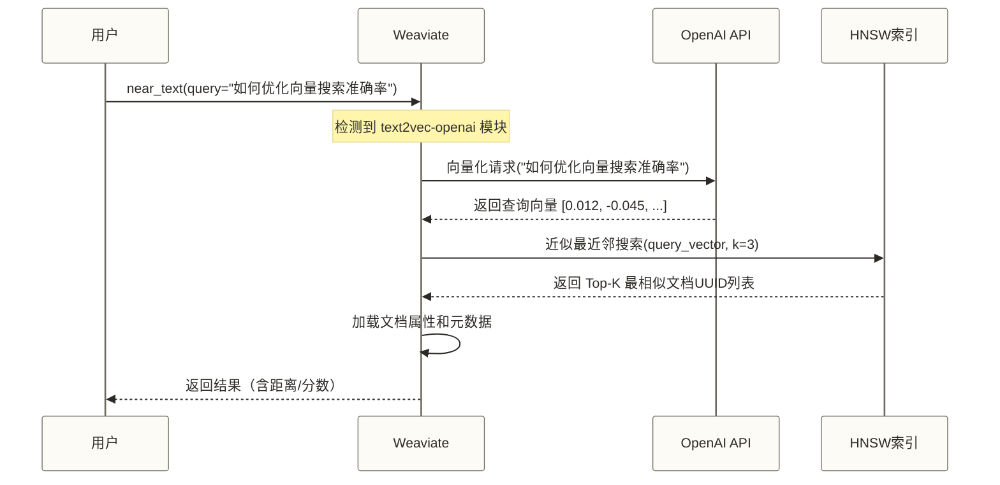
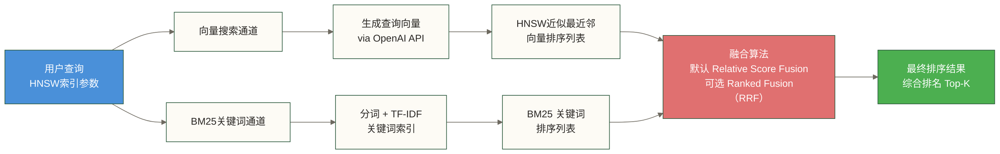
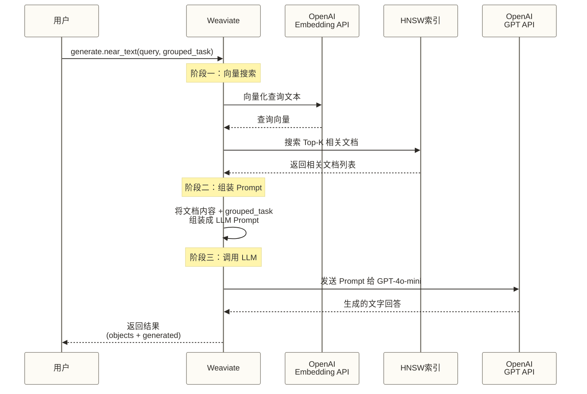

# 第一个 Weaviate 应用：从零构建知识库问答系统

#向量数据库 #Weaviate #Python #RAG #向量搜索

---

## 目录

- [[#项目目标与独特价值]]
- [[#环境准备]]
- [[#第一步：连接 Weaviate]]
- [[#第二步：创建 Collection]]
- [[#第三步：插入数据]]
- #第四步：向量搜索（near_text）
- [[#第五步：混合搜索（hybrid）]]
- [[#第六步：内置 RAG（generate）]]
- [[#第七步：构建完整问答系统]]
- [[#进阶技巧]]
- [[#完整代码汇总]]

---

## 项目目标与独特价值

### 我们要构建什么？

一个**技术文档知识库问答系统**——你可以向它提问"什么是向量索引？"，它会自动搜索相关文档，然后用 AI 把找到的内容整理成一个清晰的答案返回给你。

### 为什么选 Weaviate 做这件事？

在开始写代码之前，先想清楚一件事：这件事用 Pinecone、Qdrant 或者 Milvus 也能做，凭什么选 Weaviate？

本文选择 Weaviate，是为了演示它提供的两项集成能力；以下对比采用显式调用外部模型的示例流程，不代表其他向量数据库均不具备类似能力：

**1. `near_text` 搜索** —— 直接传文字，让数据库帮你向量化

别的向量数据库是这样用的：
```python
# 别的数据库的做法（繁琐）
embedding = openai.embeddings.create(input="什么是向量索引", model="text-embedding-3-small")
results = db.search(vector=embedding.data[0].embedding, top_k=5)
```

Weaviate 是这样的：
```python
# Weaviate 的做法（优雅）
results = collection.query.near_text(query="什么是向量索引", limit=5)
```

你只需要传一个字符串，Weaviate 自己去调用 OpenAI 向量化，再搜索，一步完成。

**2. `generate` 搜索** —— 在数据库查询里直接跑 RAG

别的数据库做 RAG 是这样的：
```python
# 别的数据库做 RAG（多步）
results = db.search(...)           # 第一步：搜索
context = format_context(results)  # 第二步：组装上下文
response = llm.generate(context)   # 第三步：调用 LLM
```

Weaviate 是这样的：
```python
# Weaviate 做 RAG（一步到位）
response = collection.generate.near_text(
    query="什么是向量索引",
    limit=3,
    grouped_task="请基于以上内容，用通俗的语言解释什么是向量索引"
)
print(response.generated)  # 直接拿到 AI 生成的答案
```

在本文配置了向量化与生成模块的环境中，客户端可以通过一次数据库查询请求完成搜索与 LLM 推理；底层仍会调用外部模型服务，此处不作其他数据库是否具备类似能力的全面比较。

> [!tip] 学习路线
> 本文按照复杂度递进：
> 1. 连接 → 2. 建 Collection → 3. 写数据 → 4. 向量搜索 → 5. 混合搜索 → 6. 内置 RAG → 7. 完整应用
>
> 建议跟着代码一步步运行，每步验证输出后再进行下一步。

---

## 环境准备

### 安装依赖

```bash
pip install weaviate-client    # Weaviate Python v4 客户端
pip install python-dotenv      # 管理环境变量
```

> [!note] 版本说明
> 本文使用 `weaviate-client >= 4.9.0`（当前最新稳定版为 4.20.x）。
> v4 与 v3 的 API **完全不同**，如果你在网上搜到的代码用的是 `weaviate.Client()` 而不是 `weaviate.connect_to_local()`，那是 v3 的老代码，不适用于本文。

### 检查版本

```python
import weaviate
print(weaviate.__version__)  # 确认 >= 4.9.0
```

### 启动 Weaviate（本地 Docker）

参考 安装与部署 文档，使用以下 `docker-compose.yml`：

```yaml
version: '3.4'
services:
  weaviate:
    image: semitechnologies/weaviate:1.29.0
    ports:
      - "8080:8080"
      - "50051:50051"
    volumes:
      - weaviate_data:/var/lib/weaviate
    environment:
      AUTHENTICATION_ANONYMOUS_ACCESS_ENABLED: 'true'
      PERSISTENCE_DATA_PATH: '/var/lib/weaviate'
      DEFAULT_VECTORIZER_MODULE: 'text2vec-openai'
      ENABLE_MODULES: 'text2vec-openai,generative-openai'
      OPENAI_APIKEY: ${OPENAI_API_KEY}
      QUERY_DEFAULTS_LIMIT: 25
      CLUSTER_HOSTNAME: 'node1'
volumes:
  weaviate_data:
```

```bash
# 启动
OPENAI_API_KEY=sk-xxx docker compose up -d

# 等待启动完成
curl http://localhost:8080/v1/meta
```

### 项目结构

| 文件名 | 说明 |
|--------|------|
| `.env` | API Keys（不提交到 Git） |
| `docker-compose.yml` | Weaviate 配置 |
| `01_connect.py` | 第一步：连接测试 |
| `02_create_collection.py` | 第二步：创建 Collection |
| `03_insert_data.py` | 第三步：插入数据 |
| `04_near_text_search.py` | 第四步：向量搜索 |
| `05_hybrid_search.py` | 第五步：混合搜索 |
| `06_rag_generate.py` | 第六步：内置 RAG |
| `07_qa_system.py` | 第七步：完整问答系统 |

`.env` 文件内容（当前分步脚本没有调用 load_dotenv，运行前需显式加载该文件或将变量导出到进程环境）：

```bash
OPENAI_API_KEY=sk-your-key-here
# 如果用 Weaviate Cloud，还需要：
# WEAVIATE_URL=https://your-cluster.weaviate.network
# WEAVIATE_API_KEY=your-weaviate-key
```

---

## 第一步：连接 Weaviate

### 连接本地实例

```python
# 01_connect.py
import weaviate
from weaviate.classes.init import AdditionalConfig, Timeout
import os

def connect_local():
    """连接本地 Weaviate 实例"""
    client = weaviate.connect_to_local(
        host="localhost",
        port=8080,
        grpc_port=50051,
        # 如果本地 Weaviate 启用了认证：
        # auth_credentials=Auth.api_key("your-local-key"),

        # 传入 OpenAI API Key，用于调用向量化和生成模块
        headers={
            "X-OpenAI-Api-Key": os.environ.get("OPENAI_API_KEY", "")
        },
        # 超时配置（中国大陆网络建议增大）
        additional_config=AdditionalConfig(
            timeout=Timeout(
                init=30,      # 连接初始化超时（秒）
                query=60,     # 查询超时（秒）
                insert=120    # 数据插入超时（秒）
            )
        )
    )
    return client

def main():
    client = connect_local()
    try:
        # 检查连接是否就绪
        if client.is_ready():
            print("Weaviate 连接成功！")
        else:
            print("Weaviate 未就绪，请检查服务状态")
            return

        # 查看服务器信息
        meta = client.get_meta()
        print(f"Weaviate 版本: {meta['version']}")
        print(f"已加载模块: {list(meta.get('modules', {}).keys())}")

    finally:
        # 记住：用完必须关闭连接！
        client.close()
        print("连接已关闭")

if __name__ == "__main__":
    main()
```

运行输出：

```text
Weaviate 连接成功！
Weaviate 版本: 1.29.0
已加载模块: ['text2vec-openai', 'generative-openai']
连接已关闭
```

### 连接 Weaviate Cloud

```python
import weaviate
from weaviate.classes.init import Auth, AdditionalConfig, Timeout
import os

def connect_cloud():
    """连接 Weaviate Cloud 托管实例"""
    client = weaviate.connect_to_weaviate_cloud(
        cluster_url=os.environ["WEAVIATE_URL"],
        auth_credentials=Auth.api_key(os.environ["WEAVIATE_API_KEY"]),
        headers={
            "X-OpenAI-Api-Key": os.environ["OPENAI_API_KEY"]
        },
        additional_config=AdditionalConfig(
            timeout=Timeout(init=30, query=60, insert=120)
        )
    )
    return client
```

### 推荐的连接写法（Context Manager）

使用 Python 的 `with` 语句，确保连接一定会被关闭：

```python
import weaviate
import os

def get_client():
    return weaviate.connect_to_local(
        headers={"X-OpenAI-Api-Key": os.environ.get("OPENAI_API_KEY", "")}
    )

# 推荐写法：使用 with 语句自动关闭连接
with get_client() as client:
    print(client.is_ready())
    # ... 在这里执行所有操作
# 离开 with 块后，连接自动关闭
```

> [!warning] 连接管理陷阱
> Weaviate v4 客户端**必须显式关闭**连接（调用 `client.close()` 或使用 `with` 语句），否则可能导致资源泄漏。这是 v3 到 v4 最容易踩的坑之一。

### 运行时动态传入 API Key（替代方案）

如果你不想在启动 Weaviate 时配置 OpenAI Key，也可以在每次 Python 连接时通过 header 传入。Weaviate 会在调用向量化时使用这个 key：

```python
# 这种方式下，docker-compose.yml 里不需要 OPENAI_APIKEY
client = weaviate.connect_to_local(
    headers={
        "X-OpenAI-Api-Key": "sk-your-key",
        "X-Cohere-Api-Key": "your-cohere-key",     # 如果同时用 Cohere
        "X-HuggingFace-Api-Key": "your-hf-key",    # 如果同时用 HuggingFace
    }
)
```

---

## 第二步：创建 Collection

### Collection 是什么？

Weaviate 里的 Collection 等同于关系数据库里的"表"，但功能更强大：它不只存数据，还内置了向量索引和 AI 能力配置。

你可以把 Collection 想象成一个"智能档案柜"：
- 它知道文件放进来时要自动生成摘要（向量化）
- 它能用语义理解来检索文件（向量搜索）
- 它能在找到文件后直接让 AI 帮你提炼（RAG）

### 创建知识库文档 Collection

```python
# 02_create_collection.py
import weaviate
from weaviate.classes.config import Configure, Property, DataType, VectorDistances
import os

def create_knowledge_collection(client: weaviate.WeaviateClient):
    """
    创建知识库文档 Collection

    重要：创建时必须配置好向量化器和生成器
    这决定了数据入库时如何自动向量化，以及搜索时如何调用 LLM
    """

    # 如果 Collection 已存在，先删除（开发时方便重置）
    if client.collections.exists("KnowledgeBase"):
        client.collections.delete("KnowledgeBase")
        print("已删除旧的 KnowledgeBase Collection")

    collection = client.collections.create(
        # Collection 名称（首字母大写是惯例，类似类名）
        name="KnowledgeBase",

        # Collection 描述
        description="技术知识库，用于存储技术文档和问答内容",

        # ===== 属性定义 =====
        # 类似关系数据库里定义列，但 Weaviate 更灵活
        properties=[
            Property(
                name="title",
                data_type=DataType.TEXT,
                description="文档标题",
                # skip_vectorization=True 表示这个字段不参与向量化
                # 标题很短，通常不单独向量化，让 content 主导
            ),
            Property(
                name="content",
                data_type=DataType.TEXT,
                description="文档正文内容",
            ),
            Property(
                name="category",
                data_type=DataType.TEXT,
                description="文档分类",
                skip_vectorization=True,  # 分类标签不需要向量化
            ),
            Property(
                name="source",
                data_type=DataType.TEXT,
                description="文档来源 URL",
                skip_vectorization=True,
            ),
            Property(
                name="difficulty",
                data_type=DataType.TEXT,
                description="难度级别：入门/进阶/高级",
                skip_vectorization=True,
            ),
            Property(
                name="view_count",
                data_type=DataType.INT,
                description="浏览次数",
            ),
            Property(
                name="created_at",
                data_type=DataType.DATE,
                description="创建时间",
            ),
            Property(
                name="tags",
                data_type=DataType.TEXT_ARRAY,  # 字符串数组
                description="标签列表",
                skip_vectorization=True,
            ),
            Property(
                name="is_published",
                data_type=DataType.BOOL,
                description="是否已发布",
            ),
        ],

        # ===== 向量化器配置 =====
        # 告诉 Weaviate 用什么模型把文字变成向量
        vectorizer_config=Configure.Vectorizer.text2vec_openai(
            model="text-embedding-3-small",   # OpenAI 嵌入模型
            # 只对这两个字段生成向量（title + content）
            # 不指定的话，所有 TEXT 类型的字段都会参与向量化
            # vectorize_collection_name=False,  # 不把 Collection 名称加入向量化
        ),

        # ===== 向量索引配置 =====
        # HNSW：高性能近似最近邻搜索，99% 的场景用这个
        vector_index_config=Configure.VectorIndex.hnsw(
            distance_metric=VectorDistances.COSINE,  # 余弦相似度
            ef_construction=128,   # 建索引时搜索范围，越大越精准但越慢
            max_connections=64,    # 每个节点的最大连接数
        ),

        # ===== 生成器配置 =====
        # 告诉 Weaviate 用什么 LLM 做 RAG
        generative_config=Configure.Generative.openai(
            model="gpt-4o-mini",   # 使用 GPT-4o-mini（速度快、成本低）
            temperature=0.3,       # 低温度 = 更严谨的回答
            max_tokens=800,        # 生成内容最大 token 数
        ),
    )

    print(f"Collection '{collection.name}' 创建成功！")
    return collection

def inspect_collection(client: weaviate.WeaviateClient):
    """查看 Collection 的配置信息"""
    collection = client.collections.get("KnowledgeBase")
    config = collection.config.get()

    print("\n=== Collection 配置信息 ===")
    print(f"名称: {config.name}")
    print(f"描述: {config.description}")
    print(f"向量化器: {config.vectorizer}")
    print(f"\n属性列表:")
    for prop in config.properties:
        print(f"  - {prop.name}: {prop.data_type} | 参与向量化: {not prop.skip_vectorization}")

def main():
    with weaviate.connect_to_local(
        headers={"X-OpenAI-Api-Key": os.environ.get("OPENAI_API_KEY", "")}
    ) as client:
        create_knowledge_collection(client)
        inspect_collection(client)

if __name__ == "__main__":
    main()
```

运行输出：

```text
已删除旧的 KnowledgeBase Collection
Collection 'KnowledgeBase' 创建成功！

=== Collection 配置信息 ===
名称: KnowledgeBase
描述: 技术知识库，用于存储技术文档和问答内容
向量化器: text2vec-openai

属性列表:
  - title: DataType.TEXT | 参与向量化: True
  - content: DataType.TEXT | 参与向量化: True
  - category: DataType.TEXT | 参与向量化: False
  - source: DataType.TEXT | 参与向量化: False
  - difficulty: DataType.TEXT | 参与向量化: False
  - view_count: DataType.INT | 参与向量化: False
  - created_at: DataType.DATE | 参与向量化: False
  - tags: DataType.TEXT[] | 参与向量化: False
  - is_published: DataType.BOOL | 参与向量化: False
```

---

## 第三步：插入数据

### 准备示例数据

我们用一批技术知识库文档作为示例数据；其中浏览量为演示数值，example.com 地址为来源字段占位符，正文中的产品比较、价格和性能描述不构成已验证的知识来源：

```python
# data.py - 示例数据
KNOWLEDGE_DOCUMENTS = [
    {
        "title": "向量数据库基础概念",
        "content": """向量数据库是一种专门设计用来存储和检索高维向量数据的数据库系统。
        与传统数据库存储结构化数据不同，向量数据库存储的是数值向量，这些向量通常由机器学习模型生成，
        代表文本、图像或其他数据的语义信息。向量数据库的核心能力是相似性搜索（Similarity Search），
        即找到与查询向量最接近的向量。常用的相似性度量包括余弦相似度、欧氏距离和内积。
        向量数据库广泛应用于推荐系统、语义搜索、图像搜索和RAG（检索增强生成）等场景。""",
        "category": "基础概念",
        "difficulty": "入门",
        "tags": ["向量数据库", "相似性搜索", "嵌入向量"],
        "view_count": 1520,
        "is_published": True,
        "source": "https://example.com/vector-db-basics",
    },
    {
        "title": "HNSW 索引算法详解",
        "content": """HNSW（Hierarchical Navigable Small World）是目前最流行的近似最近邻搜索算法之一。
        它通过构建多层图结构来实现高效的向量检索。每一层都是一个"小世界"图，
        上层节点少但跨度大（用于快速定位），下层节点多但连接密集（用于精确搜索）。
        搜索时从最高层开始，逐层下降直到找到最近邻居。
        HNSW 的关键参数包括：M（每个节点的最大连接数，影响内存和准确率）、
        ef_construction（建索引时搜索宽度，越大越准确但建索引越慢）、
        ef（查询时搜索宽度，越大越准确但查询越慢）。
        Weaviate、Qdrant、Milvus 等主流向量数据库都默认使用 HNSW 索引。""",
        "category": "索引算法",
        "difficulty": "进阶",
        "tags": ["HNSW", "向量索引", "近似最近邻", "ANN"],
        "view_count": 860,
        "is_published": True,
        "source": "https://example.com/hnsw-explained",
    },
    {
        "title": "RAG 检索增强生成原理",
        "content": """RAG（Retrieval-Augmented Generation，检索增强生成）是一种将信息检索与大语言模型结合的技术架构。
        传统 LLM 的知识固化在训练数据中，无法获取最新信息且容易产生幻觉。
        RAG 的核心思路是：在 LLM 生成答案前，先从外部知识库中检索相关内容，
        然后将检索到的内容作为上下文传给 LLM，让模型基于真实数据生成答案。
        RAG 的典型流程：用户提问 → 问题向量化 → 向量数据库检索相关文档 →
        组装 Prompt（问题 + 检索结果）→ LLM 生成答案。
        RAG 能有效减少幻觉、支持私域知识、实现知识实时更新，
        是目前企业 AI 应用最常见的落地模式。""",
        "category": "AI架构",
        "difficulty": "进阶",
        "tags": ["RAG", "LLM", "知识库", "检索增强生成"],
        "view_count": 3210,
        "is_published": True,
        "source": "https://example.com/rag-explained",
    },
    {
        "title": "余弦相似度与向量距离度量",
        "content": """在向量空间中衡量两个向量的相似程度，有多种距离度量方式。
        余弦相似度（Cosine Similarity）：衡量两个向量方向的相似程度，
        取值范围 [-1, 1]，1 表示完全相同，-1 表示完全相反，0 表示无关。
        余弦相似度对向量长度不敏感，适合文本语义比较。
        欧氏距离（Euclidean Distance / L2）：计算两点之间的直线距离，
        值越小表示越相似，适合需要考虑向量大小的场景。
        内积（Dot Product）：两个向量对应元素相乘再求和，
        当向量已归一化时等同于余弦相似度，是 HNSW 中常用的快速计算方式。
        选择建议：文本语义搜索用余弦相似度；图像特征匹配可用欧氏距离；
        对于已做 L2 归一化的非零向量，最大化余弦相似度、最大化内积与最小化欧氏距离对应相同的近邻排序，但三者数值并不相等。""",
        "category": "数学基础",
        "difficulty": "入门",
        "tags": ["余弦相似度", "欧氏距离", "向量距离", "相似度计算"],
        "view_count": 745,
        "is_published": True,
        "source": "https://example.com/vector-distance",
    },
    {
        "title": "Weaviate 模块系统与插件机制",
        "content": """Weaviate 采用模块化架构，核心功能之外的能力通过模块（Modules）扩展。
        模块分为三类：向量化模块（Vectorizer）、生成模块（Generative）、重排序模块（Reranker）。
        向量化模块决定了如何将数据转为向量，支持 OpenAI、Cohere、HuggingFace 等主流提供商。
        生成模块让 Weaviate 能在查询结果上直接运行 LLM，实现内置 RAG 能力。
        重排序模块可以对搜索结果进行二次排序，提升精准度。
        使用模块时，需要在 docker-compose.yml 的 ENABLE_MODULES 环境变量中声明，
        并提供对应的 API Key。模块在 Collection 创建时配置，一旦数据写入后更改向量化模块
        需要重新建索引。""",
        "category": "Weaviate",
        "difficulty": "进阶",
        "tags": ["Weaviate", "模块", "向量化", "插件"],
        "view_count": 428,
        "is_published": True,
        "source": "https://example.com/weaviate-modules",
    },
    {
        "title": "混合搜索：向量搜索与关键词搜索的结合",
        "content": """混合搜索（Hybrid Search）将向量语义搜索和传统 BM25 关键词搜索结合起来，
        取两者之长。纯向量搜索擅长理解语义，但可能忽略精确的关键词匹配；
        纯关键词搜索精确匹配效率高，但无法理解同义词和上下文。
        混合搜索通过 alpha 参数控制两种搜索的权重：
        alpha=1.0 表示纯向量搜索，alpha=0.0 表示纯关键词搜索，
        alpha=0.5 表示各占一半。
        Weaviate 使用 Reciprocal Rank Fusion（RRF）算法融合两种搜索结果，
        这种方法在多个基准测试中表现优于单一搜索方式。
        混合搜索特别适合：专业术语密集的文档、需要精确匹配产品名称、
        或者在语义搜索的基础上希望保留关键词权重的场景。""",
        "category": "搜索技术",
        "difficulty": "进阶",
        "tags": ["混合搜索", "BM25", "向量搜索", "RRF", "Hybrid"],
        "view_count": 1180,
        "is_published": True,
        "source": "https://example.com/hybrid-search",
    },
    {
        "title": "向量数据库选型对比：Weaviate vs Qdrant vs Milvus",
        "content": """主流向量数据库各有特点，选型时需要根据具体需求决定。
        Weaviate：最大特色是模块化 AI 能力，内置向量化和 RAG，适合需要快速构建 AI 应用的团队。
        学习曲线适中，云服务（WCD）完善。缺点是功能越多、配置越复杂。
        Qdrant：Rust 编写，性能极高，内存效率出色，支持精确的向量过滤。
        适合对性能要求极高的场景。API 设计简洁，适合程序员直接使用。
        Milvus：阿里巴巴主导开发，支持超大规模（亿级）向量，分布式架构成熟。
        适合超大规模生产部署，但运维复杂度较高。
        Pinecone：纯托管服务，运维零成本，适合不想管理基础设施的团队。
        但数据在外部服务，对数据合规要求高的场景不适用。
        选型建议：快速 PoC 用 Weaviate Cloud 或 Pinecone；
        性能敏感用 Qdrant；超大规模用 Milvus；企业私有化部署可选 Weaviate 或 Milvus。""",
        "category": "选型指南",
        "difficulty": "进阶",
        "tags": ["选型", "Weaviate", "Qdrant", "Milvus", "Pinecone", "对比"],
        "view_count": 2860,
        "is_published": True,
        "source": "https://example.com/vector-db-comparison",
    },
    {
        "title": "向量嵌入模型选择指南",
        "content": """选择合适的嵌入模型（Embedding Model）对向量搜索质量至关重要。
        OpenAI text-embedding-3-small：性价比最高，适合大多数英文和中文场景，
        每百万 token 约 0.02 美元，维度 1536。
        OpenAI text-embedding-3-large：精度更高，适合对搜索质量要求极高的场景，
        支持自定义维度（最高 3072），成本是 small 的 6.5 倍。
        Cohere embed-multilingual-v3.0：多语言支持最佳，支持 100+ 种语言，
        中文理解能力强于 OpenAI 通用模型，适合国际化产品。
        sentence-transformers/all-MiniLM-L6-v2：开源免费，可本地运行，
        无 API 费用，适合预算有限或数据不能离开本地的场景。
        BGE（BAAI General Embedding）系列：北京智源研究院开源，
        中文语义理解出色，是目前中文场景的最佳开源选择之一。""",
        "category": "嵌入模型",
        "difficulty": "进阶",
        "tags": ["嵌入模型", "OpenAI", "Cohere", "BGE", "sentence-transformers"],
        "view_count": 1650,
        "is_published": True,
        "source": "https://example.com/embedding-models",
    },
    {
        "title": "生产环境向量数据库性能优化",
        "content": """在生产环境中，向量数据库的性能优化需要从多个维度入手。
        索引参数调优：增大 ef（查询时搜索宽度）可提升召回率，但会降低查询速度；
        增大 M（最大连接数）提升精度但增加内存占用。建议 M=16-64，ef=64-256。
        向量维度选择：维度越高精度越高，但内存和计算成本线性增加。
        实践中 768 或 1536 维度是精度与性能的较好平衡点。
        批量写入优化：使用批量插入而非逐条插入，Weaviate 建议批次大小 50-200 条。
        分片策略：数据量超过 10 亿时考虑分片，Weaviate 支持基于向量的自动分片。
        内存管理：HNSW 索引全量加载到内存，100M 条 1536 维向量约需 600GB 内存。
        可将 FLAT 索引（精确搜索）或 PQ 压缩列为候选方案，结合数据规模与资源预算评估；任何索引方案都不能无条件保证没有内存溢出风险。
        缓存策略：频繁查询的向量可配置 vector cache 加速，Weaviate 支持 LRU 缓存。""",
        "category": "性能优化",
        "difficulty": "高级",
        "tags": ["性能优化", "HNSW参数", "分片", "内存管理", "生产环境"],
        "view_count": 932,
        "is_published": True,
        "source": "https://example.com/vector-db-optimization",
    },
    {
        "title": "Python 调用 Weaviate v4 快速上手",
        "content": """Weaviate Python 客户端 v4 是一次重大重写，API 风格从 v3 的 Schema 中心转变为 Collection 中心。
        关键变化：连接方式从 weaviate.Client() 改为 weaviate.connect_to_local() 或 connect_to_weaviate_cloud()；
        操作入口从 client.query 改为 collection.query；
        数据类型从字典改为强类型对象，IDE 代码补全更友好。
        v4 内部使用 gRPC 协议，性能显著优于 v3 的 REST 协议，
        批量插入速度可提升 3-5 倍。同时 v4 引入了 async API（WeaviateAsyncClient），
        适合高并发场景。v3 客户端已进入维护模式，新项目应全面切换到 v4。""",
        "category": "Weaviate",
        "difficulty": "入门",
        "tags": ["Python", "Weaviate", "v4客户端", "SDK"],
        "view_count": 2140,
        "is_published": True,
        "source": "https://example.com/weaviate-python-v4",
    },
]
```

### 批量插入数据

```python
# 03_insert_data.py
import weaviate
from weaviate.util import generate_uuid5
from datetime import datetime, timezone
import os

# 引入示例数据
from data import KNOWLEDGE_DOCUMENTS

def insert_documents(client: weaviate.WeaviateClient):
    """批量插入文档数据"""
    collection = client.collections.get("KnowledgeBase")

    print(f"开始插入 {len(KNOWLEDGE_DOCUMENTS)} 条文档...")
    print("（注意：Weaviate 会自动调用 OpenAI API 为每条数据生成向量，请稍等）\n")

    # 方式一：逐条插入（简单但慢，适合少量数据）
    # for doc in KNOWLEDGE_DOCUMENTS:
    #     uuid = collection.data.insert(doc)
    #     print(f"已插入: {doc['title']} -> {uuid}")

    # 方式二：批量插入（推荐！内部自动并发，速度快）
    with collection.batch.dynamic() as batch:
        for doc in KNOWLEDGE_DOCUMENTS:
            # 生成确定性 UUID（基于标题）
            # 好处：同一个标题总是得到相同的 UUID，避免重复插入
            doc_uuid = generate_uuid5(doc["title"])

            # 处理日期字段（Weaviate 要求 RFC3339 格式）
            doc_with_date = doc.copy()
            doc_with_date["created_at"] = datetime.now(timezone.utc).isoformat()

            batch.add_object(
                properties=doc_with_date,
                uuid=doc_uuid,
            )
            print(f"  已加入批次: {doc['title']}")

    # 检查是否有失败的插入
    if batch.number_errors > 0:
        print(f"\n警告：有 {batch.number_errors} 条数据插入失败")
        for failed_object in collection.batch.failed_objects:
            print(f"  错误: {failed_object.message}")
    else:
        print(f"\n全部 {len(KNOWLEDGE_DOCUMENTS)} 条文档插入成功！")

def verify_insert(client: weaviate.WeaviateClient):
    """验证数据是否正确插入"""
    collection = client.collections.get("KnowledgeBase")

    # 查询总数
    response = collection.aggregate.over_all(total_count=True)
    print(f"\n数据库中共有 {response.total_count} 条文档")

    # 随机查看一条数据（验证向量是否生成）
    from weaviate.classes.query import MetadataQuery

    result = collection.query.fetch_objects(
        limit=1,
        include_vector=True,  # 包含向量数据
        return_metadata=MetadataQuery(creation_time=True),
    )

    if result.objects:
        obj = result.objects[0]
        print(f"\n示例数据:")
        print(f"  UUID: {obj.uuid}")
        print(f"  标题: {obj.properties['title']}")
        print(f"  分类: {obj.properties['category']}")
        vector = obj.vector.get("default", [])
        print(f"  向量维度: {len(vector)}")
        print(f"  向量前5位: {[round(v, 4) for v in vector[:5]]}")
        print(f"  创建时间: {obj.metadata.creation_time}")

def main():
    with weaviate.connect_to_local(
        headers={"X-OpenAI-Api-Key": os.environ.get("OPENAI_API_KEY", "")}
    ) as client:
        insert_documents(client)
        verify_insert(client)

if __name__ == "__main__":
    main()
```

运行输出：

```text
开始插入 10 条文档...
（注意：Weaviate 会自动调用 OpenAI API 为每条数据生成向量，请稍等）

  已加入批次: 向量数据库基础概念
  已加入批次: HNSW 索引算法详解
  已加入批次: RAG 检索增强生成原理
  ... （省略其他）
  已加入批次: Python 调用 Weaviate v4 快速上手

全部 10 条文档插入成功！

数据库中共有 10 条文档

示例数据:
  UUID: a3c2f1b8-...
  标题: 向量数据库基础概念
  分类: 基础概念
  向量维度: 1536
  向量前5位: [0.0123, -0.0456, 0.0789, -0.0234, 0.0567]
  创建时间: 2026-03-11 10:30:00
```

> [!tip] 批量插入的正确姿势
> Weaviate v4 推荐使用 `batch.dynamic()` 模式——它会根据服务器响应自动调整批次大小，在速度和稳定性之间自动找最优平衡。不建议用 `batch.fixed_size()` 手动控制，除非你有特定原因。

---

## 第四步：向量搜索（near_text）

这是 Weaviate 最标志性的功能。你只需要传一个自然语言问题，Weaviate 会自动向量化、搜索、返回最相关的文档。

### 基础向量搜索

```python
# 04_near_text_search.py
import weaviate
from weaviate.classes.query import MetadataQuery
import os

def basic_near_text_search(client: weaviate.WeaviateClient):
    """最基础的向量搜索示例"""
    collection = client.collections.get("KnowledgeBase")

    print("=" * 60)
    print("示例1：基础向量搜索")
    print("=" * 60)

    response = collection.query.near_text(
        query="如何优化向量搜索的准确率",  # 自然语言查询
        limit=3,                            # 返回前3条
        return_metadata=MetadataQuery(
            distance=True,   # 返回距离（越小越相似）
            # 本例使用向量距离，不将其当作相关性 score
        ),
    )

    for i, obj in enumerate(response.objects, 1):
        print(f"\n[{i}] {obj.properties['title']}")
        print(f"    分类: {obj.properties['category']} | 难度: {obj.properties['difficulty']}")
        print(f"    距离: {obj.metadata.distance:.4f}")
        # 截取 content 前 100 个字
        content_preview = obj.properties['content'][:100] + "..."
        print(f"    摘要: {content_preview}")

def search_with_filters(client: weaviate.WeaviateClient):
    """带过滤条件的向量搜索"""
    from weaviate.classes.query import Filter

    collection = client.collections.get("KnowledgeBase")

    print("\n" + "=" * 60)
    print("示例2：带过滤条件的向量搜索")
    print("（只搜索'进阶'难度的文档）")
    print("=" * 60)

    response = collection.query.near_text(
        query="向量数据库的使用技巧",
        limit=3,
        filters=Filter.by_property("difficulty").equal("进阶"),  # 只返回进阶难度
        return_metadata=MetadataQuery(distance=True),
    )

    for obj in response.objects:
        print(f"\n  [{obj.properties['difficulty']}] {obj.properties['title']}")
        print(f"  距离: {obj.metadata.distance:.4f}")

def search_with_selected_properties(client: weaviate.WeaviateClient):
    """只返回指定属性（减少数据传输）"""
    from weaviate.classes.query import MetadataQuery

    collection = client.collections.get("KnowledgeBase")

    print("\n" + "=" * 60)
    print("示例3：只返回指定属性")
    print("=" * 60)

    response = collection.query.near_text(
        query="RAG 是怎么工作的",
        limit=3,
        return_properties=["title", "category", "difficulty", "view_count"],  # 只返回这几个字段
        return_metadata=MetadataQuery(distance=True),
    )

    for obj in response.objects:
        print(f"\n  标题: {obj.properties['title']}")
        print(f"  分类: {obj.properties['category']}")
        print(f"  浏览量: {obj.properties['view_count']}")
        print(f"  距离: {obj.metadata.distance:.4f}")

def search_with_distance_threshold(client: weaviate.WeaviateClient):
    """设置距离阈值，只返回相关性高的结果"""
    collection = client.collections.get("KnowledgeBase")

    print("\n" + "=" * 60)
    print("示例4：设置距离阈值（只返回距离 < 0.3 的高相关结果）")
    print("=" * 60)

    response = collection.query.near_text(
        query="机器学习模型训练",  # 故意用一个与知识库相关性较低的查询
        limit=5,
        distance=0.3,   # 余弦距离阈值，< 0.3 才返回（越严格召回越少）
        return_metadata=MetadataQuery(distance=True),
    )

    if response.objects:
        for obj in response.objects:
            print(f"  [{obj.metadata.distance:.4f}] {obj.properties['title']}")
    else:
        print("  没有找到距离 < 0.3 的相关文档（相关性不足）")

def main():
    with weaviate.connect_to_local(
        headers={"X-OpenAI-Api-Key": os.environ.get("OPENAI_API_KEY", "")}
    ) as client:
        basic_near_text_search(client)
        search_with_filters(client)
        search_with_selected_properties(client)
        search_with_distance_threshold(client)

if __name__ == "__main__":
    main()
```

运行输出（示例）：

```text
============================================================
示例1：基础向量搜索
============================================================

[1] 生产环境向量数据库性能优化
    分类: 性能优化 | 难度: 高级
    距离: 0.1823
    摘要: 在生产环境中，向量数据库的性能优化需要从多个维度入手。索引参数调优：增大 ef（查询时搜索宽度）...

[2] HNSW 索引算法详解
    分类: 索引算法 | 难度: 进阶
    距离: 0.2104
    摘要: HNSW（Hierarchical Navigable Small World）是目前最流行的近似最近邻搜索算法之一...

[3] 向量数据库基础概念
    分类: 基础概念 | 难度: 入门
    距离: 0.2341
    摘要: 向量数据库是一种专门设计用来存储和检索高维向量数据的数据库系统...
```

### near_text 的工作原理图



---

## 第五步：混合搜索（hybrid）

混合搜索把向量语义搜索和 BM25 关键词搜索结合起来。当你需要精确匹配某个专有名词（比如"HNSW"）同时又希望理解语义时，混合搜索的效果会优于纯向量搜索。

```python
# 05_hybrid_search.py
import weaviate
from weaviate.classes.query import MetadataQuery, HybridFusion
import os

def basic_hybrid_search(client: weaviate.WeaviateClient):
    """基础混合搜索"""
    collection = client.collections.get("KnowledgeBase")

    print("=" * 60)
    print("示例1：基础混合搜索（alpha=0.5，向量和关键词各半）")
    print("=" * 60)

    response = collection.query.hybrid(
        query="HNSW 索引的参数调优",
        limit=3,
        alpha=0.5,  # 0.0 = 纯 BM25，1.0 = 纯向量，0.5 = 各半
        return_metadata=MetadataQuery(score=True),
    )

    for obj in response.objects:
        print(f"\n  {obj.properties['title']}")
        print(f"  混合分数: {obj.metadata.score:.4f}")
        print(f"  分类: {obj.properties['category']}")

def compare_search_modes(client: weaviate.WeaviateClient):
    """对比不同搜索模式的结果差异"""
    collection = client.collections.get("KnowledgeBase")
    query = "BM25 向量检索融合方法"

    print("\n" + "=" * 60)
    print(f"示例2：对比不同搜索模式（查询: '{query}'）")
    print("=" * 60)

    # 纯关键词搜索
    print("\n--- 纯关键词搜索 (alpha=0.0) ---")
    response_bm25 = collection.query.hybrid(
        query=query,
        limit=3,
        alpha=0.0,
        return_metadata=MetadataQuery(score=True),
    )
    for obj in response_bm25.objects:
        print(f"  [{obj.metadata.score:.4f}] {obj.properties['title']}")

    # 纯向量搜索
    print("\n--- 纯向量搜索 (alpha=1.0) ---")
    response_vec = collection.query.hybrid(
        query=query,
        limit=3,
        alpha=1.0,
        return_metadata=MetadataQuery(score=True),
    )
    for obj in response_vec.objects:
        print(f"  [{obj.metadata.score:.4f}] {obj.properties['title']}")

    # 平衡混合搜索
    print("\n--- 平衡混合搜索 (alpha=0.5) ---")
    response_hybrid = collection.query.hybrid(
        query=query,
        limit=3,
        alpha=0.5,
        return_metadata=MetadataQuery(score=True),
    )
    for obj in response_hybrid.objects:
        print(f"  [{obj.metadata.score:.4f}] {obj.properties['title']}")

def hybrid_with_target_properties(client: weaviate.WeaviateClient):
    """仅限制混合搜索中的 BM25 分支属性，向量分支仍使用已配置的文档向量"""
    collection = client.collections.get("KnowledgeBase")

    print("\n" + "=" * 60)
    print("示例3：BM25 分支只搜索 content；向量分支仍使用 title 与 content 的文档向量")
    print("=" * 60)

    response = collection.query.hybrid(
        query="余弦距离计算",
        limit=3,
        alpha=0.5,
        target_vector="default",   # 指定向量名称
        # 只对 content 字段做 BM25 搜索
        query_properties=["content"],
        return_metadata=MetadataQuery(score=True),
    )

    for obj in response.objects:
        print(f"  {obj.properties['title']} | 分数: {obj.metadata.score:.4f}")

def hybrid_with_fusion_type(client: weaviate.WeaviateClient):
    """使用不同的融合算法"""
    collection = client.collections.get("KnowledgeBase")

    print("\n" + "=" * 60)
    print("示例4：使用 Relative Score Fusion（相对分数融合）")
    print("（本文所用 Weaviate 1.29.0 默认使用 Relative Score Fusion；不同融合方式的效果需结合查询集评估）")
    print("=" * 60)

    response = collection.query.hybrid(
        query="嵌入模型选择",
        limit=3,
        alpha=0.6,
        fusion_type=HybridFusion.RELATIVE_SCORE,  # 相对分数融合
        return_metadata=MetadataQuery(score=True),
    )

    for obj in response.objects:
        print(f"  {obj.properties['title']} | 分数: {obj.metadata.score:.4f}")

def hybrid_with_filters(client: weaviate.WeaviateClient):
    """混合搜索 + 过滤条件"""
    from weaviate.classes.query import Filter

    collection = client.collections.get("KnowledgeBase")

    print("\n" + "=" * 60)
    print("示例5：混合搜索 + 过滤（只搜索高浏览量的文档）")
    print("=" * 60)

    response = collection.query.hybrid(
        query="RAG 知识库搜索技术",
        limit=3,
        alpha=0.5,
        filters=Filter.by_property("view_count").greater_than(1000),  # 浏览量 > 1000
        return_metadata=MetadataQuery(score=True),
    )

    for obj in response.objects:
        print(f"  {obj.properties['title']}")
        print(f"  浏览量: {obj.properties['view_count']} | 混合分数: {obj.metadata.score:.4f}")

def main():
    with weaviate.connect_to_local(
        headers={"X-OpenAI-Api-Key": os.environ.get("OPENAI_API_KEY", "")}
    ) as client:
        basic_hybrid_search(client)
        compare_search_modes(client)
        hybrid_with_target_properties(client)
        hybrid_with_fusion_type(client)
        hybrid_with_filters(client)

if __name__ == "__main__":
    main()
```

### 混合搜索原理图



---

## 第六步：内置 RAG（generate）

这是 Weaviate 最独特的功能，也是最令人惊艳的地方。你在一次数据库查询里，同时完成了"向量搜索"和"LLM 推理"两件事。

### single_prompt：对每条结果单独生成

```python
# 06_rag_generate.py
import weaviate
from weaviate.classes.query import MetadataQuery
from weaviate.classes.generate import GenerateOptions
import os

def single_prompt_rag(client: weaviate.WeaviateClient):
    """
    single_prompt：对每一条搜索结果，单独执行一次 LLM 推理

    适合：对每条文档分别做处理，如翻译、摘要、格式转换
    """
    collection = client.collections.get("KnowledgeBase")

    print("=" * 60)
    print("示例1：single_prompt（对每条结果单独总结）")
    print("=" * 60)

    response = collection.generate.near_text(
        query="向量索引的工作原理",
        limit=2,
        # single_prompt：模板中用 {属性名} 引用文档属性
        single_prompt="请用一句话（20字以内）概括以下技术文档的核心观点：\n\n文档标题：{title}\n文档内容：{content}",
        return_metadata=MetadataQuery(distance=True),
    )

    for obj in response.objects:
        print(f"\n原文标题: {obj.properties['title']}")
        print(f"相关距离: {obj.metadata.distance:.4f}")
        print(f"AI 一句话总结: {obj.generated}")
        print("-" * 40)

def grouped_task_rag(client: weaviate.WeaviateClient):
    """
    grouped_task：把所有搜索结果一起传给 LLM，生成一个综合回答

    适合：问答系统、知识摘要、综合分析
    这是 RAG 最典型的用法
    """
    collection = client.collections.get("KnowledgeBase")

    print("\n" + "=" * 60)
    print("示例2：grouped_task（综合所有结果生成统一回答）")
    print("=" * 60)

    question = "向量数据库中，如何在搜索精度和查询速度之间取得平衡？"
    print(f"用户问题: {question}\n")

    response = collection.generate.near_text(
        query=question,
        limit=3,  # 检索 3 条相关文档作为 LLM 的上下文
        # grouped_task：把所有检索到的文档合并后，整体传给 LLM
        grouped_task=f"""
        你是一位技术知识库助手。请基于以下检索到的技术文档，
        用清晰易懂的语言回答用户的问题。

        用户问题：{question}

        请重点回答：
        1. 影响精度和速度的关键参数是什么？
        2. 有哪些实际的调优建议？

        请用 200 字左右的中文回答，语言要通俗易懂。
        """,
        return_metadata=MetadataQuery(distance=True),
    )

    print("参考文档：")
    for obj in response.objects:
        print(f"  - {obj.properties['title']} (距离: {obj.metadata.distance:.4f})")

    print(f"\nAI 综合回答:\n{response.generated}")

def combined_rag(client: weaviate.WeaviateClient):
    """
    同时使用 single_prompt 和 grouped_task

    实际应用：同时获得每篇文档的简化结果与基于检索文档的综合回答；此代码未将简化结果作为综合回答的输入
    """
    collection = client.collections.get("KnowledgeBase")

    print("\n" + "=" * 60)
    print("示例3：同时使用 single_prompt + grouped_task")
    print("=" * 60)

    question = "什么时候选择 Weaviate，什么时候选择 Qdrant 或 Milvus？"
    print(f"用户问题: {question}\n")

    response = collection.generate.near_text(
        query=question,
        limit=3,
        # 对每条文档：提取关键点
        single_prompt="请提取这段文字中关于向量数据库选型的核心观点（一句话）：{content}",
        # 对所有文档综合：给出选型建议
        grouped_task=f"根据以上文档内容，请给出一个清晰的向量数据库选型决策框架，帮助用户回答：{question}",
    )

    print("每篇文档的核心观点：")
    for obj in response.objects:
        print(f"\n  [{obj.properties['title']}]")
        print(f"  核心观点: {obj.generated}")

    print(f"\n综合选型建议:\n{response.generated}")

def hybrid_rag(client: weaviate.WeaviateClient):
    """
    混合搜索 + 内置 RAG
    两个功能的组合使用
    """
    collection = client.collections.get("KnowledgeBase")

    print("\n" + "=" * 60)
    print("示例4：混合搜索 + 内置 RAG（最强组合）")
    print("=" * 60)

    question = "如何用 Python 快速上手向量数据库？"
    print(f"用户问题: {question}\n")

    # 先用混合搜索找到最相关的文档，再用 RAG 生成回答
    response = collection.generate.hybrid(
        query=question,
        limit=3,
        alpha=0.6,  # 偏向语义搜索
        grouped_task=f"""
        请基于以下检索到的技术文档，用友好、实用的风格回答：
        "{question}"

        要求：
        - 给出具体的步骤或代码示例的提示
        - 指出初学者最容易犯的错误
        - 控制在 150 字以内
        """,
    )

    print("参考文档：")
    for obj in response.objects:
        print(f"  - {obj.properties['title']}")

    print(f"\nAI 回答:\n{response.generated}")

def main():
    with weaviate.connect_to_local(
        headers={"X-OpenAI-Api-Key": os.environ.get("OPENAI_API_KEY", "")}
    ) as client:
        single_prompt_rag(client)
        grouped_task_rag(client)
        combined_rag(client)
        hybrid_rag(client)

if __name__ == "__main__":
    main()
```

### generate 工作原理图



---

## 第七步：构建完整问答系统

把前面所有功能组合起来，构建一个用于本地演示的知识库问答原型；生产使用还需处理访问控制、数据安全、检索与回答评估等问题：

```python
# 07_qa_system.py
import weaviate
from weaviate.classes.query import Filter, MetadataQuery
import os
from typing import Optional

class KnowledgeBaseQA:
    """
    知识库问答系统

    特性：
    - 支持自然语言提问
    - 混合搜索（向量 + 关键词）提供两路检索融合，召回率需结合语料、查询集和参数评估
    - 内置 RAG 直接生成答案
    - 支持分类过滤
    - 显示信息来源
    """

    def __init__(self, client: weaviate.WeaviateClient):
        self.client = client
        self.collection = client.collections.get("KnowledgeBase")

    def ask(
        self,
        question: str,
        category_filter: Optional[str] = None,
        difficulty_filter: Optional[str] = None,
        num_references: int = 3,
        alpha: float = 0.6,
    ) -> dict:
        """
        提问并获取回答

        Args:
            question: 用户的自然语言问题
            category_filter: 限制搜索范围的分类（可选）
            difficulty_filter: 限制难度级别（可选）
            num_references: 参考的文档数量（越多上下文越丰富，但 LLM 费用越高）
            alpha: 混合搜索权重（0=关键词，1=向量，0.6偏向语义）

        Returns:
            包含答案、参考来源的字典
        """
        # 构建过滤条件
        filters = None
        if category_filter and difficulty_filter:
            filters = (
                Filter.by_property("category").equal(category_filter) &
                Filter.by_property("difficulty").equal(difficulty_filter)
            )
        elif category_filter:
            filters = Filter.by_property("category").equal(category_filter)
        elif difficulty_filter:
            filters = Filter.by_property("difficulty").equal(difficulty_filter)

        # 构建 RAG Prompt
        rag_prompt = f"""
你是一位专业的技术知识库助手，拥有丰富的大数据和向量数据库专业知识。

请基于以下从知识库中检索到的相关文档，回答用户的问题。

用户问题：{question}

回答要求：
1. 直接回答问题，不要重复问题
2. 如果检索到的文档与问题相关，优先基于文档内容回答
3. 可以适当补充你自己的专业见解，但要明确标注"补充说明："
4. 语言要专业但通俗易懂，避免过多术语堆砌
5. 如果问题超出知识库范围，直接说明
6. 回答控制在 300 字以内
"""

        # 执行混合搜索 + RAG
        try:
            response = self.collection.generate.hybrid(
                query=question,
                limit=num_references,
                alpha=alpha,
                filters=filters,
                grouped_task=rag_prompt,
                return_metadata=MetadataQuery(score=True, distance=True),
                return_properties=["title", "content", "category", "difficulty", "source", "view_count"],
            )
        except Exception as e:
            return {
                "answer": f"查询失败：{str(e)}",
                "references": [],
                "success": False,
            }

        # 整理参考来源
        references = []
        for obj in response.objects:
            references.append({
                "title": obj.properties.get("title", ""),
                "category": obj.properties.get("category", ""),
                "difficulty": obj.properties.get("difficulty", ""),
                "source": obj.properties.get("source", ""),
                "view_count": obj.properties.get("view_count", 0),
                "relevance_score": round(obj.metadata.score, 4) if obj.metadata.score else None,
            })

        return {
            "question": question,
            "answer": response.generated,
            "references": references,
            "success": True,
        }

    def print_answer(self, result: dict):
        """格式化打印问答结果"""
        if not result["success"]:
            print(f"错误: {result['answer']}")
            return

        print("\n" + "=" * 70)
        print(f"问: {result['question']}")
        print("=" * 70)
        print(f"\n答:\n{result['answer']}")

        if result["references"]:
            print(f"\n参考来源 ({len(result['references'])} 篇文档)：")
            for i, ref in enumerate(result["references"], 1):
                score_str = f"相关分: {ref['relevance_score']}" if ref['relevance_score'] else ""
                print(f"  [{i}] 《{ref['title']}》")
                print(f"      分类: {ref['category']} | 难度: {ref['difficulty']} | {score_str}")
                if ref['source']:
                    print(f"      来源: {ref['source']}")

        print()

def run_demo_qa(client: weaviate.WeaviateClient):
    """运行演示问答"""
    qa = KnowledgeBaseQA(client)

    # 演示问题列表
    demo_questions = [
        {
            "question": "向量数据库和传统数据库有什么本质区别？",
            "params": {}
        },
        {
            "question": "HNSW 算法是怎么工作的？关键参数有哪些？",
            "params": {"difficulty_filter": "进阶"}
        },
        {
            "question": "我该如何为中文内容选择合适的嵌入模型？",
            "params": {}
        },
        {
            "question": "RAG 和普通的 LLM 聊天有什么区别，RAG 有什么优势？",
            "params": {}
        },
        {
            "question": "Weaviate、Qdrant、Milvus 三者怎么选？",
            "params": {"category_filter": "选型指南"}
        },
    ]

    for item in demo_questions:
        result = qa.ask(item["question"], **item["params"])
        qa.print_answer(result)
        print()

def interactive_qa(client: weaviate.WeaviateClient):
    """交互式问答模式"""
    qa = KnowledgeBaseQA(client)

    print("\n" + "=" * 70)
    print("知识库问答系统已启动（输入 'quit' 退出）")
    print("=" * 70)

    while True:
        print()
        question = input("请输入您的问题: ").strip()

        if question.lower() in ["quit", "exit", "q", "退出"]:
            print("感谢使用，再见！")
            break

        if not question:
            print("问题不能为空，请重新输入")
            continue

        print("\n正在搜索知识库并生成回答，请稍候...")
        result = qa.ask(question)
        qa.print_answer(result)

def main():
    with weaviate.connect_to_local(
        headers={"X-OpenAI-Api-Key": os.environ.get("OPENAI_API_KEY", "")}
    ) as client:
        print("=== 演示模式：自动运行预设问题 ===")
        run_demo_qa(client)

        # 如果想进入交互模式，取消下面的注释：
        # print("=== 交互模式：输入你的问题 ===")
        # interactive_qa(client)

if __name__ == "__main__":
    main()
```

运行输出示例：

```text
=== 演示模式：自动运行预设问题 ===

======================================================================
问: 向量数据库和传统数据库有什么本质区别？
======================================================================

答:
向量数据库与传统数据库的本质区别在于**存储内容和检索方式**的不同。

传统数据库（如 MySQL、PostgreSQL）存储的是结构化数据，用精确匹配（如 WHERE id=1）来查询。它回答的问题是："这条记录存不存在？"

向量数据库存储的是**高维数值向量**，用相似性搜索来查询。它回答的问题是："哪些内容和这个最相似？"这些向量通常由机器学习模型生成，代表文本、图片等数据的语义信息。

核心能力差异：
- 传统数据库：精确查询，快速
- 向量数据库：模糊匹配（语义搜索），理解含义

补充说明：实际系统中两者常配合使用——向量数据库负责语义检索，传统数据库负责存储完整业务数据。

参考来源 (3 篇文档)：
  [1] 《向量数据库基础概念》
      分类: 基础概念 | 难度: 入门 | 相关分: 0.8234
      来源: https://example.com/vector-db-basics
  [2] 《RAG 检索增强生成原理》
      分类: AI架构 | 难度: 进阶 | 相关分: 0.7891
  [3] 《向量数据库选型对比：Weaviate vs Qdrant vs Milvus》
      分类: 选型指南 | 难度: 进阶 | 相关分: 0.7543
```

---

## 进阶技巧

### 技巧一：删除与更新数据

```python
# 按 UUID 删除单条数据
collection.data.delete_by_id("your-uuid-here")

# 按条件批量删除
from weaviate.classes.query import Filter

collection.data.delete_many(
    where=Filter.by_property("is_published").equal(False)
)

# 更新数据（Weaviate 使用 merge 语义，只更新指定字段）
collection.data.update(
    uuid="your-uuid-here",
    properties={
        "view_count": 999,
        "is_published": True,
    }
)

# 完整替换（replace 语义）
collection.data.replace(
    uuid="your-uuid-here",
    properties={...}  # 完整的属性字典，未提供的字段会被清空
)
```

### 技巧二：按 UUID 查询单条数据

```python
# 直接通过 UUID 获取一条数据
obj = collection.query.fetch_object_by_id(
    uuid="your-uuid-here",
    include_vector=True,
)

if obj:
    print(obj.properties)
    print(obj.vector)
```

### 技巧三：聚合查询

```python
from weaviate.classes.aggregate import GroupByAggregate

# 按分类统计文档数量
response = collection.aggregate.over_all(
    group_by=GroupByAggregate(prop="category"),
    total_count=True,
)

for group in response.groups:
    print(f"{group.grouped_by.value}: {group.total_count} 篇")
```

输出：
```text
基础概念: 1 篇
索引算法: 1 篇
AI架构: 1 篇
数学基础: 1 篇
Weaviate: 2 篇
搜索技术: 1 篇
选型指南: 1 篇
嵌入模型: 1 篇
性能优化: 1 篇
```

### 技巧四：使用 Context Manager 管理复杂事务

```python
# 大批量写入的最佳实践
with collection.batch.dynamic() as batch:
    for i, doc in enumerate(large_document_list):
        batch.add_object(properties=doc)

        # 每 1000 条打印一次进度
        if (i + 1) % 1000 == 0:
            print(f"已处理 {i + 1}/{len(large_document_list)} 条")
            print(f"当前批次大小: {batch.batch_size}")
            print(f"错误数: {batch.number_errors}")
```

### 技巧五：自定义向量（不使用内置向量化）

如果你想自己生成向量（比如用本地模型），可以在插入时直接传入向量：

```python
import numpy as np

# 随机向量仅演示写入接口，不代表文档语义，也不能用于验证检索质量
# 实际使用时，文档和查询应采用相容的嵌入模型与向量空间
my_vector = np.random.rand(1536).tolist()

collection.data.insert(
    properties={
        "title": "自定义向量文档",
        "content": "这条数据的向量是外部生成的",
    },
    vector=my_vector,  # 直接传入向量，跳过 Weaviate 内置向量化
)
```

### 技巧六：异步客户端（高并发场景）

```python
import asyncio
import weaviate

async def async_search():
    async with weaviate.use_async_with_local(
        headers={"X-OpenAI-Api-Key": "sk-your-key"}
    ) as client:
        collection = client.collections.get("KnowledgeBase")

        # 并发执行多个搜索
        tasks = [
            collection.query.near_text(query=q, limit=3)
            for q in ["向量索引", "RAG原理", "混合搜索"]
        ]
        results = await asyncio.gather(*tasks)

        for query, result in zip(["向量索引", "RAG原理", "混合搜索"], results):
            print(f"\n{query}:")
            for obj in result.objects:
                print(f"  - {obj.properties['title']}")

asyncio.run(async_search())
```

---

## 完整代码汇总

下面是一个自包含的完整示例，把所有步骤整合在一个文件里：

```python
"""
weaviate_quickstart.py

Weaviate v4 Python 客户端完整演示
包含：连接 → 建表 → 插入 → 向量搜索 → 混合搜索 → RAG 问答

运行前请确保：
1. 本地 Docker 已启动 Weaviate（含 text2vec-openai + generative-openai 模块）
2. 设置环境变量 OPENAI_API_KEY
"""

import weaviate
from weaviate.classes.config import Configure, Property, DataType, VectorDistances
from weaviate.classes.query import MetadataQuery, Filter
import os

# ============================================================
# 1. 示例数据
# ============================================================

SAMPLE_DOCS = [
    {
        "title": "向量数据库入门",
        "content": "向量数据库专门用来存储和检索高维向量，核心是相似性搜索。广泛用于推荐系统、语义搜索和RAG应用。",
        "category": "入门",
        "difficulty": "基础",
        "view_count": 1000,
    },
    {
        "title": "RAG 检索增强生成",
        "content": "RAG 将向量检索与 LLM 结合，先从知识库检索相关内容，再让 LLM 基于检索结果生成答案，可有效减少幻觉。",
        "category": "AI应用",
        "difficulty": "进阶",
        "view_count": 2500,
    },
    {
        "title": "混合搜索原理",
        "content": "混合搜索结合向量语义搜索（理解含义）和 BM25 关键词搜索（精确匹配），通过 alpha 参数控制权重，效果通常优于单一搜索。",
        "category": "搜索技术",
        "difficulty": "进阶",
        "view_count": 800,
    },
]

# ============================================================
# 2. 主流程
# ============================================================

def main():
    openai_key = os.environ.get("OPENAI_API_KEY", "")
    if not openai_key:
        print("警告：未设置 OPENAI_API_KEY，向量化和 RAG 功能将失败")

    with weaviate.connect_to_local(
        headers={"X-OpenAI-Api-Key": openai_key}
    ) as client:

        # ---- 步骤一：验证连接 ----
        assert client.is_ready(), "Weaviate 未就绪！"
        print("✓ 连接成功")

        # ---- 步骤二：创建 Collection ----
        if client.collections.exists("Demo"):
            client.collections.delete("Demo")

        collection = client.collections.create(
            name="Demo",
            properties=[
                Property(name="title", data_type=DataType.TEXT),
                Property(name="content", data_type=DataType.TEXT),
                Property(name="category", data_type=DataType.TEXT, skip_vectorization=True),
                Property(name="difficulty", data_type=DataType.TEXT, skip_vectorization=True),
                Property(name="view_count", data_type=DataType.INT),
            ],
            vectorizer_config=Configure.Vectorizer.text2vec_openai(
                model="text-embedding-3-small"
            ),
            vector_index_config=Configure.VectorIndex.hnsw(
                distance_metric=VectorDistances.COSINE
            ),
            generative_config=Configure.Generative.openai(
                model="gpt-4o-mini",
                temperature=0.3,
            ),
        )
        print("✓ Collection 创建成功")

        # ---- 步骤三：批量插入 ----
        with collection.batch.dynamic() as batch:
            for doc in SAMPLE_DOCS:
                batch.add_object(properties=doc)
        print(f"✓ 已插入 {len(SAMPLE_DOCS)} 条文档")

        # ---- 步骤四：向量搜索 ----
        print("\n--- 向量搜索（near_text）---")
        results = collection.query.near_text(
            query="如何用AI技术搜索知识库",
            limit=2,
            return_metadata=MetadataQuery(distance=True),
        )
        for obj in results.objects:
            print(f"  [{obj.metadata.distance:.4f}] {obj.properties['title']}")

        # ---- 步骤五：混合搜索 ----
        print("\n--- 混合搜索（hybrid）---")
        results = collection.query.hybrid(
            query="BM25 向量语义结合",
            limit=2,
            alpha=0.5,
            return_metadata=MetadataQuery(score=True),
        )
        for obj in results.objects:
            print(f"  [{obj.metadata.score:.4f}] {obj.properties['title']}")

        # ---- 步骤六：RAG 问答 ----
        print("\n--- 内置 RAG 问答（generate）---")
        question = "RAG 技术有什么实际价值？"
        print(f"问: {question}")

        response = collection.generate.near_text(
            query=question,
            limit=2,
            grouped_task=f"请基于检索到的内容，用2-3句话回答：{question}",
        )
        print(f"答: {response.generated}")

        print("\n✓ 演示完成！")

if __name__ == "__main__":
    main()
```

---

## 小结

走完这个教程，你已经掌握了 Weaviate 的核心用法：

| 功能 | 方法 | 特点 |
|------|------|------|
| 向量搜索 | `collection.query.near_text()` | 直接传文字，自动向量化 |
| 关键词搜索 | `collection.query.bm25()` | 精确匹配 |
| 混合搜索 | `collection.query.hybrid()` | BM25 + 向量，alpha 控制权重 |
| RAG 问答（单条） | `collection.generate.near_text(single_prompt=...)` | 对每条结果单独推理 |
| RAG 问答（综合） | `collection.generate.near_text(grouped_task=...)` | 汇总所有结果统一推理 |
| 混合 RAG | `collection.generate.hybrid(grouped_task=...)` | 最强组合 |

**Weaviate 最大的价值**不在于它是"又一个向量数据库"，而在于它把 AI 能力内嵌到数据库层面，让你在一次查询里完成"搜索 + 推理"的全链路，大大降低了构建 RAG 应用的复杂度。

> [!tip] 下一步学习
> - 探索 Weaviate 的多租户（Multi-tenancy）能力，构建 SaaS 型知识库
> - 学习 Weaviate 的备份与恢复机制
> - 了解如何用 Weaviate 处理图片、音频等多模态数据

**相关文档：**
- 安装与部署
- Weaviate 概述与核心概念
- Weaviate 数据模型
- [[【技术与工具】/向量数据库/00-向量数据库选型指南|向量数据库选型指南]]
- Qdrant 概述
- Milvus 概述
