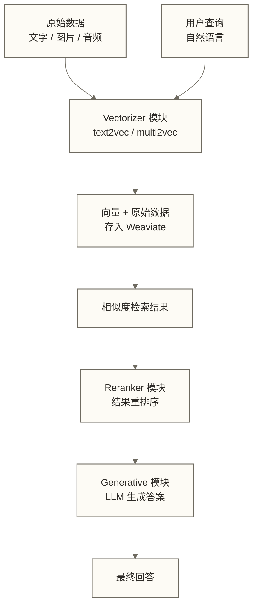
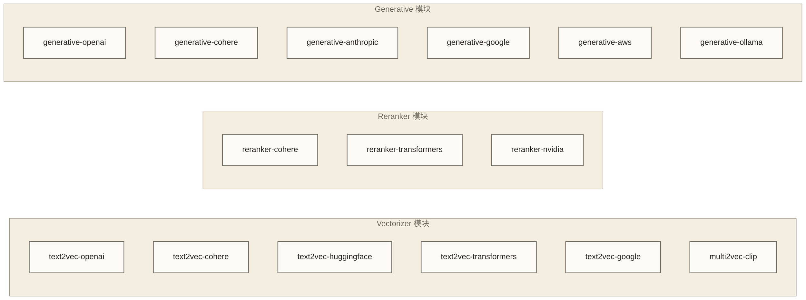
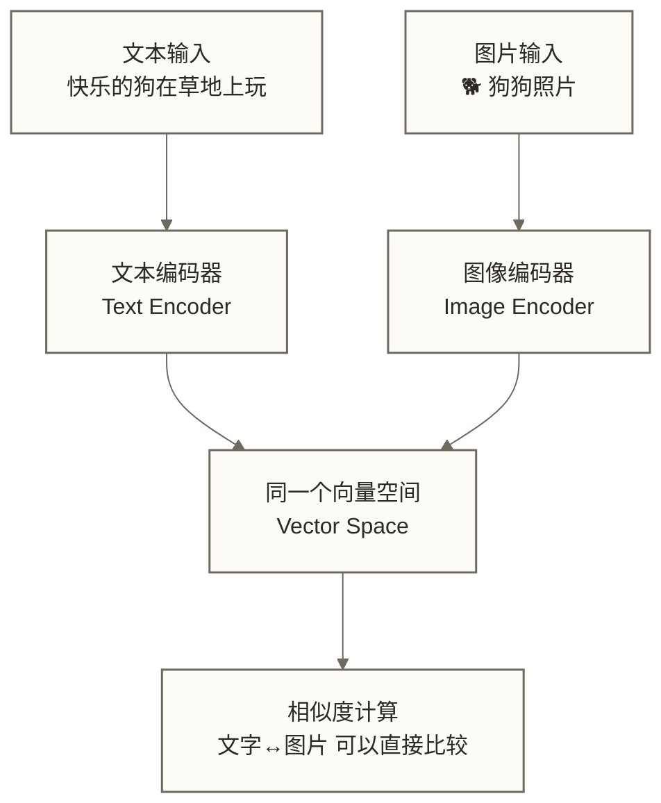
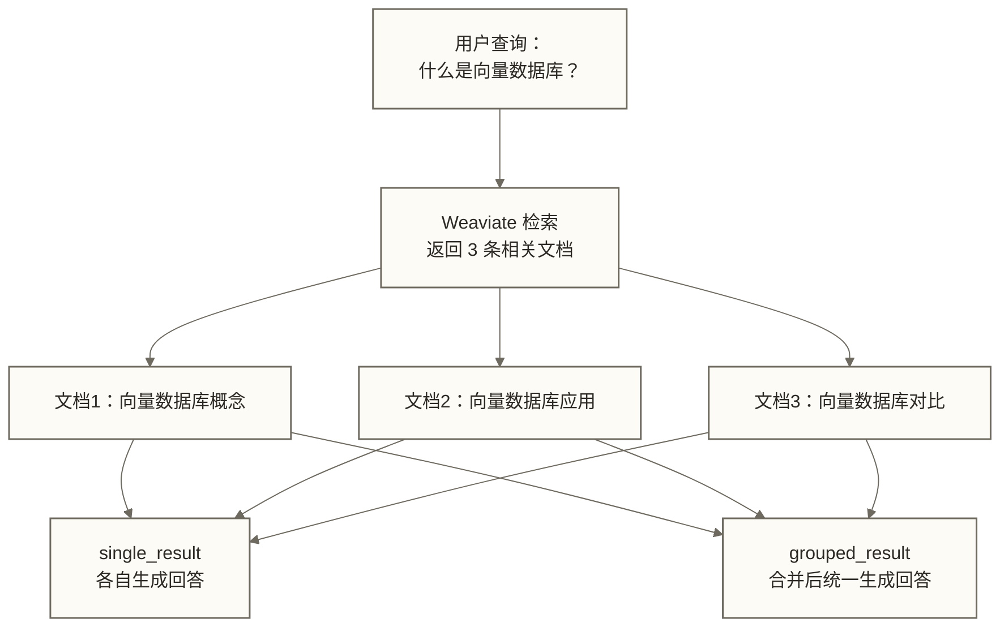
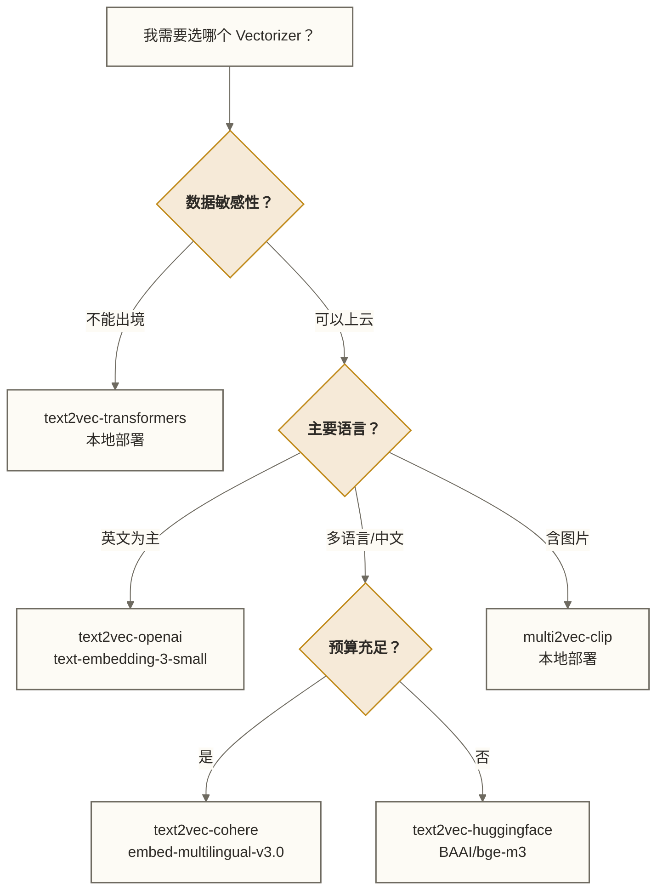
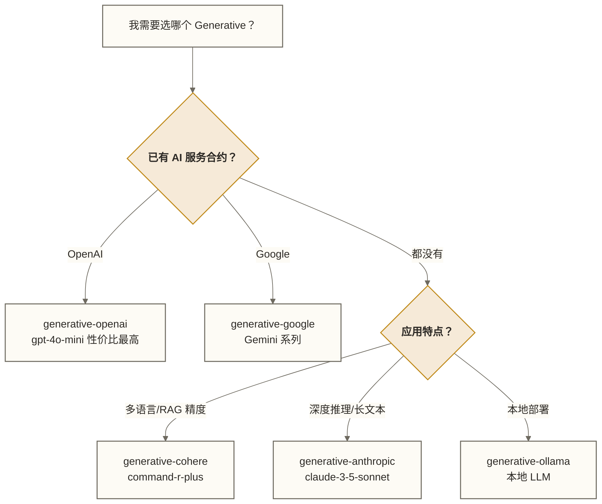

# Weaviate Modules 模块系统详解

## 为什么 Modules 是 Weaviate 最重要的设计

先说一个让人印象深刻的对比。

你用 Redis 存数据，Redis 不知道你存的是什么，它只管存取。你用 MySQL 存数据，MySQL 帮你做关系约束，但它也不"理解"你的数据。你用 Milvus 存向量，Milvus 帮你做相似度检索，但向量是你自己传进去的——它同样不知道那个向量代表什么意思。

**Weaviate 不一样。**

你把一段文字存进 Weaviate，Weaviate 会主动问：这段文字应该怎么理解？它调用内置的 Vectorizer 模块，把文字变成向量，再存起来。你要查询的时候，输入"我想找关于猫咪的内容"，Weaviate 又去调用同一个模块，把这句话变成向量，再去做相似度匹配。整个过程，你作为开发者可以完全不碰向量这个概念。

这就是 Modules 系统的核心价值：**让 Weaviate 从"存向量的地方"变成"能理解数据的地方"**。



> [!note] 模块的本质
> Weaviate 的 Module 本质上是一个**挂载在数据库流程中的服务调用钩子**。在数据写入时触发 Vectorizer，在查询返回时触发 Reranker，在最终输出时触发 Generative。这三个时机对应了数据库的三个阶段：存储、检索、生成。

---

## 目录

- [[#模块分类全景]]
- [[#Vectorizer 模块：把世界翻译成向量]]
- [[#text2vec-openai：最常用的入门选择]]
- [[#text2vec-cohere：多语言场景的首选]]
- [[#text2vec-huggingface：自由度最高的方案]]
- [[#text2vec-transformers：本地部署的王道]]
- [[#text2vec-google：Google 生态的选择]]
- [[#multi2vec-clip：让图片和文字说同一种语言]]
- [[#Generative 模块：在数据库里跑 LLM]]
- [[#generative-openai：RAG 最经典的搭档]]
- [[#generative-cohere：Command 系列的实力]]
- [[#generative-anthropic：Claude 加持的深度推理]]
- [[#Reranker 模块：让结果更精准的第二道筛选]]
- [[#模块配置实战]]
- [[#模块局限与厂商绑定风险]]
- [[#模块选型决策指南]]

---

## 模块分类全景

Weaviate 的模块分三大类，对应数据处理的三个阶段。用一个餐厅的比喻来理解：

| 阶段 | 模块类型 | 餐厅类比 | 主要代表 |
|------|----------|---------|---------|
| 存储时 | **Vectorizer** | 厨师把食材加工成料理（把原始数据变成向量） | text2vec-openai, multi2vec-clip |
| 检索后 | **Reranker** | 品鉴师对菜品重新排序（对结果重新打分） | reranker-cohere, reranker-transformers |
| 输出时 | **Generative** | 服务员把菜品组合成套餐并写菜单（LLM 生成答案） | generative-openai, generative-anthropic |



> [!tip] Weaviate v1.33 之后的变化
> 从 Weaviate v1.33 开始，**所有基于 API 的模块默认已启用**，不再需要在服务器启动时手动配置 `ENABLE_MODULES` 环境变量。你只需要在创建 Collection 时指定使用哪个模块，并提供对应的 API Key 即可。这大大简化了部署流程。

---

## Vectorizer 模块：把世界翻译成向量

### 核心机制

在讲具体模块之前，先把 Vectorizer 的工作原理说清楚。

想象你有一个翻译官，专门把人类语言翻译成一种"意思坐标"。这个坐标是一个几百或几千维度的数字数组。意思相近的内容，坐标就相近；意思差得远，坐标就差得远。

Vectorizer 就是这个翻译官。**text2vec 系列**专门翻译文字，**multi2vec 系列**同时能翻译文字和图片（翻译到同一个坐标空间里）。

当你向 Weaviate 写入数据时：

```text
原始文本: "快乐的小狗在公园里追球"
      ↓  Vectorizer
向量:   [0.023, -0.156, 0.891, ..., 0.342]  (假设 1536 维)
```

查询时也走同样的流程：

```text
查询语句: "狗狗玩耍"
      ↓  Vectorizer（同一个模型）
查询向量: [0.019, -0.143, 0.876, ..., 0.331]
      ↓  余弦相似度计算
最相近的文档: "快乐的小狗在公园里追球"
```

**关键点**：写入时用什么模型，查询时就必须用同一个模型。否则就像用中文问路，收到了英文回答——维度都可能不一样，根本没法比较。

---

## text2vec-openai：最常用的入门选择

### 为什么推荐入门用它

OpenAI 的 Embedding 模型（特别是 `text-embedding-3-small` 和 `text-embedding-3-large`）是目前性价比最高、最稳定的商业 Embedding API。开发者生态最完善，遇到问题最容易找到答案。

### 支持的模型

| 模型名 | 维度 | 价格（每百万 token） | 适用场景 |
|--------|------|-------------------|---------|
| `text-embedding-3-small` | 1536（可缩减） | $0.02 | 大多数场景，性价比最高 |
| `text-embedding-3-large` | 3072（可缩减） | $0.13 | 需要更高精度 |
| `text-embedding-ada-002` | 1536 | $0.10 | 旧项目兼容，不推荐新项目 |

> [!tip] 维度缩减（Matryoshka Embeddings）
> `text-embedding-3` 系列支持**维度缩减**——你可以尝试将 3072 维的向量缩减到 256 维或模型支持的其他维度；精度变化取决于数据、任务和所选维度，应通过实际检索评估判断。这就像俄罗斯套娃，外层包含内层的信息。这在存储成本和检索速度之间提供了灵活的权衡空间。

### Collection 配置示例

```python
import weaviate
from weaviate.classes.config import Configure, Property, DataType

client = weaviate.connect_to_weaviate_cloud(
    cluster_url="YOUR_WEAVIATE_URL",
    auth_credentials=weaviate.auth.AuthApiKey("YOUR_WEAVIATE_KEY"),
    headers={
        "X-OpenAI-Api-Key": "YOUR_OPENAI_KEY"  # 把 OpenAI Key 传给 Weaviate
    }
)

# 创建使用 text2vec-openai 的 Collection
articles = client.collections.create(
    name="Article",
    vectorizer_config=Configure.Vectorizer.text2vec_openai(
        model="text-embedding-3-large",   # 指定模型
        dimensions=1024,                   # 缩减到 1024 维（可选）
    ),
    properties=[
        Property(name="title", data_type=DataType.TEXT),
        Property(name="content", data_type=DataType.TEXT),
        Property(name="author", data_type=DataType.TEXT,
                 skip_vectorization=True),  # 作者名不参与向量化
        Property(name="publish_date", data_type=DataType.DATE,
                 skip_vectorization=True),  # 日期不参与向量化
    ]
)
```

> [!warning] 注意 skip_vectorization
> 并不是所有属性都应该参与向量化。作者名、日期、ID 这类字段如果混入向量，会"污染"语义，反而降低搜索精度。养成习惯：对非语义字段设置 `skip_vectorization=True`。

### 写入数据

```python
# 写入时不需要自己生成向量，Weaviate 会自动调用 OpenAI API
with articles.batch.dynamic() as batch:
    batch.add_object(properties={
        "title": "向量数据库入门指南",
        "content": "向量数据库是专门存储和检索高维向量的数据库...",
        "author": "张三",
        "publish_date": "2025-01-15T00:00:00Z"
    })
    # 向量在后台自动生成，你完全感知不到这一步
```

### 成本估算

写入 100 万条文章（每条平均 500 token）：
- `text-embedding-3-small`：100万 × 500 / 1,000,000 × $0.02 = **$10**
- `text-embedding-3-large`：100万 × 500 / 1,000,000 × $0.13 = **$65**

查询通常每次只有几十个 token，成本可以忽略不计。

---

## text2vec-cohere：多语言场景的首选

### Cohere 的核心优势

如果你的应用需要处理多语言内容——特别是中文、日文、阿拉伯文这类非英语语言——Cohere 的 `embed-multilingual` 系列往往比 OpenAI 效果更好。

Cohere 的 Embedding 模型专门针对多语言进行了优化，能让中文"快乐的狗"和英文"happy dog"在向量空间里距离很近。这在做多语言知识库时极有价值。

### 支持的模型

| 模型名 | 维度 | 语言支持 | 适用场景 |
|--------|------|---------|---------|
| `embed-v4.0` | 1024 | 100+ 语言 | 最新旗舰，多语言最强 |
| `embed-multilingual-v3.0` | 1024 | 100+ 语言 | 多语言标准选择 |
| `embed-english-v3.0` | 1024 | 英文 | 纯英文场景 |
| `embed-multilingual-light-v3.0` | 384 | 100+ 语言 | 轻量级，速度优先 |

### Collection 配置

```python
articles = client.collections.create(
    name="MultiLangArticle",
    vectorizer_config=Configure.Vectorizer.text2vec_cohere(
        model="embed-multilingual-v3.0",
        truncate="END",       # 超长文本截断策略：END(截尾) / START(截头) / NONE(不截)
    ),
    properties=[
        Property(name="title", data_type=DataType.TEXT),
        Property(name="content", data_type=DataType.TEXT),
        Property(name="language", data_type=DataType.TEXT,
                 skip_vectorization=True),
    ],
    headers={"X-Cohere-Api-Key": "YOUR_COHERE_KEY"}
)
```

> [!note] truncate 参数很重要
> Cohere 模型有 token 限制（embed-v4.0 是 512 tokens）。`truncate` 参数决定超长文本怎么处理：
> - `END`（推荐）：保留开头，丢弃结尾——因为通常开头信息密度更高
> - `START`：保留结尾，丢弃开头
> - `NONE`：不截断，超长直接报错

### Cohere vs OpenAI 场景对比

| 维度 | text2vec-openai | text2vec-cohere |
|------|----------------|----------------|
| 多语言效果 | 良好 | 优秀（专门优化） |
| 英文效果 | 优秀 | 良好 |
| 价格 | 较便宜 | 相当 |
| 生态 | 更大 | 相对小 |
| 推荐场景 | 英文为主的应用 | 多语言应用 |

---

## text2vec-huggingface：自由度最高的方案

### 什么时候选 HuggingFace

HuggingFace Hub 上有数千个开源 Embedding 模型。如果你：
- 需要某个特定领域的专业模型（如生物医学、法律、代码）
- 想试用 SOTA 的开源模型（如 BGE、E5、GTE 系列）
- 预算有限，想用免费的 Inference API

那么 `text2vec-huggingface` 是很好的选择。

### 配置示例

```python
articles = client.collections.create(
    name="SpecializedArticle",
    vectorizer_config=Configure.Vectorizer.text2vec_huggingface(
        model="BAAI/bge-large-zh-v1.5",   # 中文最强的开源 Embedding 模型之一
        wait_for_model=True,               # 等待模型加载（冷启动时需要）
        use_cache=True,                    # 相同输入使用缓存
        use_gpu=False,                     # 是否使用 GPU 推理
    ),
    headers={"X-HuggingFace-Api-Key": "YOUR_HF_KEY"}
)
```

### 推荐的开源模型

| 模型 | 语言 | 维度 | 特点 |
|------|------|------|------|
| `BAAI/bge-large-zh-v1.5` | 中文 | 1024 | 中文最强开源之一 |
| `BAAI/bge-m3` | 多语言 | 1024 | 多语言、多功能 |
| `intfloat/multilingual-e5-large` | 多语言 | 1024 | 多语言效果稳定 |
| `sentence-transformers/all-MiniLM-L6-v2` | 英文 | 384 | 轻量快速 |

> [!warning] HuggingFace Inference API 的限制
> 免费版 HuggingFace Inference API 有速率限制，而且"冷启动"需要等待模型加载（可能几十秒）。生产环境建议购买 HuggingFace Pro 或自己部署模型服务（参考 text2vec-transformers 本地部署 方案）。

---

## text2vec-transformers：本地部署的王道

### 为什么要本地部署

前面的 OpenAI、Cohere、HuggingFace 都是调用外部 API，这意味着：
1. 你的数据要发送到第三方服务器（数据安全问题）
2. 受网络延迟影响
3. 每次写入和查询都有 API 调用成本
4. 如果 API Key 失效或外部服务宕机，依赖该服务的自动向量化写入、查询或生成可能失败；是否影响其他操作取决于模块依赖和降级设计

`text2vec-transformers` 让你在本地运行一个专门的 Embedding 服务，和 Weaviate 一起部署，完全不依赖外部 API。

### Docker Compose 部署

```yaml
# docker-compose.yml
version: '3.4'
services:
  weaviate:
    image: cr.weaviate.io/semitechnologies/weaviate:latest
    ports:
      - "8080:8080"
    environment:
      ENABLE_MODULES: 'text2vec-transformers'
      TRANSFORMERS_INFERENCE_API: 'http://t2v-transformers:8080'
      DEFAULT_VECTORIZER_MODULE: 'text2vec-transformers'
      AUTHENTICATION_ANONYMOUS_ACCESS_ENABLED: 'true'
      CLUSTER_HOSTNAME: 'node1'

  t2v-transformers:
    # 官方提供了多个预打包好的模型镜像
    image: cr.weaviate.io/semitechnologies/transformers-inference:sentence-transformers-paraphrase-multilingual-mpnet-base-v2
    environment:
      ENABLE_CUDA: '0'   # 改为 '1' 使用 GPU
```

```python
# 配置 Collection（本地模式不需要 API Key）
articles = client.collections.create(
    name="LocalArticle",
    vectorizer_config=Configure.Vectorizer.text2vec_transformers(
        pooling_strategy="masked_mean",   # 向量池化策略
    )
)
```

### 官方预打包模型镜像

| 镜像标签 | 底层模型 | 适用场景 |
|---------|---------|---------|
| `...paraphrase-multilingual-mpnet-base-v2` | MPNet 多语言 | 多语言通用 |
| `...all-MiniLM-L6-v2` | MiniLM | 轻量快速 |
| `...distilbert-base-uncased` | DistilBERT | 英文通用 |
| `...multi2vec-clip` | CLIP ViT | 图文多模态 |

> [!tip] 生产环境推荐
> 对于有数据安全要求的企业，`text2vec-transformers` 本地部署是首选。虽然初期需要更多运维工作，但长期来看，消除了对外部服务的依赖，系统更稳定。

---

## text2vec-google：Google 生态的选择

如果你已经在使用 Google Cloud 或 Vertex AI，`text2vec-google` 可以无缝对接 Google 的 Embedding 模型。

```python
articles = client.collections.create(
    name="GoogleArticle",
    vectorizer_config=Configure.Vectorizer.text2vec_google(
        project_id="your-gcp-project",
        model_id="text-embedding-004",   # Google 最新的 Embedding 模型
        api_endpoint="us-central1-aiplatform.googleapis.com",
    )
)
```

Google 的 `text-embedding-004` 模型在 MTEB 基准测试上排名靠前，768 维，支持多语言，是 Google 生态用户的自然选择。

---

## multi2vec-clip：让图片和文字说同一种语言

### 多模态向量的核心思想

这是 Weaviate 最酷的功能之一，需要好好理解它背后的思想。

想象一个翻译官，但这个翻译官不只翻译文字，还能"理解"图片——而且文字"快乐的狗"和一张"狗狗玩耍的照片"，经过这个翻译官处理后，得到的"坐标"非常接近。

这就是 **CLIP（Contrastive Language-Image Pretraining）** 模型做的事。它通过大量图文对训练，让文字和图片共享同一个向量空间。



### 实际应用场景

1. **以文搜图**：用户输入"日落时分的海滩"，找到相关图片
2. **以图搜文**：上传一张产品图，找到对应的商品描述
3. **以图搜图**：上传一张图，找视觉相似的图片
4. **跨模态推荐**：看完一篇文章，推荐视觉内容相关的图片

### Collection 配置

```python
import weaviate
from weaviate.classes.config import Configure, Property, DataType

# multi2vec-clip 需要本地部署 CLIP 推理服务
client = weaviate.connect_to_local()

media_collection = client.collections.create(
    name="MediaContent",
    vectorizer_config=Configure.Vectorizer.multi2vec_clip(
        image_fields=["image"],          # 哪些属性是图片
        text_fields=["description"],     # 哪些属性是文字
        # 可以设置权重，决定图片和文字各占多少比重
        weights=weaviate.classes.config.Multi2VecField(
            text_fields=["description"],
            image_fields=["image"],
        )
    ),
    properties=[
        Property(name="description", data_type=DataType.TEXT),
        Property(name="image", data_type=DataType.BLOB),   # 图片用 BLOB 类型
        Property(name="category", data_type=DataType.TEXT,
                 skip_vectorization=True),
    ]
)
```

### 写入图文数据

```python
import base64

def image_to_base64(image_path: str) -> str:
    with open(image_path, "rb") as f:
        return base64.b64encode(f.read()).decode("utf-8")

# 写入包含图片的数据
with media_collection.batch.dynamic() as batch:
    batch.add_object(properties={
        "description": "金毛猎犬在绿色草坪上奔跑",
        "image": image_to_base64("dog_running.jpg"),
        "category": "animals"
    })
```

### 用文字搜索图片

```python
from weaviate.classes.query import MetadataQuery

# 以文搜图——直接用文字查询
results = media_collection.query.near_text(
    query="快乐玩耍的狗",
    limit=5,
    return_metadata=MetadataQuery(distance=True)
)

for obj in results.objects:
    print(f"距离: {obj.metadata.distance}")
    print(f"描述: {obj.properties['description']}")
    # 这里拿到的就是最匹配的图片
```

> [!note] CLIP 的 Token 限制
> CLIP 模型的文本编码器有 **77 个 token** 的限制（这是 CLIP 原始架构的设计）。如果你的文字描述太长，超出的部分会被截断。建议保持描述简洁，或者结合 text2vec 模块处理长文本。

### Docker Compose 部署 CLIP 服务

```yaml
version: '3.4'
services:
  weaviate:
    image: cr.weaviate.io/semitechnologies/weaviate:latest
    environment:
      ENABLE_MODULES: 'multi2vec-clip'
      MULTI2VEC_CLIP_INFERENCE_API: 'http://multi2vec-clip:8080'

  multi2vec-clip:
    image: cr.weaviate.io/semitechnologies/multi2vec-clip:sentence-transformers-clip-ViT-B-32
    environment:
      ENABLE_CUDA: '0'
```

---

## Generative 模块：在数据库里跑 LLM

### 这是一种什么体验

普通数据库的工作流程：查数据库 → 拿到结果 → 自己调用 LLM → 整合生成答案。

Weaviate + Generative 模块的工作流程：查数据库 → Weaviate 自动调用 LLM → 直接拿到答案。

这看起来像是把两步合并成一步，但实际上不止于此。Weaviate 的 Generative 模块有两种模式，理解这两种模式是用好 RAG 的关键。

### singleResult vs groupedResult

| 模式 | 行为 | 类比 |
|------|------|------|
| `generate.single_result` | 对每条检索结果单独生成一段回答 | 给每道菜单独写一段评价 |
| `generate.grouped_result` | 把所有检索结果合并，让 LLM 综合生成一个回答 | 把所有菜合起来，写一篇整体测评 |



---

## generative-openai：RAG 最经典的搭档

### 配置方式

```python
articles = client.collections.create(
    name="ArticleWithRAG",
    vectorizer_config=Configure.Vectorizer.text2vec_openai(
        model="text-embedding-3-small",
    ),
    # 同时配置 Generative 模块
    generative_config=Configure.Generative.openai(
        model="gpt-4o-mini",   # 或 "gpt-4o", "gpt-4-turbo"
        temperature=0.7,       # 控制采样随机性；较低值通常更集中，但 0 不保证输出完全确定
        max_tokens=500,        # 最大生成 token 数
    )
)
```

### grouped_result：最常用的 RAG 模式

```python
# 检索相关文档，然后让 GPT-4 综合回答
response = articles.generate.near_text(
    query="向量数据库和关系型数据库有什么区别",
    limit=3,
    grouped_task="根据以下检索到的文章，用简洁的语言回答：向量数据库和关系型数据库的核心区别是什么？"
)

# 拿到的是 LLM 综合所有文档后生成的回答
print(response.generated)
# 输出示例：
# "向量数据库和关系型数据库的核心区别在于数据表示方式和查询逻辑...
#  关系型数据库以结构化表格存储，通过精确匹配查询...
#  而向量数据库以高维向量存储，通过相似度来查询..."

# 也能看到支持这个回答的原始文档
for obj in response.objects:
    print(f"来源：{obj.properties['title']}")
```

### single_result：对每条结果单独处理

```python
# 让 GPT 为每篇文章单独生成一句摘要
response = articles.generate.near_text(
    query="数据架构最佳实践",
    limit=5,
    single_prompt="请用一句话总结这篇文章的核心观点：{content}"
)

# 每条结果都有自己的生成内容
for obj in response.objects:
    print(f"文章：{obj.properties['title']}")
    print(f"摘要：{obj.generated}")   # 每条独立的生成结果
    print("---")
```

> [!tip] 占位符 `{property_name}` 的用法
> 在 `single_prompt` 中，你可以用 `{属性名}` 引用文档的具体属性。比如 `"请翻译这段内容：{content}"` 会自动把每条文档的 `content` 属性填入提示词。这是 Weaviate 生成式搜索的一个实用技巧。

---

## generative-cohere：Command 系列的实力

Cohere 的 Command 系列模型在长文本理解和结构化输出方面有独特优势。

```python
articles = client.collections.create(
    name="ArticleCohere",
    vectorizer_config=Configure.Vectorizer.text2vec_cohere(
        model="embed-multilingual-v3.0",
    ),
    generative_config=Configure.Generative.cohere(
        model="command-r-plus",      # Cohere 最强的 RAG 模型
        temperature=0.3,
        max_tokens=800,
        k=5,                         # top-k 采样参数
        p=0.75,                      # nucleus 采样参数
    )
)
```

### Cohere 可用的生成模型

| 模型 | 特点 | 适用场景 |
|------|------|---------|
| `command-r-plus` | 最强，专为 RAG 优化 | 复杂推理、多跳问答 |
| `command-r` | 平衡性能和成本 | 标准 RAG 应用 |
| `command-light` | 轻量快速 | 简单问答，延迟敏感 |

> [!note] command-r-plus 的 RAG 优化
> Cohere 的 command-r-plus 是专门针对 RAG 场景训练的模型，它能更好地区分"检索到的内容"和"自身知识"，减少幻觉。如果你的应用高度依赖检索结果的准确性，这个模型值得考虑。

---

## generative-anthropic：Claude 加持的深度推理

Anthropic 的 Claude 系列以长文本理解能力和指令遵循能力著称，特别适合需要深度分析和推理的场景。

### 配置示例

```python
articles = client.collections.create(
    name="ArticleClaude",
    vectorizer_config=Configure.Vectorizer.text2vec_openai(
        model="text-embedding-3-small",
    ),
    generative_config=Configure.Generative.anthropic(
        model="claude-3-5-sonnet-20241022",   # 或 claude-3-5-haiku, claude-3-opus
        temperature=0.5,
        max_tokens=1024,
    )
)
```

### Claude 模型选择

| 模型 | 特点 | 价格层级 |
|------|------|---------|
| `claude-3-5-sonnet-20241022` | 最强性价比，推理能力强 | 中等 |
| `claude-3-5-haiku-20241022` | 速度最快，成本最低 | 低 |
| `claude-3-opus-20240229` | 最强能力，复杂推理 | 高 |

### 跨厂商混搭的常见模式

一个有趣的搭配：用 Cohere Embedding 做多语言向量化，用 Claude 做生成推理。

```python
# 多语言知识库 + Claude 推理
multilang_qa = client.collections.create(
    name="MultiLangQA",
    # Cohere 负责向量化（多语言强）
    vectorizer_config=Configure.Vectorizer.text2vec_cohere(
        model="embed-multilingual-v3.0",
    ),
    # Claude 负责生成（推理能力强）
    generative_config=Configure.Generative.anthropic(
        model="claude-3-5-sonnet-20241022",
        temperature=0.3,
    )
)
```

---

## Reranker 模块：让结果更精准的第二道筛选

### 为什么需要 Reranker

向量搜索有一个固有局限：它衡量的是"语义相似度"，但相似不等于相关。

举个例子：用户问"如何防止数据泄露"，向量搜索可能返回一篇关于"数据安全重要性"的文章（语义相似），但用户真正想要的是"具体的防护措施"（相关但不那么"相似"）。

Reranker 解决这个问题。它在向量搜索之后，用一个更复杂（但更慢）的模型对结果重新打分和排序，让真正相关的结果排到最前面。

```mermaid
%%{init: {"theme":"base","themeVariables":{"fontFamily":"PingFang SC, -apple-system, Source Han Serif SC, serif","fontSize":"16px","background":"#FDFBF5","primaryColor":"#FDFBF5","primaryTextColor":"#2D2A26","primaryBorderColor":"#6E6A60","secondaryColor":"#E8EFE8","secondaryBorderColor":"#8FA890","secondaryTextColor":"#2D2A26","tertiaryColor":"#FDFBF5","tertiaryBorderColor":"#9A9488","tertiaryTextColor":"#6E6A60","lineColor":"#6E6A60","textColor":"#2D2A26","mainBkg":"#FDFBF5","nodeBorder":"#2D5A3D","clusterBkg":"#F3EEDF","clusterBorder":"#9A9488","edgeLabelBackground":"#FDFBF5"},"flowchart":{"htmlLabels":true,"curve":"basis","padding":20,"nodeSpacing":60,"rankSpacing":70,"useMaxWidth":false},"themeCSS":".node rect, .node polygon, .node circle { stroke-width: 1.5px; } .edgePath .path { stroke-width: 1.5px; } .cluster-label .nodeLabel, .cluster-label foreignObject { color: #2D2A26 !important; } .edgeLabel, .edgeLabel foreignObject { color: #2D2A26 !important; background-color: #FDFBF5; } .edgeLabel rect { fill: #FDFBF5; }"}}%%
graph LR
    classDef default fill:#FDFBF5,stroke:#6E6A60,color:#2D2A26,stroke-width:1.5px
    classDef startend fill:#2D2A26,stroke:#2D2A26,color:#FDFBF5,font-weight:bold
    classDef decision fill:#F6EAD8,stroke:#C08A1A,color:#2D2A26,font-weight:bold
    classDef hub fill:#3B5A80,stroke:#3B5A80,color:#FDFBF5,font-weight:bold
    classDef io fill:#E5EAF0,stroke:#3B5A80,color:#2D2A26
    classDef accent fill:#A6432C,stroke:#A6432C,color:#FDFBF5,font-weight:bold
    classDef storage fill:#F3EEDF,stroke:#9A9488,color:#2D2A26
    Q["用户查询"] --> VS["向量搜索<br/>召回 Top-100"]
    VS --> RR["Reranker<br/>重新评分"]
    RR --> FR["最终结果<br/>Top-10，更精准"]
    class Q,VS,RR,FR default
```



这是一个典型的"粗排 → 精排"两阶段架构：
- **粗排**（向量搜索）：速度快，从海量数据中快速召回候选集
- **精排**（Reranker）：精度高，对候选集进行精细评分

### reranker-cohere

```python
from weaviate.classes.config import Configure

articles = client.collections.create(
    name="ArticleRerank",
    vectorizer_config=Configure.Vectorizer.text2vec_openai(),
    reranker_config=Configure.Reranker.cohere(
        model="rerank-v3.5",   # Cohere 最新 Reranker 模型
    )
)
```

使用时：

```python
from weaviate.classes.query import Rerank, MetadataQuery

response = articles.query.near_text(
    query="数据库性能优化最佳实践",
    limit=10,           # 向量搜索先召回 10 条
    rerank=Rerank(
        prop="content", # 对哪个属性做重排序
        query="如何优化数据库查询速度",  # 重排序的查询（可以更精细）
    ),
    return_metadata=MetadataQuery(score=True)   # 返回 Reranker 评分
)

for obj in response.objects:
    print(f"重排分: {obj.metadata.rerank_score}")
    print(f"标题: {obj.properties['title']}")
```

### reranker-transformers：本地部署版

如果不想依赖外部 API，可以部署本地 Reranker：

```yaml
# docker-compose.yml 添加
  reranker-transformers:
    image: cr.weaviate.io/semitechnologies/reranker-transformers:cross-encoder-ms-marco-MiniLM-L-6-v2
    environment:
      ENABLE_CUDA: '0'
```

```python
articles = client.collections.create(
    name="LocalRerank",
    reranker_config=Configure.Reranker.transformers()
)
```

---

## 模块配置实战

### Vectorizer、Generative 与 Reranker 的组合配置示例

下面是一个综合了 Vectorizer + Generative + Reranker 的 Collection 配置示例，可作为企业知识库的配置起点，但不包含完整的生产部署、安全与故障处理方案：

```python
import weaviate
from weaviate.classes.config import Configure, Property, DataType

client = weaviate.connect_to_weaviate_cloud(
    cluster_url="YOUR_CLUSTER_URL",
    auth_credentials=weaviate.auth.AuthApiKey("YOUR_WEAVIATE_KEY"),
    headers={
        "X-OpenAI-Api-Key": "YOUR_OPENAI_KEY",
        "X-Cohere-Api-Key": "YOUR_COHERE_KEY",
    }
)

knowledge_base = client.collections.create(
    name="EnterpriseKB",

    # === Vectorizer ===
    # 用 OpenAI 做向量化（中英文混合场景的好选择）
    vectorizer_config=Configure.Vectorizer.text2vec_openai(
        model="text-embedding-3-large",
        dimensions=1536,
    ),

    # === Generative ===
    # 用 GPT-4o-mini 做生成（成本和能力的平衡点）
    generative_config=Configure.Generative.openai(
        model="gpt-4o-mini",
        temperature=0.3,      # 知识库场景要降低随机性
        max_tokens=800,
    ),

    # === Reranker ===
    # 用 Cohere Reranker 做精排（效果非常好）
    reranker_config=Configure.Reranker.cohere(
        model="rerank-v3.5",
    ),

    # === Properties ===
    properties=[
        Property(
            name="title",
            data_type=DataType.TEXT,
            description="文档标题"
        ),
        Property(
            name="content",
            data_type=DataType.TEXT,
            description="文档正文"
        ),
        Property(
            name="source",
            data_type=DataType.TEXT,
            skip_vectorization=True,   # 来源不参与向量化
            description="文档来源"
        ),
        Property(
            name="doc_type",
            data_type=DataType.TEXT,
            skip_vectorization=True,
            description="文档类型：FAQ/Manual/Article"
        ),
        Property(
            name="created_at",
            data_type=DataType.DATE,
            skip_vectorization=True,
            description="创建时间"
        ),
    ]
)

print("知识库 Collection 创建成功！")
```

### 动态修改模块配置（v1.25+ 支持）

从 Weaviate v1.25 开始，Generative 和 Reranker 的配置可以在线修改，不需要重建 Collection：

```python
# 把 Generative 模块从 GPT-4o-mini 升级到 GPT-4o
articles = client.collections.get("EnterpriseKB")
articles.config.update(
    generative_config=Configure.Generative.openai(
        model="gpt-4o",           # 升级模型
        temperature=0.2,
        max_tokens=1200,
    )
)
print("Generative 模块已升级！")
```

> [!warning] Vectorizer 不能修改
> 注意：**Vectorizer 模块一旦设置，无法更改**。因为修改 Vectorizer 意味着所有已存储的向量都需要重新生成，这本质上是重建整个 Collection。如果要换 Vectorizer，需要创建新 Collection 并迁移数据。

---

## 模块局限与厂商绑定风险

### 最真实的风险场景

用了 Weaviate Modules，你实际上是在告诉 Weaviate：我的数据库依赖 OpenAI API。这意味着：

**场景1：OpenAI API Key 失效**
```text
你的 Weaviate 实例 → 调用 text2vec-openai → OpenAI API
                                           ↓
                              API Key 失效！400 错误
                                           ↓
                         新数据写入失败（无法生成向量）
                         查询也失败（无法向量化查询词）
```

**场景2：OpenAI 提价或模型下线**
- `text-embedding-ada-002` 已于 2024 年进入"遗留"状态
- 如果你用它建了数据库，现在需要迁移到新模型，意味着所有数据重新向量化

**场景3：模型版本不一致（假设性风险示例，不表示厂商已发生下述更新）**
- 你用 `text-embedding-3-small` v1 建库
- OpenAI 悄悄更新了模型权重
- 新版本生成的向量和旧版本有细微差异
- 查询质量莫名其妙变差了

### 降低厂商绑定风险的策略

**策略1：优先选择本地模型**

```python
# 如果安全性要求高，用本地 transformers
vectorizer_config=Configure.Vectorizer.text2vec_transformers()
# 向量由本机生成，不依赖任何外部服务
```

**策略2：使用 custom vectors（手动管理向量）**

```python
# 不使用任何 Vectorizer 模块
articles = client.collections.create(
    name="ManualVectors",
    vectorizer_config=Configure.Vectorizer.none(),  # 关闭自动向量化
    properties=[...]
)

# 自己生成向量再写入
import openai
oai = openai.OpenAI()

response = oai.embeddings.create(
    model="text-embedding-3-small",
    input="这是要向量化的文本"
)
vector = response.data[0].embedding

# 手动传入向量
articles.data.insert(
    properties={"title": "文章标题", "content": "..."},
    vector=vector   # 手动传入
)
```

这种方式向量生成逻辑在你自己的代码里，换模型时只需修改向量生成部分，不需要重建 Collection（但历史数据仍需重新向量化）。

**策略3：保持 Weaviate 版本稳定**

```yaml
# 锁定具体版本，不要用 :latest
image: cr.weaviate.io/semitechnologies/weaviate:1.28.4
```

**策略4：建立 API Key 轮换机制**

```python
# 在请求级别而不是全局传入 API Key
# 这样可以轮换而不需要重启 Weaviate
response = articles.query.near_text(
    query="搜索内容",
    headers={"X-OpenAI-Api-Key": get_current_key()}  # 动态获取 key
)
```

### 厂商绑定风险矩阵

| 模块 | 绑定程度 | 迁移成本 | 推荐缓解方案 |
|------|---------|---------|------------|
| Vectorizer | 高（历史数据需重建） | 高 | 本地部署 or 手动管理向量 |
| Generative | 低（只影响查询） | 低 | 可在线切换模型 |
| Reranker | 低（只影响排序） | 低 | 可在线切换或禁用 |

> [!warning] 核心结论
> Vectorizer 是绑定风险最高的模块，因为它决定了存储的向量格式。在选型时，优先考虑稳定的模型（主流厂商的长期支持模型），并评估是否需要本地部署来规避外部依赖风险。

---

## 模块选型决策指南

### 快速决策流程





### 成本对比总结

| 场景 | 推荐组合 | 月成本估算（100万文档，1万查询/天） |
|------|---------|--------------------------------|
| 创业产品 | text2vec-openai-small + generative-openai-mini | ~$50-100/月 |
| 企业应用 | text2vec-openai-large + generative-openai + reranker-cohere | ~$200-500/月 |
| 多语言应用 | text2vec-cohere-multilingual + generative-cohere-r-plus | ~$300-600/月 |
| 数据安全 | text2vec-transformers + generative-ollama（本地） | 硬件成本，无 API 费用 |

---

## 小结

Weaviate 的 Modules 系统是它区别于其他向量数据库的核心特性。通过把 Vectorizer、Generative、Reranker 三类模块嵌入数据库的不同阶段，Weaviate 让开发者可以用更少的代码实现更完整的 AI 应用流程。

但这个优势也带来了代价：厂商绑定风险，特别是 Vectorizer 一旦确定就很难更换。在实际选型中，需要在"开发便利性"和"架构灵活性"之间做出权衡。

**下一步推荐阅读**：
- 搜索与查询详解 — 学会用 near_text、hybrid 等查询方式充分发挥模块能力
- 数据模型与Schema设计 — 了解如何设计好的 Collection 结构
- [[【技术与工具】/向量数据库/00-向量数据库选型指南|向量数据库选型指南]] — 从更高维度看 Weaviate 的位置

#Weaviate #向量数据库 #Modules #text2vec #Vectorizer #Generative #Reranker #RAG #多模态
