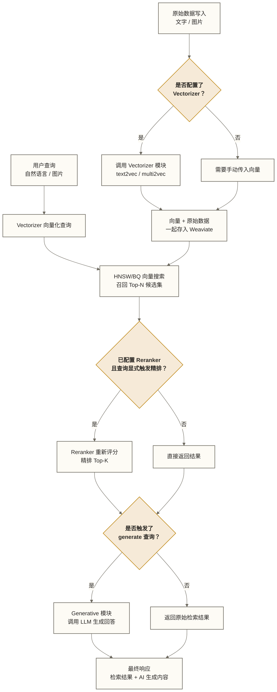
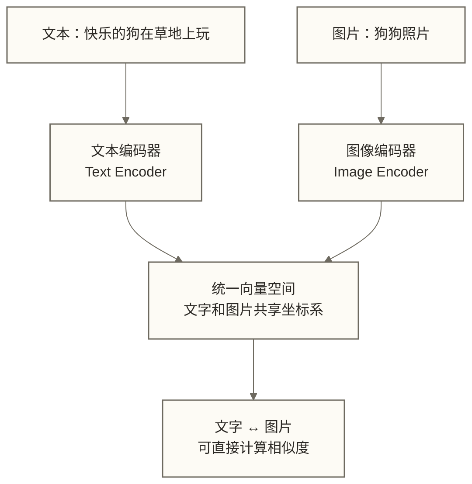
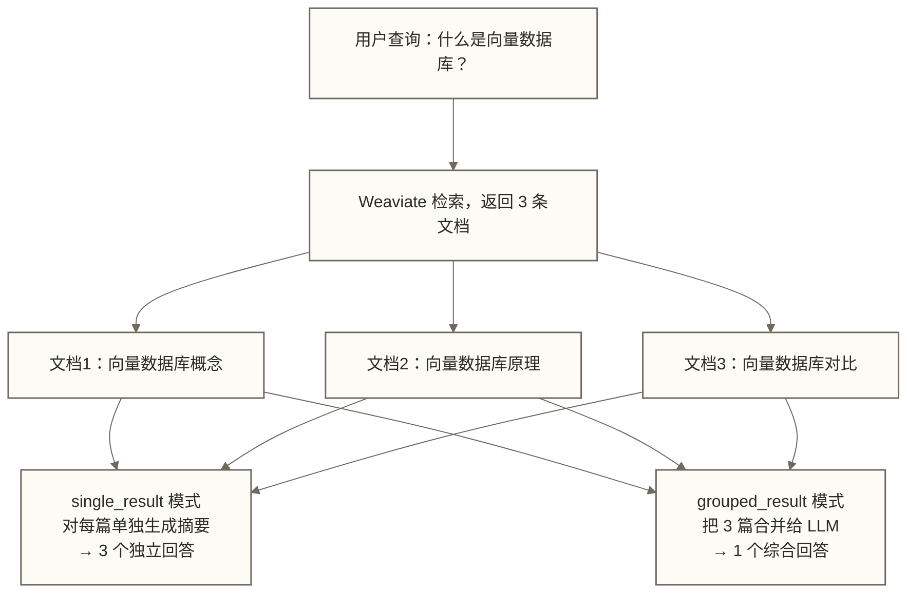
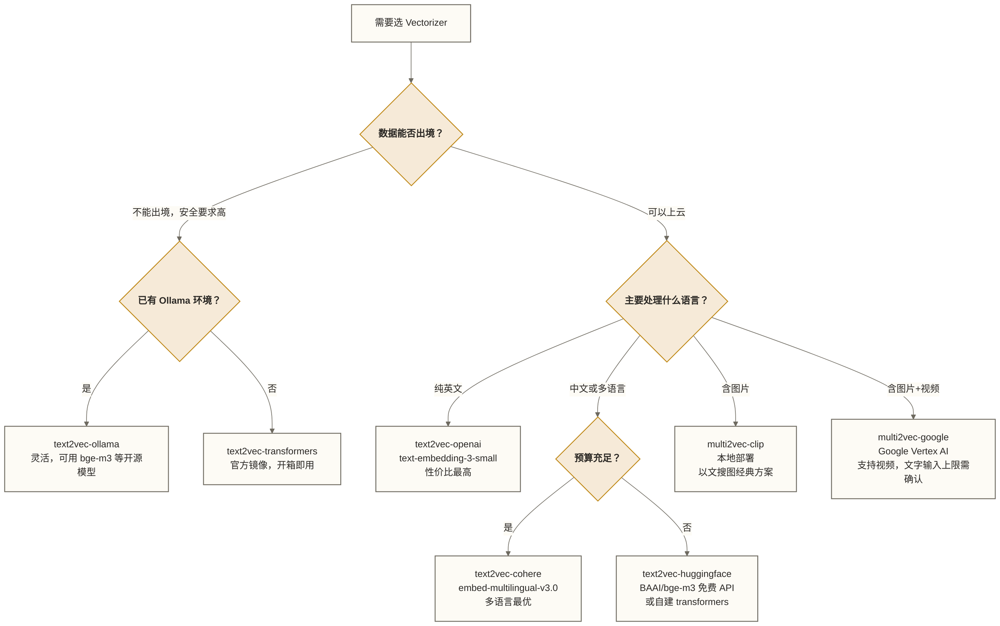
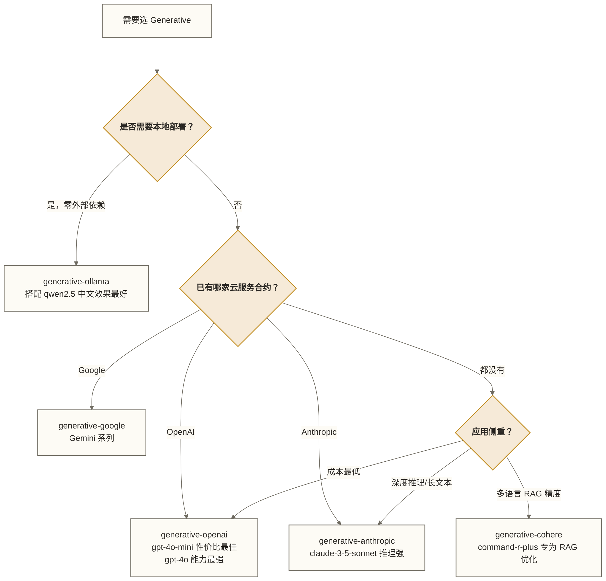

# Weaviate Modules 系统详解

> [!abstract] 本文核心目标
> Modules 系统是 Weaviate 与 Milvus、Qdrant 最根本的差异所在，也是"AI-Native"这个标签的具体体现。
>
> 读完本文，你将能够：
> 1. 理解 Modules 系统的设计哲学，知道"为什么"而不只是"怎么做"
> 2. 掌握 text2vec 全系列模块的配置方式和选型逻辑
> 3. 会配置 multi2vec-clip 实现以文搜图的多模态检索
> 4. 能在查询中直接触发 LLM 生成答案（内置 RAG）
> 5. 理解 Rerank 的原理并知道什么时候需要它
> 6. 根据实际场景做出合理的模块组合选型决策

---

## 目录

- [[#Modules 系统的设计哲学]]
- [[#模块分类与生命周期]]
- [[#text2vec 系列：把文字翻译成向量]]
  - [[#text2vec-openai]]
  - [[#text2vec-cohere]]
  - [[#text2vec-huggingface]]
  - #text2vec-transformers 本地模型重点
  - [[#text2vec-ollama 本地 LLM 生态]]
  - [[#text2vec-google]]
- [[#multi2vec 系列：多模态向量化]]
  - [[#multi2vec-clip]]
  - [[#multi2vec-google]]
- [[#generative 系列：内置 RAG]]
  - [[#generative-openai]]
  - [[#generative-cohere]]
  - [[#generative-ollama 本地 LLM]]
- [[#rerank 系列：精排的价值]]
  - [[#rerank-cohere]]
  - [[#rerank-transformers]]
- [[#全本地栈：零成本部署方案]]
- [[#模块选型决策指南]]
- [[#常见配置错误与排查]]

---

## Modules 系统的设计哲学

### 其他向量数据库的工作方式

在理解 Weaviate 的设计之前，先看看其他向量数据库是怎么做的。

用 Milvus 或 Qdrant 搭一个语义搜索应用，在下面这种由应用侧编排的方案中，你的代码负责四个步骤：

```text
你的代码负责：
  1. 调用 OpenAI/Cohere API → 生成向量
  2. 把向量存入数据库
  3. 查询时把问题也向量化
  4. 把搜索结果传给 LLM 生成答案

数据库只负责：
  存储向量、计算相似度
```

这意味着**数据库不理解数据**。它只知道一堆数字。向量的含义、数据的语义——这些完全在数据库之外，由你的应用代码管理。

### Weaviate 的选择

Weaviate 做了一个激进的设计选择：**把向量化逻辑内置到数据库本身**。

```text
Weaviate 负责：
  1. 你写入文字 → 自动调用配置好的向量化模块 → 生成并存储向量
  2. 你输入查询 → 自动向量化 → 检索 → 可选精排 → 可选 LLM 生成

你的代码只需要：
  写入原始数据、输入查询语句、读取结果
```

结果是什么？你可以完全不碰"向量"这个概念，写出一个完整的语义搜索 + RAG 应用。

> [!note] 模块的本质定义
> Weaviate 的 Module 是**挂载在数据库核心流程中的服务调用钩子**。它在特定的时机（写入、检索后、输出前）被触发，调用外部服务或本地服务，对数据进行转换和增强。模块并不改变数据库的底层存储结构，而是在数据流的关键节点插入处理逻辑。

### 这个设计的代价

这种便利性不是免费的。内置模块意味着：

- **Vectorizer 绑定风险**：一旦用 text2vec-openai 建了库，切换到其他模型需要重建全部向量
- **运维复杂度**：本地模块（text2vec-transformers、multi2vec-clip）需要额外维护 inference 容器
- **调试难度**：错误可能发生在数据库内部的模块调用链中，比直接调用 API 更难追踪

理解这个取舍，是用好 Weaviate 的前提。

---

## 模块分类与生命周期

### 三大类模块

| 阶段 | 模块类型 | 触发时机 | 核心问题 | 代表模块 |
|------|----------|---------|---------|---------|
| 数据写入 | **Vectorizer** | INSERT/UPDATE 时 | 这段数据意味着什么？ | text2vec-*, multi2vec-* |
| 检索后 | **Reranker** | 向量搜索返回候选集后 | 这些候选结果哪个最相关？ | rerank-cohere, rerank-transformers |
| 最终输出 | **Generative** | 组装最终响应时 | 用这些检索结果能回答什么问题？ | generative-openai, generative-ollama |

### 完整的数据流



> [!tip] 模块是可选的
> 三类模块都是可选的。你可以只用 Vectorizer（最常见），或者三个都用（完整 RAG 管道），也可以不用任何模块（手动管理向量）。Weaviate 的灵活性在于：你可以按需组合。

---

## text2vec 系列：把文字翻译成向量

### 核心工作原理

在介绍具体模块前，先把底层机制说清楚。

所有 text2vec 模块做的事情本质上相同：把一段文字映射到高维空间中的一个点（向量）。语义相近的文字，在这个空间里的距离更近。

```text
文本 A: "快乐的小狗在公园追球"   →  [0.023, -0.156, 0.891, ...]  (1536维)
文本 B: "狗狗在草地上玩耍"       →  [0.019, -0.143, 0.876, ...]  (1536维)
文本 C: "股票市场今日大涨"       →  [-0.312, 0.567, -0.234, ...]

A 和 B 的余弦相似度 ≈ 0.96（非常近）
A 和 C 的余弦相似度 ≈ 0.12（非常远）
```

一个关键约束：**写入时用什么模型，查询时必须用同一模型**。不同模型的向量空间不兼容，就像不能用中文地图导航英文城市。

---

### text2vec-openai

> [!tip] 最适合入门的选择
> 文档完善、生态最大、稳定性最好。中英文混合场景的首选。

#### 支持的模型

| 模型 | 维度 | 定价（每百万 token） | 推荐场景 |
|------|------|-------------------|----|
| `text-embedding-3-small` | 1536（可缩减至 512） | $0.02 | 绝大多数场景，最佳性价比 |
| `text-embedding-3-large` | 3072（可缩减至 256） | $0.13 | 高精度需求 |
| `text-embedding-ada-002` | 1536 | $0.10 | 历史项目兼容，新项目不推荐 |

> [!note] Matryoshka Embeddings（维度缩减）
> `text-embedding-3` 系列支持把高维向量压缩到更小维度，且精度损失极小。比如把 3072 维缩减到 1024 维，在数值类型不变时，单条向量的原始数值存储量约减少 67%，但数据库总存储成本不一定同比下降。检索速度与精度变化取决于数据、索引及任务；若以精度下降约 2-3% 作为方案假设，应通过实际评测验证，不能将其视为通用结果或据此断言该能力为 OpenAI 独有。

#### Collection 配置

```python
import weaviate
from weaviate.classes.config import Configure, Property, DataType

client = weaviate.connect_to_weaviate_cloud(
    cluster_url="YOUR_WEAVIATE_URL",
    auth_credentials=weaviate.auth.AuthApiKey("YOUR_WEAVIATE_KEY"),
    headers={
        "X-OpenAI-Api-Key": "YOUR_OPENAI_KEY"
    }
)

articles = client.collections.create(
    name="Article",
    vectorizer_config=Configure.Vectorizer.text2vec_openai(
        model="text-embedding-3-large",
        dimensions=1024,      # 缩减维度（可选）
    ),
    properties=[
        Property(name="title", data_type=DataType.TEXT),
        Property(name="content", data_type=DataType.TEXT),
        Property(
            name="author",
            data_type=DataType.TEXT,
            skip_vectorization=True   # 作者名不参与语义向量化
        ),
        Property(
            name="publish_date",
            data_type=DataType.DATE,
            skip_vectorization=True   # 日期字段同样不参与
        ),
    ]
)
```

> [!warning] skip_vectorization 很重要
> 养成习惯：对 ID、日期、状态标识、分类标签等非语义字段设置 `skip_vectorization=True`。这些字段混入向量会"稀释"语义，降低搜索精度。只有真正承载语义的文字字段才需要参与向量化。

#### 写入数据（无需手动生成向量）

```python
with articles.batch.dynamic() as batch:
    batch.add_object(properties={
        "title": "向量数据库入门指南",
        "content": "向量数据库是专门存储和检索高维向量的数据库系统...",
        "author": "张三",
        "publish_date": "2025-01-15T00:00:00Z"
    })
    # Weaviate 在后台自动调用 OpenAI API 生成向量
    # 对开发者完全透明
```

#### 成本估算参考

写入 100 万条文章（每条平均 500 token）：
- `text-embedding-3-small`：$10
- `text-embedding-3-large`：$65

查询成本可忽略（每次查询通常只有几十个 token）。

---

### text2vec-cohere

> [!tip] 多语言场景首选
> 如果应用需要处理中文、日文、阿拉伯文等多语言内容，Cohere 的多语言模型往往优于 OpenAI。

Cohere Embed 系列专门针对多语言对齐进行训练，能让中文"快乐的狗"和英文"happy dog"在向量空间里距离接近，跨语言语义检索效果显著优于 OpenAI。

#### 支持的模型

| 模型 | 维度 | 语言支持 | 适用场景 |
|------|------|---------|--------|
| `embed-v4.0` | 1024 | 100+ 语言 | 最新旗舰，综合最优 |
| `embed-multilingual-v3.0` | 1024 | 100+ 语言 | 多语言稳定选择 |
| `embed-english-v3.0` | 1024 | 英文 | 纯英文场景 |
| `embed-multilingual-light-v3.0` | 384 | 100+ 语言 | 轻量，速度优先 |

#### Collection 配置

```python
articles = client.collections.create(
    name="MultiLangArticle",
    vectorizer_config=Configure.Vectorizer.text2vec_cohere(
        model="embed-multilingual-v3.0",
        truncate="END",    # 超长文本的截断策略
    ),
    properties=[
        Property(name="title", data_type=DataType.TEXT),
        Property(name="content", data_type=DataType.TEXT),
        Property(
            name="language",
            data_type=DataType.TEXT,
            skip_vectorization=True
        ),
    ],
    headers={"X-Cohere-Api-Key": "YOUR_COHERE_KEY"}
)
```

> [!note] truncate 参数
> Cohere 模型有 512 token 的输入限制。`truncate` 决定超长文本的处理方式：
> - `END`（推荐）：保留开头，截去结尾。因为通常开头信息密度更高
> - `START`：保留结尾，截去开头
> - `NONE`：超长直接报错
>
> 生产环境建议在写入前自行切块（chunking），不依赖数据库的截断策略。

---

### text2vec-huggingface

HuggingFace Hub 上有数千个开源 Embedding 模型，`text2vec-huggingface` 通过调用 HuggingFace Inference API（云端托管）来使用这些模型。

适合场景：需要特定领域模型（生物医学、法律、代码）、想试用 SOTA 开源模型（BGE、E5、GTE 系列）、预算有限想用免费 API。

#### 推荐的开源模型

| 模型 | 语言 | 维度 | 特点 |
|------|------|------|------|
| `BAAI/bge-large-zh-v1.5` | 中文 | 1024 | 中文开源最强之一 |
| `BAAI/bge-m3` | 多语言 | 1024 | 多语言、多功能（密集+稀疏+多向量） |
| `intfloat/multilingual-e5-large` | 多语言 | 1024 | 效果稳定，工业界常用 |
| `sentence-transformers/all-MiniLM-L6-v2` | 英文 | 384 | 轻量快速，适合测试 |

#### 配置示例

```python
articles = client.collections.create(
    name="ChineseArticle",
    vectorizer_config=Configure.Vectorizer.text2vec_huggingface(
        model="BAAI/bge-large-zh-v1.5",
        wait_for_model=True,    # 等待冷启动（免费 API 模型需要预热）
        use_cache=True,         # 相同输入使用缓存
        use_gpu=False,
    ),
    headers={"X-HuggingFace-Api-Key": "YOUR_HF_KEY"}
)
```

> [!warning] 免费 HuggingFace Inference API 的限制
> 免费版有速率限制，冷启动可能需要等待 30-60 秒。生产环境建议：
> 1. 购买 HuggingFace Pro 账户提升速率限制
> 2. 或使用 `text2vec-transformers` 方案在本地自托管模型（见下节）

---

### text2vec-transformers 本地模型（重点）

> [!tip] 企业级本地部署首选
> 完全本地化，无需外部 API，数据不出服务器。有数据安全要求的场景必选。

#### 为什么需要本地部署

| 问题 | 云端 API | 本地 transformers |
|------|---------|-----------------|
| 数据隐私 | 数据发往第三方 | 数据不出内网 |
| 网络依赖 | 依赖外网稳定性 | 无外网依赖 |
| API 成本 | 按量付费，持续支出 | 一次性硬件投入 |
| 故障风险 | API 宕机影响全局 | 本地服务更可控 |
| 冷启动 | 无 | 容器启动需时间 |

#### Docker Compose 完整配置

`text2vec-transformers` 需要额外启动一个 inference 容器，Weaviate 通过 HTTP 调用它。

```yaml
# docker-compose.yml
version: '3.4'

services:
  weaviate:
    image: cr.weaviate.io/semitechnologies/weaviate:1.28.4
    ports:
      - "8080:8080"
      - "50051:50051"
    volumes:
      - weaviate_data:/var/lib/weaviate
    environment:
      # 必须显式启用本地模块
      ENABLE_MODULES: 'text2vec-transformers'
      # 告诉 Weaviate 去哪里找 inference 服务
      TRANSFORMERS_INFERENCE_API: 'http://t2v-transformers:8080'
      # 默认向量化模块（Collection 不指定时使用）
      DEFAULT_VECTORIZER_MODULE: 'text2vec-transformers'
      AUTHENTICATION_ANONYMOUS_ACCESS_ENABLED: 'true'
      CLUSTER_HOSTNAME: 'node1'
      PERSISTENCE_DATA_PATH: '/var/lib/weaviate'
    depends_on:
      t2v-transformers:
        condition: service_healthy

  t2v-transformers:
    # 官方提供了多个预打包模型镜像
    # 中文/多语言推荐：paraphrase-multilingual-mpnet-base-v2
    image: cr.weaviate.io/semitechnologies/transformers-inference:sentence-transformers-paraphrase-multilingual-mpnet-base-v2
    environment:
      ENABLE_CUDA: '0'     # 改为 '1' 可使用 GPU 推理
    healthcheck:
      test: ["CMD", "wget", "--spider", "-q", "http://localhost:8080/meta"]
      interval: 10s
      timeout: 5s
      retries: 5

volumes:
  weaviate_data:
```

> [!note] 中文场景推荐模型
> `paraphrase-multilingual-mpnet-base-v2` 支持 50+ 语言（包括中文），是官方镜像中多语言效果最好的选择。如果你的场景是纯中文，也可以考虑用 `paraphrase-multilingual-MiniLM-L12-v2`（更轻量）。

#### 官方预打包镜像

Weaviate 官方提供了多个预打包好模型的镜像，开箱即用：

| 镜像后缀 | 底层模型 | 语言 | 维度 |
|---------|---------|------|------|
| `paraphrase-multilingual-mpnet-base-v2` | MPNet | 50+ 语言（含中文） | 768 |
| `paraphrase-multilingual-MiniLM-L12-v2` | MiniLM | 50+ 语言（含中文） | 384 |
| `all-MiniLM-L6-v2` | MiniLM | 英文 | 384 |
| `distilbert-base-uncased` | DistilBERT | 英文 | 768 |

#### Collection 配置（本地模式）

```python
# 本地部署不需要传 API Key
client = weaviate.connect_to_local()

articles = client.collections.create(
    name="LocalArticle",
    vectorizer_config=Configure.Vectorizer.text2vec_transformers(
        pooling_strategy="masked_mean",   # 向量池化策略
    ),
    properties=[
        Property(name="title", data_type=DataType.TEXT),
        Property(name="content", data_type=DataType.TEXT),
    ]
)
```

#### GPU 加速配置

如果服务器有 GPU，修改 inference 容器的配置：

```yaml
  t2v-transformers:
    image: cr.weaviate.io/semitechnologies/transformers-inference:sentence-transformers-paraphrase-multilingual-mpnet-base-v2-cuda
    environment:
      ENABLE_CUDA: '1'
    deploy:
      resources:
        reservations:
          devices:
            - driver: nvidia
              count: 1
              capabilities: [gpu]
```

> [!warning] CUDA 镜像的后缀
> GPU 版本的镜像标签末尾有 `-cuda` 后缀，和 CPU 版本是不同的镜像。别搞错了，CPU 镜像设置 `ENABLE_CUDA: '1'` 是无效的。

---

### text2vec-ollama 本地 LLM 生态

> [!tip] 最灵活的本地方案
> 如果你已经在跑 Ollama，那么 text2vec-ollama 是最零摩擦的接入方式。你可以自由选择任何 Ollama 支持的 Embedding 模型。

[Ollama](https://ollama.ai) 是目前最流行的本地 LLM 运行框架，提供了统一的接口来运行各种开源模型（Llama、Qwen、Mistral 等）。从 Weaviate v1.25 开始，官方提供了 `text2vec-ollama` 模块，可以直接使用 Ollama 服务提供的 Embedding 能力。

#### 与 text2vec-transformers 的区别

| 对比维度 | text2vec-transformers | text2vec-ollama |
|---------|----------------------|----------------|
| 模型管理 | Weaviate 官方打包镜像 | Ollama 独立管理 |
| 模型灵活性 | 只能用官方预打包的模型 | 支持所有 Ollama 模型 |
| 部署复杂度 | 稍低（一体化） | 需要先运行 Ollama 服务 |
| 适合场景 | 追求简单稳定 | 已有 Ollama 生态、需要灵活换模型 |

#### Docker Compose 配置

```yaml
# docker-compose.yml
version: '3.4'

services:
  weaviate:
    image: cr.weaviate.io/semitechnologies/weaviate:1.28.4
    ports:
      - "8080:8080"
      - "50051:50051"
    environment:
      ENABLE_MODULES: 'text2vec-ollama'
      DEFAULT_VECTORIZER_MODULE: 'text2vec-ollama'
      AUTHENTICATION_ANONYMOUS_ACCESS_ENABLED: 'true'
      CLUSTER_HOSTNAME: 'node1'

  ollama:
    image: ollama/ollama:latest
    ports:
      - "11434:11434"
    volumes:
      - ollama_data:/root/.ollama
    # 如果有 GPU，取消注释下面的配置
    # deploy:
    #   resources:
    #     reservations:
    #       devices:
    #         - driver: nvidia
    #           count: 1
    #           capabilities: [gpu]

volumes:
  ollama_data:
```

启动后，先拉取 Embedding 模型：

```bash
# 进入 Ollama 容器拉取模型
docker exec -it <ollama_container> ollama pull nomic-embed-text

# 推荐用于中文的 Embedding 模型
docker exec -it <ollama_container> ollama pull shaw/dmeta-embedding-zh
```

#### Collection 配置

```python
client = weaviate.connect_to_local()

articles = client.collections.create(
    name="OllamaArticle",
    vectorizer_config=Configure.Vectorizer.text2vec_ollama(
        api_endpoint="http://ollama:11434",    # Ollama 服务地址
        model="nomic-embed-text",              # 指定模型
    ),
    properties=[
        Property(name="title", data_type=DataType.TEXT),
        Property(name="content", data_type=DataType.TEXT),
    ]
)
```

#### 推荐的 Ollama Embedding 模型

| 模型 | 维度 | 语言 | 特点 |
|------|------|------|------|
| `nomic-embed-text` | 768 | 英文为主 | 效果好，下载量大 |
| `mxbai-embed-large` | 1024 | 英文 | 开源 SOTA，MTEB 排名高 |
| `shaw/dmeta-embedding-zh` | 768 | 中文 | 专门优化的中文 Embedding |
| `bge-m3` | 1024 | 多语言 | 支持中文，多功能 |

---

### text2vec-google

适合已经在使用 Google Cloud / Vertex AI 的团队。Google 的 `text-embedding-004` 在 MTEB 基准上表现优异，768 维，原生支持多语言。

```python
articles = client.collections.create(
    name="GoogleArticle",
    vectorizer_config=Configure.Vectorizer.text2vec_google(
        project_id="your-gcp-project",
        model_id="text-embedding-004",
        api_endpoint="us-central1-aiplatform.googleapis.com",
    )
)
```

---

## multi2vec 系列：多模态向量化

### 什么是多模态向量

普通的 text2vec 模块把文字映射到向量空间。多模态向量化更进一步：**把文字和图片映射到同一个向量空间**，让它们可以直接比较相似度。

这意味着：
- "一只橙色的猫"（文字）和一张橙猫的照片（图片），它们的向量距离很近
- 你可以用文字搜图，用图片搜文字，或者用图片搜图片



---

### multi2vec-clip

> [!tip] 以文搜图的最经典方案
> CLIP 是 OpenAI 2021 年发布的多模态模型，用数亿个图文对训练，至今仍是以文搜图场景的标杆方案。

#### CLIP 的工作原理

CLIP（Contrastive Language-Image Pretraining）有两个编码器：
- **文本编码器**：把文字变成 512 维向量
- **图像编码器**：把图片变成同样的 512 维向量

两个编码器被训练成让配对的图文尽量"靠近"，不配对的尽量"分开"。训练完成后，"一只猫在沙发上"这段文字和一张猫坐在沙发上的照片，在向量空间里距离就很近。

#### 使用场景

1. **电商以文搜图**：用户输入"红色连衣裙"，返回商品图片
2. **内容库检索**：用关键词在图片库中搜索
3. **以图搜图**：上传一张参考图，找风格相似的图片
4. **跨模态推荐**：看了一篇文章，推荐视觉相关的配图

#### Docker Compose 配置

```yaml
# docker-compose.yml
version: '3.4'

services:
  weaviate:
    image: cr.weaviate.io/semitechnologies/weaviate:1.28.4
    ports:
      - "8080:8080"
      - "50051:50051"
    environment:
      ENABLE_MODULES: 'multi2vec-clip'
      MULTI2VEC_CLIP_INFERENCE_API: 'http://multi2vec-clip:8080'
      DEFAULT_VECTORIZER_MODULE: 'multi2vec-clip'
      AUTHENTICATION_ANONYMOUS_ACCESS_ENABLED: 'true'
      CLUSTER_HOSTNAME: 'node1'
    depends_on:
      multi2vec-clip:
        condition: service_healthy

  multi2vec-clip:
    image: cr.weaviate.io/semitechnologies/multi2vec-clip:sentence-transformers-clip-ViT-B-32
    environment:
      ENABLE_CUDA: '0'
    healthcheck:
      test: ["CMD", "wget", "--spider", "-q", "http://localhost:8080/meta"]
      interval: 10s
      timeout: 5s
      retries: 5
```

#### Schema 定义

```python
import weaviate
from weaviate.classes.config import Configure, Property, DataType

client = weaviate.connect_to_local()

media_collection = client.collections.create(
    name="MediaContent",
    vectorizer_config=Configure.Vectorizer.multi2vec_clip(
        image_fields=["image"],           # 哪些属性是图片（BLOB 类型）
        text_fields=["description"],      # 哪些属性是文字
        # 权重配置：图片和文字各占多大比重影响最终向量
        # 如果不设置，两者各占 50%
    ),
    properties=[
        Property(
            name="description",
            data_type=DataType.TEXT,
            description="图片的文字描述"
        ),
        Property(
            name="image",
            data_type=DataType.BLOB,     # 图片必须用 BLOB 类型
            description="图片内容（base64 编码）"
        ),
        Property(
            name="category",
            data_type=DataType.TEXT,
            skip_vectorization=True,     # 分类标签不参与向量化
            description="内容分类"
        ),
    ]
)
```

#### 写入图文数据

```python
import base64

def image_to_base64(image_path: str) -> str:
    """将图片文件转为 base64 字符串"""
    with open(image_path, "rb") as f:
        return base64.b64encode(f.read()).decode("utf-8")

# 批量写入图片数据
with media_collection.batch.dynamic() as batch:
    batch.add_object(properties={
        "description": "金毛猎犬在绿色草坪上奔跑，阳光明媚",
        "image": image_to_base64("/path/to/golden_retriever.jpg"),
        "category": "animals"
    })
    batch.add_object(properties={
        "description": "现代简约风格的客厅，白色沙发，落地窗",
        "image": image_to_base64("/path/to/living_room.jpg"),
        "category": "interior"
    })
```

#### 以文字搜索图片

```python
from weaviate.classes.query import MetadataQuery

# 输入文字，返回最相关的图片
results = media_collection.query.near_text(
    query="快乐玩耍的狗",
    limit=5,
    return_metadata=MetadataQuery(distance=True)
)

for obj in results.objects:
    print(f"相似度距离: {obj.metadata.distance:.4f}")
    print(f"描述: {obj.properties['description']}")
    print(f"分类: {obj.properties['category']}")
    print("---")
```

#### 以图片搜索图片

```python
# 上传一张参考图，找视觉相似的内容
query_image_b64 = image_to_base64("/path/to/query_image.jpg")

results = media_collection.query.near_image(
    near_image=query_image_b64,
    limit=5,
    return_metadata=MetadataQuery(distance=True)
)

for obj in results.objects:
    print(f"相似度距离: {obj.metadata.distance:.4f}")
    print(f"描述: {obj.properties['description']}")
```

> [!warning] CLIP 的 77 token 限制
> CLIP 的文本编码器是基于原始架构设计的，有 **77 个 token** 的硬性限制。文字描述超过这个长度会被截断。如果你的应用需要处理长文字 + 图片，建议：
> 1. 保持图片描述简洁（50 词以内）
> 2. 长文字部分用单独的 text2vec 模块处理
> 3. 考虑使用更现代的多模态模型（如 multi2vec-google）

---

### multi2vec-google

Google Vertex AI 的多模态 Embedding 支持文字、图片和视频的统一向量化，可作为视频检索方案候选。本文未明确给出所用模型的文字输入上限，不能据此认定其支持比 CLIP 更长的文字描述。

```python
media_collection = client.collections.create(
    name="RichMediaContent",
    vectorizer_config=Configure.Vectorizer.multi2vec_google(
        project_id="your-gcp-project",
        location="us-central1",
        model_id="multimodalembedding@001",
        image_fields=["image"],
        text_fields=["description"],
        # 支持视频字段（CLIP 不支持）
        video_fields=["video_clip"],
    ),
    properties=[
        Property(name="description", data_type=DataType.TEXT),
        Property(name="image", data_type=DataType.BLOB),
        Property(name="video_clip", data_type=DataType.BLOB),
    ]
)
```

> [!note] CLIP vs multi2vec-google 选型
> | 维度 | multi2vec-clip | multi2vec-google |
> |------|---------------|-----------------|
> | 部署方式 | 本地容器 | Google Cloud API |
> | 文字长度限制 | 77 tokens | 本文未明确给出适用模型的文字输入上限，不能据此认定比 CLIP 更宽松 |
> | 支持视频 | 否 | 是 |
> | 成本 | 本地硬件，无 API 费 | 按量付费 |
> | 数据隐私 | 数据不出服务器 | 数据发往 Google |
>
> 有数据安全要求、或者只需要图文搜索：用 CLIP。需要视频检索、已在 Google 生态：用 multi2vec-google。

---

## generative 系列：内置 RAG

### 内置 RAG 的工作方式

传统 RAG 流程需要你自己组装：

```text
你的代码：
  查询 Weaviate → 拿到文档列表 → 自己拼 Prompt → 调用 LLM API → 返回给用户
```

Weaviate 的 Generative 模块把这个流程内化了：

```text
你的查询：
  generate.near_text(query="...", grouped_task="请回答：...")
  → Weaviate 检索 → 自动把结果传给 LLM → 直接返回生成的答案
```

### singleResult vs groupedResult

这是理解 Generative 模块最核心的概念，两种模式对应不同的应用场景：

| 模式 | 行为 | 适合场景 |
|------|------|---------|
| `generate.single_result` | 对每条检索结果**单独**调用 LLM 生成 | 批量摘要、逐条翻译、每篇文章提取关键词 |
| `generate.grouped_result` | 把**所有**检索结果合并后统一调用 LLM | 综合问答、基于多文档的总结分析 |



---

### generative-openai

最常用的生成模块。与 text2vec-openai 搭配，构成最经典的 Weaviate RAG 方案。

#### Collection 配置

```python
articles = client.collections.create(
    name="ArticleWithRAG",
    vectorizer_config=Configure.Vectorizer.text2vec_openai(
        model="text-embedding-3-small",
    ),
    generative_config=Configure.Generative.openai(
        model="gpt-4o-mini",    # 性价比最佳选择
        temperature=0.3,        # 知识库场景降低随机性
        max_tokens=800,
    )
)
```

#### grouped_result：标准 RAG 问答

```python
# 最常用的 RAG 模式：检索 + 综合生成
response = articles.generate.near_text(
    query="向量数据库和关系型数据库有什么区别",
    limit=3,
    grouped_task=(
        "根据以下检索到的文章内容，用简洁清晰的语言回答：\n"
        "向量数据库和关系型数据库的核心区别是什么？\n"
        "请给出 3 个关键差异点。"
    )
)

# 直接拿到 LLM 综合所有文档后的生成回答
print("AI 回答：")
print(response.generated)

# 也能看到支撑这个回答的原始文档
print("\n参考来源：")
for obj in response.objects:
    print(f"  - {obj.properties['title']}")
```

#### single_result：批量处理每条结果

```python
# 对每篇文章独立生成一句摘要
response = articles.generate.near_text(
    query="数据架构最佳实践",
    limit=5,
    single_prompt=(
        "请用一句话总结这篇文章的核心观点。\n"
        "文章标题：{title}\n"
        "文章内容：{content}"
    )
)

# 每条结果都有自己的生成内容
for obj in response.objects:
    print(f"文章：{obj.properties['title']}")
    print(f"摘要：{obj.generated}")
    print("---")
```

> [!tip] 占位符语法 `{property_name}`
> 在 `single_prompt` 中可以用 `{属性名}` 引用当前文档的具体属性。Weaviate 会自动把对应属性值填入 Prompt，每条文档都使用其自身的属性内容。这是构建批量处理管道的利器。

---

### generative-cohere

Cohere Command 系列对 RAG 场景做了专门优化，能更清晰地区分"检索到的上下文"和"自身知识"，减少幻觉。

```python
articles = client.collections.create(
    name="ArticleCohere",
    vectorizer_config=Configure.Vectorizer.text2vec_cohere(
        model="embed-multilingual-v3.0",
    ),
    generative_config=Configure.Generative.cohere(
        model="command-r-plus",    # 专为 RAG 优化的旗舰模型
        temperature=0.3,
        max_tokens=800,
    ),
    headers={"X-Cohere-Api-Key": "YOUR_COHERE_KEY"}
)
```

| 模型 | 特点 | 适用场景 |
|------|------|---------|
| `command-r-plus` | 最强，专为 RAG 训练 | 复杂推理、多跳问答 |
| `command-r` | 平衡性能和成本 | 标准 RAG 应用 |
| `command-light` | 轻量快速 | 简单问答，延迟敏感 |

---

### generative-ollama 本地 LLM

> [!tip] 零成本的完整 RAG 方案
> 配合 text2vec-transformers 或 text2vec-ollama，可以构建完全在本地运行的 RAG 系统，没有任何外部 API 依赖，没有 token 费用。

`generative-ollama` 让 Weaviate 在查询时自动调用本地 Ollama 服务运行的 LLM 来生成回答。

#### 需要修改的 Docker Compose

如果你已经在 `text2vec-ollama` 中配置了 Ollama 服务，只需在 Weaviate 的环境变量中追加 `generative-ollama` 模块：

```yaml
# docker-compose.yml（完整全本地栈版本见"全本地栈"章节）
services:
  weaviate:
    environment:
      # 同时启用向量化和生成模块
      ENABLE_MODULES: 'text2vec-transformers,generative-ollama'
      TRANSFORMERS_INFERENCE_API: 'http://t2v-transformers:8080'
      # 告诉 Weaviate 去哪里找 Ollama
      GENERATIVE_OLLAMA_BASE_URL: 'http://ollama:11434'
```

#### Collection 配置

```python
articles = client.collections.create(
    name="LocalRAG",
    # 本地向量化
    vectorizer_config=Configure.Vectorizer.text2vec_transformers(),
    # 本地 LLM 生成
    generative_config=Configure.Generative.ollama(
        api_endpoint="http://ollama:11434",
        model="llama3.2",       # 或 qwen2.5, mistral, deepseek-r1 等
    )
)
```

#### 推荐的 Ollama 生成模型

| 模型 | 参数量 | 中文能力 | 推荐场景 |
|------|--------|---------|---------|
| `qwen2.5:7b` | 7B | 极强 | 中文 RAG 首选 |
| `qwen2.5:14b` | 14B | 极强 | 高质量中文生成 |
| `llama3.2:3b` | 3B | 一般 | 内存受限场景 |
| `llama3.1:8b` | 8B | 良好 | 英文 RAG |
| `deepseek-r1:7b` | 7B | 良好 | 推理任务 |
| `mistral:7b` | 7B | 一般 | 欧洲语言 |

> [!warning] 本地 LLM 的硬件要求
> 运行 7B 模型至少需要 8GB 内存（建议 16GB）。运行 14B 模型建议 32GB 内存。如果机器内存不够，Ollama 会把部分权重存到磁盘（非常慢）。请提前用 `ollama run qwen2.5:7b` 测试模型能否正常运行。

#### 本地 RAG 完整示例

```python
# 先写入数据
with articles.batch.dynamic() as batch:
    batch.add_object(properties={
        "title": "Weaviate 架构解析",
        "content": "Weaviate 是一个 AI-Native 向量数据库，核心特点是内置 Modules 系统..."
    })

# 本地 RAG 查询（全程不调用外部 API）
response = articles.generate.near_text(
    query="Weaviate 有什么特别之处",
    limit=3,
    grouped_task=(
        "你是一个数据库专家。"
        "根据以下内容，用中文简洁回答：Weaviate 与其他向量数据库相比有哪些独特优势？"
    )
)

print(response.generated)
# 完全在本地完成，无外部依赖
```

---

## rerank 系列：精排的价值

### 为什么需要 Reranker

向量搜索有一个本质局限：它衡量的是"语义相似度"，而不是"相关性"。这两者并不完全等价。

一个具体例子：

```text
用户查询："如何防止数据泄露"

向量搜索召回结果（按相似度排序）：
  第1名（相似度 0.89）："数据安全的重要性" - 讲安全重要但没有具体措施
  第2名（相似度 0.87）："数据泄露的危害案例" - 讲危害但没有防护方法
  第3名（相似度 0.85）："10 种有效的数据安全防护措施" - 用户真正想要的！
```

向量搜索找到了"语义最相近"的文档，但真正"最相关"的内容排在第三位。

Reranker 使用 **cross-encoder** 架构，把查询和每个候选文档**一起**输入模型，计算"这个文档能回答这个问题吗"的得分，而不是单独计算各自的向量再比较。这种方式更准确，但计算量更大，所以只用于对少量候选集精排，而不是全量数据。

```mermaid
%%{init: {"theme":"base","themeVariables":{"fontFamily":"PingFang SC, -apple-system, Source Han Serif SC, serif","fontSize":"16px","background":"#FDFBF5","primaryColor":"#FDFBF5","primaryTextColor":"#2D2A26","primaryBorderColor":"#6E6A60","secondaryColor":"#E8EFE8","secondaryBorderColor":"#8FA890","secondaryTextColor":"#2D2A26","tertiaryColor":"#FDFBF5","tertiaryBorderColor":"#9A9488","tertiaryTextColor":"#6E6A60","lineColor":"#6E6A60","textColor":"#2D2A26","mainBkg":"#FDFBF5","nodeBorder":"#2D5A3D","clusterBkg":"#F3EEDF","clusterBorder":"#9A9488","edgeLabelBackground":"#FDFBF5"},"flowchart":{"htmlLabels":true,"curve":"basis","padding":20,"nodeSpacing":60,"rankSpacing":70,"useMaxWidth":false},"themeCSS":".node rect, .node polygon, .node circle { stroke-width: 1.5px; } .edgePath .path { stroke-width: 1.5px; } .cluster-label .nodeLabel, .cluster-label foreignObject { color: #2D2A26 !important; } .edgeLabel, .edgeLabel foreignObject { color: #2D2A26 !important; background-color: #FDFBF5; } .edgeLabel rect { fill: #FDFBF5; }"}}%%
graph LR
    classDef default fill:#FDFBF5,stroke:#6E6A60,color:#2D2A26,stroke-width:1.5px
    classDef startend fill:#2D2A26,stroke:#2D2A26,color:#FDFBF5,font-weight:bold
    classDef decision fill:#F6EAD8,stroke:#C08A1A,color:#2D2A26,font-weight:bold
    classDef hub fill:#3B5A80,stroke:#3B5A80,color:#FDFBF5,font-weight:bold
    classDef io fill:#E5EAF0,stroke:#3B5A80,color:#2D2A26
    classDef accent fill:#A6432C,stroke:#A6432C,color:#FDFBF5,font-weight:bold
    classDef storage fill:#F3EEDF,stroke:#9A9488,color:#2D2A26
    Q["用户查询：<br/>如何防止数据泄露"] --> VS["向量搜索<br/>粗排 Top-100<br/>速度快"]
    VS --> RR["Reranker<br/>精排 Top-10<br/>更准确"]
    RR --> FR["最终结果<br/>真正相关的文档<br/>排在最前面"]
    class Q,VS,RR,FR default
```



这是搜索领域标准的**两阶段检索架构**：
- **第一阶段（Recall）**：向量搜索，高召回率，速度快，从全量数据中召回候选集
- **第二阶段（Rerank）**：精排，高精准率，速度慢，对候选集重新打分

---

### rerank-cohere

Cohere 的 Reranker API 是目前效果最好的商业 Reranker 服务之一，接入简单。

#### Collection 配置

```python
from weaviate.classes.config import Configure

articles = client.collections.create(
    name="ArticleRerank",
    vectorizer_config=Configure.Vectorizer.text2vec_openai(
        model="text-embedding-3-small",
    ),
    reranker_config=Configure.Reranker.cohere(
        model="rerank-v3.5",    # Cohere 最新 Reranker 模型
    ),
    headers={
        "X-OpenAI-Api-Key": "YOUR_OPENAI_KEY",
        "X-Cohere-Api-Key": "YOUR_COHERE_KEY",
    }
)
```

#### 带 Rerank 的查询

```python
from weaviate.classes.query import Rerank, MetadataQuery

response = articles.query.near_text(
    query="数据库性能优化最佳实践",
    limit=20,           # 向量搜索先召回 20 条候选
    rerank=Rerank(
        prop="content",              # 对哪个属性做精排
        query="如何优化数据库查询速度",  # Reranker 使用的查询（可以更精细）
    ),
    return_metadata=MetadataQuery(
        distance=True,   # 向量相似度距离
        score=True       # Reranker 精排分数
    )
)

for obj in response.objects:
    print(f"Rerank 分数: {obj.metadata.rerank_score:.4f}")
    print(f"向量距离: {obj.metadata.distance:.4f}")
    print(f"标题: {obj.properties['title']}")
    print("---")
```

> [!note] rerank_score 的含义
> Reranker 的分数（`rerank_score`）用于对同一模型处理的候选文档进行相关性排序，取值范围与解释取决于具体模型；不能统一假定为 0 到 1，也不能直接视为文档能够回答问题的概率。注意：Reranker 分数和向量相似度距离是不同的尺度，不能直接比较，但都可以用于过滤和排序。

---

### rerank-transformers

不想依赖外部 API 的情况下，可以在本地部署 cross-encoder 模型做 Reranking。

#### Docker Compose 配置

```yaml
# 在已有的 docker-compose.yml 中追加
services:
  reranker-transformers:
    image: cr.weaviate.io/semitechnologies/reranker-transformers:cross-encoder-ms-marco-MiniLM-L-6-v2
    environment:
      ENABLE_CUDA: '0'
```

同时在 Weaviate 的 `ENABLE_MODULES` 中追加 `reranker-transformers`：

```yaml
  weaviate:
    environment:
      ENABLE_MODULES: 'text2vec-transformers,reranker-transformers'
      RERANKER_INFERENCE_API: 'http://reranker-transformers:8080'
```

#### Collection 配置

```python
articles = client.collections.create(
    name="LocalRerank",
    vectorizer_config=Configure.Vectorizer.text2vec_transformers(),
    reranker_config=Configure.Reranker.transformers()
)
```

---

## 全本地栈：零成本部署方案

这里的“零成本”仅指可免去外部推理 API 的按量费用，不包括硬件、电费、存储和运维成本；该配置是受控开发测试环境中的部署示例。

对于有数据安全要求、或者想在本地开发测试的场景，可以构建完全不依赖外部 API 的完整 RAG 系统。

### 架构组成

```text
text2vec-transformers（本地向量化）
        +
generative-ollama（本地 LLM 生成）
        +
reranker-transformers（可选，本地精排）
        =
零外部依赖的完整 AI 搜索系统
```

### 完整 Docker Compose

```yaml
# docker-compose-local-stack.yml
version: '3.4'

services:
  # === Weaviate 主服务 ===
  weaviate:
    image: cr.weaviate.io/semitechnologies/weaviate:1.28.4
    ports:
      - "8080:8080"
      - "50051:50051"
    volumes:
      - weaviate_data:/var/lib/weaviate
    environment:
      # 启用所有本地模块
      ENABLE_MODULES: 'text2vec-transformers,generative-ollama,reranker-transformers'
      # 各模块的服务地址
      TRANSFORMERS_INFERENCE_API: 'http://t2v-transformers:8080'
      GENERATIVE_OLLAMA_BASE_URL: 'http://ollama:11434'
      RERANKER_INFERENCE_API: 'http://reranker-transformers:8080'
      DEFAULT_VECTORIZER_MODULE: 'text2vec-transformers'
      AUTHENTICATION_ANONYMOUS_ACCESS_ENABLED: 'true'
      CLUSTER_HOSTNAME: 'node1'
      PERSISTENCE_DATA_PATH: '/var/lib/weaviate'
    depends_on:
      t2v-transformers:
        condition: service_healthy
      ollama:
        condition: service_started

  # === 向量化服务（本地 Transformer 模型）===
  t2v-transformers:
    # 多语言模型，支持中文
    image: cr.weaviate.io/semitechnologies/transformers-inference:sentence-transformers-paraphrase-multilingual-mpnet-base-v2
    environment:
      ENABLE_CUDA: '0'   # 有 GPU 改为 '1'，镜像标签末尾加 '-cuda'
    healthcheck:
      test: ["CMD", "wget", "--spider", "-q", "http://localhost:8080/meta"]
      interval: 10s
      timeout: 5s
      retries: 10

  # === LLM 服务（Ollama）===
  ollama:
    image: ollama/ollama:latest
    ports:
      - "11434:11434"
    volumes:
      - ollama_models:/root/.ollama
    # GPU 支持（可选）
    # deploy:
    #   resources:
    #     reservations:
    #       devices:
    #         - driver: nvidia
    #           count: 1
    #           capabilities: [gpu]

  # === 本地 Reranker 服务（可选）===
  reranker-transformers:
    image: cr.weaviate.io/semitechnologies/reranker-transformers:cross-encoder-ms-marco-MiniLM-L-6-v2
    environment:
      ENABLE_CUDA: '0'

volumes:
  weaviate_data:
  ollama_models:
```

### 启动流程

```bash
# 1. 启动所有服务
docker compose -f docker-compose-local-stack.yml up -d

# 2. 等待服务就绪（大约 1-3 分钟）
docker compose -f docker-compose-local-stack.yml ps

# 3. 拉取 LLM 模型（中文推荐 qwen2.5）
docker exec <ollama_container_id> ollama pull qwen2.5:7b

# 4. 验证 Weaviate 是否就绪
curl http://localhost:8080/v1/meta | python3 -m json.tool
```

### 全本地栈 Python 示例

```python
import weaviate
from weaviate.classes.config import Configure, Property, DataType
from weaviate.classes.query import Rerank, MetadataQuery

# 连接本地 Weaviate
client = weaviate.connect_to_local()

# 创建使用全本地模块的 Collection
kb = client.collections.create(
    name="LocalKnowledgeBase",
    vectorizer_config=Configure.Vectorizer.text2vec_transformers(
        pooling_strategy="masked_mean",
    ),
    generative_config=Configure.Generative.ollama(
        api_endpoint="http://ollama:11434",
        model="qwen2.5:7b",    # 中文效果最好的本地模型
    ),
    reranker_config=Configure.Reranker.transformers(),
    properties=[
        Property(name="title", data_type=DataType.TEXT),
        Property(name="content", data_type=DataType.TEXT),
        Property(
            name="source",
            data_type=DataType.TEXT,
            skip_vectorization=True
        ),
    ]
)

# 写入数据（向量在本地自动生成）
with kb.batch.dynamic() as batch:
    batch.add_object(properties={
        "title": "Weaviate 核心概念",
        "content": "Weaviate 是一个 AI-Native 向量数据库...",
        "source": "official_docs"
    })

# 本地 RAG 查询（全程不调用任何外部 API）
response = kb.generate.near_text(
    query="Weaviate 和其他向量数据库有什么不同",
    limit=3,
    grouped_task="用中文简洁回答：Weaviate 的核心优势是什么？",
    rerank=Rerank(prop="content", query="Weaviate 独特特性")
)

print(response.generated)
client.close()
```

---

## 模块选型决策指南

### Vectorizer 选型决策树



### Generative 选型决策树



### 推荐组合方案

| 场景 | Vectorizer | Generative | Reranker | 特点 |
|------|-----------|-----------|---------|------|
| **快速入门** | text2vec-openai (3-small) | generative-openai (gpt-4o-mini) | 无 | 配置最简单，成本低 |
| **中文知识库** | text2vec-cohere (multilingual) | generative-cohere (command-r-plus) | rerank-cohere | 中文效果最好 |
| **企业高精度** | text2vec-openai (3-large) | generative-openai (gpt-4o) | rerank-cohere | 精度最高，成本也最高 |
| **全本地零成本** | text2vec-transformers (multilingual) | generative-ollama (qwen2.5:7b) | rerank-transformers | 无 API 费，需要硬件 |
| **本地灵活** | text2vec-ollama (bge-m3) | generative-ollama (qwen2.5:14b) | 无 | Ollama 统一管理所有模型 |
| **以文搜图** | multi2vec-clip | generative-openai | 无 | 图文检索场景专用 |

### 成本估算（100 万文档，1 万查询/天）

| 方案 | 写入成本 | 月查询成本 | 首月费用估算（含一次性写入；本地栈另计基础设施成本） |
|------|---------|---------|---------|
| text2vec-openai-small + gpt-4o-mini | ~$10 一次性 \vert{} ~$60-100 | ~$70-110/月 |
| text2vec-openai-large + gpt-4o | ~$65 一次性 \vert{} ~$300-500 | ~$365-565/月 |
| text2vec-cohere + command-r-plus | ~$15 一次性 \vert{} ~$250-400 | ~$265-415/月 |
| 全本地栈 (transformers + ollama) | 无 | 无 | 服务器电费 + 折旧 |

---

## 常见配置错误与排查

### 错误 1：模块未启用但 Schema 中引用了

**现象**：创建 Collection 时报错 `unknown module text2vec-transformers`

**原因**：Weaviate 启动时 `ENABLE_MODULES` 环境变量没有包含该模块

**排查**：
```bash
# 检查 Weaviate 启用了哪些模块
curl http://localhost:8080/v1/meta | python3 -c "
import json, sys
data = json.load(sys.stdin)
print('已启用模块：', data.get('modules', {}).keys())
"
```

**修复**：修改 docker-compose.yml 的 `ENABLE_MODULES` 环境变量，重启 Weaviate。

---

### 错误 2：text2vec-transformers 忘记启动 inference 容器

**现象**：写入数据时超时或报连接错误

**原因**：`t2v-transformers` 容器没有运行，或者 Weaviate 和 inference 容器不在同一个 Docker 网络

**排查**：
```bash
# 检查 inference 服务是否正常运行
curl http://localhost:8080/v1/meta    # Weaviate meta
curl http://<inference_host>:8080/meta  # Inference 服务 meta

# 在 Weaviate 容器内测试连通性
docker exec <weaviate_container> wget -O- http://t2v-transformers:8080/meta
```

---

### 错误 3：中文效果差

**现象**：中文查询返回的结果语义相关性低

**原因**：使用了纯英文模型（如 `all-MiniLM-L6-v2`）处理中文内容

**修复**：使用多语言模型：
- 本地：`paraphrase-multilingual-mpnet-base-v2` 或 `paraphrase-multilingual-MiniLM-L12-v2`
- HuggingFace：`BAAI/bge-m3` 或 `BAAI/bge-large-zh-v1.5`
- Ollama：`shaw/dmeta-embedding-zh` 或 `bge-m3`
- 云端：`text2vec-cohere` 的 `embed-multilingual-v3.0`

> [!warning] 更换模型必须重建 Collection
> 发现模型选错后，需要为待检索数据重新生成与新模型匹配的向量，不能直接混用不同模型的向量空间。可新建 Collection、重新写入数据并验证检索结果，再迁移应用访问；不必先删除旧 Collection。重新向量化与迁移成本是 Vectorizer 选型需要考虑的重要代价。

---

### 错误 4：Generative 模块有配置但查询没有生成内容

**现象**：查询返回了文档，但 `response.generated` 为 `None`

**原因**：查询时没有使用 `generate.near_text` 而是用了普通的 `query.near_text`，或者没有提供 `grouped_task` / `single_prompt` 参数

**修复**：
```python
# 错误：普通查询不会触发 Generative 模块
response = articles.query.near_text(query="...")

# 正确：使用 generate 命名空间并提供任务描述
response = articles.generate.near_text(
    query="...",
    grouped_task="请基于以上内容回答..."    # 必须提供
)
```

---

### 错误 5：Ollama 模型还未拉取

**现象**：generative-ollama 配置正确，但生成时报 `model not found`

**原因**：配置了 Ollama 模型名，但还没有在 Ollama 中拉取该模型

**修复**：
```bash
# 进入 Ollama 容器拉取模型
docker exec -it <ollama_container> ollama pull qwen2.5:7b

# 验证模型已就绪
docker exec <ollama_container> ollama list
```

---

## 小结

Weaviate 的 Modules 系统将向量化、精排和生成三个环节无缝嵌入数据库的核心流程，是其"AI-Native"定位的具体实现。这个设计让开发者可以用更少的代码构建完整的 AI 搜索和 RAG 应用，但也引入了厂商绑定风险（尤其是 Vectorizer 的不可更换性）。

核心选型原则总结：
- **有数据安全要求**：优先考虑 text2vec-transformers 或 text2vec-ollama 本地部署
- **中文场景**：text2vec-cohere（云端）或带多语言模型的 text2vec-transformers（本地）
- **快速开发验证**：text2vec-openai + generative-openai，配置最简单
- **追求检索精度**：在向量搜索基础上加 rerank-cohere
- **零成本全本地**：text2vec-transformers + generative-ollama + reranker-transformers

**延伸阅读**：
- [[【技术与工具】/向量数据库/Weaviate/01-Weaviate概述与核心定位]] — 理解 Modules 系统在整体架构中的位置
- 07-Schema设计与数据建模 — 学习如何合理设计 Collection 结构配合模块使用
- 08-查询与搜索详解 — 深入掌握 near_text、hybrid 等查询方式
- 10-RAG集成实战 — 基于 Modules 系统构建生产级 RAG 应用

#Weaviate #向量数据库 #Modules #text2vec #multi2vec #Vectorizer #Generative #Reranker #RAG #多模态 #Ollama #本地部署
