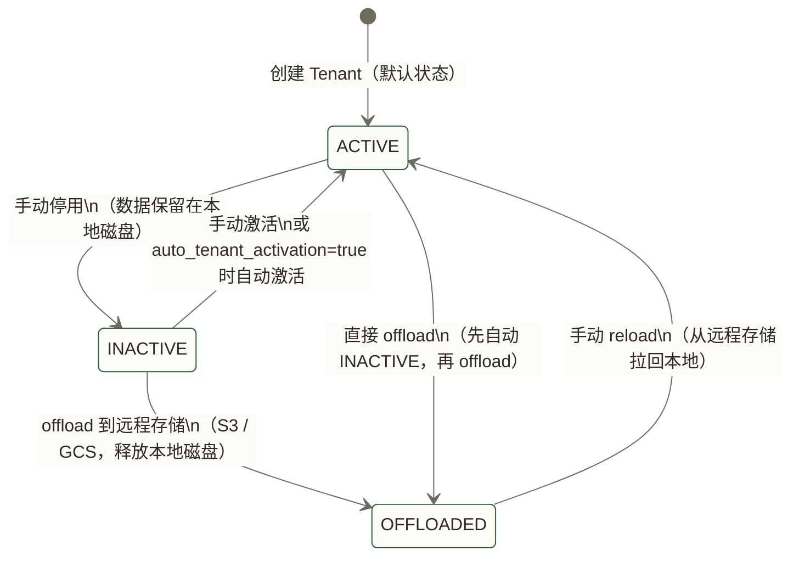
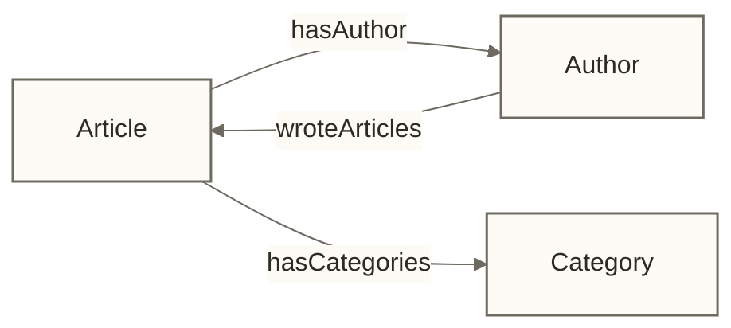

# Weaviate Schema 设计与数据建模

> [!abstract] 本文能给你什么
> - **理解 Weaviate Schema 的"弱约束"本质**，知道哪些决策事后很难改、哪些可以迭代
> - **掌握单 Class vs 多 Class 的拆分判断标准**，从向量空间语义而非数据来源的角度思考
> - **理解分词器的选择**——尤其是中文场景如何评估 `gse`，以及分词方式不匹配为什么可能导致 BM25 漏检
> - **学会设计 Cross-reference 和 Named Vectors**，处理真实业务中的复杂数据关系
> - **拿到三个完整的建模实战案例**：新闻知识库、电商商品搜索、多租户 SaaS

大多数人上手 Weaviate 之后，第一个坑不是搜索效果不好，也不是性能问题——而是 Schema 设计错了。改个 Property 的类型，发现必须删掉整个 Class 重建；中文关键词搜索没有任何结果，查了半天才发现分词器选了默认的 `word`；Named Vectors 没规划好，后来发现标题相关性和正文相关性混在一个向量里无法分开权重。

这些问题的共同特点是：**等你发现的时候，已经有几十万条数据了**。

这篇文章的目的，是在你动手写第一行 Schema 定义之前，把这些坑给你讲清楚。

---

## 目录

- [[#Schema 的"弱约束"本质]]
- [[#Class 设计：拆还是不拆]]
- [[#Property 设计详解]]
- [[#分词器选择：关键词搜索的生死线]]
- [[#Cross-reference：处理对象关系]]
- [[#Named Vectors：多向量建模]]
- [[#向量索引配置]]
- [[#多租户 Schema 设计]]
- [[#实战案例：新闻媒体知识库]]
- [[#实战案例：电商商品搜索]]
- [[#实战案例：多租户 SaaS 应用]]
- [[#Schema 变更策略]]
- [[#建模决策速查表]]

---

## Schema 的"弱约束"本质

先说一个让很多人困惑的现象：Weaviate 的 Schema 和传统关系型数据库的 Schema 不是一回事。

MySQL 的 Schema 是强约束的——你定义了 `varchar(255)`，存进去的数据就必须是字符串，不能超过 255 个字符。Weaviate 不是这样。

Weaviate 的 Schema 更像是一份"建议书"：它告诉 Weaviate 每个字段大概是什么类型、怎么处理，但不会严格拒绝类型不匹配的数据（在某些情况下会自动转换）。这就是所谓的"弱约束"。

**但弱约束不等于没有约束。** 有几个决策一旦确定，事后要改非常麻烦：

| 决策项 | 可变更性 | 说明 |
|--------|---------|------|
| 向量维度 | 不可变更 | 改维度必须删除整个 Class 重建，所有数据重新导入 |
| Property 的数据类型 | 极难变更 | 同样需要重建 Class |
| 分词器（tokenizer） | 不可变更 | 已有数据不会自动重建索引，需重建 Class |
| 向量索引类型（HNSW/Flat） | 不可变更 | 建好后不能在线切换 |
| 是否启用多租户 | 不可变更 | 启用后无法在不重建的情况下关闭 |
| 添加新的 Property | 可以在线操作 | 对现有数据透明，无需停机 |
| 修改 HNSW 的 `ef` 参数 | 可以在线操作 | 查询时参数，不影响已建索引 |

> [!warning] 核心设计原则
> **在创建 Class 之前**，你需要想清楚：向量维度、分词器、多租户。这三个决策事后改代价极高。Property 的增加相对自由，类型的变更同样代价高昂。

---

## Class 设计：拆还是不拆

### 单 Class vs 多 Class 的本质问题

这是最常见的第一个设计决策。有一个简单的判断标准：

**按"向量空间语义一致性"拆分，而不是按数据来源拆分。**

什么叫向量空间语义一致性？举个例子：

- 你有新闻文章和学术论文，它们都是文字内容，都讲概念和事件——**放在同一个 Class 里语义上是合理的**，一篇文章和一篇论文可以通过向量搜索找到相关内容。
- 你有产品描述和用户评价，虽然都属于电商数据，但描述是官方语言、专业词汇，评价是口语化表达——**向量空间差异很大**，混在一起会稀释搜索相关性。

| 对比维度 | 单 Class | 多 Class |
|---------|---------|---------|
| 查询复杂度 | 一次请求查所有数据 | 多次请求，或用 multi-target 搜索 |
| 语义一致性 | 数据类型混杂时向量质量下降 | 每个 Class 内语义纯净 |
| 过滤灵活性 | 可以用 where 过滤字段区分类型 | 天然隔离 |
| 适合场景 | 数据规模小、类型语义相近 | 数据规模大、类型语义差异明显 |
| 运维复杂度 | 简单 | 需要维护多个 Class 的配置 |

### Class 命名约定

Weaviate 对 Class 名称有一个硬性规则：**必须以大写字母开头**。这不是建议，是强制的。

```python
# 正确
"Article", "NewsItem", "ProductDescription"

# 错误（会报错）
"article", "news_item", "product_description"
```

除了大写字母开头，建议遵循以下约定：

- 使用**业务语义命名**，而非技术实现命名：`Article` 好过 `Doc`，`CustomerReview` 好过 `UserText`
- 使用**单数形式**：`Article` 而非 `Articles`（和 REST 资源命名惯例一致）
- 避免缩写：`ProductDescription` 好过 `ProdDesc`

---

## Property 设计详解

### 数据类型选择

Weaviate 支持的基本数据类型：

| 类型 | Python 中对应 | 主要用途 |
|------|-------------|---------|
| `text` | `str` | 需要文本搜索/向量化的长文本 |
| `text[]` | `list[str]` | 多值文本（标签列表等） |
| `int` | `int` | 整数，用于数值过滤 |
| `number` | `float` | 浮点数，用于数值过滤 |
| `boolean` | `bool` | 布尔标记 |
| `date` | `datetime` | 时间字段，支持范围过滤 |
| `uuid` | `str (UUID格式)` | 外部系统 ID |
| `object` | `dict` | 嵌套结构（非引用场景） |
| `object[]` | `list[dict]` | 嵌套结构列表 |

### 哪些字段需要向量化

这是一个经常被忽视的决策。Weaviate 默认会对所有 `text` 类型的字段进行向量化——这在很多场景下是错的。

**应该向量化的字段**：对语义搜索有实质贡献的内容

- 文章正文、商品描述、评价内容
- 标题（但有时需要单独的向量空间，见 Named Vectors）
- 关键摘要

**不应该向量化的字段**（需要设置 `skip: true`）：

- 文章 ID、外部系统 ID
- 创建时间、更新时间
- 数值型分类码（`status_code: 1`）
- URL、文件路径

> [!note] skip 的作用
> `skip: true` 不是删除这个字段，而是告诉 Vectorizer"计算整篇文档的向量时，忽略这个字段的内容"。该字段依然存储在数据库里，依然可以用于 where 过滤。

---

## 分词器选择：关键词搜索的生死线

这是整篇文章最重要的一节。**分词器与检索需求不匹配时，BM25 关键词搜索可能漏检或返回不相关结果；这种效果问题不一定触发报错，应使用实际语料和查询进行评估。**

Weaviate 的混合搜索（hybrid）由两部分组成：向量搜索 + BM25 关键词搜索。分词器只影响 BM25 部分，不影响向量搜索。但在混合搜索权重配置中，BM25 往往承担 30%-50% 的权重，直接影响最终结果质量。

### 五种分词器对比

| 分词器 | 分词方式 | 适用场景 | 中文支持 |
|--------|---------|---------|---------|
| `word`（默认） | 按空格切分，转小写 | 标准英文内容 | 不支持（中文无空格） |
| `whitespace` | 严格按空格切分，保留大小写 | 需要大小写敏感的英文 | 不支持 |
| `lowercase` | 按空格切分 + 全部小写 | 与 `word` 类似但更严格 | 不支持 |
| `trigram` | 按字符三元组切分 | 前缀搜索、模糊匹配、部分词搜索 | 有限支持 |
| `gse` | 中文分词选项，需匹配服务端启用配置 | 中文词级检索的候选方案 | 需按实际语料评估 |

### 为什么中文词级检索需要评估 `gse`

中文没有空格作为词的分隔符。"数据库性能优化"这八个字，对于 `word` 分词器来说，整个字符串就是一个 token——`"数据库性能优化"`。

当用户搜索"数据库"时，BM25 引擎查找的是 token `"数据库"`，但索引里存的是 `"数据库性能优化"` 这个完整字符串，两者不匹配，搜索失败。

使用 `gse` 分词器后，"数据库性能优化"会被切分为：`"数据库"` + `"性能"` + `"优化"`。搜索"数据库"时，可以精确匹配到第一个 token，BM25 正常工作。

```python
import weaviate
import weaviate.classes.config as wc

# 中文内容的正确配置
properties = [
    wc.Property(
        name="content",
        data_type=wc.DataType.TEXT,
        tokenization=wc.Tokenization.GSE,      # 中文词级检索的候选配置，需评估分词与匹配效果
    ),
    wc.Property(
        name="title",
        data_type=wc.DataType.TEXT,
        tokenization=wc.Tokenization.GSE,      # 中文标题采用同一候选分词配置，需评估效果
    ),
    wc.Property(
        name="source_url",
        data_type=wc.DataType.TEXT,
        skip_vectorization=True,               # URL 不参与向量化
        tokenization=wc.Tokenization.WHITESPACE,  # URL 按原样保存
    ),
]
```

> [!warning] GSE 需要特别启用
> `gse` 分词器需要在 Weaviate 启动时加载 gojieba 字典文件。在 Docker 部署时，需要确认 `ENABLE_MODULES` 中包含了对应的语言模块支持，或者确认 Weaviate 版本已内置。详见 [[【技术与工具】/向量数据库/Weaviate/06-Modules模块系统详解]] 中的语言扩展部分。

### `trigram` 的使用场景

`trigram` 把文本切成所有可能的三字符组合。"hello" 会变成："hel"、"ell"、"llo"。

这带来了一个特殊能力：**部分词匹配**。用户搜索 "dat" 可以匹配到 "database"。这在以下场景有价值：

- 自动补全（Autocomplete）
- 用户可能只知道关键词的一部分
- 产品型号搜索（"AB-1" 匹配 "AB-1234"）

代价是索引体积显著增大（约 3-5 倍），不适合大规模文本字段。

---

## Cross-reference：处理对象关系

### 什么是 Cross-reference

Cross-reference 是 Weaviate 在不同 Class 之间建立关联关系的机制。它类似于关系型数据库中的外键，但有一个重要区别：Weaviate 的 Cross-reference 天然支持一对多（一篇文章可以有多个作者）。

### 三种引用模式

**1. 一对一引用**

```python
# Article.hasAuthor → Author（一篇文章只有一个主作者）
wc.ReferenceProperty(
    name="hasAuthor",
    target_collection="Author",
)
```

**2. 一对多引用**

```python
# Article.hasCategories → Category（一篇文章可以属于多个分类）
# Weaviate 的 Cross-reference 默认就支持多引用，不需要特殊声明
wc.ReferenceProperty(
    name="hasCategories",
    target_collection="Category",
)
```

**3. 双向引用**

```python
# Article.hasAuthor → Author
# Author.wroteArticles → Article（反向引用需要在两个 Class 都定义）
```

### Cross-reference vs 嵌套存储：如何选择

| 对比维度 | Cross-reference | 嵌套存储（object 类型） |
|---------|----------------|----------------------|
| 被引用对象是否独立存储 | 是，独立的 Class 对象 | 否，嵌入在父对象中 |
| 被引用对象是否需要独立搜索 | 是（典型场景：搜索某个作者的所有文章） | 否 |
| 被引用对象是否需要独立更新 | 是（作者改名，只改 Author 对象即可） | 否（需要更新所有包含该数据的对象） |
| 查询复杂度 | 有额外开销（穿透引用） | 简单，直接读取 |
| 适合场景 | 作者、分类、标签、品牌等 | 商品规格、元数据字段、地址信息 |

> [!tip] 实用决策树
> 问自己两个问题：
> 1. 这个对象会被独立搜索吗？（"找出王小明写的所有文章"）
> 2. 这个对象会被独立更新吗？（"王小明改了职位，需要更新"）
>
> 两个问题有一个答"是"，就用 Cross-reference。两个都是"否"，用嵌套存储。

### 避免多层嵌套引用

Cross-reference 的查询穿透引用会产生额外的数据库开销。这在两层（A → B）时尚可接受，但三层（A → B → C）时性能会显著下降，且代码复杂度急剧上升。

建议：**保持 Cross-reference 的链路深度不超过两层。**

---

## Named Vectors：多向量建模

### 为什么需要多向量

默认情况下，一个 Weaviate 对象只有一个向量。这个向量是对整个对象（所有未 skip 的 text 字段）的综合表达。

但有些场景需要对不同字段建立独立的向量空间：

- 搜索时需要**分别控制标题相关性和正文相关性的权重**
- 同一个 Class 中的对象有**不同类型的内容**（文字 + 图片）
- 不同字段需要使用**不同的 Embedding 模型**（标题用轻量模型，正文用重量模型）

这就是 Named Vectors 的用途。

### Named Vectors 的命名约定

Named Vectors 的名称是字符串，没有硬性格式要求，但建议遵循：

- 使用小写下划线命名：`title_vector`、`body_vector`、`image_vector`
- 名称要反映对应字段或内容类型，而不是模型名称（`openai_vector` 这种命名很差）
- 保持简洁，通常 1-2 个词足够

### Named Vectors 配置示例

```python
import weaviate
import weaviate.classes.config as wc

client = weaviate.connect_to_local()

# 标题 + 正文分别建立独立向量
client.collections.create(
    name="Article",
    vectorizer_config=[
        # 向量1：仅对标题字段向量化，使用轻量模型
        wc.Configure.NamedVectors.text2vec_openai(
            name="title_vector",
            source_properties=["title"],
            model="text-embedding-3-small",
        ),
        # 向量2：仅对正文字段向量化，使用高质量模型
        wc.Configure.NamedVectors.text2vec_openai(
            name="body_vector",
            source_properties=["content"],
            model="text-embedding-3-large",
        ),
    ],
    properties=[
        wc.Property(name="title", data_type=wc.DataType.TEXT,
                    tokenization=wc.Tokenization.GSE),
        wc.Property(name="content", data_type=wc.DataType.TEXT,
                    tokenization=wc.Tokenization.GSE),
        wc.Property(name="publish_date", data_type=wc.DataType.DATE,
                    skip_vectorization=True),
    ],
)

client.close()
```

**查询时如何使用 Named Vectors：**

```python
# 针对 title_vector 搜索（标题相关性优先）
results = collection.query.near_text(
    query="机器学习入门",
    target_vector="title_vector",   # 指定向量空间
    limit=10,
)

# 针对 body_vector 搜索（正文相关性优先）
results = collection.query.near_text(
    query="机器学习入门",
    target_vector="body_vector",
    limit=10,
)
```

---

## 向量索引配置

### HNSW vs Flat：选哪个

Weaviate 提供两种向量索引类型，选择逻辑很简单：

| 数据量 | 推荐索引 | 理由 |
|--------|---------|------|
| < 10 万条 | Flat | 精确 KNN，无召回损失，内存占用低 |
| > 10 万条 | HNSW | 近似 KNN，牺牲少量精度换取大规模下的性能 |

未启用量化、以原始向量执行精确距离检索时，Flat Index 可返回该距离定义下的精确近邻；这不等于业务相关性保证，也不能直接推广到启用 BQ 的配置。缺点是查询时间随数据量线性增长，百万级数据下会明显变慢。

### HNSW 核心参数详解

```python
wc.Configure.VectorIndex.hnsw(
    ef_construction=128,    # 建索引时的搜索宽度
    max_connections=16,     # 每个节点的最大连接数（M 参数）
    ef=-1,                  # 查询时的搜索宽度（-1 表示动态计算）
    dynamic_ef_min=100,     # 动态 ef 的最小值
    dynamic_ef_max=500,     # 动态 ef 的最大值
    dynamic_ef_factor=8,    # 动态 ef 因子（ef = limit * factor）
    distance_metric=wc.VectorDistances.COSINE,  # 距离度量
)
```

**三个最重要的参数：**

**`efConstruction`（建索引质量）**

这个参数决定了 HNSW 图在建立时，每次插入新节点时搜索多宽。越大，图的质量越高，索引后的搜索精度越好，但插入速度越慢。

- 开发/测试环境：64-128（快速导入数据）
- 生产环境：128-256（平衡质量和写入速度）
- 高精度要求：256-512（批量导入完成后不再频繁写入）

**`maxConnections`（内存与精度的平衡，即 M 参数）**

每个节点在 HNSW 图中最多和多少个邻居节点相连。越大，搜索精度越高，但内存占用线性增长。

- 128 维向量（短向量）：M = 8-16
- 768 维向量（标准 BERT）：M = 16-32
- 1536 维向量（OpenAI text-embedding-3-small）：M = 32-64

**`ef`（查询时的搜索宽度）**

查询时搜索的候选节点数量。越大，召回率越高，查询越慢。建议使用动态 ef（设为 -1），让 Weaviate 根据每次查询的 `limit` 自动计算合适的 ef 值。

| 场景 | ef 推荐值 |
|------|---------|
| 高吞吐量、可接受少量精度损失 | 64-128 |
| 默认均衡配置 | 动态 ef（ef=-1） |
| 高精度、低延迟要求不高 | 256-512 |

### 完整 HNSW 生产配置示例

```python
import weaviate
import weaviate.classes.config as wc

client = weaviate.connect_to_local()

collection = client.collections.create(
    name="Article",
    vectorizer_config=wc.Configure.Vectorizer.text2vec_openai(
        model="text-embedding-3-small",
    ),
    vector_index_config=wc.Configure.VectorIndex.hnsw(
        # 生产环境推荐配置（1536 维向量）
        ef_construction=200,
        max_connections=32,
        ef=-1,                      # 动态 ef
        dynamic_ef_min=100,
        dynamic_ef_max=500,
        dynamic_ef_factor=8,
        distance_metric=wc.VectorDistances.COSINE,
        # 量化压缩（大规模场景节省内存）
        quantizer=wc.Configure.VectorIndex.Quantizer.pq(
            segments=0,             # 0 表示自动计算
            training_limit=25000,   # PQ 训练使用的样本数量上限，非最低数据量保证
        ),
    ),
    properties=[
        wc.Property(name="title", data_type=wc.DataType.TEXT,
                    tokenization=wc.Tokenization.GSE),
        wc.Property(name="content", data_type=wc.DataType.TEXT,
                    tokenization=wc.Tokenization.GSE),
    ],
)

client.close()
```

### Flat Index 配置示例

```python
collection = client.collections.create(
    name="SmallCollection",
    vectorizer_config=wc.Configure.Vectorizer.text2vec_openai(),
    # 小数据集使用 Flat Index；本例启用 BQ，不保证原始向量距离下的精确近邻
    vector_index_config=wc.Configure.VectorIndex.flat(
        distance_metric=wc.VectorDistances.COSINE,
        # 可选：Binary Quantization 压缩（Flat + BQ 组合）
        quantizer=wc.Configure.VectorIndex.Quantizer.bq(),
    ),
)
```

### 量化压缩：PQ vs BQ

| 压缩方式 | 压缩比 | 精度损失 | 适用场景 |
|---------|-------|---------|---------|
| 无压缩（默认） | 1x | 无 | 数据量 < 500 万，内存充足 |
| Product Quantization (PQ) | 4-32x | 小（1-5%） | 数据量大，可接受少量精度损失 |
| Binary Quantization (BQ) | 32-64x | 较大（5-15%） | 极大数据量，高维向量，精度要求不极致 |

> [!note] PQ 需要训练数据
> PQ 压缩需要先收集足够数量的向量样本来训练量化器（由 `training_limit` 参数控制，默认 100,000 条）。在数据量达到 `training_limit` 之前，Weaviate 会使用未压缩的方式存储向量，达到阈值后自动开始 PQ 训练和压缩。

---

## 多租户 Schema 设计

### 启用多租户的 Class 定义

```python
import weaviate
import weaviate.classes.config as wc
from weaviate.classes.tenants import Tenant, TenantActivityStatus

client = weaviate.connect_to_local()

# 启用多租户的 Class
client.collections.create(
    name="CustomerDocument",
    multi_tenancy_config=wc.Configure.multi_tenancy(
        enabled=True,
        auto_tenant_creation=False,     # 禁止自动创建 Tenant（生产环境建议）
        auto_tenant_activation=True,    # 自动激活访问时的 INACTIVE Tenant
    ),
    vectorizer_config=wc.Configure.Vectorizer.text2vec_openai(),
    properties=[
        wc.Property(name="title", data_type=wc.DataType.TEXT,
                    tokenization=wc.Tokenization.GSE),
        wc.Property(name="content", data_type=wc.DataType.TEXT,
                    tokenization=wc.Tokenization.GSE),
        wc.Property(name="doc_type", data_type=wc.DataType.TEXT,
                    skip_vectorization=True,
                    tokenization=wc.Tokenization.LOWERCASE),
    ],
)

client.close()
```

### Tenant 状态机

Weaviate 的 Tenant 有三种状态，对应不同的资源占用和访问能力：



| 状态 | 本地磁盘 | 远程存储 | 可读写 | 内存占用 |
|------|---------|---------|-------|---------|
| ACTIVE | 占用 | 无 | 是 | 高 |
| INACTIVE | 占用 | 无 | 否 | 低（索引卸载） |
| OFFLOADED | 不占用 | 占用 | 否 | 极低 |

### Tenant 生命周期管理代码

```python
import weaviate
from weaviate.classes.tenants import Tenant, TenantActivityStatus

client = weaviate.connect_to_local()
collection = client.collections.get("CustomerDocument")

# 创建新 Tenant（为新客户开通空间）
collection.tenants.create([
    Tenant(name="customer_001"),
    Tenant(name="customer_002"),
])

# 停用不活跃的 Tenant（节省内存，数据留在本地磁盘）
collection.tenants.update([
    Tenant(
        name="customer_001",
        activity_status=TenantActivityStatus.INACTIVE,
    ),
])

# Offload 冷数据到 S3（释放本地磁盘）
# 前提：Weaviate 配置了 offload storage（S3/GCS）
collection.tenants.update([
    Tenant(
        name="customer_001",
        activity_status=TenantActivityStatus.OFFLOADED,
    ),
])

# 重新激活（从 S3 拉回本地，需要等待数据恢复）
collection.tenants.update([
    Tenant(
        name="customer_001",
        activity_status=TenantActivityStatus.ACTIVE,
    ),
])

# 查询指定 Tenant 的数据
tenant_collection = collection.with_tenant("customer_002")
results = tenant_collection.query.near_text(
    query="合同条款",
    limit=5,
)

client.close()
```

### 何时降级 Tenant 状态

| 触发条件 | 目标状态 | 操作 |
|---------|---------|------|
| 用户 30 天未登录 | INACTIVE | 释放内存，保留本地数据 |
| 用户账号暂停/注销 | OFFLOADED | 已配置远程卸载存储时释放本地磁盘；不等于独立备份，注销后的保留或删除需另行确定 |
| 历史归档数据（> 1 年） | OFFLOADED | 已配置远程卸载存储时减少本地资源占用；合规保留还需明确期限、访问和删除策略 |
| 用户重新登录 | ACTIVE | 如启用 auto_tenant_activation，自动完成 |

---

## 实战案例：新闻媒体知识库

### 数据模型设计

三个核心 Class：`Article`（文章）、`Author`（作者）、`Category`（分类）。

关系：一篇文章有一个主作者，属于多个分类；一个作者写了多篇文章（双向引用）。



### 完整 Schema 代码

```python
import weaviate
import weaviate.classes.config as wc

client = weaviate.connect_to_local()

# Step 1：创建 Author Class（被引用的对象先创建）
client.collections.create(
    name="Author",
    description="文章作者信息",
    vectorizer_config=wc.Configure.Vectorizer.text2vec_openai(
        model="text-embedding-3-small",
    ),
    vector_index_config=wc.Configure.VectorIndex.hnsw(
        ef_construction=128,
        max_connections=16,
    ),
    properties=[
        wc.Property(
            name="name",
            data_type=wc.DataType.TEXT,
            description="作者姓名",
            tokenization=wc.Tokenization.GSE,
        ),
        wc.Property(
            name="bio",
            data_type=wc.DataType.TEXT,
            description="作者简介，参与向量化",
            tokenization=wc.Tokenization.GSE,
        ),
        wc.Property(
            name="email",
            data_type=wc.DataType.TEXT,
            description="联系邮箱，不参与向量化",
            skip_vectorization=True,
            tokenization=wc.Tokenization.LOWERCASE,
        ),
    ],
)

# Step 2：创建 Category Class
client.collections.create(
    name="Category",
    description="文章分类标签",
    vectorizer_config=wc.Configure.Vectorizer.text2vec_openai(
        model="text-embedding-3-small",
    ),
    properties=[
        wc.Property(
            name="name",
            data_type=wc.DataType.TEXT,
            tokenization=wc.Tokenization.GSE,
        ),
        wc.Property(
            name="slug",
            data_type=wc.DataType.TEXT,
            description="URL 友好的标识符",
            skip_vectorization=True,
            tokenization=wc.Tokenization.LOWERCASE,
        ),
        wc.Property(
            name="description",
            data_type=wc.DataType.TEXT,
            tokenization=wc.Tokenization.GSE,
        ),
    ],
)

# Step 3：创建 Article Class（引用前两个 Class）
client.collections.create(
    name="Article",
    description="新闻文章",
    vectorizer_config=wc.Configure.Vectorizer.text2vec_openai(
        model="text-embedding-3-small",
        # 只对以下字段向量化
        source_properties=["title", "summary", "content"],
    ),
    vector_index_config=wc.Configure.VectorIndex.hnsw(
        ef_construction=200,
        max_connections=32,
        ef=-1,
        dynamic_ef_min=100,
        dynamic_ef_max=500,
        dynamic_ef_factor=8,
        distance_metric=wc.VectorDistances.COSINE,
    ),
    properties=[
        wc.Property(
            name="title",
            data_type=wc.DataType.TEXT,
            description="文章标题",
            tokenization=wc.Tokenization.GSE,
        ),
        wc.Property(
            name="summary",
            data_type=wc.DataType.TEXT,
            description="摘要，简要概括文章内容",
            tokenization=wc.Tokenization.GSE,
        ),
        wc.Property(
            name="content",
            data_type=wc.DataType.TEXT,
            description="正文内容",
            tokenization=wc.Tokenization.GSE,
        ),
        wc.Property(
            name="publish_date",
            data_type=wc.DataType.DATE,
            description="发布时间，用于时间范围过滤",
            skip_vectorization=True,
        ),
        wc.Property(
            name="view_count",
            data_type=wc.DataType.INT,
            description="浏览量，用于热度排序过滤",
            skip_vectorization=True,
        ),
        wc.Property(
            name="is_published",
            data_type=wc.DataType.BOOL,
            description="是否已发布",
            skip_vectorization=True,
        ),
        wc.Property(
            name="source_url",
            data_type=wc.DataType.TEXT,
            description="原文链接",
            skip_vectorization=True,
            tokenization=wc.Tokenization.WHITESPACE,
        ),
        # Cross-references
        wc.ReferenceProperty(
            name="hasAuthor",
            target_collection="Author",
            description="文章作者（一对一）",
        ),
        wc.ReferenceProperty(
            name="hasCategories",
            target_collection="Category",
            description="文章分类（一对多）",
        ),
    ],
)

# Step 4：在 Author Class 添加反向引用（创建完 Article 之后）
author_collection = client.collections.get("Author")
author_collection.config.add_reference(
    wc.ReferenceProperty(
        name="wroteArticles",
        target_collection="Article",
        description="该作者写的文章（反向引用）",
    )
)

print("新闻知识库 Schema 创建完成")
client.close()
```

---

## 实战案例：电商商品搜索

### 设计思路

电商商品的核心挑战是：用户搜索时可能关注的点完全不同——

- "红色连衣裙"：颜色 + 品类，属于描述性搜索
- "夏季清凉"：场景感受，属于语义搜索
- "M 码 200 元以内"：规格 + 价格，属于属性过滤

单一向量无法同时很好地支持这三类搜索。使用 Named Vectors 把商品名称、描述分开，配合 where 过滤解决属性筛选。

```python
import weaviate
import weaviate.classes.config as wc

client = weaviate.connect_to_local()

client.collections.create(
    name="Product",
    description="电商商品",
    # Named Vectors：名称向量 + 描述向量
    vectorizer_config=[
        wc.Configure.NamedVectors.text2vec_openai(
            name="name_vector",
            source_properties=["name", "brand"],
            model="text-embedding-3-small",
        ),
        wc.Configure.NamedVectors.text2vec_openai(
            name="description_vector",
            source_properties=["description", "tags"],
            model="text-embedding-3-large",   # 描述用更高质量模型
        ),
    ],
    vector_index_config={
        # Named Vectors 场景下，分别为每个向量配置索引
        "name_vector": wc.Configure.VectorIndex.hnsw(
            ef_construction=128,
            max_connections=16,
        ),
        "description_vector": wc.Configure.VectorIndex.hnsw(
            ef_construction=200,
            max_connections=32,
        ),
    },
    properties=[
        # 需要参与向量化的字段
        wc.Property(
            name="name",
            data_type=wc.DataType.TEXT,
            tokenization=wc.Tokenization.GSE,
        ),
        wc.Property(
            name="brand",
            data_type=wc.DataType.TEXT,
            tokenization=wc.Tokenization.GSE,
        ),
        wc.Property(
            name="description",
            data_type=wc.DataType.TEXT,
            tokenization=wc.Tokenization.GSE,
        ),
        wc.Property(
            name="tags",
            data_type=wc.DataType.TEXT_ARRAY,  # 多值文本
            tokenization=wc.Tokenization.GSE,
        ),
        # 过滤字段（不参与向量化）
        wc.Property(
            name="price",
            data_type=wc.DataType.NUMBER,
            skip_vectorization=True,
        ),
        wc.Property(
            name="category_id",
            data_type=wc.DataType.TEXT,
            skip_vectorization=True,
            tokenization=wc.Tokenization.LOWERCASE,
        ),
        wc.Property(
            name="in_stock",
            data_type=wc.DataType.BOOL,
            skip_vectorization=True,
        ),
        wc.Property(
            name="rating",
            data_type=wc.DataType.NUMBER,
            skip_vectorization=True,
        ),
        # 嵌套存储：商品规格（不需要独立搜索）
        wc.Property(
            name="specs",
            data_type=wc.DataType.OBJECT,
            skip_vectorization=True,
            nested_properties=[
                wc.Property(name="color", data_type=wc.DataType.TEXT),
                wc.Property(name="size", data_type=wc.DataType.TEXT),
                wc.Property(name="weight", data_type=wc.DataType.NUMBER),
            ],
        ),
    ],
)

client.close()
```

**查询示例——价格过滤 + 语义搜索：**

```python
import weaviate.classes.query as wq

collection = client.collections.get("Product")

# 200 元以内的红色连衣裙，按名称向量搜索
results = collection.query.near_text(
    query="红色连衣裙",
    target_vector="name_vector",      # 指定使用名称向量
    limit=20,
    filters=wq.Filter.by_property("price").less_than(200.0) &
            wq.Filter.by_property("in_stock").equal(True),
    return_properties=["name", "brand", "price", "rating"],
)
```

---

## 实战案例：多租户 SaaS 应用

### 两种方案对比

| 对比维度 | 方案A：单 Class + 多 Tenant | 方案B：多 Class 隔离 |
|---------|--------------------------|-------------------|
| 数据隔离级别 | Shard 级物理隔离 | Class 级物理隔离 |
| 规模评估假设（非已验证上限） | 以数万个 Tenant 作为待压测目标 | 以数百个 Class 作为待压测目标；实际承载取决于资源、配置与负载 |
| 运维复杂度 | 低（统一管理一个 Class） | 高（每个租户独立的 Class 配置） |
| Schema 灵活性 | 所有 Tenant 共享同一个 Schema | 每个 Class 可有不同 Schema |
| 适合场景 | **标准 SaaS（推荐）** | 少量大客户、定制化程度高 |

**结论：绝大多数 SaaS 场景，选方案A（单 Class + 多 Tenant）。**

### 完整多租户 SaaS Schema

```python
import weaviate
import weaviate.classes.config as wc
from weaviate.classes.tenants import Tenant, TenantActivityStatus

client = weaviate.connect_to_local()

# 创建支持多租户的知识库 Class
client.collections.create(
    name="KnowledgeBase",
    description="多租户 SaaS 知识库",
    multi_tenancy_config=wc.Configure.multi_tenancy(
        enabled=True,
        auto_tenant_creation=False,    # 禁止自动创建 Tenant；访问授权仍需单独实现
        auto_tenant_activation=True,   # 访问 INACTIVE tenant 时自动激活
    ),
    vectorizer_config=wc.Configure.Vectorizer.text2vec_openai(
        model="text-embedding-3-small",
        source_properties=["title", "content"],
    ),
    vector_index_config=wc.Configure.VectorIndex.hnsw(
        ef_construction=128,
        max_connections=16,
        distance_metric=wc.VectorDistances.COSINE,
    ),
    properties=[
        wc.Property(
            name="title",
            data_type=wc.DataType.TEXT,
            tokenization=wc.Tokenization.GSE,
        ),
        wc.Property(
            name="content",
            data_type=wc.DataType.TEXT,
            tokenization=wc.Tokenization.GSE,
        ),
        wc.Property(
            name="doc_type",
            data_type=wc.DataType.TEXT,
            description="文档类型：faq / policy / manual",
            skip_vectorization=True,
            tokenization=wc.Tokenization.LOWERCASE,
        ),
        wc.Property(
            name="created_at",
            data_type=wc.DataType.DATE,
            skip_vectorization=True,
        ),
    ],
)

# 为新客户开通 Tenant（客户注册时调用）
def onboard_customer(customer_id: str):
    collection = client.collections.get("KnowledgeBase")
    collection.tenants.create([Tenant(name=customer_id)])
    print(f"客户 {customer_id} 已开通知识库空间")

# 停用不活跃客户（定时任务：30 天未登录）
def deactivate_inactive_customers(customer_ids: list[str]):
    collection = client.collections.get("KnowledgeBase")
    collection.tenants.update([
        Tenant(
            name=cid,
            activity_status=TenantActivityStatus.INACTIVE,
        )
        for cid in customer_ids
    ])

# 示例：将注销客户数据卸载到已配置的远程存储；是否保留及保留期限需由合规与删除策略决定
def archive_cancelled_customers(customer_ids: list[str]):
    collection = client.collections.get("KnowledgeBase")
    collection.tenants.update([
        Tenant(
            name=cid,
            activity_status=TenantActivityStatus.OFFLOADED,
        )
        for cid in customer_ids
    ])

# 客户查询自己的知识库
def query_customer_kb(customer_id: str, query: str):
    collection = client.collections.get("KnowledgeBase")
    tenant_collection = collection.with_tenant(customer_id)
    return tenant_collection.query.hybrid(
        query=query,
        alpha=0.6,     # 60% 向量权重，40% BM25 权重
        limit=5,
    )

client.close()
```

---

## Schema 变更策略

### 可以安全在线变更的操作

```python
collection = client.collections.get("Article")

# 添加新 Property（安全，不影响现有数据）
collection.config.add_property(
    wc.Property(
        name="word_count",
        data_type=wc.DataType.INT,
        skip_vectorization=True,
    )
)

# 添加新的 Cross-reference（安全）
collection.config.add_reference(
    wc.ReferenceProperty(
        name="hasRelatedArticles",
        target_collection="Article",
    )
)

# 修改 HNSW 查询参数（安全，不影响已建索引结构）
collection.config.update(
    vector_index_config=wc.Reconfigure.VectorIndex.hnsw(
        ef=300,          # 提高查询精度
        flat_search_cutoff=40000,
    )
)
```

### 不可在线变更，需要重建 Class 的操作

- 修改 Property 的数据类型
- 修改分词器（tokenizer）
- 修改向量维度（更换 Embedding 模型且维度不同）
- 启用/禁用多租户
- 切换向量索引类型（HNSW ↔ Flat）

### 重建 Schema 的简化示例（非无损迁移流程）

```python
import json
import weaviate
import weaviate.classes.config as wc

client = weaviate.connect_to_local()

# Step 1：导出对象属性和向量（示例将全部对象累积到内存，不适合直接用于大规模或完整关系数据备份）
def export_collection(collection_name: str, output_file: str):
    collection = client.collections.get(collection_name)
    data = []
    for item in collection.iterator(include_vector=True):
        data.append({
            "uuid": str(item.uuid),
            "properties": item.properties,
            "vector": item.vector,
        })
    with open(output_file, "w", encoding="utf-8") as f:
        json.dump(data, f, ensure_ascii=False, default=str)
    print(f"导出 {len(data)} 条数据到 {output_file}")

export_collection("Article", "article_backup.json")

# Step 2：删除旧 Class
client.collections.delete("Article")
print("旧 Class 已删除")

# Step 3：用新配置重建 Class（此处写入正确的 Schema 定义）
client.collections.create(
    name="Article",
    # ... 新的 Schema 配置
)

# Step 4：重新导入数据
def reimport_collection(collection_name: str, input_file: str):
    with open(input_file, "r", encoding="utf-8") as f:
        data = json.load(f)

    collection = client.collections.get(collection_name)

    # 批量导入（每批 100 条）
    batch_size = 100
    for i in range(0, len(data), batch_size):
        batch = data[i:i + batch_size]
        with collection.batch.fixed_size(batch_size=batch_size) as batch_ctx:
            for item in batch:
                batch_ctx.add_object(
                    properties=item["properties"],
                    uuid=item["uuid"],
                    # 如果不想重新向量化（节省 API 费用），传入原始向量
                    # vector=item["vector"],
                )
        print(f"已导入 {min(i + batch_size, len(data))} / {len(data)} 条")

reimport_collection("Article", "article_backup.json")
client.close()
```

---

## 建模决策速查表

在开始设计 Schema 之前，用这张表做一次完整的自检：

| 决策项 | 核心问题 | 选项 |
|-------|---------|------|
| Class 划分 | 不同类型的数据在向量空间里语义相近吗？ | 相近 → 单 Class；差异大 → 多 Class |
| 向量配置 | 同一对象的不同字段需要独立的相似度搜索吗？ | 需要 → Named Vectors；不需要 → 默认单向量 |
| 分词器选择 | 内容是中文吗？ | 中文 → `gse`；英文 → `word`；需要模糊匹配 → `trigram` |
| 字段向量化 | 这个字段的内容对语义相关性有贡献吗？ | 无贡献（ID/日期/数字）→ `skip_vectorization=True` |
| 关系建模 | 被关联的对象需要独立搜索或更新吗？ | 需要 → Cross-reference；不需要 → `object` 嵌套 |
| 多租户 | 不同用户/客户的数据需要严格隔离吗？ | 需要 → 启用多租户；不需要 → 普通 Class |
| 向量索引 | 数据量超过 10 万条吗？ | 否 → Flat；是 → HNSW |
| 量化压缩 | 内存资源紧张，数据量在百万级以上吗？ | 是 → PQ；极致压缩 → BQ；否 → 不压缩 |

---

## 总结

Schema 设计的本质是**在灵活性与约束之间找到正确的平衡点**。Weaviate 的弱约束体系给了你很大的迭代空间，但某些核心决策——向量维度、分词器、多租户开关——一旦确定就很难改变。

记住三个最容易踩的坑：

**第一，中文场景忘记设置 `gse` 分词器。** 向量搜索看起来正常（因为向量化不依赖分词器），但 BM25 部分可能因分词不匹配而漏检。若将其混合权重设为 30%-50%，这也只是配置假设，不代表整体搜索质量会下降同等比例；实际影响需用检索评测衡量。

**第二，把所有字段都加入向量化。** ID、URL、时间戳参与向量化会"污染"语义向量，让不相关的字段影响相似度计算，降低搜索精度。养成习惯：只有真正表达内容语义的字段才参与向量化。

**第三，用 Cross-reference 来存储不需要独立查询的简单结构。** Cross-reference 有查询开销，对于商品规格、元数据这类只用来展示、不用来独立检索的结构，直接用 `object` 类型嵌套更高效。

做好这三点，你的 Weaviate 数据模型就有了一个扎实的基础。

---

## 延伸阅读

- 03-核心概念详解 — 理解 Collection、Shard、Replica 的基本概念
- [[【技术与工具】/向量数据库/Weaviate/06-Modules模块系统详解]] — 了解各种 Vectorizer 模块的选择与配置
- [[【技术与工具】/向量数据库/Weaviate/07B-多租户与数据隔离]] — 深入了解多租户架构与 Tenant 生命周期管理
- 08-查询与搜索详解 — 学习如何在多向量和过滤条件下编写高效查询

#向量数据库 #Weaviate #Schema设计 #数据建模 #Named-Vectors #中文搜索 #多租户 #HNSW
