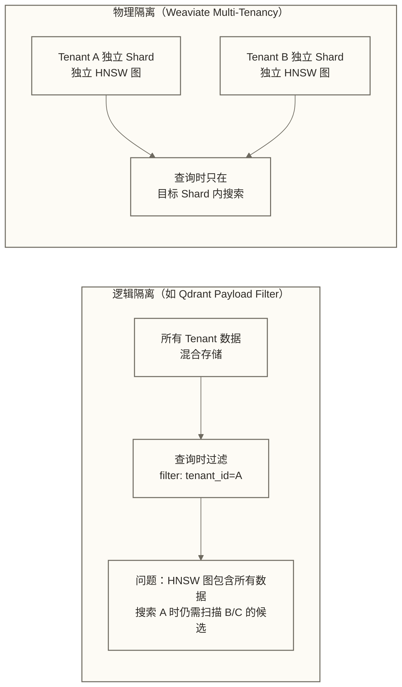
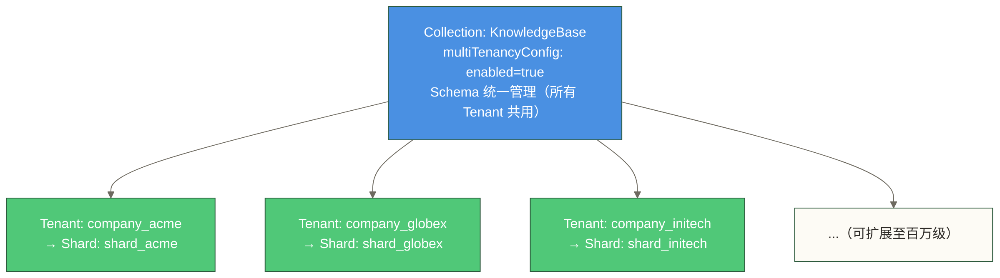
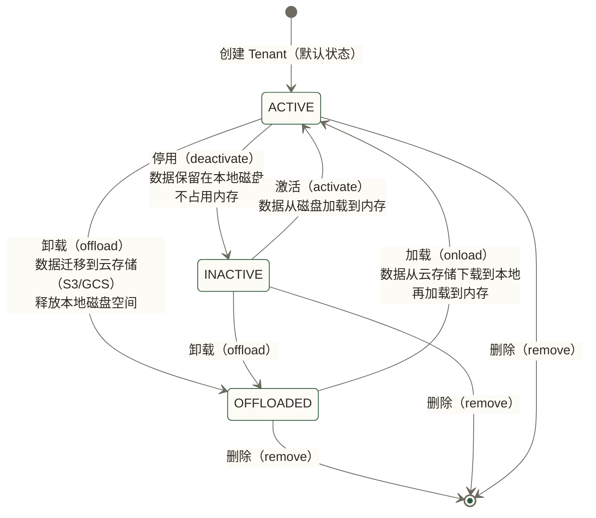
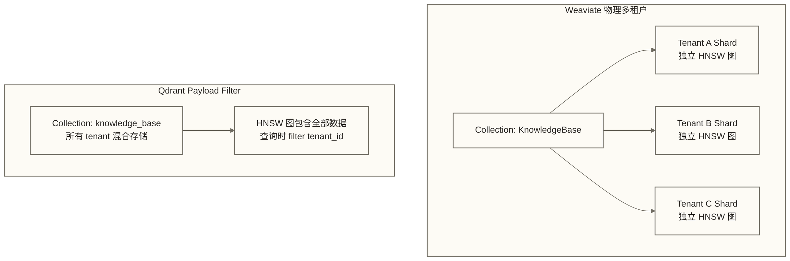
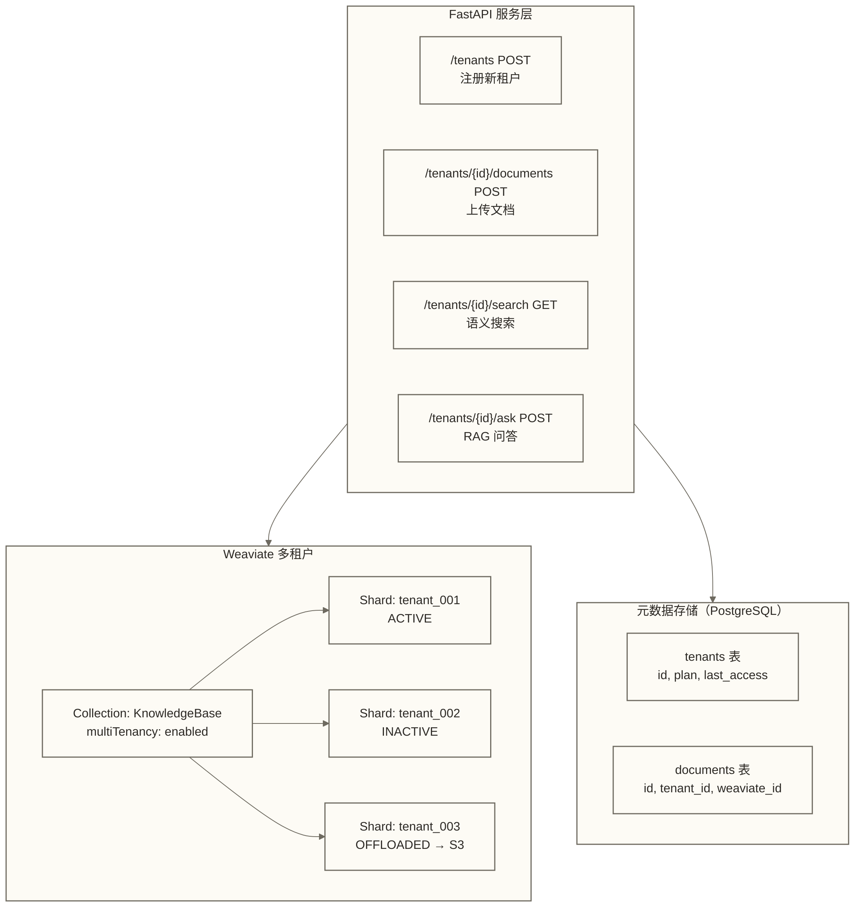

# Weaviate 多租户与数据隔离

> [!abstract] 本文能给你什么
> - **彻底理解 Weaviate 多租户的物理隔离原理**，知道它为什么比"逻辑隔离"更强
> - **掌握完整的 Tenant 生命周期管理**：创建、激活、停用、冷存储迁移
> - **理解三种 Tenant 状态（ACTIVE / INACTIVE / OFFLOADED）**，学会按使用频率分级管理
> - **与 Qdrant Payload Filter 方案做深度对比**，知道什么场景选什么
> - **拿到一份 SaaS 产品多租户知识库的服务骨架示例**，用于演练租户管理、文档写入、检索与问答；生产使用还需补齐身份认证、租户授权及运行配置

如果你在构建 SaaS 产品，每个客户的数据必须严格隔离，那这篇文章就是为你写的。Weaviate 的多租户是目前向量数据库里设计最成熟、工程最扎实的方案之一。读完这篇，你会对"什么叫真正的数据隔离"有全新的认知。

---

## 目录

- [[#写字楼比喻：理解多租户的本质]]
- [[#多租户原理：物理隔离 vs 逻辑隔离]]
- [[#开启多租户：multiTenancyConfig 配置]]
- [[#Tenant 生命周期管理]]
- [[#三种 Tenant 状态详解]]
- [[#冷热数据分层：Tenant Offloading]]
- [[#多租户与 Modules 的结合]]
- [[#与 Qdrant Payload Filter 的深度对比]]
- [[#SaaS 产品实战：多租户知识库完整实现]]
- [[#多租户性能与规模上限]]
- [[#常见问题与陷阱]]

---

## 写字楼比喻：理解多租户的本质

在开始讲技术细节之前，先建立一个直觉模型。

想象一栋写字楼：

- **整栋楼** = 一个 Weaviate 实例（或集群）
- **每家公司（租户）** = 一个 Tenant
- **每家公司的楼层** = 独立的物理 Shard
- **楼层门禁** = Weaviate 的租户隔离机制
- **基础设施（电梯、空调、网络）** = 共用的 Weaviate 引擎和配置

这栋楼有几个重要特性：

**第一，门禁是物理级别的，不是人工值守的。** 公司 A 的员工用自己的门禁卡，物理上就进不了公司 B 的楼层。这不是靠"保安记住了哪个人不让进"——这里的门禁只是比喻：独立 Shard 提供存储与索引隔离，不代表租户使用专属硬件，也不替代应用层授权。Weaviate 的多租户就是这样，每个 Tenant 的数据存在自己独立的 Shard 上，不是靠查询时加个 `WHERE tenant_id = xxx` 的过滤条件。

**第二，公司可以暂时"搬走"。** 有些公司长期不用办公室（比如疫情期间），楼管可以把他们的档案搬到地下室（冷存储），释放出楼层给其他人。等他们回来了，再搬回来。这就是 Weaviate 的 OFFLOADED 状态——把不活跃的 Tenant 的数据迁移到 S3，释放本地磁盘空间。

**第三，基础设施是共享的，所以成本可控。** 100 家公司共用一套电梯、空调、门卫系统，比每家公司单独建一栋楼便宜得多。Weaviate 的多租户让你用一个实例服务成千上万个客户，而不是为每个客户部署一套独立的 Weaviate。

这个比喻贯穿全文。记住它，每当你遇到技术细节感到困惑时，回来想想这栋楼。

---

## 多租户原理：物理隔离 vs 逻辑隔离

### 两种隔离方式的根本区别

理解 Weaviate 多租户，必须先搞清楚一个核心概念：**物理隔离**和**逻辑隔离**的区别。

**逻辑隔离**是什么样的？

```text
所有数据存在一起：
[tenant_A_doc1, tenant_B_doc1, tenant_A_doc2, tenant_B_doc2, ...]

查询时加过滤器：
search(query, filter={"tenant_id": "A"})
```

逻辑隔离的本质是：数据混在一个大池子里，查询时通过条件过滤来"假装"隔离。这就像一个大档案室，所有公司的文件混放在一起，靠文件袋上贴的标签来区分。

**物理隔离**是什么样的？

```text
每个 Tenant 有自己独立的存储单元：
Tenant A: /data/shards/TenantA/   [独立的向量索引、倒排索引、对象存储]
Tenant B: /data/shards/TenantB/   [独立的向量索引、倒排索引、对象存储]
Tenant C: /data/shards/TenantC/   [独立的向量索引、倒排索引、对象存储]
```

Weaviate 的每个 Tenant 拥有独立的：
- 向量索引（HNSW 图）
- 倒排索引（用于关键词搜索）
- 对象存储（原始数据）
- WAL（Write-Ahead Log，用于数据恢复）

这就像每家公司有自己专属的档案室，档案室有独立的锁，钥匙只有自己的员工有。

### 为什么物理隔离更好？



物理隔离的三大优势：

| 维度 | 逻辑隔离 | 物理隔离（Weaviate） |
|------|---------|-------------------|
| **查询性能** | 取决于总数据量、过滤索引、查询策略及资源负载，不能仅由租户数推断 | 搜索范围限定于目标 Tenant 的索引，但查询时间仍受共享资源及并发负载影响 |
| **数据安全** | 过滤器失效会导致数据泄露 | 独立 Shard 避免依赖 tenant_id 查询过滤器，但仍需正确选择 Tenant 并实施身份认证与授权 |
| **合规性** | 可按租户条件删除匹配数据，仍需处理备份、日志等保留副本 | 可执行租户级删除，但不能据此保证所有副本已清除或 GDPR 合规 |
| **独立扩展** | 无法单独扩展某个 Tenant | 可以按需激活/停用/迁移特定 Tenant |

> [!important] 关键认知
> 物理隔离意味着每个 Tenant 的 HNSW 索引是独立构建的。当你查询 Tenant A 时，Weaviate 只在 Tenant A 的 HNSW 图中搜索，图的大小就是 Tenant A 自己的数据量，不受其他 Tenant 影响。这使目标租户的索引搜索范围不随其他租户的数据量直接扩大，但查询速度仍可能受共享 CPU、内存、磁盘、网络及并发负载影响。

### Weaviate 的 Collection + Tenant 模型

Weaviate 的多租户建立在 Collection（原 Class）之上：



所有 Tenant 共享同一份 Collection Schema（属性定义、vectorizer 配置等），但数据完全独立存储。这是多租户比"每个客户建一个 Collection"更优雅的地方——Schema 管理只有一份，但数据完全隔离。

> [!note] 多租户 Collection 与普通 Collection 的关键区别
> 普通 Collection：直接存入对象
> 多租户 Collection：**必须指定 Tenant**，否则报错
> 这是一个设计上的强约束，防止你不小心把数据存到错误的地方。

---

## 开启多租户：multiTenancyConfig 配置

### 基础配置

多租户在创建 Collection 时开启，**创建后无法更改**（这一点很重要，提前规划）。

```python
import weaviate
import weaviate.classes as wvc

client = weaviate.connect_to_local()

# 创建支持多租户的 Collection
client.collections.create(
    name="KnowledgeBase",
    # 核心：开启多租户
    multi_tenancy_config=wvc.config.Configure.multi_tenancy(
        enabled=True,
        # 是否允许自动创建 Tenant（写入时 Tenant 不存在时自动创建）
        auto_tenant_creation=False,   # 默认 False，生产环境推荐保持 False
        # 是否允许查询时自动激活 INACTIVE 的 Tenant
        auto_tenant_activation=True,  # 默认 False，开启后访问 INACTIVE Tenant 时自动激活
    ),
    # 其余配置正常设置
    vectorizer_config=wvc.config.Configure.Vectorizer.text2vec_openai(),
    properties=[
        wvc.config.Property(name="title", data_type=wvc.config.DataType.TEXT),
        wvc.config.Property(name="content", data_type=wvc.config.DataType.TEXT),
        wvc.config.Property(name="category", data_type=wvc.config.DataType.TEXT),
    ]
)
```

对应的 REST API：

```json
POST /v1/schema
{
  "class": "KnowledgeBase",
  "multiTenancyConfig": {
    "enabled": true,
    "autoTenantCreation": false,
    "autoTenantActivation": true
  },
  "vectorizer": "text2vec-openai",
  "properties": [
    {"name": "title", "dataType": ["text"]},
    {"name": "content", "dataType": ["text"]},
    {"name": "category", "dataType": ["text"]}
  ]
}
```

### 配置参数详解

| 参数 | 默认值 | 说明 | 生产建议 |
|------|--------|------|---------|
| `enabled` | `false` | 是否开启多租户 | 需要隔离时必须设为 `true` |
| `autoTenantCreation` | `false` | 写入时 Tenant 不存在是否自动创建 | 生产保持 `false`，避免拼写错误创建垃圾 Tenant |
| `autoTenantActivation` | `false` | 访问 INACTIVE Tenant 是否自动激活 | 根据业务需求，低频访问场景建议开启 |

> [!warning] 重要限制
> 一旦创建了 Collection，`multiTenancyConfig.enabled` 就无法更改。如果你后来想加多租户支持，只能新建 Collection 并迁移数据。**提前规划，不要侥幸。**

---

## Tenant 生命周期管理

### 创建 Tenant

```python
from weaviate.classes.tenants import Tenant

collection = client.collections.get("KnowledgeBase")

# 创建单个 Tenant
collection.tenants.create(
    tenants=[
        Tenant(name="company_acme")
    ]
)

# 批量创建 Tenant（常见于新用户注册流程）
collection.tenants.create(
    tenants=[
        Tenant(name="company_acme"),
        Tenant(name="company_globex"),
        Tenant(name="company_initech"),
        Tenant(name="company_umbrella"),
    ]
)
```

> [!tip] Tenant 命名规范
> Tenant name 是字符串标识符，建议使用你系统里已有的唯一 ID（如用户 UUID、组织 ID），而不是随机命名。这样业务代码和 Weaviate 的 Tenant 是一一对应的，不需要额外的映射表。
>
> 推荐格式：`org_{uuid}` 或直接使用 UUID

### 写入数据（必须指定 Tenant）

```python
# 获取特定 Tenant 的操作句柄
tenant_collection = collection.with_tenant("company_acme")

# 写入对象（自动归属到 company_acme 的 Shard）
tenant_collection.data.insert({
    "title": "产品使用手册 v2.1",
    "content": "本手册介绍了 ACME 产品的核心功能和使用方法...",
    "category": "产品文档"
})

# 批量写入
with tenant_collection.batch.dynamic() as batch:
    for doc in acme_documents:
        batch.add_object({
            "title": doc["title"],
            "content": doc["content"],
            "category": doc["category"]
        })
```

### 查询（自动限定在 Tenant 范围内）

```python
# 向量语义搜索（只搜索 company_acme 的数据）
results = tenant_collection.query.near_text(
    query="产品安装步骤",
    limit=5
)

# 混合搜索
results = tenant_collection.query.hybrid(
    query="产品安装步骤",
    alpha=0.7,  # 0=纯关键词，1=纯向量
    limit=5
)

for obj in results.objects:
    print(obj.properties["title"])
    print(obj.metadata.score)
```

### 列出所有 Tenant

```python
# 获取所有 Tenant 列表
tenants = collection.tenants.get()

for name, tenant in tenants.items():
    print(f"Tenant: {name}, 状态: {tenant.activity_status}")

# 输出示例：
# Tenant: company_acme, 状态: ACTIVE
# Tenant: company_globex, 状态: INACTIVE
# Tenant: company_initech, 状态: OFFLOADED
```

### 删除 Tenant

```python
# 删除单个 Tenant（删除其所有数据，操作不可逆）
collection.tenants.remove(
    tenants=["company_acme"]
)

# 批量删除
collection.tenants.remove(
    tenants=["company_globex", "company_initech"]
)
```

> [!warning] 删除 Tenant 是不可逆操作
> 删除 Tenant 用于删除 Weaviate 中该租户的向量索引、倒排索引和原始对象；实际清理完成情况及副本保留边界需结合部署与版本确认。这就是物理隔离的好处——该操作用于删除 Weaviate 中的租户数据；GDPR 删除流程还需处理其他存储、备份、日志及相关保留要求，但也意味着**没有后悔药**。
>
> 生产环境建议：删除前先备份，或者先 OFFLOAD 到 S3 保留一段时间再彻底删除。

---

## 三种 Tenant 状态详解

这是 Weaviate 多租户最精妙的设计之一。回到写字楼比喻：不是所有公司每天都要上班，楼管需要一套机制来管理"在用的"和"不常用的"公司。

### 状态概览



### ACTIVE（活跃）

**类比**：公司正常上班，员工可以随时进出。

- 数据加载在内存中（HNSW 索引常驻内存）
- 支持读写操作
- 占用内存资源
- **适用场景**：高频访问的客户，需要低延迟响应

```python
from weaviate.classes.tenants import Tenant, TenantActivityStatus

# 激活 Tenant
collection.tenants.update(
    tenants=[
        Tenant(
            name="company_acme",
            activity_status=TenantActivityStatus.ACTIVE
        )
    ]
)
```

### INACTIVE（非活跃）

**类比**：公司暂时休业，档案还在自己楼层（本地磁盘），但大门上了锁，员工进不去。

- 数据保留在本地磁盘（向量文件还在）
- **不加载到内存**，释放内存资源
- 不支持读写操作，访问会报错
- 激活（→ ACTIVE）相对较快（从本地磁盘加载）
- **适用场景**：偶尔访问的客户，不需要随时在线但响应延迟可接受几秒钟

```python
# 停用 Tenant
collection.tenants.update(
    tenants=[
        Tenant(
            name="company_globex",
            activity_status=TenantActivityStatus.INACTIVE
        )
    ]
)

# 访问 INACTIVE Tenant 时的行为：
# - 如果 autoTenantActivation=False：报错 "Tenant is not active"
# - 如果 autoTenantActivation=True：自动激活后响应（有延迟）
```

### OFFLOADED（已卸载）

**类比**：公司搬走了，档案搬到了城郊的仓库（S3/GCS/Azure），楼层已空出来，本地完全没有占用。

- 数据迁移到云对象存储（S3/GCS/Azure）
- **不占用本地磁盘和内存**
- 不支持读写操作
- 重新激活（→ ACTIVE）需要先从云存储下载，延迟较高
- **适用场景**：极少访问的客户，愿意接受数分钟的激活延迟，换取极低的存储成本

```python
# 需要先配置 offload 模块（见下节）
# 卸载 Tenant 到云存储
collection.tenants.update(
    tenants=[
        Tenant(
            name="company_initech",
            activity_status=TenantActivityStatus.OFFLOADED
        )
    ]
)

# 从云存储重新激活
collection.tenants.update(
    tenants=[
        Tenant(
            name="company_initech",
            activity_status=TenantActivityStatus.ACTIVE
        )
    ]
)
```

### 三种状态的资源占用对比

| 状态 | 内存占用 | 磁盘占用 | 读写可用 | 激活延迟 | 月均存储成本（估算） |
|------|---------|---------|---------|---------|-----------------|
| ACTIVE | 高（索引常驻内存） | 中 | 是 | 无 | 高（内存 + 磁盘） |
| INACTIVE | 无 | 中 | 否 | 秒级 | 中（仅磁盘） |
| OFFLOADED | 无 | 无 | 否 | 分钟级 | 低（仅云存储，约 $0.023/GB/月 on S3） |

> [!tip] SaaS 产品的分级策略
> 这三种状态天然对应 SaaS 产品的用户分级：
> - **付费活跃用户** → ACTIVE（响应最快，体验最好）
> - **免费用户 / 低频用户** → INACTIVE（节省内存，访问时激活）
> - **已流失但合同未到期用户** → OFFLOADED（数据保留合规，成本极低）
> - **合同到期且确认不再需要** → 删除（完全清理）

---

## 冷热数据分层：Tenant Offloading

Offloading 是 Weaviate 多租户最有工程价值的特性之一，本节详细讲解配置和操作。

### 配置 S3 Offloading

在 Weaviate 启动时配置（docker-compose.yml 或 Kubernetes ConfigMap）：

```yaml
# docker-compose.yml
version: '3.4'
services:
  weaviate:
    image: cr.weaviate.io/semitechnologies/weaviate:1.27.0
    ports:
      - "8080:8080"
      - "50051:50051"
    environment:
      # 开启 S3 offload 模块
      ENABLE_MODULES: "text2vec-openai,offload-s3"
      # S3 配置
      OFFLOAD_S3_BUCKET: "my-weaviate-tenant-offload"
      OFFLOAD_S3_BUCKET_AUTO_CREATE: "true"  # 自动创建 bucket（需要相应 IAM 权限）
      OFFLOAD_S3_CONCURRENCY: "25"           # 并发 offload 数量
      # AWS 认证（也可以用 IAM Role，更安全）
      AWS_ACCESS_KEY_ID: "${AWS_ACCESS_KEY_ID}"
      AWS_SECRET_ACCESS_KEY: "${AWS_SECRET_ACCESS_KEY}"
      AWS_REGION: "us-east-1"
```

配置 GCS Offloading：

```yaml
environment:
  ENABLE_MODULES: "text2vec-openai,offload-gcs"
  OFFLOAD_GCS_BUCKET: "my-weaviate-tenant-offload"
  OFFLOAD_GCS_BUCKET_AUTO_CREATE: "true"
  GOOGLE_APPLICATION_CREDENTIALS: "/path/to/service-account.json"
```

### Offloading 的工作原理

当你把 Tenant 状态设为 OFFLOADED 时，Weaviate 会执行以下操作：

```text
1. 停止该 Shard 的读写服务
2. 将本地 Shard 数据上传到云存储：
   - 向量索引文件（HNSW 图）
   - 倒排索引文件
   - 对象存储文件（LSM Tree）
   - WAL 文件
3. 上传完成后，删除本地文件，释放磁盘
4. 更新 Tenant 状态为 OFFLOADED
```

重新激活时：

```text
1. 从云存储下载全部 Shard 文件到本地
2. 加载到内存
3. 更新状态为 ACTIVE，开放读写
```

> [!note] Offload 的时间估算
> Offload / Onload 的速度取决于数据量和网络带宽。
> 粗略估算：
> - 传输耗时示例假设：若待迁移文件总量为 1GB，且有效传输速度约为 8.3–33.3MB/s，仅传输约需 30–120 秒；50 万条 1536 维 float32 向量本身约为 3.07GB，尚未计入索引、对象及日志
> - 10GB 数据：约 5-20 分钟
> 这个延迟对"偶尔回来查一下历史数据"的场景完全可以接受。

### 自动化 Tenant 状态管理

在真实的 SaaS 产品中，你不会手动管理每个 Tenant 的状态，而是要写一套自动化策略：

```python
import weaviate
from weaviate.classes.tenants import Tenant, TenantActivityStatus
from datetime import datetime, timedelta
import logging

logger = logging.getLogger(__name__)

class TenantStateManager:
    """
    自动化 Tenant 状态管理器
    策略：
    - 过去 7 天内有访问 → ACTIVE
    - 7-90 天未访问 → INACTIVE
    - 90 天以上未访问 → OFFLOADED
    """

    def __init__(self, weaviate_client, collection_name: str):
        self.client = weaviate_client
        self.collection = weaviate_client.collections.get(collection_name)
        self.now = datetime.utcnow()

    def get_desired_state(self, last_access_time: datetime) -> TenantActivityStatus:
        """根据最后访问时间计算期望状态"""
        days_since_access = (datetime.utcnow() - last_access_time).days

        if days_since_access <= 7:
            return TenantActivityStatus.ACTIVE
        elif days_since_access <= 90:
            return TenantActivityStatus.INACTIVE
        else:
            return TenantActivityStatus.OFFLOADED

    def sync_tenant_states(self, tenant_access_map: dict):
        """
        批量同步 Tenant 状态
        tenant_access_map: {tenant_name: last_access_datetime}
        """
        # 获取当前所有 Tenant 状态
        current_tenants = self.collection.tenants.get()

        # 计算需要更新的 Tenant
        updates = []
        for tenant_name, last_access in tenant_access_map.items():
            desired_status = self.get_desired_state(last_access)
            current = current_tenants.get(tenant_name)

            if current is None:
                logger.warning(f"Tenant {tenant_name} 不存在，跳过")
                continue

            if current.activity_status != desired_status:
                updates.append(
                    Tenant(
                        name=tenant_name,
                        activity_status=desired_status
                    )
                )
                logger.info(
                    f"Tenant {tenant_name}: "
                    f"{current.activity_status} → {desired_status}"
                )

        # 批量更新
        if updates:
            self.collection.tenants.update(tenants=updates)
            logger.info(f"已更新 {len(updates)} 个 Tenant 的状态")
        else:
            logger.info("所有 Tenant 状态已是最优，无需更新")

    def activate_tenant_on_access(self, tenant_name: str) -> bool:
        """
        访问前确保 Tenant 处于 ACTIVE 状态
        返回 True 表示可以访问，False 表示激活失败
        """
        current = self.collection.tenants.get_by_names([tenant_name])

        if not current:
            logger.error(f"Tenant {tenant_name} 不存在")
            return False

        tenant = current[tenant_name]

        if tenant.activity_status == TenantActivityStatus.ACTIVE:
            return True  # 已激活，直接访问

        # 需要激活
        logger.info(f"激活 Tenant {tenant_name}，当前状态: {tenant.activity_status}")
        self.collection.tenants.update(
            tenants=[
                Tenant(
                    name=tenant_name,
                    activity_status=TenantActivityStatus.ACTIVE
                )
            ]
        )

        # 等待激活完成（可选：加轮询机制）
        import time
        for _ in range(30):  # 最多等 30 秒
            time.sleep(1)
            updated = self.collection.tenants.get_by_names([tenant_name])
            if updated[tenant_name].activity_status == TenantActivityStatus.ACTIVE:
                logger.info(f"Tenant {tenant_name} 激活成功")
                return True

        logger.error(f"Tenant {tenant_name} 激活超时")
        return False
```

---

## 多租户与 Modules 的结合

Weaviate 的 Modules 系统（特别是 Vectorizer）在多租户场景下有一些特别的使用方式值得了解。

### 所有 Tenant 共用同一个 Vectorizer

这是默认情况，也是最常见的模式：

```python
# Collection 级别配置 Vectorizer，所有 Tenant 共用
client.collections.create(
    name="KnowledgeBase",
    multi_tenancy_config=wvc.config.Configure.multi_tenancy(enabled=True),
    vectorizer_config=wvc.config.Configure.Vectorizer.text2vec_openai(
        model="text-embedding-3-small",
        dimensions=1536
    )
)

# 写入时，无论哪个 Tenant，都用 text-embedding-3-small 生成向量
company_a = collection.with_tenant("company_a")
company_b = collection.with_tenant("company_b")

# 两个 Tenant 的向量都用同一个模型生成，可以跨 Tenant 做距离比较（但没必要）
```

### 写入自定义向量（绕过 Vectorizer）

多租户场景下，有时你需要更灵活地控制向量生成（比如不同客户用不同的模型）：

```python
# 不依赖 Weaviate 的 Vectorizer，手动传入向量
company_a = collection.with_tenant("company_a")

# 自己生成向量
import openai
openai_client = openai.OpenAI()

text = "产品使用手册内容..."
embedding_response = openai_client.embeddings.create(
    model="text-embedding-3-small",
    input=text
)
vector = embedding_response.data[0].embedding

# 手动写入向量
from weaviate.classes.data import DataObject
company_a.data.insert(
    properties={
        "title": "产品使用手册",
        "content": text,
        "category": "文档"
    },
    vector=vector  # 直接指定向量，跳过自动 vectorization
)
```

### Generative Module（内置 RAG）在多租户中的使用

```python
from weaviate.classes.generate import GenerateOptions

company_a = collection.with_tenant("company_a")

# 在 company_a 的数据范围内做 RAG
result = company_a.generate.near_text(
    query="如何重置密码",
    limit=3,
    grouped_task="根据以上文档，用简洁的步骤回答用户问题"
)

print(result.generated)  # LLM 生成的答案
# 检索范围指定为 company_a；仍需校验调用者对该 Tenant 的权限，且不能据此保证生成模型只输出文档信息
```

> [!important] 多租户场景下的 RAG 安全性
> 由于 Weaviate 多租户是物理隔离，`with_tenant("company_a")` 操作后，所有查询（包括 Generative 的检索阶段）都被限定在 company_a 的 Shard 内。即使 LLM Prompt 里没有特别指定，也不可能检索到其他 Tenant 的数据。这是构建合规 SaaS RAG 系统的重要保障。

---

## 与 Qdrant Payload Filter 的深度对比

这是很多架构师在选型时最纠结的问题：Weaviate 的物理多租户 vs Qdrant 的 Payload Filter 方案，到底选哪个？

### Qdrant 的多租户方案

Qdrant 本身没有内置的多租户概念，但可以通过两种方式实现：

**方案一：Payload Filter（最常用）**

```python
# Qdrant: 所有 tenant 的数据混合存储，查询时过滤
from qdrant_client import QdrantClient
from qdrant_client.models import Filter, FieldCondition, MatchValue

qdrant = QdrantClient("localhost", port=6333)

# 写入时打上 tenant_id 标签
qdrant.upsert(
    collection_name="knowledge_base",
    points=[{
        "id": "doc_001",
        "vector": [...],
        "payload": {
            "tenant_id": "company_a",  # 逻辑隔离标记
            "content": "..."
        }
    }]
)

# 查询时过滤
qdrant.search(
    collection_name="knowledge_base",
    query_vector=[...],
    query_filter=Filter(
        must=[
            FieldCondition(
                key="tenant_id",
                match=MatchValue(value="company_a")
            )
        ]
    ),
    limit=5
)
```

**方案二：每个 Tenant 一个 Collection**

```python
# Qdrant: 为每个 tenant 创建独立 collection
qdrant.create_collection(
    collection_name="kb_company_a",
    vectors_config={"size": 1536, "distance": "Cosine"}
)
qdrant.create_collection(
    collection_name="kb_company_b",
    vectors_config={"size": 1536, "distance": "Cosine"}
)
```

### 深度对比分析



| 对比维度 | Weaviate 物理多租户 | Qdrant Payload Filter | Qdrant 每 Tenant 一 Collection |
|---------|-------------------|----------------------|-------------------------------|
| **隔离级别** | 物理隔离 | 逻辑隔离 | 物理隔离 |
| **查询性能随租户数变化** | 独立索引限制搜索范围，延迟仍受共享资源影响 | 取决于数据量、过滤索引、查询策略与负载 | 独立 Collection 限制搜索范围，延迟仍受共享资源影响 |
| **Schema 管理** | 统一（一份配置，多个 Tenant） | 统一 | 分散（每个 Collection 独立管理） |
| **冷热数据管理** | 原生支持（INACTIVE/OFFLOADED） | 不支持 | 不支持 |
| **GDPR 删除** | 提供租户级删除操作，其他副本及处理环节需另行覆盖 | 可按条件删除匹配文档，其他副本及处理环节需另行覆盖 | 提供 Collection 级删除操作，其他副本及处理环节需另行覆盖 |
| **数据泄露风险** | 独立 Shard 提供存储与索引隔离，仍需身份认证、租户授权及安全配置 | 需正确实施租户过滤、身份认证与授权 | 独立 Collection 提供存储与索引隔离，仍需身份认证、授权及安全配置 |
| **单节点最大 Tenant 数** | 50,000+ | 取决于向量数量 | 数百（Collection 数量有限制） |
| **运维复杂度** | 低（统一管理） | 低 | 高（Collection 爆炸式增长） |
| **适合租户数量** | 数千到百万 | 数十到数千 | 数十到数百 |

### 关键结论：什么场景选什么

**选 Weaviate 物理多租户，当：**
- 租户规模较大，且在相同数据量、过滤索引、资源配置与并发条件下的测试表明独立租户索引更适合业务；1,000 个租户仅作为待验证的选型假设，不是性能分界线
- 有严格的合规要求（金融、医疗、政府 SaaS）需要物理级数据隔离
- 租户数量参差不齐（有的大客户有百万文档，有的小客户只有几十条，需要独立扩展）
- 需要冷热数据分层（大量"沉睡"租户不需要常驻内存）

**选 Qdrant Payload Filter，当：**
- 租户数量在数百以内，且增长有限
- 需要跨租户做聚合查询（这是 Weaviate 物理多租户难以支持的）
- 团队已经深度使用 Qdrant，不想引入新系统

**选 Qdrant 每租户一个 Collection，当：**
- 租户数量很少（< 100）
- 每个租户的 Schema 差异很大，无法统一
- 可以接受随租户数量增长的运维复杂度

> [!tip] 一句话总结
> **Qdrant Payload Filter 是"聪明的过滤"，Weaviate 多租户是"真正的隔离"**。如果你的 SaaS 产品会规模化到数万客户，或者客户数据合规要求严格，Weaviate 的方案是更扎实的工程选择。

---

## SaaS 产品实战：多租户知识库完整实现

下面是一个 SaaS 多租户知识库服务骨架示例，展示租户管理、文档管理、智能搜索和 RAG 问答；未实现身份认证、租户授权及架构图中的 PostgreSQL 元数据持久化，不能直接作为完整生产服务。

### 系统架构



### 完整实现代码

```python
"""
SaaS 多租户知识库 - 完整实现
使用 Weaviate 多租户 + FastAPI
"""

import weaviate
import weaviate.classes as wvc
from weaviate.classes.tenants import Tenant, TenantActivityStatus
from weaviate.classes.generate import GenerateOptions
from fastapi import FastAPI, HTTPException, BackgroundTasks
from pydantic import BaseModel
from typing import Optional, List
from datetime import datetime
import uuid
import logging

logger = logging.getLogger(__name__)

# ============================================
# Weaviate 初始化
# ============================================

def init_weaviate():
    """初始化 Weaviate 连接"""
    client = weaviate.connect_to_local(
        host="localhost",
        port=8080,
        headers={
            "X-OpenAI-Api-Key": "your-openai-api-key"  # 用于 text2vec-openai 和 generative-openai
        }
    )
    return client

def ensure_collection(client: weaviate.WeaviateClient):
    """确保 Collection 存在，幂等操作"""
    if not client.collections.exists("KnowledgeBase"):
        client.collections.create(
            name="KnowledgeBase",
            # 开启多租户
            multi_tenancy_config=wvc.config.Configure.multi_tenancy(
                enabled=True,
                auto_tenant_creation=False,
                auto_tenant_activation=True,  # 允许自动激活，提升用户体验
            ),
            # 使用 OpenAI 自动向量化
            vectorizer_config=wvc.config.Configure.Vectorizer.text2vec_openai(
                model="text-embedding-3-small"
            ),
            # 开启 RAG 支持
            generative_config=wvc.config.Configure.Generative.openai(
                model="gpt-4o-mini"
            ),
            properties=[
                wvc.config.Property(
                    name="title",
                    data_type=wvc.config.DataType.TEXT,
                    vectorize_property_name=True
                ),
                wvc.config.Property(
                    name="content",
                    data_type=wvc.config.DataType.TEXT,
                    vectorize_property_name=True
                ),
                wvc.config.Property(
                    name="category",
                    data_type=wvc.config.DataType.TEXT,
                    skip_vectorization=True  # 分类字段不参与向量化
                ),
                wvc.config.Property(
                    name="doc_id",
                    data_type=wvc.config.DataType.TEXT,
                    skip_vectorization=True
                ),
                wvc.config.Property(
                    name="created_at",
                    data_type=wvc.config.DataType.DATE,
                    skip_vectorization=True
                ),
            ],
            # 向量索引配置（多租户场景推荐 Dynamic Index）
            vector_index_config=wvc.config.Configure.VectorIndex.dynamic(
                threshold=10000,          # 超过 1 万条文档后自动从 Flat 切换到 HNSW
                hnsw_config=wvc.config.Configure.VectorIndex.hnsw(
                    ef_construction=128,
                    max_connections=64,
                    ef=64
                ),
                flat_config=wvc.config.Configure.VectorIndex.flat()
            )
        )
        logger.info("KnowledgeBase Collection 创建成功")
    else:
        logger.info("KnowledgeBase Collection 已存在")

# ============================================
# Tenant 管理服务
# ============================================

class TenantService:
    def __init__(self, client: weaviate.WeaviateClient):
        self.client = client
        self.collection = client.collections.get("KnowledgeBase")

    def register_tenant(self, tenant_id: str, plan: str = "free") -> dict:
        """注册新租户（新用户注册时调用）"""
        # 检查是否已存在
        existing = self.collection.tenants.get_by_names([tenant_id])
        if existing:
            return {"status": "already_exists", "tenant_id": tenant_id}

        # 创建 Tenant
        # 示例中所有新租户均以 ACTIVE 创建，plan 暂不影响初始状态
        initial_status = TenantActivityStatus.ACTIVE

        self.collection.tenants.create(
            tenants=[
                Tenant(
                    name=tenant_id,
                    activity_status=initial_status
                )
            ]
        )

        logger.info(f"租户注册成功: {tenant_id}, 计划: {plan}")
        return {
            "status": "created",
            "tenant_id": tenant_id,
            "initial_status": initial_status.value
        }

    def deactivate_tenant(self, tenant_id: str) -> dict:
        """停用租户（降级到 INACTIVE，节省内存）"""
        self.collection.tenants.update(
            tenants=[
                Tenant(
                    name=tenant_id,
                    activity_status=TenantActivityStatus.INACTIVE
                )
            ]
        )
        return {"status": "deactivated", "tenant_id": tenant_id}

    def offload_tenant(self, tenant_id: str) -> dict:
        """卸载租户到云存储（长期不活跃用户）"""
        self.collection.tenants.update(
            tenants=[
                Tenant(
                    name=tenant_id,
                    activity_status=TenantActivityStatus.OFFLOADED
                )
            ]
        )
        logger.info(f"租户已卸载到云存储: {tenant_id}")
        return {"status": "offloaded", "tenant_id": tenant_id}

    def delete_tenant(self, tenant_id: str) -> dict:
        """永久删除租户（GDPR 删除请求）"""
        self.collection.tenants.remove(tenants=[tenant_id])
        logger.info(f"租户已永久删除: {tenant_id}")
        return {"status": "deleted", "tenant_id": tenant_id}

    def get_tenant_status(self, tenant_id: str) -> Optional[dict]:
        """获取租户状态"""
        tenants = self.collection.tenants.get_by_names([tenant_id])
        if not tenants:
            return None
        tenant = tenants[tenant_id]
        return {
            "tenant_id": tenant_id,
            "status": tenant.activity_status.value
        }

# ============================================
# 文档管理服务
# ============================================

class DocumentService:
    def __init__(self, client: weaviate.WeaviateClient):
        self.client = client
        self.collection = client.collections.get("KnowledgeBase")

    def add_document(
        self,
        tenant_id: str,
        title: str,
        content: str,
        category: str = "general"
    ) -> dict:
        """向指定租户添加文档"""
        # 获取该 Tenant 的操作句柄
        tenant_col = self.collection.with_tenant(tenant_id)
        doc_id = str(uuid.uuid4())

        weaviate_id = tenant_col.data.insert(
            properties={
                "title": title,
                "content": content,
                "category": category,
                "doc_id": doc_id,
                "created_at": datetime.utcnow().isoformat() + "Z"
            }
        )

        return {
            "doc_id": doc_id,
            "weaviate_id": str(weaviate_id),
            "tenant_id": tenant_id
        }

    def batch_add_documents(
        self,
        tenant_id: str,
        documents: List[dict]
    ) -> dict:
        """批量提交文档；返回提交数及提交阶段异常数，不代表最终落库结果。"""
        tenant_col = self.collection.with_tenant(tenant_id)
        success_count = 0
        error_count = 0

        with tenant_col.batch.dynamic() as batch:
            for doc in documents:
                try:
                    batch.add_object(
                        properties={
                            "title": doc.get("title", ""),
                            "content": doc.get("content", ""),
                            "category": doc.get("category", "general"),
                            "doc_id": doc.get("id", str(uuid.uuid4())),
                            "created_at": datetime.utcnow().isoformat() + "Z"
                        }
                    )
                    success_count += 1
                except Exception as e:
                    logger.error(f"文档写入失败: {e}")
                    error_count += 1

        return {
            "success": success_count,
            "error": error_count,
            "tenant_id": tenant_id
        }

    def delete_document(self, tenant_id: str, weaviate_id: str) -> bool:
        """删除指定文档"""
        tenant_col = self.collection.with_tenant(tenant_id)
        tenant_col.data.delete_by_id(weaviate_id)
        return True

# ============================================
# 搜索与问答服务
# ============================================

class SearchService:
    def __init__(self, client: weaviate.WeaviateClient):
        self.client = client
        self.collection = client.collections.get("KnowledgeBase")

    def semantic_search(
        self,
        tenant_id: str,
        query: str,
        limit: int = 5,
        category_filter: Optional[str] = None
    ) -> List[dict]:
        """语义向量搜索"""
        tenant_col = self.collection.with_tenant(tenant_id)

        # 可选：按分类过滤
        filters = None
        if category_filter:
            filters = wvc.query.Filter.by_property("category").equal(category_filter)

        results = tenant_col.query.near_text(
            query=query,
            limit=limit,
            filters=filters,
            return_metadata=wvc.query.MetadataQuery(score=True, distance=True)
        )

        return [
            {
                "title": obj.properties["title"],
                "content": obj.properties["content"][:200] + "...",  # 截断预览
                "category": obj.properties["category"],
                "score": obj.metadata.score,
                "weaviate_id": str(obj.uuid)
            }
            for obj in results.objects
        ]

    def hybrid_search(
        self,
        tenant_id: str,
        query: str,
        alpha: float = 0.7,
        limit: int = 5
    ) -> List[dict]:
        """混合搜索（向量 + 关键词）"""
        tenant_col = self.collection.with_tenant(tenant_id)

        results = tenant_col.query.hybrid(
            query=query,
            alpha=alpha,  # alpha=1: 纯向量；alpha=0: 纯关键词
            limit=limit,
            return_metadata=wvc.query.MetadataQuery(score=True)
        )

        return [
            {
                "title": obj.properties["title"],
                "content": obj.properties["content"][:200] + "...",
                "score": obj.metadata.score
            }
            for obj in results.objects
        ]

    def rag_answer(
        self,
        tenant_id: str,
        question: str,
        context_limit: int = 3
    ) -> dict:
        """RAG 问答：检索租户文档，用 LLM 生成答案"""
        tenant_col = self.collection.with_tenant(tenant_id)

        result = tenant_col.generate.near_text(
            query=question,
            limit=context_limit,
            grouped_task=f"""
            你是一个专业的客服助手。请根据以下文档内容，用简洁专业的中文回答用户的问题。
            如果文档中没有相关信息，请明确告知用户。

            用户问题：{question}
            """,
            return_metadata=wvc.query.MetadataQuery(score=True)
        )

        # 收集参考来源
        sources = [
            {
                "title": obj.properties["title"],
                "score": obj.metadata.score
            }
            for obj in result.objects
        ]

        return {
            "answer": result.generated,
            "sources": sources,
            "tenant_id": tenant_id
        }

# ============================================
# FastAPI 路由
# ============================================

app = FastAPI(title="多租户知识库 API")
weaviate_client = init_weaviate()
ensure_collection(weaviate_client)

tenant_service = TenantService(weaviate_client)
doc_service = DocumentService(weaviate_client)
search_service = SearchService(weaviate_client)

class RegisterTenantRequest(BaseModel):
    tenant_id: str
    plan: str = "free"

class AddDocumentRequest(BaseModel):
    title: str
    content: str
    category: str = "general"

class SearchRequest(BaseModel):
    query: str
    limit: int = 5
    category: Optional[str] = None

class AskRequest(BaseModel):
    question: str

@app.post("/tenants")
def register_tenant(req: RegisterTenantRequest):
    """注册新租户"""
    return tenant_service.register_tenant(req.tenant_id, req.plan)

@app.delete("/tenants/{tenant_id}")
def delete_tenant(tenant_id: str):
    """执行 Weaviate 租户删除（不代表完整 GDPR 合规删除流程）"""
    return tenant_service.delete_tenant(tenant_id)

@app.get("/tenants/{tenant_id}/status")
def get_tenant_status(tenant_id: str):
    """获取租户状态"""
    status = tenant_service.get_tenant_status(tenant_id)
    if not status:
        raise HTTPException(status_code=404, detail="租户不存在")
    return status

@app.post("/tenants/{tenant_id}/documents")
def add_document(tenant_id: str, req: AddDocumentRequest):
    """向租户知识库添加文档"""
    return doc_service.add_document(tenant_id, req.title, req.content, req.category)

@app.post("/tenants/{tenant_id}/search")
def search(tenant_id: str, req: SearchRequest):
    """语义搜索"""
    return search_service.hybrid_search(tenant_id, req.query, limit=req.limit)

@app.post("/tenants/{tenant_id}/ask")
def ask(tenant_id: str, req: AskRequest):
    """RAG 问答"""
    return search_service.rag_answer(tenant_id, req.question)
```

---

## 多租户性能与规模上限

### 待验证的容量与耗时假设

以下数值保留为规划假设；本文未提供官方出处、实测环境或复现材料，不应视为已验证指标或容量承诺。

| 指标 | 数据 | 备注 |
|------|------|------|
| 单节点 ACTIVE Tenant 容量假设 | 50,000+ | 待验证；空 Shard 每租户约 1MB 内存也仅作为估算假设 |
| 整体 Active Tenant 上限 | 100 万+ | 20 节点集群可支持 |
| Tenant 创建时间 | < 10ms | 极快，适合实时注册 |
| INACTIVE → ACTIVE 时间 | 100ms ~ 数秒 | 取决于 Tenant 数据量 |
| OFFLOADED → ACTIVE 时间 | 数十秒 ~ 数分钟 | 取决于数据量和网络带宽 |
| 每 Tenant 最大对象数 | 无硬性限制 | 受单 Shard 资源限制 |

### 内存使用估算

在多租户场景下，内存使用主要来自 ACTIVE 状态的 Tenant：

```text
总内存需求 ≈ Σ(每个 ACTIVE Tenant 的向量索引大小)

单个 Tenant 的 HNSW 内存 ≈ 向量数 × 维度数 × 4 bytes × 1.5（HNSW 图开销系数）

示例：
- 10,000 条文档，1536 维向量
- = 10,000 × 1536 × 4 × 1.5 bytes
- = 10,000 × 1536 × 6 bytes
- ≈ 90 MB per Tenant

如果有 100 个 ACTIVE Tenant：
- = 100 × 90 MB = 9 GB 内存
```

> [!tip] 控制 ACTIVE Tenant 数量是多租户运维的关键
> 大多数 SaaS 产品中，真正在线使用的用户在任意时刻只占总用户的 5-20%。利用 INACTIVE/OFFLOADED 机制，把非活跃用户的内存释放出来，是扩大服务规模最有效的手段。

### Dynamic HNSW Index 在多租户中的价值

Weaviate 1.25+ 引入了 Dynamic Index：

```text
小 Tenant（< 10,000 文档）→ 使用 Flat Index（内存占用极小，精确搜索）
大 Tenant（> 10,000 文档）→ 自动迁移到 HNSW Index（高性能近似搜索）
```

对于多租户场景，大多数 SaaS 的小客户数据量都不大（几百到几千条文档），Flat Index 完全够用，而且内存占用极小。只有大客户才会自动升级到 HNSW。这个特性在多租户场景下非常实用。

```python
# 配置 Dynamic Index（推荐用于多租户）
vector_index_config=wvc.config.Configure.VectorIndex.dynamic(
    threshold=10000,  # 超过 1 万条自动切换到 HNSW
    hnsw_config=wvc.config.Configure.VectorIndex.hnsw(
        ef_construction=128,
        max_connections=64,
        ef=64
    ),
    flat_config=wvc.config.Configure.VectorIndex.flat(
        # 可配置是否使用 Product Quantization 压缩
        quantizer=wvc.config.Configure.VectorIndex.Quantizer.pq()
    )
)
```

---

## 常见问题与陷阱

### 问题一：忘记指定 Tenant 导致报错

```python
# 错误写法：直接操作多租户 Collection 而不指定 Tenant
collection = client.collections.get("KnowledgeBase")
collection.data.insert({"title": "测试"})  # 报错！

# 正确写法
tenant_col = collection.with_tenant("my_tenant")
tenant_col.data.insert({"title": "测试"})  # 正确
```

### 问题二：访问 INACTIVE Tenant 未处理异常

```python
# 如果 autoTenantActivation=False，访问 INACTIVE Tenant 会报 WeaviateQueryError
try:
    results = tenant_col.query.near_text(query="...", limit=5)
except Exception as e:
    if "is not active" in str(e):
        # 手动激活
        collection.tenants.update(
            tenants=[Tenant(name=tenant_id, activity_status=TenantActivityStatus.ACTIVE)]
        )
        # 重试
        results = tenant_col.query.near_text(query="...", limit=5)
    else:
        raise
```

### 问题三：Offload 模块未配置就尝试 OFFLOAD

```python
# 如果没有配置 offload-s3 模块，设置 OFFLOADED 状态会失败
# 确保 Weaviate 启动时配置了 ENABLE_MODULES: "...,offload-s3"
```

### 问题四：批量操作时 Tenant 未激活导致部分失败

```python
# 批量处理前先激活所有目标 Tenant
def ensure_tenants_active(collection, tenant_ids: List[str]):
    current = collection.tenants.get_by_names(tenant_ids)
    to_activate = [
        Tenant(name=name, activity_status=TenantActivityStatus.ACTIVE)
        for name, tenant in current.items()
        if tenant.activity_status != TenantActivityStatus.ACTIVE
    ]
    if to_activate:
        collection.tenants.update(tenants=to_activate)
```

### 问题五：删除 Tenant 后 Shard 文件残留

在较早版本的 Weaviate（1.27 之前的某些版本）中，删除处于非正常状态的 Tenant 可能导致磁盘文件残留（GitHub issue #8889）。建议升级到最新版本，并在删除前将 Tenant 激活到 ACTIVE 状态。

---

## 小结

Weaviate 的多租户是目前向量数据库领域设计最成熟的方案，核心优势总结：

1. **存储与索引隔离**：每个 Tenant 有独立的 Shard；使用 HNSW 时拥有独立的图，但查询性能仍受共享资源和并发负载影响
2. **三级状态管理**：ACTIVE / INACTIVE / OFFLOADED 覆盖了从高频到沉睡的全部场景，让资源使用极度灵活
3. **租户级删除操作**：可通过一个操作发起 Weaviate 租户数据删除，其他存储、备份、日志和外部处理仍需纳入完整删除流程
4. **百万租户可扩展**：可将 20 节点承载 100 万租户设为待验证的容量目标；本文未提供支撑该规模的测试条件，租户容量也不等于并发服务能力
5. **Dynamic Index**：自动根据数据量选择最优索引，小租户省内存，大租户高性能

下一步阅读推荐：
- Weaviate 生产运维与性能调优 — 把多租户系统推上生产，性能调优与监控
- [[【技术与工具】/向量数据库/Qdrant/07-Payload与过滤设计|Qdrant Payload 与过滤设计]] — 了解 Qdrant 的逻辑隔离方案，做对比参考
- [[【技术与工具】/向量数据库/00-向量数据库选型指南|向量数据库选型指南]] — 从更高视角决策用哪个向量数据库

#Weaviate #向量数据库 #多租户 #数据隔离 #SaaS #GDPR
