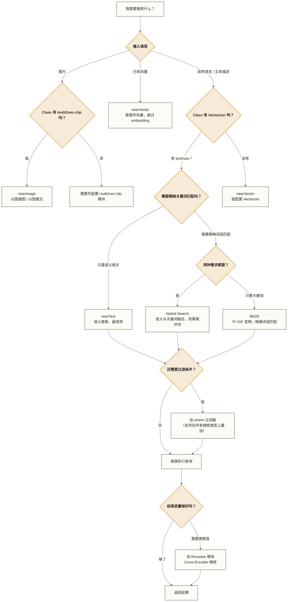

# Weaviate 查询与搜索详解

> [!abstract] 本文能给你什么
> - **掌握 Weaviate 全部搜索类型**：nearText、nearVector、nearImage、BM25、Hybrid，理解每种搜索的底层原理
> - **真正用好混合搜索**：理解 alpha 参数和 fusionType 的含义，知道为什么混合搜索通常优于单一方法
> - **精通 where 过滤器语法**：单条件、AND/OR 组合、地理位置过滤、跨引用过滤
> - **理解 Reranker 精排**：知道 ANN 粗排之后为什么还需要 Cross-Encoder 精排，以及怎么用
> - **掌握查询性能调优**：limit、ef、分页、Cursor API，避免生产环境常见的性能陷阱

这是 Weaviate 系列第 8 篇，也是生产使用频率最高的一篇。前面的文章帮你把数据存进去，这篇告诉你怎么把它高效地找出来。如果你只能精读系列里的一篇，就读这篇。

---

## 目录

- [[#查询架构全景：三种 API，各司其职]]
- [[#搜索类型选择决策树]]
- [[#nearText：语义搜索的核心]]
- [[#nearVector：精确向量搜索]]
- [[#nearImage：图像搜索]]
- [[#BM25：关键词搜索]]
- [[#混合搜索（Hybrid Search）]]
- [[#where 过滤器]]
- [[#结果排序与 Reranker 精排]]
- [[#Aggregate 聚合查询]]
- [[#多租户查询]]
- [[#查询性能优化]]
- [[#各搜索类型横向对比]]

---

## 查询架构全景：三种 API，各司其职

在写第一行查询代码之前，先理解 Weaviate 的查询接口分层。很多人上来就直接搜 API，结果碰到问题时不知道该往哪个方向排查。

### GraphQL API：主查询接口

Weaviate 的**主查询接口是 GraphQL**，覆盖三种查询类型：

| 查询类型 | GraphQL 操作 | 用途 |
|---------|------------|------|
| `Get` | `{ Get { ClassName { ... } } }` | 检索对象（最常用） |
| `Aggregate` | `{ Aggregate { ClassName { ... } } }` | 统计聚合（count、mean、max 等） |
| `Explore` | `{ Explore { ... } }` | 跨 Class 探索（v1.26 后逐渐被 Get 取代） |

> [!note] Python 客户端 v4 提供集合操作 API
> 实际开发中你几乎不需要手写 GraphQL 字符串。`weaviate-client v4` 提供集合操作 API，集合检索使用 gRPC；不能将全部客户端操作理解为自动构造 GraphQL 查询。本文所有示例均使用 Python v4 客户端。

### REST API：管理操作接口

REST API 主要用于**管理类操作**，不用于搜索：

- Schema 操作（创建/删除 Class、Property）
- 对象 CRUD（单个对象的增删改查）
- 集群状态、健康检查、备份

### gRPC API：高性能批量接口（v1.24+）

v4 客户端的 `batch` 操作默认走 gRPC，延迟更低，不需要手动配置。

---

## 搜索类型选择决策树

面对一个搜索需求，先问自己三个问题：



> [!tip] 混合搜索是生产默认选择
> 在不确定用哪种搜索时，可将**混合搜索（Hybrid）作为候选基线**。它融合语义搜索和关键词搜索，但是否优于 nearText 或 BM25，需要结合实际查询、数据、延迟与检索质量评估。

---

## nearText：语义搜索的核心

### 什么是 nearText

nearText 是 Weaviate 最具代表性的功能——**用自然语言描述你想找什么，Weaviate 理解你的意图并返回语义相关的结果**。

工作流程是：
1. 你传入查询文本（比如"量子计算最新进展"）
2. Weaviate 调用 Class 配置的 Vectorizer 模块，把这段文字变成向量
3. 在索引中做 ANN（近似最近邻）搜索，找到向量最相近的对象
4. 返回结果

**关键前提**：Class 必须配置了 Vectorizer 模块（`text2vec-openai`、`text2vec-cohere`、`text2vec-transformers` 等任意一种）。如果 Class 没有 Vectorizer，就只能用 nearVector 或 BM25。

> [!warning] 没有 Vectorizer 就没有 nearText
> 一个常见的踩坑：创建 Class 时忘记配置 `vectorizer`，或者设置了 `"vectorizer": "none"`，然后发现 nearText 不能用。这时候需要重建 Class 并重新导入数据。这个决策在 Schema 设计阶段就要确定，见 07-Schema设计与数据建模。

### 基本用法

```python
import weaviate
import weaviate.classes as wvc

client = weaviate.connect_to_local()  # 或 connect_to_weaviate_cloud(...)

# 基本 nearText 查询
articles = client.collections.get("Article")

response = articles.query.near_text(
    query="量子计算最新研究进展",
    limit=5,
    return_properties=["title", "content", "publishDate"],
    return_metadata=wvc.query.MetadataQuery(distance=True)
)

for obj in response.objects:
    print(obj.properties["title"])
    print(f"  向量距离: {obj.metadata.distance}")
```

### certainty 与 distance：相似度阈值控制

nearText 返回的是"最相似的 N 个结果"，但有时候你想过滤掉相关性太低的结果——这时候用阈值控制。

**两个参数，选其一：**

| 参数 | 含义 | 范围 | 越高/低越相似 |
|------|------|------|-------------|
| `certainty` | 相似度置信度（归一化） | 0.0 ~ 1.0 | 越**高**越相似（0.9 = 非常相似） |
| `distance` | 向量空间距离（余弦距离） | 0.0 ~ 2.0 | 越**小**越相似（0.1 = 非常相似） |

两者是同一回事的两种表达：`certainty = 1 - distance/2`（余弦距离下）。`certainty` 仅适用于余弦距离；使用其他距离度量时应使用对应的 `distance`，阈值需结合模型与数据评估。

```python
# 使用 certainty 阈值：只返回相似度 >= 0.75 的结果
response = articles.query.near_text(
    query="量子计算最新研究进展",
    certainty=0.75,          # 相似度阈值，低于这个的不返回
    limit=10,                # 最多返回 10 条
    return_metadata=wvc.query.MetadataQuery(certainty=True, distance=True)  # 返回分数
)

for obj in response.objects:
    print(f"{obj.properties['title']} | certainty={obj.metadata.certainty:.3f}")
```

> [!note] certainty 和 limit 的关系
> `certainty` 是下限过滤，`limit` 是数量上限。两者可以同时设置：先找最相似的 `limit` 个，再过滤掉 certainty 不足的。实际返回数量可能少于 `limit`。

### autocut：自动截断低质量结果

`autocut` 是一个更智能的截断策略。它不需要你手工设置阈值，而是自动检测结果列表中的"质量断层"，在断层处截断。

```python
# autocut=1 表示在第一个质量断层处截断
response = articles.query.near_text(
    query="量子计算",
    autocut=1,    # 自动找第一个质量断层
    limit=20      # 先检索 20 条，再自动截断
)
```

适合不确定阈值时的快速上线方案。

### moveTo 与 moveAwayFrom：概念引导

这是 nearText 的进阶功能，允许你**"推"和"拉"查询向量**——让搜索结果靠近某些概念，同时远离另一些概念。

```python
# 场景：搜索量子计算文章，但偏向应用层，远离纯理论
response = articles.query.near_text(
    query="量子计算",
    move_to=wvc.query.Move(
        concepts=["工程应用", "产业落地"],   # 拉向这些概念
        force=0.3                            # 力度 0.0~1.0，越大偏移越明显
    ),
    move_away_from=wvc.query.Move(
        concepts=["理论物理", "数学证明"],   # 推离这些概念
        force=0.25
    ),
    limit=5,
    return_properties=["title", "content"]
)
```

> [!tip] moveTo/moveAwayFrom 的实际效果
> 这个功能在探索性搜索场景很有用，比如"推荐系统"的个性化调整。但力度参数需要实验调整，不要设太大（> 0.5），否则会偏离原始查询太远。

### Named Vectors 场景：指定搜索目标向量

如果 Class 配置了 [[【技术与工具】/向量数据库/Weaviate/06B-Modules系统与本地部署|Named Vectors]]（同一对象存储了多个不同维度的向量），查询时需要用 `target_vector` 指定搜索哪个向量。

```python
# 场景：文章对象有两个向量——title 向量和 content 向量
# 我想用自然语言搜索标题向量（更快，用于标题匹配）
response = articles.query.near_text(
    query="量子计算应用",
    target_vector="title_vector",   # 指定搜索 title 对应的向量
    limit=10,
    return_properties=["title", "content"]
)

# 也可以同时对多个向量加权搜索（Weaviate v1.26+）
response = articles.query.near_text(
    query="量子计算应用",
    target_vector=wvc.query.TargetVectors.manual_weights(
        title_vector=0.7,    # title 向量权重 70%
        content_vector=0.3   # content 向量权重 30%
    ),
    limit=10,
    return_properties=["title", "content"]
)
```

---

## nearVector：精确向量搜索

### 什么时候用 nearVector

nearVector 和 nearText 的搜索逻辑完全一样——都是 ANN 相似度搜索——区别在于**你直接传向量，而不是让 Weaviate 帮你生成向量**。

适用场景：

1. **外部模型生成的查询向量**：你的应用已经用 OpenAI、Cohere 或本地模型生成了查询向量，不想让 Weaviate 重复调用
2. **多步推理**：第一步 RAG 检索得到的向量，传入第二步搜索
3. **Class 没有配置 Vectorizer**：数据写入时手动传向量，查询时也手动传向量
4. **精确控制 embedding 模型版本**：不依赖 Weaviate 内置的模块版本

```python
import openai
import weaviate
import weaviate.classes as wvc

# 前提：Article 的目标向量须与下述模型的输出具有兼容的模型、维度及向量空间；仅维度相同不够。
# 本例使用 certainty，要求目标向量索引采用余弦距离。
# 第一步：用外部模型生成查询向量
openai_client = openai.OpenAI()
query_text = "量子计算硬件最新突破"

embedding_response = openai_client.embeddings.create(
    input=query_text,
    model="text-embedding-3-small"
)
query_vector = embedding_response.data[0].embedding  # List[float]，长度 1536

# 第二步：用 nearVector 传入向量直接搜索
weaviate_client = weaviate.connect_to_local()
articles = weaviate_client.collections.get("Article")

response = articles.query.near_vector(
    near_vector=query_vector,   # 直接传向量
    certainty=0.7,
    limit=5,
    return_properties=["title", "content"],
    return_metadata=wvc.query.MetadataQuery(certainty=True)
)

for obj in response.objects:
    print(f"{obj.properties['title']} | certainty={obj.metadata.certainty:.3f}")
```

> [!note] nearVector 的 Named Vectors 支持
> 和 nearText 一样，nearVector 也支持 `target_vector` 参数，在多向量场景下指定搜索哪个命名向量。

---

## nearImage：图像搜索

### 前提：multi2vec-clip 模块

nearImage 要求 Class 配置了 `multi2vec-clip` 模块，这个模块使用 CLIP（Contrastive Language-Image Pretraining）模型，能把图片和文字映射到**同一个向量空间**——这是"以图搜文"和"以文搜图"的技术基础。

> [!info] 相关配置
> multi2vec-clip 的 Class Schema 配置方法参见 [[【技术与工具】/向量数据库/Weaviate/06B-Modules系统与本地部署]]。

### nearImage：传图片搜索相似内容

```python
import base64
import weaviate
import weaviate.classes as wvc

# 读取图片并转 base64
with open("cat_photo.jpg", "rb") as f:
    image_base64 = base64.b64encode(f.read()).decode("utf-8")

client = weaviate.connect_to_local()
images = client.collections.get("ProductImage")

# 以图搜图：找与这张图片语义最相似的产品图片
response = images.query.near_image(
    near_image=image_base64,   # base64 编码的图片
    limit=5,
    return_properties=["productName", "category", "imageUrl"],
    return_metadata=wvc.query.MetadataQuery(certainty=True)
)

for obj in response.objects:
    print(f"{obj.properties['productName']} | {obj.metadata.certainty:.3f}")
```

### 使用场景

| 场景 | 说明 |
|------|------|
| 以图搜图 | 上传商品图，找相似款式（电商场景） |
| 以图搜文 | 上传图片，找描述该图片内容的文章 |
| 以文搜图 | 用 nearText 搜索图片 Class（CLIP 使文字和图片在同一空间） |
| 多模态相似 | 混合图片+文字描述，构建跨模态推荐 |

---

## BM25：关键词搜索

### 为什么语义搜索之外还需要 BM25

很多人初学 Weaviate 时认为：有了向量语义搜索，BM25 是过时的东西。这是一个误解。

语义搜索和关键词搜索解决的是**不同的问题**：

- **语义搜索**解决"语义相关"：你搜"汽车"，能找到"轿车"、"越野车"的结果
- **BM25**解决"精确词语匹配"：你搜"Model Y 2024款"，必须精确匹配这个型号

以下场景 BM25 明显优于语义搜索：

- **专有名词**：产品型号（Model Y 2024）、人名（埃隆·马斯克）、股票代码（TSLA）
- **代码搜索**：`def forward(self, x)`——代码片段的语义向量通常不稳定
- **精确 ID 或编码**：订单号、文档编号、哈希值
- **用户明确知道关键词时**：不需要语义理解，直接匹配更快

### 配置前提：tokenization 设置

BM25 依赖分词，text 字段的 `tokenization` 设置决定了怎么切词。

| tokenization 值 | 适用语言 | 切词方式 |
|----------------|---------|---------|
| `word`（默认） | 英文 | 按空格和标点切词 |
| `lowercase` | 英文 | 切词后全部小写 |
| `whitespace` | 英文 | 只按空格切，不处理标点 |
| `field` | 任意 | 整个字段作为一个 token（精确匹配） |
| `gse` | **中文等语言** | 使用 GSE 分词；是中文检索可评估的选项，并非唯一选择 |
| `trigram` | 任意 | 三元字符分割，支持部分匹配 |

> [!warning] 中文 BM25 需要评估分词配置
> 中文通常没有空格词界，默认 `word` 的切词结果可能不符合业务需求。`gse` 是可评估的中文分词选项，并非唯一选择；应结合服务端支持、索引配置和实际查询比较分词效果。
>
> Schema 配置示例：
> ```python
> wvc.config.Property(
>     name="content",
>     data_type=wvc.config.DataType.TEXT,
>     tokenization=wvc.config.Tokenization.GSE   # 中文分词
> )
> ```

### BM25 查询

```python
articles = client.collections.get("Article")

# 基本 BM25 关键词搜索
response = articles.query.bm25(
    query="Weaviate 向量数据库 HNSW",
    limit=5,
    return_properties=["title", "content"],
    return_metadata=wvc.query.MetadataQuery(score=True)   # BM25 分数
)

for obj in response.objects:
    print(f"{obj.properties['title']} | BM25 score={obj.metadata.score:.4f}")
```

### properties 参数：指定搜索字段与加权

默认情况下 BM25 在所有 TEXT 字段上搜索。可以通过 `query_properties` 指定字段，并用 `^` 设置权重。

```python
# 在 title 和 content 上搜索，title 权重是 content 的 2 倍
response = articles.query.bm25(
    query="量子计算",
    query_properties=["title^2", "content"],  # title 权重 2，content 权重 1
    limit=10,
    return_properties=["title", "content"]
)
```

> [!tip] 字段权重的直觉
> 标题通常是文章最浓缩的语义表达，匹配标题的结果往往比匹配正文的结果更相关。`title^2` 这样的加权能有效提升结果质量，是 BM25 调优的常用手段。

---

## 混合搜索（Hybrid Search）

### 混合搜索 = nearText + BM25 的融合

混合搜索（Hybrid Search）是 Weaviate 在生产场景最推荐的搜索方式。它**同时运行语义搜索和 BM25 关键词搜索，然后用融合算法把两份结果合并排序**。

为什么混合搜索通常优于单一方法？

| 维度 | nearText 语义搜索 | BM25 关键词搜索 |
|------|-------------------|---------------|
| 优势 | 理解意图，语义泛化 | 精确词语匹配，可解释 |
| 劣势 | 专有名词容易"理解偏" | 只能匹配词语，不理解语义 |
| 适合 | 模糊查询、意图理解 | 精确名词、代码、型号 |

混合搜索在两者都有结果时取长补短，在一方失效时另一方兜底——可在 BEIR 或业务评测集上比较混合搜索与单一方法；本文未提供具体实验依据，不将混合搜索持续优于单一方法作为已证实结论。

### alpha 参数：控制混合比例

```python
articles = client.collections.get("Article")

# 混合搜索：alpha=0.5 均衡，alpha=0 纯 BM25，alpha=1 纯向量
response = articles.query.hybrid(
    query="Weaviate 向量搜索性能优化",
    alpha=0.5,                    # 0=纯BM25, 1=纯向量, 0.5=均衡
    limit=10,
    return_properties=["title", "content"],
    return_metadata=wvc.query.MetadataQuery(score=True, explain_score=True)
)

for obj in response.objects:
    print(f"{obj.properties['title']}")
    print(f"  hybrid score={obj.metadata.score:.4f}")
```

alpha 参数的直觉：

```ini
alpha = 0.0   → 纯 BM25，完全关键词匹配
alpha = 0.25  → 偏 BM25，关键词优先，语义辅助
alpha = 0.5   → 均衡（推荐默认值）
alpha = 0.75  → 偏语义，语义优先，关键词辅助
alpha = 1.0   → 纯向量语义搜索
```

> [!tip] alpha 的调优策略
> 从 `alpha=0.5` 开始，根据你的场景调整：
> - 数据以专有名词为主（技术文档、产品手册）→ 降低 alpha（偏 BM25）
> - 数据以自然语言为主（新闻、问答）→ 提高 alpha（偏语义）
> - 不确定时保持 0.5

### fusionType：融合算法

混合搜索有两种结果融合算法，通过 `fusion_type` 参数指定：

| fusionType | 算法名称 | 适用场景 |
|-----------|---------|---------|
| `rankedFusion` | Reciprocal Rank Fusion (RRF) | 基于排名融合，不依赖原始分数尺度 |
| `relativeScoreFusion` | 相对分数归一化融合 | 保留候选集内的相对分数差异，不提供跨查询通用的绝对相关性分数 |

默认融合算法存在版本边界；需要明确行为时显式设置 `fusion_type`。

```python
# 显式使用 relativeScoreFusion；分数阈值须在具体查询与候选集上评估
response = articles.query.hybrid(
    query="量子计算芯片",
    alpha=0.6,
    fusion_type=wvc.query.HybridFusion.RELATIVE_SCORE,   # 相对分数融合
    limit=10,
    return_properties=["title", "content"],
    return_metadata=wvc.query.MetadataQuery(score=True)
)
```

**RRF vs relativeScoreFusion 的选择**：

- **RRF**：基于排名合并，不依赖具体分数数值，对异常值鲁棒。当你只关心排序，不关心分数本身时，用 RRF。
- **relativeScoreFusion**：先把 BM25 分数和向量距离分别归一化到 [0,1]，然后加权求和。可以在具体查询及候选集上评估 `score > 0.7` 这样的阈值，但该分数是相对归一化融合结果，不是绝对相关性概率，不能直接作为跨查询通用阈值。

### 混合搜索 + 字段权重

混合搜索的 BM25 部分同样支持字段权重：

```python
response = articles.query.hybrid(
    query="向量数据库性能",
    alpha=0.5,
    query_properties=["title^3", "abstract^2", "content"],  # BM25 部分的字段权重
    limit=10,
    return_properties=["title", "abstract", "content"]
)
```

---

## where 过滤器

### 过滤器的作用

搜索类型（nearText、BM25、Hybrid）决定了**如何排序**，where 过滤器决定了**哪些对象有资格参与排序**。过滤器是前置条件，不是后置过滤——Weaviate 会先缩小候选范围，再做向量搜索。

> [!info] 过滤器下推（v1.26+ ACORN 算法）
> Weaviate v1.26 引入 ACORN 过滤算法，where 过滤在 ANN 向量搜索阶段就已下推执行，而不是先搜索再过滤。过滤器限定参与检索的对象范围；过滤策略对召回率、延迟及向量计算量的影响，取决于索引配置、数据分布和过滤选择性，不能据此保证准确率不下降。

### 基础过滤：单条件

```python
import weaviate
import weaviate.classes as wvc

articles = client.collections.get("Article")

# 单条件过滤：只搜索 2024 年之后的文章
from datetime import datetime, timezone

response = articles.query.near_text(
    query="量子计算",
    filters=wvc.query.Filter.by_property("publishDate").greater_than(
        datetime(2024, 1, 1, tzinfo=timezone.utc)
    ),
    limit=5,
    return_properties=["title", "publishDate"]
)

# 字符串精确匹配
response = articles.query.bm25(
    query="GPU 性能",
    filters=wvc.query.Filter.by_property("category").equal("硬件评测"),
    limit=10,
    return_properties=["title", "category"]
)

# 数值范围过滤
response = articles.query.hybrid(
    query="性价比显卡",
    filters=wvc.query.Filter.by_property("price").less_than(5000),
    limit=10,
    return_properties=["title", "price"]
)
```

### 支持的过滤操作符

| 操作符 | Python 方法 | 说明 |
|--------|-----------|------|
| `=` | `.equal(value)` | 精确匹配 |
| `!=` | `.not_equal(value)` | 不等于 |
| `<` | `.less_than(value)` | 小于 |
| `<=` | `.less_or_equal(value)` | 小于等于 |
| `>` | `.greater_than(value)` | 大于 |
| `>=` | `.greater_or_equal(value)` | 大于等于 |
| `LIKE` | `.like("pattern*")` | 通配符匹配（`*` 任意字符） |
| `IsNull` | `.is_none(True/False)` | 空值判断 |
| `ContainsAny` | `.contains_any([...])` | 数组字段包含任一值 |
| `ContainsAll` | `.contains_all([...])` | 数组字段包含所有值 |

```python
# LIKE 通配符匹配：标题以"量子"开头的文章
response = articles.query.near_text(
    query="前沿技术",
    filters=wvc.query.Filter.by_property("title").like("量子*"),
    limit=10
)

# 数组字段过滤：标签包含"AI"或"机器学习"
response = articles.query.bm25(
    query="神经网络",
    filters=wvc.query.Filter.by_property("tags").contains_any(["AI", "机器学习", "深度学习"]),
    limit=10
)

# IsNull：过滤掉没有摘要的文章
response = articles.query.near_text(
    query="大模型",
    filters=wvc.query.Filter.by_property("abstract").is_none(False),  # abstract 不为空
    limit=10
)
```

### AND/OR 多条件组合

```python
# AND 组合：类别是"技术"AND 发布时间晚于 2024-01-01 AND 浏览量大于 1000
combined_filter = wvc.query.Filter.all_of([
    wvc.query.Filter.by_property("category").equal("技术"),
    wvc.query.Filter.by_property("publishDate").greater_than(
        datetime(2024, 1, 1, tzinfo=timezone.utc)
    ),
    wvc.query.Filter.by_property("viewCount").greater_than(1000)
])

response = articles.query.near_text(
    query="AI 应用案例",
    filters=combined_filter,
    limit=10,
    return_properties=["title", "category", "publishDate", "viewCount"]
)

# OR 组合：类别是"技术"OR 类别是"科学"
or_filter = wvc.query.Filter.any_of([
    wvc.query.Filter.by_property("category").equal("技术"),
    wvc.query.Filter.by_property("category").equal("科学")
])

response = articles.query.hybrid(
    query="量子计算",
    filters=or_filter,
    alpha=0.5,
    limit=10
)

# 嵌套 AND/OR
complex_filter = wvc.query.Filter.all_of([
    wvc.query.Filter.any_of([   # (category=技术 OR category=科学)
        wvc.query.Filter.by_property("category").equal("技术"),
        wvc.query.Filter.by_property("category").equal("科学")
    ]),
    wvc.query.Filter.by_property("rating").greater_than(4.0)   # AND rating > 4.0
])
```

### 地理位置过滤：geoWithin

如果 Property 类型是 `GEO_COORDINATES`，可以做地理范围过滤：

```python
from weaviate.classes.query import GeoCoordinate

# 搜索北京天安门 5 公里范围内的餐厅
restaurants = client.collections.get("Restaurant")

response = restaurants.query.near_text(
    query="北京烤鸭",
    filters=wvc.query.Filter.by_property("location").within_geo_range(
        coordinate=GeoCoordinate(latitude=39.9042, longitude=116.4074),   # 天安门坐标
        distance=5000  # 5000 米 = 5 公里
    ),
    limit=10,
    return_properties=["name", "address", "rating", "location"]
)
```

### Cross-reference 过滤：按关联对象属性过滤

当对象之间有引用关系时（比如 Article 引用了 Author），可以通过关联对象的属性来过滤。

```python
# Schema 结构：Article.hasAuthor -> Author
# 过滤条件：只返回 Author.country = "中国" 的文章

response = articles.query.near_text(
    query="量子计算",
    filters=wvc.query.Filter.by_ref("hasAuthor").by_property("country").equal("中国"),
    limit=10,
    return_properties=["title", "content"]
)

# 多级跨引用过滤：Article -> Author -> Institution
# 只返回作者所在机构位于"北京"的文章
response = articles.query.near_text(
    query="AI 安全",
    filters=(
        wvc.query.Filter
        .by_ref("hasAuthor")
        .by_ref("worksAt")
        .by_property("city").equal("北京")
    ),
    limit=10
)
```

---

## 结果排序与 Reranker 精排

### sort 标量排序

向量搜索默认按向量距离排序。本文所示 Python v4 的 near_text 和 bm25 调用不接受 `sort` 参数；可先检索相关候选集，再在客户端按标量字段重排。纯对象读取的标量排序应使用支持排序的 fetch_objects 接口。

> [!warning] 客户端排序只改变已召回候选集的展示顺序
> 先检索再排序不等于对全部匹配对象做全局标量排序，结果受候选集大小限制。若同时考虑相关性与时间，应明确组合策略；相关性 Reranker 不会自动实现时间优先。

```python
# 前提：候选对象的 publishDate 为有效且格式一致的日期值，rating 为数值。
# 先召回相关候选，再按发布时间降序展示前 10 条。
response = articles.query.near_text(
    query="量子计算",
    limit=50,
    return_properties=["title", "publishDate", "viewCount"]
)
latest_results = sorted(
    response.objects,
    key=lambda obj: obj.properties["publishDate"],
    reverse=True
)[:10]

# 在 BM25 候选集内先按评分降序，评分相同再按发布时间降序。
response = articles.query.bm25(
    query="AI 应用",
    limit=50,
    return_properties=["title", "rating", "publishDate"]
)
ranked_results = sorted(
    response.objects,
    key=lambda obj: (obj.properties["rating"], obj.properties["publishDate"]),
    reverse=True
)[:10]
```

### Reranker 模块：ANN 粗排之后的精排

#### 为什么需要 Reranker

ANN 向量搜索是**粗排**：它用近似算法快速找到向量空间中的邻居，速度很快，但准确率有一定损失（ANN vs 精确 KNN）。

Reranker 使用 **Cross-Encoder 模型**做**精排**：Cross-Encoder 同时编码查询+候选文档，能更准确地判断相关性，但计算量大，只适合对少量结果重排（通常对前 20-100 条结果重排，返回前 5-10 条）。

两阶段搜索流程：

```text
第一阶段（粗排）：ANN 向量搜索，快速找到候选集（前 50 条）
           ↓
第二阶段（精排）：Reranker Cross-Encoder 对候选集重排，返回前 10 条
```

这个设计在工业界的 RAG 系统中广泛使用，是提升召回质量的标准手段。

#### Reranker 配置前提

Class Schema 需要配置 Reranker 模块，参见 [[【技术与工具】/向量数据库/Weaviate/06B-Modules系统与本地部署]]。目前支持：
- `rerank-cohere`：Cohere Rerank API
- `rerank-transformers`：本地部署的 Cross-Encoder 模型

#### Reranker 查询示例

```python
# nearText + Reranker：先向量粗排取 50 条，再精排返回 10 条
response = articles.query.near_text(
    query="量子计算芯片最新突破",
    limit=50,    # 粗排候选集大小
    return_properties=["title", "content"],
    return_metadata=wvc.query.MetadataQuery(score=True),
    rerank=wvc.query.Rerank(
        prop="content",       # 用哪个字段做重排（建议用内容最丰富的字段）
        query="量子计算芯片最新突破"   # 重排时的查询（通常和主查询一样）
    )
)

# 获取精排后的前 10 条
top_results = response.objects[:10]
for obj in top_results:
    print(f"{obj.properties['title']}")
    print(f"  rerank score: {obj.metadata.rerank_score:.4f}")

# Hybrid + Reranker 组合（待与单阶段方案比较的候选方案）
response = articles.query.hybrid(
    query="向量数据库性能调优",
    alpha=0.5,
    limit=50,
    return_properties=["title", "content"],
    rerank=wvc.query.Rerank(
        prop="content",
        query="向量数据库性能调优"
    )
)
```

> [!tip] Reranker 的实际收益
> 可比较"Hybrid（50条） + Reranker（返回10条）"与"Hybrid（返回10条）"的 NDCG@10。若将提升 5–15% 设为实验假设，需要用业务数据验证；本文未提供支持该收益范围的测量依据。精排是否改善 RAG context 和最终回答，也需分别评估。

---

## Aggregate 聚合查询

Aggregate 用于**数据统计分析**，不用于检索对象。典型用途：了解数据集的分布情况、监控数据量变化。

```python
articles = client.collections.get("Article")

# 统计对象总数
response = articles.aggregate.over_all(
    total_count=True
)
print(f"文章总数：{response.total_count}")

# 统计数值字段的聚合指标
response = articles.aggregate.over_all(
    return_metrics=[
        wvc.aggregate.Metrics("viewCount").integer(
            count=True,
            mean=True,
            maximum=True,
            minimum=True,
            sum_=True
        ),
        wvc.aggregate.Metrics("rating").number(
            mean=True,
            maximum=True,
            minimum=True
        )
    ]
)

view_stats = response.properties["viewCount"]
print(f"平均浏览量：{view_stats.mean:.1f}")
print(f"最高浏览量：{view_stats.maximum}")
print(f"总浏览量：{view_stats.sum_}")

rating_stats = response.properties["rating"]
print(f"平均评分：{rating_stats.mean:.2f}")

# 统计文本字段（只支持 count 和 top_occurrences）
response = articles.aggregate.over_all(
    return_metrics=[
        wvc.aggregate.Metrics("category").text(
            count=True,
            top_occurrences_count=True,
            top_occurrences_value=True
        )
    ]
)

category_stats = response.properties["category"]
print("各类别出现次数（Top 5）：")
for occurrence in category_stats.top_occurrences[:5]:
    print(f"  {occurrence.value}: {occurrence.count}")
```

### Aggregate + where 过滤

Aggregate 也支持 where 过滤，用于统计特定条件下的数据分布：

```python
# 统计 2024 年后的文章数量和平均评分
response = articles.aggregate.over_all(
    filters=wvc.query.Filter.by_property("publishDate").greater_than(
        datetime(2024, 1, 1, tzinfo=timezone.utc)
    ),
    total_count=True,
    return_metrics=[
        wvc.aggregate.Metrics("rating").number(mean=True)
    ]
)

print(f"2024年后文章数：{response.total_count}")
print(f"平均评分：{response.properties['rating'].mean:.2f}")
```

---

## 多租户查询

如果你的 Class 开启了多租户（`multiTenancyConfig.enabled: true`），**每次查询都必须指定 Tenant**。忘记指定会报错。

> [!info] 多租户架构详解
> 多租户的开启方式和 Tenant 生命周期管理参见 [[【技术与工具】/向量数据库/Weaviate/07B-多租户与数据隔离]]。本节只关注查询语法。

```python
articles = client.collections.get("Article")  # 多租户 Class

# 必须通过 .with_tenant() 指定租户
tenant_articles = articles.with_tenant("tenant_user_001")

# 之后所有查询都在这个 Tenant 范围内执行
response = tenant_articles.query.near_text(
    query="量子计算",
    limit=5,
    return_properties=["title", "content"]
)

# BM25 同样需要指定 Tenant
response = tenant_articles.query.bm25(
    query="Weaviate 向量数据库",
    limit=10
)

# Aggregate 也需要指定 Tenant
response = tenant_articles.aggregate.over_all(total_count=True)
print(f"租户 tenant_user_001 的文章数：{response.total_count}")
```

### 多租户查询的关键注意点

1. **每次操作都要 `.with_tenant()`**：没有"默认 Tenant"，必须显式指定
2. **INACTIVE Tenant 不能查询**：处于非活跃状态的 Tenant 在查询前要先激活（`tenant.activate()`）
3. **跨 Tenant 查询不支持**：不能在一次查询中同时搜索多个 Tenant 的数据
4. **Tenant 名称区分大小写**：`tenant_001` 和 `Tenant_001` 是不同的 Tenant

---

## 查询性能优化

### limit 设置原则

向量搜索的时间复杂度与 `limit` 正相关。不要设置不必要的大 limit：

```python
# 不推荐：limit 过大
response = articles.query.near_text(query="AI", limit=10000)  # 很慢！

# 推荐：按实际需求设置
response = articles.query.near_text(query="AI", limit=20)     # 合理
```

生产环境建议：
- 展示场景：`limit=10~20`
- RAG 检索候选集：`limit=20~50`
- 后接 Reranker：`limit=50~100`（精排能处理）

### ef 参数：索引配置中的搜索广度

HNSW 索引有一个 `ef` 参数控制查询时的搜索广度（候选节点数量）。`ef` 越大，召回率越高，但延迟也越高。

`ef` 及动态 ef 相关参数属于 HNSW 索引配置；本文所示 near_text 接口不能通过 additional_arguments 在单次查询中覆盖 ef。应结合服务端版本、索引配置及实际召回率和延迟进行调优。

```python
# 查询使用集合的 HNSW 索引配置，不在此处传入逐查询 ef。
response = articles.query.near_text(
    query="量子纠错算法",
    limit=10,
    return_properties=["title"]
)
```

> [!note] ef 与 limit 的关系
> 搜索广度应结合 limit、动态 ef 配置、数据分布及召回率目标评估。`max(limit * 4, 64)` 可作为待测试的经验假设，而非通用配置要求或召回率保证。

### 分页：offset + limit（有限制）

普通分页用 `offset + limit`：

```python
# 第 1 页（第 1-10 条）
page1 = articles.query.near_text(query="AI", limit=10, offset=0)

# 第 2 页（第 11-20 条）
page2 = articles.query.near_text(query="AI", limit=10, offset=10)

# 第 3 页（第 21-30 条）
page3 = articles.query.near_text(query="AI", limit=10, offset=20)
```

> [!warning] 向量搜索的分页有硬限制
> `offset + limit` 的总和不能超过 `QUERY_MAXIMUM_RESULTS`（默认 10000）。超过这个限制会报错。
>
> 向量搜索天然不适合深分页——语义相关度排序在第 1000 页之后已经没有意义了。如果你需要大批量导出数据，用 Cursor API 而不是深分页。

### Cursor API：大批量数据导出

当你需要遍历整个 Class 的所有数据（比如数据迁移、批量处理），用 Cursor API：

```python
# Cursor API 批量导出所有文章
# 每次拿 100 条，直到取完

all_articles = []
cursor = None

while True:
    # 第一次调用不传 cursor，之后传上一次的 after cursor
    response = articles.query.fetch_objects(
        limit=100,
        after=cursor,   # 翻页游标
        return_properties=["title", "content", "publishDate"]
    )

    if not response.objects:
        break   # 没有更多数据了

    all_articles.extend(response.objects)
    cursor = response.objects[-1].uuid   # 用最后一个对象的 UUID 作为游标

    print(f"已获取 {len(all_articles)} 条...")

print(f"共导出 {len(all_articles)} 篇文章")
```

> [!note] Cursor API vs 分页的区别
> - **分页（offset）**：适合小规模、需要跳页的场景（用户翻页、随机访问）
> - **Cursor API**：适合大规模、顺序遍历的场景（数据导出、批处理）
>
> Cursor API 没有数量上限，而且随着数据量增大，性能比深分页好得多。

### 过滤器的性能考量

在大数据量下，过滤器的选择性直接影响性能：

- **高选择性过滤**（过滤后剩 1% 的数据）：需测量候选规模、召回率与延迟，不能仅按剩余比例保证性能
- **低选择性过滤**（过滤后剩 99% 的数据）：候选范围变化较小，但仍需比较过滤开销
- **中等选择性过滤**（过滤后剩 20-50% 的数据）：可比较服务端支持的过滤策略；使用 ACORN 还需确认索引配置，并非满足版本条件就必然启用

```python
# 高选择性过滤与向量搜索组合示例。
# 实际过滤策略由服务端版本与索引配置决定，应测量召回率和延迟。
response = articles.query.near_text(
    query="AI 芯片",
    filters=wvc.query.Filter.by_property("category").equal("芯片评测"),  # 高选择性
    limit=10
)
```

---

## 各搜索类型横向对比

| 搜索类型 | 适用场景 | 前提条件 | 性能特点 | 推荐 alpha/参数 |
|---------|---------|---------|---------|----------------|
| **nearText** | 自然语言语义搜索 | 需要 Vectorizer 模块 | 中（需实时 embedding） | certainty=0.7~0.8 |
| **nearVector** | 已有预计算向量，精确控制 embedding | 任意（有无 Vectorizer 均可） | 快（无 embedding 步骤） | 自行控制向量质量 |
| **nearImage** | 以图搜图、以图搜文 | 需要 multi2vec-clip | 中（CLIP 模型推理） | certainty 视场景而定 |
| **BM25** | 精确关键词、专有名词、代码 | 字段设置合适的 tokenization | 快（倒排索引） | query_properties 加权 |
| **Hybrid** | 通用搜索（生产首选） | 需要 Vectorizer + BM25 tokenization | 中（两者并行后融合） | alpha=0.5（可调） |
| **Hybrid + Reranker** | 高精度要求、RAG 场景 | Vectorizer + BM25 + Reranker 模块 | 较慢（Cross-Encoder 精排） | limit=50 粗排，精排取 10 |

---

## 常见问题与陷阱

> [!faq] nearText 返回结果数量少于 limit
> 可能原因：1）设置了 `certainty` 阈值，部分结果被过滤掉；2）Class 中本身数据量不足；3）`autocut` 自动截断。检查是否设置了相似度阈值。

> [!faq] BM25 在中文场景效果很差
> 检查相关 Property 的分词结果及 `tokenization` 配置。默认 `word` 可能不符合中文词界需求，可评估 `gse` 等服务端支持的方案；调整已有属性的分词配置时，应确认版本限制及是否需要重建属性或集合并重新导入数据。

> [!faq] 混合搜索的 score 为什么不在 0-1 之间？
> 先确认实际使用的融合算法，默认值取决于服务端版本。RRF 分数基于排名计算；relativeScoreFusion 使用候选集内的相对归一化分数，也不是绝对相关性概率，不能直接套用跨查询通用阈值。

> [!faq] 多租户查询报错 "tenant not found"
> 检查两点：1）Tenant 是否存在（拼写是否正确，区分大小写）；2）Tenant 是否处于 ACTIVE 状态，INACTIVE 和 OFFLOADED 状态下需要先激活。

> [!faq] 向量搜索 + sort 排序结果不对
> 本文所示 near_text 调用不支持传入 sort。若需要“相关 AND 最新”，可先取相关候选，再在客户端按时间重排；这只排序已召回候选，不是全局排序。Reranker 的相关性评分也不等同于时间排序。

---

## 小结

回顾本文的核心知识点：

1. **查询架构**：GraphQL 提供 Get/Aggregate/Explore 操作；Python v4 集合检索使用 gRPC，REST 主要用于管理操作，不能把客户端操作统一理解为 GraphQL 查询
2. **nearText**：语义搜索的核心，需要 Vectorizer 模块；`certainty` 控制相似度阈值；`moveTo/moveAwayFrom` 做概念引导
3. **nearVector**：你提供向量，跳过 embedding 步骤；适合外部模型或多步推理场景
4. **BM25**：解决关键词匹配，中文需评估适合的 tokenization，`gse` 是可选方案之一；`query_properties` 支持字段加权
5. **Hybrid Search**：生产首选，`alpha=0.5` 均衡语义和关键词；`rankedFusion` vs `relativeScoreFusion` 按需选择
6. **where 过滤器**：`Filter.all_of/any_of` 组合条件；支持地理过滤和跨引用过滤；ACORN 的使用取决于服务端版本与索引配置，效率需实测
7. **Reranker**：两阶段方案，ANN 粗排（50条）+ Cross-Encoder 精排（取10条），RAG 场景的标准配置
8. **性能优化**：`limit` 按需设置；深分页受查询结果上限限制，顺序导出可用 Cursor API；HNSW 搜索广度通过索引配置调优

**推荐的生产查询方案**：

```text
Hybrid（alpha=0.5）+ where 过滤 + Reranker（可选）
```

这个组合可作为 RAG 和语义搜索的候选方案；是否优于单一检索方法，需要比较业务数据上的检索质量、回答质量、延迟与成本。

---

## 下一步

- 09-生产运维与性能调优 — 深入 HNSW 参数调优、资源配置、监控告警，让查询在生产环境稳定运行
- 10-RAG集成实战 — 把本文的查询技巧应用到完整的 RAG 系统，从检索到生成端到端实战
- [[【技术与工具】/向量数据库/Weaviate/06B-Modules系统与本地部署]] — 回顾 Reranker 模块和 Named Vectors 的配置细节
- 07-Schema设计与数据建模 — 如果你在查询时发现 BM25 不生效，大概率是 Schema 设计时 tokenization 没配好

#Weaviate #向量数据库 #语义搜索 #混合搜索 #RAG #查询优化 #BM25 #nearText #GraphQL
